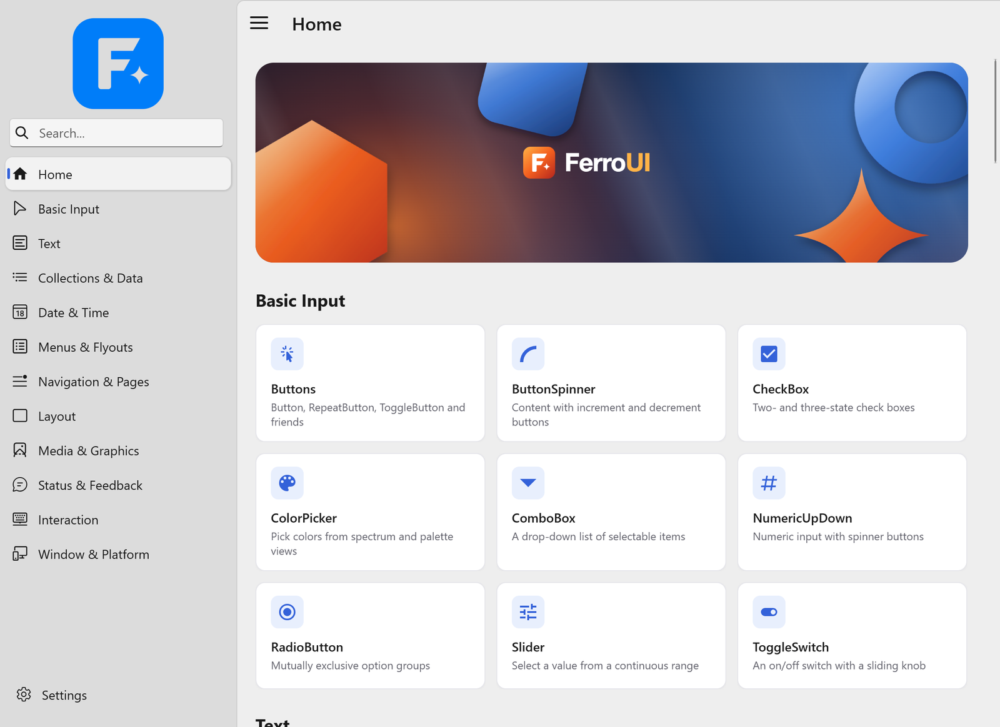
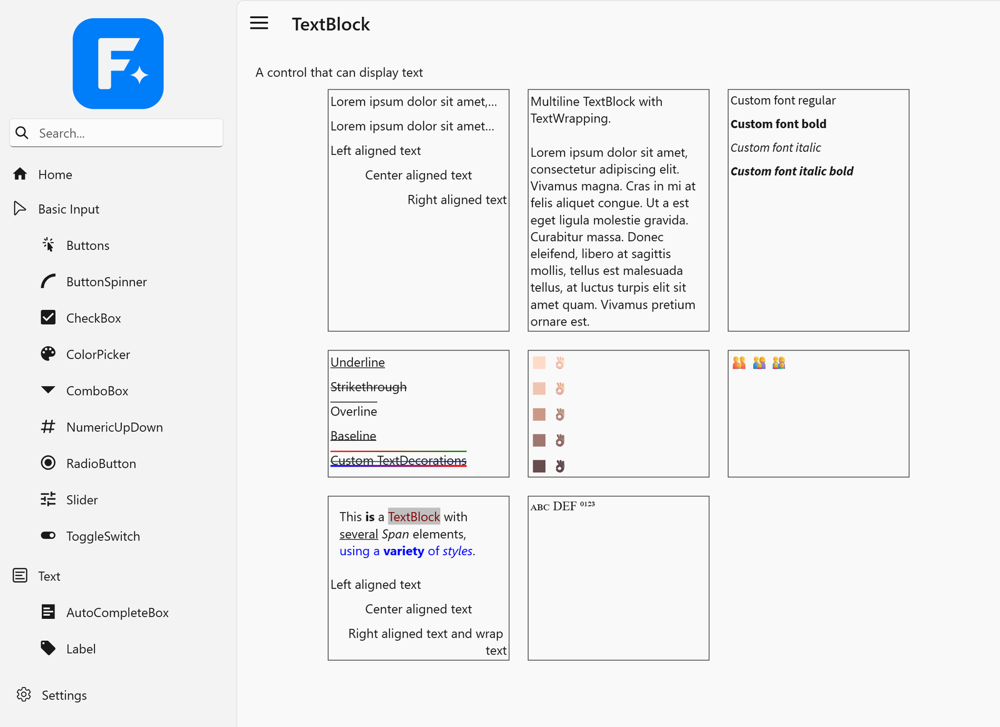
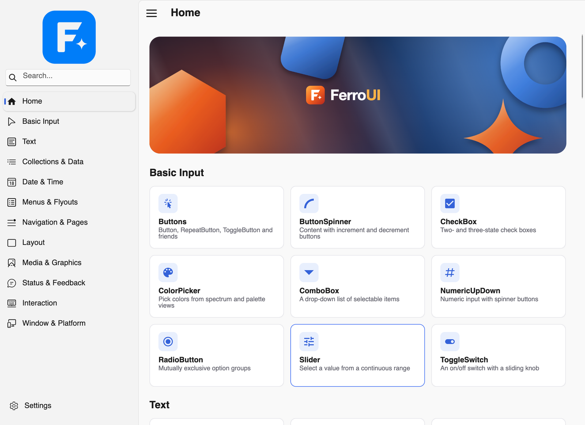
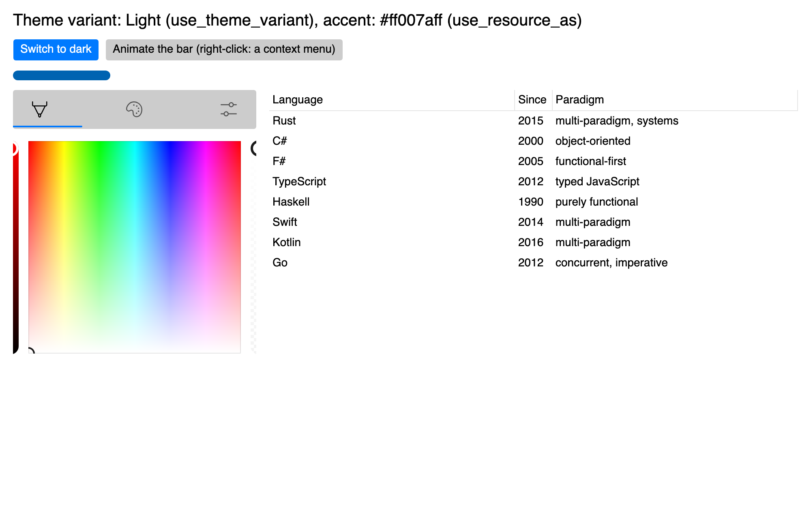
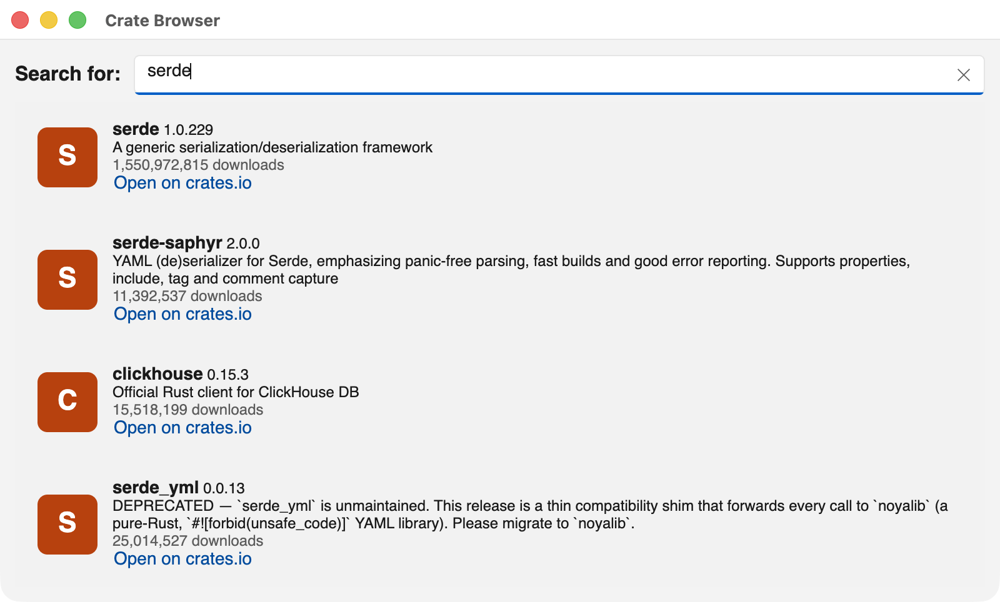
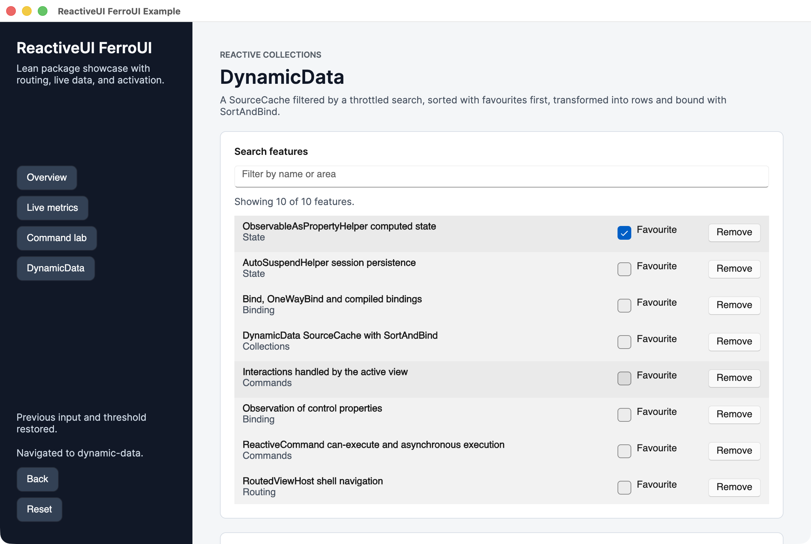
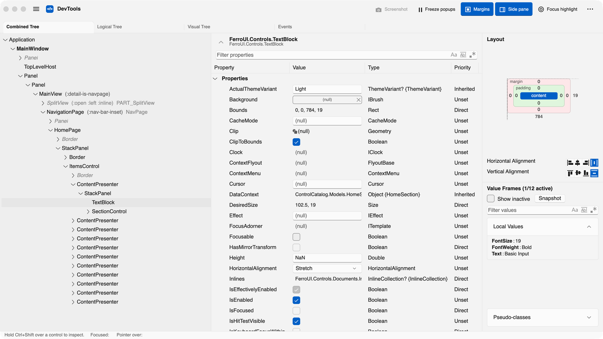

# FerroUI

[](https://github.com/wieslawsoltes/FerroUI/actions/workflows/ci.yml)
[](LICENSE)
[](https://t.me/+yQ69t8M7xgwyOGZk)

FerroUI is a cross-platform UI framework for Rust: a retained-mode control library with a styled property system, data binding, XAML markup, control themes and a composition-based renderer. It is a port of the Avalonia UI framework to Rust that keeps the original architecture, contracts and behaviour, so that applications, themes and markup written against that model carry over with their structure intact.

> **Status: 0.4.0.** `0.4.0` is the current release on crates.io. It adds a declarative Rust API for user interfaces without XAML: builders, the `rsx!` macro, signals, components with hooks and a reconciler, asynchronous data, error boundaries and a router ([docs/declarative-ui.md](docs/declarative-ui.md)). It also adds the [developer tools](#developer-tools) and makes the Vello backend faster ([CHANGELOG.md](CHANGELOG.md)). Every upstream file and member in scope is ported or waived with a recorded reason. The framework runs on macOS, Windows, Linux (X11, Wayland and the framebuffer), iOS, Android and in the browser. It was verified in continuous integration, in virtual machines, in the iOS simulator and on the Android emulator, not on a range of real devices. Within 0.4 the public API is kept; 0.5.0 may change it. See [Project status](#project-status).



The ControlCatalog sample with the WinUI 3 theme (`ferroui-themes-winui`), its default theme, on Windows 11 with the Mica backdrop. Text is shaped with HarfBuzz and drawn by Skia with the platform's text rendering settings: the contrast and gamma of ClearType on Windows, greyscale antialiasing on a high-density display, and colour emoji (`docs/porting/text-rendering.md`).

| Text on Windows | The same catalog on macOS |
|---|---|
|  |  |

## Highlights

- **Complete object model.** Styled and direct properties with value priorities, inheritance, coercion and change notification; logical and visual trees; routed events; layout; input, focus and gestures.
- **Styling and theming.** Selectors, styles, control themes, resources, theme variants and transitions. The Fluent, Simple and WinUI 3 themes are included.
- **Data binding.** Compiled and reflection-style binding paths, converters, multi-bindings, data validation and templates.
- **XAML.** A port of the XamlX compiler front end with the framework's transformers and markup extensions. Documents are compiled to Rust source by the build script of a crate, or loaded at run time.
- **Composition renderer.** A compositor with a render loop on its own thread, dirty-region tracking, server-side visuals and composition animations, drawing through a backend-neutral drawing context.
- **Swappable backends.** Rendering and windowing sit behind contracts. Skia renders through Graphite on Metal, Ganesh on OpenGL, ANGLE, WebGL and Vulkan, or in software; an experimental Vello backend sits behind the same contracts; HarfBuzz shapes text.
- **Declarative Rust UI.** `ferroui-view` writes user interfaces in Rust without XAML: builders generated for every control, an `rsx!` macro, fine-grained signals, and React-style components with hooks and a reconciler, with hot reload, an inspector and interoperation with XAML ([below](#declarative-rust-ui)).
- **Developer tools.** F12 opens the [developer tools](#developer-tools) on a running application: its trees, the properties of a control and where their values come from, its layout and styles, and the routed events.
- **Safe Rust.** The controls, markup, XAML and theme crates contain no `unsafe` code. It is confined to a small part of the object model core and to the rendering, text shaping, platform and interop backends.

## Project status

The state per subsystem is tracked in [docs/porting/CRITICAL-PATH.md](docs/porting/CRITICAL-PATH.md), the state per upstream member in [docs/porting/TRACKING.md](docs/porting/TRACKING.md), the upstream test suites per project in [docs/porting/TESTS.md](docs/porting/TESTS.md), and what is not ported in [docs/porting/REMAINING.md](docs/porting/REMAINING.md). The checks that still need real hardware or a person at the screen are listed in [docs/porting/manual-verification.md](docs/porting/manual-verification.md). Of the upstream projects in scope, every member has a counterpart or is waived with a reason (30354 present, 5856 waived, none missing); of every upstream project, in scope or not, the port has 81 percent of the members.

### Framework

| Area | State |
|---|---|
| Property system, trees, layout, input, styling, resources | Ported, with the upstream test suites |
| Data binding, animation, transitions | Ported |
| Media, text layout, fonts | Ported |
| Compositor and render loop | Ported, including composition animations, custom visuals and the import of external GPU objects; the render loop runs on its own thread on the desktop |
| Controls | The control set, including items controls, text input, menus, pickers, calendar, pages, the colour picker, the managed dialogs and automation peers |
| XAML | The run-time loader with the upstream test suites, and compilation of markup to Rust source in build scripts (used by the themes, the dialogs and the ControlCatalog sample); hot reload and parts of the build integration are open |
| Themes | Fluent, Simple and WinUI 3, for every control (WinUI 3: [progress](docs/porting/winui-theme/PROGRESS.md), [deviations](docs/porting/winui-theme/DEVIATIONS.md), [comparison with native WinUI 3](docs/porting/winui-theme-gallery.md)) |
| Skia and HarfBuzz backends | Ported; Skia is the default and reference renderer |
| Developer tools | Ported from upstream's last open-source version (`ferroui-diagnostics`), with the TreeDataGrid as the property grid |
| Vello backend | Experimental: CPU, hybrid and GPU modes, measured against Skia; open work in [vello-backend.md](docs/porting/vello-backend.md), section 13 |

### Platforms

| Platform | What works | Verified |
|---|---|---|
| macOS | Windows, input, input methods, clipboard, drag and drop, menus, tray icon, storage pickers, native control host, accessibility; Metal (default), OpenGL (with Skia built with `--cfg ferro_skia_apple_ganesh`) and software rendering | CI and the development machine; the storage pickers and a screen reader not exercised |
| Windows | Windows, input, input methods and the input pane, clipboard and drag and drop over OLE, file dialogs, tray icon, native control host, extended client area, UI Automation; rendering in software, through ANGLE, WGL, DirectComposition, Windows.UI.Composition (with blur, acrylic and Mica) and a DXGI swap chain; Vulkan behind the feature `vulkan` | CI (x64 and ARM64) and a Windows 11 ARM64 virtual machine; screen readers and the look of acrylic and Mica on a real desktop not verified |
| WinUI 3 hosting (`ferroui-winui`) | The content in a swap chain panel of a WinUI 3 window, with input, text input, cursors, drag and drop and automation | The smoke run of its sample (rendering, the automation tree, closing) in a virtual machine; input, drag and drop and a UI Automation client not verified |
| Linux, X11 | Windows, input, input methods (XIM, IBus, Fcitx), clipboard, drag and drop, desktop portals, GTK file dialogs, menus and tray icon over D-Bus, session management, native control host, accessibility over AT-SPI; rendering in software, through GLX, EGL and Vulkan | CI under Xvfb and an Ubuntu virtual machine; no screen reader |
| Linux, Wayland | Opt-in, as upstream (platform detection chooses X11): toplevels with server-side or drawn decorations, popups, pointer, keyboard, touch and text input, clipboard and drag and drop, fractional scaling; rendering through shared memory, EGL or a dmabuf swap chain | CI under headless sway and a virtual machine (sway, headless Mutter); a desktop compositor with input and the dmabuf swap chain on a GPU not verified |
| Linux framebuffer | One full-screen view on `/dev/fb0` (software) or on a KMS output (OpenGL through EGL on GBM), with input through `libinput` or the event devices | Virtual devices only (`vkms`, `uinput`) in CI and a virtual machine; not on a board |
| iOS | A view over Metal or OpenGL ES, touch, keyboard and text input, clipboard, storage, native control host, accessibility | The simulator; no signed device build, no VoiceOver |
| Android | A view over EGL, software or Vulkan (feature `vulkan`), touch, keyboard and the input method, lifecycle, clipboard, storage, native control host, accessibility; builds with stable Rust | The emulator (API 36); no device, no TalkBack |
| Browser (WebAssembly) | A view in a web page, rendered with WebGL 2 or a 2D canvas, input, clipboard, storage, native control host; an opt-in build renders from a worker thread | Headless Chrome in CI; other browsers not verified |
| Headless | Windows without a screen for tests, and a VNC server (`ferroui-headless-vnc`) to see and drive an application remotely | Tests; the VNC server with a test client, not with real viewers |

## Requirements

- Rust 1.89 or later (the browser needs 1.93 or later).
- Python 3 for the maintenance scripts (not needed to build).
- The first build downloads a prebuilt Skia for the target, or builds it from source where no prebuilt binary matches (Vulkan on Windows), and builds HarfBuzz from source with a C++ compiler; it can take a while.

Per platform:

| Platform | Needs | Details |
|---|---|---|
| macOS | macOS 11 or later and the Xcode command line tools (the platform compiles an Objective-C++ library) | [apple-opengl.md](docs/porting/apple-opengl.md) for the OpenGL configuration |
| Windows | x64 or ARM64, the MSVC build tools; `libclang` for ANGLE (the default feature `angle`); the feature `vulkan` builds Skia from source. Hosting in WinUI 3 needs the Windows App SDK 1.6 runtime and its bootstrap library beside the executable | [win32-platform.md](docs/porting/win32-platform.md), [winui.md](docs/porting/winui.md) |
| Linux | The development packages of fontconfig and FreeType; the system libraries (Xlib, GTK, GLib, EGL, Vulkan, `libwayland-client`, `libxkbcommon`, `libinput`, `libdrm`, `libgbm`) are opened at run time, none is linked | [x11-platform.md](docs/porting/x11-platform.md), [wayland-platform.md](docs/porting/wayland-platform.md), [linux-framebuffer-platform.md](docs/porting/linux-framebuffer-platform.md) |
| iOS | Xcode with the iOS SDK and the targets `aarch64-apple-ios` and `aarch64-apple-ios-sim`; an application is bundled without an Xcode project (`scripts/ios/bundle.sh`) | [ios-platform.md](docs/porting/ios-platform.md) |
| Android | The Android SDK and NDK, stable Rust with the target `aarch64-linux-android`, API level 26 or later; packaged without Gradle (`scripts/android/apk.sh`) | [android-platform.md](docs/porting/android-platform.md) |
| Browser | The target `wasm32-unknown-emscripten`, Emscripten and the pinned `wasm-bindgen` command-line tool (`scripts/browser/setup.sh` installs them); the opt-in build with threads also needs the pinned nightly toolchain | [browser-platform.md](docs/porting/browser-platform.md) |

## Installation

FerroUI is a set of crates that are released together at one version. A desktop application names the base library, the controls, the desktop entry point and a theme:

```toml
[dependencies]
ferroui-base = "=0.4.0"
ferroui-controls = "=0.4.0"
ferroui-desktop = "=0.4.0"
ferroui-themes-fluent = "=0.4.0"
```

The WinUI 3 theme is the crate `ferroui-themes-winui` (`WinUITheme`), used in place of `ferroui-themes-fluent` or beside it; the facade crate has it as the feature `winui-theme`.

An application can also name one dependency instead: the facade crate `ferroui`. It re-exports the common crates under short names (`ferroui::base`, `ferroui::controls`, ...) with a prelude of the types of a minimal application; its default features are the desktop platforms and the Fluent theme, and further features add the Simple theme, XAML loading at run time, the colour picker, Charts, the TreeDataGrid, the dialogs, the browser platform, the WinUI 3 theme, the Vello backend, the headless platform and the graphics contracts ([docs/release.md](docs/release.md), section 2.1). In the repository it is used already: `cargo run -p ferroui --example hello`.

The libraries for MVVM applications (Rx, DynamicData, ReactiveUI and their integration with the controls) are crates of the release as well: `ferroui-reactiveui-controls = "=0.4.0"` beside the crates above, or the facade crate with its feature `reactiveui` ([docs/mvvm.md](docs/mvvm.md)).

The declarative API (`ferroui-view` with `ferroui-view-macros`, [docs/declarative-ui.md](docs/declarative-ui.md)) and the developer tools (`ferroui-diagnostics`) are crates of the release too: `ferroui-view = "=0.4.0"` and `ferroui-diagnostics = "=0.4.0"` beside the crates above (the facade has the developer tools as its feature `diagnostics`).

The crates of a release depend on one another at exactly its version, so name the same version for every FerroUI crate, as above. `0.1.0` followed four previews (`0.1.0-preview.1` to `0.1.0-preview.4`), pre-releases in the sense of semantic versioning, which Cargo selects only when they are named, `0.2.0`, `0.3.0` and `0.4.0` are the next minor versions, and `0.3.0` and `0.4.0` each followed one preview (`0.3.0-preview.1`, `0.4.0-preview.1`). The work towards the next one is published as previews of it (`0.5.0-preview.1` will be the first), which may change any part of the public API. The release process is described in [docs/release.md](docs/release.md) and the changes of each release in [CHANGELOG.md](CHANGELOG.md).

The platforms that are not part of platform detection are named by their own crates beside the others: `ferroui-wayland`, `ferroui-linuxframebuffer`, `ferroui-ios`, `ferroui-android`, `ferroui-browser`, `ferroui-winui` and `ferroui-headless-vnc`.

Markup is loaded at run time with `ferroui-markup-xaml-loader` (the feature `xaml` of the facade), or compiled by the build script of the application with `ferroui-build` (a build dependency) against `ferroui-markup-xaml`. The code the markup compiler writes names the crates it calls by their own names, so an application that compiles its markup depends on those crates directly, beside or instead of the facade.

### Crates

<!-- crates-table:begin (generated by scripts/release/readme-crates-table.sh; do not edit) -->

**Core**

| Crate | Description | Version | Downloads | Documentation |
|---|---|---|---|---|
| [`ferroui-system`](https://crates.io/crates/ferroui-system) | The parts of the .NET base class library that FerroUI and its reusable libraries share: thread-local variables for every target, events, property and collection change notification, cancellation | [](https://crates.io/crates/ferroui-system) | [](https://crates.io/crates/ferroui-system) | [](https://docs.rs/ferroui-system) |
| [`ferroui-base`](https://crates.io/crates/ferroui-base) | The base library of FerroUI: the property system, layout, input, styling, media, text, animation, data binding and the compositor | [](https://crates.io/crates/ferroui-base) | [](https://crates.io/crates/ferroui-base) | [](https://docs.rs/ferroui-base) |
| [`ferroui-reactive`](https://crates.io/crates/ferroui-reactive) | A port of Rx.NET (System.Reactive) for FerroUI: observable sequences, their operators, schedulers, disposables and subjects, independent of the user interface | [](https://crates.io/crates/ferroui-reactive) | [](https://crates.io/crates/ferroui-reactive) | [](https://docs.rs/ferroui-reactive) |
| [`ferroui-dynamic-data`](https://crates.io/crates/ferroui-dynamic-data) | A port of DynamicData for FerroUI: reactive collections, change sets, observable caches and lists with their operators, independent of the user interface | [](https://crates.io/crates/ferroui-dynamic-data) | [](https://crates.io/crates/ferroui-dynamic-data) | [](https://docs.rs/ferroui-dynamic-data) |
| [`ferroui-reactive-testing`](https://crates.io/crates/ferroui-reactive-testing) | A port of Microsoft.Reactive.Testing for ferroui-reactive: the virtual-time test scheduler, recorded notifications, hot and cold test observables and their assertions | [](https://crates.io/crates/ferroui-reactive-testing) | [](https://crates.io/crates/ferroui-reactive-testing) | [](https://docs.rs/ferroui-reactive-testing) |
| [`ferroui-splat`](https://crates.io/crates/ferroui-splat) | A port of Splat for FerroUI: the service locator with its dependency resolvers, logging, mode detection, feature usage tracking and the application builder, independent of the user interface | [](https://crates.io/crates/ferroui-splat) | [](https://crates.io/crates/ferroui-splat) | [](https://docs.rs/ferroui-splat) |
| [`ferroui-dependency-injection`](https://crates.io/crates/ferroui-dependency-injection) | Microsoft.Extensions.DependencyInjection for Rust: thread-local services, scopes, keyed resolution and constructor factories, independent of the user interface | [](https://crates.io/crates/ferroui-dependency-injection) | [](https://crates.io/crates/ferroui-dependency-injection) | [](https://docs.rs/ferroui-dependency-injection) |
| [`ferroui-reactiveui`](https://crates.io/crates/ferroui-reactiveui) | A port of ReactiveUI for FerroUI, in its System.Reactive flavour with the run time of ReactiveUI.Binding: reactive objects, commands, property observation, bindings, view location, activation and routing for MVVM, independent of the user interface | [](https://crates.io/crates/ferroui-reactiveui) | [](https://crates.io/crates/ferroui-reactiveui) | [](https://docs.rs/ferroui-reactiveui) |
| [`ferroui-reactiveui-testing`](https://crates.io/crates/ferroui-reactiveui-testing) | A port of ReactiveUI.Testing for ferroui-reactiveui: running code with test schedulers, the builders of test data and the helpers of tests of view models | [](https://crates.io/crates/ferroui-reactiveui-testing) | [](https://crates.io/crates/ferroui-reactiveui-testing) | [](https://docs.rs/ferroui-reactiveui-testing) |
| [`ferroui`](https://crates.io/crates/ferroui) | FerroUI in one dependency: the facade crate that re-exports the common crates under short names, with a prelude and features that choose the platform, the theme and the backends | [](https://crates.io/crates/ferroui) | [](https://crates.io/crates/ferroui) | [](https://docs.rs/ferroui) |

**Controls and themes**

| Crate | Description | Version | Downloads | Documentation |
|---|---|---|---|---|
| [`ferroui-static-view-locator-macros`](https://crates.io/crates/ferroui-static-view-locator-macros) | The attributes #[static_view_locator] and #[static_view_mapping] of ferroui-static-view-locator | [](https://crates.io/crates/ferroui-static-view-locator-macros) | [](https://crates.io/crates/ferroui-static-view-locator-macros) | [](https://docs.rs/ferroui-static-view-locator-macros) |
| [`ferroui-controls`](https://crates.io/crates/ferroui-controls) | The controls of FerroUI: the application model, top levels, the control set and automation peers | [](https://crates.io/crates/ferroui-controls) | [](https://crates.io/crates/ferroui-controls) | [](https://docs.rs/ferroui-controls) |
| [`ferroui-fonts-inter`](https://crates.io/crates/ferroui-fonts-inter) | The Inter font family as an embedded font collection of FerroUI | [](https://crates.io/crates/ferroui-fonts-inter) | [](https://crates.io/crates/ferroui-fonts-inter) | [](https://docs.rs/ferroui-fonts-inter) |
| [`ferroui-reactiveui-controls`](https://crates.io/crates/ferroui-reactiveui-controls) | The integration of ReactiveUI with FerroUI: the scheduler of the dispatcher, property observation and command binding for FerroUI objects, activation, the reactive views and view hosts, the data-template hook, suspension and use_reactive_ui on the application builder | [](https://crates.io/crates/ferroui-reactiveui-controls) | [](https://crates.io/crates/ferroui-reactiveui-controls) | [](https://docs.rs/ferroui-reactiveui-controls) |
| [`ferroui-static-view-locator`](https://crates.io/crates/ferroui-static-view-locator) | View locators generated at build time for FerroUI: view models mapped to views by naming convention, contracts and explicit mappings, without reflection | [](https://crates.io/crates/ferroui-static-view-locator) | [](https://crates.io/crates/ferroui-static-view-locator) | [](https://docs.rs/ferroui-static-view-locator) |
| [`ferroui-treedatagrid-core`](https://crates.io/crates/ferroui-treedatagrid-core) | The framework-neutral part of FerroUI's TreeDataGrid: flat and hierarchical sources, columns, rows, sorting, expansion, and row and cell selection | [](https://crates.io/crates/ferroui-treedatagrid-core) | [](https://crates.io/crates/ferroui-treedatagrid-core) | [](https://docs.rs/ferroui-treedatagrid-core) |
| [`ferroui-view-macros`](https://crates.io/crates/ferroui-view-macros) | The rsx! and #[component] macros of ferroui-view, the declarative Rust API of FerroUI | [](https://crates.io/crates/ferroui-view-macros) | [](https://crates.io/crates/ferroui-view-macros) | [](https://docs.rs/ferroui-view-macros) |
| [`ferroui-controls-charts`](https://crates.io/crates/ferroui-controls-charts) | Native FerroUI charts: line, area and bar series, category and calendar axes, legends, markers and labels | [](https://crates.io/crates/ferroui-controls-charts) | [](https://crates.io/crates/ferroui-controls-charts) | [](https://docs.rs/ferroui-controls-charts) |
| [`ferroui-dialogs`](https://crates.io/crates/ferroui-dialogs) | The managed dialogs of FerroUI: the managed file chooser, the managed storage provider and the about dialog | [](https://crates.io/crates/ferroui-dialogs) | [](https://crates.io/crates/ferroui-dialogs) | [](https://docs.rs/ferroui-dialogs) |
| [`ferroui-themes-fluent`](https://crates.io/crates/ferroui-themes-fluent) | The FerroUI Fluent theme: control themes, colour palettes and resources for the control set, in light and dark variants | [](https://crates.io/crates/ferroui-themes-fluent) | [](https://crates.io/crates/ferroui-themes-fluent) | [](https://docs.rs/ferroui-themes-fluent) |
| [`ferroui-controls-treedatagrid`](https://crates.io/crates/ferroui-controls-treedatagrid) | The TreeDataGrid control of FerroUI: hierarchical and tabular data in one virtualizing view, with sorting, selection, editing, drag and drop and its control themes | [](https://crates.io/crates/ferroui-controls-treedatagrid) | [](https://crates.io/crates/ferroui-controls-treedatagrid) | [](https://docs.rs/ferroui-controls-treedatagrid) |
| [`ferroui-themes-simple`](https://crates.io/crates/ferroui-themes-simple) | The FerroUI Simple theme: control themes and resources for the control set, in light and dark variants | [](https://crates.io/crates/ferroui-themes-simple) | [](https://crates.io/crates/ferroui-themes-simple) | [](https://docs.rs/ferroui-themes-simple) |
| [`ferroui-controls-color-picker`](https://crates.io/crates/ferroui-controls-color-picker) | The colour picker library of FerroUI: ColorPicker, ColorView, ColorSpectrum, ColorSlider, ColorPreviewer, the colour palettes and their control themes | [](https://crates.io/crates/ferroui-controls-color-picker) | [](https://crates.io/crates/ferroui-controls-color-picker) | [](https://docs.rs/ferroui-controls-color-picker) |
| [`ferroui-devtools`](https://crates.io/crates/ferroui-devtools) | Opt-in Chrome DevTools Protocol target for FerroUI applications | [](https://crates.io/crates/ferroui-devtools) | [](https://crates.io/crates/ferroui-devtools) | [](https://docs.rs/ferroui-devtools) |
| [`ferroui-themes-winui`](https://crates.io/crates/ferroui-themes-winui) | The FerroUI WinUI theme: the control styles, templates and theme resources of WinUI 3, in light, dark and high contrast variants | [](https://crates.io/crates/ferroui-themes-winui) | [](https://crates.io/crates/ferroui-themes-winui) | [](https://docs.rs/ferroui-themes-winui) |
| [`ferroui-diagnostics`](https://crates.io/crates/ferroui-diagnostics) | The developer tools of FerroUI: the logical and visual trees, the properties and their value sources, routed events, the layout explorer and screenshots of a running application | [](https://crates.io/crates/ferroui-diagnostics) | [](https://crates.io/crates/ferroui-diagnostics) | [](https://docs.rs/ferroui-diagnostics) |
| [`ferroui-view`](https://crates.io/crates/ferroui-view) | A declarative Rust API for FerroUI user interfaces without XAML: element builders generated for every control, an rsx! macro, signals that properties follow, components that run again with hooks and a reconciler | [](https://crates.io/crates/ferroui-view) | [](https://crates.io/crates/ferroui-view) | [](https://docs.rs/ferroui-view) |

**Markup and build**

| Crate | Description | Version | Downloads | Documentation |
|---|---|---|---|---|
| [`ferroui-build-scan`](https://crates.io/crates/ferroui-build-scan) | The build-time type model of FerroUI and the source scanner that fills it: what a build script exports of a crate, linking nothing of the framework | [](https://crates.io/crates/ferroui-build-scan) | [](https://crates.io/crates/ferroui-build-scan) | [](https://docs.rs/ferroui-build-scan) |
| [`ferroui-static-view-locator-build`](https://crates.io/crates/ferroui-static-view-locator-build) | The generator of ferroui-static-view-locator: the build-script part that maps the view models of a crate to its views and writes the locators | [](https://crates.io/crates/ferroui-static-view-locator-build) | [](https://crates.io/crates/ferroui-static-view-locator-build) | [](https://docs.rs/ferroui-static-view-locator-build) |
| [`ferroui-markup`](https://crates.io/crates/ferroui-markup) | The markup support of FerroUI: binding path parsing and reflection-style bindings | [](https://crates.io/crates/ferroui-markup) | [](https://crates.io/crates/ferroui-markup) | [](https://docs.rs/ferroui-markup) |
| [`ferroui-markup-xaml`](https://crates.io/crates/ferroui-markup-xaml) | The FerroUI XAML runtime library: markup extensions, templates, includes, converters and the runtime helpers of compiled XAML | [](https://crates.io/crates/ferroui-markup-xaml) | [](https://crates.io/crates/ferroui-markup-xaml) | [](https://docs.rs/ferroui-markup-xaml) |
| [`xamlx`](https://crates.io/crates/xamlx) | Rust port of the backend-independent part of XamlX (XAML compiler library) | [](https://crates.io/crates/xamlx) | [](https://crates.io/crates/xamlx) | [](https://docs.rs/xamlx) |
| [`ferroui-markup-xaml-loader`](https://crates.io/crates/ferroui-markup-xaml-loader) | The FerroUI XAML language definition and compiler extensions built on xamlx | [](https://crates.io/crates/ferroui-markup-xaml-loader) | [](https://crates.io/crates/ferroui-markup-xaml-loader) | [](https://docs.rs/ferroui-markup-xaml-loader) |
| [`ferroui-build`](https://crates.io/crates/ferroui-build) | Build-script support of FerroUI: compiles the markup documents of a crate to Rust source and embeds its assets | [](https://crates.io/crates/ferroui-build) | [](https://crates.io/crates/ferroui-build) | [](https://docs.rs/ferroui-build) |

**Render backends and text**

| Crate | Description | Version | Downloads | Documentation |
|---|---|---|---|---|
| [`ferroui-harfbuzz`](https://crates.io/crates/ferroui-harfbuzz) | The HarfBuzz text shaping backend of FerroUI | [](https://crates.io/crates/ferroui-harfbuzz) | [](https://crates.io/crates/ferroui-harfbuzz) | [](https://docs.rs/ferroui-harfbuzz) |
| [`ferroui-metal`](https://crates.io/crates/ferroui-metal) | The Metal platform contracts of FerroUI: the device, the surface of a top-level and the import of external objects | [](https://crates.io/crates/ferroui-metal) | [](https://crates.io/crates/ferroui-metal) | [](https://docs.rs/ferroui-metal) |
| [`ferroui-opengl`](https://crates.io/crates/ferroui-opengl) | The OpenGL platform contracts of FerroUI: contexts, surfaces and the entry points the framework itself uses | [](https://crates.io/crates/ferroui-opengl) | [](https://crates.io/crates/ferroui-opengl) | [](https://docs.rs/ferroui-opengl) |
| [`ferroui-vulkan`](https://crates.io/crates/ferroui-vulkan) | The Vulkan platform contracts of FerroUI: the instance, the device, the graphics context, the swap chain render target of a surface and the import of external objects | [](https://crates.io/crates/ferroui-vulkan) | [](https://crates.io/crates/ferroui-vulkan) | [](https://docs.rs/ferroui-vulkan) |
| [`ferroui-skia`](https://crates.io/crates/ferroui-skia) | The Skia render backend of FerroUI: Graphite on Metal, Ganesh on WebGL and raster | [](https://crates.io/crates/ferroui-skia) | [](https://crates.io/crates/ferroui-skia) | [](https://docs.rs/ferroui-skia) |
| [`ferroui-vello`](https://crates.io/crates/ferroui-vello) | The Vello render backend: the render contracts of the base library on kurbo, peniko and the renderers of the Vello project | [](https://crates.io/crates/ferroui-vello) | [](https://crates.io/crates/ferroui-vello) | [](https://docs.rs/ferroui-vello) |

**Platforms**

| Crate | Description | Version | Downloads | Documentation |
|---|---|---|---|---|
| [`ferroui-microcom`](https://crates.io/crates/ferroui-microcom) | The COM-style interop runtime of FerroUI, which its native platform backend is built on | [](https://crates.io/crates/ferroui-microcom) | [](https://crates.io/crates/ferroui-microcom) | [](https://docs.rs/ferroui-microcom) |
| [`ferroui-freedesktop`](https://crates.io/crates/ferroui-freedesktop) | The FreeDesktop services of FerroUI for Linux desktops: D-Bus input methods, portals, menus, tray icons and accessibility over AT-SPI | [](https://crates.io/crates/ferroui-freedesktop) | [](https://crates.io/crates/ferroui-freedesktop) | [](https://docs.rs/ferroui-freedesktop) |
| [`ferroui-android`](https://crates.io/crates/ferroui-android) | The Android platform of FerroUI: a view in an activity, rendered through EGL or to the native window | [](https://crates.io/crates/ferroui-android) | [](https://crates.io/crates/ferroui-android) | [](https://docs.rs/ferroui-android) |
| [`ferroui-native`](https://crates.io/crates/ferroui-native) | The macOS platform of FerroUI: windows, input, clipboard, drag and drop, menus and Metal and OpenGL graphics over a native library | [](https://crates.io/crates/ferroui-native) | [](https://crates.io/crates/ferroui-native) | [](https://docs.rs/ferroui-native) |
| [`ferroui-headless`](https://crates.io/crates/ferroui-headless) | The headless platform of FerroUI: windows without a screen, driven by simulated input, for tests | [](https://crates.io/crates/ferroui-headless) | [](https://crates.io/crates/ferroui-headless) | [](https://docs.rs/ferroui-headless) |
| [`ferroui-headless-vnc`](https://crates.io/crates/ferroui-headless-vnc) | The VNC server of the headless platform of FerroUI: an application runs without a screen and is seen and driven through a VNC viewer | [](https://crates.io/crates/ferroui-headless-vnc) | [](https://crates.io/crates/ferroui-headless-vnc) | [](https://docs.rs/ferroui-headless-vnc) |
| [`ferroui-ios`](https://crates.io/crates/ferroui-ios) | The iOS platform of FerroUI: a UIKit view, touch input and Metal and OpenGL ES graphics | [](https://crates.io/crates/ferroui-ios) | [](https://crates.io/crates/ferroui-ios) | [](https://docs.rs/ferroui-ios) |
| [`ferroui-linuxframebuffer`](https://crates.io/crates/ferroui-linuxframebuffer) | The Linux framebuffer platform of FerroUI: one full-screen top-level on a framebuffer device or a KMS output, with input from the kernel's input devices | [](https://crates.io/crates/ferroui-linuxframebuffer) | [](https://crates.io/crates/ferroui-linuxframebuffer) | [](https://docs.rs/ferroui-linuxframebuffer) |
| [`ferroui-browser`](https://crates.io/crates/ferroui-browser) | The browser platform of FerroUI: a top-level in an element of a web page, rendered with WebGL or to a 2D canvas | [](https://crates.io/crates/ferroui-browser) | [](https://crates.io/crates/ferroui-browser) | [](https://docs.rs/ferroui-browser) |
| [`ferroui-win32`](https://crates.io/crates/ferroui-win32) | The Windows platform backend: windows, the message loop, input, screens and the software surface over the Win32 API | [](https://crates.io/crates/ferroui-win32) | [](https://crates.io/crates/ferroui-win32) | [](https://docs.rs/ferroui-win32) |
| [`ferroui-winui`](https://crates.io/crates/ferroui-winui) | FerroUI content inside a WinUI 3 (Windows App SDK) application: a swap chain panel with pointer, keyboard and text input, cursors, drag and drop and automation | [](https://crates.io/crates/ferroui-winui) | [](https://crates.io/crates/ferroui-winui) | [](https://docs.rs/ferroui-winui) |
| [`ferroui-x11`](https://crates.io/crates/ferroui-x11) | The X11 windowing platform of FerroUI for Linux | [](https://crates.io/crates/ferroui-x11) | [](https://crates.io/crates/ferroui-x11) | [](https://docs.rs/ferroui-x11) |
| [`ferroui-desktop`](https://crates.io/crates/ferroui-desktop) | The desktop entry point of FerroUI: platform detection with the default render and text shaping backends | [](https://crates.io/crates/ferroui-desktop) | [](https://crates.io/crates/ferroui-desktop) | [](https://docs.rs/ferroui-desktop) |
| [`ferroui-wayland`](https://crates.io/crates/ferroui-wayland) | The Wayland platform of FerroUI for Linux: toplevels and popups over xdg-shell, pointer, keyboard, touch and text input, clipboard and drag and drop, rendered through shared memory, EGL or a dmabuf swap chain | [](https://crates.io/crates/ferroui-wayland) | [](https://crates.io/crates/ferroui-wayland) | [](https://docs.rs/ferroui-wayland) |

**Tools and designer support**

| Crate | Description | Version | Downloads | Documentation |
|---|---|---|---|---|
| [`ferroui-remote-protocol`](https://crates.io/crates/ferroui-remote-protocol) | The remote protocol of FerroUI: the messages of the previewer and of remote rendering, their BSON serialization and the transports that carry them | [](https://crates.io/crates/ferroui-remote-protocol) | [](https://crates.io/crates/ferroui-remote-protocol) | [](https://docs.rs/ferroui-remote-protocol) |
| [`microcom-codegen`](https://crates.io/crates/microcom-codegen) | Code generator of the FerroUI interop runtime: a C++ header and Rust bindings from an interface definition file | [](https://crates.io/crates/microcom-codegen) | [](https://crates.io/crates/microcom-codegen) | [](https://docs.rs/microcom-codegen) |
| [`ferroui-inspect`](https://crates.io/crates/ferroui-inspect) | Opt-in application inspection core for FerroUI, shared by its MCP server and its Chrome DevTools Protocol endpoint | [](https://crates.io/crates/ferroui-inspect) | [](https://crates.io/crates/ferroui-inspect) | [](https://docs.rs/ferroui-inspect) |
| [`ferroui-mcp`](https://crates.io/crates/ferroui-mcp) | Opt-in application inspection MCP server for FerroUI | [](https://crates.io/crates/ferroui-mcp) | [](https://crates.io/crates/ferroui-mcp) | [](https://docs.rs/ferroui-mcp) |
| [`ferroui-designer-support`](https://crates.io/crates/ferroui-designer-support) | Designer support of FerroUI: the loader of the previewed window and the previewer that talks to an IDE over the remote protocol | [](https://crates.io/crates/ferroui-designer-support) | [](https://crates.io/crates/ferroui-designer-support) | [](https://docs.rs/ferroui-designer-support) |

<!-- crates-table:end -->

## Getting started

Clone the repository and build the workspace:

```sh
git clone https://github.com/wieslawsoltes/FerroUI.git
cd FerroUI
cargo build --workspace
```

Run the examples:

```sh
# A minimal application through the facade crate and its prelude, with the Fluent theme
cargo run -p ferroui --example hello

# The same with the crates named one by one
cargo run -p ferroui-desktop --example hello_window

# Themed controls, Simple theme (add -- --fluent for the Fluent theme)
cargo run -p ferroui-themes-simple --example themed_window

# Hello, World! in the WinUI 3 theme, in XAML (samples/HelloWorld), and in each style of the
# declarative Rust API: builders, rsx!, a component with hooks, a component in XAML
cargo run -p hello-world
cargo run -p hello-world-builders
cargo run -p hello-world-macros
cargo run -p hello-world-hooks
cargo run -p hello-world-component-host

# The ControlCatalog sample application
cargo run -p control-catalog-desktop

# Ember, an adaptive Hacker News reader with rich threads and an offline SQLite library
cargo run -p ember-desktop

# The TreeDataGrid demo (its pages are also the page TreeDataGrid of the ControlCatalog)
cargo run -p treedatagrid-demo

# Charts: compiled XAML, line/area/bar series, shared live data and light/dark resources
cargo run -p charts-demo --features desktop

# ReactiveDemo, the getting-started sample of ReactiveUI: a crates.io browser on the WinUI 3
# theme (add --no-default-features to search an in-memory catalogue instead of crates.io)
cargo run -p reactive-demo

# The example of the ReactiveUI integration, with a DynamicData page, on the WinUI 3 theme
cargo run -p reactiveui-example

# The gallery of the WinUI theme (its capture mode and its comparison with WinUI 3 on Windows:
# docs/porting/winui-theme-gallery.md)
cargo run -p winui-theme-gallery --bin winui-theme-gallery
```

The ControlCatalog runs on the other platforms too: on Linux it takes the Wayland backend when a compositor is reachable, as the original sample does (`FERROUI_CATALOG_WAYLAND=0` keeps X11), on the framebuffer with `--fbdev` or `--drm`, and on the headless platform behind a VNC server with `--vnc`; in the browser through `scripts/build-browser.sh control-catalog-browser`; on iOS through `scripts/ios/sim-catalog.sh` and on Android through `scripts/android/emu-catalog.sh`. The platform documents under [docs/porting](docs/porting) have the details.

[Ember](docs/samples/ember.md) demonstrates an application built on the WinUI 3 theme: responsive touch navigation, custom control templates, selectable rich HTML, virtualized discussions, search, custom themes and durable offline storage. Its browser host uses the same control tree with Fetch and IndexedDB; desktop, Android and iOS hosts use SQLite. See the guide for platform commands and verification status.

Run the tests:

```sh
cargo test --workspace
```

### A minimal application

An application is a class derived from `Application` that creates its main window when the framework has finished initialising. With the facade crate everything it names comes from `ferroui::prelude`:

```rust
use ferroui::prelude::*;
use std::rc::Rc;

#[repr(C)]
pub struct App {
    base: Application,
}

ferro_class!(App: Application);
ferro_impl_classes!(App: FerroObjectImpl);

impl NewApplication for App {
    fn new_application() -> Ref<Self> {
        instantiate(Self { base: Application::construct() })
    }
}

impl ApplicationImpl for App {
    fn initialize(this: &Self) {
        Self::parent_initialize(this);
        this.styles().add(FluentTheme::new().as_style());
    }

    fn on_framework_initialization_completed(this: &Self) {
        let lifetime = this.application_lifetime();
        if let Some(desktop) =
            lifetime.as_ref().and_then(|lifetime| lifetime.as_classic_desktop_style_application_lifetime())
        {
            desktop.set_main_window(Some(create_main_window()));
        }
        Self::parent_on_framework_initialization_completed(this);
    }
}

fn create_main_window() -> Ref<Window> {
    let text = TextBlock::new();
    text.set_text(Some("Hello from FerroUI"));
    text.set_font_size(24.0);

    let button = Button::new();
    button.set_content(Some(Rc::new("Click me".to_string())));
    button.click(|_, _| println!("Button clicked"));

    let panel = StackPanel::new();
    panel.set_spacing(12.0);
    panel.children().add(text);
    panel.children().add(button);

    let window = Window::new();
    window.set_title(Some("Hello".to_string()));
    window.set_content(Some(Control::boxed(panel)));
    window
}

fn main() -> std::process::ExitCode {
    let args: Vec<String> = std::env::args().skip(1).collect();
    let exit_code = AppBuilder::configure::<App>()
        .use_platform_detect()
        .start_with_classic_desktop_lifetime(&args);
    std::process::ExitCode::from(exit_code as u8)
}
```

The complete programs are [`hello.rs`](src/FerroUI/examples/hello.rs) (the facade) and [`hello_window.rs`](src/FerroUI.Desktop/examples/hello_window.rs) (the crates one by one). The API is still changing; those examples are kept building and are the authoritative reference.

### Markup

Views can be written in XAML. FerroUI uses its own XML namespace:

```xml
<Window xmlns="https://github.com/ferroui"
        xmlns:x="http://schemas.microsoft.com/winfx/2006/xaml"
        Title="Hello">
  <StackPanel Margin="16" Spacing="8">
    <TextBlock Text="{Binding Greeting}" />
    <Button Content="Click" Command="{Binding ClickCommand}" />
  </StackPanel>
</Window>
```

### Declarative Rust UI

`ferroui-view` writes user interfaces in Rust without XAML, on the same controls, themes, styles and bindings. A component can run once and let its properties follow signals (the model of SolidJS and Leptos), or run again when its state changes and let a reconciler patch the controls (the model of React):

```rust
use ferroui_base::layout::Orientation;
use ferroui_view::prelude::*;

#[component(rerender)]
fn Counter() -> Element {
    let count = use_signal(|| 0);
    rsx! {
        StackPanel { orientation: Orientation::Horizontal, spacing: 8.0,
            TextBlock { text: format!("Clicked {} times", count.get()) }
            Button { class: "accent", on_click: move |_| count.update(|c| *c += 1), "Click" }
        }
    }
}

fn main() {
    ferroui_view::launch(|| rsx! { Window { title: "Counter", Counter {} } });
}
```

| The gallery of the API (light and dark, a TreeDataGrid and a colour view from their builders) | CRUD of 7GUIs as a component with hooks |
|---|---|
|  |  |

| Area | What it gives | API |
|---|---|---|
| Builders | A builder per control and setter per property and routed event, generated from the sources of the controls; the TreeDataGrid, the colour picker, the dialogs and the ReactiveUI controls behind features | `button()`, `stack_panel().child(..)`, `.set(property, value)`, `.bind(property, binding)` |
| Markup in Rust | Elements, attributes, attached properties, text, conditions and loops | `rsx! { Grid { Grid.row: 1, Button { on_click: f, "Go" } } }` |
| Fine-grained state | Signals, memos, effects and owners; a property follows a signal or a closure; two-way values | `signal`, `memo`, `effect`, `text: count`, `text: name.two_way()` |
| Children that follow state | Keyed lists, conditions, computed children | `for_each`, `show`, `show_else`, `dynamic` |
| Components | Run once, or run again; a component that runs again with comparable parameters is memoized by default (its parent's run skips it when they are equal) | `#[component]`, `#[component(rerender)]`, `#[component(rerender, always)]`, `rerender(..)` |
| Hooks and context | State and effects of a component that runs again; values provided to the components below | `use_signal`, `use_memo`, `use_effect`, `use_effect_with`, `use_hook`, `provide_context`, `use_context` |
| Reconciler | Siblings matched by key and by place, equal values left alone, handlers swapped in place, values following the same signal kept, keyed lists reordered with the fewest moves | automatic |
| XAML together | A component in XAML, XAML (run time or compiled) in a component, the data context of a view model | `ComponentHost`, `register_component`, `use_xaml`, `use_data_context` |
| Virtualized lists | Data templates whose items are components, recycled as the list scrolls | `template(\|item: T\| ..)` |
| Styles and themes | Styles with XAML selectors, the theme variant and resources followed live | `style("Button.accent").set(..)`, `styles: [..]`, `use_theme_variant`, `use_resource_as`, `ThemeVariantScope` |
| Motion | Transitions and key-frame animations of the port | `transition(property, ms(200))`, `transitions([..])`, `animation(..)`, `use_animation` |
| Popups | A popup's child and a context menu as elements | `Popup { .. }`, `context_menu: rsx! { ContextMenu { .. } }` |
| Tools | Hot reload of the literals of `rsx!`, diagnostics (keys, runaway components), an inspector of components on Shift+F12 | feature `hot-reload`, `set_diagnostics_handler`, `open_inspector` |
| Asynchronous data | A future run by a component on the executor of the thread, started again when its dependencies change; its state shown pending, ready or failed; a timer for debouncing | `use_future(deps, \|deps\| future)`, `suspense(..)`, `AsyncState`, `sleep` |
| Error boundaries | A panic of a component below shows a fallback instead of ending the application; the child can be mounted again | `error_boundary(\|\| child, \|info\| fallback)`, `info.reset()` |
| Navigation | A router of views modelled on the routing of ReactiveUI: a stack of paths, routes with parameters | `router("/", vec![route("/people/:id", \|m\| ..)])`, `use_router().navigate(..)`, `navigate_back`, `navigate_and_reset` |
| Samples | Hello, World! in each style; the 7GUIs in builders, `rsx!` and hooks versions; XAML interoperation; the gallery; TodoMVC; ReactiveDemo as components | `samples/HelloWorld.Builders`, `.Macros`, `.Hooks`, `.ComponentHost`, `samples/SevenGuis`, `samples/ViewInterop`, `samples/ViewGallery`, `samples/TodoMvc`, `samples/ReactiveDemoComponents` |

For React developers, in short:

| React | FerroUI |
|---|---|
| JSX | `rsx!`, or the builders |
| function component | `#[component(rerender)]`, or `#[component]` that runs once |
| `useState`, `useReducer` | `use_signal` (a `Copy` signal: `get`, `set`, `update`) |
| `useEffect`, `useLayoutEffect` | `use_effect_with(deps, ..)` with `on_cleanup`; `use_effect` follows the signals it reads |
| `useMemo`, `useCallback` | `use_memo` (follows signals, no dependency list); handlers need no memoizing |
| `useContext` | `provide_context`, `use_context::<T>()` |
| `React.memo`, `key` | the default for comparable parameters (`always` opts out), `key: ..` |
| portals | `Popup` with a child element |
| react-window | a virtualized `ListBox` with `item_template: template(..)` |
| Fast Refresh, React DevTools | feature `hot-reload` (literals), the inspector (Shift+F12) |
| error boundaries, `Suspense` with data, React Router | `error_boundary`, `use_future` with `suspense`, `router` with `route` |
| no counterpart | a property that follows a signal updates without running anything; typed setters checked at compile time; two-way values; XAML and components inside each other |

The design is in [docs/declarative-ui.md](docs/declarative-ui.md), and the comparison with React in [docs/declarative-ui-react.md](docs/declarative-ui-react.md).

### MVVM with ReactiveUI

FerroUI has ports of System.Reactive, DynamicData, Splat and ReactiveUI, one crate each, and an integration of ReactiveUI with the controls (`ferroui-reactiveui-controls`) that is set up with `use_reactive_ui` on the application builder. Only the integration depends on the user interface, so view models can be tested without a window. The guide [docs/mvvm.md](docs/mvvm.md) covers view models, property paths, commands, views, routing, reactive collections, threading and testing, with the two samples, `samples/ReactiveDemo` and `samples/ReactiveUIExample`.

| ReactiveDemo | The DynamicData page of the ReactiveUI example |
|---|---|
|  |  |

### Developer tools

AI agents can inspect and drive a running application through the optional [MCP server](docs/mcp.md): visual, logical and automation trees, properties, styles, resources, input, screenshots and condition waits. ControlCatalog supports `--features mcp` with stdio or authenticated loopback HTTP, including headless runs.

Press F12 in a window of a debug build to inspect the running application: its logical and visual trees, and a combined tree (the default view) that shows the parts of each template greyed out below the element, the properties of the selected control with where each value comes from and an editor for it, the styles and setters that apply, its layout, and the routed events as they travel. The tools are `ferroui-diagnostics`, a port of upstream's last open-source developer tools, in the WinUI 3 theme with TreeDataGrids for the trees and the property grid: a header in the title bar with a command bar for the common commands, a button that collapses the tree pane, and the views in a tab view.



Attach them once the application is set up (the ControlCatalog does it in `samples/ControlCatalog.Desktop/program.rs`), or use the feature `diagnostics` of the facade:

```rust
use ferroui_diagnostics::DevToolsExtensions;

let builder = builder.after_setup(|builder| {
    #[cfg(debug_assertions)]
    if let Some(application) = builder.instance() {
        application.attach_dev_tools();
    }
});
```

Remote inspection and automation are available through the opt-in [Chrome DevTools Protocol endpoint](docs/devtools-cdp.md):

```sh
FERROUI_CDP_PORT=9222 cargo run -p control-catalog-desktop --features cdp
```

Connect Chrome DevTools through `chrome://inspect`, or use a Playwright CDP session. The facade
feature is `devtools`; `ferroui-inspect` provides the shared inspection core. Browser builds can
opt into a JavaScript transport bridge. See the guide for supported commands and limitations.

## Repository layout

The layout follows the upstream project so that files can be compared side by side; the crate of each directory is in the table of crates above.

| Path | Contents |
|---|---|
| `src` | The crates of the framework, one directory per upstream project (`src/FerroUI.Base`, `src/FerroUI.Controls`, `src/Markup/...`, `src/Skia/...`, `src/Windows/...`, ...) |
| `native/FerroUI.Native` | The Objective-C++ library of the macOS platform |
| `external/XamlX` | The XAML compiler front end (`xamlx`) |
| `samples` | The sample applications: the ControlCatalog with its hosts for the desktop, the browser, iOS and Android, the WinUI gallery, the gallery of the WinUI theme with its comparison against WinUI 3, and the smaller samples |
| `tests` | Test crates: the XAML suites, the render tests, the leak tests, the benchmarks, the Windows integration tests and the comparison of the render backends |
| `docs/porting` | The porting guide, the design and verification documents of each platform, and the tracking |
| `scripts` | Code generators, upstream synchronisation, the status tooling, the release scripts and the build and run scripts of each platform |

## Documentation

- [Porting guide](docs/porting/PORTING-GUIDE.md): the class model, naming and mapping rules, and the conventions every ported file follows.
- [Critical path](docs/porting/CRITICAL-PATH.md): the state of each subsystem and what is open.
- [Tracking](docs/porting/TRACKING.md) and [what is left](docs/porting/REMAINING.md): generated per-file, per-type and per-member status.
- [Deviations](docs/porting/DEVIATIONS.md): every place where the port differs from upstream, and why.
- [XAML design](docs/porting/xaml.md): the markup pipeline, the run-time loader and the compiler of markup to Rust.
- [WinUI Charts port](docs/porting/winui-charts.md): the published-contract boundary, native implementation, complete source/test mapping, adaptations and [compiled sample](samples/ChartsDemo/README.md).
- [Declarative Rust UI](docs/declarative-ui.md): `ferroui-view`, its builders, `rsx!`, signals, components, hooks, the reconciler, XAML interoperation, tools and the phases of the work; [compared with React](docs/declarative-ui-react.md).
- [Developer tools](docs/porting/tracking/diagnostics/TRACKING.md): the port of upstream's developer tools, attached with F12, member by member.
- [MVVM on FerroUI](docs/mvvm.md): ReactiveUI, DynamicData and System.Reactive on FerroUI, with the samples ReactiveDemo and ReactiveUIExample.
- Platforms: [Windows](docs/porting/win32-platform.md), [WinUI](docs/porting/winui.md), [Linux on X11](docs/porting/x11-platform.md) with [AT-SPI](docs/porting/atspi.md), [Wayland](docs/porting/wayland-platform.md), [Linux framebuffer](docs/porting/linux-framebuffer-platform.md), [OpenGL on macOS and iOS](docs/porting/apple-opengl.md), [iOS](docs/porting/ios-platform.md), [Android](docs/porting/android-platform.md), [browser](docs/porting/browser-platform.md) with its [render worker](docs/porting/browser-render-worker.md), [headless VNC](docs/porting/headless-vnc.md), [Vulkan](docs/porting/vulkan.md).
- Rendering: [render thread](docs/porting/render-thread.md), [Vello backend](docs/porting/vello-backend.md), [render tests](docs/porting/render-tests.md).
- [Binary size](docs/binary-size.md): what an executable is made of, the `dist` profile to ship with, and the settings that make it smaller.
- [Releasing](docs/release.md): the published crates, the version scheme and the release workflow; [changelog](CHANGELOG.md).

## Contributing

Please open an issue to discuss a change before sending a pull request. Contributions are expected to follow the [porting guide](docs/porting/PORTING-GUIDE.md): port files one to one with their tests, keep behaviour identical to the reference implementation (or record the difference in [DEVIATIONS.md](docs/porting/DEVIATIONS.md)), and keep `cargo test --workspace` green. A large change can be sent as a [stack of pull requests](docs/stacked-pull-requests.md).

## License

FerroUI is licensed under the [MIT License](LICENSE).

It is derived from other open source projects, and some files are carried under their original licenses. See [NOTICE.md](NOTICE.md) and the component-level notices it refers to for the full attributions and license texts.
