# Declarative user interfaces in Rust (`ferroui-view`)

FerroUI user interfaces can be written in Rust without XAML: elements built with chained setters or with the `rsx!` macro, state held in signals that the properties of controls follow, children that follow state, and components that run again whose output a reconciler patches into the controls. The controls, themes, layout, styles and bindings are the ones XAML and imperative Rust use; this is another way to create and connect them.

This document is the design of the crates and the plan of the work (issue #237). Seven phases are built:

- **Phase 0**: the element tree, the builders, the macros, fine-grained reactivity, and the 7GUIs samples.
- **Phase 1**: components that run again, their hooks, and the reconciler (sections 7 and 8).
- **Phase 2**: XAML and components together, and data templates whose items are components (section 9).
- **Phase 3**: the rest of the API (section 10):
  - builders for the other crates of controls;
  - styles;
  - the theme variant and resources;
  - transitions and animations;
  - popups and context menus as elements.
- **Phase 4**: tools (section 11): hot reload of the literals of `rsx!`, diagnostics, and an inspector of the mounted trees.
- **Phase 5**: performance and scale (section 12): the fewest moves of keyed children, handlers swapped in place, values that follow the same signal kept, memo by default, and benchmarks.
- **Phase 6**: patterns of larger applications (section 13): futures run by components, error boundaries, a router of views, and the samples TodoMVC and ReactiveDemo as components.

Section 15 records the phases, their plans and how what was built differs from them. [declarative-ui-react.md](declarative-ui-react.md) compares the API with React.

## 1. A first look

The counter of 7GUIs with the builders:

```rust
use ferroui_view::prelude::*;

pub fn counter() -> Element {
    let count = signal(0);
    stack_panel()
        .orientation(Orientation::Horizontal)
        .spacing(8.0)
        .child(text_box().text(count).is_read_only(true).width(80.0))
        .child(button().content("Count").on_click(move |_| count.update(|c| *c += 1)))
        .into()
}
```

The same with the macro:

```rust
#[component]
pub fn Counter() -> Element {
    let count = signal(0);
    rsx! {
        StackPanel { orientation: Orientation::Horizontal, spacing: 8.0,
            TextBox { text: count, is_read_only: true, width: 80.0 }
            Button { on_click: move |_| count.update(|c| *c += 1), "Count" }
        }
    }
}
```

The same as a component that runs again (phase 1): the function runs again when the count changes, and the reconciler patches the text of the field:

```rust
#[component(rerender)]
pub fn Counter() -> Element {
    let count = use_signal(|| 0);
    rsx! {
        StackPanel { orientation: Orientation::Horizontal, spacing: 8.0,
            TextBox { text: count.get().to_string(), is_read_only: true, width: 80.0 }
            Button { on_click: move |_| count.update(|c| *c += 1), "Count" }
        }
    }
}
```

An application whose main window is an element (`ferroui-view` with its feature `desktop`):

```rust
fn main() {
    ferroui_view::launch(|| rsx! { Window { title: "Counter", width: 320.0, height: 120.0, Counter {} } });
}
```

## 2. The crates

| Crate | What it holds |
|---|---|
| `ferroui-view` (`src/FerroUI.View`) | The element tree (`element.rs`), mounting and the reconciler (`mount.rs`), the reactive runtime with contexts (`reactive.rs`), the hooks (`hooks.rs`), `ComponentHost` (`component_host.rs`), data templates of components (`template.rs`), the types for markup and, with the feature `xaml`, XAML in a component (`xaml.rs`), the builders (generated), the conversions of values, children that follow state, and with the feature `desktop` the launch of an application |
| `ferroui-view-macros` (`src/FerroUI.View.Macros`) | `rsx!` and `#[component]` (with `rerender` and `memo`) |

`ferroui-view` also holds styles (`style.rs`), transitions and animations (`animation.rs`), futures run by components (`async_data.rs`), error boundaries (`error_boundary.rs`), the router (`router.rs`), and with the features `treedatagrid`, `color-picker`, `dialogs` and `reactiveui` the builders of those crates (`generated/`).

`ferroui-view` depends on `ferroui-base` and `ferroui-controls`, and on `ferroui-system` for the executor of futures; it adds nothing to them. The builders are generated from their sources by `scripts/generate_view_builders.py`, so a control or a property ported later gets its builder by running the script again (`--check` fails when the generated file is stale; `--report` lists what was left out and why).

## 3. Elements

An `Element` describes user interface: a control with its property values, handlers and children, text, several elements, children that follow state, a component that runs again, or a control that exists already (a XAML user control, a control the application keeps).

The element of a control is data:

- the class (how to create the control, compared by type);
- the key among its siblings;
- the `Name` and the style classes;
- the property values: a list of the property (`&'static FerroProperty`) and its value, where a plain value is a `BoxedValue` that compares by value;
- the handlers;
- the children.

`Element::mount` creates the controls: each control is created, told that it is being initialised (`begin_init`, as the XAML loader does, so that an items control applies a selected index once its items are there), given its values, handlers and children, and initialised (`end_init`). Children go into the content of the control: `Children` of a panel, `Items` of an items control, `Content` of a content control, `Child` of a decorator, the text of a `TextBlock`. Text is text where the content takes text (a content, an item) and a `TextBlock` elsewhere.

Because the element of a control is data compared by value, the reconciler compares two trees of elements and patches the controls of the first into the second (section 8).

## 4. Builders

For every class of `FerroUI.Base` and `FerroUI.Controls` the generator writes:

- a function that starts an element of a class that can be created (`button()`, `stack_panel()`, 134 of them);
- a trait of the class (`ButtonProps`) with a setter per registered property (`click_mode(..)`) and a handler per routed event (`on_click(..)`), implemented for the element of the class and of every class derived from it (193 traits);
- one trait with a setter per attached property, named after its owner (`grid_row(..)`, `dock_panel_dock(..)`), and the setter on the owner class itself (`scroll_viewer().horizontal_scroll_bar_visibility(..)`).

The element also has its own methods:

| Method | What it does |
|---|---|
| `key(..)`, `name(..)`, `class("a b")` | The key, the `Name`, style classes |
| `child(..)`, `children((a, b, c))` | Children: elements, builders, text, vectors, arrays, tuples |
| `set(property, value)` | Any property, also one the generator left out or one of another crate |
| `bind(property, binding)` | A binding of the property system (`Binding`, a path on the data context) |
| `on(event, handler)` | Any routed event, with the control that handles it |
| `on_changed(property, handler)` | The new value of a property whenever it changes |
| `with(|control| ..)` | The control once it was made (a call the class has no property for) |
| `node_ref(r)` | Keeps the control in a `NodeRef` |
| `row_definitions("Auto,*")`, `column_definitions(..)` | The rows and columns of a grid, as XAML writes them |

### 4.1 What a setter takes

A setter of a property whose value is `T` takes what converts to it (`IntoProp<T, _>`, the second parameter inferred):

| Given | The property |
|---|---|
| a `T`, or a value that converts to `T` (below) | is set once |
| a `Signal<V>` or a `Memo<V>` | follows it |
| a closure `move \|\| ..` | follows what the closure reads |
| `signal.two_way()` | follows the signal, and a change of the property (the user typed, a slider moved) is written into the signal |
| `Bind(binding)` | is bound by the property system |
| an element, for a property that holds an object (`content`, `header`, `tag`) | holds its control |

The conversions of values: `T` to `Option<T>`; text to `String` and `Option<String>`; numbers to `f64` and to text; `f64` and tuples to `Thickness`; `f64` to `CornerRadius`; a `Color`, a color name or `#rgb` text to a brush.

### 4.2 The forms of upstream's code-first API

Upstream writes properties and bindings in code with indexers and operators on properties. Rust has neither an assignable indexer nor a second prefix operator (the port already maps `!Property` to `Property.bind()`, see the waivers of `AvaloniaProperty`), so the element has methods for them:

| Upstream C# | Here |
|---|---|
| `control[Grid.RowProperty] = 1` | `.set(Grid::row_property(), 1)` or `.grid_row(1)`; in `rsx!`, `Grid.row: 1` |
| `control[!TextBlock.TextProperty] = binding` | `.bind(TextBlock::text_property(), binding)` |
| `control.Bind(Property, observable)` | `.text(signal)`, `.text(move \|\| ..)` |
| `!!` (two-way) | `.text(signal.two_way())` |
| `control.Classes.Add("accent")` | `.class("accent")` |
| `new Style(x => x.OfType<Button>())` | the styles API of the port (`Selectors`, `Style`, `Setter`), unchanged |

## 5. The macros

### 5.1 `rsx!`

```rust
rsx! {
    Grid { row_definitions: "Auto,*", column_definitions: "*,Auto",
        TextBox { Grid.row: 0, text: draft.two_way() }
        Button { Grid.column: 1, class: "accent", on_click: add, "Add" }
        ListBox { Grid.row: 1, { for_each(move || todos.get(), |t| t.id, |t| rsx! { ListBoxItem { content: t.title } }) } }
    }
}
```

| Form | Meaning |
|---|---|
| `Name { .. }` | An element of the class or component `Name` in scope: `<Name as Builder>::builder()`. The prelude names every control class; a component declares its own type |
| `name: value` | The setter `.name(value)`: a property, a handler, `key`, `name`, `class` |
| `name` | The setter `.name(name)`, as a field of a struct is given |
| `Owner.name: value` | An attached property: `.owner_name(value)` (`Grid.row`, `DockPanel.dock`, `Canvas.left`) |
| `name(a, b)` | A method with several arguments: `on_changed(property, handler)`, `set(property, value)`, `bind(..)`, `with(..)` |
| `"text"`, `{expr}`, a nested element | Children |
| `if cond { .. } else { .. }`, `for x in items { .. }` | Children chosen or repeated when the tree is built |

An attribute a class has no setter for is a missing method of its builder: the error points at the attribute.

### 5.2 `#[component]`

```rust
#[component]
fn Labelled(label: String, #[prop(default = 2)] digits: usize, value: f64) -> Element { .. }

rsx! { Labelled { label: "Sum", value: total } }     // or labelled().label("Sum").value(total)
```

The function stays as it is. Beside it the macro declares a type of the name (what `rsx!` names), a builder function in snake case (`labelled()`) with a setter per parameter taking what converts into its type, and the key. A parameter is required unless it has `#[prop(default)]`, `#[prop(default = expr)]` or an `Option` type; a missing one panics with its name when the element is built. A parameter `children: Element` takes the children of the element.

By default a component runs once, when its element is built: its function is called by the builder and returns the element in its place. Two options make it a component that runs again (section 7):

| Attribute | The component |
|---|---|
| `#[component]` | runs once; what changes afterwards changes through signals |
| `#[component(rerender)]` | runs when it is mounted and again whenever a signal it read changes or its parent runs again; its parameters are cloned for each run, so they are `Clone` |
| `#[component(rerender, memo)]` | as `rerender`, and a parent that runs again with parameters equal to the last ones (`PartialEq`) does not run it again; since phase 5 that is the default of `rerender` for comparable parameters, and `memo` makes it required |
| `#[component(rerender, always)]` | as `rerender`, and runs with its parent every time |

## 6. State

`signal(value)`, `memo(|previous| ..)` and `effect(|| ..)` are fine-grained reactivity: an effect records the signals and memos it reads and runs again when one of them changes; a memo is a value computed the same way and read like a signal. Handles are `Copy`, so a `move` closure takes them without a clone.

Every signal, memo and effect belongs to the `Owner` that was current when it was made, and is disposed with it: a mounted tree has an owner (`Element::mount_root`, a window mounted by `launch` or `open_window` ends it when the window closes), each item of a dynamic list has its own, and an effect owns what it makes while it runs. `on_cleanup` runs code when the owner ends (a timer stopped, a subscription disposed). Using a handle after its owner ended panics. `batch` runs the effects once after several writes; `untrack` reads without following.

### 6.1 Children that follow state

| Function | Children |
|---|---|
| `for_each(each, key, view)` | One per item, kept by key: an item whose key and value stay keeps its control; a new or changed item gets a new one; the controls of items that left are taken out |
| `show(when, then)`, `show_else(when, then, otherwise)` | The children of the branch, made again only when the condition changes |
| `dynamic(render)` | Whatever the closure gives, made again when what it read changes; an element with a key keeps its control |

They are elements a parent mounts in place, among its other children, in panels, items controls and contents.

## 7. Components that run again (phase 1)

A component that runs again is the model of React: its function returns the elements of its state, it runs again when the state changes, and the reconciler patches the controls it made into what it returns now (section 8). It is made with `rerender(|| ..)` with the builders, or with `#[component(rerender)]`:

```rust
fn counter() -> Element {
    rerender(|| {
        let count = use_signal(|| 0);
        button()
            .content(format!("Clicked {} times", count.get()))
            .on_click(move |_| count.update(|c| *c += 1))
            .into()
    })
}
```

**When it runs again.** The function runs inside an effect of the runtime of section 6, so it runs again when a signal or memo it read changes. There is no `set_state` that schedules a run: a write to a signal the function read is that. It also runs again when its parent runs again and gives it its parameters anew (unless it is memoized and they are equal). Two writes in `batch(|| ..)` run it once; without `batch`, each write runs it at once, as the effects of phase 0 do. A handler is not batched on its own: code of phase 0 counts on effects that run in the middle of a handler (the temperature converter, the CRUD selection).

**What runs where.** Reading a signal in the function makes the component run again when it changes. Reading it in a property instead (`text: count`, `text: move || ..`) changes only that property, as in phase 0, and the component does not run again. The two mix freely: the CRUD of the hooks samples keeps the selection two-way (`selected_index: selected.two_way()`) and computes the filtered list in the function.

### 7.1 Hooks

What outlives one run is kept in hooks (`hooks.rs`). Each `use_*` call has a slot of the component, found by the order of the calls. So a hook is called on every run, in the same order; a run that calls another hook than the first run did at the same place panics and names the rule.

| Hook | What it gives |
|---|---|
| `use_hook(|| value)` | A value made on the first run and handed back (cloned) on the next ones: the slot every other hook is built on (a `NodeRef`, an `Rc` of a cache) |
| `use_signal(|| value)` | A signal kept across runs: the state of the component |
| `use_memo(|| ..)` | A memo kept across runs; it follows the signals it reads |
| `use_effect(|| ..)` | An effect started once the controls of the first run are in place; it runs again when the signals it read change |
| `use_effect_with(deps, |deps| ..)` | A closure run once the controls of a run are in place, on the first run and whenever `deps` differ from those of the call before; what it registers with `on_cleanup` runs before the next call and when the component is taken out |
| `provide_context(value)`, `use_context::<T>()` | A value provided to the components below, found by type (also outside components, on the current owner) |

What a hook makes belongs to the component: it is disposed when the component is taken out, and the cleanups run. A signal made with `signal(..)` in the function itself belongs to the run and is made again on the next one; in a component that runs again, state is a hook. For the same reason a `NodeRef` is kept with `use_hook(NodeRef::new)`, and the code of an element's `with(..)` runs when its control is made, not on later runs.

### 7.2 The two models together

| | Runs once (`#[component]`) | Runs again (`#[component(rerender)]`) |
|---|---|---|
| State | `signal(..)` in the function | `use_signal(..)` |
| What follows a change | the properties and children bound to the signal | the function runs again; the reconciler patches the difference |
| Lists and conditions | `for_each`, `show`, `dynamic` | `for` and `if` of `rsx!`, `iter().map(..)`, with `key` on the items of a list |
| Cost of a change | the bound properties only | the function and a comparison of its elements |
| Effects | `effect(..)`, `on_cleanup(..)` | `use_effect`, `use_effect_with` |

Both produce the same elements, so a component of either model is a child of the other. `for_each`, `show` and `dynamic` work in a component that runs again too: when the component runs again, the list takes the new closure, runs again, and patches the items it keeps (section 8.4).

## 8. The reconciler

`mount.rs` holds the mounting of elements and the reconciler that patches mounted controls into a new element tree. This section is its design.

### 8.1 Instances and slots

A mounted element is an instance: the control it made (or the text, the list, the component) with what it was made from, so that the next tree can be compared with it.

| Instance | Holds |
|---|---|
| Control | the class, the key, the control, an owner, and the mounted state: the name, the style classes, the property values with what each started, the owner of the handlers, and the mounted children |
| Text | the text, and the text value or the `TextBlock` it placed |
| Existing | the control it was given |
| Dynamic | the closure of the list, its items by key (each with an owner and the instances it rendered) |
| Component | the type, the key, the closure that runs it, its parameters when memoized, its hook slots, an owner, and the instances it rendered |

Each instance places its controls into the content of the parent control through a slot. A slot is either a list of placed children (a control, or a value such as the text of a content or an item) or a group of slots: the children of a control, the items of a dynamic list, the output of a component. The top slot of a control's content belongs to the host, which is `Children` of a panel, `Items` of an items control, `Content` of a content control or of a property that holds an element, `Child` of a decorator, or the text of a `TextBlock`.

A slot that changes on its own (a dynamic list whose signal changed, a component that ran again) computes where it begins among the host's children by walking up the groups. It replaces its part of the host's children, and only the part that differs: the common prefix and suffix of the old and new lists are left in place, and the middle is removed and inserted. Until the parent placed its children for the first time, a change places nothing and the parent places every child at once.

The root of a mounted tree has no host: its control is handed to the caller (`Element::mount`, a window). A component at the root may patch its root control, but not replace it; a root whose class changes panics with a message that says so.

### 8.2 Matching

`reconcile_list` patches the instances of a slot into a new list of elements:

1. Fragments are flattened and empty elements left out.
2. Each new element with a key takes the old instance with that key. Each new element without a key takes the next old instance without a key, in order: siblings without a key are matched by their place among the siblings without a key.
3. A match of the same kind is patched and keeps its control: the same control class, text and text, the same existing control, two dynamic lists, the same component type (the type of the closure of `rerender`, the type `#[component]` declares). Anything else is mounted anew.
4. The slot takes the new list of instances; the host gets the difference (section 8.1).
5. The instances that were not taken are disposed after they left the host: their owners end, which stops their effects and detaches their handlers.

These are the rules of React's reconciliation (different type: replace; same type: update; keys identify siblings), with one difference: an element without a key is matched by its place among the elements without a key, not by its place among all siblings, so adding a keyed element does not shift the unkeyed ones.

### 8.3 Patching a control

| Part | Rule |
|---|---|
| Name, style classes | set when they differ; classes that are gone are removed and new ones added |
| A property with an equal plain value | left alone: values compare by value (`BoxedValue` equality) |
| A property with another value | what the old value started is stopped (the effect of a reactive value, a two-way subscription, a binding expression), then the new one is applied |
| A reactive value, a two-way value, a binding | never equal (closures are not comparable), so applied again on each run; applying sets the same value, which the property system ignores |
| A property that holds an element (`content`, `header`) | the element is reconciled with the one mounted there, so a content keeps its control |
| A property that is gone | cleared (`clear_value_untyped`), back to its default or style value |
| Handlers | detached and attached again: closures are never equal; a routed handler is removed by its token when its owner ends |
| Children | reconciled by the rules of section 8.2 |
| `with(..)`, `node_ref(..)` | not run again: they run when the control is made |

The patch does not call `begin_init` and `end_init`: they are for a control that is being made.

### 8.4 Dynamic lists and components

**A dynamic list** (`for_each`, `show`, `dynamic`) keeps its own effect and items. When its own signals change, it does what it did in phase 0: items with an equal key and value stay as they are, new or changed items are made, and the others are taken out. When the component that holds it runs again, the list takes the new closure and runs again in refresh mode: the items it keeps render again and are patched with the reconciler, so a closure that captured a new value of the parent shows it. What an item's elements made while rendering belongs to a scope of the item that is replaced on each render.

**A component** has an owner for its hooks and a second owner for the instances it rendered. Its function runs in an effect owned by the component; the elements it returns are reconciled with the instances of the run before, outside the effect (`untrack`), under the owner of the instances. Then the closures that hooks queued run (`use_effect`, `use_effect_with`).

When its parent runs again, the component takes the new closure and its parameters, and a version signal it reads changes. So the component runs once more, after its parent's run, in the same propagation of changes. A memoized component whose parameters are equal skips this.

### 8.5 Lifetimes

Every instance has an owner of the runtime of section 6, made under the owner of its parent. Disposing an owner disposes what it owns, so taking an instance out stops everything below it: effects, bindings, handlers, hooks, nested components. An instance is kept alive by its owner (a cleanup holds it) as well as by its parent, so a slot whose parent was dropped still places its changes. The cleanup releases it when the owner ends, and no reference cycle outlives the owner.

### 8.6 Costs and limits

- **The cost of a run** is the function and a walk of the elements it returned: equal plain values are compared and skipped. Reactive values, bindings and handlers are applied again on each run, so a component that runs often (the timer of the hooks samples runs on every tick) is better off with fine-grained values for what changes most.
- **Moves.** A keyed list whose order changes is patched by the prefix and suffix rule, which removes and inserts the controls in between. That is correct and keeps the controls, but it is not the minimal number of moves (section 12.1).
- **Synchronous.** A run happens when the write that caused it ends (or the batch); there is no scheduler that splits or defers work, and no concurrent rendering.
- **Items controls.** The children of an items control are its items. An items control with virtualization and an item template is not driven by the reconciler; its items are components through a data template (section 9.2).

## 9. XAML and templates (phase 2)

Phase 2 connects the declarative API with the rest of FerroUI: a component can live inside XAML or any tree of controls made otherwise, XAML can live inside a component, and the items of an items control can be components.

### 9.1 `ComponentHost`: a component in another tree

`ComponentHost` (`component_host.rs`) is a control, a `Decorator`, that shows an element:

```rust
let host = ComponentHost::with_view(|| rsx! { Counter {} });
some_panel.children().add(host);
```

- The element is mounted when the host is given it, under the owner that was current then (so contexts reach it), or under a root owner.
- It is disposed (effects, hooks, handlers) when the host leaves the visual tree, and mounted anew when the host is attached again.
- A component inside reads the `DataContext` of the host with `use_data_context` (section 9.3), so a host in a view of an MVVM application shows its view model.

**In XAML**, the `Component` property names a component registered with `register_component`:

```rust
ferroui_view::register_types();                // XAML finds ComponentHost as using:FerroUI.View
register_component("Counter", || rsx! { Counter {} });
```

```xml
<UserControl xmlns="https://github.com/ferroui" xmlns:view="using:FerroUI.View">
  <view:ComponentHost Component="Counter" />
</UserControl>
```

`register_types` registers the types of `ferroui-view` for markup: the namespace `FerroUI.View` and the assembly `FerroUI.View`, so both `using:FerroUI.View` and `clr-namespace:FerroUI.View;assembly=FerroUI.View` resolve.

### 9.2 Data templates whose items are components

`template(|item: T| ..)` (`template.rs`) is a data template for the `ItemTemplate` of an items control or the `ContentTemplate` of a content control:

```rust
let item_template = use_hook(|| template(|person: Person| rsx! {
    StackPanel {
        TextBlock { text: person.name }
        TextBlock { text: person.city }
    }
}));
rsx! { ListBox { items_source: source, item_template: item_template } }
```

Each item container gets a `ComponentHost`. Its component reads the item (the `DataContext` of the container) and runs `view` with it. The template matches data of type `T`.

**Recycling.** A virtualizing panel realizes only the visible items. When it takes a container away, it clears the container's content, so the presenter builds a new child for the next item: a template that made a new host each time would mount a new component and new controls for every item scrolled into view. The template keeps a pool instead:

1. A host that leaves the visual tree goes to the pool of its template, with its component still mounted. While it has no data context, the component keeps showing its last item, so nothing is taken down.
2. The next container that needs a child takes a host from the pool. Its data context becomes the new item, the component runs again with it, and the reconciler patches its controls.
3. When the template is dropped (the items control is gone), the pool ends its hosts.

In the test of 10,000 items in a list 300 pixels high (`tests/template_tests.rs`), 19 containers are realized. Scrolling to items 2,000, 5,000 and 9,999 mounts one more component in all (20 mounts), and the components run 133 times. Without the pool, each screen mounted 19 new components (76 in all).

**Keep the template and the items in hooks.** A data template and an items source compare by identity. A new one on each run of a component is a new value: the list sets it again and makes its items again. A component that runs again makes them in `use_hook`, as above. A component that runs once makes them in its body.

### 9.3 The data context and the parent control

| Hook | Gives |
|---|---|
| `use_data_context::<T>()` | The `DataContext` of the control the component is mounted in (inherited from its ancestors), when it is a `T`. The component runs again when it changes. |
| `use_data_context_value()` | The same, untyped (`Option<BoxedValue>`). |
| `use_parent_control()` | The control the component is mounted in: the control whose children or content hold it; `None` at the root of a tree. |

The reconciler hands each component the control of its host (section 8.1), so a component knows its parent without a lookup.

### 9.4 XAML in a component

With the feature `xaml` (the XAML runtime library and its run-time loader):

| Function | Does |
|---|---|
| `load_xaml(text)` | Loads XAML text whose root is a control. Its named controls are found with `find_control` or `get_control` of the root. |
| `load_xaml_uri("ferres://assembly/path.xaml")` | Loads a document: its compiled markup when the assembly has it, the run-time loader otherwise. |
| `xaml(text)` | An element of the loaded control, for a component that runs once. |
| `use_xaml(text_or_uri)` | A hook: the control is loaded on the first run and kept, so `Element::Existing(use_xaml(..))` keeps its control on every run. |

Each registers what it needs (the types of the XAML runtime library and of `ferroui-view`, the run-time loader) the first time it is called.

### 9.5 Compiled XAML

XAML that a component loads by its URI can be compiled to Rust when the crate is built. `load_xaml_uri` and `use_xaml("ferres://..")` run the compiled markup of the document when its assembly registered it, and the run-time loader otherwise. `ferroui-view` exports its type model (`build.rs`, `links = "ferroui_view_xaml"`, `register_types.rs`, `rust_paths.rs`), so the compiler knows `ComponentHost`. A crate compiles its documents with the build script of the small samples, then registers the loader table:

```rust
// build.rs
fn main() {
    sample_build::SampleBuild::new("ViewInterop").run();
}

// lib.rs
extern crate self as view_interop;
ferroui_markup_xaml::include_compiled_xaml!();
// in register_types(): ferroui_markup_xaml::register_types(); ferroui_view::register_types();
//                      MarkupAssembly::register(&ASSEMBLY); crate::compiled_markup::register();
```

The details of `samples/ViewInterop` are `Details.xaml`, compiled this way, and the generated code creates `ferroui_view::ComponentHost` directly.

### 9.6 The sample

`samples/ViewInterop` (`cargo run -p view-interop`) puts the three together:

- a directory of 10,000 people in a virtualized `ListBox` whose item template is a component;
- the details of the selected person are XAML (`Details.xaml`, compiled when the crate is built) loaded with `use_xaml` by its URI, whose named controls the component fills;
- inside that XAML, a `ComponentHost` shows the registered component `Badge`, which reads the person from its data context.

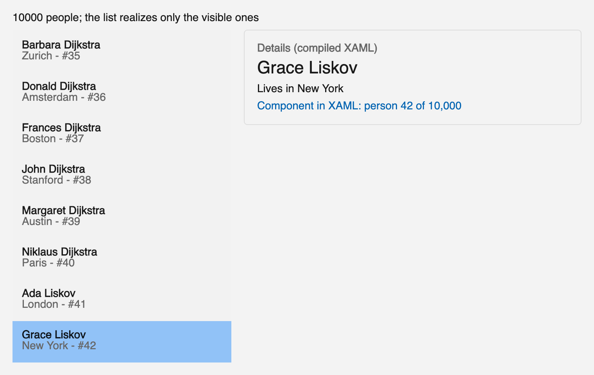

## 10. The rest of the API (phase 3)

### 10.1 Builders for the other crates of controls

The generator (`scripts/generate_view_builders.py`) writes the builders of the other crates of controls, each into a file of its own behind a feature of `ferroui-view`:

| Feature | Crate | File | Builders |
|---|---|---|---|
| `treedatagrid` | `ferroui-controls-treedatagrid` | `generated/treedatagrid.rs` | `tree_data_grid()` and its cells, rows and presenters (10) |
| `color-picker` | `ferroui-controls-color-picker` | `generated/color_picker.rs` | `color_view()`, `color_picker()`, `color_spectrum()`, `color_slider()`, `color_previewer()` |
| `dialogs` | `ferroui-dialogs` | `generated/dialogs.rs` | `managed_file_chooser()` and the others (4) |
| `reactiveui` | `ferroui-reactiveui-controls` | `generated/reactiveui.rs` | `view_model_view_host()`, `routed_view_host()`, the reactive bases (4) |

The classes of a group derive from the classes of `ferroui-controls`, so their elements also have the setters of their bases. The base file is unchanged. A type that a group's `rust_paths.rs` does not list (it is not registered for markup) is given a path in the table of the group (`TreeDataGridSourceRef`, the column and row contracts of the TreeDataGrid, `RoutingState`), so properties such as `TreeDataGrid.source` get their setters. `--check` and `--report` cover every file.

### 10.2 Styles

```rust
stack_panel().styles([
    style("Button.accent")
        .set(TemplatedControl::background_property(), "#0063B1")
        .set(TemplatedControl::foreground_property(), "White")
        .nested(style("^:pointerover").set(Visual::opacity_property(), 0.85)),
])
```

- `style(selector)` parses a selector in the syntax of XAML with the run-time selector parser of the port (`ferroui-markup`), resolving type names among the registered classes. `style_of(selector)` takes a selector built with the selectors API.
- `.set(property, value)` takes what converts to the value of the property, as the setters of elements do.
- `.nested(style("^..."))` adds a nested style; its selector starts with `^`, the selector of the style it is in (`^:pointerover`, `^.selected > TextBlock`). The run-time parser of the port parses `^`, an addition to upstream's, whose run-time parser leaves it to the XAML compiler (DEVIATIONS.md, Parsers of markup).
- `.styles([..])` of an element (`styles: [..]` in `rsx!`) adds the styles to the `Styles` of the control when it is made.

### 10.3 The theme variant and resources

| Hook | Gives |
|---|---|
| `use_parent_property(property)` | The value of a styled property on the control the component is mounted in (the inherited value for an inherited property). The component runs again when it changes. `use_data_context` is built on it. |
| `use_theme_variant()` | The `ActualThemeVariant` of that control: `Light`, `Dark`, or one of the application. |
| `use_resource(key)` | The resource as that control finds it (its resources, its ancestors', the application's and the theme's, for its theme variant), followed through the resource observable of the port. |
| `use_resource_as::<T>(key)` | The same, converted from the markup value (`Rc<dyn IBrush>` for a brush of a theme). |

A `ThemeVariantScope` element (`requested_theme_variant: variant`) switches the variant of a part of the tree; components below it read the new variant and resources.

### 10.4 Transitions and animations

| Function | Gives |
|---|---|
| `transition(property, duration)` | A transition of the port for the value type of the property: `f64`, `f32`, `i32`, `bool`, `Thickness`, `CornerRadius`, `Color`, brushes, `Size`, `Point`, `Vector` (the trait `Transitionable`) |
| `transition_eased(property, duration, easing)` | The same with an easing |
| `transitions([..])` | The `Transitions` of a control, for its `transitions` setter |
| `ms(n)` | `Duration::from_millis(n)` |
| `animation(duration).key_frame(cue, |frame| frame.set(property, value))` | An `Animation` of the port with key frames, `iterations`, `easing`, `fill_mode`, `delay` |
| `use_animation(node_ref, trigger, || animation(..))` | Runs the animation on the control of the reference once the controls are in place, and again when `trigger` changes. A run in progress is cancelled first, and when the component is taken out. |

In a component that runs again, keep `transitions([..])` in `use_hook`, as the template and the items of section 9.2: a new value on each run is set again.

### 10.5 Popups and context menus

A `Popup` takes its child as an element (`popup().child(..)`, or `Popup { .. }` in `rsx!`). The child is shown in a root of its own above the window: in the logical tree and under the owner of the popup, outside the visual tree of its parent. That is what a portal is in React. A property that holds a control of a class takes an element too: `context_menu: rsx! { ContextMenu { MenuItem { header: "Copy" } } }`. The reconciler patches the element there like any other.

Flyouts (`flyout`, `context_flyout`) are not controls (`FlyoutBase` derives from the object model, not from `Control`), so they are made with their API and given as values.

### 10.6 The sample

`samples/ViewGallery` (`cargo run -p view-gallery`, `-- --dark` to start dark) is a component that runs again under a `ThemeVariantScope` it switches. It shows:
- styles of an element with a nested style;
- the theme variant and two resources of the theme;
- a bar whose width moves with a transition;
- a button with a context menu given as an element;
- a `ColorView` and a `TreeDataGrid` written with the generated builders, under the Fluent theme with the themes of their crates.

| Light | Dark |
|---|---|
|  | 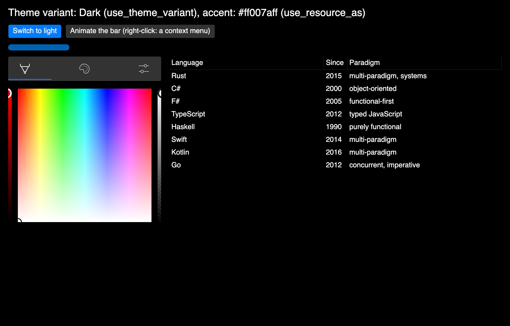 |

## 11. Tools (phase 4)

### 11.1 Hot reload of `rsx!`

With the feature `hot-reload` of `ferroui-view`, the literals of `rsx!` can be edited while the application runs:
- the text of a child (`"Count"`);
- a number, a text or a character given to an attribute (`width: 80.0`, `background: "#0063B1"`, `class: "accent"`).

How it works:
1. `rsx!` passes each such literal through `ferroui_view::hot::lit(site, index, value)`. The site is the place of the macro (`file!()`, `line!()`, `column!()` of the invocation and the directory of its crate). The index is the number of the literal among the literal tokens of the macro, in the order of the source; the macro counts the literals inside expressions too, to keep the numbers in step with the source.
2. Without the feature, `lit` returns its value: the cost is nothing.
3. With it, the first call of a file reads the file and records its `rsx!` invocations as the build saw them: where each starts, its literal tokens, and the shape of its other tokens. `launch` calls `hot::watch()`, which checks the files on the dispatcher every 300 ms.
4. When a file changes, its invocations are read again with `proc-macro2` (with the locations of tokens). An invocation whose shape is the shape of the build gets its changed literals, and a version signal changes. `lit` reads that signal, so the components that read a changed literal run again, and the reconciler patches their controls: state, focus and scroll positions stay.
5. An invocation whose shape changed (an attribute added, an element moved) is reported as needing a rebuild (`Diagnostic::NeedsRebuild`). The literals of the other invocations still apply.

Only components that run again, and children that follow state, run again. A component that runs once keeps what it built. Literals inside expressions (`{if dark { "a" } else { "b" }}`) are code, not literals of the tree, and need a rebuild. `hot::apply_source(file, text)` applies a text as if the file had been saved with it: for tests and tools that hold the source.

The gallery of section 10.6, run with `cargo run -p view-gallery --features hot-reload` and its source edited while it ran. The text of the second button and the colour of the bar changed, and the console printed `hot reload, 2 literals differ from the build`:

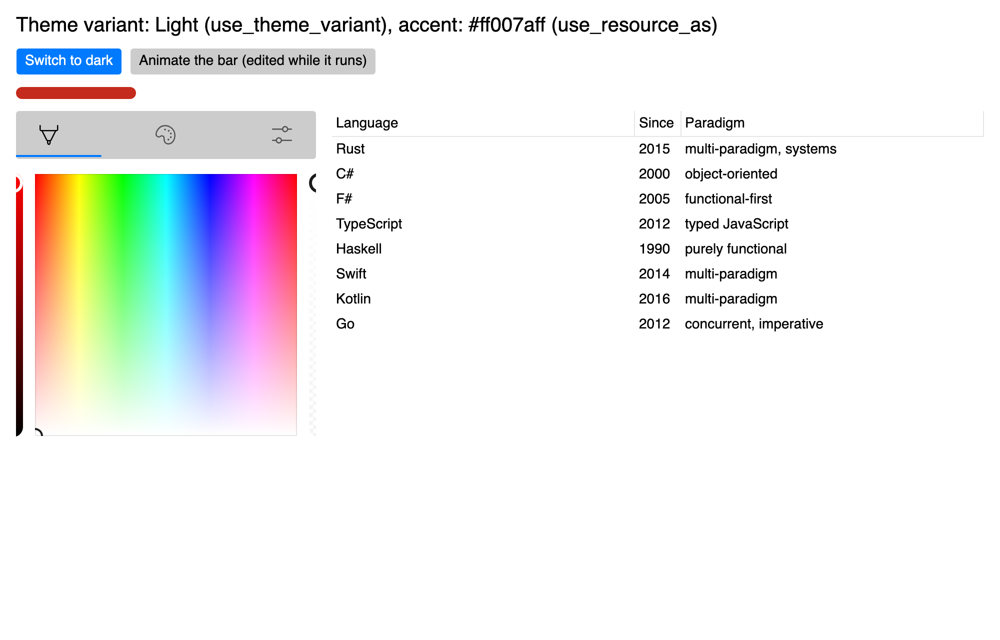

### 11.2 Diagnostics

Mistakes the framework can see are checked in debug builds and reported as a `Diagnostic`:

| Diagnostic | When |
|---|---|
| `MissingKeys` | A list (`for` in `rsx!`, a `Vec` of elements: `Element::List`) has two or more controls or components without keys |
| `DuplicateKey` | Two siblings have the same key |
| `RunawayComponent` | A component runs more than 100 times in one propagation of changes (its function writes a signal it reads) |
| `NeedsRebuild`, `HotReloaded` | Hot reload: an `rsx!` changed more than its literals; literals were applied |
| `ErrorCaught` | A run of a component below an error boundary panicked, and the boundary shows its fallback (section 13.2); reported in every build |

By default each distinct diagnostic is printed once to the standard error. `set_diagnostics_handler(|d| ..)` sends them elsewhere (a test, a log, a tool). `Element::List` is new: an iteration makes it, and it is flattened like a fragment, but its items are checked for keys.

### 11.3 The inspector

`mounted_trees()` describes the live mounted trees of the thread as `InstanceNode`s:
- components, with their keys, runs and hooks;
- controls, with their class, `Name`, style classes, and properties: the value on the control now and where the element's value comes from (`value`, `follows state`, `two-way`, `element`, `binding`);
- text;
- the lists that follow state, with their items and keys.

Each mounted tree registers its roots in a registry of the thread (`Element::mount`, a window, a `ComponentHost`), and each dynamic list keeps its items in order for it.

`inspector()` is an element that shows them: a list of the instances, indented by depth, and the details of the selected one, refreshed on a click or every second. With the feature `desktop`, `open_inspector()` opens it in a window. `launch` attaches it to the main window on Shift+F12 in debug builds (`attach_inspector`), leaving F12 to the DevTools of the port, which are being ported separately. When they land, the inspector becomes their "Components" page.

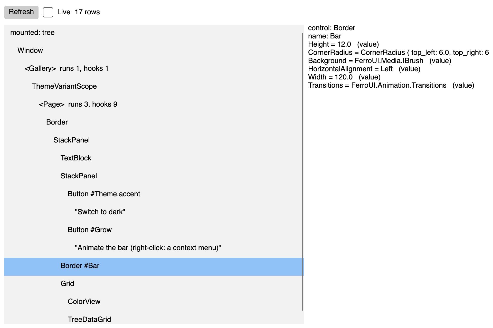

## 12. Performance and scale (phase 5)

### 12.1 The fewest moves of keyed children

A list host (`Children` of a panel, `Items`) is patched child by child; content, decorator and text hosts keep the splice of section 8.1. After the common prefix and suffix:
1. the children that are gone are removed, from the end;
2. the kept children in the longest increasing subsequence of their new places stay where they are (O(n log n), the patience method);
3. from the end of the new list, each other kept child is moved before the child that follows it, and each new child is inserted there.

The number of moves is the number of kept children minus that subsequence: one for a child moved to the front, n - 1 for a list reversed. A panel moves a control without taking it out of the visual tree (`move_item`), so a moved control keeps its focus and its state, and a `ComponentHost` in it is not unmounted. Places are found through a map from control to index, which each move updates over the range it shifts. When there are more than 16 moves, a scan of the list costs less than keeping the map, and the patch scans instead.

### 12.2 Work a run skips

- **Handlers.** The closure of a handler is in a cell, and the attached trampoline calls what the cell holds (`Handler`). When a run has handlers of the same identities (the routed event, the property of `on_changed`) in the same order, the patch puts the new closures into the cells of the attached handlers and attaches nothing.
- **Values that follow a signal.** A property set from a signal or a memo (`text: count`), and a two-way value of a signal, carry the identity of their source (`PropValue::Follows`). Two that follow the same source are equal, so a run leaves the effect of the first in place instead of stopping it and starting another.
- **Memo by default.** `#[component(rerender)]` memoizes a component whose parameters are all `PartialEq` and `Clone`: a parent that runs again with equal parameters does not run it. The macro decides this when the expansion is compiled, with autoref specialization: `(&MemoProbe(parameters)).memo_props()` resolves to the trait implemented for comparable types first and to the fallback otherwise.
  - `#[component(rerender, memo)]` requires comparable parameters, so it is a compile error otherwise.
  - `#[component(rerender, always)]` runs with its parent every time.
  - A component with a parameter that cannot be compared (a closure, `children: Element`) runs with its parent. So does a closure given to `rerender(..)`: what it captures cannot be compared.
  - Context: a memoized component does not run again because its parent provides another context value. A value that changes is provided as a signal and read in the component.

`view_stats()` counts what the mounting and the reconciler did on the thread: operations on the children of hosts, handlers attached and reactive values started. The tests of this section use it.

### 12.3 Measures

`tests/FerroUI.Benchmarks/declarative/view_benchmark.rs` measures with the harness of the benchmarks crate:
```sh
FERROUI_BENCH_FILTER=declarative cargo test --release -p ferroui-benchmarks run_benchmarks -- --ignored --nocapture
```

The benchmarks use a list of 1,000 rows, and 2,600 components (the cells of the 7GUIs spreadsheet). Medians on an M3 Pro, release build:

| Benchmark | Before phase 5 | Phase 5 |
|---|---|---|
| Mount the list: controls made directly (the baseline) | 1.17 ms | 1.07 ms |
| Mount the list: run-once model | 1.96 ms | 1.46 ms |
| Mount the list: a component that runs again | 1.56 ms | 1.42 ms |
| A run with nothing changed | 355 us | 283 us |
| A run with one row changed | 331 us | 270 us |
| One keyed row moved to the front | 2.88 ms | 0.46 ms |
| All keyed rows reversed | 2.78 ms | 1.81 ms |
| One row changed through its signal (run-once model) | 0.32 us | 0.29 us |
| A parent that runs again over 2,600 components (not memoized) | 14.56 ms | 14.44 ms |
| The same, memoized (opt-in before, by default now) | 0.26 ms | 0.23 ms |

What the numbers say:
- Mounting through elements costs 1.3 to 1.4 times making the controls directly.
- A run of 1,000 rows with nothing changed costs about 0.28 ms: the function and the comparison of 1,000 elements.
- A change that follows a signal in the run-once model costs 0.3 us, about a thousand times less. The two models mix (section 7.2), so the parts of a screen that change most often can follow signals.
- Memo turns the parent of 2,600 components from 14 ms into 0.23 ms, which is why it is the default.

## 13. Patterns of larger applications (phase 6)

Phase 6 adds what an application larger than a form needs: data that arrives later, a part of the window that fails without ending the application, and navigation between views.

### 13.1 Asynchronous data

| Function | What it gives |
|---|---|
| `use_future(deps, \|deps\| future)` | A hook. It runs the future on the executor of the thread when the component first runs, and again whenever `deps` differ from those of the run before, and gives its state as a `Signal<AsyncState<T>>` |
| `AsyncState<T>` | `Pending`, `Ready(T)` or `Failed(String)`, with `is_pending()`, `value()` and `error()` |
| `suspense(state, pending, ready, failed)` | An element that shows the element of the state: a component that runs again when the state changes, so the controls of two states of the same shape are patched |
| `sleep(duration)` | A future that ends after `duration`, on a timer of the dispatcher of the thread |

The future of `use_future` returns `Result<T, String>`. It runs on the executor of `ferroui_system::threading::tasks` (`spawn_local`): it is polled when it starts and again when it is woken, on the thread of the user interface, so what it reads and writes needs no synchronization. A future that waits for work on another thread (`tasks::run`) is woken through the dispatcher.

```rust
#[component(rerender)]
fn Search() -> Element {
    let query = use_signal(String::new);
    let results = use_future(query.get(), |query| {
        let query = query.clone();
        async move {
            sleep(Duration::from_millis(300)).await;
            search(&query).await
        }
    });
    rsx! {
        StackPanel {
            TextBox { text: query.two_way() }
            {suspense(
                results,
                || rsx! { TextBlock { text: "Searching..." } },
                |found| rsx! { TextBlock { text: format!("{} crates", found.len()) } },
                |error| rsx! { TextBlock { text: error } },
            )}
        }
    }
}
```

- The future starts once the controls of the run are in place, as the closure of `use_effect_with` runs. With new dependencies the state goes back to `Pending` and another future starts.
- A future whose dependencies were replaced, or whose component was taken out, is abandoned. Its result is ignored, and the executor is woken to drop it, which ends what it waited for: a `sleep` stops its timer. In the search above, each keystroke abandons the future of the one before, so the search runs once the user pauses for 300 ms.
- `get()` of the state needs `T: Clone`; `with(|state| ..)` reads it in place.

### 13.2 Error boundaries

```rust
error_boundary(
    || rsx! { Report {} },
    |info| rsx! {
        StackPanel {
            TextBlock { text: format!("The report failed: {}", info.message()) }
            Button { on_click: move |_| info.reset(), "Try again" }
        }
    },
)
```

`error_boundary(child, fallback)` mounts the element of `child`. When a run of a component below it panics, on its first run or a later one, the boundary shows `fallback(info)` instead, and the rest of the window goes on.

1. A component mounted below a boundary finds it when it is mounted, through the contexts of the owners, and runs its function under `catch_unwind`. Without a boundary above, a component runs as before, and a panic propagates.
2. A run that panics renders nothing. The state of the reactive runtime (the observer, the owner, the depth of batches) and the frames of the hooks are put back as they were before the run. The panic is reported to the nearest boundary and as `Diagnostic::ErrorCaught`.
3. The boundary is not changed while a tree is being reconciled. The report waits until the outermost run of a component in progress has ended. Then the boundary runs again, shows its fallback, and takes the child tree out: its owner is disposed, with the component that panicked.
4. `info.reset()` mounts the child again, as new: its components start with fresh hooks.

The nearest boundary catches, and a panic of a fallback goes to the boundary above. What is guarded is the function of each component below the boundary, `child` included (it is the function of a component of the boundary). Handlers, effects and the mounting of controls are not guarded, as React does not catch errors in event handlers either. The panic hook of the process still runs, so the message of the panic is printed.

### 13.3 Navigation

The router follows the routing of ReactiveUI (`RoutingState`, [mvvm.md](mvvm.md), section 7):

| ReactiveUI | `ferroui-view` |
|---|---|
| `RoutingState` | `Router`, provided by `router(initial, routes)` to the components below; `use_router()` and `try_use_router()` find it |
| `NavigationStack` | `router.stack()`: the paths, the current one last |
| `Navigate` | `router.navigate(path)` |
| `NavigateBack`, and whether it can execute | `router.navigate_back()`, false when only one path is left; `router.can_go_back()` |
| `NavigateAndReset` | `router.navigate_and_reset(path)` |
| `CurrentViewModel` | `router.current()`: the current path |
| `RoutedViewHost` and the view locator | the routes: the view of the first pattern that matches |

```rust
router("/", vec![
    route("/", |_| rsx! { Home {} }),
    route("/people/:id", |m| rsx! { Person { id: m.param("id").unwrap_or_default().to_string() } }),
    route("*", |m| rsx! { NotFound { path: m.path().to_string() } }),
])
```

- **Patterns.** A pattern is segments separated by `/`. `:name` matches one segment and binds it (`m.param("name")`), `*` matches the rest of the path (`m.param("*")`) and comes last, and any other segment matches itself. Empty segments are ignored, so `/a/b/` is `/a/b`.
- **Matching.** The first route whose pattern matches the current path is shown. A last `route("*", ..)` shows what no other route matches; without one, nothing is shown.
- **Paths, not view models.** The entries of the stack are paths: a path names its view and its parameters. State that outlives navigation lives above the router, in signals or contexts, as the view models of ReactiveUI live in the screen.
- **Views.** The view of the current route is a component of its own. Another route mounts its view anew and takes the view before out, with its state. The same route with other parameters runs its view again with the new `RouteMatch`, and the reconciler patches its controls.
- **The handle.** `current()`, `can_go_back()` and `stack()` are reactive: a component that reads them runs again when the path changes. A component calls `use_router()` while it runs and keeps the handle, which is `Copy`, for its handlers.

### 13.4 The samples

Two applications use the API of the phases together, in the WinUI 3 theme:

- **TodoMVC** (`samples/TodoMvc`, `cargo run -p todo-mvc`): the application of the TodoMVC specification as components that run again, with the state in hooks and the filters of the list (all, active, completed) as the routes of a router.
- **ReactiveDemo as components** (`samples/ReactiveDemoComponents`, `cargo run -p reactive-demo-components`, or with `--no-default-features` to search a catalogue in memory instead of crates.io): the crate browser of `samples/ReactiveDemo` ([mvvm.md](mvvm.md), section 12) written as components that run again instead of a view model and views; what the view model computes with `when_any_value` and `to_property` (a search throttled as the user types) is computed with the hooks and the asynchronous data of section 13.1. A result opens its details as a route of the router, inside an error boundary.

Each sample has scenario tests (`cargo test -p todo-mvc`, `cargo test -p reactive-demo-components`) and writes a picture of its window when `FERROUI_TODOMVC_SHOTS` or `FERROUI_REACTIVE_DEMO_SHOTS` names a directory.

| TodoMVC | ReactiveDemo as components |
|---|---|
| 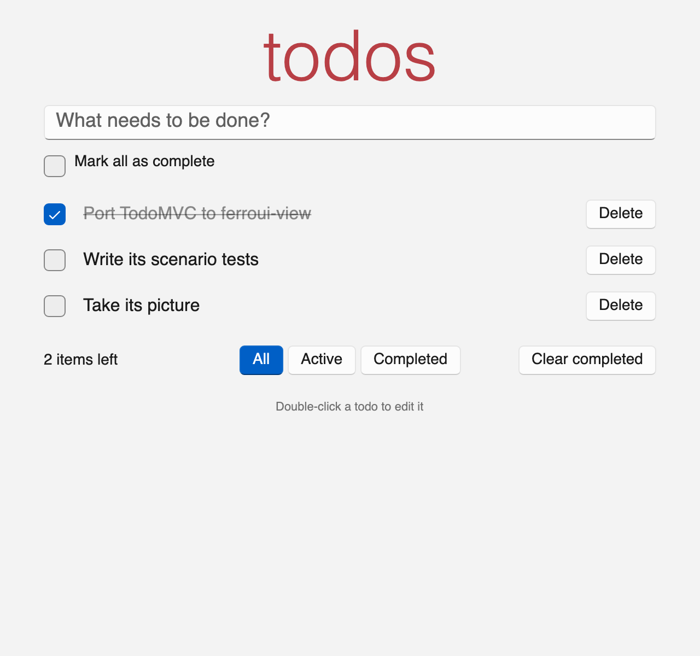 | 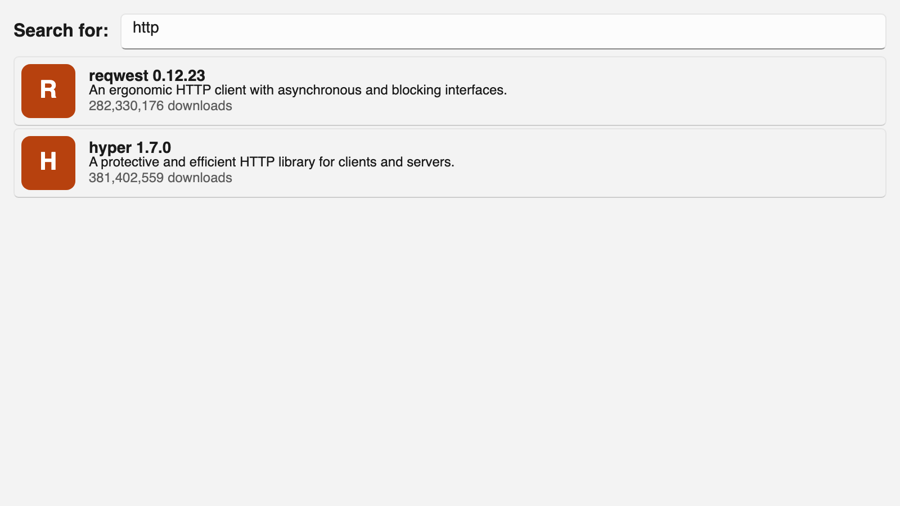 |

## 14. Samples: 7GUIs

The seven tasks of 7GUIs (<https://eugenkiss.github.io/7guis/tasks>) are written three times, each task a crate of its own so that each stays small:

- with the builders;
- with `rsx!`;
- as components that run again, with hooks (phase 1).

| Task | Builders | Macro | Hooks |
|---|---|---|---|
| Counter | `samples/SevenGuis/Builders/Counter` | `samples/SevenGuis/Macros/Counter` | `samples/SevenGuis/Hooks/Counter` |
| Temperature converter | `.../Builders/Temperature` | `.../Macros/Temperature` | `.../Hooks/Temperature` |
| Flight booker | `.../Builders/FlightBooker` | `.../Macros/FlightBooker` | `.../Hooks/FlightBooker` |
| Timer | `.../Builders/Timer` | `.../Macros/Timer` | `.../Hooks/Timer` |
| CRUD | `.../Builders/Crud` | `.../Macros/Crud` | `.../Hooks/Crud` |
| Circle drawer | `.../Builders/CircleDrawer` | `.../Macros/CircleDrawer` | `.../Hooks/CircleDrawer` |
| Cells | `.../Builders/Cells` | `.../Macros/Cells` | `.../Hooks/Cells` |

The hooks versions show the model of section 7. Each computes in its function what follows from the state and lets the reconciler patch:
- the flight booker's dates and whether it can book;
- the CRUD's filtered list, as a keyed `for` of `rsx!`;
- the circles, the circle under the pointer and the state of undo and redo.

The timer starts its clock in `use_effect_with` and stops it in the cleanup. The temperature converter writes its fields as controlled inputs: each field shows its state, and a field whose text is already the state changes nothing. Each cell of the spreadsheet runs again on its own; whether it is edited is a `use_memo`, so a change of the edited cell runs only the two cells concerned. The headers are memoized.

`samples/SevenGuis/Model` holds what the three share: the conversions, the dates, the CRUD filter, the circle history, the formulas of the cells (a parser and an evaluator; each cell is a memo of the cells it names, so a change is computed again only in the cells that depend on it, and a cycle is an error until it is broken), the reactive state of the circle drawer and of the cells, and the window a task runs in (in the WinUI 3 theme of `ferroui-themes-winui`). `samples/SevenGuis/Tests` runs one scenario per task on each of the twenty-one crates (what a user types and clicks, and what the task must show), in one test binary.

The windows of the tasks, as each renders itself (`FERROUI_SEVEN_GUIS_SHOTS`). The three versions of a task render the same window. The pictures of the hooks versions are `images/seven-guis/hooks-*.png`:

| Counter | Temperature converter | Flight booker |
|---|---|---|
| 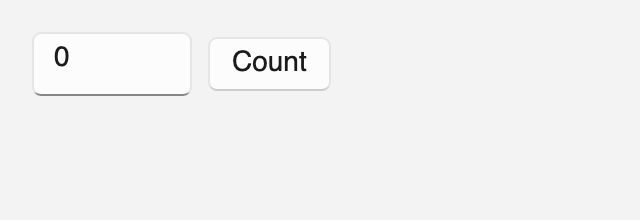 | 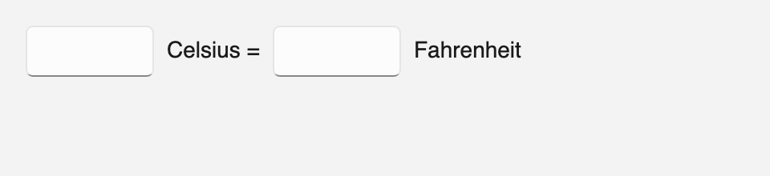 | 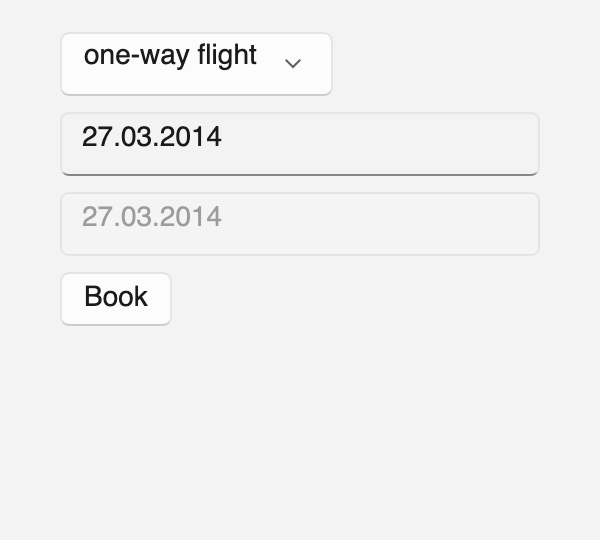 |

| Timer | CRUD |
|---|---|
|  | 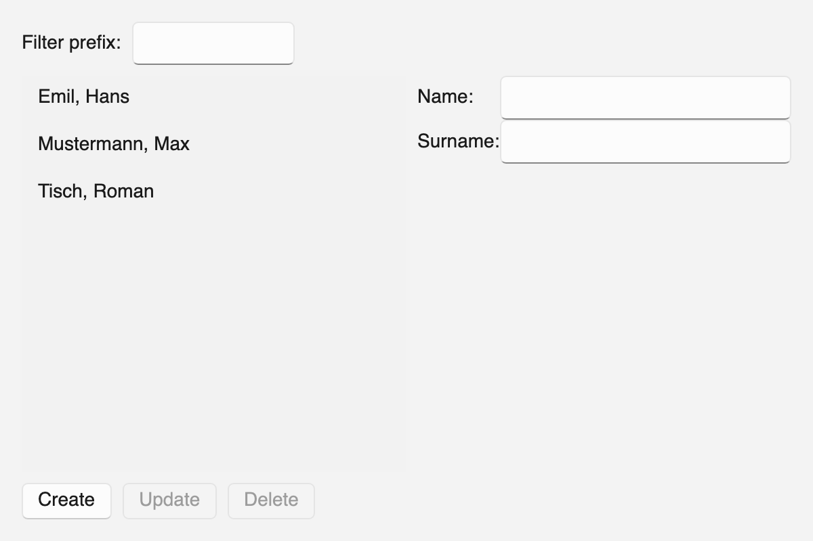 |

| Circle drawer | Cells |
|---|---|
|  | 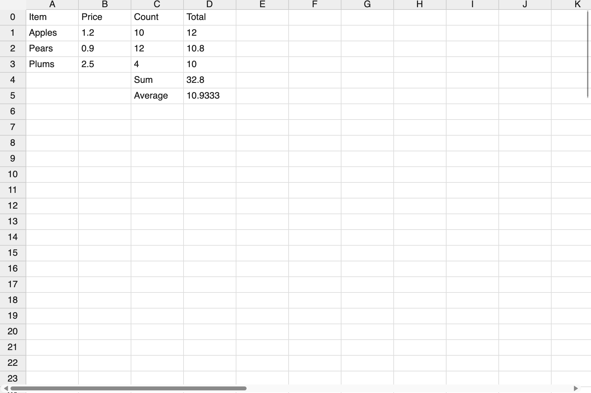 |

```sh
cargo run -p seven-guis-counter-builders
cargo run -p seven-guis-cells-macros
cargo run -p seven-guis-crud-hooks
FERROUI_SEVEN_GUIS_SHOTS=/tmp/shots cargo run -p seven-guis-crud-macros   # renders the window into /tmp/shots/macros-crud.png
```

## 15. Phases

| Phase | Content | State |
|---|---|---|
| 0 | Element tree, generated builders, `rsx!`, `#[component]`, signals, children that follow state, 7GUIs in two versions | done (#270) |
| 1 | Components that run again, hooks, contexts, the reconciler, 7GUIs in a third version | done |
| 2 | Interoperation with XAML and templates: `ComponentHost`, data templates of components, the data context, XAML in a component | done |
| 3 | The rest of the API: other crates of controls, styles, resources and the theme variant, transitions and animations, popups and context menus | done |
| 4 | Tools: hot reload of the literals of `rsx!`, diagnostics, an inspector of the mounted trees | done |
| 5 | Performance and scale: the fewest moves, handlers swapped, values kept, memo by default, benchmarks | done |
| 6 | Patterns of larger applications: futures run by components, error boundaries, a router, TodoMVC and ReactiveDemo as components | done |

Each phase lands as one or more pull requests with tests, and samples where they show something new. Each also updates this document and [declarative-ui-react.md](declarative-ui-react.md).

### Phase 2: interoperation with XAML and templates (done, section 9)

- **A component in XAML.** A control, `ComponentHost`, holds a component, so that a XAML view can host a part written in Rust. Its content is mounted under the owner of the control and disposed when the control is detached. Properties of the host reach the component as a context or as parameters.
- **XAML in a component.** `Element::Existing` takes any control already. What is missing is to load a XAML resource as an element (`xaml("ferres://..")`), with access to its named controls.
- **Item templates from components.** An `ItemsControl` with virtualization makes its item containers itself, so the reconciler does not drive them. A data template that builds an element per item (`template(|item: &T| rsx! { .. })`) would mount the element in each container and reconcile it when the container is given another item. This makes the declarative API work with virtualized lists, `TreeDataGrid` included.
- **Data context.** A hook that reads the `DataContext` of the control a component is mounted in, for components that live in a view model application (`docs/mvvm.md`).

Acceptance: a XAML window with a Rust component inside, a component with a XAML user control inside, and a virtualized `ListBox` of 10,000 items whose template is a component; each tested (`tests/template_tests.rs`).

What was built differs from the plan above in two points:
- Properties of the host reach the component through the data context, not as parameters.
- `xaml(..)` takes text or a `ferres://` URI, and the named controls are found with the existing `find_control` / `get_control` of the root.

### Phase 3: the rest of the API (done, section 10)

- **Builders for other crates.** The generator runs over `ferroui-controls-treedatagrid`, `ferroui-controls-color-picker`, `ferroui-dialogs` and the ReactiveUI controls, each set behind a feature of `ferroui-view` or in the crate itself.
- **Styles.** A builder for `Style` in the form of the element builders (`style("Button.accent").set(Button::background_property(), ..)`), and styles held by an element (`styles: [..]`).
- **Resources and themes.** `use_resource(key)`, a hook that follows a dynamic resource, and a way to read the theme variant.
- **Animations and transitions.** Builders for `Transitions` and key-frame animations, and a hook that runs an animation when a value changes.
- **Popups.** Elements for popups, flyouts and context menus that are mounted outside their parent's visual tree but under its owner, as React's portals are.

Acceptance: the ControlCatalog page of one control of each crate written with the builders, and a styled sample with a theme switch.

What was built differs from the plan above in three points:
- The gallery (section 10.6) shows a control of the colour picker and of the TreeDataGrid. The builders of the dialogs and of the ReactiveUI controls are generated and compile, but are not shown there.
- The hook of animations runs an animation of the port on a control when a value changes (`use_animation`). It does not animate a value itself.
- Flyouts are not elements (section 10.5).

### Phase 4: tools (done, section 11)

- **Hot reload of `rsx!`.** The static parts of `rsx!` (the classes, the literal values, the layout) are kept in a form the running application can load again. Only expressions need a rebuild. The reconciler applies the new tree to the mounted controls and keeps their state.
- **An inspector.** The DevTools of FerroUI show the instance tree beside the visual tree: components, their hooks and their keys.
- **Diagnostics.** In debug builds, warnings for siblings of a list without keys, duplicate keys, and a component that runs again more than a given number of times in one propagation of changes.

What was built differs from the plan above in three points:
- Hot reload changes literals only. Classes and layout given as literals change; a new element or attribute needs a rebuild and is reported as such.
- The inspector is an element and a window of its own until the DevTools of the port land.
- The diagnostic of a component that runs too often counts runs in one propagation of changes, not in a frame.

### Phase 5: performance and scale (done, section 12)

- **Moves.** Keyed children reordered with the fewest moves (the longest increasing subsequence of the old positions, as Vue and Inferno do), instead of the prefix and suffix rule.
- **Values that skip work.** Handlers wrapped so that the control keeps one handler and the closure behind it is swapped on each run (no detach and attach). Reactive values compared by the identity of the signal they follow.
- **Measures.** Benchmarks of mounting and of a run of large trees (the cells of the spreadsheet, a list of 10,000 rows), against the run-once model and against a XAML view, in `scripts/` as the TreeDataGrid benchmarks are.
- **Memo by default** for components whose parameters are all `Copy` and `PartialEq`, if the measures show a gain.

What was built differs from the plan above in two points:
- Memo by default needs `PartialEq` and `Clone`, not `Copy`.
- The benchmarks compare with controls made directly, not with a XAML view: a view loaded from XAML makes the same controls, after the cost of loading.

### Phase 6: patterns of larger applications (done, section 13)

- **Asynchronous data.** `use_resource(future)`, a hook that runs a future on the thread's executor (`ferroui_system::threading::tasks`) and gives its state (pending, done, failed), with a way to show a placeholder while it is pending.
- **Errors.** An error boundary: a component that catches a panic of a child's run and shows a replacement instead of ending the application.
- **Navigation.** A router of views for single-window applications, with the routing of ReactiveUI as a model.
- **A larger sample.** TodoMVC and a port of a ReactiveUI sample to components that run again, in the WinUI 3 theme, with screenshots and scenario tests.

What was built differs from the plan above in four points:
- The hook of futures is `use_future(deps, make)`, not `use_resource(future)`: `use_resource` follows a dynamic resource since phase 3. A future is started again when its dependencies change, and the placeholder is `suspense(state, ..)`.
- An abandoned future is dropped by the executor, so what it waits for ends with it; `sleep` gives futures a timer of the dispatcher for debouncing.
- An error boundary guards the functions of the components below it. Handlers, effects and the mounting of controls are not guarded.
- The entries of the router are paths with parameters, not view models.

## 16. Testing

- `src/FerroUI.View/tests`: the reactive runtime, setters and conversions, mounting, two-way values, handlers, keyed lists, conditions, the macros and components; and for phase 1 (`rerender_tests.rs`):
  - runs again and kept controls;
  - equal values left alone and missing values cleared;
  - matching by key and by place;
  - handlers attached again, and batching;
  - hooks and child state across a parent's run;
  - memoized components;
  - effects and their cleanups;
  - contexts;
  - the order of hooks;
  - dynamic lists in a component that runs again;
  - `if` and `for` of `rsx!`.
- `src/FerroUI.View/tests/template_tests.rs` (phase 2):
  - a host that follows its data context, ends its component when detached and mounts it again when attached;
  - a component registered and shown by name;
  - XAML that hosts a registered component;
  - a component that hosts XAML and keeps it across runs (feature `xaml`);
  - a virtualized list of 10,000 items whose template recycles its hosts.
- `src/FerroUI.View/tests/api_tests.rs` (phase 3):
  - styles of an element with a nested style;
  - a selector that does not parse;
  - a component that follows the theme variant and a resource;
  - transitions and animations;
  - a popup's child and a context menu as elements;
  - a builder of another crate (feature `treedatagrid`).
- `src/FerroUI.View/tests/tools_tests.rs` (phase 4):
  - a list without keys and duplicate keys reported;
  - a component that writes what it reads reported;
  - hot reload of the literals of a component, keeping its controls, with a change of structure reported;
  - the inspector's description of a mounted tree and its view.
- `src/FerroUI.View/tests/performance_tests.rs` (phase 5):
  - the fewest moves;
  - 300 random edits of a keyed list against the expected list and the kept controls;
  - the longest increasing subsequence;
  - handlers swapped and values that follow the same signal kept;
  - memo by default, `always`, and parameters that cannot be compared.
- `src/FerroUI.View/tests/patterns_tests.rs` (phase 6):
  - a future pending, then ready or failed;
  - new dependencies that start a new future and abandon the old one, whose result is ignored;
  - the future of a component that ended, dropped and without effect;
  - `suspense` in its three states;
  - an error boundary: a panic on the first run and on a later run, the components beside it still running, a reset, the nearest boundary catching and a panic of a fallback going to the one above, and a panic without a boundary propagating;
  - the router: the initial route, navigation, going back and resetting with the stack, parameters, the rest of a path, a path no route matches, a component that reads the current path, and `use_router` without a router.
- `tests/FerroUI.Benchmarks/declarative`: the benchmarks of section 12.3, with a smoke test in `cargo test`.
- `samples/SevenGuis/Tests`: the scenarios of the seven tasks on the twenty-one crates, on the test application of `ferroui-controls` (a dispatcher of the thread).
- `samples/SevenGuis/Model`: the logic without user interface.
