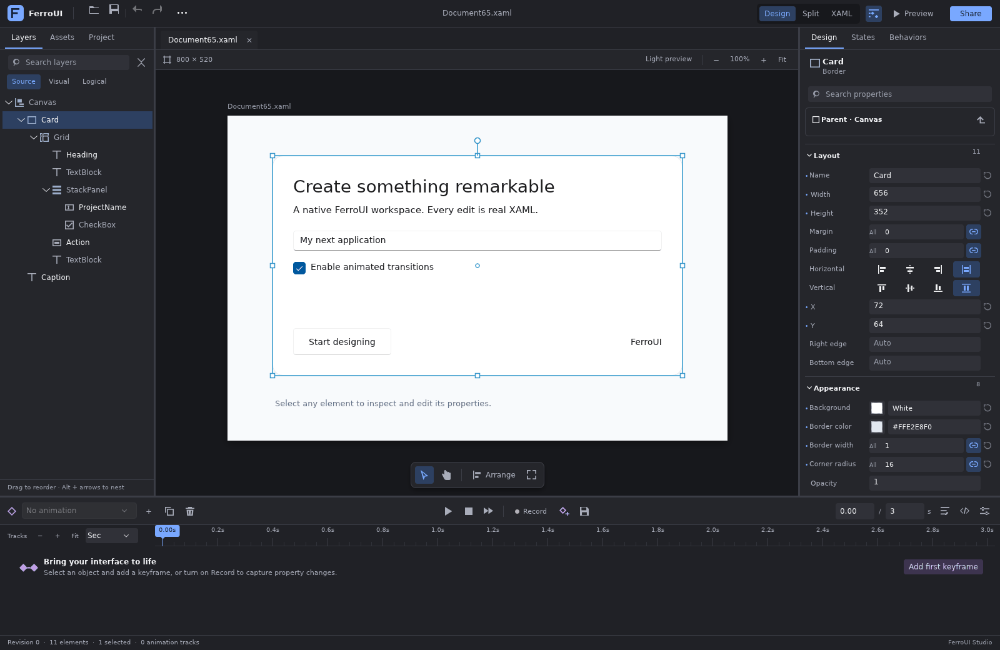
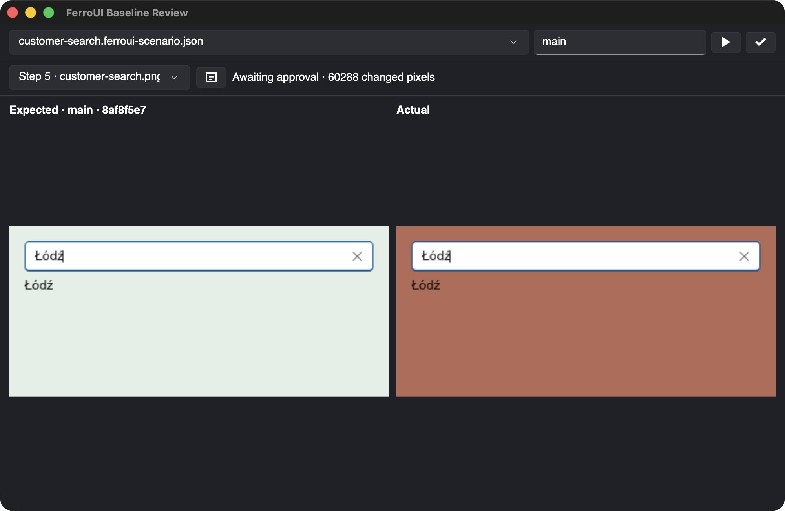
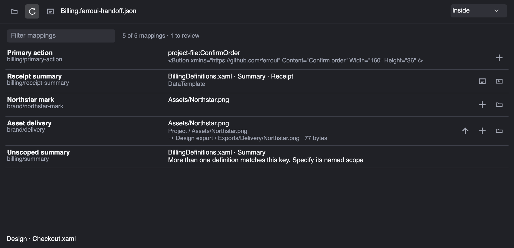
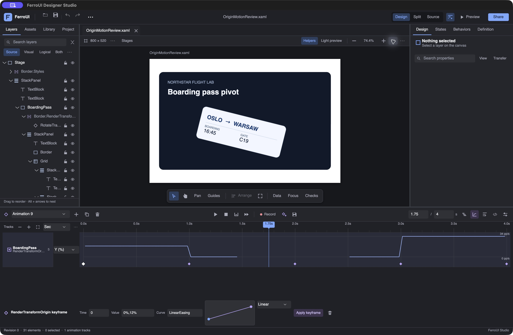
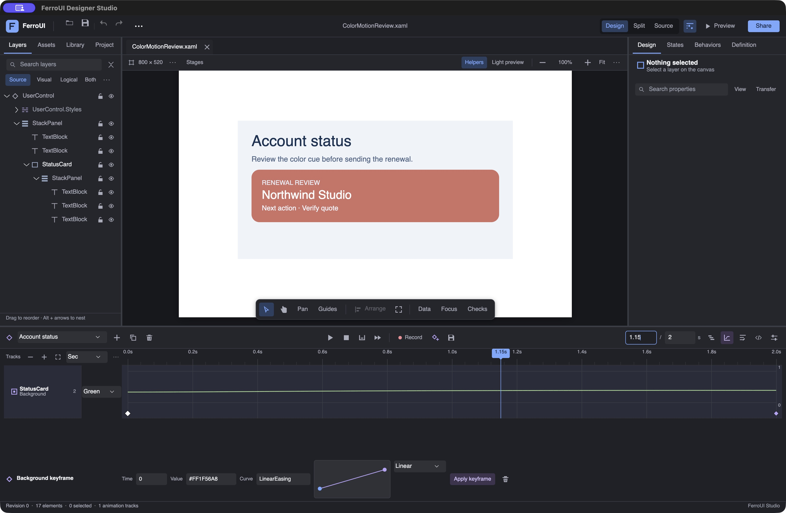
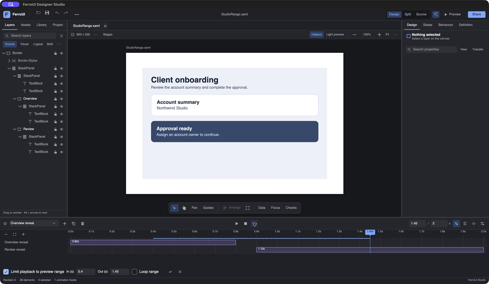
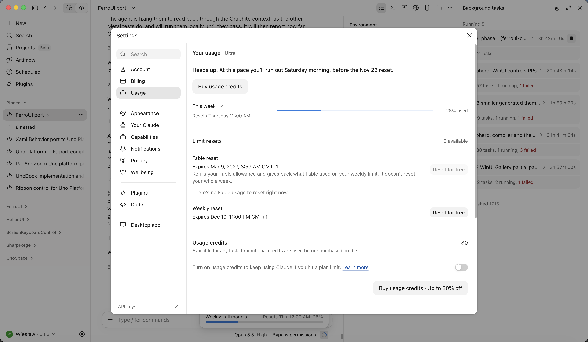
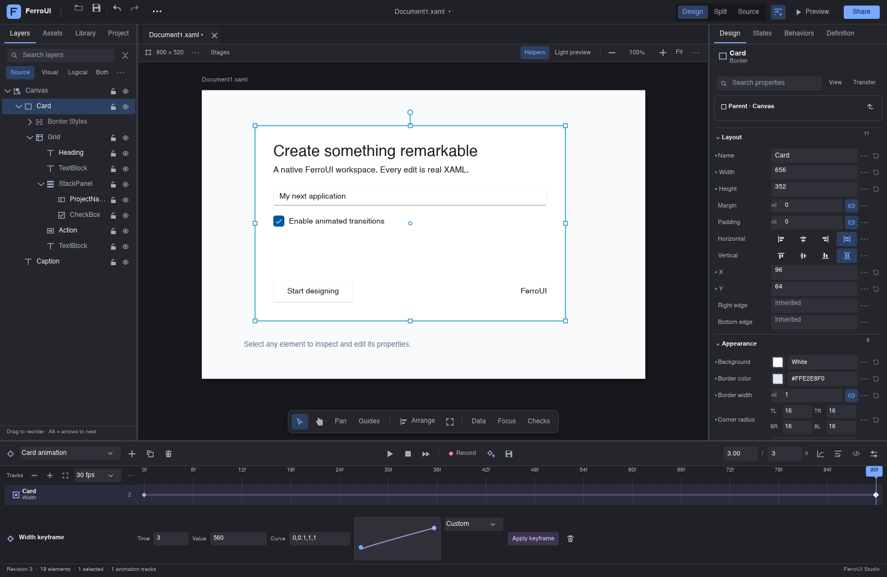

# FerroUI Designer Studio

Designer Studio is a native authoring workspace for FerroUI XAML and mapped Rust `rsx!` views.

The [VS Code extension](../../editors/vscode/README.md) embeds its native preview and source
editing tools beside FerroUI XAML and Rust `rsx!` files. The [VS Code user guides](vscode/README.md)
cover authoring, the animation Timeline, project and runtime tools, and MCP.
The workspace combines an artboard, synchronized source editor, object hierarchy, live visual and
logical trees, properties, layout manipulation, and animation tracks. All authored changes pass
through a document transaction; the artboard renders actual FerroUI controls.



This image is captured from the native Vello/HarfBuzz rendering test using WinUI controls and
the designer's scoped visual language. The [design study and token guide](visual-design.md)
explains the Blend, Figma and Penpot patterns applied throughout the workspace.
In the [animation capture](images/designer-animation.png), the property inspector retains
the authored Width of 656 while animation previews 608 at the
playhead; the source retains the base value. Effective values and value origins are available in
property-cell tooltips.
The compact workspace demonstrates the same controls at 1280 × 820.

The [Visual Studio/Blend, Figma and Qt workflow comparison](feature-comparison.md) records
the existing coverage and the latest additions: [design-time values and sample data](design-time-data.md),
local layer locking/hiding/isolation, native keyboard-order and label-target authoring, and
responsive preview environments. Open the [workflow sample](samples/DesignWorkflows.xaml)
to exercise them together.
Use **Checks** in the canvas toolbar to review measured overflow, rectangular clipping,
ineffective layout values, accessible names, and text contrast on supported opaque backgrounds.
Choose a finding to reveal the authored control or the specific layout value. The
`designer_preview_checks` MCP tool reads the same native findings.
`designer_preview_stage_checks` evaluates one current stage and its own environment.
The [canvas navigation and icon guide](canvas-navigation.md) covers mouse-wheel modes,
pointer-anchored zoom, hand panning, fit selection, per-tab cameras and compact vector icons.
The [selection and appearance guide](selection-workflows.md) covers selective property copy/paste,
layout resets, size matching, overlapping-layer menus and exact control-type selection.
Open the [selection workflow sample](samples/SelectionWorkflows.xaml) to try these commands
with a gradient source card, independent destinations and overlapping layers.
The [Xcode preview comparison and stage guide](xcode-previews.md) covers independent named
views, size/theme/orientation/direction comparisons, pinned previews, per-stage Live/Select,
native state scenarios and saved stage sets. Content-fitting layouts, direct resizing,
per-card zoom, bounded comparison matrices and native PNG export extend the same board.
Open the [preview-stage sample](samples/PreviewStages.xaml)
to compare Loading, Empty, Content and Error screens with actual native theme resources and
design-time sample rows.
The [multi-view prototyping guide](prototyping.md) compares Figma, Penpot, Android Studio,
Xcode storyboards and historical Qt/SketchFlow workflows. Search stages across documents,
define named flows and source-anchored navigation or overlay interactions, inspect
connections, and play a journey with independent native controls. The
[prototype sample](samples/PrototypeFlow.xaml) provides Home, Details and Settings screens.
The [overlay sample](samples/PrototypeOverlays.xaml) adds reusable editor, help and
confirmation views over a retained workspace, with nested dialogs, swapping and outside
dismissal. Both preserve native input during a run.

## Run

From the repository root:

```sh
cargo run -p designer-studio
cargo run -p designer-studio -- --file /absolute/path/to/MainWindow.xaml
cargo run -p designer-studio -- --file docs/designer/samples/DesignWorkflows.xaml
cargo run -p designer-studio -- --file docs/designer/samples/SelectionWorkflows.xaml
cargo run -p designer-studio -- --file docs/designer/samples/PreviewStages.xaml
cargo run -p designer-studio -- --file docs/designer/samples/PrototypeFlow.xaml
cargo run -p designer-studio -- --file docs/designer/samples/PrototypeOverlays.xaml
cargo run -p designer-studio -- --file samples/TodoWorkbench/app_preview/motion.rs --project samples/TodoWorkbench/Cargo.toml
cargo run -p designer-studio -- --project /absolute/path/to/solution
```

The desktop host uses the normal FerroUI desktop backend. A portable host can embed
`ferroui-designer` without taking a desktop backend dependency. A headless sample configuration
is available for automated hosts:

```sh
cargo check -p designer-studio --no-default-features --features headless,mcp
```

### Start a project in Studio

1. Open **Project** and choose the plus icon beside its title. Choose the RSX task counter or the compiled XAML binding starter.
2. Enter the package name and parent folder. Leave the dependency field empty to use the published FerroUI release, or enter the root of a source checkout.
3. Choose **Review project files** and inspect the generated sources in the tabs. The checkmark creates the project, opens the view, and loads its Cargo package. Use **Run** in the Project pane to launch it.

The checkmark beside the Project title reports the active Cargo and Rust versions and the installed target libraries. The same starter plans and toolchain checks are available through Studio and VS Code MCP. [Project setup tools](vscode/reference.md#create-a-project-with-mcp)

The workspace supports Window, UserControl and other Control roots. Register application-specific
control types and resource providers before loading their documents, just as an ordinary FerroUI
application does. Use `DesignerWorkspace::with_uri` when relative includes and resources need the
original document location. A raw resource dictionary or style document needs a host that supplies
an appropriate preview control; it is not a standalone control artboard.

The **Preview** command opens the actual platform Window, including decorations, sizing and
registered code-behind behavior. Its lifetime is owned by the preview and follows accepted source
changes. The inline artboard retains a content projection for selection and geometry editing.
`PreviewHostOptions` registers metadata callbacks, application root factories keyed by `x:Class`
or qualified root type, and resource preview factories. A factory receives the original source,
base URI and loader configuration; `PreviewRequest::populate` loads XAML into the real instance
before the host wires application handlers. Resource/style documents use `Design.PreviewWith`
or the supplied resource factory. Unregistered application classes produce a diagnostic requiring
their factory instead of being silently replaced by a framework control.

Open, Save and Save as use the host's existing native storage provider. Opening or closing a dirty
document presents a save/discard/cancel choice. Local saves write a temporary sibling and replace
the destination, checking that an existing file has not changed externally. Virtual storage files
use their provider's stream API. The workspace tracks the exact saved source so subsequent edits
remain dirty.

### Test a saved scenario

Open the folder that contains the scenario from Studio's **Project** pane and select the baseline review icon. Choose a saved XAML, RSX, or prototype scenario. Enter an optional local Git branch, tag, or commit and select **Run baseline review**. The comparison shows the chosen expected image, current native capture, and highlighted difference. Select the check icon to approve one capture after its assertions pass.



Studio uses the same `ferroui-designer-preview` helper as VS Code and CI. Build it beside Studio with `cargo build -p designer-studio -p ferroui-designer-preview` or set `FERROUI_DESIGNER_PREVIEW` to its executable. Studio's MCP tools can list, run, review, cancel, and approve the same saved scenario. [Scenario user guide](vscode/testing.md) · [Scenario MCP workflow](vscode/reference.md#review-and-approve-a-scenario-with-mcp)

## Native workspace

Designer Studio uses native WinUI controls with reusable scoped chrome: semantic color resources,
inset fields, full keyboard-focus outlines, quiet dock tabs and consistent vector commands.
The preview keeps its own application theme. The workspace starts in **Design** mode with a large artboard.
**Split** exposes the synchronized XAML editor, and **XAML** gives it the entire document area.
F6 cycles these views without reloading the document or discarding partially typed source.
**Fit** uses the measured canvas viewport. Wheel input pans; Ctrl/Cmd+wheel zooms around the
pointer. Shift+wheel pans horizontally, and middle drag or Space+left drag pans freely.
The **Pan** tool retains hand mode until Select or Interact is chosen. Open **…** beside
**Fit** for an editable percentage, fit selection, actual size and the alternate Blend wheel
mode. Shift+1 fits the artboard; Shift+2 fits the selection. Each retained document tab keeps
its view. See [canvas navigation](canvas-navigation.md) for input routing and host APIs.
The **Timeline** command releases its working space
when hidden and restores its resized height when reopened.
**Focus canvas** temporarily hides both docks and the timeline, preserving their sizes and view
state. Use the canvas shelf or Ctrl+Shift+F / Cmd+Shift+F to restore them. `V` selects objects;
`I` interacts with the native preview when no text editor owns input.
**Data** opens design-only property/sample authoring. **Focus** opens the scoped tab-order
and label-target editor with native canvas badges. The **…** action beside the canvas
dimensions opens size presets, orientation, theme and reading direction. Layers rows and
their action menu expose local lock/hide/isolation without changing application visibility.
**Stages** opens a comparison board of independent native views. Each stage can use an open
document or supported authored definition, its own environment, design data setting and
visual-state endpoints. Pinning keeps a stage visible across document tabs; Pause suspends
automatic source updates. **Focus** returns its context to the editing canvas. Stage settings
remain separate from authored XAML and can be saved as a versioned set. See the
[preview-stage guide](xcode-previews.md) for exact behavior and platform boundaries.
Studio's `designer_preview_stage_states` MCP tool lists the scoped authored choices used
by the stage editor and the VS Code **States…** action.
Open **Review design tokens** from Studio’s **Project** toolbar. Import a DTCG file or export the active XAML resource dictionary. Inspect the mappings and generated file, adjust keys, paths, supported representations, or the logical pixels per `rem`, then save a new local file. Studio, VS Code, and `designer_design_tokens` share the conversion planner for colors, dimensions, durations, layered shadows, gradient brushes, easing curves, and typography. Apply a generated typography theme to a `TextBlock` or reference its standalone font family and weight. [Design token guide](vscode/authoring.md#review-a-design-token-conversion) · [Studio review](images/studio-design-token-review.png)

### Review design handoff

With a solution and receiving view open, select **Review design handoff** from **Project**. Open a local `.ferroui-handoff.json` with the folder icon. The review resolves exact Toolbox IDs and scoped Library definitions. It shows proposed file transfers and the authored reference for registered or local assets. Use the arrow on a pending transfer to copy the reviewed bytes. Use the plus to place a control or raster relative to the current selection. The source and preview icons open a resolved definition in its Library scope. [Manifest format and steps](vscode/authoring.md#review-design-handoff) · [Handoff MCP workflow](vscode/reference.md#review-design-handoff-with-mcp)


The stage editor supports fitting either or both axes using native measurement. A resize
grip applies fixed logical dimensions while preserving Live control state; card zoom
changes only display scale. **Compare matrix** combines size, theme, direction, design-data
and authored-state choices within the board's capacity. **Save preview image…** saves the
current accepted native stage as PNG, excluding designer commands and display zoom.
**Current document** / **All views** and search organize the stage board without changing
pinning or native state. **Prototype** opens named flows and their reachable-screen
connections. **Add interaction…** binds an authored control to Navigate, Back, Open overlay,
Swap overlay or Close overlay. The player uses a separate native run so returning to a
screen or overlay retains that run's text and control state. Modal overlays keep the base
screen visible, offer nine placements or bounded manual coordinates, and support optional
outside dismissal and dimming. Back closes the top overlay before navigating screen
history; Restart clears both while retaining native controls. Starting a new Play run
creates fresh controls. Stage sets use version 3 for overlay graphs, version 2 for
Navigate/Back graphs and version 1 for no graph, with portable stage references. See
[interactive prototypes](prototyping.md) for source guards, keyboard input and automation.

The left dock switches between **Layers**, **Assets**, **Library** and **Project**:

- **Layers** uses a virtualized TreeDataGrid for source, visual and logical trees. Expansion and
  selection are retained across refreshes. One column shows semantic kind icons and authored
  names or resource keys; tooltips retain full type information. Native type-ahead and the
  selection-preserving Collapse layers command help navigate deep trees. Search keeps matching ancestors visible and does not
  modify document selection. Authored source rows support ordered multi-selection drag and drop
  before, after or inside compatible containers. Drops use one source transaction and one undo
  step; generated runtime rows, stale drags, cycles and occupied single-content hosts are rejected.
- **Assets** is a reusable searchable catalog with categories, vector icons, native keyboard
  activation and drag-to-place behavior. Switch between visual Grid cards and a compact List with
  descriptions without losing filters. Hosts can register their own snippets and icons with
  `DesignerWorkspace::register_asset` or use `AssetToolbox` independently.
- **Project** uses a hierarchical TreeDataGrid for project folders, XAML documents and assets.
  File activation shares the same canonical URI identity as tabs, language edits and saves.
- **Library** catalogs authored controls, templates, themes, styles and resources, together with
  source-backed project and host libraries. Instance links expose **Edit current** and **Edit a
  copy**; a definition canvas retains original source identities and a return path to the instance.
  See [components, themes and resource scopes](components.md) for the reusable catalog, native
  inspectors, project registration and atomic dependency-copy contracts.

The property dock is a TreeDataGrid with collapsible categories and lazily created value editors.
It includes scrubbable numeric labels, visual alignment/flow choices, linked spacing/corner
radii, solid-color swatches, tri-state booleans, enum pickers, expressions and mixed selections.
Uniform components use one **All** field; the chain control reveals the independent sides.
The color flyout reuses native ColorView spectrum, palette, components and alpha controls.
Picker changes remain drafts until Apply and create one undoable source transaction.
Search supports multiple terms and `@modified` / `@local` filters. Enter commits typed text or
numbers; a scrub commits once on release and cancels with Escape. Custom editor factories take
precedence over the built-ins. The reset
button removes the authored value. Object-valued property elements can be revealed in XAML
and reset without flattening their object graph. Tooltips read the current runtime type, effective
value and priority when opened, so animation sampling does not replace the editor or its draft.
An editor retained across a document switch or revision change cannot write to the new document.
The shared [typed property editor pipeline](property-editors.md) also supplies compound values,
reflected enums/flags, font and time values, structured bindings, theme-aware resource choices,
resource extraction, and staged object/collection editing. The same metadata-aware factories
serve instance properties, theme setters, resource objects and nested object drafts.
Runtime-only objects remain inspectable without receiving invented source IDs.

Drop a value onto a property cell to validate and apply it to the selection. Drag a keyed resource
from Layers for a static resource reference, Shift-drag for a dynamic reference, or Alt-drag a
named element for an ElementName binding. The destination object stays selected throughout the
gesture. Internal reference drops check source identity and destination scope before authoring.

The contextual **Layout** section exposes common settings for the selected panel or the common
parent of selected children. Grid row/column editors support pixel, star and Auto lengths, plus
insertion/removal that updates child indices and spans in the same transaction. Explicit
definition metadata and comments survive the operation. Effective styled cell placements are
preserved; bound placements and externally supplied definition collections are protected.
See the Grid layout capture.

The **Helpers** canvas command adds panel-specific layout visualization and direct editing.
Grid exposes measured cells and track grips; Stack, Wrap and Flex expose flow, gaps and insertion
boundaries; Dock and UniformGrid show the destination the native layout will use. Content holders
show available slots and explain rejected occupied slots. Selected children expose margin grips,
and supported containers expose padding. Dragging between panels previews the actual source move,
including Grid/Dock attached values and affine Canvas placement, before one undoable commit.
Native control ghosts, bounded alignment guides, neighboring distances and size labels provide
feedback while the accepted document remains unchanged.

Press **H** to toggle helpers, **F8** or **Shift+F8** to cycle grips, and use arrows to adjust the
focused value (Shift: ten units; Ctrl: one tenth). Escape cancels; Alt retains free manipulation.
See the [layout helper architecture and extension guide](layout-helpers.md) for the portable
provider contract, coordinate frames, guarded transactions and namespace-stable custom panel
registration. The [layout playground](samples/LayoutHelpers.xaml) can be opened with
`designer-studio --file docs/designer/samples/LayoutHelpers.xaml`.

The canvas **Arrange** menu exposes alignment, equal-gap distribution, source ordering and
nesting through the existing panel layout adapters. Layers supports Alt+Up/Down to reorder,
Alt+Home/End to move first/last, and Alt+Right/Left to nest/unnest. Canvas arrows nudge by one
unit (Shift: ten; Ctrl: one tenth); Shift-drag locks to the dominant axis. Directional marquees
select contained objects left-to-right and intersecting objects right-to-left. Canvas selection,
hierarchy selection and properties refer to the same
session. The select and interact tools switch between source manipulation and live control input.
The top command bar keeps document/history actions visible and moves secondary file/edit actions
into its native overflow menu.

The animation editor has a fixed time ruler, two-line object/property headers, violet keys and
authored ranges, a blue playhead, and a fixed contextual keyframe editor. The ruler and editor
stay available while tracks scroll. A sampled easing preview follows the actual engine curve,
including overshoot; invalid drafts clear the graph. Ctrl-click toggles keys, Shift-click
selects ranges, and dragging empty lane space selects a marquee. Move, duplicate or delete
groups across tracks in one undoable source transaction. Selected keys keep their relative
offsets, values and easing; collisions reject the
entire edit. Choose seconds or 24/30/60 fps snapping. Double-click a lane to record, or use arrow
keys to nudge selected keys. Escape and lost pointer capture cancel a drag without authoring it.
Ctrl+wheel or +/- zooms the timeline; Shift+wheel or PageUp/PageDown pans the visible range.
Choose **Value curves** from the **Animation graph** icon to graph properties on the same
ruler and playhead. Each track scales to its visible values, including overshoot. Drag an
authored key to change its time and the selected component in one Undo step. Use Alt+Up or
Alt+Down on a selected graph key to change its component by one percent of the visible range.
Select the key to edit its complete value in the inspector. [Component workflows](vscode/motion.md#edit-a-curve-component)

Choose **Velocity curves** to graph signed property units per authored second. Drag a marker beneath
the trace to retime its key. Change its incoming easing in the inspector to shape the velocity.
The fit icon frames a selection in either display. `designer_animation_curve` accepts
`metric: "velocity"` for the same native samples.

For transform component tracks such as `RotateTransform.Angle` or
`TranslateTransform.X`, the graph samples the matching native transform object.
Use the key inspector to edit its value or add a sampled key at the playhead.
Studio and App Preview keep the original transform and use its properties when
the animation has an implicit endpoint. [Animate a render transform](vscode/motion.md#animate-a-render-transform)

Use a `RenderTransform` key to animate a complete ordered list. The native graph exposes individual
translation, rotation, scale, skew, and matrix operations and the coefficients of the combined
transform. Record or edit the whole list from the key inspector.
[Animate a transform list](vscode/motion.md#animate-a-transform-list)

For inline gradient brush keys, plot the native stop offsets, RGBA components, opacity, or brush
geometry. Choose the key inspector to edit a literal brush, or record the complete brush at the
playhead. The animation clock and checked XAML or Rust source edit are shared with VS Code and MCP.
[Animate a gradient brush](vscode/motion.md#animate-a-gradient-brush)

For a `BoxShadow` track, choose a numbered shadow and an offset, blur, spread, or tint channel.
The native graph follows the layer order and separates segments where a layer changes between
inner and outer. Use the key inspector to edit the full list or record it at the playhead.
[Animate layered box shadows](vscode/motion.md#animate-layered-box-shadows)

Use the picker beside a supported geometry track to see one coordinate, dimension, side, or
corner. Drag beneath the trace to retime its key or use the inspector to edit the complete
geometry value. The MCP program catalog lists the same `curve_channels` for a track.
Relative points and scalars show separate percentage and logical pixel curves. The trace
leaves a gap while the other unit is active. Velocity uses percentage points or logical
pixels per authored second. [Inspect a curve that changes units](vscode/motion.md#inspect-a-curve-that-changes-units)



For a color or solid brush track, the picker offers red, green, blue, and alpha. The value
graph keeps a 0–1 scale. The key inspector edits the full hex color in one Undo step.
[Inspect a color animation](vscode/motion.md#inspect-a-color-animation)



For a literal blur or offset drop shadow, choose **Value curves** or **Velocity curves** and
select the radius, a shadow offset, or a shadow tint channel. The graph reads the native animator
and leaves gaps for unset poses. Use the contextual key editor for the complete effect literal,
or record the sampled native value at the playhead. [Inspect a blur or drop-shadow animation](vscode/motion.md#inspect-a-blur-or-drop-shadow-animation)

Native effect objects add separate **Shadow opacity** and, for directional shadows,
**Direction** and **Shadow depth** curves. Open a key to edit its complete object value.
Studio keeps direct objects and `Setter.Value` properties in their authored forms. Mapped
Rust keys keep their immutable effect constructor. MCP exposes the same native curves
and checked key edits. [Edit directional shadows and independent opacity](vscode/motion.md#edit-directional-shadows-and-independent-opacity)

The same Effect lane plots named parameters from the native registry, including library shaders such as `spotlight`. Select a parameter in the graph and use the key inspector to edit the authored literal. [Animate registered shader parameters](vscode/motion.md#animate-registered-shader-parameters)

The contextual editor validates time, value and easing together before one undoable transaction.
The **Add a keyframe at the playhead** icon command records the selected track's live property
value, with Opacity as the initial fallback for an object without a track. The **Animation name
and target** icon command reveals program details; creating or duplicating programs allocates
useful unique defaults even when those details are closed.
Keyboard focus follows accepted timeline and Grid edits so repeated edits stay in the same
control. The multi-key timeline capture shows group
selection with frame snapping enabled.
The motion editor capture shows multiple property tracks
and the live easing graph. **States** and **Behaviors** use the full inspector height;
behavior pickers reveal the fields relevant to the chosen trigger and action.

Reusable public controls and workspace APIs include `designer_chrome_style`, `AssetToolbox`,
`AssetViewMode`, `DesignerAsset`, `AssetIcon`, `TimelineLane`, `EasingPreview`,
`PropertyNumberScrubber`, `PropertyComponentsEditor`, `PropertyColorEditor`, `GridTrackEditor`,
`OutlineCommand`, `WorkspaceViewMode`, `NavigationPane`, inspection-grid accessors and the
workspace's single/group keyframe APIs. The workspace routes authoring callbacks through its
session; standalone hosts supply their own transaction callbacks. The controls do not modify
runtime controls behind the document authority. The
[native controls guide](native-controls.md) includes host integration examples and the complete
property, layout, hierarchy, asset and timeline interaction contracts.

Native rendering also covers the asset catalog,
asset list, [split view](images/designer-split.png),
canvas focus, color popup,
states, behaviors,
animation settings and [sharing](images/designer-sharing.png).
The [engine performance report](performance.md) records controlled workloads, raw measurements,
reproduction commands and the initial-index tradeoff separately from UI verification.

## Crates and ownership

| Crate | Owns | Runtime dependency |
| --- | --- | --- |
| `ferroui-designer-core` | Lossless XAML syntax, source spans, stable local IDs, atomic edits, revisions and history | None |
| `ferroui-designer-tools` | Layout adapters, property metadata/editor contracts, geometry, selection and manipulation planning | None |
| `ferroui-designer-animation` | Typed keyframes, easing, deterministic sampling, playback and native animation XAML interchange | None |
| `ferroui-designer-collaboration` | Replicated operations, shared identities, conflict reporting, snapshots, version summaries and presence | Document core |
| `ferroui-designer-collaboration-host` | Durable authenticated rooms, invitations, ACLs, checkpoints, peer transport and offline outboxes | Portable store; optional existing MCP service/client |
| `ferroui-designer-project` | Cargo/loose-file solutions, resource paths, versioned document buffers, save/rename and cancellable build/run tasks | Document core |
| `ferroui-designer-language` | Runtime-derived schema, diagnostics, completion, navigation, refactoring, formatting, semantic tokens and stdio LSP | Core and project engines |
| `ferroui-designer` | UI-thread session, live preview, native controls, property editors, design surface, timeline and optional MCP tools | FerroUI runtime |
| `designer-studio` | Application lifetime, document IO, desktop/headless startup and opt-in MCP hosting | Workspace and selected platform |

These boundaries let a command-line tool or service manipulate documents without loading the
windowing, rendering, inspection or hot reload stack. The UI library starts neither a process nor
a network service when it is linked.

## Embedding the workspace

After ordinary FerroUI application and theme initialization:

```rust
use ferroui_controls::{Control, Window};
use ferroui_designer::DesignerWorkspace;

let workspace = DesignerWorkspace::new(source)?;
let window = Window::new();
window.set_content(Some(Control::boxed(&workspace.control())));
let session = workspace.session(); // Rc<RefCell<DesignerSession>>, owned by this UI thread
```

Keep the workspace alive for the lifetime of its view. Hosts can register native property editor
factories and portable layout adapters. The source buffer is available through
`session.borrow().document().source()` for the host's storage workflow.

The facade also exposes `ferroui::designer` with its `designer` feature; `designer-mcp` adds the
optional MCP adapter. Neither feature selects a windowing or rendering backend.

Sharing a document through the collaboration host (`ferroui_designer::sharing` and the Share panel
of the workspace) is the default feature `collaboration-client` of `ferroui-designer`, which the
facade and Designer Studio (its feature `collaboration`) turn on. A browser host builds without it:
the HTTPS client of the host has no TLS random source on `wasm32-unknown-emscripten`. Without the
feature the sharing module does not exist and the workspace hides its Share button.

## Source, syntax and preview are separate states

There are three relevant values:

1. **Authored source** is what the user typed. It can temporarily be invalid.
2. **Last valid syntax** supplies the source AST and document-local node identities.
3. **Accepted runtime preview** is the last revision FerroUI successfully loaded and applied.

A malformed tag does not delete the authored text. A well-formed but unknown control does not
replace a working preview. Visual manipulation requires the accepted preview to match the
current valid document revision; this prevents stale geometry from writing changes into newer
source. Source edits can be accepted immediately while expensive preview work is debounced.

Debug builds reuse `HotReloadSession` and `ContentReloadTarget` for accepted preview changes.
Designer sessions opt into runtime-only structural contract updates so adding named controls and
changing the root remains a normal authoring operation. Compiled application sessions keep their
existing contract protections; a runtime-only session rejects a compiled class binding. The new
contract becomes authoritative only after its staged target commits successfully.
Release builds use a staged runtime XAML load and replace the preview only after loading succeeds;
the existing hot reload package is development-only. Both paths reuse FerroUI's runtime loader and
retain the last accepted preview on failure.

The AST retains comments, CDATA, processing instructions, namespaces, attribute spelling and
quotes, text nodes, property elements, and markup expressions. A parse followed by no edits
preserves every byte. Visual changes use UTF-8 source patches rather than reformatting the whole
file. Namespace-aware reparenting preserves the meaning of moved elements.

The engine validates XML structure. FerroUI's existing XAML loader resolves control types,
properties, resources, bindings, templates and converters. Unknown syntax is preserved by the
editing engine even when the runtime cannot preview it.

Lexical namespace declarations work throughout the parser, transformations, runtime loader and
compiled emitter. Nested declarations and prefix shadowing apply at their source occurrence;
deferred templates capture the declaration's namespace scope. Markup extensions and reflection
binding paths use the same scope in interpreted and compiled content.

### One transaction for every authoring path

```rust
use ferroui_designer_core::{Document, Edit};

let mut document = Document::new(
    r#"<Canvas><Button Name="Action" Width="100" /></Canvas>"#,
)?;
let button = document.ast().find_name("Action").unwrap();
let expected = document.revision();
let change = document.apply_at(expected, "Resize button", vec![
    Edit::SetAttribute { node: button, name: "Width".into(), value: "180".into() },
    Edit::SetAttribute { node: button, name: "Height".into(), value: "40".into() },
])?;
assert_eq!(change.previous_revision, expected);
document.undo()?;
document.redo()?;
```

An invalid edit in a batch rolls back the entire candidate. Revision guards reject stale
commands. Pointer gestures preview transient geometry and commit one history item at completion.
Source history includes invalid drafts, so undo restores what the user actually authored.
Immutable AST/source snapshots share storage through `Arc`; property batches coalesce assignments
before reparsing. The core tests exercise a 10,000-element document.
Source offset mapping uses a prefix-delta table and binary search for batch patches; a separate
4,096-element mixed-property transaction verifies stable syntax identities and undo/redo.

## Property and layout extension points

The native inspector exposes registered writable properties, attached properties and authored
attributes. Editors distinguish an explicitly empty value from an inherited value, support mixed
multi-selection values, and route reset operations through source editing. Runtime-only generated
objects can be inspected without pretending that they have an authored XAML node.

A `PropertyEditorFactory` creates a native control from `PropertyEditorContext`; its callback
receives an optional source value, where `None` means reset. The portable `PropertyRegistry` and
`EditorRegistry` supply typed contracts for hosts that use a different UI. Expressions are kept as
expressions. Layout tools refuse to overwrite a binding or resource reference as a side effect of
a drag.

`LayoutRegistry` associates panel types with `LayoutAdapter` implementations. The built-in set
covers Canvas, Grid, StackPanel, ReversibleStackPanel, WrapPanel, DockPanel, UniformGrid,
RelativePanel, FlexPanel and ordinary Panel, with explicit ownership rules for generated
virtualizing and internal panels. Grid track edits preserve definition property elements and
min/max/shared-size metadata. The host supplies measured tracks for Auto sizing. See
[`FerroUI.Designer.Tools/README.md`](../../src/FerroUI.Designer.Tools/README.md) for the exact
capabilities and extension contracts.

The geometry layer supplies affine transforms, snapping, alignment, distribution, marquee
selection, ordered selection and manipulation revision guards. Coordinate conversions must use
actual parent transforms; the portable engine accepts measured geometry rather than guessing a
second layout system. Batch planning validates multiselection operations as one transaction,
including operations spanning different layout parents. The registry recognizes 30 built-in
panel, content-host and framework-layer names; generated containers expose ownership restrictions
instead of accepting edits that their item generator would overwrite.

Resize handles follow the element's transformed quadrilateral. Pointer deltas are converted through
the actual ancestor/element matrices, including nonuniform scaling, skew, mirrors and absolute or
relative transform origins. Rotation and property-element transforms preserve their source and
compensate around the actual origin. Noninvertible geometry is rejected without changing source.
Native planners receive resolved styled/bound layout values and measured geometry. Registered
custom panels receive a generic child-insertion/reorder adapter and transform-preserving movement
and resize; a host adapter can provide additional panel-specific semantic commands.

Duplicate allocates unique names and program identities, rewrites references across copied
siblings and descendants using the same namescope-aware language index, and updates copied state
metadata. External references and ambiguous declarations retain their original meaning. Single
content hosts and generated containers continue to enforce their actual ownership rules.

## Animation authoring

The animation model uses FerroUI's native `Animation`, `KeyFrame` and `Setter` markup. It does not
introduce a second runtime animation dialect. The workspace imports supported animation markup,
records property changes as keyframes, writes them through the document transaction, and samples
preview values at animation priority. Stop restores ordinary source and style values. Source
reload restores the elapsed playback position when the authored program can be resolved. The
typed sampler retains per-target visibility clocks. Natural playback completion respects the
animation's fill mode and can retain the final sample.

The program picker enumerates every Animation in local/shared/nested styles and resources. Each
program retains its own selector, targets, timing, tracks and persisted UUID. Create, rename,
duplicate, remove, edit source, select preview targets and play-all operate on independent programs.
Selectors are matched by the native style system; per-target underlying values and visibility clocks
are retained. Resource programs can be previewed against explicit targets. Graphical track lanes
support scrubbing, keyframe selection and dragging, with explicit time, easing and removal controls.

### Arrange clips on a shared ruler

Open [ClipSequence.xaml](samples/ClipSequence.xaml) and choose **Compare animation clips** in the
Timeline toolbar. The ruler and **Time** field seek the elapsed time shared by the visible clips.
Use Play and Stop to rehearse the arrangement. Use the ruler controls to zoom and fit the clips.

Drag a bar to move its start. For exact placement, select its name and enter **Start (s)** below
the rows. Select names in sequence order to reveal **Gap / overlap (s)**. Apply zero for adjoining
clips, a positive gap, or a negative overlap. One Undo restores the original delays together.
The placement uses native XAML `Delay` or a mapped Rust `.delay(...)` and preserves the keyframes
and existing triggers. Use the compare icon again to return to the selected program's keys.
[VS Code workflow and MCP arguments](vscode/motion.md#compare-and-sequence-clips)

App Preview uses the same placement rules with the selected binary’s registered animators and
resolved timing. It samples the combined pose before displaying a compatible source replacement.
[App Preview clip workflow](vscode/motion.md#compare-clips-in-app-preview)

### Rehearse a preview range



Choose **Preview range** beside Play and Stop to open the settings below the tracks. Enable
**Limit playback to preview range**, enter **In (s)** and **Out (s)**, and choose **Apply range**.
With the ruler focused, `I` and `O` set either
boundary at the playhead. The ruler shows the selected interval and playback starts at In when the
playhead is outside it. Enable **Loop range** to wrap back to In or clear it to hold the rendered
pose at Out. Use Pause to inspect the current pose and Stop to restore the base artboard.

Typed tracks use authored seconds in the keyframe view. Clip comparison and the fallback native
clock for opaque programs use elapsed seconds. The work area is a Timeline view setting. It
preserves authored timing, keys, and triggers. A compatible source edit retains the native pose
and fits the work area to the replacement clock. In Studio MCP, use `designer_program` with
`action: "play_range"` and a `range` containing `start`, `end`, and `loop`. Include `all: true` for
the shared clip clock. [App Preview range workflow](vscode/motion.md#rehearse-a-range-in-app-preview)

### Bookmark poses in Designer Studio



Pause, seek to the pose, then choose **Preview range**. Enter a **Marker name** below the range settings and press Enter or choose **Add or update marker at playhead**. Click the amber mark on the ruler or the named row to return to the pose. Use the remove icon beside its time to delete it. Set the same name again to move the mark to the current playhead.

The keyframe view and **Compare animation clips** keep their own marker lists. Typed keys use authored seconds, and the shared ruler uses elapsed seconds. Markers stay with their preview scope and are kept out of source and Undo history. In Studio MCP, read `designer_timeline_markers` with the current `expected_revision`. Use `designer_timeline_marker_edit` with `action`, `name`, and `time` for `set`. Use `name` for `seek` or `remove`. Supply `program` for a particular clip or `all: true` for the shared ruler. [VS Code and App Preview marker controls](vscode/motion.md#bookmark-preview-positions)

### Edit property transitions

Select a control in XAML Design and choose the clock icon next to **Definition**. Choose a registered target property and use the add icon to create a transition. With an entry selected, use the target icon to change its property, the arrows to move it, or the minus icon to remove it. Edit literal duration, delay, and easing, and choose the check icon to apply them. Use the source icon to reveal the declaration. Switch the artboard to **Interact** and trigger the property change to verify its native behavior. [Property transition example](vscode/motion.md#edit-property-transitions) · [Studio collection editor](images/studio-property-transition-collection.png)

An inline Rust `ferroui_view::transitions` collection also renders on the native artboard. Select the RSX invocation and open the same panel to edit its entries. Duration and easing changes apply to the active Rust declaration. Switch the artboard to **Interact** to see its authored transition when a property changes. [Supported Rust builders](vscode/motion.md#preview-and-edit-property-transitions-in-rust)

### Edit tracks and keyframes

Select a key and drag either handle in the incoming easing graph. The graph and **Curve**
field show the draft together. Handle X is bounded from 0 to 1. Drag Y beyond the start or
end value to add anticipation or overshoot. Escape cancels a drag. To edit with the
keyboard, focus the graph, press Space to switch handles, and use the arrow keys. Hold
Shift for larger steps or Ctrl or Command for finer steps. Press Enter or choose
**Apply keyframe** to write the checked XAML or mapped Rust edit in one Undo step.
The graph stays focused when a keyboard apply rebuilds the Timeline.



To change the spacing of selected keys, set the playhead to the pivot, enter a **Factor** in the
selection inspector, and choose **Scale from playhead**. For example, `0.5` halves each key's
distance from the playhead. Studio preserves each key's value and easing and applies the change in
one Undo step. For a shared Rust cue, include each setter on the cue in the selection.

Use the **Keyframe Actions** icon beside the snap picker to copy, paste, and mirror a
selection across tracks. **Paste at Playhead** maps the copied tracks to existing compatible
properties and keeps their relative spacing. **Paste Reversed at Playhead** reverses the
sequence. **Mirror About Playhead** reflects the selected keys in place. A successful paste
or mirror is one source transaction. In a focused lane, use Ctrl+C or Command+C to copy
and Ctrl+V or Command+V to paste. Hold Shift while pasting to reverse the keys. Studio
and VS Code use the same typed clipboard and authoring tools. [Transfer keys between editors](vscode/motion.md#copy-paste-and-mirror-keyframes)

Supported values include numbers, colors, points, vectors, sizes, rectangles, corner radii,
relative points/scalars, thicknesses and discrete values. The portable
engine implements linear-light color interpolation, cubic Bézier inversion, named FerroUI easing
families, parameterized spring easing, delay, delay between iterations, speed, finite/infinite repetition, direction, alternate
playback, native visibility behavior and fill modes.
Times are seconds in the editing API and native 100 ns times in exported markup. Import/export
checks native duration grammar, timing range, repeat range and keyframe quantization collisions.

A `CompiledTimeline` validates once and can be sampled repeatedly without rescanning all model
validation. Deterministic seek/scrub is independent of a wall clock. The live runtime's property
system remains authoritative about which property types and converters can actually receive an
animation value.

The `designer_animation_curve` query plots a scalar track over a range of authored seconds. Typed
tracks use the same compiled target and underlying value as Studio’s scrubber. Registered scalar
animators use the loaded native interpolation with temporary setter bindings. The query leaves the
active playhead and target property unchanged. Studio and VS Code route curve drags through
the same checked transaction as the keyframe editor. With the negotiated animation curve
protocol, App Preview also samples its loaded native animator and uses the source document's
animation codec to plan editable XAML keys.

Programs with native object payloads also use the accepted runtime Animation objects directly.
Source provenance identifies the matching style or resource program, and an explicit preview clock
drives the framework's own shadow, gradient, effect, integer, transform-component and registered
custom animators. This preserves native interpolation for values outside the portable model.
Studio also uses the registered native animator when it can author a typed track for its property.
App-hosted design uses the same clock and native animation layer in the Cargo target’s process.
The additive `Animation::apply_for_preview` retains final fill and generated transforms at animation
priority; disposal restores underlying values and live bindings. Application `apply` behavior stays
unchanged. Failed setup unwinds its temporary subscriptions and values before reporting the error.

`AnimationCodecRegistry` allows application-specific typed tracks and animator payloads to share
the same program, transaction and preview workflow. A codec receives original source and can
preserve its custom objects. Unknown payloads remain available in the program's source editor;
typed edits require a codec that represents them faithfully. See the
[animation crate documentation](../../src/FerroUI.Designer.Animation/README.md) for interchange
rules and runtime semantic tests.

Register the same codec with `DesignerSession::register_animation_codec` for an embedded Studio
session and `ferroui_designer_support::register_preview_animation_codec` in the application
preview's UI-thread setup for VS Code. App Preview offers keyframe editing when the codec can
decode an accepted XAML clip and round-trip its key values. A codec can expose a native
property through a text representation and validate each authoring edit. Playback uses the
property's registered animator. [Todo Workbench shadow codec](../../samples/TodoWorkbench/app_preview/animation_codec.rs)

App Preview uses the same authored program IDs and source paths as Studio when a valid source
replaces its native tree. The relay resolves the selected clip and assigned controls, then samples
the application at the retained elapsed time before it sends the replacement image to VS Code.

### RSX style animations

Attach an `AnimationBuilder` to an inline Rust style. The view mounts the same native
`Animation`, `KeyFrame`, and `KeySpline` objects that FerroUI uses for XAML.

```rust,ignore
rsx! {
    StackPanel {
        styles: [
            ferroui_view::style("Border#Card").animation(
                ferroui_view::animation(ferroui_view::ms(800))
                    .key_frame(0.0, |key| key.set(ferroui_base::Visual::opacity_property(), 0.2))
                    .key_frame(1.0, |key| key.set(ferroui_base::Visual::opacity_property(), 1.0)
                        .key_spline(0.25, 0.1, 0.75, 1.0))
            ),
        ],
        Border { name: "Card", width: 180.0, height: 80.0, background: "#1660A0" }
    }
}
```

Studio and the VS Code designer map fully qualified FerroUI builders in the active `rsx!` invocation.
They support literal selectors, millisecond duration and delay, fill, iteration count, and
named easing. Keyframes can use scalar values and supported native geometry constructors.
When several setters share a Rust keyframe, the designer can edit each value. Select all the
setters on that cue to move them together. Edit a shared easing in Rust. Use the warning icon in Timeline or App Preview
to see an explanation for each unsupported clip and open its declaration.

Open a `.rs` file in Studio and use the **RSX view** picker in the source pane to switch
invocations. The canvas renders the selected projection. The editor, Save, and Undo operate
on the original Rust file. A draft with incomplete tokens keeps the last accepted artboard
visible. Mapped properties and supported static layout edits use the same checked patches.

### Project animation accessors

A `MarkupAssembly` can declare the correspondence between a fully qualified Rust getter
in `KeyFrameBuilder::set` and a styled property from the build-generated XAML schema.
Use the local `crate::` spelling or the dependency crate's qualified path. The getter
must return the same registered property as the named accessor.

```rust,ignore
(
    "FerroUI.Designer.RsxAnimation.v1:crate::app_preview::motion::review_corner_property",
    "::ferroui_controls::Border::corner_radius_property",
)
```

The mapper reads the registered value type from Cargo's `.xamlmeta` outputs. It handles
`f64`, `CornerRadius`, `Thickness`, `Point`, `Vector`, `Size`, and `Rect` values when the
authored arguments use supported literal forms, such as `CornerRadius::new` or `uniform`.
An edit uses the existing constructor shape and patches its numeric arguments in place.
Use a named selector such as `#ReviewCard` for a project-only control. Open App Preview
to load the project's registered control and animator. See the [Todo Workbench motion
example](../../samples/TodoWorkbench/app_preview/motion.rs).

Select a key in Timeline to change its time, value, or incoming spline. Studio checks the
native track and the helper patches the original Rust tokens in a single undoable edit.
Click **Add keyframe at playhead** or double-click a property track to record its effective
value. Use the keyframe actions to move, scale, duplicate, copy, paste, mirror, or delete mapped keys together.
Duplicating keys preserves their values and easing, and deleting one setter in a shared cue
leaves the other setters intact. In Studio, select the package in
**Project**, enter its optional Cargo features, and run **Check** or **Build** to load the
registry. For Todo Workbench, use the `app-preview` feature.
Source reveal takes you to the animation declaration in the active invocation. Agents can
validate `designer_keyframe_draft` or use the shared `designer_program` actions with the
current designer revision. [Rust Timeline controls and MCP actions](vscode/motion.md#edit-mapped-rust-clips-and-state-routes)

Use **New animation program** in Studio’s Timeline toolbar to add an inline style animation to
the selected Rust control. **Animation name and target** opens the name field. Rename, copy,
and delete clips with the existing Timeline controls. A source comment preserves the name and
identity, and a copy receives its own identity. The selector and timing are available in the Rust
source. Studio MCP uses the same `designer_program` actions and source history.

App Preview validates the same mapped Rust key against the application's loaded animation and
codec. It sends a source-checked Rust patch to the editor and keeps the compatible elapsed
position when the edited invocation renders. An isolated preview uses the native animators
registered in the designer process. For project-specific motion, use App Preview and its
`designer_hosted_keyframe_draft` and `designer_hosted_keyframe` tools. Agents can read
`sourceIssues` in the program catalog and navigate with `designer_animation_issue` or the
app-hosted animation action `reveal_issue`.

## Visual states, transitions and behaviors

The **States** panel authors groups, named states, target setters, default/directional transitions,
durations and easing. Source models emit real FerroUI classes, styles, native Animation objects
and existing behavior actions. State navigation, seeking and playback use actual runtime values.
Directional routes use the framework's existing ConditionalAction implementation.
In VS Code, the States action opens a route in the Timeline. The `designer_state` tool can
sample the same explicit route at a requested time through `preview_transition`.

### Rust visual states

Declare typed state groups inline with `visual_states: [ferroui_view::visual_state_group("Review")…]`.
Use `visual_state("Queued").set(property, value)` on the group owner or
`set_on("Card", property, value)` on its named control. Routes use
`transition(Some("Queued"), "Ready", ferroui_view::ms(640), "CubicEaseIn")`.
A `None` starting endpoint declares a default route. The compiled view calls
`ferroui_view::set_visual_state` to enter a state or clear it. State properties use native or
application-registered animators. Clearing the state restores the underlying values and bindings.

Select the owner and open **States** to add a group. Add states and property setters
from the group controls. In the Transitions section, choose the endpoints, duration
in whole milliseconds, and the easing. Use the playhead in Studio or the Timeline
transport in VS Code to sample a default or directional route. The reveal control
opens the authored Rust declaration.

To enter a state from a control event, select the event source and open **States**.
Under **Event triggers**, choose the routed event and its enclosing group and
state in **Destination**. Use the **Link event to state** icon to apply the
source edit. Pick the same event and a new state in the same group to retarget
the link. The reveal and remove icons are beside each authored trigger. Switch
to Interact and use the control to see its native transition. The compiled Rust
form uses `state_trigger("Click", "Review", "Ready")` inside the event source’s
`rsx!` block. [VS Code event trigger workflow](vscode/motion.md#link-a-rust-event-to-a-state)

App Preview in VS Code can sample eligible mapped routes on the selected Cargo
binary’s native properties. Use its animation picker and edit icon to change
duration and easing. The **Interactive review** Rust fixture also runs the
compiled view’s button handlers on its application clock. [App Preview state routes](vscode/motion.md#scrub-a-rust-state-route-in-app-preview)

Studio, VS Code, and MCP share the source planner for adding and removing inline
groups, states, setters, and routes. Each action uses one Undo step. Comments,
unchanged literals, and neighboring expressions retain their source. New sibling
groups require an inline array with identifiable group names. Cargo-exported
property getters use the same registry as RSX keyframes. Todo Workbench registers
the **Interactive review** fixture from `app_preview/review_states.rs` for runtime
state preview. [VS Code motion guide](vscode/motion.md#edit-and-preview-visual-states)

The **Behaviors** panel authors event and data triggers and property, command, method, and class
actions. Edit or reorder one action in its source collection. Use the source icon or **Behavior
XAML** for custom markup. **Preview actions** runs the native actions. **Reset behavior preview**
restores the authored view. [Studio workflow](native-controls.md#edit-behaviors) · [VS Code workflow](vscode/authoring.md#edit-a-behavior)

Generated state programs have explicit ownership markers. Updating an endpoint preserves unrelated
programs, authored intermediate keys/splines, custom animator data, complex Setter.Value objects,
collection order and namespace meanings. Changing a literal to a binding removes obsolete owned
endpoints. Application code remains responsible for the semantics of its own actions and external
side effects; preview reconstruction restores the view, not external services or shared view models.

## Solutions, documents and source language services

The **Solution** command opens Cargo workspaces or loose-file projects. Discovery uses actual locked
offline Cargo metadata, and project documents retain independent source, dirty state and undo/redo
history in tabs. Save-all, save-as and rename preserve resource URIs and check external disk changes.
Check/Build/Run use explicit executable/argument vectors and selected binary targets. Output is
bounded, decoded across UTF-8 pipe boundaries and drained before completion; cancellation terminates
the owned process group/tree. Build tasks run only when requested by the user or authorized MCP tool.

The native source editor uses the reusable language service for completion, live diagnostics,
definition/reference navigation, formatting and version-guarded cross-document rename. It supports
incomplete drafts, typed bindings through x:DataType/ElementName/self/template sources, namescopes,
resource dictionaries/imports and ambiguity-aware references. Refactorings validate all document
versions before applying any part of the transaction. The service indexes unopened project XAML
and retains open-buffer precedence over disk snapshots.

The generated default schema describes 569 framework types and 1,530 declared members. Hosts add
application controls/view models and definition locations with `Schema::register`. The same service
is available to external editors through a real Content-Length-framed stdio language server:

```sh
cargo run -p ferroui-designer-language --bin ferroui-xaml-lsp
```

The server advertises incremental UTF-16 synchronization, diagnostics, completion, hover, signatures,
definitions/references, rename, formatting, symbols, folding and semantic tokens. It handles workspace
changes, file-rename edits, cancellation and shutdown. Native callers use UTF-8 byte offsets through
strict `LineIndex` conversion. See the [language](../../src/FerroUI.Designer.Language/README.md) and
[project](../../src/FerroUI.Designer.Project/README.md) contracts for embedding examples.

## Collaboration semantics

VS Code’s **Collaboration** view connects to the same rooms as Designer Studio. The VS Code workbench binds the room to a local XAML buffer and uses the native Changes editor for a version-checked review. [Share and review XAML in a room](vscode/collaboration.md)

`DocumentReplica` is an ordered operation-set replication engine over the same lossless document
model. It has stable shared node aliases, actor/sequence identities, Lamport ordering, duplicate
detection, dependency replay, contiguous version summaries and SHA-256 baseline verification.
Every operation is an atomic source transaction. Delivery permutations are tested to converge to
the same accepted source and conflict set.

The session translates its local AST IDs to shared aliases by source correspondence. Those IDs
must not be confused with the inspector's runtime IDs or another replica's local AST IDs.
Structured property/insert/remove/move commands retain their fine-grained semantics. Arbitrary
source replacement uses compare-and-set against the expected source; concurrent text edits can
produce an explicit conflict requiring a merged draft. This is not a character-level text CRDT.

Property compensation checks the last writer's operation identity during replay, including
same-value writes. The workspace's shared history additionally guards whole-source compensation
against a newer peer version. Remote changes never silently discard an unsubmitted local draft.

A host starts a session with `enable_collaboration(actor, document_id)`, exchanges snapshots when
joining, and sends `collaboration_changes_since(version)` to peers. `merge_collaboration` commits
a successfully projected source through normal preview processing. Presence uses a receiver
clock for expiry; it is ephemeral and separate from source history.

The core replica stays transport-independent. `ferroui-designer-collaboration-host` supplies the
complete room service: separate administrator/transport/member credentials, owner/editor/viewer
roles, expiring bounded-use invitations, actor-bound operation validation, membership revocation,
durable operation snapshots, receiver-clock presence and exact-version checkpoint epochs with an
explicit reviewed-source path for resolving historical operation conflicts.
Room files contain credential hashes. Unix storage uses owner-only directory/file modes; on Windows,
credential/checkpoint files inherit the selected directory's ACL, which the host must keep private.
The host does not create or tighten Windows ACLs. A process lock prevents multiple writers to one
directory. Writes synchronize the file before atomic replacement; Unix also synchronizes the parent
directory. An indeterminate post-rename durability failure blocks further store access until
restart/validation. Windows does not perform the additional directory synchronization.

**Share** hosts a room, joins an invitation or resumes a saved session. The native panel supplies
editor/viewer invitations, membership/role controls, checkpointing and remote/resolved-source review.
Network and disk work run on a dedicated worker. Local invalid drafts and unacknowledged operations
are checkpointed before transmission. Disconnect captures the final outbox, detaches the UI and
queues the checkpoint write; the sharing status confirms when that write succeeds. Wait for that
confirmation before terminating the process or reusing the session directory. A changed tab/room
cannot receive stale network results. Joining a different source requires an explicit revision-pinned review and saves
the previous document and sharing checkpoint first. The review has separate actions for adopting the
remote source, restoring a saved offline draft or publishing a reviewed resolution. Peer cursors use
artboard coordinates, so zoom and scroll do not change their meaning. Viewers can inspect/play but
cannot author.

Review persistence has two phases: backups and the proposed resolution are written first; the
accepted peer checkpoint is published only after the UI revision check succeeds. A rejected
proposal never replaces the remote side of the review. Replies are fenced by room actor ownership
as well as document URI. A viewer downgrade with unsent edits immediately blocks further authoring
and retains the outbox for review before adopting the current remote snapshot. Viewers can adopt
the remote snapshot; restoring or publishing a different saved draft requires an editor role.
The [recovery guide](deployment/README.md#recovery) identifies the saved peer, backup and prepared
resolution files, including what remains recoverable after a failed acceptance commit.

The client reconnects expired MCP sessions and retries idempotent operation sets after lost replies.
Offline edits remain in the local outbox. A new server epoch requires explicit source resolution;
it never silently drops the old draft. Large Unicode documents use authenticated checksummed chunks
without increasing the existing MCP message limit. Durable transport tokens survive server restarts.

Run a standalone host with the existing MCP transport:

```sh
cargo run -p ferroui-designer-collaboration-host --features server \
  --bin ferroui-collaboration-server -- --storage ./private-rooms --bind 127.0.0.1:7491
```

For a remote team, use the supplied [TLS deployment configuration](deployment/README.md). The service
retains MCP's loopback, bearer, Host/Origin and message-limit protections. It exposes only room tools;
application inspection, input, logs and resources are absent from the service endpoint. See the
[host](../../src/FerroUI.Designer.Collaboration.Host/README.md) and
[replication](../../src/FerroUI.Designer.Collaboration/README.md) documentation.

## MCP integration

The sample enables its server only when requested. It starts with read-only permissions:

```sh
cargo run -p designer-studio -- --mcp
cargo run -p designer-studio -- --file MainWindow.xaml --mcp-port 0 --mcp-write
cargo run -p designer-studio -- --mcp-stdio --mcp-write
```

`--mcp-port` selects the loopback HTTP port (`0` selects an available port). The existing server
reports its endpoint and generated bearer token to stderr. `--mcp-stdio` reserves stdout for the
protocol before application initialization. `--mcp-write` enables authoring commands and requires
an explicit server option; UI input simulation remains disabled by default.
`--mcp-input` explicitly enables input simulation. Executing native behaviors or project build/run
tasks requires both `--mcp-write` and `--mcp-input`; inspecting a process plan needs neither.

Enable the `mcp` feature of `ferroui-designer` and retain the returned server handle:

```rust
use ferroui_designer::mcp::{Options, Permissions};

let server = workspace.serve_workspace_mcp(Options {
    permissions: Permissions {
        allow_property_writes: true,
        allow_input: false,
    },
    ..Options::default()
})?;
```

The existing `ferroui-mcp` transport still owns HTTP loopback binding, bearer authentication,
stdio framing, session negotiation, cancellation, size limits and UI dispatch. The reusable
`UiToolProvider` extension point registers immutable tool descriptions and a UI-thread-owned
provider. Transport threads receive a numeric provider identity and descriptions; they never
carry `Rc<RefCell<DesignerSession>>` or controls across threads. Providers cannot shadow built-in
inspector tool names, and extension registrations are isolated per server.
The original `serve()` API still returns its `Send` server handle. `serve_with_tools()` returns a
separate `UiServerHandle`, which stops its server before disposing the UI provider registration.

The additional tools are:

| Tool | Purpose |
| --- | --- |
| `designer_document` / `designer_ast` | Source, accepted revision, diagnostics, syntax nodes and spans |
| `designer_apply` / `designer_source` | Atomic structured edits or source editing with a required revision guard |
| `designer_select` / `designer_undo` / `designer_redo` | Selection and shared authoring history |
| `designer_tree` | Live visual/logical tree with runtime and source identities |
| `designer_toolbox` / `designer_place` | List registered Toolbox assets and place or move controls through the same outline and native layout plans used by VS Code |
| `designer_timeline` / `designer_animation` | Inspect, seek, play, record and edit keyframes |
| `designer_collaboration_state` / `designer_collaboration` | Snapshots, version summaries, operations and explicit draft resolution |
| `designer_presence` | Ephemeral peer selection/cursor updates |
| `designer_programs` / `designer_program` | Independent program inspection, create/edit/targets/timing/source and playback |
| `designer_rsx_views` / `designer_select_rsx_view` | List and switch Studio's authored Rust invocations |
| `designer_reveal_rsx_animation_issue` | Reveal an expression from the selected Rust Timeline's source issues |
| `designer_states` / `designer_state` / `designer_state_actions` | State groups, setters, transitions and native actions |
| `designer_behaviors` / `designer_behavior` | Behavior/trigger/action authoring and explicit native execution |
| `designer_properties` / `designer_property` | Runtime-derived property schemas, typed values and transactional edits |
| `designer_brush_draft` | Draft typed solid and gradient properties and stops. Apply the resulting source with `designer_component` and the current document revision. |
| `designer_layers` / `designer_layer` | Local layer presentation, hierarchy navigation and exact control-type selection with scope/epoch guards |
| `designer_focus_order` / `designer_focus_edit` | Inspect native focus scopes and label targets, request measured overlay geometry, and apply guarded tab-order and label edits |
| `designer_selection_layout` / `designer_selection_layout_edit` | Inspect exact reset/size-match edits and apply the accepted plan in one transaction |
| `designer_property_transfer` / `designer_property_transfer_edit` | Inspect authored appearance, compatible destination edits and skipped values, then apply the accepted transfer |
| `designer_components` / `designer_component` | Component catalog and transactional resource/template/theme authoring |
| `designer_component_resources` / `designer_component_references` | Theme-aware visible resources and authored reference analysis |
| `designer_definition_scope` / `designer_definition` | Native definition preview, sample host options and guarded scope navigation |
| `designer_preview_stages` / `designer_preview_stage` | Inspect native preview stages and measured sizes; configure views, variants, bounded matrices and manifests using the current model token |
| `designer_preview_matrix` | Plan exact comparison configurations, count and capacity without creating native stages |
| `designer_preview_image` | Capture an eligible native stage as PNG with source and size metadata, without refreshing, changing layout or writing files |
| `designer_project` / `designer_project_edit` | Solution, tab, save and document lifecycle |
| `designer_build_plan` / `designer_project_task` | Reviewable process plans and explicit build/run/cancel |
| `designer_language` / `designer_language_apply` | Semantic queries and versioned cross-document refactoring |

For example, after reading revision `7` and source node `12`:

```json
{
  "name": "designer_apply",
  "arguments": {
    "expected_revision": 7,
    "label": "Resize action button",
    "edits": [
      {"SetAttribute": {"node": 12, "name": "Width", "value": "180"}},
      {"SetAttribute": {"node": 12, "name": "Height", "value": "40"}}
    ]
  }
}
```

The built-in inspector tools remain available. Direct runtime `set_property` is an inspection
operation and does not author XAML; use `designer_apply` when a change must persist in source,
history and collaboration.

## Validation

The dedicated [Visual designer workflow](../../.github/workflows/designer.yml) covers:

- Source roundtrips, Unicode spans, namespace moves, invalid drafts, identity and atomic history.
- Layout metadata, measured panel actions, selection, transforms and snapping.
- Independent native animation programs, extension codecs, state/behavior source preservation and runtime playback.
- Replication delivery order, duplicates, missing dependencies, identity equivocation, baseline
  mismatch, source conflicts, compensation and presence expiry.
- Native property edits, preview retention, Window/UserControl roots, history and collaboration.
- Authored appearance transfer, selective layout resets, logical size matching, guarded overlap picking and exact control-type selection.
- Actual affine manipulation, registered code-behind factories and native Window settings.
- Project buffers, safe saves, shell-free build/cancel tasks, typed language services and the actual stdio LSP lifecycle.
- Authenticated rooms, role changes, durable restart, offline/outbox recovery, checkpoint review and real two-peer MCP transfer.
- Existing MCP authentication/cancellation plus provider isolation and designer commands.
- WinUI workspace navigation, measured fit, source preservation, native toolbox and keyframe gestures.
- Virtualized TreeDataGrid cells, hierarchy drops, typed property commits and stale-editor guards.
- Numeric scrubbing, linked spacing editors, category search and native resource/name reference drops.
- Atomic Grid track structure, inherited cells, namespaces and retained keyboard focus.
- Multi-track key selection/retiming, collision rollback, frame precision and fractional-time source roundtrips.
- Actual Vello/HarfBuzz Design, Split, Assets, Grid layout, compact workspace and animation PNG rendering.
- Lexical namespace scopes, deferred templates and interpreted/compiled reflection-binding parity.
- Runtime-only structural hot reload with unchanged compiled-application contract checks.
- Native animation final fill, live binding preservation, generated transforms and failed-setup cleanup.
- Headless sample compilation, application startup/shutdown, and the separate release preview code path.

Local commands:

```sh
cargo test -p ferroui-designer-core -p ferroui-designer-tools \
  -p ferroui-designer-animation -p ferroui-designer-collaboration \
  -p ferroui-designer-project -p ferroui-designer-language \
  -p ferroui-designer-collaboration-host --features ferroui-designer-collaboration-host/client
cargo test -p ferroui-designer --features mcp --lib -- --test-threads=1
cargo test -p ferroui-mcp --lib -- --test-threads=1
cargo test -p ferroui-controls-treedatagrid row_drag_ --lib -- --test-threads=1
FERROUI_DESIGNER_RENDER_OUTPUT=/tmp/designer-renders \
  cargo test -p ferroui-designer --features mcp,render-smoke --lib render_tests:: -- --test-threads=1 --nocapture
cargo check -p ferroui-designer --features mcp --release
```

## Host and extension contracts

The workspace supplies native authoring workflows while applications register their own control
metadata, real root factories, resource previews, animation codecs, custom property editors and
panel semantics. These registrations reuse the same AST, document history, language indexes and
runtime preview; they do not introduce parallel serialization or transport stacks. HTTPS deployment
uses the operator's domain/certificates and private storage directory. External editors can connect
to the stdio LSP, automation to the existing MCP server, and collaborators to the isolated room host.
