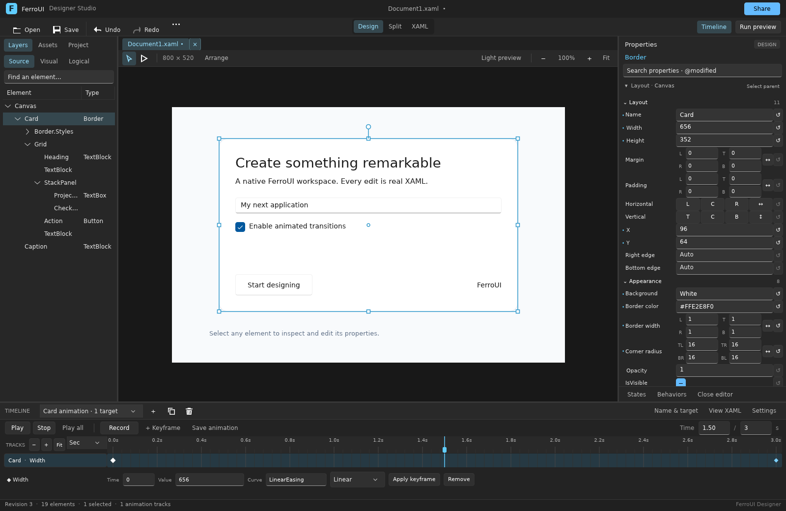

# FerroUI Designer Studio

Designer Studio is a native FerroUI XAML authoring workspace and a set of reusable Rust engines.
The workspace combines an artboard, synchronized source editor, object hierarchy, live visual and
logical trees, properties, layout manipulation, and animation tracks. All authored changes pass
through a document transaction; the artboard renders actual FerroUI controls.



This image is captured from the native Vello/HarfBuzz rendering test using the WinUI theme.
The property inspector retains the authored Width of 656 while animation previews 608 at the
playhead; the source retains the base value. Effective values and value origins are available in
property-cell tooltips.
The [initial workspace capture](images/designer-workspace.png) shows the same document before edits.

## Run

From the repository root:

```sh
cargo run -p designer-studio
cargo run -p designer-studio -- --file /absolute/path/to/MainWindow.xaml
cargo run -p designer-studio -- --project /absolute/path/to/solution
```

The desktop host uses the normal FerroUI desktop backend. A portable host can embed
`ferroui-designer` without taking a desktop backend dependency. A headless sample configuration
is available for automated hosts:

```sh
cargo check -p designer-studio --no-default-features --features headless,mcp
```

The workspace supports Window, UserControl and other Control roots. Register application-specific
control types and resource providers before loading their documents, just as an ordinary FerroUI
application does. Use `DesignerWorkspace::with_uri` when relative includes and resources need the
original document location. A raw resource dictionary or style document needs a host that supplies
an appropriate preview control; it is not a standalone control artboard.

The **Run preview** command opens the actual platform Window, including decorations, sizing and
registered code-behind behavior. Its lifetime is owned by the preview and follows accepted source
changes. The inline artboard retains a content projection for selection and geometry editing.
`PreviewHostOptions` registers metadata callbacks, application root factories keyed by `x:Class`
or qualified root type, and resource preview factories. A factory receives the original source,
base URI and loader configuration; `PreviewRequest::populate` loads XAML into the real instance
before the host wires application handlers. Resource/style documents use `Design.PreviewWith`
or the supplied resource factory. Unregistered application classes produce a diagnostic requiring
their factory instead of being silently replaced by a framework control.

Open, Save and Save as use the host's existing native storage provider. Opening or closing a dirty
document presents a save/discard/cancel choice. Local saves write a temporary sibling and replace
the destination, checking that an existing file has not changed externally. Virtual storage files
use their provider's stream API. The workspace tracks the exact saved source so subsequent edits
remain dirty.

## Native workspace

Designer Studio uses the repository's WinUI theme, including its native button, text, numeric,
menu, focus and disabled states. The workspace starts in **Design** mode with a large artboard.
**Split** exposes the synchronized XAML editor, and **XAML** gives it the entire document area.
F6 cycles these views without reloading the document or discarding partially typed source.
**Fit** uses the measured canvas viewport. The **Timeline** command releases its working space
when hidden and restores its resized height when reopened.

The left dock switches between **Layers**, **Assets** and **Project**:

- **Layers** uses a virtualized TreeDataGrid for source, visual and logical trees. Expansion and
  selection are retained across refreshes. Search keeps matching ancestors visible and does not
  modify document selection. Authored source rows support ordered multi-selection drag and drop
  before, after or inside compatible containers. Drops use one source transaction and one undo
  step; generated runtime rows, stale drags, cycles and occupied single-content hosts are rejected.
- **Assets** is a reusable searchable catalog with categories, vector icons, native keyboard
  activation and drag-to-place behavior. Hosts can register their own snippets and icons with
  `DesignerWorkspace::register_asset` or use `AssetToolbox` independently.
- **Project** uses a hierarchical TreeDataGrid for project folders, XAML documents and assets.
  File activation shares the same canonical URI identity as tabs, language edits and saves.

The property dock is a TreeDataGrid with collapsible categories and lazily created value editors.
It includes scrubbable numeric labels, direct alignment choices, linked four-component editors
for spacing/corner radii, tri-state booleans, enum pickers, expressions and mixed selections.
Search supports multiple terms and `@modified` / `@local` filters. Enter commits typed text or
numbers; a scrub commits once on release and cancels with Escape. Custom editor factories take
precedence over the built-ins. The reset
button removes the authored value. Object-valued property elements can be revealed in XAML
and reset without flattening their object graph. Tooltips read the current runtime type, effective
value and priority when opened, so animation sampling does not replace the editor or its draft.
An editor retained across a document switch or revision change cannot write to the new document.
Runtime-only objects remain inspectable without receiving invented source IDs.

Drop a value onto a property cell to validate and apply it to the selection. Drag a keyed resource
from Layers for a static resource reference, Shift-drag for a dynamic reference, or Alt-drag a
named element for an ElementName binding. The destination object stays selected throughout the
gesture. Internal reference drops check source identity and destination scope before authoring.

The contextual **Layout** section exposes common settings for the selected panel or the common
parent of selected children. Grid row/column editors support pixel, star and Auto lengths, plus
insertion/removal that updates child indices and spans in the same transaction. Explicit
definition metadata and comments survive the operation. Effective styled cell placements are
preserved; bound placements and externally supplied definition collections are protected.
See the [Grid layout capture](images/designer-grid-layout.png).

The canvas **Arrange** menu exposes alignment, equal-gap distribution, source ordering and
nesting through the existing panel layout adapters. Layers supports Alt+Up/Down to reorder,
Alt+Home/End to move first/last, and Alt+Right/Left to nest/unnest. Canvas arrows nudge by one
unit (Shift: ten; Ctrl: one tenth); Shift-drag locks to the dominant axis. Directional marquees
select contained objects left-to-right and intersecting objects right-to-left. Canvas selection,
hierarchy selection and properties refer to the same
session. The select and interact tools switch between source manipulation and live control input.
The top command bar keeps document/history actions visible and moves secondary file/edit actions
into its native overflow menu.

The animation editor has a labelled time ruler, compact object/property lanes and a contextual
keyframe editor. Ctrl-click toggles keys, Shift-click selects ranges, and dragging empty lane
space selects a marquee. Move, duplicate or delete groups across tracks in one undoable source
transaction. Selected keys keep their relative offsets, values and easing; collisions reject the
entire edit. Choose seconds or 24/30/60 fps snapping. Double-click a lane to record, or use arrow
keys to nudge selected keys. Escape and lost pointer capture cancel a drag without authoring it.
Ctrl+wheel or +/- zooms the timeline; Shift+wheel or PageUp/PageDown pans the visible range.
The contextual editor validates time, value and easing together before one undoable transaction.
**+ Keyframe** records the selected track's live property value, with Opacity as the initial
fallback for an object without a track. **Name & target** reveals program details; creating or
duplicating programs allocates useful unique defaults even when those details are closed.
Keyboard focus follows accepted timeline and Grid edits so repeated edits stay in the same
control. The [multi-key timeline capture](images/designer-timeline-selection.png) shows group
selection with frame snapping enabled.

Reusable public controls and workspace APIs include `AssetToolbox`, `DesignerAsset`, `AssetIcon`,
`TimelineLane`, `PropertyNumberScrubber`, `PropertyComponentsEditor`, `GridTrackEditor`,
`OutlineCommand`, `WorkspaceViewMode`, `NavigationPane`, inspection-grid accessors and the
workspace's single/group keyframe APIs. These controls send semantic actions through the session;
they do not modify runtime controls behind the document authority. The
[native controls guide](native-controls.md) includes host integration examples and the complete
property, layout, hierarchy, asset and timeline interaction contracts.

Native rendering also covers the [asset catalog](images/designer-assets.png),
[split view](images/designer-split.png) and [compact workspace](images/designer-compact.png).
The [engine performance report](performance.md) records controlled workloads, raw measurements,
reproduction commands and the initial-index tradeoff separately from UI verification.

## Crates and ownership

| Crate | Owns | Runtime dependency |
| --- | --- | --- |
| `ferroui-designer-core` | Lossless XAML syntax, source spans, stable local IDs, atomic edits, revisions and history | None |
| `ferroui-designer-tools` | Layout adapters, property metadata/editor contracts, geometry, selection and manipulation planning | None |
| `ferroui-designer-animation` | Typed keyframes, easing, deterministic sampling, playback and native animation XAML interchange | None |
| `ferroui-designer-collaboration` | Replicated operations, shared identities, conflict reporting, snapshots, version summaries and presence | Document core |
| `ferroui-designer-collaboration-host` | Durable authenticated rooms, invitations, ACLs, checkpoints, peer transport and offline outboxes | Portable store; optional existing MCP service/client |
| `ferroui-designer-project` | Cargo/loose-file solutions, resource paths, versioned document buffers, save/rename and cancellable build/run tasks | Document core |
| `ferroui-designer-language` | Runtime-derived schema, diagnostics, completion, navigation, refactoring, formatting, semantic tokens and stdio LSP | Core and project engines |
| `ferroui-designer` | UI-thread session, live preview, native controls, property editors, design surface, timeline and optional MCP tools | FerroUI runtime |
| `designer-studio` | Application lifetime, document IO, desktop/headless startup and opt-in MCP hosting | Workspace and selected platform |

These boundaries let a command-line tool or service manipulate documents without loading the
windowing, rendering, inspection or hot reload stack. The UI library starts neither a process nor
a network service when it is linked.

## Embedding the workspace

After ordinary FerroUI application and theme initialization:

```rust
use ferroui_controls::{Control, Window};
use ferroui_designer::DesignerWorkspace;

let workspace = DesignerWorkspace::new(source)?;
let window = Window::new();
window.set_content(Some(Control::boxed(&workspace.control())));
let session = workspace.session(); // Rc<RefCell<DesignerSession>>, owned by this UI thread
```

Keep the workspace alive for the lifetime of its view. Hosts can register native property editor
factories and portable layout adapters. The source buffer is available through
`session.borrow().document().source()` for the host's storage workflow.

The facade also exposes `ferroui::designer` with its `designer` feature; `designer-mcp` adds the
optional MCP adapter. Neither feature selects a windowing or rendering backend.

## Source, syntax and preview are separate states

There are three relevant values:

1. **Authored source** is what the user typed. It can temporarily be invalid.
2. **Last valid syntax** supplies the source AST and document-local node identities.
3. **Accepted runtime preview** is the last revision FerroUI successfully loaded and applied.

A malformed tag does not delete the authored text. A well-formed but unknown control does not
replace a working preview. Visual manipulation requires the accepted preview to match the
current valid document revision; this prevents stale geometry from writing changes into newer
source. Source edits can be accepted immediately while expensive preview work is debounced.

Debug builds reuse `HotReloadSession` and `ContentReloadTarget` for accepted preview changes.
Designer sessions opt into runtime-only structural contract updates so adding named controls and
changing the root remains a normal authoring operation. Compiled application sessions keep their
existing contract protections; a runtime-only session rejects a compiled class binding. The new
contract becomes authoritative only after its staged target commits successfully.
Release builds use a staged runtime XAML load and replace the preview only after loading succeeds;
the existing hot reload package is development-only. Both paths reuse FerroUI's runtime loader and
retain the last accepted preview on failure.

The AST retains comments, CDATA, processing instructions, namespaces, attribute spelling and
quotes, text nodes, property elements, and markup expressions. A parse followed by no edits
preserves every byte. Visual changes use UTF-8 source patches rather than reformatting the whole
file. Namespace-aware reparenting preserves the meaning of moved elements.

The engine validates XML structure. FerroUI's existing XAML loader resolves control types,
properties, resources, bindings, templates and converters. Unknown syntax is preserved by the
editing engine even when the runtime cannot preview it.

Lexical namespace declarations work throughout the parser, transformations, runtime loader and
compiled emitter. Nested declarations and prefix shadowing apply at their source occurrence;
deferred templates capture the declaration's namespace scope. Markup extensions and reflection
binding paths use the same scope in interpreted and compiled content.

### One transaction for every authoring path

```rust
use ferroui_designer_core::{Document, Edit};

let mut document = Document::new(
    r#"<Canvas><Button Name="Action" Width="100" /></Canvas>"#,
)?;
let button = document.ast().find_name("Action").unwrap();
let expected = document.revision();
let change = document.apply_at(expected, "Resize button", vec![
    Edit::SetAttribute { node: button, name: "Width".into(), value: "180".into() },
    Edit::SetAttribute { node: button, name: "Height".into(), value: "40".into() },
])?;
assert_eq!(change.previous_revision, expected);
document.undo()?;
document.redo()?;
```

An invalid edit in a batch rolls back the entire candidate. Revision guards reject stale
commands. Pointer gestures preview transient geometry and commit one history item at completion.
Source history includes invalid drafts, so undo restores what the user actually authored.
Immutable AST/source snapshots share storage through `Arc`; property batches coalesce assignments
before reparsing. The core tests exercise a 10,000-element document.
Source offset mapping uses a prefix-delta table and binary search for batch patches; a separate
4,096-element mixed-property transaction verifies stable syntax identities and undo/redo.

## Property and layout extension points

The native inspector exposes registered writable properties, attached properties and authored
attributes. Editors distinguish an explicitly empty value from an inherited value, support mixed
multi-selection values, and route reset operations through source editing. Runtime-only generated
objects can be inspected without pretending that they have an authored XAML node.

A `PropertyEditorFactory` creates a native control from `PropertyEditorContext`; its callback
receives an optional source value, where `None` means reset. The portable `PropertyRegistry` and
`EditorRegistry` supply typed contracts for hosts that use a different UI. Expressions are kept as
expressions. Layout tools refuse to overwrite a binding or resource reference as a side effect of
a drag.

`LayoutRegistry` associates panel types with `LayoutAdapter` implementations. The built-in set
covers Canvas, Grid, StackPanel, ReversibleStackPanel, WrapPanel, DockPanel, UniformGrid,
RelativePanel, FlexPanel and ordinary Panel, with explicit ownership rules for generated
virtualizing and internal panels. Grid track edits preserve definition property elements and
min/max/shared-size metadata. The host supplies measured tracks for Auto sizing. See
[`FerroUI.Designer.Tools/README.md`](../../src/FerroUI.Designer.Tools/README.md) for the exact
capabilities and extension contracts.

The geometry layer supplies affine transforms, snapping, alignment, distribution, marquee
selection, ordered selection and manipulation revision guards. Coordinate conversions must use
actual parent transforms; the portable engine accepts measured geometry rather than guessing a
second layout system. Batch planning validates multiselection operations as one transaction,
including operations spanning different layout parents. The registry recognizes 30 built-in
panel, content-host and framework-layer names; generated containers expose ownership restrictions
instead of accepting edits that their item generator would overwrite.

Resize handles follow the element's transformed quadrilateral. Pointer deltas are converted through
the actual ancestor/element matrices, including nonuniform scaling, skew, mirrors and absolute or
relative transform origins. Rotation and property-element transforms preserve their source and
compensate around the actual origin. Noninvertible geometry is rejected without changing source.
Native planners receive resolved styled/bound layout values and measured geometry. Registered
custom panels receive a generic child-insertion/reorder adapter and transform-preserving movement
and resize; a host adapter can provide additional panel-specific semantic commands.

Duplicate allocates unique names and program identities, rewrites references across copied
siblings and descendants using the same namescope-aware language index, and updates copied state
metadata. External references and ambiguous declarations retain their original meaning. Single
content hosts and generated containers continue to enforce their actual ownership rules.

## Animation authoring

The animation model uses FerroUI's native `Animation`, `KeyFrame` and `Setter` markup. It does not
introduce a second runtime animation dialect. The workspace imports supported animation markup,
records property changes as keyframes, writes them through the document transaction, and samples
preview values at animation priority. Disposable preview layers restore ordinary source/style
values on Stop, preview reload or switching to Interact. Natural playback completion respects
the animation's fill mode and can retain the final sample.

The program picker enumerates every Animation in local/shared/nested styles and resources. Each
program retains its own selector, targets, timing, tracks and persisted UUID. Create, rename,
duplicate, remove, edit source, select preview targets and play-all operate on independent programs.
Selectors are matched by the native style system; per-target underlying values and visibility clocks
are retained. Resource programs can be previewed against explicit targets. Graphical track lanes
support scrubbing, keyframe selection and dragging, with explicit time, easing and removal controls.

Supported values include numbers, colors, points, vectors, sizes, rectangles, corner radii,
relative points/scalars, thicknesses and discrete values. The portable
engine implements linear-light color interpolation, cubic Bézier inversion, named FerroUI easing
families, parameterized spring easing, delay, delay between iterations, speed, finite/infinite repetition, direction, alternate
playback, native visibility behavior and fill modes.
Times are seconds in the editing API and native 100 ns times in exported markup. Import/export
checks native duration grammar, timing range, repeat range and keyframe quantization collisions.

A `CompiledTimeline` validates once and can be sampled repeatedly without rescanning all model
validation. Deterministic seek/scrub is independent of a wall clock. The live runtime's property
system remains authoritative about which property types and converters can actually receive an
animation value.

Programs with native object payloads also use the accepted runtime Animation objects directly.
Source provenance identifies the matching style or resource program, and an explicit preview clock
drives the framework's own shadow, gradient, effect, integer, transform-component and registered
custom animators. This preserves native interpolation for values outside the portable model.
The additive `Animation::apply_for_preview` retains final fill and generated transforms at animation
priority; disposal restores underlying values and live bindings. Application `apply` behavior stays
unchanged. Failed setup unwinds its temporary subscriptions and values before reporting the error.

`AnimationCodecRegistry` allows application-specific typed tracks and animator payloads to share
the same program, transaction and preview workflow. A codec receives original source and can
preserve its custom objects. Unknown payloads remain available in the program's source editor;
typed edits require a codec that represents them faithfully. See the
[animation crate documentation](../../src/FerroUI.Designer.Animation/README.md) for interchange
rules and runtime semantic tests.

## Visual states, transitions and behaviors

The **States** panel authors groups, named states, target setters, default/directional transitions,
durations and easing. Source models emit real FerroUI classes, styles, native Animation objects
and existing behavior actions. State navigation, seeking and playback use actual runtime values.
Directional routes use the framework's existing ConditionalAction implementation.

The **Behaviors** panel authors event/data triggers and property, command, method and class actions.
Custom trigger/action objects retain their raw markup and can be edited in source. The designer
registers the existing Interactivity, Interactions and Interactions.Custom types. Preview executes
the real behavior/action implementation; Stop restores the authored view rather than preserving
behavior-mutated default control values as hot-reload user state.

Generated state programs have explicit ownership markers. Updating an endpoint preserves unrelated
programs, authored intermediate keys/splines, custom animator data, complex Setter.Value objects,
collection order and namespace meanings. Changing a literal to a binding removes obsolete owned
endpoints. Application code remains responsible for the semantics of its own actions and external
side effects; preview reconstruction restores the view, not external services or shared view models.

## Solutions, documents and source language services

The **Solution** command opens Cargo workspaces or loose-file projects. Discovery uses actual locked
offline Cargo metadata, and project documents retain independent source, dirty state and undo/redo
history in tabs. Save-all, save-as and rename preserve resource URIs and check external disk changes.
Check/Build/Run use explicit executable/argument vectors and selected binary targets. Output is
bounded, decoded across UTF-8 pipe boundaries and drained before completion; cancellation terminates
the owned process group/tree. Build tasks run only when requested by the user or authorized MCP tool.

The native source editor uses the reusable language service for completion, live diagnostics,
definition/reference navigation, formatting and version-guarded cross-document rename. It supports
incomplete drafts, typed bindings through x:DataType/ElementName/self/template sources, namescopes,
resource dictionaries/imports and ambiguity-aware references. Refactorings validate all document
versions before applying any part of the transaction. The service indexes unopened project XAML
and retains open-buffer precedence over disk snapshots.

The generated default schema describes 569 framework types and 1,530 declared members. Hosts add
application controls/view models and definition locations with `Schema::register`. The same service
is available to external editors through a real Content-Length-framed stdio language server:

```sh
cargo run -p ferroui-designer-language --bin ferroui-xaml-lsp
```

The server advertises incremental UTF-16 synchronization, diagnostics, completion, hover, signatures,
definitions/references, rename, formatting, symbols, folding and semantic tokens. It handles workspace
changes, file-rename edits, cancellation and shutdown. Native callers use UTF-8 byte offsets through
strict `LineIndex` conversion. See the [language](../../src/FerroUI.Designer.Language/README.md) and
[project](../../src/FerroUI.Designer.Project/README.md) contracts for embedding examples.

## Collaboration semantics

`DocumentReplica` is an ordered operation-set replication engine over the same lossless document
model. It has stable shared node aliases, actor/sequence identities, Lamport ordering, duplicate
detection, dependency replay, contiguous version summaries and SHA-256 baseline verification.
Every operation is an atomic source transaction. Delivery permutations are tested to converge to
the same accepted source and conflict set.

The session translates its local AST IDs to shared aliases by source correspondence. Those IDs
must not be confused with the inspector's runtime IDs or another replica's local AST IDs.
Structured property/insert/remove/move commands retain their fine-grained semantics. Arbitrary
source replacement uses compare-and-set against the expected source; concurrent text edits can
produce an explicit conflict requiring a merged draft. This is not a character-level text CRDT.

Property compensation checks the last writer's operation identity during replay, including
same-value writes. The workspace's shared history additionally guards whole-source compensation
against a newer peer version. Remote changes never silently discard an unsubmitted local draft.

A host starts a session with `enable_collaboration(actor, document_id)`, exchanges snapshots when
joining, and sends `collaboration_changes_since(version)` to peers. `merge_collaboration` commits
a successfully projected source through normal preview processing. Presence uses a receiver
clock for expiry; it is ephemeral and separate from source history.

The core replica stays transport-independent. `ferroui-designer-collaboration-host` supplies the
complete room service: separate administrator/transport/member credentials, owner/editor/viewer
roles, expiring bounded-use invitations, actor-bound operation validation, membership revocation,
durable operation snapshots, receiver-clock presence and exact-version checkpoint epochs with an
explicit reviewed-source path for resolving historical operation conflicts.
Room files contain credential hashes. Unix storage uses owner-only directory/file modes; on Windows,
credential/checkpoint files inherit the selected directory's ACL, which the host must keep private.
The host does not create or tighten Windows ACLs. A process lock prevents multiple writers to one
directory. Writes synchronize the file before atomic replacement; Unix also synchronizes the parent
directory. An indeterminate post-rename durability failure blocks further store access until
restart/validation. Windows does not perform the additional directory synchronization.

**Share** hosts a room, joins an invitation or resumes a saved session. The native panel supplies
editor/viewer invitations, membership/role controls, checkpointing and remote/resolved-source review.
Network and disk work run on a dedicated worker. Local invalid drafts and unacknowledged operations
are checkpointed before transmission. Disconnect captures the final outbox, detaches the UI and
queues the checkpoint write; the sharing status confirms when that write succeeds. Wait for that
confirmation before terminating the process or reusing the session directory. A changed tab/room
cannot receive stale network results. Joining a different source requires an explicit revision-pinned review and saves
the previous document and sharing checkpoint first. The review has separate actions for adopting the
remote source, restoring a saved offline draft or publishing a reviewed resolution. Peer cursors use
artboard coordinates, so zoom and scroll do not change their meaning. Viewers can inspect/play but
cannot author.

Review persistence has two phases: backups and the proposed resolution are written first; the
accepted peer checkpoint is published only after the UI revision check succeeds. A rejected
proposal never replaces the remote side of the review. Replies are fenced by room actor ownership
as well as document URI. A viewer downgrade with unsent edits immediately blocks further authoring
and retains the outbox for review before adopting the current remote snapshot. Viewers can adopt
the remote snapshot; restoring or publishing a different saved draft requires an editor role.
The [recovery guide](deployment/README.md#recovery) identifies the saved peer, backup and prepared
resolution files, including what remains recoverable after a failed acceptance commit.

The client reconnects expired MCP sessions and retries idempotent operation sets after lost replies.
Offline edits remain in the local outbox. A new server epoch requires explicit source resolution;
it never silently drops the old draft. Large Unicode documents use authenticated checksummed chunks
without increasing the existing MCP message limit. Durable transport tokens survive server restarts.

Run a standalone host with the existing MCP transport:

```sh
cargo run -p ferroui-designer-collaboration-host --features server \
  --bin ferroui-collaboration-server -- --storage ./private-rooms --bind 127.0.0.1:7491
```

For a remote team, use the supplied [TLS deployment configuration](deployment/README.md). The service
retains MCP's loopback, bearer, Host/Origin and message-limit protections. It exposes only room tools;
application inspection, input, logs and resources are absent from the service endpoint. See the
[host](../../src/FerroUI.Designer.Collaboration.Host/README.md) and
[replication](../../src/FerroUI.Designer.Collaboration/README.md) documentation.

## MCP integration

The sample enables its server only when requested. It starts with read-only permissions:

```sh
cargo run -p designer-studio -- --mcp
cargo run -p designer-studio -- --file MainWindow.xaml --mcp-port 0 --mcp-write
cargo run -p designer-studio -- --mcp-stdio --mcp-write
```

`--mcp-port` selects the loopback HTTP port (`0` selects an available port). The existing server
reports its endpoint and generated bearer token to stderr. `--mcp-stdio` reserves stdout for the
protocol before application initialization. `--mcp-write` enables authoring commands and requires
an explicit server option; UI input simulation remains disabled by default.
`--mcp-input` explicitly enables input simulation. Executing native behaviors or project build/run
tasks requires both `--mcp-write` and `--mcp-input`; inspecting a process plan needs neither.

Enable the `mcp` feature of `ferroui-designer` and retain the returned server handle:

```rust
use ferroui_designer::mcp::{Options, Permissions};

let server = workspace.serve_workspace_mcp(Options {
    permissions: Permissions {
        allow_property_writes: true,
        allow_input: false,
    },
    ..Options::default()
})?;
```

The existing `ferroui-mcp` transport still owns HTTP loopback binding, bearer authentication,
stdio framing, session negotiation, cancellation, size limits and UI dispatch. The reusable
`UiToolProvider` extension point registers immutable tool descriptions and a UI-thread-owned
provider. Transport threads receive a numeric provider identity and descriptions; they never
carry `Rc<RefCell<DesignerSession>>` or controls across threads. Providers cannot shadow built-in
inspector tool names, and extension registrations are isolated per server.
The original `serve()` API still returns its `Send` server handle. `serve_with_tools()` returns a
separate `UiServerHandle`, which stops its server before disposing the UI provider registration.

The additional tools are:

| Tool | Purpose |
| --- | --- |
| `designer_document` / `designer_ast` | Source, accepted revision, diagnostics, syntax nodes and spans |
| `designer_apply` / `designer_source` | Atomic structured edits or source editing with a required revision guard |
| `designer_select` / `designer_undo` / `designer_redo` | Selection and shared authoring history |
| `designer_tree` | Live visual/logical tree with runtime and source identities |
| `designer_timeline` / `designer_animation` | Inspect, seek, play, record and edit keyframes |
| `designer_collaboration_state` / `designer_collaboration` | Snapshots, version summaries, operations and explicit draft resolution |
| `designer_presence` | Ephemeral peer selection/cursor updates |
| `designer_programs` / `designer_program` | Independent program inspection, create/edit/targets/timing/source and playback |
| `designer_states` / `designer_state` / `designer_state_actions` | State groups, setters, transitions and native actions |
| `designer_behaviors` / `designer_behavior` | Behavior/trigger/action authoring and explicit native execution |
| `designer_properties` / `designer_property` | Runtime-derived property schemas, typed values and transactional edits |
| `designer_project` / `designer_project_edit` | Solution, tab, save and document lifecycle |
| `designer_build_plan` / `designer_project_task` | Reviewable process plans and explicit build/run/cancel |
| `designer_language` / `designer_language_apply` | Semantic queries and versioned cross-document refactoring |

For example, after reading revision `7` and source node `12`:

```json
{
  "name": "designer_apply",
  "arguments": {
    "expected_revision": 7,
    "label": "Resize action button",
    "edits": [
      {"SetAttribute": {"node": 12, "name": "Width", "value": "180"}},
      {"SetAttribute": {"node": 12, "name": "Height", "value": "40"}}
    ]
  }
}
```

The built-in inspector tools remain available. Direct runtime `set_property` is an inspection
operation and does not author XAML; use `designer_apply` when a change must persist in source,
history and collaboration.

## Validation

The dedicated [Visual designer workflow](../../.github/workflows/designer.yml) covers:

- Source roundtrips, Unicode spans, namespace moves, invalid drafts, identity and atomic history.
- Layout metadata, measured panel actions, selection, transforms and snapping.
- Independent native animation programs, extension codecs, state/behavior source preservation and runtime playback.
- Replication delivery order, duplicates, missing dependencies, identity equivocation, baseline
  mismatch, source conflicts, compensation and presence expiry.
- Native property edits, preview retention, Window/UserControl roots, history and collaboration.
- Actual affine manipulation, registered code-behind factories and native Window settings.
- Project buffers, safe saves, shell-free build/cancel tasks, typed language services and the actual stdio LSP lifecycle.
- Authenticated rooms, role changes, durable restart, offline/outbox recovery, checkpoint review and real two-peer MCP transfer.
- Existing MCP authentication/cancellation plus provider isolation and designer commands.
- WinUI workspace navigation, measured fit, source preservation, native toolbox and keyframe gestures.
- Virtualized TreeDataGrid cells, hierarchy drops, typed property commits and stale-editor guards.
- Numeric scrubbing, linked spacing editors, category search and native resource/name reference drops.
- Atomic Grid track structure, inherited cells, namespaces and retained keyboard focus.
- Multi-track key selection/retiming, collision rollback, frame precision and fractional-time source roundtrips.
- Actual Vello/HarfBuzz Design, Split, Assets, Grid layout, compact workspace and animation PNG rendering.
- Lexical namespace scopes, deferred templates and interpreted/compiled reflection-binding parity.
- Runtime-only structural hot reload with unchanged compiled-application contract checks.
- Native animation final fill, live binding preservation, generated transforms and failed-setup cleanup.
- Headless sample compilation, application startup/shutdown, and the separate release preview code path.

Local commands:

```sh
cargo test -p ferroui-designer-core -p ferroui-designer-tools \
  -p ferroui-designer-animation -p ferroui-designer-collaboration \
  -p ferroui-designer-project -p ferroui-designer-language \
  -p ferroui-designer-collaboration-host --features ferroui-designer-collaboration-host/client
cargo test -p ferroui-designer --features mcp --lib -- --test-threads=1
cargo test -p ferroui-mcp --lib -- --test-threads=1
cargo test -p ferroui-controls-treedatagrid row_drag_ --lib -- --test-threads=1
FERROUI_DESIGNER_RENDER_OUTPUT=/tmp/designer-renders \
  cargo test -p ferroui-designer --features mcp,render-smoke --lib render_tests:: -- --test-threads=1 --nocapture
cargo check -p ferroui-designer --features mcp --release
```

## Host and extension contracts

The workspace supplies native authoring workflows while applications register their own control
metadata, real root factories, resource previews, animation codecs, custom property editors and
panel semantics. These registrations reuse the same AST, document history, language indexes and
runtime preview; they do not introduce parallel serialization or transport stacks. HTTPS deployment
uses the operator's domain/certificates and private storage directory. External editors can connect
to the stdio LSP, automation to the existing MCP server, and collaborators to the isolated room host.
