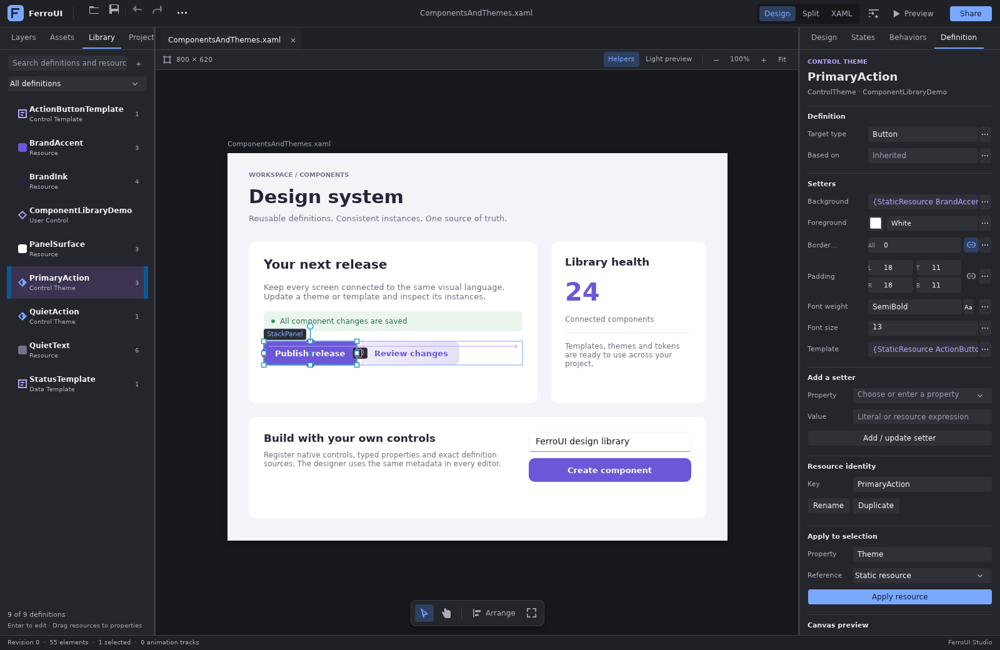
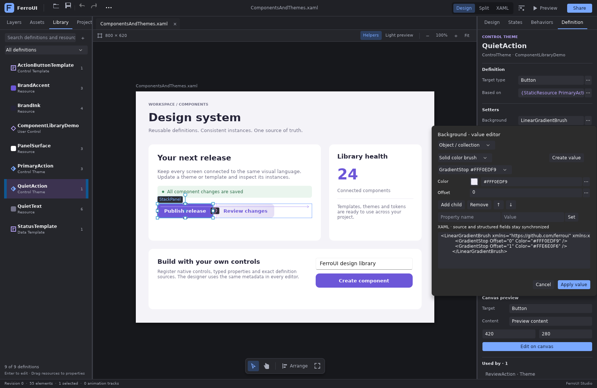
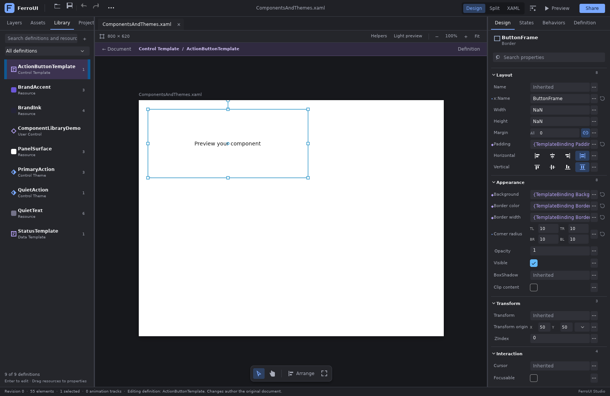

# Components, templates and resources

Designer Studio separates a selected control instance from the shared definition that shapes
it. The **Library** dock catalogs the current document's user controls, custom controls, control
templates, data templates, control themes, styles, named resources and resource dictionaries.
Indexed project XAML and retained source tabs contribute reusable definitions automatically.
Hosts can also register exact definition sources and custom control assets. Searching and
browsing the Library preserve the canvas selection, so **Apply resource** has a clear destination.

The workflow follows three useful designer conventions:

- [Figma's main components and instances](https://help.figma.com/hc/en-us/articles/360038662654-Guide-to-components-in-Figma)
  make the relationship between a shared definition and its instances visible. FerroUI exposes
  linked definitions underneath the selection header and shows document-local references in
  the definition inspector. Instance properties remain authored on the selected instance.
- [Blend's Edit current, Edit a copy and Create empty commands](https://learn.microsoft.com/en-us/visualstudio/xaml-tools/modify-the-style-of-objects-in-blend?view=visualstudio)
  distinguish changes to shared definitions from creating an independent variant. FerroUI's
  Library opens original definitions, creates resource copies and opens an explicit canvas
  scope with a return path to the document.
- [Visual Studio's resource workflow](https://learn.microsoft.com/en-us/visualstudio/xaml-tools/how-to-create-and-apply-a-resource?view=visualstudio)
  makes the key, owner scope and target property explicit. FerroUI retains those decisions in
  the Definition inspector and validates lexical resource visibility before applying or renaming.

## Use the Library

Choose **Library** in the left dock. Search matches names, types and origin information; the
category selector narrows the list to components, templates, themes, resources or dictionaries.
Resource swatches and semantic icons distinguish the entries. Registered source documents show
their origin URI. Double-click an authored component or template to edit it on the canvas.
Registered user-control definitions open their source document in a normal tab. The current
document keeps its unsaved buffer and undo history; an already open definition keeps its edits.
**Place on canvas** and dragging a code-behind definition create a reference to the registered
native control type. The designer never inserts an entire `x:Class` declaration into another
control's children. Unregistered classes require native metadata/constructors or an explicit
`DesignerAsset` insertion snippet.

Selecting a definition opens **Definition** in the right dock. The available controls follow
the definition's kind:

| Definition | Editors and actions |
| --- | --- |
| User/custom control | Authored properties, source, canvas scope |
| Control template | Target type, source, preview target/content/dimensions, editable copy |
| Data template | Data type, source, sample content, editable copy |
| Control theme | Target type, BasedOn, typed setters, new setter, resource identity, canvas scope |
| Style | Selector, typed setters, source, preview target |
| Resource | Reflected writable properties, object graphs, primitive text value, key and references |
| Resource dictionary | Source and a native resource gallery |

**Target type**, **Data type**, **BasedOn** and **Selector** edit the definition's authored
identity. The fields under **Canvas preview** configure only the temporary sample host; they
do not add Width, Height, Content or preview-only elements to the definition's source.

Theme setters and reflected resource properties use the same `PropertyEditorFactory` pipeline
as the regular property inspector. This includes literal fields, typed compound values,
expressions, visible resource choices and staged object editing. Known incompatible native
resource types are omitted from the picker and rejected on commit. Custom conversions retain
their source representation and can supply a host-specific editor.

The **+** command creates a named resource, control theme, control template or data template
in an explicitly selected owner scope. Key rename updates resolved references in the same
transaction. Removal rejects definitions that still have document-local references. Source
drafts and resource values remain local until their Apply command succeeds.

Drag a named resource from the Library onto a property field for a static resource reference.
Hold Shift for a dynamic reference. The payload contains the original document URI, revision,
AST snapshot and resource identity, allowing the destination to reject retired or out-of-scope
references. Registered control assets can be dragged directly onto the artboard; immutable
definition sources must first become an authored copy.

## Edit a definition on the canvas

**Edit on canvas** renders the selected definition in a native sample control. The canvas scope
bar identifies the definition and provides **Back to document**. The authored Layers tree shows
the selected definition's subtree. Real template parts retain their original document NodeIds,
so selection, property editing, layout helpers and visual manipulation author that original
subtree and share its undo history.

The temporary sample host is presentation state. It receives no editable original NodeId and
never appears in authored source or collaboration edits. Resource layers from the original
ancestors remain separate in the projection so shadowed names keep their lookup order.
Untyped control templates receive a target annotation only in the temporary projection, inferred
from their theme, inline control or unambiguous instance usage. This preserves TemplateBinding
compilation beneath the sample host without adding TargetType to authored source. The preview
target field can choose an explicit registered type when an untyped definition needs one.
Returning to the document restores the previous instance selection. Invalid projections retain
the last accepted native graph, and a source revision or scope change invalidates retired
definition dialogs. Read-only collaboration sessions can inspect scopes while authored edits
remain rejected.

The sample at [ComponentsAndThemes.xaml](samples/ComponentsAndThemes.xaml) contains shared brush
resources, a control template, a base theme, a derived theme with a gradient setter, a data
template and several instances. Open it with:

```sh
cargo run -p designer-studio -- --file docs/designer/samples/ComponentsAndThemes.xaml
```

## Register application controls and source libraries

Application controls still use their real runtime metadata and preview factories. Register
their types through `PreviewHostOptions::register_types`; register a code-behind factory with
`register_root` where constructing the real root instance is necessary. `DesignerAsset` supplies
an insertion snippet and icon. A definition provider supplies exact authored XAML independently
of the preview object's visual tree.

```rust,ignore
use ferroui_designer::{DesignerDefinitionAsset, tools::ComponentKind};

workspace.register_component_definition(DesignerDefinitionAsset {
    id: "commerce:product-card-theme".into(),
    label: "Product card theme".into(),
    kind: ComponentKind::ControlTheme,
    target_type: Some("shop:ProductCard".into()),
    source: exact_theme_xaml.to_owned(),
    origin_uri: Some("ferres://Commerce/Controls/ProductCard.xaml".into()),
})?;

let copy = workspace.copy_component_definition(
    "commerce:product-card-theme", resource_owner, "ProductCardCustom",
)?;
workspace.edit_component_on_canvas(copy)?;
```

For a registered user control, use `workspace.open_component_document(id)` to open the main
source. A selected instance can show a link to that source when its registered native type
matches the definition's class or explicit target type.

The linked-definition banner has separate **Edit current** and **Edit a copy** commands.
Editing the current definition retains its relationship to every instance. Editing a copy creates
an independent template/theme, replaces only the selected instance's reference, and enters the
new definition scope. Creation and reference replacement are one undo entry. The session API is
`copy_definition_for_instance(definition, target, property, key)`; scope navigation remains a
separate presentation operation. A copied template that would bind its dependencies to different
resources is rejected before changing source.

Prefer registering the whole source document when a theme depends on sibling resources:

```rust,ignore
workspace.register_component_document(
    "ferres://Commerce/Controls/ProductCard.xaml",
    exact_dictionary_xaml,
)?;
```

Registration validates the definition kind against its source and does not modify the active
document. Re-registering a URI replaces that provider's prior entries atomically. The designer
does not reconstruct a compiled template from live visuals or guess missing source.

Use `register_component_documents(iter)` to register multiple `(uri, source)` pairs together.
The entire batch is validated before any provider is replaced; one invalid document or duplicate
canonical URI leaves the prior catalog intact. Successful registration refreshes the Library once.

Project discovery uses the language service's indexed documents, with active and retained editor
buffers taking precedence over indexed source. An unchanged AST snapshot is reused without
reparsing or rereading its file. Invalid drafts retire their automatic exports until they become
valid again, and the active document is displayed through its authored catalog rather than a
duplicate external entry. Canonical file identities keep aliases pointed at the same open tab.
Explicitly registered providers remain host-owned snapshots and are not replaced by automatic
discovery; re-register them when their source changes.

Designer Studio enables the WinUI theme crate's optional `designer-sources` feature and registers
the actual control XAML documents through `ferroui_themes_winui::designer_documents()`. The
embeddable designer library does not require this feature or a particular application theme.
This keeps the editable source available where requested without adding it to ordinary theme
consumers.

## Theme variants and reference identity

Resource pickers use the selected native control's actual theme and complete inherited-theme
chain. The portable `ComponentResourceContext` allows another host to supply the same context.
Lookup follows FerroUI's runtime ordering: local resources, the requested theme and its inherited
variants, Default, reverse-order merged dictionaries, then ancestors. Each target in a multiple
selection resolves independently. A prepared apply operation is invalidated if the actual theme
changes while its editor remains open.

Without a known theme, `component_resource_resolution` returns the possible declarations plus
missing/external flags. Its `resolved()` method yields an identity only if all possible lookup
paths agree. Rename, removal and template-copy checks consider possible references across variants:
renaming only a Dark declaration cannot silently retarget a reference also used by Light. String-key
commands leave implicit/type-keyed resources, custom expression keys and external dictionaries to
their explicit source/provider workflows. The original XAML remains editable.

## Copy dependency semantics

Copying from a registered source document stages a dependency closure before changing the active
document. Local `BasedOn`, template and brush references are resolved in their original lexical
scope. Dependencies receive collision-free keys derived from the new definition key. Their
references are rewritten through the same semantic resource rename planner used for authored
resource rename. The provider remains immutable, and destination resources with the original
keys keep their existing behavior.

Resources supplied by the application remain external references if the active document or
native application resource context resolves them. A missing external resource, cyclic local
dependency, conflicting destination key or custom resource-key expression that cannot be
resolved safely rejects the copy before source mutation. A successful import is one document
transaction and one undo step, including all copied dependencies.

Definition sources should use absolute asset/include URIs when moving between documents. A
provider-specific key object or custom conversion may need the application's resource setup or
a self-contained source fragment. These cases remain explicit extension responsibilities;
the designer keeps the original source available for editing.

## Reuse the controls without the workspace

`ComponentLibrary` accepts `ComponentLibraryItem` rows and selection, activation, creation and
drag callbacks. It owns navigation state and native presentation; it does not author documents.
`ResourceDefinitionEditor` accepts `ResourceDefinitionModel` and emits semantic
`DefinitionEditorCommand` values. Its fields stage drafts and surface the host's returned error.
`DefinitionPropertyField` embeds any metadata-aware property editor supplied by the host.

The workspace adapter routes these commands through `DesignerSession` and the portable
`ComponentAction` planner. This boundary lets other native hosts reuse the same catalog,
resource lookup, guarded edit previews and history semantics without embedding Designer Studio.

## MCP commands

The optional MCP provider exposes the same session model:

| Tool | Purpose |
| --- | --- |
| `designer_components` | Read the active document's catalog, optionally with namespace-complete source. |
| `designer_component_resources` | Read resources visible to a target and its accepted native theme context. |
| `designer_component_references` | Read possible authored references to a resource. |
| `designer_component` | Create, copy, rename, remove, apply, extract or edit a definition through a semantic component action. |
| `designer_definition_scope` | Read the current scope, preview options and scope epoch. |
| `designer_definition` | Enter or exit a native definition preview. |

Document writes require the existing property-write permission and `expected_revision`.
`copy_definition_for_instance` creates the resource and retargets only that instance in one
transaction. Tool schemas reject fields unrelated to the selected action. Source operations
retain read-only, dependency, native-type and undo checks from the UI/session implementation.

Scope navigation changes presentation, not source or history. It requires MCP write permission
and `expected_revision`, and accepts `expected_scope_epoch` to reject an outdated navigation
request. A read-only collaboration viewer can still inspect a definition when the host permits
this navigation. Preview options are `target_type`, `sample_content`, `width` and `height`.

## Validation

The native tests cover Library filtering and selection, staged definition fields, retired
dialog rejection, instance-to-definition navigation, compatible resource application, source
registration, dependency-preserving copy, real WinUI theme source and one-step undo. The
Vello/HarfBuzz rendering fixture captures the actual Library, typed theme setters, object-value
workbench, resource inspector and template canvas before and after an authored change.

## Native render evidence

These captures come from the attached native workspace using WinUI templates, HarfBuzz and
Vello's CPU renderer. The template captures turn off optional layout helpers so the
content-occupancy badge does not cover the centered sample text. Selection adorners remain
visible, and the sample retains native Light-theme colors. A direct native regression verifies
the sample host, ContentPresenter, generated text, foreground/background brushes and template
bindings without adding presentation values to authored source.







| Capture | Workflow |
| --- | --- |
| [Component Library](images/designer-component-library.png) | Inspect a shared theme while preserving its selected instance. |
| [Object-valued setter](images/designer-theme-object-setter.png) | Edit a gradient brush inherited through a derived theme. |
| [Object workbench](images/designer-property-object-workbench.png) | Stage typed gradient-stop and XAML changes before Apply. |
| [Resource inspector](images/designer-resource-editor.png) | Inspect a brush, its identity, reflected properties and references. |
| [Template canvas](images/designer-template-canvas.png) | Select the original template part inside a native sample host. |
| [Edited template](images/designer-template-edited.png) | Author CornerRadius on the original part. |
| [Updated instances](images/designer-component-instances.png) | Return to the document and inspect the shared result. |
| [Registered source library](images/designer-definition-library-sources.png) | Filter source-backed and document-local templates with distinct provenance. |

## Reference analysis and ownership decisions

| Reference | Adopted design decision |
| --- | --- |
| [Blend style and template workflow](https://learn.microsoft.com/en-us/visualstudio/xaml-tools/modify-the-style-of-objects-in-blend?view=visualstudio) | Separate current/copy/empty/apply/reset commands and an explicit return from the definition scope. |
| [Figma component properties](https://developers.figma.com/docs/plugins/working-with-component-properties/) | Keep shared definition ownership separate from instance values; show linked definitions beside the instance's public properties. FerroUI's own properties, content and templates remain authoritative. |
| [Microsoft designer surface isolation](https://github.com/microsoft/xaml-designer-extensibility/blob/main/documents/xaml-designer-extensibility-migration.md) | Extensions receive stable type/source identities and model operations; authored persistence never depends on mutating the preview tree. The current native host is in-process and does not claim process isolation. |
| [Qt property-sheet extensions](https://doc.qt.io/qt-6/qdesignerpropertysheetextension.html) | Every editor uses the host's undo-aware transaction path, including extension factories and nested object dialogs. |

These are workflow and architecture references. FerroUI does not import another designer's plugin
ABI or serialize generated template visuals back into authored documents. A real registered
user-control root retains its factory/code-behind preview; generated sample hosts for nonvisual
definitions remain outside the authored identity map.
