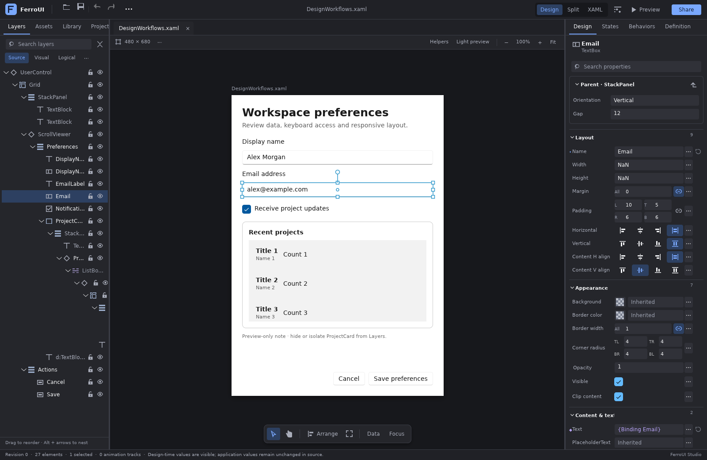
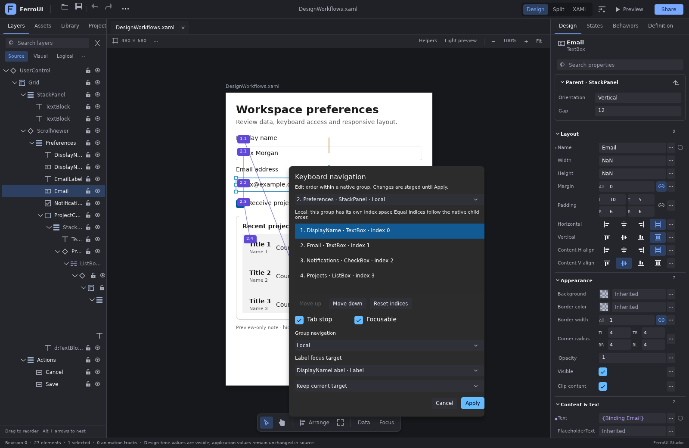

# Designer workflow comparison and implementation

This review compares the XAML-relevant workflows in Visual Studio/Blend, Figma and
Qt Widgets Designer against the native FerroUI designer. The implementation extends the
existing session, source-preserving AST, native preview, property factory chain and layout
adapters. It does not add a second document model or another rendering stack.

## Findings

| Workflow | Reference behavior | FerroUI before this review | Result of this review |
| --- | --- | --- | --- |
| Source/design synchronization | Visual Studio/Blend retain XAML while providing a visual editor | Lossless AST, atomic source edits, native reload, diagnostics and language service | Reused by every new authored command |
| Layout manipulation | Figma alignment/distribution; Blend and Qt container-aware layout editing | Multi-selection, affine movement/resize, alignment/distribution, source order, nesting and panel-specific helpers | Layer locks/isolation now guard these existing paths, including cached drops and tree drags |
| Shared definitions and instances | Blend template/style scopes; Figma component/instance ownership | Component Library, template/theme scopes, edit-current/edit-copy, resource dependencies | Existing workflows retained; generated template controls are explicitly distinguished in focus editing |
| Typed and extensible property editing | Blend inline/extended editors; Qt property-sheet extensions | Shared native typed fields, staged values/bindings/resources/objects, custom factories | New preview and navigation editors use the same session ownership and snapshot rules |
| Animation and interaction | Blend timelines/states/behaviors; Figma prototype transitions; Qt connections | Native animation tracks, states/transitions, behavior event/data triggers and actions | Existing native authoring remains the application-behavior model |
| Design-time values and sample data | Visual Studio's ignorable `d:` properties, controls and generated `SampleData` | Loader recognized selected design directives, but no connected designer projection/editor | Added namespace-aware design projection, staged Design Data editor, bounded anonymous sample records and native source mapping |
| Layer lock/visibility and selection depth | Figma lock, hide and nested layer selection | Portable selection flags existed but were not connected to the native surface | Added native row/menu actions, local visibility masks, isolation, hierarchy navigation and overlap cycling |
| Tab order | Qt numbered tab-order mode | `TabIndex` was editable as a scalar; no navigation model/editor | Added native navigation-group catalog, staged order editor, mode editing and canvas badges |
| Label/input associations | Qt buddy connections | Native `Label.Target` existed without designer authoring | Added namescope-correct target picker, connection overlay and atomic target-name/binding creation |
| Preview environment | Figma device sizes/orientation; Qt form previews; native theme scopes | Artboard-size API and a binary theme toggle | Added staged size presets, custom dimensions, orientation, inherited/light/dark theme and reading direction |

The comparison maps concepts to FerroUI's native contracts. Figma variables map to existing
resource/theme authoring, and application interaction uses native bindings, behaviors,
states and navigation. Qt's C++ signal/slot syntax and Figma's scene-file format are not
introduced into XAML. Foreign plugin ABIs, operating-system emulation and arbitrary Rust
code generation are separate concerns from this authoring layer.

## Design-time data

Open **Data** on the canvas tool shelf. The editor can toggle sample visualization, stage
common design properties, author a scalar/expression or an object-property value, reset an
override, and generate sample items. Applying authored values is one source transaction.
Cancel or dismissal leaves the document untouched. Existing application values and
bindings retain their original spelling.

```xml
<StackPanel xmlns="https://github.com/ferroui"
            xmlns:d="http://schemas.microsoft.com/expression/blend/2008"
            xmlns:mc="http://schemas.openxmlformats.org/markup-compatibility/2006"
            mc:Ignorable="d" d:DesignWidth="480" d:DesignHeight="680">
  <TextBox Text="{Binding Name}" d:Text="Alex Morgan" />
  <ListBox ItemsSource="{Binding Projects}"
           d:ItemsSource="{d:SampleData ItemCount=4}">
    <ListBox.ItemTemplate>
      <DataTemplate>
        <StackPanel>
          <TextBlock Text="{Binding Title}" />
          <TextBlock Text="{Binding Owner.Name}" />
        </StackPanel>
      </DataTemplate>
    </ListBox.ItemTemplate>
  </ListBox>
</StackPanel>
```

The implementation resolves namespace URIs rather than assuming the prefix `d`. It
preserves existing namespace aliases and compatibility declarations. Scalar and property
element overrides are distinct semantic commands. Design-only controls and legacy native
`Design.Width`, `Design.Height` and `Design.DataContext` are projected consistently.

The preview projection has its own syntax-to-source identity map. It composes with
definition projections so inserting or masking a design-only property cannot move a
runtime object onto the wrong authored node. Preview factories continue receiving exact
authored source in `PreviewRequest.source`; `preview_source` supplies the disposable
design projection used by `populate`.

Generated sample data uses immutable anonymous records with a dedicated native binding
accessor. It infers simple and nested binding paths from item templates and creates
deterministic values. Generation is bounded to 200 items. It does not construct an
application view model. Complex paths, custom conversions, image assets and domain-specific
values should use explicit design overrides or registered application data types.

The **Use design size** action in Preview environment explicitly adopts root
`d:DesignWidth` and `d:DesignHeight` hints. Those hints leave the root unconstrained so
responsive presets can resize it; explicit `d:Width` and `d:Height` remain real property
overrides. Switching sample visualization changes the preview without adding an undo entry.

Native constructors, registered preview factories and initial template realization run
inside a scoped design-mode flag, restored on success, failure or unwind. The loader's
explicit design-mode configuration is respected. This allows custom controls to recognize
their preview environment without leaving the surrounding application in design mode.

Reusable entry points include `DesignTimeSnapshot`, `DesignTimeEdit`,
`plan_design_time_edits`, `DesignTimeEditor`, and `DesignerSession` design-data methods.
The snapshot rejects a retained dialog after a source, selection, document or definition
scope change. Normal source edits retain collaboration and read-only role enforcement.

## Layer presentation and selection

Source Layers rows expose lock and visibility controls. The layer action menu also provides
isolation, exit isolation, show all, unlock all and hierarchy selection. Source rows remain
inspectable so a hidden or locked control can be deliberately edited or restored.

| Interaction | Behavior |
| --- | --- |
| Lock / unlock | Prevent canvas and hierarchy movement of the layer and its descendants |
| Hide / show in editor | Suppress painting and hit testing while preserving measured layout and authored values |
| Isolate selection | Keep selected subtrees and necessary ancestor context; hide unrelated visual branches |
| Ctrl/Cmd+Shift+L | Toggle the selected layers' locks |
| Ctrl/Cmd+Shift+H | Toggle selected layers' editor visibility |
| Ctrl+Alt+click | Cycle the front-to-back authored hit stack |
| Enter / Shift+Enter on the canvas | Select children / parent |
| Tab / Shift+Tab on the canvas | Select next / previous authored sibling |
| Escape | Cancel an active gesture, or exit isolation |

These are local editor preferences. They never write `IsVisible`, `Opacity`, source
history or collaboration operations. Hiding uses the renderer's counted render
suppression, honored by both live composition and exported bitmaps, plus disposable
hit-test values, so animation and binding updates cannot
accidentally reveal a hidden layer. Releasing the designer's suppression does not release
another subsystem's suppression request.

Retained document tabs store `LayerViewSnapshot` alongside the document. It restores only
into the corresponding source allocation and URI; stale metadata is retired without
preventing the document from opening. Each definition scope retains its own isolation.
A monotonically changing layer epoch invalidates pending gestures even after lock/unlock
returns to the previous visible state.

`LayerState`, `LayerCommand`, `LayerEditSnapshot`, `LayerViewSnapshot` and the session APIs
are reusable by hosts. `DesignSurface::hit_stack` exposes the actual authored overlap stack
for alternative selection UIs. Geometry planners, layout helpers and outline drops enforce
the same presentation restrictions before committing.

## Keyboard navigation and label targets

Open **Focus** on the canvas shelf. The editor inspects actual native navigation groups,
shows their effective order and allows changes to be staged together. Apply commits one
undo transaction; Cancel retires the draft. Canvas badges show the group and rank, and
label connection lines show existing targets.

FerroUI's native modes are represented directly:

| Mode | Meaning in the editor |
| --- | --- |
| Continue | Children share the enclosing group's index space |
| Local | This group has a separate index space |
| Cycle | Tab wraps within the group |
| Contained | Tab stops at the group's boundary |
| Once | Entry selects one child; the next Tab leaves the group |
| None | Children are excluded from Tab navigation |

The catalog respects native child-order overrides, effective `TabIndex`, enabled/visible
state, `Focusable` and `IsTabStop`. Excluded entries remain inspectable. Generated template
controls are read-only; a scope containing such entries cannot be flattened into a new
authored order. Template parts are authored inside their definition scope.

Reorder accepts a complete permutation within one native group and validates it before
writing. Bound/object indices are preserved until explicitly reset or edited in source.
Reset removes authored values and lets native styles/defaults determine the resulting
order. The editor does not assume that every reset returns to simple source order.

The label picker uses the real XAML namescope. Associating an unnamed input generates a
collision-free name and `Label.Target` ElementName binding together. Removing a target
removes only the authored target value. The native label/access-key implementation owns
focus behavior.

`FocusOrderCatalog`, `FocusOrderSnapshot`, `FocusOrderEdit`, `FocusOrderEditor` and the
session methods provide the embedding contract. An accepted snapshot includes native
navigation semantics as well as source identity; a runtime-only change can retire a
pending dialog even when the XAML revision has not changed.

## Preview environment

The **…** button beside the canvas dimensions opens a reusable staged environment editor.
Presets cover generic phone, tablet and desktop logical sizes. Width and height are
validated together; swapping orientation and adopting XAML design size are explicit
actions. These sizes test native layout constraints and do not claim device hardware or
DPI emulation.

Theme can be Light, Dark or inherited from the application. Reading direction can be
inherited, left-to-right or right-to-left. Both apply under the preview's own native scope,
so designer chrome is unchanged and explicit document values retain native precedence.
The artboard backing tracks subsequent inherited theme changes.

`PreviewEnvironment` and `PreviewEnvironmentEditor` are public. The workspace's
`set_preview_environment`, `rotate_preview` and existing `set_artboard_size`/
`set_preview_dark` methods share the same state and validation. Environment changes are
available to viewers and preserve pending source text, undo, selection and collaboration.

## Automation

| MCP tool | Contract |
| --- | --- |
| `designer_design_data` | Inspect overrides, enablement and design dimensions |
| `designer_design_data_edit` | Set/reset a scalar or object override, configure sample count, toggle visualization |
| `designer_focus_order` | Read the native groups/labels and an ephemeral model token |
| `designer_focus_edit` | Apply an order, reset, focus/tab-stop/navigation change or label target against the accepted model |
| `designer_layers` | Read local layer flags, isolation and epoch |
| `designer_layer` | Change local presentation or hierarchy selection against the accepted layer and preview-scope epochs |

All actions have strict schemas and the existing tool write permission. Authored commands
also enforce document revision and collaboration roles. Focus edits require the current
native model token; layer edits require the current presentation and preview-scope epochs. The tokens are
concurrency checks, not authentication credentials. Preview-only changes do not create
source history.

## Source editing

The language service recognizes the exact Blend namespace through any in-scope alias.
It completes native control types, scalar and object-property overrides, and
`SampleData`/`ItemCount`, including signature help and bounded item-count diagnostics.
Explicit design data-context objects supply the same typed binding completions as runtime
contexts. `mc:Ignorable` is recognized through its exact compatibility namespace.

Static attached-property owners are now included in the generated framework schema, so
`KeyboardNavigation.TabNavigation`, `Design` properties and other native attached members
are discovered from actual Rust declarations. Unrelated application namespaces keep their
ordinary type and member validation.

## Run and verify

```sh
cargo run -p designer-studio -- --file docs/designer/samples/DesignWorkflows.xaml
```

The sample combines runtime bindings with design values, generated item-template data,
real label targets, navigation groups and responsive layout. Native tests cover namespace
aliases, projection identity, factories, samples, roles, stale models, source preservation,
undo, layer visibility restoration and preview inheritance. The PR validation section
records the exact completed test runs and CI status.

## Native render examples

These captures come from the real WinUI-themed FerroUI workspace, shaped with HarfBuzz
and rendered through Vello's CPU backend. The fixture checks native preview readiness,
source-language diagnostics, generated records and source/history preservation.





Additional views: [Design Data editor](images/designer-design-data-editor.png),
[layer isolation](images/designer-layer-isolation.png),
[preview environment editor](images/designer-preview-environment.png), and
[dark, right-to-left landscape preview](images/designer-responsive-rtl-preview.png).

## Primary references

- [Visual Studio design-time data](https://learn.microsoft.com/en-us/visualstudio/xaml-tools/xaml-designtime-data?view=visualstudio)
- [Visual Studio generated sample data](https://learn.microsoft.com/en-us/visualstudio/xaml-tools/xaml-design-time-sample-data?view=visualstudio)
- [Blend styles, templates and resource scopes](https://learn.microsoft.com/en-us/visualstudio/xaml-tools/modify-the-style-of-objects-in-blend?view=visualstudio)
- [Figma lock and unlock layers](https://help.figma.com/hc/en-us/articles/360041596573-Lock-and-unlock-layers)
- [Figma layer visibility](https://help.figma.com/hc/en-us/articles/360041112614-Toggle-visibility-to-hide-layers)
- [Figma device and orientation settings](https://help.figma.com/hc/en-us/articles/21158597546391-Set-prototype-device-and-background-settings)
- [Figma responsive prototype previews](https://help.figma.com/hc/en-us/articles/360040318013-Play-your-prototypes)
- [Qt Designer editing modes](https://doc.qt.io/qt-6/designer-editing-mode.html)
- [Qt tab order](https://doc.qt.io/qt-6/designer-tab-order.html)
- [Qt label buddies](https://doc.qt.io/qt-6/designer-buddy-mode.html)
- [Qt form previews](https://doc.qt.io/qt-6/designer-preview.html)
- [Qt property-sheet extensions and undo](https://doc.qt.io/qt-6/qdesignerpropertysheetextension.html)
