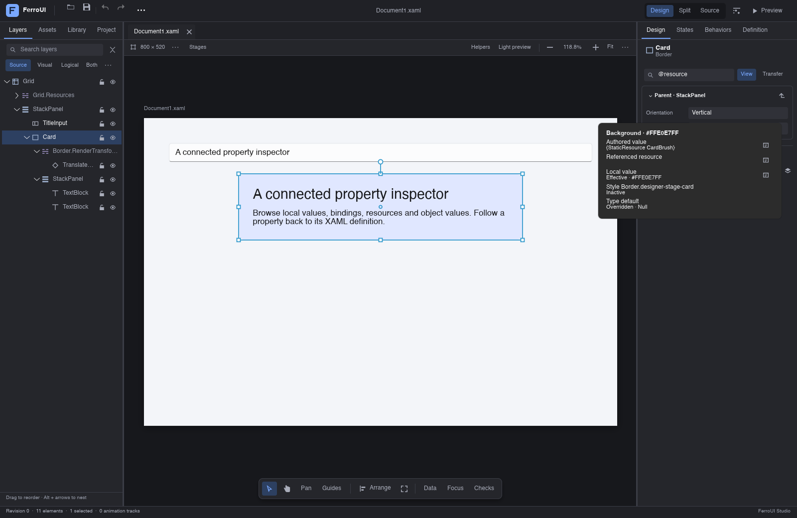
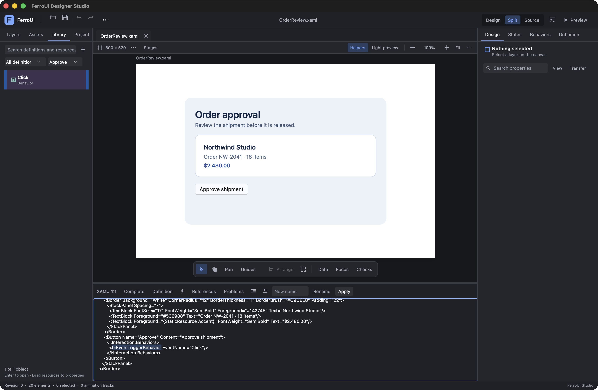

# Native designer controls and interaction guide

The designer workspace composes ordinary FerroUI controls with reusable `AssetToolbox`,
`TimelineLane`, `EasingPreview`, `PropertyNumberScrubber`, `PropertyComponentsEditor`,
`PropertyColorEditor` and `GridTrackEditor`
components. Hosts can use these without loading the workspace shell. They do not own a
document, start a window, or create an undo
stack; their callbacks let the host apply changes through its existing transaction boundary.

## Shared chrome and embedding

`designer_chrome_style()` returns the reusable style collection from `DesignerChrome.xaml`.
Add it to a host's styles and apply `designer-chrome` to editor containers. The loader registers
the types referenced by its selectors. All semantic color resources have a `Designer` prefix;
they do not replace application-theme keys or recolor the preview. The
[visual design guide](visual-design.md) lists tokens, metrics and reference decisions.

## Compact property inspector

Properties are grouped into collapsible categories. Common geometry stays in Layout; minimum
and maximum dimensions are available under Advanced. Search matches every term and supports
`@modified` and its alias `@local` for authored overrides, including expressions. A dot marks
authored overrides, a diamond identifies an expression, and inherited values have no marker.
Native tooltips include the effective value and its runtime origin. Changing
the filter does not author source or discard the document selection.

Eligible numeric property names are `PropertyNumberScrubber` controls; mixed selections,
expressions, object-valued properties and unavailable numeric values retain ordinary labels.
Drag a scrubber label horizontally to adjust its draft, then release to commit one transaction.
Shift multiplies the configured step
by ten; Ctrl divides it by ten. Arrow keys use the same policy. Escape, lost pointer capture,
or reconfiguration cancels a drag. `PropertyNumberOptions` sets minimum, maximum, step and
integer rounding. Native numeric value fields remain directly editable; Enter commits text.

`PropertyComponentsEditor` presents Margin/Padding/BorderThickness as L/T/R/B and CornerRadius as
TL/TR/BR/BL. The link button switches between a common value and independent components.
Built-in editors initially link uniform values and show one **All** field. Mixed or nonuniform
values retain explicit components. Toggling the chain is view state and does not author values.
Enter validates and commits the four values together; Escape restores the accepted values.
A mixed selection starts with empty components rather than inventing zeros. In unlinked mode,
all four values must be explicit before committing a mixed edit; linked mode applies one explicit
value to all four. Padding, border thickness and corner radii enforce nonnegative values;
margins may be negative. Alignment editors provide four vector choices with native keyboard
activation and automation names; orientation uses explicit horizontal/vertical flow icons.

Relative points and rectangles share one units selector for all coordinates. A matrix with perspective retains its three additional fields when edited. Mapped Rust thickness and corner radii use the same component order in Studio and VS Code. [VS Code compound fields](vscode/authoring.md#edit-compound-property-values)

Custom hosts construct a scrubber with `PropertyNumberScrubber::new()`, call `configure`
with an accepted label/value/options, and handle `on_commit`. Construct a compound editor
with `PropertyComponentsEditor::new(PropertyComponentsKind::Thickness, false)`, call
`configure(Some([left, top, right, bottom]))`, then connect `on_commit`. Configuration updates
the view without generating an authoring callback. `control()` embeds a compound editor in
another view; a scrubber is itself a native control. Existing `PropertyEditorFactory` extension
points take precedence over built-ins and are used by the contextual panel editors too.

### Trace property values

Select a control and choose the layers icon beside a property. The flyout shows its effective value and the applied local, style, theme, template, inheritance, and default contributors. An animated property includes its base value when available. A current value override has its own row.

Use a source arrow to reveal an authored property, setter, or resource. When an accepted stylesheet or dictionary supplies the value, the arrow opens the owning XAML tab and selects the declaration. The popup reads the current native preview and leaves source and Undo history intact. [VS Code workflow](vscode/authoring.md#trace-an-effective-property-value) · [MCP arguments](vscode/reference.md#trace-property-values-with-mcp)



### Edit scoped styles and palettes

Select a style or theme in **Library** to edit its selector, setters, or base theme in the definition inspector. Choose **New style in this scope** to add a style to the selected host. Use **Edit scoped palette** from a resource owner or dictionary to inspect Shared, Default, Light, Dark, and High contrast declarations. The appearance icons change the native preview. **Compare theme colors** shows each resolved value and adds the High contrast column when the host supplies that theme.

Choose a palette swatch to open the native color editor. Enter a literal or choose a color and apply it. To add a token, choose the layer, fill in the key and color, and use the plus button. When creating a High contrast layer, select the application's theme package in the palette editor. An accepted color or style edit takes one Undo step. Use the source arrow beside a swatch to open its exact declaration. [VS Code guide](vscode/styles.md) · [MCP arguments](vscode/reference.md#edit-styles-and-palettes-with-mcp)

In the consuming view's definition inspector, choose **Open included styles and palettes**. Select an entry and use the source arrow to open its owner in Studio. In the comparison, the source arrow follows keyed aliases and supported brush references to the authored color, including when High contrast inherits its value from Dark. The arrow's tooltip describes the chain. Choose **Edit scoped palette** to edit the supplying layer. Use **Return to consuming view** in the definition inspector to see the unsaved change applied. Undo from the owning tab. [Follow a color alias](vscode/styles.md#follow-a-color-alias)

### Edit Rust styles

Open a Rust view, select its RSX invocation, and choose **Edit Rust styles** in the **Properties** toolbar. Pick a selector, edit its literal or a typed setter, and use Enter or the check icon to apply. The plus actions add a rule, a nested rule, or a setter. Use the source icon beside a computed value to open the expression. Each accepted change uses Studio’s document history. [VS Code and App Preview workflow](vscode/styles.md#edit-inline-rust-styles) · [MCP arguments](vscode/reference.md#edit-rust-styles-with-mcp)

Open the Cargo solution to work with a shared color in a separate Rust module. Choose the color’s source icon in the layer list or comparison to open its initializer in the owning tab. Use the shared color editor to write to the constant’s file or choose **Use a local color** for this registration. A shared declaration edit keeps the view open and updates it from the unsaved module buffer. Undo or Redo from either participating tab to restore the matching view and source together. [Shared Rust colors](vscode/styles.md#edit-a-shared-rust-color)

If the view wraps a shared `u32` in `Color::from_uint32`, the source arrow and **Edit const** follow the integer into its module. Named swatches and literal parsed colors use the same editor. [Rust color source forms](vscode/styles.md#edit-rust-style-color-resources)

Under **Color resources**, choose **Shared**, **Default**, **Light**, **Dark**, or **High contrast** to add or edit an authored swatch. **Compare Rust theme colors** shows the resolved appearances and opens each supplying declaration. Use **Assign color resource** on a compatible setter. **Add color resource setter** creates a typed setter with the selected key. The source icon opens the literal constructor or the setter’s string key. The preview follows the resource seen by the matched control. Packed ARGB constructors and explicit color fields retain their authored shape when you edit the swatch. [Rust color resources guide](vscode/styles.md#edit-rust-style-color-resources)

When a color comes from a same-file constant, choose the diamond icon beside its value. Select **Use a local color** for this style or **Edit the shared constant for all uses**. Apply the color from the popup. Undo restores the exact Rust source and keeps the selected RSX view. [Shared Rust colors](vscode/styles.md#edit-a-shared-rust-color)

### Create an XAML event handler

Open the owning Cargo project and build it from **Project** to load the exported XAML registry. Open the XAML view in **Split** or **Code**. Put the caret on an event attribute such as `Click="OnApply"`, then choose the lightning button **Create Rust event handler** in the source toolbar. Studio adds the typed callback to the view’s Rust class registration and opens its declaration. Use an empty attribute value to accept a generated name. The paired edit participates in Studio Undo and Redo. [VS Code and MCP workflows](vscode/authoring.md#create-a-rust-handler-for-an-xaml-event)

### Browse objects by owning scope

Open **Library** and use the **Owning scope** selector beside the category filter. Choose an owning control or dictionary to browse its resources, includes, templates, and behaviors. Use the category filter and search to narrow the selected scope. **Document and project** returns to the general Library.

Select a reusable XAML definition to open its existing inspector. Press Enter or double-click an include, behavior, or mapped Rust entry to reveal the declaration in source. Rust item and cell template assignments open in their owning Rust module. An isolated definition lists its own contents. [VS Code workflow](vscode/authoring.md#browse-objects-by-owning-scope) · [MCP workflow](vscode/reference.md#browse-library-scopes-with-mcp)



### Bind a command and its parameter

Build the owning Cargo project to load its registered properties. Open an XAML view with a typed data context, then select the control in the canvas or Layers. In the inspector header, choose the link icon **Edit command binding**.

Choose an `ICommand` member from the **Command** picker and, where offered, a typed member from **CommandParameter**. **Browse** opens the selected object’s registered members. Use the source icon to open an existing expression or choose **Clear binding** to remove a simple data-context binding. The check icon applies both fields in one Undo step. Source edits or changes to the preview scope retire the open picker. [VS Code workflow](vscode/authoring.md#bind-a-command-and-its-parameter) · [MCP arguments](vscode/reference.md#bind-a-command-with-mcp)

### Edit a Rust command binding

Select a control with a mapped Rust command on the canvas or in **Layers**. In the inspector header, choose **Edit command binding**. Enter the Rust expression and optional parameter in their fields. Hover over a field to see the registered type. Use the source icon to reveal an expression in **Split**, or use the reset icon to clear the field. The check icon applies both changes with one Undo step. The app supplies and evaluates the command at runtime. [VS Code workflow](vscode/authoring.md#edit-a-rust-command-binding) · [MCP arguments](vscode/reference.md#edit-a-rust-command-with-mcp)

### Follow a Rust declaration from XAML

Build the owning Cargo package from Studio. In **Split** or **Code**, place the caret on a registered control, property, type annotation, typed binding member, or style selector operand and press **F12**. Choose the result to open the source and select the declaration. Open Rust drafts contribute their current text. For a dependency inside the open solution, the result opens its Rust tab. [Supported declarations](vscode/authoring.md#follow-registered-rust-declarations)

### Review a resource rename

Open the owning project. In **Code** or **Split**, place the caret on a keyed resource or reference. Choose the **Rename resource and references** icon, enter the new key, and choose **Review resource rename**. From the **Library** definition editor, enter a key and choose **Rename** to open the same project review.

For each file, compare **Original source** and **Proposed source**. The review follows included dictionaries and uses the current drafts for open views. Use the check icon to apply one history step across the participating buffers. Undo or Redo from any participating tab steps through the complete change. Save when the files are ready. [VS Code workflow](vscode/authoring.md#rename-a-resource-across-xaml-files) · [MCP workflow](vscode/reference.md#review-a-resource-rename-with-mcp)

For a palette key defined in several layers of one dictionary, the review shows the **Theme family** and its participating layers. Open the authored palette or put the caret on a reference to that family. The review includes inline declarations, native High contrast keys, supported included layer files, and consumer references. [Theme resource workflow](vscode/authoring.md#rename-a-key-across-theme-variants)

### Move a resource to another dictionary

Open the owning project. In **Code** or **Split**, place the caret on a keyed resource declaration or a reference that has one authored declaration. Use the arrow icon **Move resource** in the source toolbar. Choose a destination dictionary by scope, file and line, then select the source icon **Review resource move**.

Compare **Original source** and **Proposed source** in each affected file. The review shows any include needed to retain visibility and any updated relative resource paths. Use the check icon to apply the move or the close icon to cancel. Undo or Redo from either participating tab restores both buffers together. Save the changed files when ready. [VS Code workflow](vscode/authoring.md#move-a-resource-to-another-dictionary) · [MCP workflow](vscode/reference.md#move-a-resource-with-mcp)

### Review a registered property rename

Build the owning Cargo package from Studio. In **Code** or **Split**, place the caret on a property name, a typed binding member, or a property inside a style selector. Choose the **Rename registered property** icon, enter its new public name, and choose **Review property rename**. Typed binding paths can name an ancestor, cast a value, or qualify an attached owner. The review follows the resolved registration and retains the rest of the path. [Typed binding examples](vscode/authoring.md#follow-registered-rust-declarations)

Choose a file and compare **Original source** and **Proposed source**. Review any separate Rust assembly file that contains an explicit RSX builder mapping for the property. Studio follows named imports and qualified paths to unconditional text constants in the built crate, including their open drafts. It edits the selected metadata tuple and preserves the shared constant. If Studio shows **Potential references**, choose a location and select the source icon to inspect that usage. Open a new review when ready to apply. Use the check icon to commit the displayed Rust and XAML patches. Undo or Redo from any participating tab moves all the edits together. Save the files and rebuild the package to publish the new schema. [Supported source forms](vscode/authoring.md#rename-a-registered-xaml-property) · [MCP workflow](vscode/reference.md#review-a-registered-property-rename-with-mcp)

### Review a registered type rename

Build the owning Cargo package to index its XAML types and Rust declarations. In **Code** or **Split**, put the caret on a registered control tag, type value, or type inside a style selector. Select the **Rename registered type** icon and enter the new name.

When the XAML name comes from its Rust declaration, Studio resolves Rust references in the background using `rust-analyzer` on `PATH`. Set `FERROUI_RUST_ANALYZER` to an executable path to select a specific copy. For a literal XAML alias, the review opens as soon as the source planner finishes.

Compare **Original source** and **Proposed source** for every file, including any RSX builder metadata. Inspect potential references listed below the comparison. Use the check icon to edit the buffers together. Undo or Redo from a participating document restores the grouped source changes. Save and rebuild the schema to publish the new name. [VS Code workflow](vscode/authoring.md#rename-a-registered-xaml-type) · [MCP workflow](vscode/reference.md#review-a-registered-type-rename-with-mcp)

### Extract an XAML resource dictionary

Open the owning project. In **Split** or **Code**, put the caret on the resource, its inline dictionary, or the control that owns the `Resources` property. Choose the file icon **Extract resource dictionary** in the source toolbar. Enter the sibling filename and choose **Review extraction**. Compare **Original source** and **Source replacement**, then read the new file in its named tab.

Choose **Apply extraction** to create the file and update the view. The original view stays open for review and save. Undo from that view restores the inline resources and removes the generated dictionary while its file and contents match the creation. Use Redo to create it again. If you edit the generated dictionary, undo those edits before reversing the extraction. [VS Code and MCP workflows](vscode/authoring.md#extract-a-resource-dictionary)

### Preview a packaged asset

Open the project and build the owning Cargo package from Studio. An XAML image can use the same `ferres://Assembly/Assets/Logo.png` address it uses in the app. Studio reads the asset from the source file recorded by the build for the canvas, native preview, and Preview Stages. If you update an asset outside Studio, refresh the preview to see the new bytes. A failed stage refresh keeps its last accepted frame.

To inspect the recorded source file through MCP, call `designer_language` with `action: "resource_uri"` and the `reference` from XAML. Build the application again to update the embedded bytes used in App Preview or the running app. [Asset paths in VS Code](vscode/authoring.md#open-the-source-of-a-packaged-asset)

### Place a packaged asset

1. In a built Cargo project, open the view and choose **Assets**, then **Packaged images**. Find the raster by filename, assembly, or export key.
2. Drag the raster onto the canvas or into **Layers**. For keyboard selection, focus the raster row and press Enter, then choose a location on the artboard. To edit an existing authored image, select the control and open the raster’s context menu. Choose **Use as image source** or the named image property.
3. Check the image on the canvas and save the document. Undo reverses the insertion or assignment as a single source edit. Build the app again after replacing the asset bytes.

Studio writes a `ferres://` reference in XAML or a static `::ferroui_view::asset_image` call in mapped Rust. MCP agents can find the raster with `designer_toolbox`, place it with `designer_place`, and assign it with `designer_set_image_source`. [VS Code workflow](vscode/authoring.md#place-a-published-cargo-asset) · [MCP reference](vscode/reference.md#drive-an-editor-workflow)

### Move a published asset

1. Build the owning Cargo package. In the **Packaged images** category, open the image’s context menu and choose **Move or rename asset…**.
2. Enter a workspace-relative destination inside an embedded directory and choose **Review asset move**. Compare the old and new published addresses and review the source changes, including any `ExportPlan::asset` entry.
3. Choose **Apply file move**. The native canvas and Stages follow the new address. Undo or Redo from the design or a participating source tab to restore the file and references together. Save the edited buffers and rebuild to publish the address in the app.

With MCP, pass the Toolbox `asset` ID, `destination`, and current `expected_revision` to `designer_plan_asset_move`. Review the returned documents and addresses, then pass its `review` with the same arguments to `designer_move_asset`. [VS Code workflow](vscode/authoring.md#move-an-asset-and-update-its-references)

### Move an XAML file

Open an XAML file from the owning project. In **Split** or **Code**, choose the file-and-arrow icon **Move XAML file**. Enter the destination relative to the project workspace and choose **Review file move**. Compare **Original source** and **Proposed source** for affected markup, Rust, Cargo build files, saved stage sets, and scenarios.

**Apply file move** transfers the file, writes the reviewed stage sets and scenarios, and updates the participating source buffers. Save the buffers to persist their new references. Undo or Redo from a participating XAML or Rust tab restores the matching location, source edits, and saved reference files as one operation. Studio checks the saved files for external changes when replaying history. [Supported paths and VS Code workflow](vscode/authoring.md#move-an-xaml-file-and-its-references)

An open **Preview Stages** card follows its source through the move, Undo, and Redo. The board keeps its card configuration and prototype links. A paused card holds its image until you refresh it or turn updates on.

For explicit Cargo registrations, the review keeps authored URI aliases and rebases file-derived keys along with their literal XAML and Rust consumers. Build the owning package to load metadata for custom assembly names. [How the planner handles compiled addresses](vscode/authoring.md#move-an-xaml-file-and-its-references)

For an existing group built from `std::fs::read_to_string`, the review can follow a literal file path and immutable Rust bindings into `XamlGroup::documents`. Check the physical path and any changed registration key or class selector in **Proposed source**. [Supported Cargo file reads](vscode/authoring.md#existing-cargo-groups-that-read-files)

For computed groups that use `XamlGroup::document_files`, Studio uses the selected build's input index to find the path declared in Rust. Review that path change in **Proposed source**. The published key and generated Rust names stay stable. Build the owning package again if Studio reports that a declaration shifted. [Declare file-backed Cargo inputs](vscode/authoring.md#computed-cargo-groups-with-file-backed-registrations)

The canvas, Preview Stages, and prototype player use the compiled group's base for relative XAML includes with a recorded source. Apply, Undo, and Redo keep those references attached to the file. Studio reports conflicting targets when a source belongs to several groups that resolve the same include differently. [Relative include workflow](vscode/authoring.md#computed-cargo-groups-with-file-backed-registrations)

For a move that changes a generated Rust build function, build the owning Cargo package from Studio and make `rust-analyzer` available on Studio’s `PATH`. Set `FERROUI_RUST_ANALYZER` before launching Studio to select a different executable. **Review file move** resolves the Rust imports and calls in the background using the build’s Cargo feature and profile settings. The same review includes edits to open Rust drafts. Close the flyout to cancel an in-progress review. Once the changes appear, apply and save them, then rebuild to regenerate the compiled modules. [Review a move with generated Rust references in VS Code](vscode/authoring.md#move-an-xaml-file-and-its-references)

### Rename a control in a Rust view

Choose the `rsx!` invocation and select the control in the canvas or **Layers**. Edit **Name** in Properties to update the literal and any mapped style selectors or visual-state targets. Undo restores them together. If the name has a mapped reference, rename the control or remove the reference before resetting **Name**. [Supported references](vscode/authoring.md#rename-an-rsx-control)

### Edit RSX builder values

Select a control in a Rust view and open **Properties**. Edit a supported literal authored as a field, such as `width: 160.0`, or as a single-argument call, such as `width(160.0)`. The same editor handles mapped layout calls such as `grid_row(1)` and setters registered by the project. **Reset** removes the assignment and retains its comments. Use the source arrow to open a computed value. Each applied edit takes one Undo step. [VS Code workflow](vscode/authoring.md#edit-rsx-builder-values) · [MCP tools](vscode/reference.md#drive-an-editor-workflow)

For a mapped image, edit **Source** using a URI relative to the Rust file. Studio updates the path in `embedded_image(include_bytes!(…))`, including an explicitly imported `embedded_image` and a path assembled from string literals with `concat!`. The edit keeps the existing macro calls and comments. When the include starts with `env!("CARGO_MANIFEST_DIR")`, open the owning package so Studio can resolve its base. [VS Code Assets workflow](vscode/authoring.md#edit-values-actions-and-resources)

When Studio has the Cargo target for a Rust view, it can preview embedded raster paths anchored to `CARGO_MANIFEST_DIR`. Edit the image's **Source** relative to the Rust file in Properties. Studio keeps the package-relative constructor and macro in the original source. [Supported embedded paths](vscode/authoring.md#edit-values-actions-and-resources)

### Arrange an inline Rust child collection

Open the outer RSX invocation for a panel whose children come from an inline array or a qualified `::std::vec!` of nested RSX controls. Drag a mapped member in **Layers** or on the canvas. Insert a Toolbox control, move a member to another authored panel, or wrap consecutive members in a panel. Studio keeps their authored expressions and comments and restores the exact Rust in one Undo. Use the Rust editor to change computed entries. [Collection syntax and limits](vscode/authoring.md#arrange-an-inline-rust-child-collection)

Select one or more mapped members and choose **Delete selection** to remove their Rust expressions in one Undo step. Computed siblings retain their original source and order.

### Solid color editor

`PropertyColorEditor::new() -> Result<Self, String>` creates a swatch, source field and native
ColorView flyout. `configure(Option<&str>, bool) -> Result<(), String>` updates accepted state
without committing. Its first argument accepts a literal solid color or `None`; the second
indicates a mixed selection. An expression, complex brush or invalid color returns `Err` and
leaves the accepted state unchanged. The workspace's built-in factory uses ordinary source
editing for those values; standalone hosts provide their own fallback. `on_commit` receives a
source value only after Enter or explicit Apply. Spectrum, palette and component adjustments
remain drafts while the popup is open; Cancel and dismissal discard them. Named colors retain
their spelling when confirmed unchanged, and explicit confirmation can materialize an inherited
effective color. Mixed selection requires an explicit value.

`control`, `text_editor`, `swatch_button`, `color_view` and `flyout` expose the native components.
The popup scopes the ColorView library's compatibility resources locally so its spectrum,
palette, components and alpha controls work under the WinUI host. Expressions and complex
brushes retain source editing; the solid picker does not flatten them.

### Dropping values and references

Drop text or a `property_value_data_format()` string onto a property value to validate and
apply it to the selected authored objects. A valid drop copies one value; it never removes the
source. Multi-selection is one atomic transaction. Invalid values and read-only, runtime-only
or stale destinations reject the drop before modifying source.

In Layers, select the destination object first, then drag a keyed resource to the appropriate
property to create `{StaticResource Key}`. Shift-drag creates `{DynamicResource Key}`.
Alt-drag a named element to create `{Binding ElementName=Name}`. The inspector destination
remains selected while the reference is dragged; an ordinary resource click still selects the
resource for inspection. Internal references retain their document identity and are checked
against destination resource/name scopes, including shadowing and merged dictionary order.
Reference drops require the referenced object to be resolvable from every selected target.

The native TreeDataGrid `RowDragStarted` arguments expose `data_transfer()` and
`key_modifiers()` so other hosts can attach typed payloads while retaining normal row drag
behavior. Designer source hierarchy moves continue to use their own guarded move transaction.

## Edit table columns

Select a `TableView` or `TreeDataGrid` in an XAML or RSX view using the canvas or Layers. Use the **Edit columns** icon beside the property search. Choose a column from the list. The arrow icons change its position, and the adjacent icons duplicate, remove, or reveal it in source. To add a column, choose an available type and select the plus icon.

Edit a column’s width, header, binding, or supported type-specific settings. Press Enter in a text field or use the check icon to confirm a value. Reset restores the framework default by removing the authored field. A template, object value, or protected expression links to its authored source. You can also edit the supported inner fields of an XAML hierarchy column.

Each action updates the native design and writes one source transaction. Undo restores the previous collection or value. Use the authored source for collections supplied by runtime code. [VS Code Columns view](vscode/authoring.md#edit-table-columns) · [MCP arguments](vscode/reference.md#edit-table-columns-with-mcp)

For an RSX table, Columns edits an inline `ferroui_view::table_columns` array and starts one when you add the first column. Enter a simple path such as `Customer.Name` in **Binding**. Reveal a computed property in its original Rust expression. If the whole collection is computed, use **Reveal column collection in source** in the flyout. [RSX example](vscode/authoring.md#edit-an-rsx-tableview)

For an RSX TreeDataGrid, the same flyout edits a `ferroui_view::tree_data_grid_columns` array. Edit the header, width, and binding under **Inner column** when working with a hierarchy. Its parent column sets the children and expansion paths. Choose **Edit cell templates** on a template column to open the display or editing body. [RSX TreeDataGrid example](vscode/authoring.md#edit-an-rsx-treedatagrid)

An RSX table can also call a named function that returns a static column array. **Edit columns** shows the supplying function beside the table name. Use the source icon to reveal the array or a field in its owning file. Changes to a shared collection apply to its other consumers. When the collection comes from a companion Cargo module, undo or redo the edit from either the view tab or the module tab. [Shared Rust columns](vscode/authoring.md#edit-shared-rust-column-definitions)

## Edit item and cell templates

Select an items control or an authored table column in Layers. Open **Edit item templates** beside the property search. The popup shows each supported slot and its current assignment. Use the canvas, source, new template, copy, or reset icon for that slot. To assign a resource, choose a visible template and confirm with the check icon.

**Make inline copy** works with an included resource template from the current preview. Stable links keep their resource and theme scope. A dependency that would be shadowed gets a private key in the nearest writable resource owner. Copied dependencies and the template assignment use one Undo step in the consuming document. [Included template copy example](vscode/authoring.md#edit-item-and-cell-templates)

The canvas uses the first item from the selected design fixture when the items binding resolves to an array. Choose **Return to document** to leave a local template preview. Each assignment, inline creation, copy, or reset uses one source transaction. Apply **Make inline copy** to a local resource whose dependencies can be preserved.

For a template supplied by a workspace dictionary include, the canvas and source icons open its owning document tab. The canvas starts with the consuming view's selected fixture. Edit and undo definition changes in the dictionary tab, then use **Return to document** to inspect the consuming view. The picker includes reliably resolved templates and shows their dictionary's filename. [VS Code workflow](vscode/authoring.md#edit-item-and-cell-templates) · [MCP arguments](vscode/reference.md#edit-item-templates-with-mcp)

For Rust, select an items control and open **Edit item templates**. For a TableView column, choose it in **Edit columns** and use **Edit cell template**. The canvas icon opens the mapped `rsx!` returned by its typed closure. Use Properties and the canvas on that original body, then use the back arrow to return to the owning view. For an empty slot, enter the Rust item type and press Enter or choose the plus icon. Reset removes a mapped assignment. For a computed template, use the source icon. [Rust example](vscode/authoring.md#edit-a-rust-item-or-cell-template) · [MCP arguments](vscode/reference.md#edit-item-templates-with-mcp)

For a shared Rust template, the inspector shows the supplying function. The canvas icon opens the original invocation in the template’s file. The source icons reveal either the body or the call site. Use the back arrow to return to the consuming tab. Undo a body edit in the template’s tab. Resetting a call in a companion column module links the table and the column module, so Undo works from either tab. [Shared Rust example](vscode/authoring.md#edit-a-shared-rust-template)

## Edit control templates

Select an XAML control with a writable `Template` property. Choose **Edit templates** in the property inspector and use the **Control Template** section. Open the template on the canvas, reveal its source, or choose a visible resource that matches the control's type. Studio shows **Inherited** for a template supplied by a style or theme with a verified source. An included definition opens in its original file and uses its authored resource scope.

When the selected Cargo package has a current XAML schema, Studio can trace an inherited template from a file-backed compiled dictionary to its XAML input. The published `ferres://` address continues to identify the resource, including when its physical filename differs.

**Create inline template** starts a template with the control's type and its registered required parts. **Make inline copy** duplicates the assigned or inherited template. A dependency that would be shadowed keeps its value under a private key in a writable resource scope. **Reset template** removes the local assignment and restores the inherited value. Studio records each source change as one Undo step. [VS Code workflow](vscode/authoring.md#edit-a-control-template) · [MCP workflow](vscode/reference.md#edit-item-templates-with-mcp)

## Contextual panel layout

The property dock's Layout section shows the selected panel, or the common parent panel of
selected children. **Select parent** moves to that panel. Stack, Wrap, Dock, UniformGrid and
Flex panels expose their common settings through the same registered property factories and
layout adapters. Custom panel adapters can expose their own settings through this section.

Grid rows and columns each use `GridTrackEditor`: choose a track, edit its numeric length and
`*`, `px` or `Auto` unit, or insert/remove a track. Inserting adjusts child indices and expands
spans crossing the insertion. Removing shifts indices, shrinks spans and keeps cells inside
the remaining tracks. One transaction updates definitions and all affected children; one undo
restores the original source. An implicit axis becomes explicit only when edited, and at least
one track remains. Authored definition property elements retain their other attributes,
namespaces, comments, min/max constraints and shared-size groups.

`GridTrackEditor::new(axis)` creates the standalone view. `configure(values, selected, writable)`
updates it without authoring; `on_selected` reports navigation and `on_change` receives a
`GridTrackChange` whose callback returns a validation result. Invalid typed lengths remain
available for correction. Hosts can inspect the native selector and value controls using
`track_selector`, `length_editor` and `unit_selector`.

The workspace calls `DesignerSession::edit_grid_tracks`. The portable
`plan_grid_track_change` and `plan_grid_track_change_with_placements` functions are available
to other hosts in `ferroui-designer-tools`. The native path supplies effective child placements,
so cells inherited from styles are preserved by materializing only the changed coordinates.
Bound cell coordinates/spans, object-valued positions, and definition collections supplied
entirely by a style or factory are rejected rather than flattened. Structural Grid edits remain
ordinary source edits even when animation recording is enabled.

### Wrap selected controls

Select one control or consecutive siblings. Open **Arrange** on the canvas shelf, choose **Wrap selection**, then choose a stack, WrapPanel, Grid, Canvas, or Border. The wrapper occupies the original child slot and becomes the selection. **Canvas (keep positions)** uses the measured slots of existing Canvas children. **Border** wraps one child.

Use Undo to restore the original source in one step. Studio applies the same plan to XAML and mapped Rust views, including Rust comments and computed values within the selected controls. [Layout choices in VS Code](vscode/authoring.md#wrap-selected-controls) · [MCP workflow](vscode/reference.md#wrap-controls-with-mcp)

## Hierarchy and artboard

Layer rows use a single virtualized template column with semantic icons and name/key/type
identity. Complete type/context remains in tooltips and automation names. Native type-ahead
search is forwarded through hierarchical expanders, including custom template text selectors.
`DesignerWorkspace::collapse_outline()` collapses unrelated branches and retains the selected
ancestor paths without touching source or undo history.

`canvas_focused()` and `set_canvas_focused(bool)` provide the temporary canvas-focused workspace.
The side widths, prior timeline visibility/height, source draft and panel modes survive the
round trip. The toolbar command and Ctrl+Shift+F / Cmd+Shift+F share this API.

Source hierarchy drags preserve source order and selected subtrees. Hovering over a compatible
collapsed container expands it; native TreeDataGrid scrolling and drop adorners stay active.
Before/after/inside drops validate content ownership, cycles and the captured source identity.
Canvas reparenting preserves measured world geometry across affine parent transforms.

Layer visibility, locking, and selection follow a control through checked source edits. Identical XAML siblings and mapped Rust child lists retain their own identities through moves and wrapping. Use **Undo** and **Redo** for the source gesture. A hidden control keeps its layout space. [VS Code workflow](vscode/authoring.md#keep-layer-state-during-edits)

In a Rust view, drag mapped controls around loops and conditionals on the artboard or in Layers. The moved blocks keep their comments, handler expressions, and other Rust values. A drop below an authored row places the selection before the next Rust child, which may be a loop or expression. A drop inside a panel appends to its authored child list. Computed single-child slots and explicitly computed child collections are editable in Rust source. A successful drag keeps the moved controls selected and uses one Undo step. [VS Code workflow](vscode/authoring.md#move-and-insert-controls-in-a-partial-rsx-preview)

| Focus / gesture | Behavior |
| --- | --- |
| Layers: Alt + Up / Down | Move selected siblings earlier / later |
| Layers: Alt + Home / End | Move selected siblings first / last |
| Layers: Alt + Right / Left | Nest in the previous compatible sibling / move out one level |
| Artboard: arrow keys | Move selected controls by one layout unit |
| Artboard: Shift + arrows / Ctrl + arrows | Move by ten units / one tenth of a unit |
| Artboard: Shift while dragging | Lock movement to the dominant axis |
| Artboard: marquee left to right | Select fully enclosed objects |
| Artboard: marquee right to left | Select intersecting objects |
| Artboard: Shift / Ctrl / Alt marquee | Add / toggle / subtract objects |
| Escape or lost capture during a canvas gesture | Cancel and restore the original selection/geometry |

The Arrange menu also exposes source-order and nesting commands alongside alignment and
distribution. `OutlineCommand`, `DesignerWorkspace::edit_outline` and the corresponding
session methods provide the same operations for embedding hosts. Multi-object structural
commands are atomic; an incompatible member prevents a partial move.

## Project assets

`DesignerWorkspace::register_asset` adds a project control to the searchable toolbox, or
replaces the existing entry with the same stable ID. Categories and the visible result count
update immediately while preserving the current category filter.

```rust
use ferroui_designer::{AssetIcon, DesignerAsset};

workspace.register_asset(DesignerAsset {
    id: "Project.RevenueCard".into(),
    title: "Revenue card".into(),
    category: "Project".into(),
    description: "A reusable revenue summary".into(),
    source: r##"<Border Width="240" Height="120" CornerRadius="8" Background="#FFE0E7FF">
        <TextBlock Text="Revenue" Margin="16" />
    </Border>"##.into(),
    icon: AssetIcon::CustomPath(
        "M2 22V12H7V22Z M10 22V7H15V22Z M18 22V2H23V22Z".into(),
    ),
})?;
```

Icons use native path geometry in a 24 × 24 coordinate space. Registration rejects empty
IDs, titles, categories, or snippets and invalid vector geometry before modifying the
catalog. Snippets are interpreted in the destination document's namespace context; custom
controls must be registered with the runtime loader, and any additional XML namespaces must
be declared in the document or snippet. Insertion uses the existing layout tools and source
transaction pipeline.

The standard catalog includes 20 controls, panels, and shapes. Search matches every
whitespace-separated term, ignoring case, across the title, ID, category, and description.
Native buttons supply keyboard focus, theme states, tooltips, and automation names. Dragging
starts a placement gesture; keyboard activation arms placement on the artboard.

For a separate host, construct `AssetToolbox::new(default_designer_assets())`, embed its
`control()`, and connect `on_activate` and `on_begin_drag`. The public `set_query`,
`set_category`, `visible_asset_ids`, `assets`, and `register` methods also support a host's
own catalog UI or integration tests.

`set_view_mode(AssetViewMode::Grid)` uses category cards; `AssetViewMode::List` uses compact
name/description rows. `view_mode()` reports the current presentation. Switching views preserves
the query, category, catalog and placement callbacks. `DesignerWorkspace::asset_toolbox()`
returns `Option<Rc<AssetToolbox>>` for hosts that need these browsing controls.

## Edit behaviors

1. Select an authored XAML control in Design or Layers and choose **Behaviors** in the inspector. When no behavior is attached, the inspector opens the trigger and first action fields.
2. Choose an existing trigger from **Behavior**. Open **Edit trigger** to set its routed event and source or its binding, comparison, and restore behavior. Use **Action** to choose a step, then open **Edit action** to edit it. The arrow icons move the action within its collection. Use **Add action** to append a step and the check or plus icon to apply the fields.
3. Use **Preview actions** to execute the native actions on the artboard and **Reset behavior preview** to restore the authored view. The source icon reveals the selected trigger or action. **Behavior XAML** opens the exact subtree for an advanced edit, including custom trigger types and nested objects.

Choose **Attach behavior** to create another trigger. Studio applies each edit as one source transaction. [VS Code workflow](vscode/authoring.md#edit-a-behavior) · [MCP workflow](vscode/reference.md#edit-and-preview-behaviors-with-mcp)

## Timeline tracks and ruler

The workspace uses separate fixed hosts for the ruler and keyframe inspector; only the track
list scrolls. Two-line track headers distinguish the target and property, with a separate key
count. Violet ranges/diamonds represent authored animation; the blue time flag identifies the
playhead and stays inside the viewport at both endpoints.

`TimelineLane::new()` creates a keyframe lane. `TimelineLane::ruler()` creates a time ruler.
Configure both with the same duration and visible interval to align ticks, diamonds, and
the playhead:

```rust
use ferroui_designer::TimelineLane;

let ruler = TimelineLane::ruler();
let track = TimelineLane::new();
ruler.configure(5.0, Vec::new());
track.configure(5.0, vec![0.0, 2.5, 5.0]);
for lane in [&ruler, &track] {
    lane.set_view(1.0, 4.0);
    lane.set_playhead(2.5);
}
track.set_selected(Some(2.5));
track.set_highlighted(true);
```

The control reports intent through `on_activate`, `on_move`, `on_remove`, `on_insert`,
`on_zoom`, and `on_pan`. A move callback carries the original and destination times. A zoom
callback carries a scale factor and pivot time; a pan callback carries a delta in seconds.
The host applies the command, then updates the controls from accepted state. `view_range`
returns the current visible interval.

| Interaction | Behavior |
| --- | --- |
| Drag the ruler | Scrub continuously |
| Drag a selected diamond | Show selected ghost markers; request one group move on release |
| Ctrl + click / Shift + click | Toggle a key / select a range |
| Drag empty lane space | Marquee-select keys; Ctrl or Shift adds to the selection |
| Ctrl + A | Select every key in the focused lane |
| Escape or lost pointer capture | Cancel the pending keyframe move |
| Double-click an empty point on a track | Request a keyframe at that time |
| Left / Right | Nudge selected keys by 0.1 seconds, or scrub when no key is selected |
| Ctrl + Left / Right | Nudge by 0.01 seconds |
| Shift + Left / Right | Nudge by 1 second |
| Alt + Left / Right | Seek to the previous / next key in the focused lane |
| Ctrl + D | Duplicate after the selected range, separated by one keyboard step |
| Delete / Backspace | Remove the selected keyframes |
| Home / End | Seek to the timeline boundaries |
| Ctrl + wheel | Zoom around the pointer |
| + / − | Zoom around the playhead |
| Shift + wheel, horizontal wheel | Pan the visible interval |
| Page Up / Page Down | Pan by most of the visible interval |

Pointer retiming snaps to 0.1 seconds, or 0.01 seconds with Ctrl. The interval becomes finer
at close zoom levels; Alt disables snapping. Tick labels adapt to the visible scale,
including millisecond precision. Keys are sorted once during configuration, hit testing uses
binary search, and rendering visits only keys inside the visible interval.

`EasingPreview::new()` creates the small native graph used beside the keyframe's curve field.
`set_easing(Some(easing))` samples the actual animation engine, including overshoot.
`set_easing(None)` clears the preview and shows an invalid-draft marker; `easing()` returns the
accepted display value. The graph never authors a keyframe. The workspace updates it while
typing or choosing a preset, and commits only when the keyframe editor's Apply action succeeds.

The workspace offers seconds or 24/30/60 fps snapping. A host can use
`set_frame_rate(Some(fps))` for any integer rate from 1 through 1,000, or `None` for seconds.
In frame mode arrows move by one frame, Shift by ten frames, and Ctrl retains whole-frame
precision; the ruler displays frame labels. Pointer group moves preserve relative offsets and
clamp a shared delta at the focused lane's timeline boundaries. Cross-lane destinations are
then validated together before committing. Persisted key times use the native animation clock's
100 ns precision so accepted keys remain selectable after source round trips.

Batch hosts use `set_selected_keys`, `selected_keys`, `on_selection_changed`,
`on_move_selection`, `on_remove_selection` and `on_duplicate_selection`. Existing single-key
callbacks remain supported. The selection callback includes whether other lanes should retain
their selection, allowing a workspace to support groups across multiple objects/properties.

## Format XAML in Studio

Open the Source pane and select **XAML formatting options** beside **Format XAML**. Choose the indentation, attribute layout, wrap column, bracket placement, and whitespace preferences for this Studio window. The wrap column controls the **Wrap** attribute layout. With a selection, the format icon or Ctrl+Shift+F on Windows and Linux or Cmd+Shift+F on macOS formats that range. With the caret alone, it formats the whole document. Use Undo to restore the original source in one step.

Studio uses the shared formatter for whitespace-sensitive XAML and protected generated regions. Agents can call `designer_language` with `action: "format"`, an optional UTF-16 `range`, and optional formatter overrides. Review the returned `edit` and apply it with `designer_language_apply` and the returned `revision` as `expected_revision`. [Settings and protected regions](vscode/authoring.md#format-xaml) · [MCP arguments](vscode/reference.md#drive-an-editor-workflow)

## Workspace authoring

The workspace shows compact object/property lanes and a contextual editor for a single selected
key. Selecting multiple keys reveals the Offset/Move/Duplicate/Delete toolbar.
Time, value, and curve changes are validated together and committed in one source transaction,
so one undo restores the whole edit. Invalid input remains available for correction. An
editor captured against an older document URI, syntax snapshot, revision, or active animation
cannot modify the newly active animation, including replacement sessions with coincident IDs.

Zoom, pan, and Fit update existing lanes without rebuilding keyframe editors. This preserves
native focus and unfinished input while changing the viewport. Shortening an animation
resets an interval that no longer fits its duration.

The **Add a keyframe at the playhead** icon command records the currently selected track's
property when it belongs to the selected object; otherwise it records that object's opacity.
Values come from the accepted live
preview at the playhead, including interpolation. Record mode continues to capture supported
property edits through the existing session recording pipeline.

A host can reveal an exact keyframe programmatically:

```rust
workspace.select_keyframe(target_node_id, "Width", 2.5)?;
```

The call validates the authored key, selects its object, seeks the playhead, and opens the
contextual editor. New animation programs derive their default selector from the selected
owner and choose an available name. Duplicate creates an available copy name when the name
field still displays the original program.

`DesignerWorkspace::select_keyframes` accepts `(NodeId, property, time)` tuples across tracks.
`selected_keyframes`, `move_selected_keyframes`, `duplicate_selected_keyframes` and
`remove_selected_keyframes` expose the matching group commands. Each group edit validates
every destination before one source transaction; collisions with unselected keys or an
out-of-range destination reject the entire operation. Moving a selected group onto its own
previous positions is valid. Key values and easing remain attached to their keys, and undo
restores the group together. The toolbar exposes selection count, duplicate and delete; curve
presets populate the single-key editor and commit only when Apply is activated.

`set_timeline_frame_rate` and `timeline_frame_rate` coordinate snapping across the ruler and
all lanes. Selection, zoom and frame-rate changes do not author source. Accepted keyboard
edits restore native focus into the rebuilt lane or editor so repeated nudges continue without
requiring a mouse click. Retired timeline editors and gestures remain guarded against URI,
revision, AST identity and active animation changes. Property/layout callbacks additionally
validate the captured destination selection.
