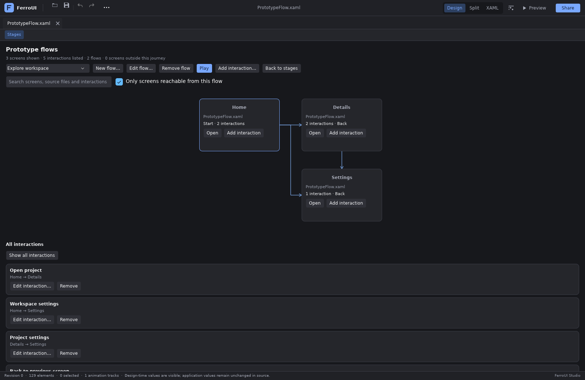
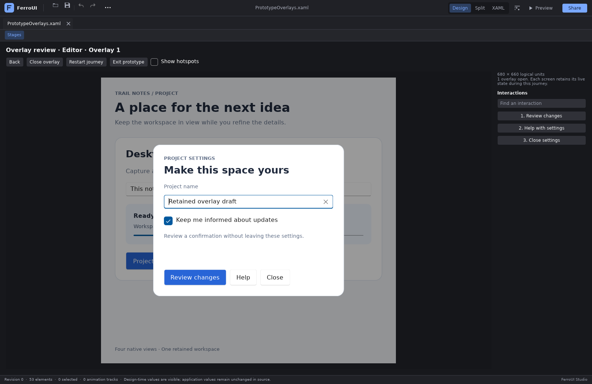
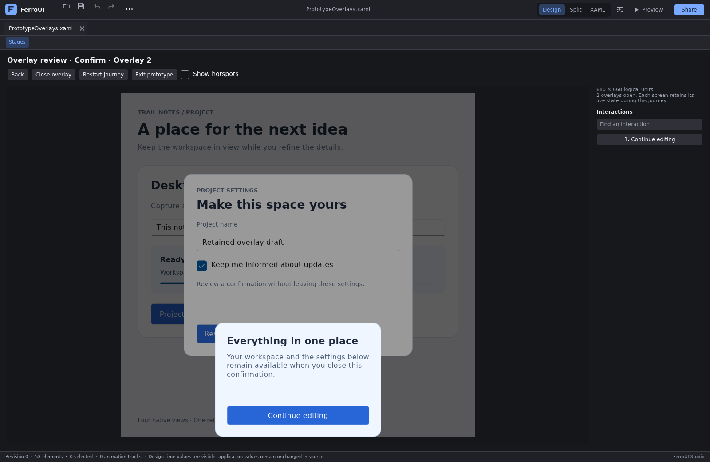
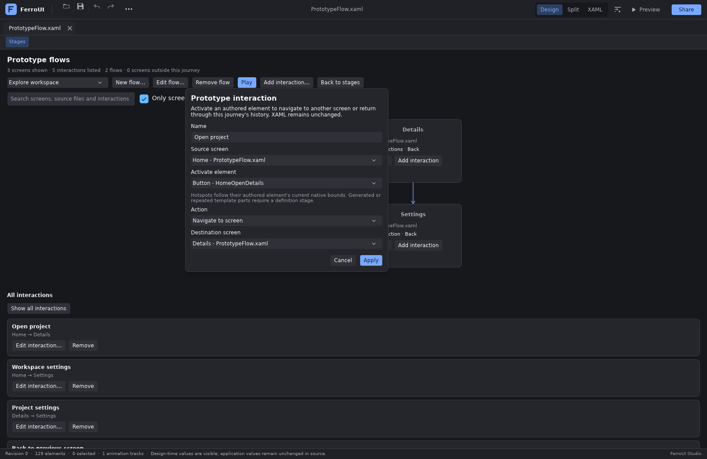
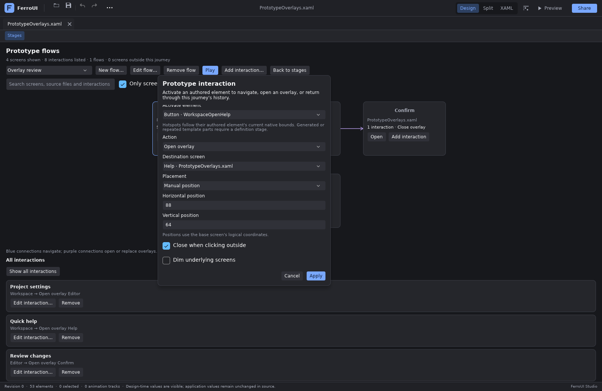
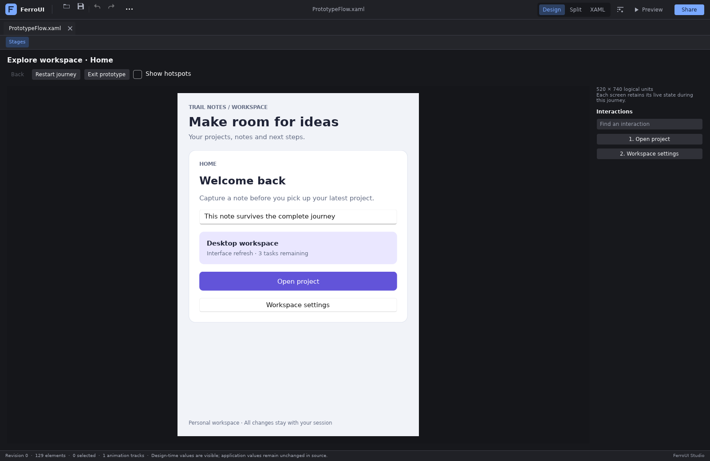

# Multiple views and interactive prototypes

**Prototype** connects existing preview stages into named journeys. A stage remains an
independent native XAML view with its own size, theme, definition, design-data setting and
visual-state scenario. The prototype adds a starting screen, source-anchored navigation
and modal overlays for dialogs, sheets and contextual panels. It does not add event
handlers, navigation classes or temporary visibility changes to the application's XAML.

The stage board answers “how does this view behave in these environments?” The prototype
answers “where can the user go from here, and what happens when they return?” Both use the
same source snapshots, anchors, native loader, preview factories and configuration model.
See [preview stages](xcode-previews.md) for native layout, state scenarios and environment
contracts.



## Research and design choices

The comparison was reviewed on **2026-10-29** using the vendors' published documentation.
Historical material is identified explicitly.

| Reference | Relevant workflow | FerroUI implementation decision |
| --- | --- | --- |
| [Figma prototype flows](https://help.figma.com/hc/en-us/articles/360039823894-Create-and-manage-prototype-flows) | Named starting frames, shared screens and several journeys in one document. | Store named flows separately from screen configurations; a stage can participate in several flows. |
| [Figma connections](https://help.figma.com/hc/en-us/articles/4411431245335-View-prototype-connections) and [actions](https://help.figma.com/hc/en-us/articles/360040035874-Prototype-actions) | Inspect connections, choose a destination, and distinguish forward navigation from Back. | Keep an inspectable connection overview and explicit Navigate/Back actions. Resolve Back from the current run's history. |
| [Figma sections](https://help.figma.com/hc/en-us/articles/16194160540567-Use-sections-in-prototyping) | Sections group related views and can remember their last-visited child. | Add stage search and current-document/all-view browsing. Remembered group destinations remain a separate future player contract. |
| [Penpot prototyping](https://help.penpot.dev/user-guide/prototyping-testing/prototyping/) and [View mode](https://help.penpot.dev/user-guide/prototyping-testing/testing-view-mode/) | Connect source layers to screen boards, search destinations, choose flows and display interaction hints. | Use namespace-qualified source anchors, searchable stage choices, flow selection and optional native hotspot hints. |
| [Figma overlays](https://help.figma.com/hc/en-us/articles/360039818254-Create-overlays-in-your-prototypes) and [Penpot overlay actions](https://help.penpot.dev/user-guide/prototyping-testing/prototyping/) | Both support positioned overlays and outside dismissal. Figma adds Swap with inherited settings; Penpot adds Toggle, trigger-relative placement and targeted Close. | Add Open overlay, Swap overlay and top-layer Close overlay with explicit per-interaction options. Retain underlying native views and a bounded modal stack; the remaining actions and placement modes are listed under Boundaries. |
| [WinUI flyouts](https://learn.microsoft.com/windows/apps/design/controls/dialogs-and-flyouts/flyouts), [popup focus](https://learn.microsoft.com/windows/apps/develop/ui/controls/dialogs-and-flyouts/popup) and [W3C modal dialog guidance](https://www.w3.org/WAI/ARIA/apg/patterns/dialog-modal/) | Dismissal should not activate the underlying control; modal content owns keyboard traversal and restores appropriate focus on return. | Consume outside pointer input, confine Tab navigation to the active overlay, support Escape and restore the previous view's focus or a valid fallback. The W3C guidance informs the interaction contract; this remains native FerroUI, not an ARIA implementation. |
| [Qt Quick Popup](https://doc.qt.io/qt-6/qml-qtquick-controls-popup.html) | Modal popups intercept covered input; outside dismissal closes the topmost popup by default. Content size, placement and overlay coordinate transforms are distinct. | Consume dismissal input, close only the top layer and place the resolved native content in base-frame coordinates. Clip to the prototype frame rather than claiming Qt's window or OS-native popup behavior. |
| [Apple sheets](https://developer.apple.com/design/human-interface-guidelines/sheets), [modality](https://developer.apple.com/design/human-interface-guidelines/modality) and [popovers](https://developer.apple.com/design/human-interface-guidelines/popovers/) | Modal sheets block the parent and provide explicit completion; popovers commonly dismiss outside. Apple also supports nonmodal iOS/iPadOS sheets and recommends restrained use of simultaneous modal presentations. | Make outside dismissal opt-in, keep an explicit Close command and let designers test nested confirmations. The player does not emulate UIKit/AppKit presentation or impose Apple's one-sheet recommendation. |
| [Android Studio Navigation Editor](https://developer.android.com/guide/navigation/design/editor) and [navigation graphs](https://developer.android.com/guide/navigation/design) | A destination list, graph and attributes describe one graph; playback has a separate back stack. The visual editor targets XML navigation resources. | Share one graph between native editors, overview, persistence and automation. Keep the navigation cursor independent of authored source and source undo. |
| [Android dialog destinations](https://developer.android.com/guide/navigation/backstack/dialog) | Dialog destinations stack above hosted content; navigating to a non-dialog destination removes the dialogs first. | Keep overlays above the retained base screen and clear them on Navigate. Store ordinary screen history separately from the modal stack. |
| [Xcode storyboards](https://developer.apple.com/documentation/uikit/showing-and-hiding-view-controllers) and [unwind segues](https://developer.apple.com/documentation/uikit/dismissing-a-view-controller-with-an-unwind-segue) | An action connects a source object to another view; return navigation can resolve to an existing previous view. | Source-anchored activation with retained native controls when navigating Back. The prototype is independent of UIKit or application router APIs. |
| [Qt Design Studio Flow Mode introduction](https://www.qt.io/blog/introducing-flow-mode-qt-design-studio-1.5), **historical 2020 reference**, and [current Connections documentation](https://doc.qt.io/qtdesignstudio/quick-signals.html) | Flow Mode described action areas, connected screens, Go Back and live presentation. Connections associates native signals with actions and state changes. | Add a native prototype player and interaction model while retaining existing XAML behavior/state authoring for application logic. The historical article is not a claim about current Flow Mode availability. |
| [Microsoft SketchFlow description](https://learn.microsoft.com/en-us/archive/msdn-magazine/2009/september/the-tao-of-screen-design), **archived 2009 reference** | Screens form a visual navigation map; reusable Component Screens map to UserControls. | Reuse native document and definition stages for complete screens and components. SketchFlow is a historical design precedent, not a current Blend feature claim. |

The implementation concentrates on finding views, describing connections and playing
navigation and overlays with real controls. It uses the current native state and binding
systems for screen content. Animated transitions and prototype variables remain separate
contracts, described under [Boundaries](#boundaries).

FerroUI deliberately defines **Back as closing the top overlay first**. Figma documents
that swapping overlays does not enter its navigation history and that Back after a swap
returns to the previous screen; Apple's sheet guidance uses Back for a previous step within the
sheet, with dismissal handled separately. Those are useful references, rather than a
single platform behavior to copy. In FerroUI, screen history and the modal stack are
separate, and the visible top layer always determines what Back will do.

**Swap uses the authored replacement options.** Figma retains the old overlay's settings
and position. FerroUI instead applies the Swap interaction's placement, outside-dismissal
and dimming values, even when the destination is the same top stage. Swap requires an
open overlay; it does not become ordinary navigation when used on the base screen.
This makes each interaction explicit in the editor and saved graph. Swapping does not
add a screen-history entry or a lower overlay to return to.

## Try the sample

From the repository root:

```sh
cargo run -p designer-studio -- --file docs/designer/samples/PrototypeFlow.xaml
```

The [sample](samples/PrototypeFlow.xaml) is a single ordinary `UserControl` named
`PrototypeScene`. Its **Screen** state group contains **Home**, **Details** and **Settings**.
The default authored view is Home. Named Buttons provide unambiguous interaction targets;
the text fields and checkboxes demonstrate retained native input.

1. Open **Stages**. Edit the initial stage, name it **Home**, and choose **Home** in the
   **Screen** group. A phone size such as 390 × 700 works well.
2. Duplicate it twice. Name the copies **Details** and **Settings**, and select the
   corresponding Screen state for each.
3. Open **Prototype** and add a flow named **Explore** with **Home** as its start. A second
   flow, **Settings review**, can start at **Settings** while sharing that stage with Explore.
4. Use a stage's **… → Add interaction…** to create the connections below. Select the named
   source element, action and destination, then apply the detached draft.
5. Play **Explore**. Type a new value in the Home note field, open the project, open settings,
   and use Back twice. The note retains the value entered during this run.
6. Try **Restart journey** to return to the flow's start while preserving this run's native
   controls. **Exit prototype** and start Play again to create fresh native views.
7. Use **Save set** to store the stage configurations and prototype graph together. Keep the
   referenced XAML source available when loading it again.

| Source stage | Named source element | Action | Destination |
| --- | --- | --- | --- |
| Home | `HomeOpenDetails` | Navigate | Details |
| Home | `HomeOpenSettings` | Navigate | Settings |
| Details | `DetailsOpenSettings` | Navigate | Settings |
| Details | `DetailsBack` | Back | Previous screen in this run |
| Settings | `SettingsBack` | Back | Previous screen in this run |

Settings can therefore return to Home or Details according to the path actually taken.
It does not require a separate fixed reverse connection for each possible origin. In
Settings review, Settings is the first screen and there is initially no previous screen.

The note field is `HomeNote`; the project checkbox is `DetailsChecklist`; the Settings
controls are `SettingsReminders`, `SettingsCompleted` and `SettingsName`. These names are
also useful for embedding tests and native inspection. The graph lives in the stage set,
so opening the sample alone does not silently install prototype connections.

## Try dialogs, sheets and contextual overlays

Run the [overlay sample](samples/PrototypeOverlays.xaml):

```sh
cargo run -p designer-studio -- --file docs/designer/samples/PrototypeOverlays.xaml
```

The document is a workspace with three reusable native `ControlTemplate` resources. Add
the stages below through **Stages → Add stage**. For the definition stages, select the
resource in **View**, set its preview target to **ContentControl**, leave sample content
empty, and use the listed width and height for both the stage and the definition preview.
These explicit dimensions make the dialog, confirmation and help panel smaller than the
base screen; opening an overlay does not automatically choose a dialog size.

| Stage name | View | Stage and definition dimensions |
| --- | --- | --- |
| Workspace | Complete document | 680 × 660; no definition settings |
| Editor | `ProjectEditorOverlay` | 440 × 350 |
| Confirm | `ConfirmationOverlay` | 320 × 220 |
| Help | `ProjectHelpOverlay` | 380 × 280 |

Create an **Overlay review** flow starting at Workspace, then author these interactions:

| Source / named element | Action | Destination | Placement | Close outside | Dim |
| --- | --- | --- | --- | --- | --- |
| Workspace / `WorkspaceOpenEditor` | Open overlay | Editor | Center | Off | On |
| Workspace / `WorkspaceOpenHelp` | Open overlay | Help | Top right | On | Off |
| Editor / `EditorConfirm` | Open overlay | Confirm | Bottom center | Off | On |
| Editor / `EditorHelp` | Swap overlay | Help | Center | Off | On |
| Editor / `EditorClose` | Close overlay | — | — | — | — |
| Confirm / `ConfirmClose` | Close overlay | — | — | — | — |
| Help / `HelpReturn` | Swap overlay | Editor | Center | Off | On |
| Help / `HelpClose` | Close overlay | — | — | — | — |

Play the flow, change the workspace note, and open Project settings. Change its project
name and choose Review changes to stack a confirmation over the editor. Continue editing
closes only the confirmation. Switch to Help and back to Project settings: the native
project-name field retains the entered value. Close the editor to see the retained
workspace note. Quick help opens in the top right; clicking the exposed workspace closes
it and consumes that click. Turning dimming off does not enable interaction with the
covered screen.





The sample's controls are ordinary XAML. Its comments describe the stage setup; the
connections are saved with **Save set**, not installed by opening the source file.

## Finding and organizing views

The stage board provides **Current document and pinned** and **All views** browsing,
together with a search field. All views makes stages from other open source documents
available without changing their pinned settings. Filtering changes the board's presentation; it does not
delete stages, rewrite source, rebuild their native graphs or discard Live input.

Stage names, source identities and definition contexts distinguish otherwise similar
cards. A screen that appears in several flows is still one stage configuration. The
prototype overview lists the selected flow's reachable screens and their connections;
Navigate, Open overlay and Swap overlay edges determine static reachability. Back and
Close overlay are shown as actions without invented fixed destinations.

The overview search filters screen names, source identities and interaction rows. Clear
**Only screens reachable from this flow** to inspect stages outside the selected journey.
Select a screen to list its outgoing interactions; **Show all interactions** returns to
the complete list within the current flow/search scope.

Source and destination pickers use existing stages and native ComboBox type-ahead. They do
not open arbitrary paths or create placeholder application screens. Add or configure a
stage through the normal stage editor before connecting it. Document tabs, pinning, definition navigation, comparison
matrices and the stage board's sixteen-view capacity retain their existing contracts.

## Authoring connections

A flow has a unique, nonempty name and a starting stage. An interaction has a display name,
a source stage, a `PreviewSourceAnchor` and one of five actions:

| Action | Behavior |
| --- | --- |
| **Navigate** | Replace the base screen, clear overlays and record the previous base screen in history. Navigating to the current base just closes overlays without another history entry. |
| **Back** | Close the top overlay if present; otherwise return to the previous base screen in this run. It has no fixed destination. |
| **Open overlay** | Present the destination above the base and existing overlays, using the interaction's placement, outside-dismissal and dimming options. |
| **Swap overlay** | Replace only the top overlay using the new action's options. It requires an open overlay and adds no history entry. Swapping to the same top stage updates its options. |
| **Close overlay** | Close only the top overlay. It reports an error when no overlay is open and never navigates the base screen. |

Open rejects a stage already presented as the base or any open overlay. Swap rejects the
base and lower open overlays, while allowing the current top stage to receive new options.
An inactive retained view can be opened again. A native stage cannot be parented in two
places simultaneously. Such errors, depth limits and rejected destination layouts leave
the current screen, stack and history intact.

Content fitting is validated again after the destination joins the native tree and
receives focus. A focus style or application callback can change the measured size,
move a hotspot or hide its source control. The player settles those changes before
accepting interaction geometry; a destination that cannot be presented restores the
previous journey, retained controls and focus. Retired provisional callbacks cannot
act on the restored frame.

Each source control has at most one prototype interaction in a stage. Two stages showing
the same XAML may attach different interactions to that control. The anchor records the
namespace, type, authored name or resource key along the source path, so an unrelated
numeric AST identifier cannot become the target after a document is parsed again.



Editors work on detached drafts. Cancel leaves the graph unchanged. Applying a draft
checks the current stage/source model, validates the complete graph and rejects a stale
source or destination instead of attaching the action to a different control. Graph
changes remain designer presentation state and leave source text and source undo history
intact.

An authored control must also resolve to a current, usable native target before its
interaction can run. Removed or ambiguous anchors, stale source snapshots and repeated
template instances produce diagnostics. Use uniquely named controls or an isolated
definition stage where the authored target has one native instance.

### Overlay layout and dismissal

The overlay uses its destination stage's native logical layout size, including any
content-fitting policy. The base screen defines the player's frame. Opening or swapping
an overlay leaves that frame unchanged, and the outer player scales the complete
composition uniformly to fit its viewport. Card display zoom is not a placement unit.
An overlay suppresses the stage's opaque preview backing, so authored transparent
areas and rounded corners reveal the retained view below. Returning that same stage
as a base screen restores its current theme's backing without rebuilding its controls.

Choose one of nine presets: center; top left, top center, top right; center left, center
right; bottom left, bottom center, bottom right. **Manual position** specifies signed
integer X and Y coordinates from the base frame's top-left corner, each between −16,384
and 16,384 inclusive. Presets also align to the base frame, including when opening a
second overlay. There is no automatic trigger-relative anchor or operating-system
popover placement.

The native frame clips overlays and their hotspots. A partially visible overlay remains
in place with only its visible area interactive; a fully off-frame overlay is rejected
before changing the journey. Large overlays keep their native dimensions, so choose stage
sizes that expose the content and actions you want to test.



Every overlay is modal within the prototype frame. Lower layers stay visible and retain
their controls, but receive neither pointer input nor keyboard tab traversal. Dimming is
enabled by default and is a visual option; turning it off leaves the same modal behavior.
Outside dismissal is disabled by default. When enabled, a primary pointer press outside
the active overlay closes it and is consumed, without clicking a lower control. Other
outside presses and scrolling are also consumed.

**Close overlay** and **Back** close the top layer regardless of its outside-dismissal
setting. An **Escape** key that the active native control does not consume also closes
the top overlay; a control can first use Escape for its own editing or popup behavior.
Closing restores the retained lower view and its previous focus where that control
remains usable, with a valid active-view fallback otherwise. While focus is inside an
overlay, Tab and Shift+Tab cycle within that view. The player's toolbar and interaction
commands remain available for the design review, including an explicit Close overlay
command.

## Playing a flow

The player owns a separate, bounded set of native stage graphs for the run. It copies the
accepted stage configurations and uses the same source snapshots, preview factories,
themes, design-data projection, content-fitting layout and selected state endpoints as
the board. A board card and the player never attempt to parent the same native control
simultaneously.

This isolation gives playback its own native text, checkbox and scroll state. Navigating
away, covering a screen, closing a layer or swapping back to it reuses that run's view,
so entered values remain available. Those values do not replace the board's Live values
or the values authored in XAML.

Isolation is at the native control graph level. Host-provided factory services and view
models retain their existing lifetime and sharing behavior.



Prototype hotspots are native transparent Buttons positioned over the resolved source
controls. They provide pointer/touch activation and native keyboard focus/activation.
Optional hints identify the available interactions. Linked hotspots activate the
prototype action; unlinked controls in the active layer continue to receive native Live input.
Focus and keyboard activation remain owned by the player instead of reaching the source
editor's authoring shortcuts.

The player exposes the current flow, base screen, active overlay, Back availability,
Close overlay, Restart and Exit. Only the active top layer's interactions can run; a
retained lower-layer command cannot activate through a modal overlay.
**Restart journey** clears overlays and navigation history and returns to the flow's start
while retaining this run's native controls. **Exit prototype**, followed by **Play**, starts
fresh native instances. Starting another flow also creates a new run.

Source, dependency, stage configuration or graph changes retire the running player. Reopen Play against the
new accepted model. A stale callback cannot advance a replacement run, and a pending or
invalid XAML draft cannot be represented as a current interactive screen.

## Persistence and limits

**Save set** writes a version-3 preview-stage manifest when the graph contains an overlay
action, version 2 for a graph using only Navigate/Back, and version 1 for an empty graph.
Each contains the stage configurations and, where present, the prototype graph. Its flow
starts and interaction endpoints use indices into that manifest's stage list. Loading
allocates fresh runtime stage IDs and remaps every graph
reference to those new IDs. Runtime control IDs and source `NodeId` values are never saved
as persistent interaction targets.

All three versions load; version-1 sets have an empty prototype graph, and version-1/2
sets reject overlay actions rather than silently changing their meaning. Validation of a
complete incoming set finishes before replacing the accepted set. Unknown fields, invalid indices,
duplicate flow names, duplicate source interactions, malformed anchors and oversized
descriptors are rejected. Reordering stages preserves logical connections; removing a
stage removes flows that start there and interactions to or from that stage.

The current bounds are:

| Resource | Limit |
| --- | ---: |
| Native stage configurations | 16 |
| Named prototype flows | 32 |
| Prototype interactions | 128 |
| Navigation history entries in one run | 64 |
| Simultaneous overlays above the base | 8 |
| Manual X and Y position | −16,384 to 16,384 logical pixels each |
| Flow and interaction labels | 128 UTF-8 bytes each |
| Prototype descriptor text | 512 KiB |
| Complete saved manifest | 1 MiB |

When history is full, the next forward navigation reports the limit without changing the
base, overlays or history. Go Back or Restart before continuing. Overlay open/swap/close
operations do not add screen history entries. A navigation action targeting the current
base keeps history unchanged while closing overlays.

The manifest references source documents; it does not embed their source, ship application
assemblies, recreate factory registrations or grant filesystem/network access. The host
must keep those documents and dependencies available just as for ordinary saved stages.

## Embedding and automation

The portable model and the native views can be reused independently:

| Type | Responsibility |
| --- | --- |
| `PreviewPrototype`, `PreviewPrototypeFlow`, `PreviewPrototypeLink`, `PreviewPrototypeAction` | Bounded live graph, named starts, source anchors, screen/overlay actions and reachability |
| `PreviewPrototypeOverlayPlacement`, `PreviewPrototypeOverlayOptions`, `PreviewPrototypeOverlay` | Validated placement and dismissal settings; one presented overlay entry |
| `PreviewPrototypeManifest` | Positional persistence and fresh stage-ID remapping |
| `PreviewPrototypeSession` | Base-screen cursor, bounded history and overlay stack; no source session or native control ownership |
| `PreviewPrototypeView` | Native flow and connection overview |
| `PreviewPrototypeFlowEditor`, `PreviewPrototypeLinkEditor` | Detached native drafts |
| `PreviewPrototypePlayerView`, `PreviewPrototypePlayerLayer` | Native layered presentation, modal input, focus restoration and interaction controls |

Workspace APIs expose the same behavior:

- `preview_prototype`, `set_preview_prototype` and `preview_prototype_model` inspect,
  validate and install the graph.
- `preview_prototype_playback` reports the current run, including `screen` (base), `current`
  (top overlay or base), `overlays` and base-screen `history`.
- `set_preview_prototype_visible` opens or closes the overview.
- `start_preview_prototype`, `activate_preview_prototype_link`, `back_preview_prototype`,
  `close_preview_prototype_overlay`, `restart_preview_prototype` and `stop_preview_prototype`
  control playback.

Standalone sessions expose the same distinction through `screen()`, `current()`,
`overlays()` and `active_stages()`. The overlay slice is ordered from bottom to top;
`active_stages()` begins with the base. `PreviewPrototypeAction::target_stage()` returns
a destination for Navigate/Open/Swap and none for Back/Close.

Hosts using `PreviewPrototypeSession` independently must validate source/native authority
before activating an interaction. The cursor alone deliberately has no access to native
views, document drafts, dependency snapshots or application input permissions.

| MCP tool | Behavior |
| --- | --- |
| `designer_prototype` | Read the graph, optimistic model, flow/reachability and playback state; optionally include source element choices for a stage. |
| `designer_prototype_action` | Apply `set_graph`, or execute `play`, `activate`, `back`, `close_overlay`, `restart` and `stop` against `expected_model`. |

Read operations are observational: they do not construct previews, advance playback or
apply pending source. Mutations use the host's write permission. `play`, `activate`, `back`,
`close_overlay` and `restart` additionally require input permission; stopping a run does
not require input permission. Native UI and automation share graph validation and current source checks.
The containing stage manifest remains available through the existing preview-stage
persistence API.

## Boundaries

This is a design-time prototype. It does not generate application router code, rewrite
event handlers, or claim the platform-specific behavior of UIKit segues or Android's
Navigation component. A production application continues to own its navigation service,
view models, bindings and native event handlers.

Animated transitions, delayed/hover triggers, conditional branches, prototype variables,
remembered group destinations and externally shareable hosted prototypes are not
implemented by this graph. Overlay presentation is currently modal, bounded by the base
frame and positioned in its coordinates. Nonmodal popovers, trigger-relative anchors,
toggle actions, closing an arbitrary lower layer and OS-native sheet/window chrome need
additional interaction contracts.

Figma's [variable/conditional workflows](https://help.figma.com/hc/en-us/articles/14506587589399-Use-variables-in-prototypes)
are useful references for further extensions. FerroUI's existing native states, behaviors
and bindings remain available for application logic without introducing a second
expression language into prototype navigation.

Phone/tablet dimensions still describe the current host's native FerroUI layout. The
player does not emulate another operating system, inject device safe areas or simulate
platform accessibility settings. Native layout and interactive prototype checks complement
the application's normal platform and accessibility tests.
