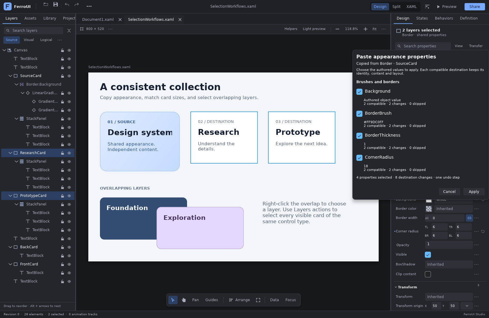
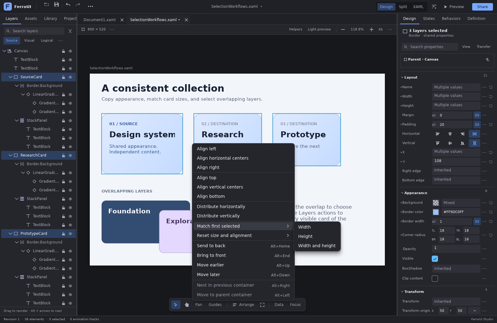
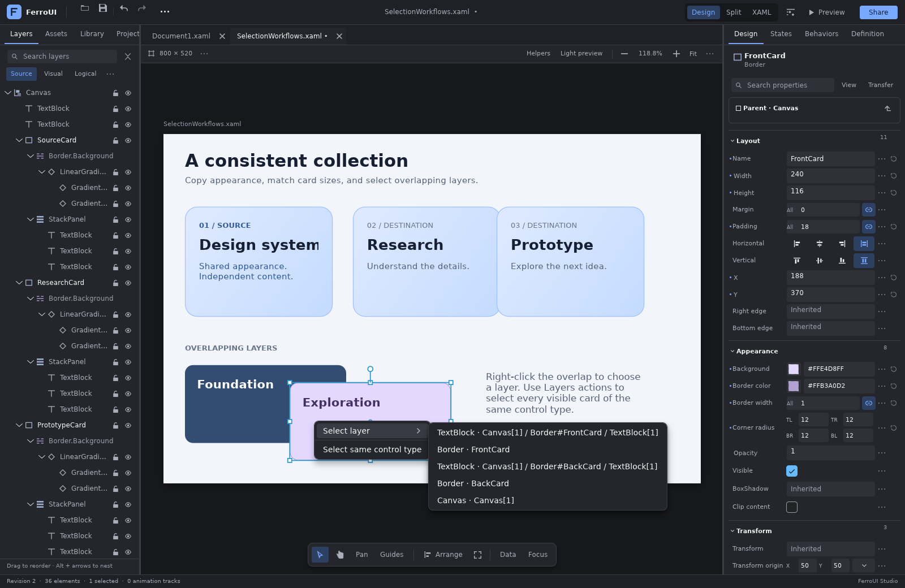

# Selection, appearance transfer and layout commands

This continuation of the [designer comparison](feature-comparison.md) fills gaps in
frequent selection-wide authoring workflows. It reuses FerroUI's native property
metadata, layout adapters, preview identities, lossless source edits and undo history.

## Reference comparison

| Reference workflow | Existing FerroUI coverage | Addition |
| --- | --- | --- |
| Visual Studio/Blend selective layout reset | Individual property resets and container-aware manipulation | Grouped margin, alignment, width, height, size and complete size/constraint resets |
| Figma compatible property copy/paste | Typed property editors, resource extraction and component reuse | An authored appearance clipboard and staged, selective paste with per-destination compatibility |
| Figma selection of an overlapping layer | Front-to-back hit testing and Ctrl+Alt overlap cycling | A native context menu with explicit layer names and hierarchy paths |
| Figma matching-object and shared-property selection | Parent/child/sibling navigation, lock/hide/isolation and outline multiselection | Exact control-type matching within the active authored preview scope |
| Figma dimension editing and Qt shared-property editing | Width/height fields and panel-specific resizing | Match width, height or both to the first selected control's native layout dimensions |

The existing native TreeDataGrid already provides Shift range selection and individual
Ctrl/Cmd selection. The designer also already has numbered focus-order editing, label
targets, design data, templates/components/resources, structured bindings, property-source
filters, guides and camera navigation. This work extends those services without introducing
a second document or visual model.

FerroUI's matching command uses control type as its predicate. Selection by a shared brush,
font or resource, and corresponding-layer matching across repeated containers, remain
separate candidates. Figma also includes locked objects in its Select layer menu; FerroUI's
canvas picker follows the designer's existing lock policy, while locked controls remain
inspectable and unlockable through Layers.

Primary references:

- [Visual Studio/Blend: work with elements in XAML Designer](https://learn.microsoft.com/en-us/visualstudio/xaml-tools/working-with-elements-in-xaml-designer?view=visualstudio).
- [Figma: copy and paste properties between layers](https://help.figma.com/hc/en-us/articles/4412765442967-Copy-and-paste-properties-between-layers).
- [Figma: select layers and objects](https://help.figma.com/hc/en-us/articles/360040449873-Select-layers-and-objects).
- [Figma: adjust alignment, rotation, position and dimensions](https://help.figma.com/hc/en-us/articles/360039956914-Adjust-alignment-rotation-position-and-dimensions).
- [Qt Widgets Designer: widget editing and the property editor](https://doc.qt.io/qt-6/designer-widget-mode.html).

## Copy and paste appearance

Select one authored control and choose **Transfer → Copy appearance properties** in the
property inspector. Select one or more destination controls, then choose **Transfer →
Paste appearance properties…**. Ctrl/Cmd+Alt+C and Ctrl/Cmd+Alt+V perform the same actions
when a text editor does not own keyboard input.

The native picker lists the captured values, groups them by purpose, and reports how many
destinations support each property. Check the values to transfer and press **Apply**.
Checkbox changes remain local to the dialog. Apply produces one ordinary source transaction;
Cancel, Escape and dismissal leave the source untouched. The footer remains visible while
the property and compatibility lists scroll.

The clipboard contains authored values. Inherited style values and evaluated binding results
are not converted into local overrides. The supported families are brushes and borders,
opacity, typography and shape appearance. Native property type metadata checks every
destination; for example, a border-specific property can be applied to selected Borders
while a selected TextBlock receives only properties it actually supports. Every skipped
value has an explanation, including its destination's type/name label.

Selected values replace the destination's existing authored form, including an attribute,
binding expression or property-element value. Unchecked properties retain their existing
values. Names, content, data contexts, events, behaviors, dimensions and parent placement
are outside the appearance clipboard.

### Values and reference identity

| Captured value | Transfer behavior |
| --- | --- |
| Native appearance literal | Retains authored spelling and uses destination metadata validation |
| Self-contained native value graph | Copies objects such as gradient brushes, stops and transforms with their lexical namespaces and comments |
| Local static/dynamic resource reference | Transfers only when the captured source document is unchanged and every possible applicable theme lookup resolves to the same declaration at the destination |
| Binding, application expression or computed resource key | Listed as skipped because the meaning depends on the original context |
| Object graph containing names, attached/application metadata, nested expressions or URI-dependent values | Listed as skipped; use the object/resource editor for explicit authoring |
| Unsupported or differently typed destination property | Listed as skipped for that destination |

Owner-qualified property elements and namespace aliases resolve to registered native type
and property identities. An unrelated application member with the same final name is not
overwritten. Existing destination property wrappers retain their own namespace declarations;
copied object graphs carry the namespace environment they need. The Window-root preview
projection retains the authored Window property's ownership.

The clipboard belongs to the workspace and is shared by its retained document tabs. Literal
and self-contained object values can be pasted into another document. A copied resource
reference requires the original unchanged document; it is not rebound by matching its key
in another file. The operating-system clipboard is unaffected.

### Retained editor contract

The accepted paste model captures the document URI, revision, AST allocation, selection,
session generation, definition scope, layer epoch and weak identities of native targets.
Changing source, permissions, selection, scopes or the native preview retires an old draft.
Returning to the same apparent selection does not revive it. Dismissed, replaced and
successfully applied editors also retire their callbacks.

Copy and compatibility inspection remain available to collaboration viewers. Applying a
paste requires a writable session. Locked, hidden, isolated-out and out-of-scope destinations
are rejected. A pending XAML buffer is preserved; the user must apply or cancel it before
using these authoring commands. Pasting while recording changes authored values without
creating animation keys.



## Reset size and alignment

Select one or more controls and open **Arrange → Reset size and alignment**.

| Command | Local values removed |
| --- | --- |
| Margin | `Margin` |
| Alignment | `HorizontalAlignment`, `VerticalAlignment` |
| Width | `Width` |
| Height | `Height` |
| Width and height | `Width`, `Height` |
| All sizes, constraints, margin and alignment | The values above plus `MinWidth`, `MinHeight`, `MaxWidth`, `MaxHeight` |

Reset removes authored declarations, allowing native style, inheritance and default behavior
to become visible. It does not assign a guessed default. Exact native property identity
handles ordinary attributes, aliased/base-owner attributes, and property elements containing
bindings. Foreign same-named members, comments outside the removed declarations and
unrelated XAML remain intact.

Parent placement (`Canvas.Left`, `Grid.Row`, Dock/Flex/RelativePanel properties), transforms,
padding, content alignment, resources and child layout definitions retain their values.
Resetting several controls creates one undo step. Resetting values that are already absent
is a no-op. These commands do not record animation keys.

## Match the first selected control

Select the reference first, then add destination controls. **Arrange → Match first selected**
offers Width, Height and Width and height. The reference stays unchanged; each destination
is resized using its parent layout adapter.

Measurements use the control's logical layout dimensions before render transforms. A rotated
or scaled control retains its transform. Width-only matching preserves the other dimension
and its bindings, as well as vertical Canvas anchors; height-only matching behaves symmetrically.
The shared portable resize planner now also follows this rule for ordinary edge resizing.

Canvas changes normalize only the affected leading/trailing anchors, including authored
aliases. Grid and flow layouts preserve the outer allocation through their existing margin
and alignment rules. Native min/max conflicts, active-axis bindings and unsupported structural
conditions reject the complete operation before source changes. Selecting an ancestor and
its descendant together is rejected because resizing the ancestor would invalidate the
descendant's measured allocation. Controls must have a current, finite, positive measured size.

The built-in and template adapters support one-axis matching. Custom layout adapters can
participate in complete size matching through their existing Resize planner; an unknown
adapter's edits are not guessed or filtered into a one-axis operation. Equal dimensions
produce no source transaction.



## Select an overlapping layer

Right-click the canvas in Select mode and open **Select layer**. The list follows native
front-to-back hit-test order and identifies controls by type and authored name. Unnamed
controls include their source path; path tooltips and accessibility names disambiguate nesting.
The keyboard context-menu request uses the primary selected control's center.

Opening or dismissing the menu does not change selection, XAML or history. Choosing a layer
selects that authored control and synchronizes the workspace. Hidden, locked and out-of-scope
layers are excluded. Generated template content remains associated with the instance in
document mode; its authored parts become available when editing the corresponding definition.

The menu snapshot captures source/selection/scopes, layer state, camera and viewport geometry,
the accepted hit stack, and weak native visual identities and transforms. Changes to any of
these retire the menu's actions, including runtime-only resize or native reconstruction.
Pan, Interact and unfinished insertion/manipulation gestures retain their own input ownership.

**Layers → … → Select same control type**, also available in the canvas context menu,
selects visible, unlocked authored controls with the primary selection's exact native type
in the active document or definition scope. Namespace aliases for the same registered type
match. Derived or unrelated same-named application types do not. The primary control remains
first, making it a stable reference for the size commands.
This is a local selection operation and remains available to viewers and in source view.



## Embedding APIs

| API | Purpose |
| --- | --- |
| `DesignerSession::copy_properties()` / `copy_properties_from(node)` | Capture a selected or explicit authored appearance source |
| `PropertyClipboard` | Immutable values, source label, property names and skipped-value explanations |
| `DesignerSession::prepare_property_paste(clipboard, names)` | Create an immutable, validated compatibility plan without writes |
| `PropertyPastePreview` | Exact sequential edits, changes, skipped values, change count and current-model check |
| `DesignerSession::commit_property_paste(preview)` | Apply an accepted plan in one transaction |
| `PropertyTransferEditor` | Reusable native staged picker with Apply/Cancel callbacks |
| `LayoutReset`, `LayoutMatch` | Typed command options |
| `plan_layout_reset`, `reset_selection_layout` | Plan or apply a grouped native-property reset |
| `plan_match_selection_size`, `match_selection_size` | Plan or apply measured size matching |
| `matching_native_type_selection`, `select_matching_native_type` | Query or apply exact native-type matching |
| `CanvasLayerChoice`, `CanvasSelectionSnapshot` | Immutable authored candidates and accepted canvas context |
| `DesignerWorkspace::capture_canvas_selection`, `create_canvas_selection_menu`, `select_canvas_layer` | Capture, present and accept a guarded layer choice |

Workspace wrappers guard pending XAML and refresh the existing outline, inspector, source
and surface after a successful operation. Authoring and same-type selection require an
authored selection; an explicit layer choice can return from runtime inspection to an
authored control. Hosts can use the same session APIs with their own presentation.
Layout planning requires a valid, current native preview and the usual layer/scope checks,
and remains available to collaboration viewers. Reset and match mutations require a
writable session, including when the resulting edit plan is empty.

## Automation

Four MCP tools use the same semantic planners:

| Tool | Contract |
| --- | --- |
| `designer_selection_layout` | Read a chosen reset/match operation's exact edits and accepted model token |
| `designer_selection_layout_edit` | Apply that operation with `expected_revision` and `expected_model` |
| `designer_property_transfer` | Read captured source values, exact destination edits, compatibility, skipped values and model token |
| `designer_property_transfer_edit` | Apply the reviewed source/property selection with revision and model checks |

Both read-plan tools are available to collaboration viewers. Their edit counterparts enforce
the writer role and normal tool write permission, including for no-op requests.

`designer_layer` additionally accepts `select_matching_type`, using its existing revision,
layer-epoch and scope-epoch contract. Its local selection action remains available to viewers
with the tool's normal write permission.

Layout model tokens include the recomputed measured adapter edits. Property model tokens
include the exact edits and accepted native identities, so same-source preview reconstruction
also invalidates an earlier token. Model tokens are concurrency checks; normal tool permissions
and session roles remain mandatory. Schemas reject unknown operations, unexpected arguments,
invalid node IDs, non-string property names and oversized property lists. Property transfer
reads use an explicit source node and the current destination selection; they do not alter
the native UI's clipboard or selection.

## Run and verify

```sh
cargo run -p designer-studio -- --file docs/designer/samples/SelectionWorkflows.xaml
cargo test --locked -p ferroui-designer-tools
cargo test --locked -p ferroui-designer --features mcp,render-smoke -- --test-threads=1
cargo clippy --locked -p ferroui-designer-tools -p ferroui-designer \
  --features ferroui-designer/mcp,ferroui-designer/render-smoke --all-targets --no-deps -- -D warnings
```

The runnable sample includes a gradient appearance source, independent destination cards,
size differences and overlapping layers. Native regressions exercise real metadata, bindings,
styles, template scopes, input routing, source preservation and undo. The render fixture opens
the actual paste and selection menus, checks the visible footer, commits through native controls,
and captures WinUI/HarfBuzz/Vello CPU output. It also verifies that both menu levels have
opaque, readable native surfaces, popup anchors follow the transformed canvas position,
and Apply stays inside the presenter and window. Menu resource overrides are confined to
designer-owned hosts; application preview controls retain their own resource lookup.
PR validation records the completed test counts
and remote workflow status for the published commit.
