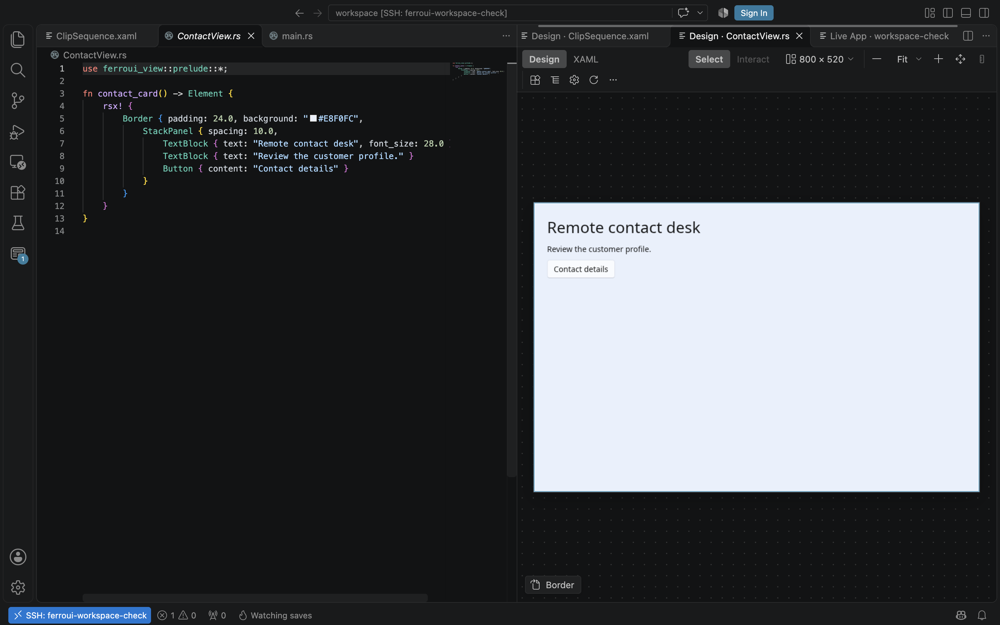

Use FerroUI Designer to edit a view alongside a native preview of its unsaved source. Open an XAML file or a Rust file containing `rsx!`. The designer, Timeline, and editing views follow the active design or its source editor.

## Install and open a view

1. In desktop VS Code 1.102 or later, run **Extensions: Install from VSIX** and choose the FerroUI Designer package for the operating system and architecture of the workspace host. A platform package includes the XAML language server and native preview. Install [rust-analyzer](https://marketplace.visualstudio.com/items?itemName=rust-lang.rust-analyzer) for Cargo and Rust language features.
2. Open a trusted local folder with a FerroUI project. You can also open a loose XAML file for the built-in controls and language features. To try the designer without a project build, open [DesignWorkflows.xaml](../samples/DesignWorkflows.xaml) from the source checkout.
3. Run **FerroUI: Open Designer** from the editor toolbar or Command Palette. VS Code opens **Design** beside the source. For a file with several `rsx!` invocations, place the caret inside the one you want or choose it from the designer’s RSX picker.
4. Select a control in the canvas. Open **Show Properties** and edit its width or text. The matching edit appears in the unsaved source. Use VS Code’s Undo to restore it.
5. Use **Interact** in the designer to try its controls. Build and run the project when the view needs application services, custom controls, or real data.

For a package built from this checkout, see the [extension build and packaging instructions](../../../editors/vscode/README.md#install-or-develop-from-the-repository).

## Open a remote workspace

1. Connect to the workspace from desktop VS Code with **Remote–SSH**. Open the project folder on the remote machine and install FerroUI from VSIX in that window. Choose the remote machine’s platform and architecture, such as `linux-arm64` for an ARM64 Linux host. The Extensions view lists FerroUI under the SSH host. [VS Code Remote–SSH](https://code.visualstudio.com/docs/remote/ssh)
2. Open an XAML or Rust view and run **FerroUI: Open Designer**. The language server and native preview helper run on the workspace host. The desktop window shows the source, diagnostics, and rendered frames.
3. If you supply your own helpers or Cargo, use **Preferences: Open Remote Settings (JSON)**. Set `ferroui.languageServer.path`, `ferroui.preview.path`, or `ferroui.hotReload.cargoPath` to absolute executable paths on the workspace host.

Build and run Cargo targets from the connected window. Install your Rust debug adapter on the SSH host when you want to debug there. Live App and the editor's MCP server connect to application inspectors on that same host. [Run and inspect a view](runtime.md) · [Run app tools through the editor MCP server](reference.md#run-app-tools-through-the-editor-mcp-server)

## Choose the tools for your task

| Task | Where to work |
| --- | --- |
| Create a runnable XAML or RSX app and check the active Rust toolchain | [Start a FerroUI project](authoring.md#start-a-ferroui-project) |
| Find a project view, edit source and layout, configure columns and behaviors, or work with bindings and resources | [Author views and components](authoring.md) |
| Map external components, exchange assets, and convert design tokens | [Review design handoff](authoring.md#review-design-handoff) |
| Compose XAML styles and compare Light, Dark, and High contrast colors | [Edit styles, control themes, and palettes](styles.md) |
| Edit a clip or state transition, compare variants, or play a prototype | [Animate and preview variations](motion.md) |
| Preview with the app’s types and data, inspect a running window, or hot reload | [Run and inspect a view](runtime.md) |
| Run several Cargo targets and open a Live App editor for each | [Run several app sessions](runtime.md#run-several-app-sessions) |
| Verify interaction and accessibility, compare baseline images, or run a CI suite | [Test UI and review visual changes](testing.md) |
| Share XAML with a Studio or VS Code collaborator and review changes in the editor | [Share and review XAML in a room](collaboration.md) |
| Set up MCP, find a command, or configure the workspace | [Use agents and configure the extension](reference.md) |

The canvas toolbar and its **More designer actions** menu open the workbench views. You can also run their **FerroUI** commands from the Command Palette. Drag a view’s title or use **View: Move View** to place Toolbox, Outline, Properties, Events, Behaviors, Resources, and Assets where you use them. **FerroUI Timeline** opens in the VS Code Panel, below the editor groups in the default workbench layout. Drag the Panel divider to size it or use **Maximize Panel**. [VS Code custom layout](https://code.visualstudio.com/docs/configure/custom-layout)

When a design changes, the last accepted frame stays visible until the replacement is ready. The canvas can decode a replacement while the VS Code window is covered, so zoom and pan use the refreshed artboard when you return to its tab.

## If the designer does not open

| Symptom | What to check |
| --- | --- |
| XAML has no completion or diagnostics | Select **FerroUI XAML** as the file’s language mode. Check that the native language server matches the workspace host, then run **FerroUI: Restart XAML Language Server**. |
| The renderer fails to start | Check the platform package or set `ferroui.preview.path` to the native executable from the matching checkout. |
| FerroUI completion or hover is missing inside `rsx!` | Check the **FerroUI Designer** output. Once the preview helper is available, invoke completion or hover again in the same Rust buffer. |
| The canvas shows an earlier image | Correct the source or a referenced file. The designer retains its last accepted frame while the current buffer is invalid. Source-backed actions become available after the current text renders. |
| A type, relative include, or binding path is unknown | Keep the file in its authored folder and build the owning project’s schema. Use [App Preview](runtime.md#render-with-your-app-in-app-preview) for types and loaders supplied at application startup. |
| A Rust preview omits part of the view | Open the preview message to find expressions or dynamic children that require compiled Rust. Use the actual view in an [app-hosted fixture](runtime.md#render-with-your-app-in-app-preview). |

See [Designer Studio](../README.md) for the native workbench and the framework’s [Visual designer guide](https://ferroui.github.io/docs/next/tools/designer/) for its standalone workflow.
