Start with a view you can render, then use the same source buffer for text edits and visual authoring. Try [DesignWorkflows.xaml](../samples/DesignWorkflows.xaml) for XAML or [views.rs](../../../editors/vscode/test/fixtures/views.rs) for several RSX invocations.

## Find or create the view

1. Open **FerroUI → Project**. Expand a workspace folder to browse its Cargo manifests, XAML and RSX views, assets, stage sets, and test scenarios. Expand a Cargo manifest to see its binaries. Refresh the view after changes outside VS Code if its list is out of date.
2. Run **FerroUI: Find Project View** to open a view by name. To start a view, run **New View** or **New Component**, choose XAML or RSX, and enter a path relative to the chosen workspace folder. Add the generated Rust file to your app’s module tree when you use it in the binary.
3. For project controls and typed bindings, run **Build Project XAML Schema** and choose the owning Cargo target. App Preview and a managed application build also publish their registered metadata. The nearest Cargo package supplies the types, including exported dependency controls. `ferroui.types` can override or augment the metadata.

## Work in source or use the counterpart tab

| In the editor | Workflow |
| --- | --- |
| FerroUI XAML | Use completion and hover for control, property, and binding metadata. Add `x:DataType` or an explicit binding source type where applicable. **Quick Fix** imports a known namespace or corrects a resource key or typed binding member when the replacement is unambiguous. **Go to Definition**, **Find References**, and **Rename Symbol** use the active template namescope or resource scope, including applicable unopened files. Scope-changing renames are rejected. |
| FerroUI XAML formatting | **Format Document** and **Format Selection** use the [folder's XAML formatting settings](#format-xaml). Linked editing updates the matching tag when `editor.linkedEditing` is enabled. Symbols, folding, signature help, semantic highlighting, and binding type hints are available through the VS Code language features. |
| Rust | Keep rust-analyzer active for Rust semantics, Cargo, and macros. FerroUI supplies supplemental property completion and hover in mapped `rsx!` fields. Enable `ferroui.rsx.inlayHints` to show mapped types. Put the caret in a named control or select it in the designer and run **Rename RSX Control** to change its authored `name` literal in that invocation. |
| **XAML** or **RSX** tab beside **Design** | Edit the projection of a supported static tree, then choose **Apply**. Value edits patch the original buffer. Structural editing requires a supported tree and preserves the surrounding Rust. Reload the projection if the source changed while a projected draft was open. |

For a partial Rust preview, the designer can still edit supported literals and mapped handler expressions, move mapped controls, and wrap consecutive mapped children. Edit the loop, conditional, or computed child itself in the Rust editor. In XAML with bindings, style objects, or property elements that have no static counterpart, edit the authored XAML. Existing XAML design data survives supported counterpart value edits. [Language service](../../../src/FerroUI.Designer.Language/README.md) · [Mapping project controls to RSX](../../../editors/vscode/README.md#map-an-application-control-to-rsx)

Project metadata can expose a custom control in the source Outline and Properties even when the isolated preview cannot render it. Select the control in Outline to edit a mapped value. Use App Preview for a native frame with your app’s registered controls. [Open App Preview](runtime.md#render-with-your-app-in-app-preview)

### Format XAML

Open a FerroUI XAML file and run **Format Document**. Select a range and run **Format Selection** to change the formatting inside that range. Select **FerroUI** in **Format Document With…** when several formatters are available. The same settings apply when VS Code runs formatting on save or paste.

Search Settings for `@ext:FerroUI.ferroui formatting`. For a shared project style, set the options in the project's `.vscode/settings.json`. Each folder in a multi-root workspace can choose its own style.

| Setting under `ferroui.xaml.formatting` | Effect |
| --- | --- |
| `attributeLayout` | `preserve` keeps existing attribute separators. `inline` uses a space between attributes. `onePerLine` puts each attribute on a separate line. `wrap` uses separate lines when the start tag exceeds the configured column. |
| `wrapColumn` | Choose 20 to 240 columns, including indentation. The default is 100. |
| `closingBracketOnNewLine` | Put the ending bracket of a wrapped start tag on its own line. |
| `selfClosingSpace` | Choose `preserve`, `space`, or `none` for the gap before a same-line `/>`. |
| `preserveBlankLines` | Keep existing blank lines between elements. |

This example wraps long start tags and uses two-space indentation.

```json
{
  "ferroui.xaml.formatting.attributeLayout": "wrap",
  "ferroui.xaml.formatting.wrapColumn": 100,
  "ferroui.xaml.formatting.selfClosingSpace": "space",
  "ferroui.xaml.formatting.preserveBlankLines": true,
  "[ferroui-xaml]": {
    "editor.tabSize": 2,
    "editor.insertSpaces": true,
    "editor.detectIndentation": false
  }
}
```

The formatter keeps LF and CRLF line endings and uses the editor's indentation and file newline settings. It preserves attribute values and quotes, markup extensions, mixed text, inline runs, CDATA, and `xml:space` scopes. Put `<!-- @formatter:off -->` and `<!-- @formatter:on -->` around a generated region to keep it verbatim. A document with an `@generated` or `<auto-generated>` comment marker before the root is kept verbatim. Repair incomplete XML before formatting. [Studio formatting](../native-controls.md#format-xaml-in-studio) · [MCP formatting](reference.md#drive-an-editor-workflow)

### Follow registered Rust declarations

Run **Build Project XAML Schema** for the owning Cargo target. In XAML, put the caret on a registered control tag, a property name, an `x:Class` or `x:DataType` value, a member of a typed binding path, or a type or property inside a style selector. Press **F12** or choose **Go to Definition**.

The result opens the authored Rust registration for that type or property. Each step in a path such as `Address.Street` follows the build's type information, including dependency types exposed under a XAML alias. With `{CompiledBinding Street, DataType={x:Type data:PostalAddress}}`, place the caret on `Street` for the registered property or on `data:PostalAddress` for its type. Navigation resolves the current file or open Rust draft, so adding lines above a declaration keeps the selection on its name. Rebuild the schema after moving declarations between files, changing a registration, or using build output without the source index. [Studio workflow](../native-controls.md#follow-a-rust-declaration-from-xaml) · [MCP workflow](reference.md#find-registered-rust-definitions-with-mcp)

### Rename a registered XAML property

Run **Build Project XAML Schema**, then put the caret on a registered property in XAML, a typed binding, or a style selector. Choose **FerroUI: Rename Registered Property…** from the Command Palette or the editor context menu. Enter the new public XAML property name.

The Changes editor shows the Rust registration and every mapped XAML edit, including unopened files. It covers direct attributes, owner-qualified property elements, inherited properties, typed binding paths, and setters in typed styles or control themes. In `ui|Card[Caption=Ready]`, the review follows `Caption` through the type of `Card`. It also resolves attached operands such as `Button[(ui|Card.Badge)=New]`. The Rust patch edits the property name in its metadata declaration or registration string. Open drafts contribute their current text.

Review both sides of each diff, then choose the check icon **Apply Property Rename**. If the review found possible references with dynamic targets, choose **Show Locations** to inspect them. **Apply Mapped Rename** commits the resolved patches. Undo reverts the Rust and XAML edits together. Repair an incomplete file that may use the name before reviewing. A collision or a changed file requires a fresh review.

If the property appears in an explicit RSX builder mapping, the review edits its public key in the assembly metadata. This applies to inherited properties on mapped builders too. Existing RSX fields continue to use the builder method shown in the mapping. Open the workspace folders that contain the registration and its consumers, then save the reviewed buffers and rebuild the schema. [Studio workflow](../native-controls.md#review-a-registered-property-rename) · [MCP workflow](reference.md#review-a-registered-property-rename-with-mcp) · [RSX builder mappings](../../../editors/vscode/README.md#map-an-application-control-to-rsx)

### Rename a registered XAML type

Run **Build Project XAML Schema**, then place the caret on a registered control tag or a type reference such as `x:DataType="local:Customer"` or `ui|Card` in a style selector. Choose **FerroUI: Rename Registered Type…** and enter the new name.

For an explicit `as "Name"` registration, the review edits the public alias. When XAML takes the name from Rust, VS Code asks the active rust-analyzer provider to rename the declaration and find Rust references. Open the Cargo workspace that owns the declaration and wait for rust-analyzer to finish loading it.

The Changes editor includes mapped start and end tags, qualified property owners, `x:Class`, type arguments, and explicit type values such as `{x:Type local:Customer}`. It also includes resolved type names in `Selector` attributes and single-text `Style.Selector` elements, including `:is`, `:not`, and attached property owners. Class names, control names, and comparison values keep their original spelling. Use **Show Locations** to inspect uncertain references, then apply with the check icon. Undo restores the group.

The review also renames the public type key in explicit RSX builder metadata. For a Rust-backed name, the metadata follows the renamed declaration and its implicit public re-exports. An explicit re-export such as `pub use controls::Card as Card` retains its alias. Keep the assembly source in the workspace, and rebuild the Cargo schema after changing Rust imports or saving the reviewed rename. [Studio workflow](../native-controls.md#review-a-registered-type-rename) · [MCP workflow](reference.md#review-a-registered-type-rename-with-mcp)

### Rename an RSX control

Select the named control in Design or Outline, then run **FerroUI: Rename RSX Control** from the Command Palette. You can also edit **Name** in Properties. The edit changes the naming literal and applicable references within the active `rsx!` invocation in one Undo step.

The planner follows name selectors in inline `ferroui_view::style` declarations, including nested styles and selectors used by animation clips. It also updates literal `visual_state(...).set_on(...)` targets below their state owner. It preserves source trivia, computed setter values, and the separate scope reached through `/template/`. Duplicate names and names that would capture an existing reference are rejected. When a related style or state target is computed, edit its expression in Rust before changing the name. [MCP workflow](reference.md#rename-an-rsx-control-with-mcp) · [Studio workflow](../native-controls.md#rename-a-control-in-a-rust-view)

## Arrange controls on the canvas and in Outline

1. In **Select** mode, click a control and use the resize handles or drag the control. Hold Ctrl or Command to add other controls. **Arrange Selection** offers native alignment, distribution, size matching, and reset for supported layouts. Size matching uses the first selected control as its reference.
2. Open **Toolbox** and search by name, category, or description. Switch between list and tile views. Drag a control to a canvas landing hint or a **Source** Outline row. The top and bottom of the row insert before and after it. The middle nests the control in an eligible container. Use the same placements to move existing controls or an ordered multi-selection.
3. For keyboard placement, focus a Toolbox item and press Enter. Shift+Enter offers the valid positions for the selection. In Source Outline, use Alt+Up or Alt+Down to reorder. In the canvas, Up and Down move among authored controls, Alt+click cycles overlapping controls, and Enter reveals the selected declaration. Focus a resize handle and use the arrow keys for keyboard resizing.
4. Run **Edit Grid Tracks** for the nearest Grid. Adjust Auto, pixel, or star sizes or insert or remove a row or column. Supported changes update child cell and span attributes in the same edit. Use the [Grid fixture](../../../editors/vscode/test/fixtures/GridWorkbench.xaml) to see the result in source.

Switch Outline to **Visual**, **Logical**, or **Combined** to inspect constructed controls and template parts. Source-backed editing requires an authored control. **Studio → Layers** lets you hide, lock, or isolate controls in the design session. Use Undo for authored changes. Layer flags and viewport navigation use local designer state.

Use the size button to change logical width, height, preset, or theme. With the canvas focused, press `0` to fit, `1` for actual size, `+` or `−` to zoom, and hold Space while dragging to pan. The zoom menu includes **Fit selection**. Use **Interact** and its input bar for clicks, scroll, text, and key gestures.

### Move and insert controls in a partial RSX preview

Choose an RSX invocation in **Design** and switch Outline to **Source**. Move one mapped control or a selection in the canvas or Outline, or insert a compatible Toolbox item. The move preserves source order and keeps the moved controls selected. Their Rust blocks retain handler expressions, comments, and computed values. A placement can update the mapped layout literals needed by the new parent.

In Outline, **After** inserts immediately after the chosen authored control, before the next loop, conditional, expression, or control in that Rust child list. **Before** inserts ahead of the chosen control and **Inside** appends to the chosen container. Dynamic siblings keep their order. For a panel with only computed children visible in Rust, drop **Inside** to append a mapped control. Edit computed single-child slots and explicit computed child collections in the Rust editor. If the preview was updated during a drag, start it again. One Undo restores all controls and layout values changed by the gesture. [Studio workflow](../native-controls.md#hierarchy-and-artboard) · [MCP arguments](reference.md#drive-an-editor-workflow)

## Wrap selected controls

In **Design**, use **Select** mode and select one control or consecutive siblings in the canvas or Source Outline. Choose **Wrap Selection** from **More designer actions**, from **Arrange selection** in Outline, or from the Command Palette. Choose a container and the designer selects the new wrapper.

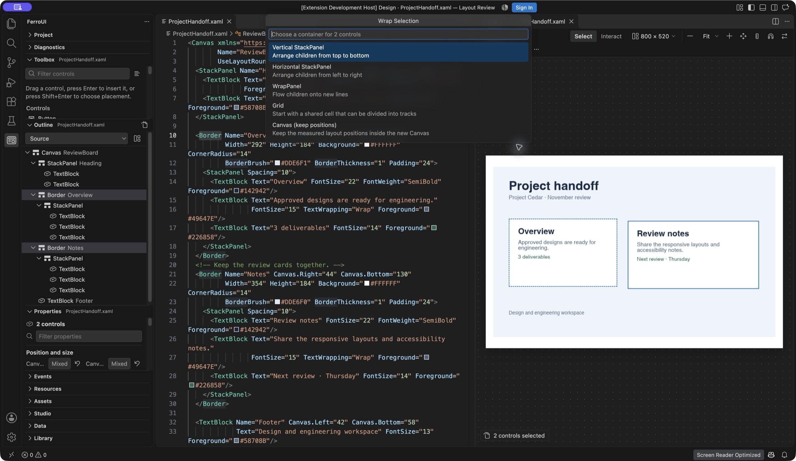

| Container | What to expect |
| --- | --- |
| **Vertical StackPanel** or **Horizontal StackPanel** | Arrange the selected controls in source order along the chosen axis. |
| **WrapPanel** | Flow the selected controls onto new lines. Inside a Canvas, the wrapper starts at the measured group width. |
| **Grid** | Start the children together in one cell. Use **Edit Grid Tracks** and the Properties view to lay out multiple rows or columns. |
| **Canvas (keep positions)** | Keep the current positions of Canvas children. The new Canvas uses the measured group bounds, and its children use offsets inside it. |
| **Border** | Put one selected control inside a container that supports padding, a background, and a border. |

The selection must share one authored child slot. In a Grid, select controls with matching cells and spans. In a DockPanel, select controls on the same side. The planner protects bindings and object-valued layout attributes that would need to change. An RSX run can sit beside a dynamic child or contain computed values of its own. Wrap a run interrupted by an unmapped child in the Rust editor.

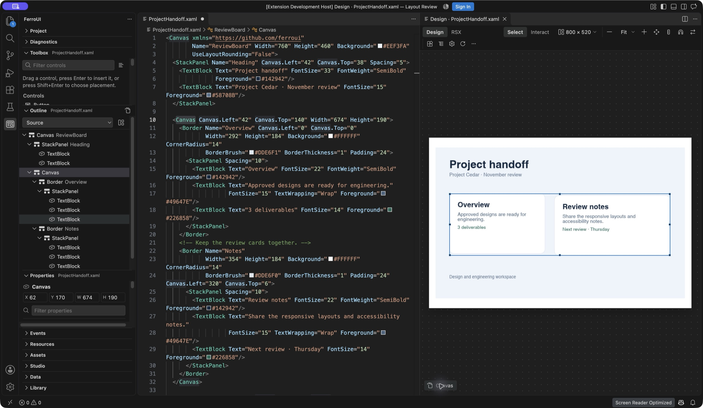

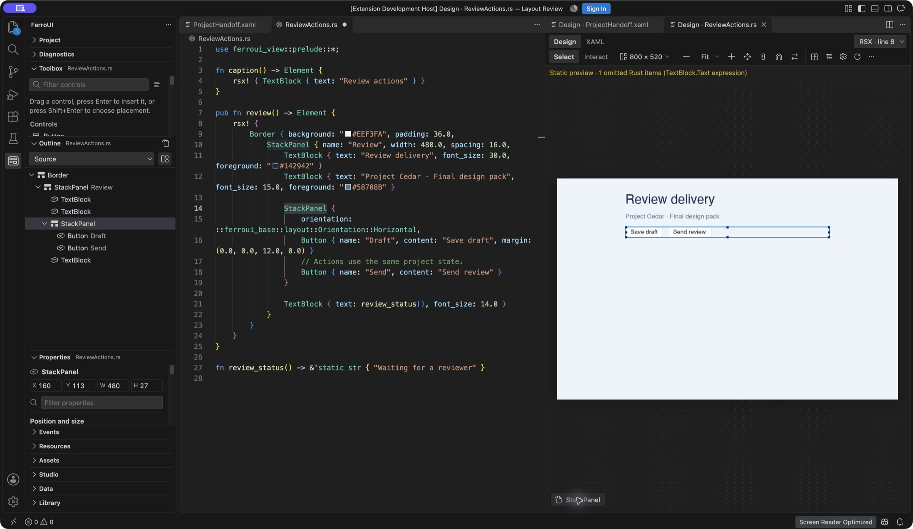

Wrap Selection is one source edit. Undo restores the original layout and source order. [Studio authoring](../native-controls.md#wrap-selected-controls) · [MCP workflow](reference.md#wrap-controls-with-mcp)

## Measure and mark the canvas

In the **Design** tab, open the ruler icon for **Canvas Guides**, enable **Rulers**, and choose **Apply**. You can also focus the preview canvas in **Select** mode and press Shift+R. The ruler reads logical pixels from the top-left of the rendered view as you zoom or pan.


| Action | Result |
| --- | --- |
| Drag down from the top ruler or right from the left ruler | Add a horizontal Y guide or a vertical X guide |
| Drag a guide, or hold Alt (Option on macOS) as you start the drag | Move the guide, or drag a copy |
| Drag a guide back to its ruler | Remove it |
| Tab to a visible guide, then press an arrow key along its axis | Nudge it by 1 px. Hold Shift to nudge by 10 px. |
| With a guide focused, press Delete or Backspace | Remove the focused guide |
| Press Escape during a drag | Cancel the gesture |
| With the canvas focused, press Shift+G | Show or hide the guide lines |

For an exact position, open **Canvas Guides** again. Use the horizontal or vertical add icon, enter a position such as `73.5` or `-18.125`, and choose **Apply**. You can remove individual rows or clear the list in the same draft. **Cancel** discards the draft. If the accepted frame or guides change while the editor is open, reopen it to use the current values. [Exact position controls](../images/vscode-canvas-guide-positions.jpg)

The designer tab retains a guide set for the document, each XAML definition opened from **Library**, and each Rust `rsx!` invocation. Reopening a definition or switching back to an invocation restores its guides. Guide positions stay in the designer tab’s view state. Source edits use the editor’s Undo history. [RSX canvas with guides](../images/vscode-rsx-canvas-guides.jpg) · [Studio guides](../canvas-guides.md)

## Snap controls to guides, the grid, or other controls

Open the magnet icon for **Snapping** in the **Design** toolbar. Choose one or more targets, then choose **Apply**.


| Target | What snaps |
| --- | --- |
| Grid | The leading corner of a drop or move, and the active resize edges. **Spacing** sets the grid in logical pixels. **Show grid** controls the display independently. |
| Guides | The edge or center of a moved control or selection aligns to a guide. Hidden guides remain active when this target is enabled. |
| Objects | Edges and centers align to other measured controls in the current design scope. The moving selection and its descendants are excluded from the targets. |

Drag a Toolbox entry or an authored control onto a **Canvas**, or drag an active resize handle. Dashed lines indicate the native snap positions. Move a multi-selection to align its combined bounds. Side handles snap along their resize axis. Grid cells and flow layouts use their existing placement rules. Hold Alt (Option on macOS) during a gesture to use its precise unsnapped position.


**Tolerance** is in screen pixels. Increase it to catch more nearby targets, or reduce it for precise placement. Changing zoom preserves the same screen distance. Edits use logical positions and the preview follows the app’s layout rounding. Arrow keys on resize handles use their existing exact steps. The tab retains snapping settings with the current guide set. Moving, inserting, or resizing a control commits one authored edit, including when the Timeline records a supported geometry gesture. [Layout sample](../samples/SelectionWorkflows.xaml)

## Adjust spacing on the canvas

In **Design**, switch to **Select** and choose **Show Spacing Handles** from the arrow-swap icon in the toolbar. Select a layout container or a child. The overlay marks gaps and margins in blue and padding in purple. Each handle identifies its property, owner, and current value. Values use logical pixels at every zoom.

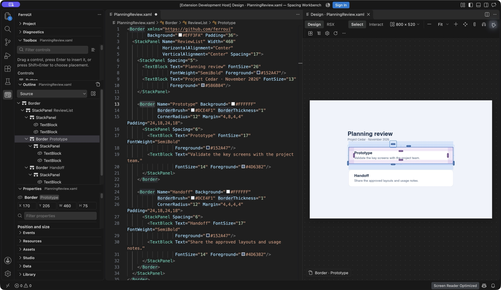

| Select | Handles |
| --- | --- |
| StackPanel or ReversibleStackPanel | Spacing between items |
| WrapPanel or FlexPanel | Item and line gaps for the measured arrangement |
| Grid or UniformGrid | Measured row and column gaps |
| A supported container or control, such as a Border | Individual padding sides |
| One child or siblings with the same layout parent | Individual margin sides for the selected children and the parent’s available gap controls |

Drag a handle along its cursor direction. The draft label shows the proposed value. Release to commit one source edit or press Escape to cancel. To use the keyboard, tab to a handle and use the arrow keys to decrease or increase by 1. Hold Shift for steps of 10 or Ctrl (Command also works on macOS) for steps of 0.1. Press Enter or double-click a handle to enter an exact value.


The edit preserves the other sides of the inset and participates in VS Code Undo and Redo. Gaps and padding start at zero. Margins accept negative values. A disabled handle describes the protected binding, expression, layer, or source form. In a mapped RSX view, a supported scalar or four-sided tuple can be adjusted even when a sibling is dynamic. The overlay follows the accepted selection and frame. Turn it off to show the standard resize handles again, or switch to **Interact** to use the view.

Try the StackPanel, Grid, and Border in [LayoutHelpers.xaml](../samples/LayoutHelpers.xaml). [Pointer edit](../images/vscode-spacing-drag.jpg) · [Mapped Rust padding](../images/vscode-rsx-spacing-handles.jpg) · [Studio gestures](../layout-helpers.md#native-input-and-transaction-flow) · [MCP workflow](reference.md#adjust-measured-spacing-with-mcp)

## Edit values, actions, and resources

| Tool | What to do |
| --- | --- |
| **Properties** | Select a control and search its common and additional fields. Compare measured bounds to authored values. Edit a common field across selected controls, inspect effective values and their sources, or reset an authored value. Use **Edit binding**, **Edit brush**, or **Promote to resource** when available for the property. |
| **Events** | Assign or clear an XAML handler name or supported RSX expression. Create a Rust code-behind handler for an XAML event with a project registration, or open its declaration. |
| **Behaviors** | Attach an event or data trigger to an XAML control, edit and order its actions, and run the actions on the native Design canvas. |
| **Resources** | Filter to the current selection’s XAML scope. Inspect usage, reveal the definition, or apply a compatible static or dynamic reference. Use the rename icon to review a key and its project references. Extract the containing dictionary into a reusable file, or use **Promote to resource** to replace a literal with a reference. |
| **Library** | Browse reusable XAML definitions across the project and group the active design’s definitions by kind. Open a scoped native preview or reveal the original declaration. The current document’s Library also exposes references, template creation, and applicable resource actions. |
| **Assets** | Import and browse images, fonts, media, and markup. Open a file, preview a raster image, or copy a relative path. Drop a raster image on the canvas or Outline, or use **Choose image placement**. XAML inserts a relative URI. Mapped RSX uses `embedded_image` with a relative `include_bytes!` path whose bytes are read at build time. |
| **Studio** | In **Focus and Labels**, set tab stops, change traversal order, and link a label to its target. Enable **Focus Order Overlay** from canvas actions and use Tab and Enter to reach and reveal badges. Open **Behaviors** to edit the selected XAML control’s triggers. |

To change an authored image, select it in **Design** or **Outline**. Select a raster file in **Assets** and choose **Use as image source**. The action is available for an empty or literal image source. XAML writes the document-relative URI. On an existing mapped RSX source, the edit changes the path inside `include_bytes!` and preserves the surrounding call, comments, and compatible raw-string delimiters. One Undo restores the previous source.

To try the binding inspector, open [BindingWorkbench.xaml](../../../editors/vscode/test/fixtures/BindingWorkbench.xaml), select its bound control, and open the binding on its property. For a gradient, open [CustomerGradient.xaml](../../../editors/vscode/test/fixtures/CustomerGradient.xaml), choose **Edit brush**, and change a stop’s color or position. Review the draft and apply it to author one edit.

### Edit a behavior

1. Open [BehaviorsWorkbench.xaml](../../../editors/vscode/test/fixtures/BehaviorsWorkbench.xaml) in Design. Select **Approve** in **Outline** and choose the lightning icon in **Properties**, or run **FerroUI: Edit Behaviors**.
2. Expand a trigger to see the actions in execution order. Press Enter on the trigger to edit its event, source, or data condition. Press Enter on an action to select the field you want to edit. Use **Reveal in Source** to open a custom trigger or action, edit a collection supplied by a style or template, or change the trigger type.
3. Choose the plus icon in the view title to attach a routed event or data condition. Give the trigger its first action. The plus icon on a trigger appends another action. Built-in choices change a property, invoke a command, call a method, add a style class, or remove a style class. Use a control name or binding for an optional source or target. Leaving it empty uses the selected control when the action supports an implicit target.
4. Drag an action onto another action in the same trigger to change its order. Drop on the trigger to move it to the end. For keyboard ordering, focus an action, press Shift+F10, and choose **Move Action Earlier** or **Move Action Later**. The row menu also removes actions and triggers. One Undo restores the previous XAML after any accepted edit.
5. Choose **Preview Actions** on the trigger to execute its actions on the Design canvas. **Reset Behavior Preview** restores the authored view. If an action fails, the designer restores the authored view and reports the failure. To test whether an event or data change fires the trigger, use **Interact** and operate the control.

In the sample, the Click trigger grows the Approve button and updates the status. Move the first width action after the second, then preview again to see the different final width. The behavior stays inside its authored `ActionCollection`.

When editing XAML directly, completion recognizes the framework’s trigger and action types, inherited properties, and comparison values.

To wire an event to a visual state, select the control that raises the event. In **Studio → States**, choose the destination state and **Attach event trigger…**. Choose the routed event. The generated XAML actions use the selected state group. [Designer Studio workflow](../native-controls.md#edit-behaviors) · [MCP workflow](reference.md#edit-and-preview-behaviors-with-mcp)

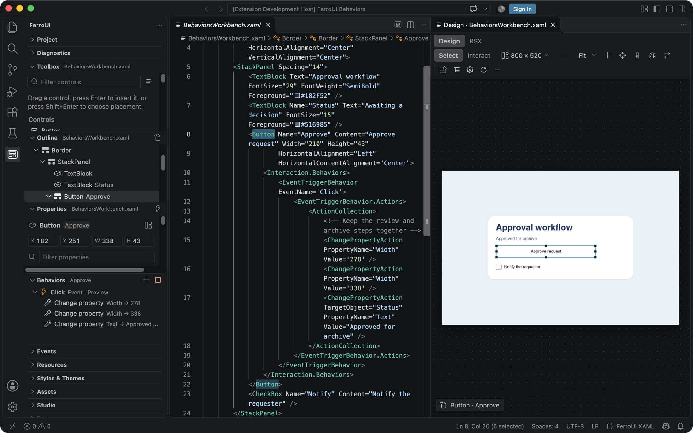

### Find reusable XAML definitions

1. Run **FerroUI: Show Library**, then expand **Project**. In a multi-root workspace, expand the folder that owns the definition. The index includes reusable components, styles, control themes, and templates in unopened XAML files.
2. Use the search icon in Library or run **FerroUI: Find Definition in Designer**. Filter results by name, type, or file. The picker groups matches by workspace folder and includes definitions from the current design when its preview is ready.
3. Choose a search result to open its scoped native preview. In the tree, expand an entry and choose **Preview definition** or **Reveal definition in source**. **Current document** offers the actions for the original authored scope, including **Return to document preview**.

The Library follows unsaved XAML drafts and updates when files change on disk. Repair an invalid draft to bring its definitions back. If a definition changes while the search is open, reopen the search to get its current name and location. [Studio Library](../components.md#use-the-library) · [MCP reference](reference.md#drive-an-editor-workflow)

### Import an asset

1. Open **Assets** and use the import icon, or run **FerroUI: Import Asset…**.
2. Choose a local image, font, media file, or XAML asset. Enter a destination relative to the active workspace folder. The default is `Assets/` followed by the source filename. Use the source file's extension.
3. Review the source, destination, type, and byte count. Confirm **Import** to create a copy. If the destination exists or the source changes during review, choose a new destination or review the current file.

The copy appears under **Assets**. To use a raster import, drag it onto the canvas or use **Use as image source** for a selected authored image. MCP agents can review and copy assets already inside the workspace. [MCP reference](reference.md#drive-an-editor-workflow)

### Move an asset and update its references

1. Select an image, font, or media file in **Assets** and use **Move or rename asset…**. Enter a path in an existing directory in the same Cargo package or loose-file project. Keep the file extension.
2. The Changes editor shows the proposed patches. Review the XAML URI properties, typed style values, font source paths, and supported literal Rust includes there. A move with no indexed references shows a file confirmation.
3. Choose **Apply Asset Move** to move the file and update the displayed references in one VS Code edit. Undo from an edited reference to restore the file and those source changes together. Use **Cancel Asset Move** to return to the editor. If a file or draft changes, prepare a new review.

The review reflects the indexed XAML and Rust code, including open drafts. Inspect dynamically constructed paths and externally managed asset mappings before applying. In RSX, the editor can update the literal in a supported `include_bytes!` call while preserving the surrounding Rust. Save the edited buffers to update the running app. [Move a XAML file](#move-an-xaml-file-and-its-references) · [MCP reference](reference.md#drive-an-editor-workflow)

## Create a Rust handler for an XAML event

Open the Cargo project containing the XAML view and run **FerroUI: Build Project XAML Schema**. The view’s `x:Class` must resolve to an authored `ferro_class_info!` registration in the package. The build registry supplies the event signature, including inherited routed events and ordinary events declared in a control’s markup metadata.

1. In **Design** or **Outline**, select the control. Open **FerroUI: Show Events** and find an event such as **Click**.
2. Choose **Create or open Rust handler** beside the event. For an unassigned event, accept the suggested name or enter a Rust identifier. The extension assigns the XAML attribute, adds the typed callback to the class’s `methods` list, and opens the declaration in the Rust editor. A named event uses its existing XAML spelling.
3. Write the callback body in Rust, then save both buffers and rebuild the application. The new callback must be compiled into the next app process. [Choose a Run or Debug target](runtime.md)

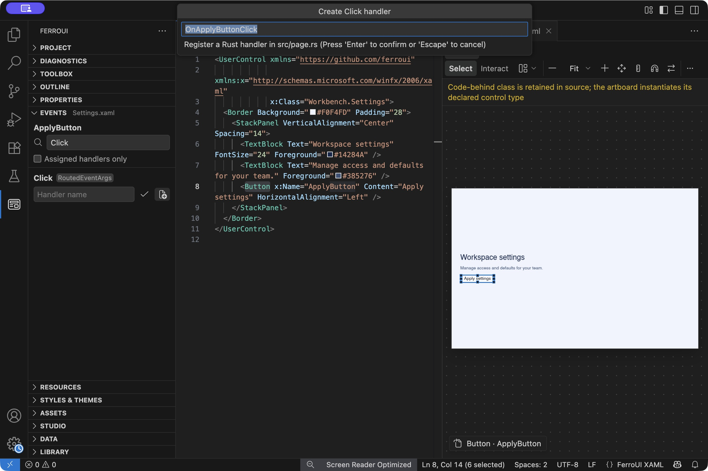

You can also put the cursor on an XAML event attribute and choose **Create Rust event handler** from Quick Fix. On a named event, use **Go to Definition** to open the registration, including one still in the unsaved Rust buffer. The Events source arrow opens the XAML attribute when a Rust declaration is unavailable.

The XAML and Rust updates form one Undo step. Both source buffers stay open for review and save. The action checks revisions and preserves existing event expressions and objects. If the type’s registration has moved, build the Cargo schema again. [Studio source action](../native-controls.md#create-an-xaml-event-handler) · [MCP workflow](reference.md#create-an-event-handler-with-mcp)

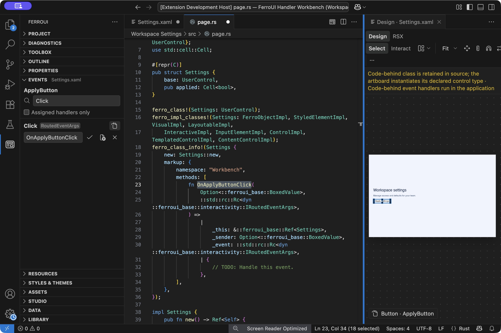

## Bind a command and its parameter

Give the XAML view an `x:DataType` that exposes the command, and run **FerroUI: Build Project XAML Schema** for custom types. For example, a view model can expose `Actions.Save` as an `ICommand` and `SelectedTask` as its command parameter. The picker follows the same registered member paths as XAML completion.

1. Select one authored control in **Design** or **Outline**. In **Events**, choose the link icon **Edit command binding**. You can also run **FerroUI: Edit Command Binding** from the Command Palette.
2. Choose the command property if the control exposes several. Browse to a registered command, such as **Actions** and then **Actions.Save**. Only members with a registered command type can be assigned to the command property.
3. If the control exposes a matching parameter property, choose a data member such as **SelectedTask** or keep its current value. Each field also offers source reveal for an existing value and clear for a simple binding. Escape cancels the picker. Completing the last field applies the two choices as one edit.

Undo restores both values in the owning XAML file. Named sources, converters, resources, and object-form values open at their source. The parameter uses a typed data path. Its accepted runtime values depend on the command’s implementation. [Designer Studio](../native-controls.md#bind-a-command-and-its-parameter) · [MCP workflow](reference.md#bind-a-command-with-mcp)

## Rename a resource across XAML files

1. Open the containing project in a trusted workspace. In **Resources**, use the rename icon beside the key. In **Library**, choose **Rename resource and references…** on a keyed definition. From XAML, place the caret on a resource declaration or reference and run **FerroUI: Rename Resource and References…**.
2. Enter the new key and inspect the files in **Changes**. The review includes the owning dictionary and references from open drafts and unopened views. A local resource that shadows the same key keeps its own references.
3. Choose **Apply Resource Rename** using the check icon, or **Cancel Resource Rename** using the close icon. Undo or Redo in a participating editor restores the whole change. Save the buffers when you are ready for the running app to load them.

The planner renames authored string keys. It follows includes, static and dynamic resource operands, and the same scopes used for XAML navigation. Diagnostics in open views follow unsaved dictionary changes, including Apply and Undo across files. The planner asks you to reopen the review when a participating buffer or file changes. Resolve ambiguous theme providers and repair relevant incomplete drafts before applying the rename. Try the workflow on the included palette in [AccountCard.xaml](../../../editors/vscode/test/fixtures/ResourceRename/AccountCard.xaml). [Studio workflow](../native-controls.md#review-a-resource-rename) · [MCP workflow](reference.md#review-a-resource-rename-with-mcp)

### Rename a key across theme variants

Run **Rename Resource and References** from a member of a palette or from a resource reference that resolves to that palette. When the declarations belong to one theme family, **Rename Theme Resource** shows its layers. Review the owning dictionary, supported included layer files, and consuming views together.

The review covers an authored key shared across **Shared**, **Default**, **Light**, **Dark**, and native **High contrast** layers in one owning dictionary. For High contrast, use the theme package's static member, such as `{x:Static winui:WinUITheme.HighContrast}` with `xmlns:winui="using:FerroUI.Themes.WinUI"`. The review follows literal includes inside that layer. It preserves local shadows and checks whether the new key would overlap a declaration or change where a consumer resolves the key. If a reference can fall back to another owner, use its definition links to inspect the competing providers. [Compare theme colors](styles.md) · [MCP workflow](reference.md#review-a-resource-rename-with-mcp)

When a view should keep its own palette in every appearance, give that palette a **Default** value for each key it uses. The default covers variants without their own value and keeps the view’s references local during a rename in another palette.

## Move a resource to another dictionary

1. Open the owning project in a trusted workspace. In **Resources**, select the arrow beside a keyed resource. In an XAML editor, place the caret on the declaration or a reference that resolves to one declaration and run **FerroUI: Move Resource…**.
2. Choose an existing dictionary in the picker. The file path and line identify each scope, including named theme layers and dictionaries in unopened files. To move a specific theme variant, start from its declaration.
3. Inspect the before and after source in **Changes**. The review includes a dictionary import when it is needed to preserve visibility. It updates typed relative asset and include paths so they point to the same targets from the new file.
4. Select the check icon **Apply Resource Move** or the close icon **Cancel Resource Move**. Undo and Redo from a participating source editor step through the whole change. Save both buffers when the changes are ready.

The key stays the same. The planner checks authored static and dynamic references, including shadowed keys and theme variants. A move that changes an affected reference, adds an include cycle, or depends on an unresolved provider stops before review. Choose a different destination or resolve the reported dictionary, path, or draft and start a new review. [Designer Studio](../native-controls.md#move-a-resource-to-another-dictionary) · [MCP workflow](reference.md#move-a-resource-with-mcp)

## Extract a resource dictionary

1. Open the XAML view in a trusted workspace. Place the caret on the owning control, its `Resources` property, or a resource in the dictionary. Choose **Refactor…** and **Extract Resource Dictionary…**. In the **Resources** dock, the file icon beside a resource offers the same action for its dictionary.
2. Enter a name for the new `.xaml` file beside the view. Review the native diff for the original view. Choose **Review New Dictionary** in the editor toolbar to read the file that will be created.
3. Choose **Apply Extraction** from either review tab. The dictionary is created and the view receives a `ResourceInclude`. Save the view when you are ready for the change to reach the application. Use **Cancel Extraction** to close the review. Undo or Redo in the original view steps through the two-file change together.

The action moves the whole inline dictionary, including comments, namespace aliases, and contained templates. An inline dictionary under `MergedDictionaries` is replaced in its original position. Sibling files keep existing relative asset and include paths. Static references inside the moved dictionary must resolve there or through its includes. If an expression belongs to the view’s namescope or code-behind, keep it with the view. The action checks for changed source and occupied destinations when you apply. [Studio workflow](../native-controls.md#extract-an-xaml-resource-dictionary) · [MCP workflow](reference.md#extract-a-resource-dictionary-with-mcp)

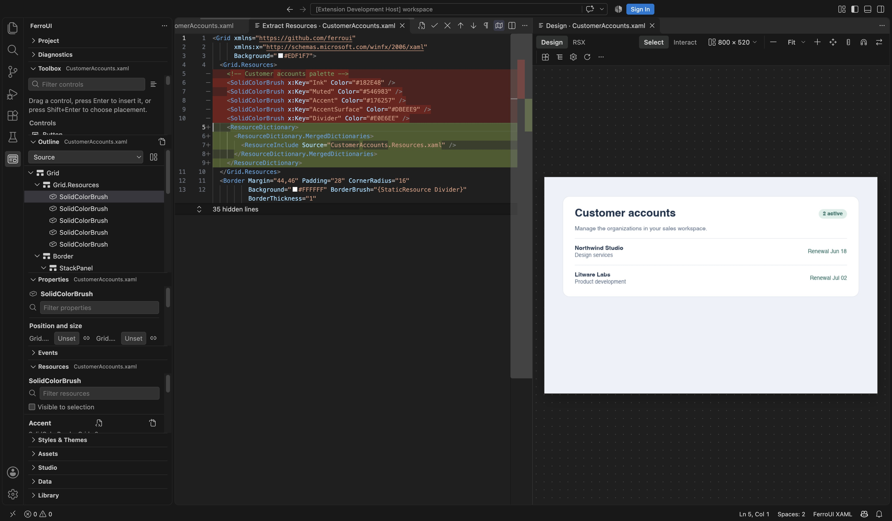

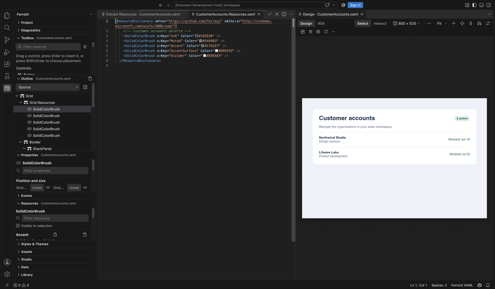

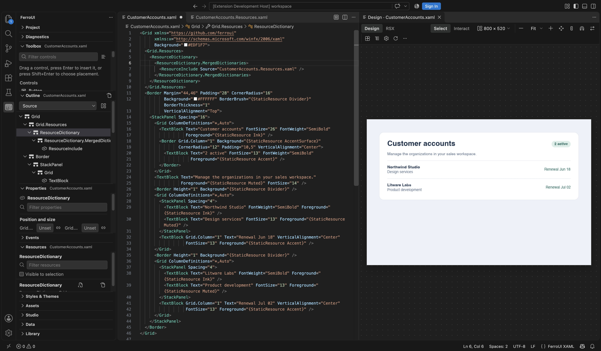

## Move an XAML file and its references

1. Right-click the XAML file in **Explorer** or **FerroUI → Project → Views** and choose **Move XAML File…**. You can also run the command from an open XAML editor.
2. Enter the destination path relative to the workspace folder. Choose an existing directory in the same Cargo package or loose-file project and an available `.xaml` filename.
3. Expand each affected file in the Changes editor. Review the move and its references in XAML, Rust, Cargo builds, stage sets, and scenarios. Choose **Apply File Move** or **Cancel File Move** in the editor toolbar.

Apply moves the file and updates the participating buffers together. An open **Design** tab follows the file and keeps its last frame visible while rendering the new source location. Undo or Redo from an affected editor steps through the whole operation. Use **Save All** before building the app or running a saved scenario. If the destination becomes occupied or a file changes during the review, prepare a new review.

Open **Stages** boards follow the file in either direction, including when it appears as a secondary comparison source. A board named for the moved file updates its tab title. The bundled preview helper keeps each card, its environment, and prototype links intact. A paused card keeps its current image until you refresh it or resume updates. [Compare designs in Stages](motion.md#compare-design-data-and-environments)

The planner follows literal XAML includes, typed URI and image properties, and complete `ferres://` or `resm:` addresses it can resolve. In Rust, it updates the literal paths in `include_str!` and `include_bytes!`, including paths anchored with `concat!(env!("CARGO_MANIFEST_DIR"), "/…")`. Open Rust and XAML buffers contribute their unsaved text to the review.

In the selected Cargo build target, the review can update `Build::input`, Cargo rerun directives, and the registration keys in `XamlGroup::documents` and `class_document` that directly identify the moved file. Rust includes keep the filesystem spelling. Compiled registration keys follow their XAML root and use URI escapes such as `%20` for a space.

An exported group can publish `Shared/Palette.xaml` from a file such as `Themes/PaletteSource.xaml`. Moving the file updates its literal `include_str!` and keeps the published alias. When a key follows the source path, the review also updates literal `ferres://` consumers in XAML and Rust. Run **Build Project XAML Schema** for a package with a custom assembly name so the planner can use its emitted name. If the new address is already registered, choose another destination.

For a move that changes a generated Rust `build_…` name, build the owning package with **Build Project XAML Schema** and let rust-analyzer load the same Cargo target. The Changes editor shows affected authored Rust imports and calls beside the XAML and Cargo changes. A move can change a neighboring build function when their keys previously produced the same name. A class keeps its `populate` entry point. Save the reviewed sources and run Cargo to regenerate the Rust modules. If the generated declaration is out of date or rust-analyzer cannot resolve it, refresh the schema and let rust-analyzer finish loading before reviewing again.

The review includes saved stage sets and native scenario JSON, including unsaved edits to their open buffers. Stage sets use file URIs. Scenarios use paths relative to their own directory or absolute file paths. When a stage URI changes, its prototype scenario remap key follows it. A remap's path changes when it points to the moved file. The planner edits those values in their original JSON positions. Repair an incomplete draft that still has a relevant saved reference, or resolve a conflicting remap key, before reviewing the move again. [Studio workflow](../native-controls.md#move-an-xaml-file) · [MCP workflow](reference.md#move-an-xaml-file-with-mcp)

### Existing Cargo groups that read files

For a group that passes `std::fs::read_to_string` results to `XamlGroup::documents`, the review can follow a literal file path through immutable Rust bindings. It recognizes standard library imports, package-relative paths, and paths joined to `CARGO_MANIFEST_DIR`. Document tuples, arrays, and the group builder can have their own bindings. [SampleControls build script](../../../samples/SampleControls/build.rs) · [Class example](../../../src/FerroUI.Dialogs/build.rs)

Review the physical input in **Changes**. Separately authored keys stay stable, including keys passed to `class_document`. When the key and path share one binding, a rename such as `New Card.xaml` keeps the space in the filesystem path and uses `New%20Card.xaml` at the compiled key and class selector. Run **Build Project XAML Schema** to also review any affected generated Rust names.

If the selected build reports a key whose input cannot be traced, declare that input with the file-backed API below and rebuild the schema. A published alias can give a relative include a different base from its source file. If the review reports an unmapped compiled target, use an explicit resource URI or a registration with a compiler source mapping.

### Computed Cargo groups with file-backed registrations

Declare the logical key and physical path separately with `xaml_document_file!`. Relative input paths start at the Cargo package directory. Pass the records selected by your build script to `XamlGroup::document_files`. Use the key in `class_document` when a group compiles an `x:Class`. The build watches the physical files and records the Rust declaration that supplied each one.

```rust
use ferroui_build::{xaml_document_file, Build, TypeSystem, XamlGroup};

fn main() {
    let preview = xaml_document_file!("Themes/Preview.xaml", "Source/Preview.xaml");
    let production = xaml_document_file!("Themes/Light.xaml", "Source/Light.xaml");
    let mut build = Build::from_env().type_system(TypeSystem::Model);
    for (module, file) in [("preview_theme", preview), ("production_theme", production)] {
        build = build.compile_group(XamlGroup::new(module).document_files(&[file]));
    }
    build.run();
}
```

Run **Build Project XAML Schema** for the Cargo target you want to review. The **Changes** editor includes the path literal in `build.rs` or in the Rust module that declares the selected input. The review keeps the logical key, `ferres://` consumers, and generated Rust names. After applying the move, save the participating sources and rebuild the package. [Computed groups in the Dock sample](../../../samples/Dock/FerroDockReactiveUISample/build.rs)

The review uses the declaration positions from the selected build. If a declaration shifted, save it and build the schema again. Give the physical path as a literal at the `xaml_document_file!` call so the move can preserve the rest of the computation.

Relative `ResourceInclude`, `MergeResourceInclude`, and `StyleInclude` paths follow their compiled group when the build records the target's source. For example, a view registered as `Published/Card.xaml` can include `Colors.xaml` from the same group even when the registered palette lives in `Source/Palette.xaml`. The review preserves that include when either source moves. Design, Stages, and language navigation follow the relocated source through Apply, Undo, and Redo while the build schema is loaded. An open palette draft still supplies the preview. Loose-file includes use their filesystem base and appear in the review when their literal needs to change.

If the review flags different targets across compiled groups, inspect the reported include and choose a resource address that identifies the intended target in each group. Rebuild the selected project schema if it predates the source mappings. References to assets without a compiler source mapping may require an explicit resource URI before the move can proceed.

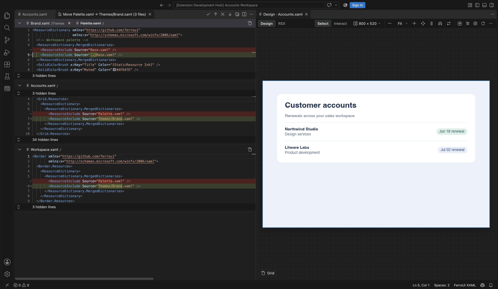

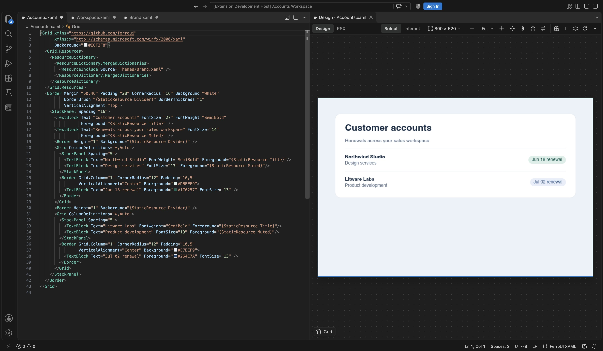

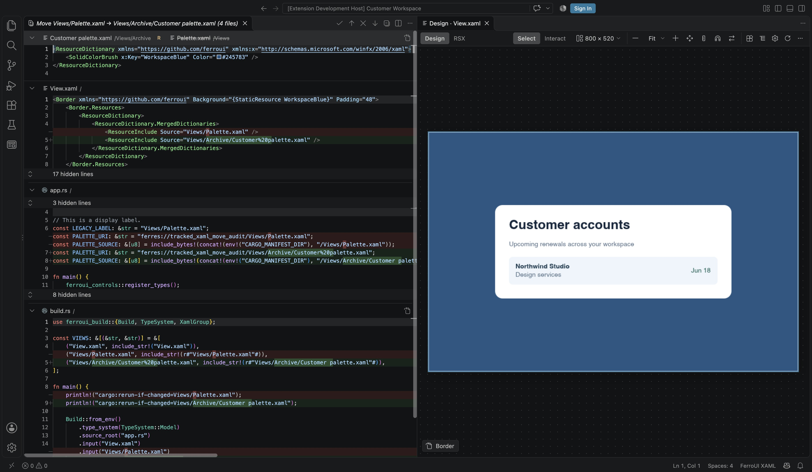

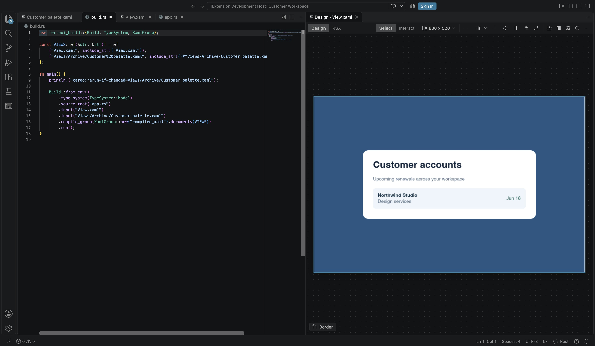

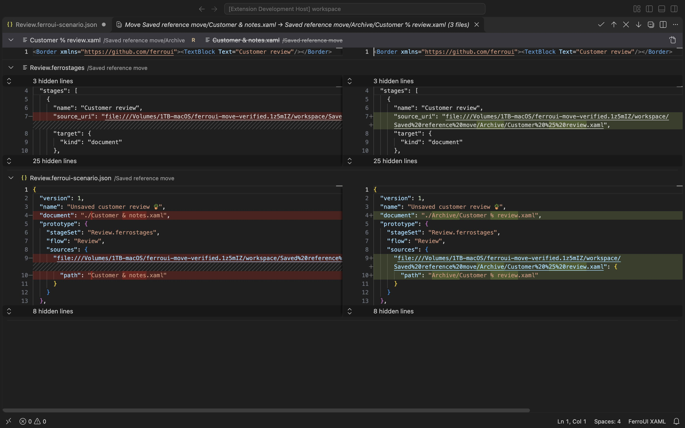

## Trace an effective property value

Select one control in **Design** or **Outline**. In **Properties**, choose the layers icon beside a property to open its value trace. The title shows the effective value from the current native preview. An authored value or expression appears when the editor can map it to XAML or RSX.

| Entry | What it shows |
|---|---|
| **Effective** | The exact contributor supplying the value, such as a local value, style setter, theme, inherited value, or type default. |
| **Animation base** | The value under the animation. The animated value appears as the effective contributor. |
| **Current value override** | A value applied through the framework’s current-value API. The authored declaration remains visible. |
| **Overridden**, **Inactive**, or **Unset** | A lower-priority entry, an inactive selector, or a local binding without a current contribution. |
| **Referenced resource** | A resource key that resolves unambiguously inside the current authored XAML document and theme. |

Choose a source arrow or press Enter on a linked row to reveal its declaration. Preview-only controls and sources supplied by an external file may have entries without an authored range. Opening the trace leaves source and Undo history intact.

Try [PropertyTraceWorkbench.xaml](../../../editors/vscode/test/fixtures/PropertyTraceWorkbench.xaml). **StyleCard → Opacity** shows the winning `Border.priority` setter and the overridden `Border.account` setter, both with value `0.72`. **LocalCard → Opacity** shows its local `0.9` value. Trace **Background** to reach the `AccountSurface` resource. [Studio workflow](../native-controls.md#trace-property-values) · [MCP workflow](reference.md#trace-property-values-with-mcp)

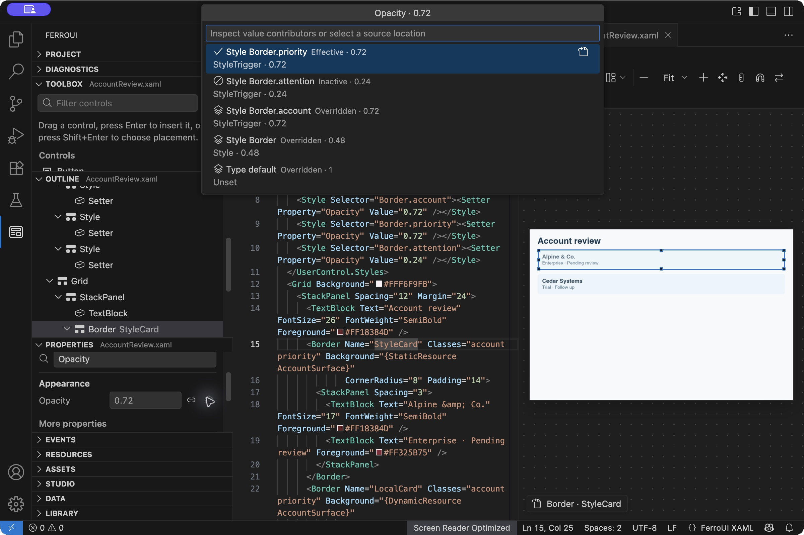

## Edit table columns

1. Open the designer for [ColumnsWorkbench.xaml](../../../editors/vscode/test/fixtures/ColumnsWorkbench.xaml). Select **Portfolio** or **Status** in the canvas or **Outline**.
2. Choose the table icon in the **Properties** title bar or run **FerroUI: Edit Columns**. The **Columns** view shows the selected table’s authored columns in display order.
3. Expand a column to edit its header, width, binding, or control-specific options. Use `Auto`, a number in logical pixels, or a star length such as `2*` for a width. Use XAML markup such as `{Binding Region}` for a binding. Boolean and enum fields offer a list of valid values. **Reset Property** removes an optional authored value. Edit required bindings directly. **Reveal in Source** opens a column declaration, binding, or template.
4. Use **Add Column** to append a column. `TableView` offers its standard column. `TreeDataGrid` adds text, checkbox, template, row header, and hierarchy columns. A template starts with a cell template you can open in source. A hierarchy column starts with a `Children` binding and an inner text column. Edit the binding to point to your row model’s child collection.
5. Drag a top-level column onto its destination in **Columns**. Dropping on a property of an expanded column uses that column’s position. Drop below the list to move a column to the end. To reorder with the keyboard, focus the row, press Shift+F10, and choose **Move Column Earlier** or **Move Column Later**. The same menu offers **Duplicate Column** and **Remove Column** when applicable.

Each action updates the unsaved XAML and native preview through one Undo step. Moving a column preserves its bindings, object values, and templates. Use **Reveal in Source** to edit protected expressions and object values. [Designer Studio workflow](../native-controls.md#edit-table-columns) · [MCP workflow](reference.md#edit-table-columns-with-mcp)

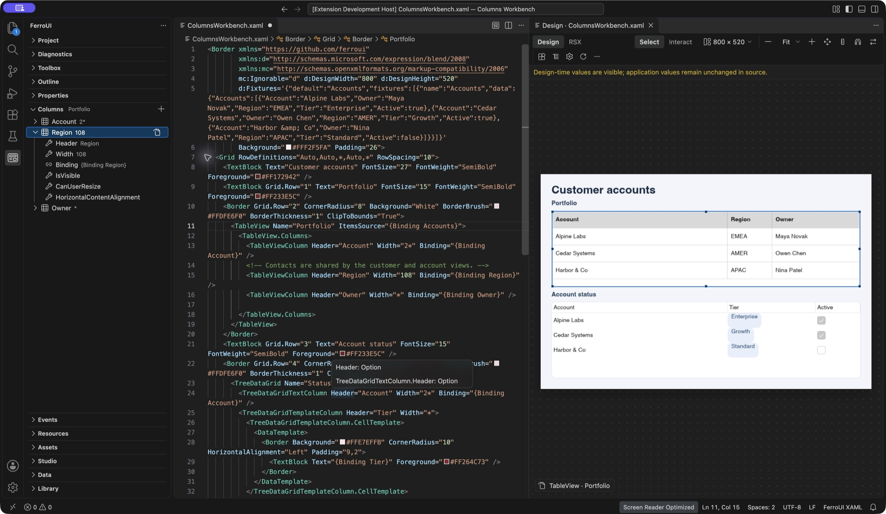

[Keyboard ordering](../images/vscode-column-ordering.jpg) · [Add a column](../images/vscode-add-column.jpg) · [Edit an exact width](../images/vscode-column-width.jpg) · [Inspect a hierarchy column](../images/vscode-hierarchy-column.jpg)

### Edit an RSX TableView

Open the designer for [column_workbench.rs](../../../editors/vscode/test/fixtures/column_workbench.rs) and select **Accounts**. Open **Columns** using the same table icon in **Properties**. Add a column to an empty `TableView`, or declare a collection using `ferroui_view::table_columns` with an inline array of `ferroui_view::table_column` builders.

Edit the header, width, visibility, resizing, alignment, and simple row binding. Enter a binding path such as `Customer.Name`. The editor writes `.binding_path("Customer.Name")` in Rust. For widths it writes the matching `GridLength` value. Drag columns to reorder them, or use the same keyboard and context-menu actions as in XAML. Each change updates the original Rust and takes one Undo step. Reordering retains comments that precede a column and its original builder expression.

Open **Cell template** under the column to create or edit an inline RSX template. For a computed assignment such as `.cell_template(status_cell())`, choose **Reveal Template Assignment**. Use **Reveal Column Collection** in the **Columns** title bar if the collection is supplied by an expression such as `computed_columns()`. The XAML projection of an authored column collection is read-only. [Rust builders](../../declarative-ui.md#43-build-tableview-columns) · [MCP workflow](reference.md#edit-table-columns-with-mcp)

### Edit an RSX TreeDataGrid

1. Open Design for [tree_grid_workbench.rs](../../../editors/vscode/test/fixtures/tree_grid_workbench.rs). Select **Accounts** in **Outline** and choose **Edit Columns** in Properties.
2. Expand **Account** to see the hierarchy settings and its inner text column. Edit the inner **Width** or **Binding** to change the header geometry or value. Use **ChildrenBinding** on the hierarchy column to set the path to a row's children. For a checkbox, use a Boolean row property such as `Active`.
3. Choose **Add Column** to add a text, checkbox, template, row-header, or hierarchy column. A grid can have one hierarchy column. Drag top-level columns into order or use **Move Column Earlier** and **Move Column Later** from the row's context menu. Each accepted edit has one Undo step.
4. Expand a template column and choose **Cell template** or **Cell editing template**. Open the mapped body on the canvas, or create a typed inline template in an empty slot. The editing starter uses a text box. The back arrow returns to the owning grid view.

The isolated canvas shows the native headers. Launch the application to see the authored columns with the app's rows. An inline `ferroui_view::tree_data_grid_columns` array supplies editable column definitions. When `source` or `model` supplies the grid, **Reveal Column Collection** opens the Rust assignment. For computed fields in an editable collection, reveal the field's expression. [Rust builders](../../declarative-ui.md#44-build-treedatagrid-columns) · [MCP workflow](reference.md#edit-table-columns-with-mcp)

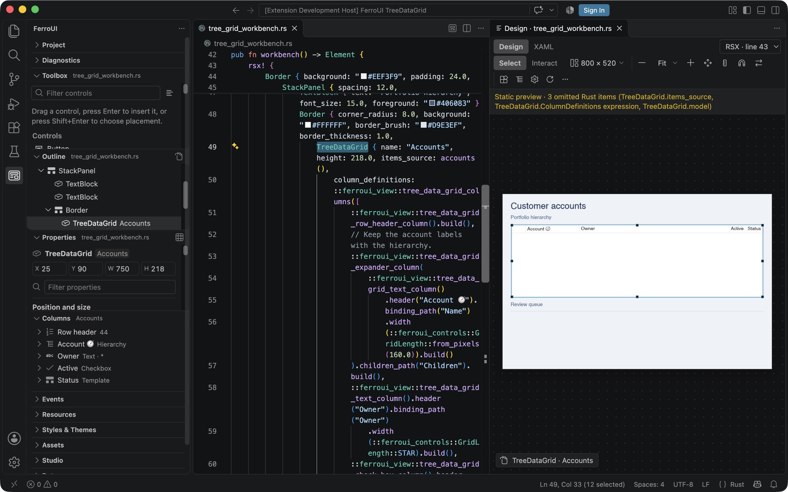

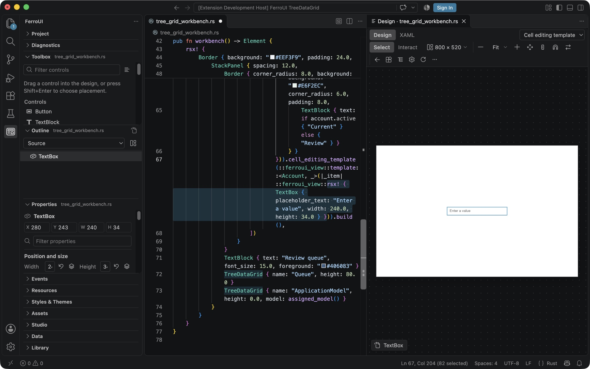

## Edit item and cell templates

1. Open [ItemTemplatesWorkbench.xaml](../../../editors/vscode/test/fixtures/ItemTemplatesWorkbench.xaml) and choose **FerroUI: Open Designer**. Select **Directory** from **Outline** to work on its shared template, or select **ReviewQueue** to start with the default item presentation.
2. Choose **Edit item templates** beside the selected control in **Properties**, or run **FerroUI: Edit Item Templates**. When the control has several template slots, choose the one to edit. For a table cell, select the authored column in **Outline**.
3. Use the actions for the selected slot.

| Action | Result |
|---|---|
| **Edit Template on Canvas** | Open the assigned definition. A template in an included dictionary opens in its owning Design tab. Use the canvas, Outline, and Properties to edit its XAML. |
| **Create Inline Template** | Add a data template with a bound text control to a slot that uses the default. Open it on the canvas to change its contents. |
| **Assign Template Resource** | Choose a visible `DataTemplate` or `TreeDataTemplate`. Included choices show their dictionary's filename. Assignments use resources that resolve to the same definition across themes. |
| **Make Inline Copy** | Give this control or column its own copy of an assigned local or included resource template. The shared definition and its other uses stay intact. |
| **Reset Template** | Remove the local assignment from an optional slot. A `TreeDataGridTemplateColumn` requires a cell template. |
| **Reveal Template Source** or **Reveal Template Assignment** | Open the authored definition or its assignment in XAML. |

When **Design Data** supplies an array through a simple `ItemsSource` binding, the template canvas shows the first item from the selected fixture. Try the **Trial** fixture in the local sample to see a different customer. Use the back arrow in the designer toolbar to return from a local template to the view.

Try [IncludedItemTemplates.xaml](../../../editors/vscode/test/fixtures/IncludedItemTemplates.xaml) inside a workspace. Select **Directory** and edit its template to open **Customer Rows.xaml** in the dictionary's own resource scope. Its preview starts with the consuming view's selected fixture and resolves the brush from the dictionary. Change the template in **Properties**, then use the back arrow to see the update in the consuming Design tab. Use Undo in **Customer Rows.xaml** to restore the template. Reopen the template from the consuming view to sample a different fixture.

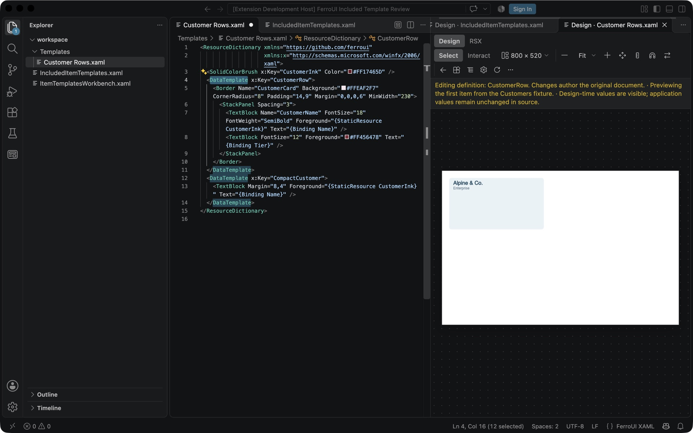

Try **Make Inline Copy** on **Directory** in [IncludedTemplateCopies.xaml](../../../editors/vscode/test/fixtures/IncludedTemplateCopies.xaml). The copy keeps resource links that resolve to the same declarations and theme scope. If a nearer key would shadow a dependency, the designer copies its proven resource and any required dependencies under unique keys in the nearest writable scope. Relative asset and include paths continue to point to their original targets. Edit the private template on the canvas, then return to the consuming preview. The review queue keeps its assignment to the shared template. Undo the copy from **IncludedTemplateCopies.xaml** to restore the assignment and remove the private resources together.

The contextual editor covers authored XAML item, selection box, menu item, cell, and cell editing templates on controls that expose those properties. Included templates need a literal, workspace-local dictionary include that the preview can resolve. The action picker explains when an authored resource scope cannot be preserved. For an application-supplied XAML expression, reveal its assignment. [Designer Studio workflow](../native-controls.md#edit-item-and-cell-templates) · [MCP workflow](reference.md#edit-item-templates-with-mcp)

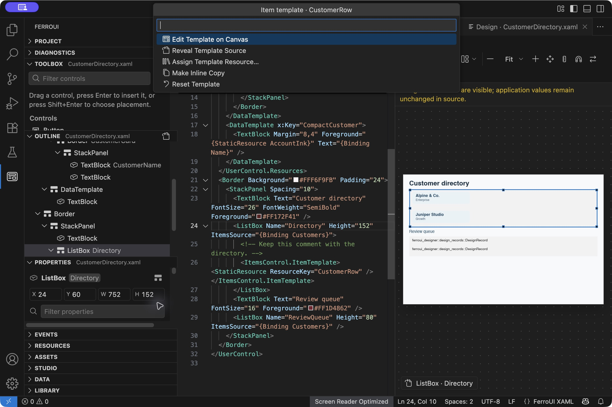

### Edit a Rust item or cell template

1. Open Design for [template_workbench.rs](../../../editors/vscode/test/fixtures/template_workbench.rs). Select **Directory** in **Outline**, then choose the item-template icon in **Properties** or run **FerroUI: Edit Item Templates**.
2. Choose **Edit Template on Canvas**. The view picker names the template. Hover over it to see the line in the original Rust source. Select **CustomerTitle** and change **Text** or **FontSize** in **Properties**. The change updates the Rust buffer, including when it is unsaved. The surrounding closure, data access, and other invocations keep their original source.
3. Use the back arrow in Design to return to the owning view. To edit a table cell, select **Accounts**, open **Columns**, expand **Status**, and choose **Cell template**.
4. To add a template to the **Account** column or another empty slot, choose **Create Inline Rust Template** and enter the Rust type of one item, such as `Customer` or `crate::model::Customer`. The editor adds a typed `ferroui_view::template` with a starter text control. **Reset Template** removes a mapped local assignment. Each creation, reset, or canvas edit has its own Undo step.

The isolated canvas renders the supported static controls and literals of a direct `ferroui_view::template` closure. Use the running app to see computed content with its real data. A template supplied by a variable, a function call, or another builder remains editable in the Rust source through **Reveal Template Assignment**. The template picker supports inline item templates on ItemsControl, ListBox, TreeView and ComboBox, the ComboBox selection box template, NavigationView menu items, and display and editing templates on their applicable table columns. [Rust data templates](../../declarative-ui.md#92-data-templates-whose-items-are-components) · [MCP workflow](reference.md#edit-item-templates-with-mcp)

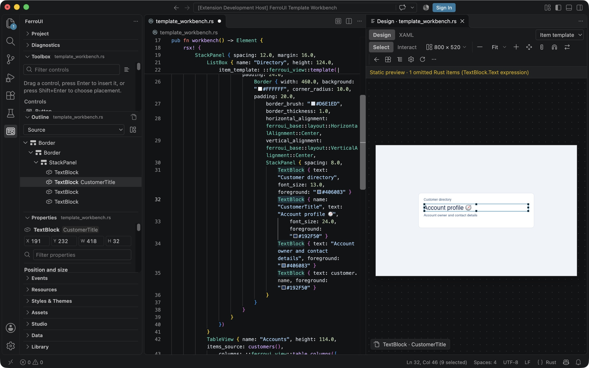

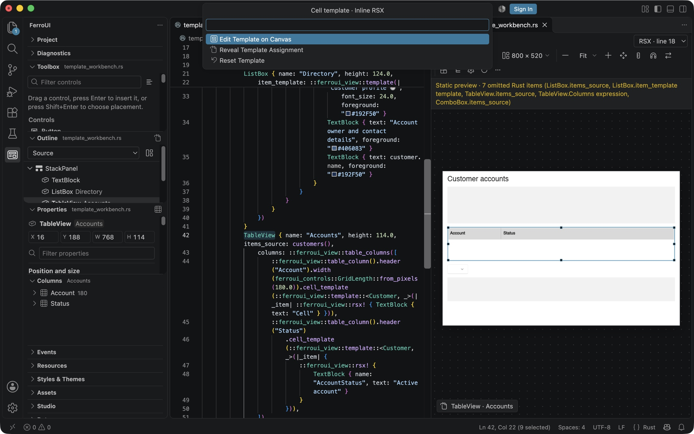

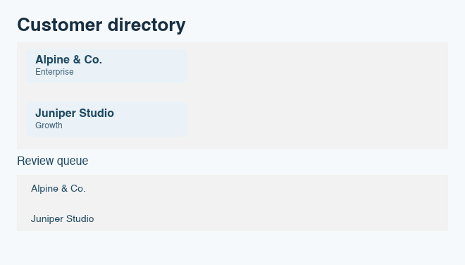

## Edit a control template

1. Select a control that exposes a writable `Template` property. Choose **Edit control template** beside its name in **Properties**, or run **FerroUI: Edit Control Template**.
2. Use **Edit Template on Canvas** to open the authored XAML `ControlTemplate` used by the selected control. The picker shows **Inherited** when a style or theme supplies the template and the native preview can locate its source. An included template opens in the file that owns it. Use the back arrow to return to the consumer.
3. Choose **Assign Template Resource…** to use a visible control template with a compatible `TargetType`. **Make Inline Copy** gives this instance a private copy of the assigned or inherited template and carries across the dependencies its scope needs. **Create Inline Template** uses the selected control's `TargetType` and scaffolds its registered required parts. **Reset Template** removes the local template and lets the style or theme supply it again.

Use Undo in the owning XAML buffer to revert an edit. If the control assigns a template with an authored expression, **Reveal Template Assignment** opens the expression in source. [Designer Studio workflow](../native-controls.md#edit-control-templates) · [MCP workflow](reference.md#edit-item-templates-with-mcp)

In the workbench example, **SharedAction** opens a template in its included dictionary. Select **LocalAction** and choose **Make Inline Copy** to duplicate a template from the same document. The copy receives its own brush key because the button already shadows the template’s original brush key. **SecondLocalAction** keeps using the shared template. Use Undo once to remove the private template and its brush together. **PlainAction** can start an inline template. [Control template workbench](../../../editors/vscode/test/fixtures/ControlTemplateWorkbench.xaml)

In the same workbench, **InheritedAction** gets its template from a local style. **ThemedAction** gets its template from a control theme in the included dictionary. Use **Reveal Template Source** to see the supplying setter, or take a private copy before changing just the selected control. Compiled or programmatic templates may need a source mapping before the designer can open them. [Control template workbench](../../../editors/vscode/test/fixtures/ControlTemplateWorkbench.xaml)

The isolated template renders the current fixture on the native canvas. [Customers fixture](../images/native-item-template-customers.png) · [Trial fixture](../images/native-item-template-trial.png)

## Reuse snippets and design tokens

Save a reusable, single-root XAML fragment under `.ferroui/toolbox` in the workspace or Cargo package. Select the package view to see its snippets and registered **Project controls** and **Dependency controls**. A package snippet takes precedence over a workspace snippet with the same filename. RSX offers entries with a supported source mapping.

Run **Import Design Tokens** on a DTCG JSON file or **Export Design Tokens** on a literal XAML dictionary. Review the mapping, rename keys or paths, and choose applicable color and dimension representations before creating a file. Import supports typed groups, `$root`, numbers, sRGB colors, `px`, `rem` with a scale, durations, and resolvable aliases. The report identifies skipped values such as unsupported composite tokens or dynamic resources. Include the imported dictionary with `ResourceInclude`. The preview refreshes for saved and unsaved local includes. [Example tokens](../../../editors/vscode/test/fixtures/customer-design.tokens.json) · [DTCG format](https://www.designtokens.org/TR/2025.10/format/)

## Diagnose a design-time issue

Open a XAML or RSX design and expand **Preview Checks** under **FerroUI → Diagnostics**. Hover a row for the full explanation. Select a finding to highlight the control in Design and reveal the control or its exact authored value in source. In **Stages**, use the check icon on a card to inspect that stage's current size, theme, and state.

| Finding | What to look at |
| --- | --- |
| **Overflow** | A control extends beyond its layout slot or parent bounds. The report gives the boundary and distance on each affected edge in logical pixels. |
| **Clipping** | The preview viewport or a rectangular clip cuts through a control. Scrollable axes are evaluated with the scroller in mind. |
| **Ineffective layout value** | Read which constraint or parent controls the result. Examples include competing Canvas anchors, out-of-range Grid tracks or spans, a filled DockPanel child, and Width or Height constrained by a size limit. |
| **Accessibility** | Check missing accessible names and text contrast on supported backgrounds. |

Try [LayoutDiagnostics.xaml](../../../editors/vscode/test/fixtures/LayoutDiagnostics.xaml). The **OverhangingCard** extends 40 logical pixels past its Canvas. Change the Canvas width or the card position and watch the finding disappear. Open the **CapacityCard** finding for **Canvas.Right** to see the anchor that loses precedence. Checks use the accepted frame and leave the source buffer and undo history intact. [Preview Checks through MCP](reference.md#read-preview-checks-with-mcp)

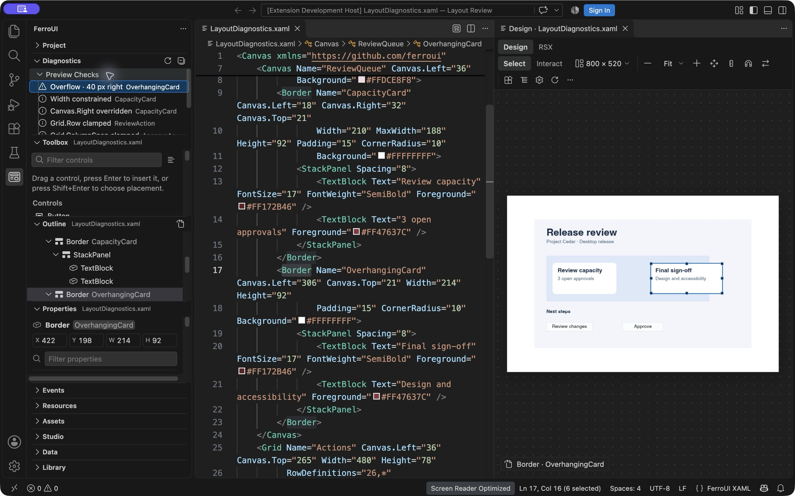

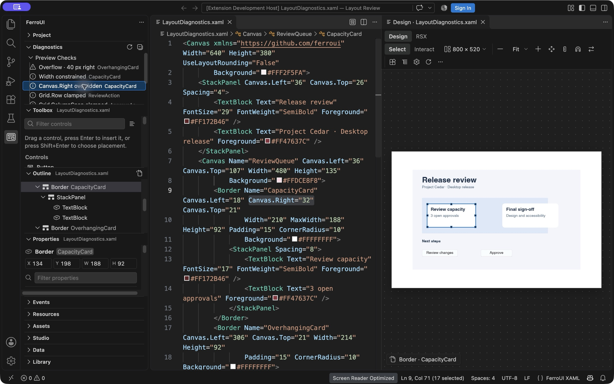

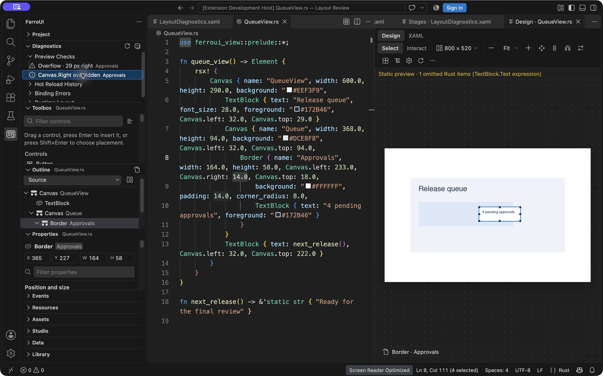

Use the Visual and Logical Outline to locate runtime-only elements. For a binding that depends on the application model or a custom loader, use a registered app fixture and inspect the running UI. [Test and inspect the app](runtime.md)
