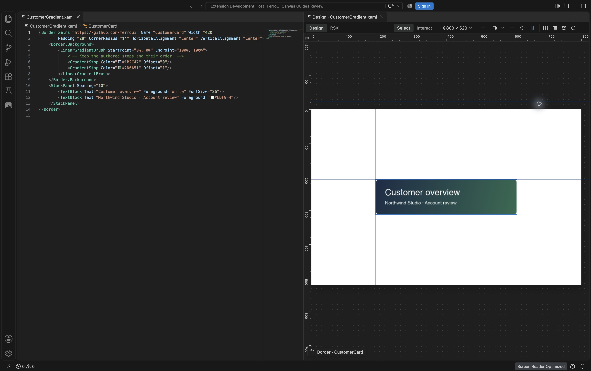
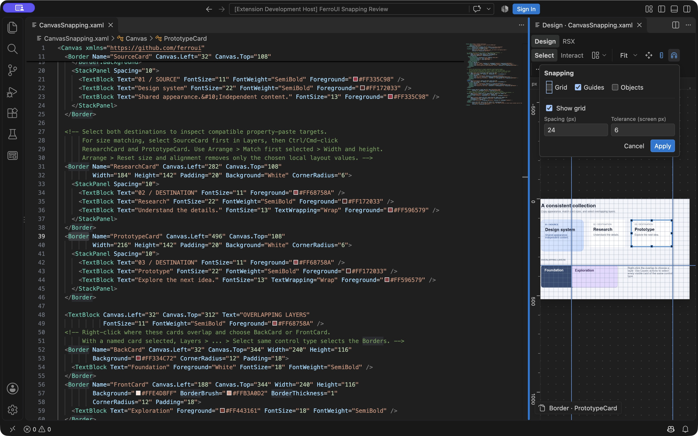
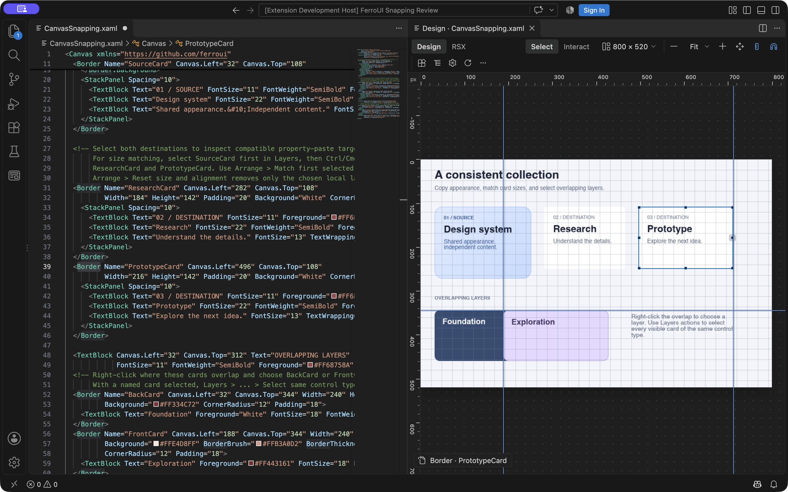
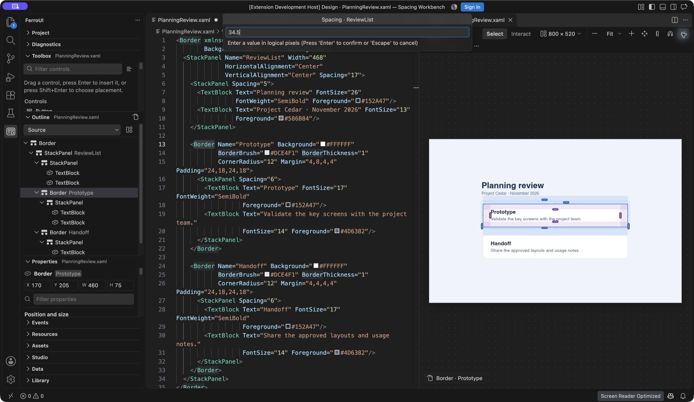

Start with a view you can render, then use the same source buffer for text edits and visual authoring. Try [DesignWorkflows.xaml](../samples/DesignWorkflows.xaml) for XAML or [views.rs](../../../editors/vscode/test/fixtures/views.rs) for several RSX invocations.

## Find or create the view

1. Open **FerroUI → Project**. Expand a workspace folder to browse its Cargo manifests, XAML and RSX views, assets, stage sets, and test scenarios. Expand a Cargo manifest to see its binaries. Refresh the view after changes outside VS Code if its list is out of date.
2. Run **FerroUI: Find Project View** to open a view by name. To start a view, run **New View** or **New Component**, choose XAML or RSX, and enter a path relative to the chosen workspace folder. Add the generated Rust file to your app’s module tree when you use it in the binary.
3. For project controls and typed bindings, run **Build Project XAML Schema** and choose the owning Cargo target. App Preview and a managed application build also publish their registered metadata. The nearest Cargo package supplies the types, including exported dependency controls. `ferroui.types` can override or augment the metadata.

## Work in source or use the counterpart tab

| In the editor | Workflow |
| --- | --- |
| FerroUI XAML | Use completion and hover for control, property, and binding metadata. Add `x:DataType` or an explicit binding source type where applicable. **Quick Fix** imports a known namespace or corrects a resource key or typed binding member when the replacement is unambiguous. **Go to Definition**, **Find References**, and **Rename Symbol** use the active template namescope or resource scope, including applicable unopened files. Scope-changing renames are rejected. |
| FerroUI XAML formatting | **Format Document** and **Format Selection** preserve mixed content and `xml:space`. Linked editing updates the matching tag when `editor.linkedEditing` is enabled. Symbols, folding, signature help, semantic highlighting, and binding type hints are available through the VS Code language features. |
| Rust | Keep rust-analyzer active for Rust semantics, Cargo, and macros. FerroUI supplies supplemental property completion and hover in mapped `rsx!` fields. Enable `ferroui.rsx.inlayHints` to show mapped types. Put the caret in a named control or select it in the designer and run **Rename RSX Control** to change its authored `name` literal in that invocation. |
| **XAML** or **RSX** tab beside **Design** | Edit the projection of a supported static tree, then choose **Apply**. Value edits patch the original buffer. Structural editing requires a supported tree and preserves the surrounding Rust. Reload the projection if the source changed while a projected draft was open. |

For a partial Rust preview, edit expressions, handler code, or dynamic child lists in the Rust editor. The designer can still edit supported literals and mapped handler expressions and wrap consecutive mapped children. In XAML with bindings, style objects, or property elements that have no static counterpart, edit the authored XAML. Existing XAML design data survives supported counterpart value edits. [Language service](../../../src/FerroUI.Designer.Language/README.md) · [Mapping project controls to RSX](../../../editors/vscode/README.md#map-an-application-control-to-rsx)

## Arrange controls on the canvas and in Outline

1. In **Select** mode, click a control and use the resize handles or drag the control. Hold Ctrl or Command to add other controls. **Arrange Selection** offers native alignment, distribution, size matching, and reset for supported layouts. Size matching uses the first selected control as its reference.
2. Open **Toolbox** and search by name, category, or description. Switch between list and tile views. Drag a control to a canvas landing hint or a **Source** Outline row. The top and bottom of the row insert before and after it. The middle nests the control in an eligible container. Use the same placements to move existing controls or an ordered multi-selection.
3. For keyboard placement, focus a Toolbox item and press Enter. Shift+Enter offers the valid positions for the selection. In Source Outline, use Alt+Up or Alt+Down to reorder. In the canvas, Up and Down move among authored controls, Alt+click cycles overlapping controls, and Enter reveals the selected declaration. Focus a resize handle and use the arrow keys for keyboard resizing.
4. Run **Edit Grid Tracks** for the nearest Grid. Adjust Auto, pixel, or star sizes or insert or remove a row or column. Supported changes update child cell and span attributes in the same edit. Use the [Grid fixture](../../../editors/vscode/test/fixtures/GridWorkbench.xaml) to see the result in source.

Switch Outline to **Visual**, **Logical**, or **Combined** to inspect constructed controls and template parts. Source-backed editing requires an authored control. **Studio → Layers** lets you hide, lock, or isolate controls in the design session. Use Undo for authored changes. Layer flags and viewport navigation use local designer state.

Use the size button to change logical width, height, preset, or theme. With the canvas focused, press `0` to fit, `1` for actual size, `+` or `−` to zoom, and hold Space while dragging to pan. The zoom menu includes **Fit selection**. Use **Interact** and its input bar for clicks, scroll, text, and key gestures.

## Wrap selected controls

In **Design**, use **Select** mode and select one control or consecutive siblings in the canvas or Source Outline. Choose **Wrap Selection** from **More designer actions**, from **Arrange selection** in Outline, or from the Command Palette. Choose a container and the designer selects the new wrapper.

| Container | What to expect |
| --- | --- |
| **Vertical StackPanel** or **Horizontal StackPanel** | Arrange the selected controls in source order along the chosen axis. |
| **WrapPanel** | Flow the selected controls onto new lines. Inside a Canvas, the wrapper starts at the measured group width. |
| **Grid** | Start the children together in one cell. Use **Edit Grid Tracks** and the Properties view to lay out multiple rows or columns. |
| **Canvas (keep positions)** | Keep the current positions of Canvas children. The new Canvas uses the measured group bounds, and its children use offsets inside it. |
| **Border** | Put one selected control inside a container that supports padding, a background, and a border. |

The selection must share one authored child slot. In a Grid, select controls with matching cells and spans. In a DockPanel, select controls on the same side. The planner protects bindings and object-valued layout attributes that would need to change. An RSX run can sit beside a dynamic child or contain computed values of its own. Wrap a run interrupted by an unmapped child in the Rust editor.

Wrap Selection is one source edit. Undo restores the original layout and source order. [Studio authoring](../native-controls.md#wrap-selected-controls) · [MCP workflow](reference.md#wrap-controls-with-mcp)

## Measure and mark the canvas

In the **Design** tab, open the ruler icon for **Canvas Guides**, enable **Rulers**, and choose **Apply**. You can also focus the preview canvas in **Select** mode and press Shift+R. The ruler reads logical pixels from the top-left of the rendered view as you zoom or pan.

| Action | Result |
| --- | --- |
| Drag down from the top ruler or right from the left ruler | Add a horizontal Y guide or a vertical X guide |
| Drag a guide, or hold Alt (Option on macOS) as you start the drag | Move the guide, or drag a copy |
| Drag a guide back to its ruler | Remove it |
| Tab to a visible guide, then press an arrow key along its axis | Nudge it by 1 px. Hold Shift to nudge by 10 px. |
| With a guide focused, press Delete or Backspace | Remove the focused guide |
| Press Escape during a drag | Cancel the gesture |
| With the canvas focused, press Shift+G | Show or hide the guide lines |

For an exact position, open **Canvas Guides** again. Use the horizontal or vertical add icon, enter a position such as `73.5` or `-18.125`, and choose **Apply**. You can remove individual rows or clear the list in the same draft. **Cancel** discards the draft. If the accepted frame or guides change while the editor is open, reopen it to use the current values. [Exact position controls](../images/vscode-canvas-guide-positions.jpg)

The designer tab retains a guide set for the document, each XAML definition opened from **Library**, and each Rust `rsx!` invocation. Reopening a definition or switching back to an invocation restores its guides. Guide positions stay in the designer tab’s view state. Source edits use the editor’s Undo history. [RSX canvas with guides](../images/vscode-rsx-canvas-guides.jpg) · [Studio guides](../canvas-guides.md)

## Snap controls to guides, the grid, or other controls

Open the magnet icon for **Snapping** in the **Design** toolbar. Choose one or more targets, then choose **Apply**.

| Target | What snaps |
| --- | --- |
| Grid | The leading corner of a drop or move, and the active resize edges. **Spacing** sets the grid in logical pixels. **Show grid** controls the display independently. |
| Guides | The edge or center of a moved control or selection aligns to a guide. Hidden guides remain active when this target is enabled. |
| Objects | Edges and centers align to other measured controls in the current design scope. The moving selection and its descendants are excluded from the targets. |

Drag a Toolbox entry or an authored control onto a **Canvas**, or drag an active resize handle. Dashed lines indicate the native snap positions. Move a multi-selection to align its combined bounds. Side handles snap along their resize axis. Grid cells and flow layouts use their existing placement rules. Hold Alt (Option on macOS) during a gesture to use its precise unsnapped position.

**Tolerance** is in screen pixels. Increase it to catch more nearby targets, or reduce it for precise placement. Changing zoom preserves the same screen distance. Edits use logical positions and the preview follows the app’s layout rounding. Arrow keys on resize handles use their existing exact steps. The tab retains snapping settings with the current guide set. Moving, inserting, or resizing a control commits one authored edit, including when the Timeline records a supported geometry gesture. [Layout sample](../samples/SelectionWorkflows.xaml)

## Adjust spacing on the canvas

In **Design**, switch to **Select** and choose **Show Spacing Handles** from the arrow-swap icon in the toolbar. Select a layout container or a child. The overlay marks gaps and margins in blue and padding in purple. Each handle identifies its property, owner, and current value. Values use logical pixels at every zoom.

| Select | Handles |
| --- | --- |
| StackPanel or ReversibleStackPanel | Spacing between items |
| WrapPanel or FlexPanel | Item and line gaps for the measured arrangement |
| Grid or UniformGrid | Measured row and column gaps |
| A supported container or control, such as a Border | Individual padding sides |
| One child or siblings with the same layout parent | Individual margin sides for the selected children and the parent’s available gap controls |

Drag a handle along its cursor direction. The draft label shows the proposed value. Release to commit one source edit or press Escape to cancel. To use the keyboard, tab to a handle and use the arrow keys to decrease or increase by 1. Hold Shift for steps of 10 or Ctrl (Command also works on macOS) for steps of 0.1. Press Enter or double-click a handle to enter an exact value.

The edit preserves the other sides of the inset and participates in VS Code Undo and Redo. Gaps and padding start at zero. Margins accept negative values. A disabled handle describes the protected binding, expression, layer, or source form. In a mapped RSX view, a supported scalar or four-sided tuple can be adjusted even when a sibling is dynamic. The overlay follows the accepted selection and frame. Turn it off to show the standard resize handles again, or switch to **Interact** to use the view.

Try the StackPanel, Grid, and Border in [LayoutHelpers.xaml](../samples/LayoutHelpers.xaml). [Pointer edit](../images/vscode-spacing-drag.jpg) · [Mapped Rust padding](../images/vscode-rsx-spacing-handles.jpg) · [Studio gestures](../layout-helpers.md#native-input-and-transaction-flow) · [MCP workflow](reference.md#adjust-measured-spacing-with-mcp)

## Edit values, actions, and resources

| Tool | What to do |
| --- | --- |
| **Properties** | Select a control and search its common and additional fields. Compare measured bounds to authored values. Edit a common field across selected controls, inspect effective values and their sources, or reset an authored value. Use **Edit binding**, **Edit brush**, or **Promote to resource** when available for the property. |
| **Events** | Assign or clear an XAML handler name or supported RSX handler expression. Use the reveal action to open a handler with a known declaration. Keep code-behind and unmapped Rust logic in the source editor. |
| **Resources** | Filter to the current selection’s XAML scope. Inspect usage, reveal the definition, or apply a compatible static or dynamic reference. In Studio, create a resource or rename it against the resolved scope. **Promote to resource** creates the entry and replaces the literal in one undo step. |
| **Library** | Filter authored components, templates, themes, styles, and dictionaries by kind. **Find Definition in Designer** searches them and opens a scoped native preview. Use the definition’s actions to reveal its declaration and references. XAML authors can create a data or control template and duplicate or rename applicable resources. |
| **Assets** | Browse images, fonts, media, and markup. Open a file, preview a raster image, or copy a relative path. Drop a raster image on the canvas or Outline, or use **Choose image placement**. XAML inserts a relative URI. Mapped RSX uses `embedded_image` with a relative `include_bytes!` path whose bytes are read at build time. |
| **Studio** | In **Focus and Labels**, set tab stops, change traversal order, and link a label to its target. Enable **Focus Order Overlay** from canvas actions and use Tab and Enter to reach and reveal badges. In **Behaviors**, attach routed-event or data-condition triggers and configure their actions in supported XAML. |

To try the binding inspector, open [BindingWorkbench.xaml](../../../editors/vscode/test/fixtures/BindingWorkbench.xaml), select its bound control, and open the binding on its property. For a gradient, open [CustomerGradient.xaml](../../../editors/vscode/test/fixtures/CustomerGradient.xaml), choose **Edit brush**, and change a stop’s color or position. Review the draft and apply it to author one edit.

## Reuse snippets and design tokens

Save a reusable, single-root XAML fragment under `.ferroui/toolbox` in the workspace or Cargo package. Select the package view to see its snippets and registered **Project controls** and **Dependency controls**. A package snippet takes precedence over a workspace snippet with the same filename. RSX offers entries with a supported source mapping.

Run **Import Design Tokens** on a DTCG JSON file or **Export Design Tokens** on a literal XAML dictionary. Review the mapping, rename keys or paths, and choose applicable color and dimension representations before creating a file. Import supports typed groups, `$root`, numbers, sRGB colors, `px`, `rem` with a scale, durations, and resolvable aliases. The report identifies skipped values such as unsupported composite tokens or dynamic resources. Include the imported dictionary with `ResourceInclude`. The preview refreshes for saved and unsaved local includes. [Example tokens](../../../editors/vscode/test/fixtures/customer-design.tokens.json) · [DTCG format](https://www.designtokens.org/TR/2025.10/format/)

## Diagnose a design-time issue

Use **Preview Checks** in the designer actions menu to find measured rectangular clipping, missing accessible names, and supported text contrast issues. Open a result to reveal its authored source. Use the Visual and Logical Outline to locate runtime-only elements. For a binding that depends on the application model or a custom loader, use a registered app fixture and inspect the running UI. [Test and inspect the app](runtime.md)
