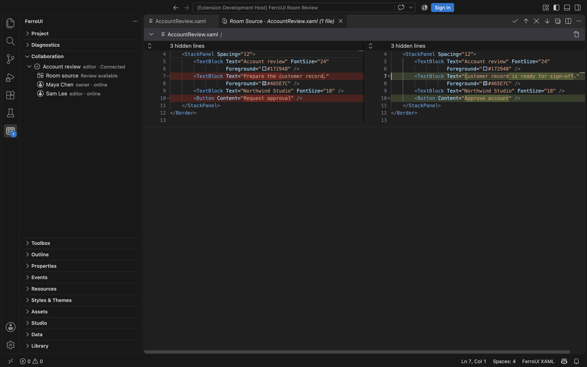

Use **Collaboration** in the FerroUI view container to share the source of an open XAML file. VS Code and Designer Studio can join the same room. Each person uses a local file for authoring and native preview. Keep the project, referenced dictionaries, and assets available in each checkout.

## Start or join a room

1. Open a FerroUI XAML file in a trusted desktop workspace. Run **FerroUI: Host XAML Room…** and enter your display name. The room starts with the current editor buffer, including unsaved changes.
2. In the **Collaboration** view, open the room’s context menu and choose **Copy Room Invitation…**. Choose **Editor** or **Viewer**, then send the invitation to your collaborator through your team’s private channel.
3. In VS Code, the collaborator opens their local XAML file and runs **FerroUI: Join XAML Room…**. In Designer Studio, they use **Share** and **Join invitation**. Both accept the same invitation.
4. In VS Code, choose **Room source** to open the current diff. Choose **Apply Reviewed Room Source** to install the reviewed version in the local editor. The editor keeps its line endings and records one Undo step. Saving the file remains a separate action.

For two windows on one computer, use the default loopback address. For colleagues on other computers, configure `ferroui.collaboration.bindAddress` and `ferroui.collaboration.publicEndpoint` before hosting. The first sets a fixed loopback address for the room service. The second advertises the HTTPS endpoint of its TLS reverse proxy. An invitation carries access credentials and expires after 24 hours. [Deploy a FerroUI collaboration service](../deployment/README.md)

## Review, publish, and merge

The **Collaboration** view shows each member’s role and presence. Review stays tied to the local buffer and the version of the room that produced the diff.

| Role | Actions |
| --- | --- |
| Viewer | Read the room, compare revisions, and apply reviewed source to a local editor. |
| Editor | Review and publish changes from a local XAML editor. |
| Owner | Publish changes, invite members, change roles, revoke or restore access, and checkpoint the room. |

Edit a control in the designer or edit text directly. Open **Publish Local Draft…**, then use **Publish Reviewed Room Source** to commit the reviewed text. The room retains its existing line endings. A local edit or a newer room version invalidates an open review. Open the current diff and review it again.

When you and another editor change the same source from a common version, use the room diff to prepare a merged draft in your editor. Open **Publish Reviewed Resolution…** to compare it with the latest source before publishing. Room operations use the native XAML replication engine. Text publishes compare against the reviewed base. Designer Studio retains its structured edit and shared Undo history.

Use **Checkpoint Room…** as owner to start a fresh room epoch once the operations have synchronized. If operation conflicts require an explicit source, open **Review Room Checkpoint Resolution…** to review a merged draft. Participants then review and adopt the new baseline. A participant downgraded to Viewer while changes are queued can review the new baseline and recover their prior local source.

## Reconnect and recover a draft

**Disconnect Room** saves the connection and leaves the editor open. A locally hosted room becomes available again when its owner resumes. Use **FerroUI: Resume XAML Room…** to reopen a saved connection, including any queued publishes. **Synchronize Room** retries the current exchange and refreshes the member list. Closing the document disconnects its room.

Before accepting new room source or resolving a baseline, the extension saves the local text in its private extension storage. Choose **Review Saved Room Backup…** to compare that text with the current editor and restore it with one Undo step. A baseline change also archives the previous room checkpoint and outbox. [Room deployment and recovery](../deployment/README.md#recovery)

## Use collaboration from MCP

Connect the VS Code FerroUI MCP server to inspect the room and its local editor. Enable `ferroui.mcp.allowWrites` in user settings to connect, publish, apply, or manage rooms with an agent. [Set up the VS Code MCP server](reference.md#start-the-right-mcp-server)

| Task | Tools |
| --- | --- |
| List, open, or leave sessions | `ferroui_rooms`, `ferroui_room_host`, `ferroui_room_join`, `ferroui_room_resume`, `ferroui_room_disconnect` |
| Read and apply a checked review | `ferroui_room_review`, `ferroui_room_source` |
| Publish, resolve, or checkpoint | `ferroui_room_sync`, `ferroui_room_source` |
| Read and restore a backup | `ferroui_room_recovery`, `ferroui_room_recover` |
| Invite or manage a participant | `ferroui_room_invite`, `ferroui_room_member` |

Pass the `session` from `ferroui_rooms` into `ferroui_room_review`. Use the returned `revision` and `editor_version` as `revision` and `expected_version` when calling `ferroui_room_source`. Choose `apply`, `publish`, `publish_resolution`, `checkpoint`, or `checkpoint_resolution` according to the reviewed change. For restoration, pass the `backup` and `editor_version` from `ferroui_room_recovery` to `ferroui_room_recover`. The invitation tool uses the user’s clipboard.
