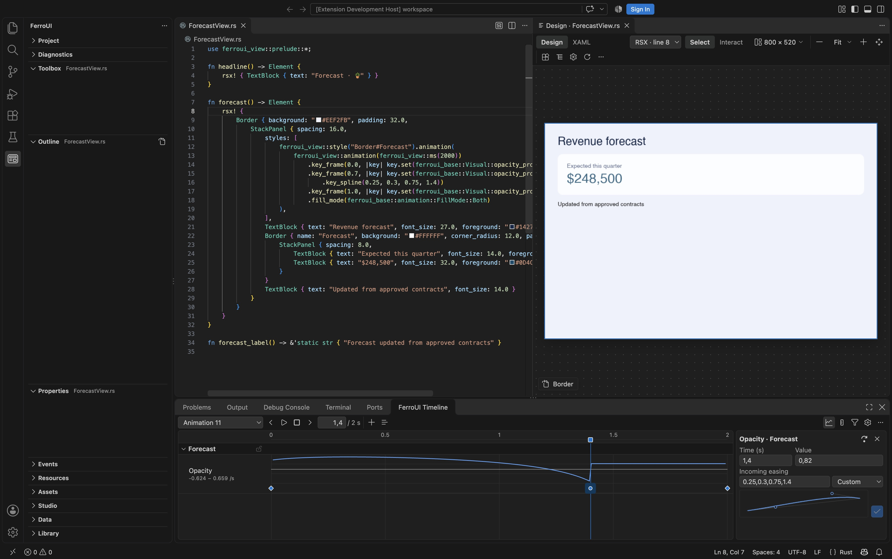
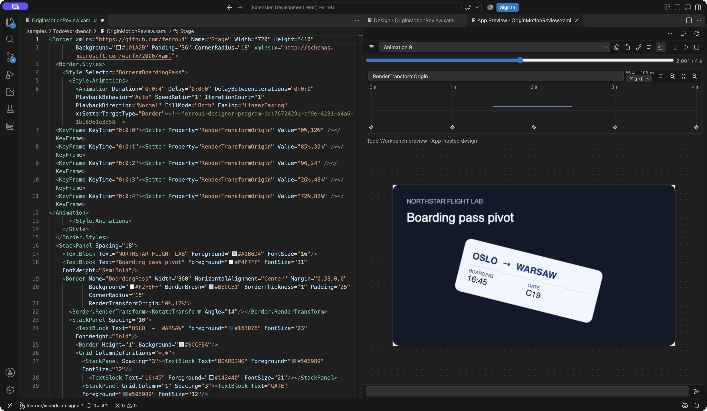
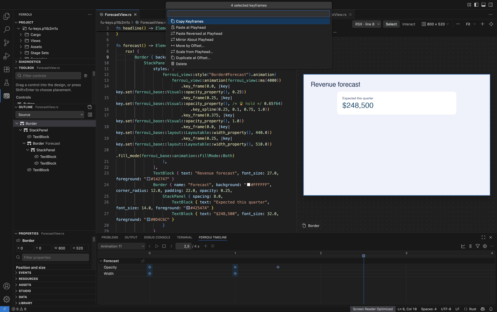
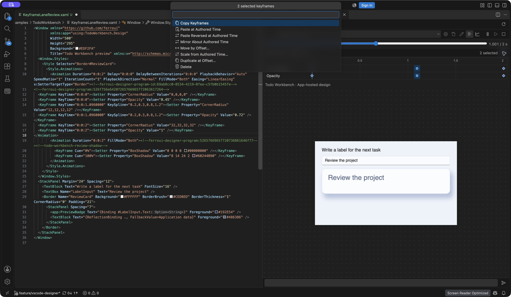
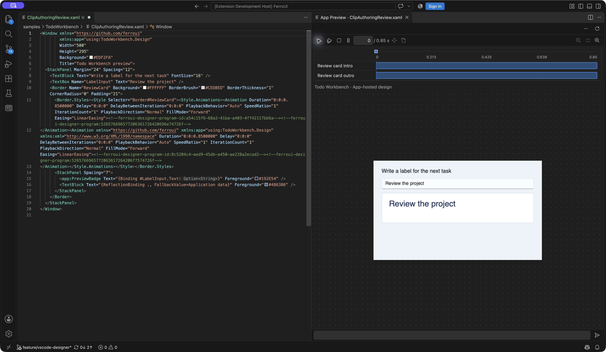
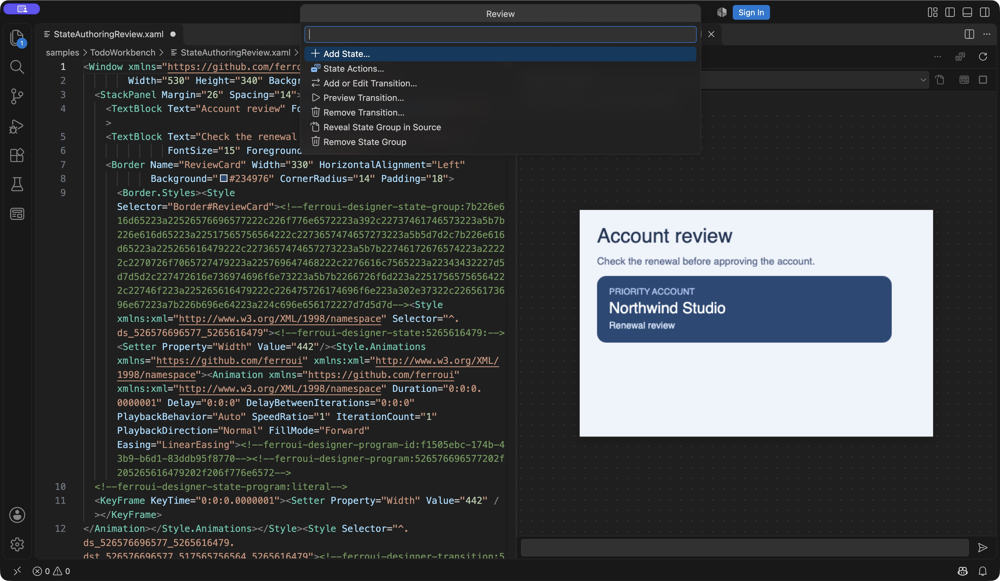
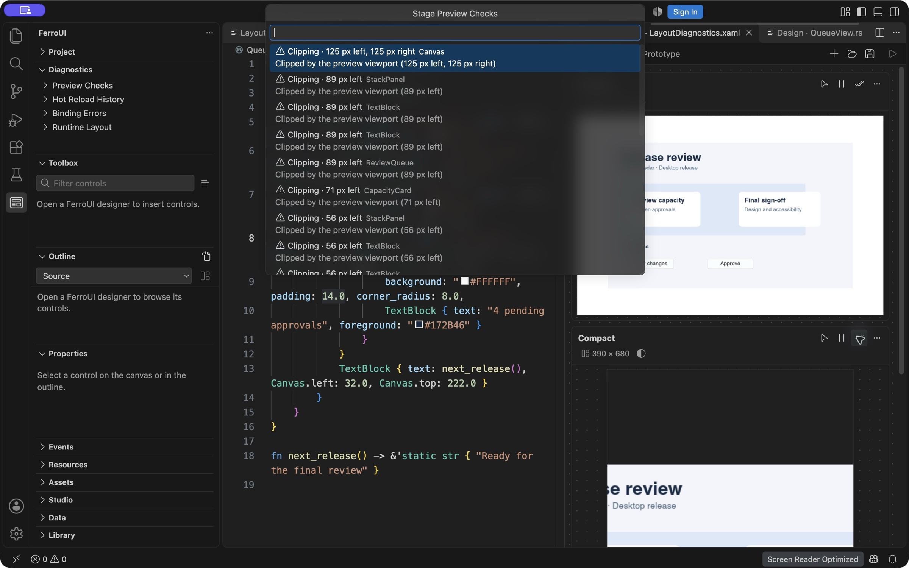
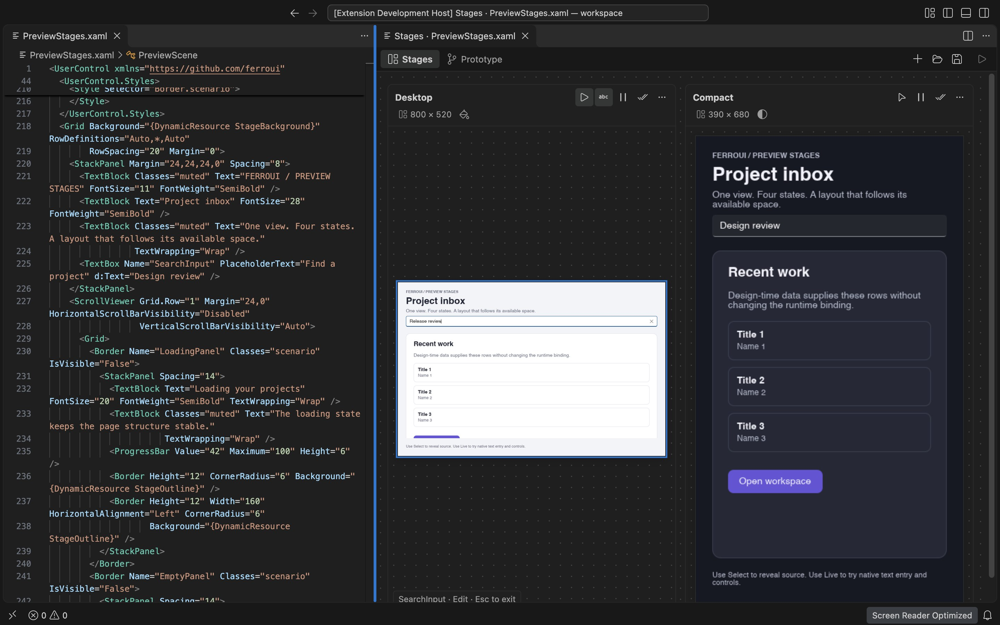

Open the source with **FerroUI: Open Designer** first. The animation and stage tools render FerroUI controls with the native layout and animation engines.

## Edit an animation

1. Open [DesignWorkflows.xaml](../samples/DesignWorkflows.xaml) or an XAML file with an authored animation. Choose **FerroUI: Show Animation Timeline**. In the default VS Code layout, the **FerroUI Timeline** tab opens below the source and design. Drag the Panel divider or use **Maximize Panel** for more space. If you previously moved the view, open its title context menu and choose **Reset Location**.
2. Select an animation in the program picker. To create one in XAML, select an authored control and choose **New animation program** from **More Animation Actions**. The same menu manages program names, targets, timing, duplication, and removal. **Timing and Playback** includes delays, repeat, speed, direction, fill, and easing. Duration changes scale the authored key times.
3. Click the time ruler or drag the playhead to preview a pose. Enter an exact time in the seconds field and press Enter. **Previous keyframe** and **Next keyframe** step between authored keys. Use **Play** or **Pause** for the selected program. Open the gear icon, **Timeline view options**, for **Play all animations**, zoom, and keyframe snapping. **Stop** restores the underlying values. A compatible source edit can retain the paused pose and elapsed time.
4. Click a key or focus it and press Enter. The key editor opens beside the tracks on a wide Panel and below them in a narrow dock. Change the time or value and [edit the easing](#shape-an-incoming-easing). **Seek to selected keyframe** previews its exact pose.
5. Open the **Animation graph** icon and choose **Value curves** to see interpolated scalar values, including overshoot. Drag a key horizontally to retime it or vertically to change its value. The curve and keyframe editor use the same checked source transaction. Use **Fit selected keyframes** to zoom into a group of keys in the graph.
6. Toggle a target header to collapse its property tracks into a row of summary diamonds. On expanded tracks, round keys have incoming easing and diamonds mark linear keys. Open **Filter tracks** and type a property or target name, or turn on **Selected controls only** to follow the canvas and Outline selection. A filter expands matching groups while it is active. Clear the search and uncheck the selection filter to return to all tracks.
7. Use the lock beside a target to protect its keys from Timeline edits. Locked keys still seek when you select them. Rectangle selection and Select All use displayed, unlocked property tracks. Unlock the tracks before arming **Record animation edits** for the canvas.

Escape dismisses the filter popup when it has focus.

### Read a velocity curve



Choose **Velocity curves** from **Animation graph** to see how quickly each scalar track changes. The graph shows signed property units per authored second. Positive values are rising, negative values are falling, and zero marks a held value. The graph estimates the slope between adjacent samples from the native animator. An easing overshoot can briefly reverse the sign as the value approaches its key.

The key markers stay under the velocity trace. Drag them horizontally to change their timing, or select a marker to change its authored value or incoming easing. The ruler, zoom, playhead, and selection work in both graph displays. Switch to **Keyframes** for the compact track lanes.

VS Code and Designer Studio agents can pass `metric: "velocity"` to `designer_animation_curve`. Use `metric: "value"` or omit `metric` to return property values. The query uses the accepted program and target and leaves the authored source and playhead intact.

### Inspect one part of a geometry value


In **Value curves** or **Velocity curves**, choose a component beside a supported geometry track. Points and vectors offer X and Y. Size and rectangle tracks offer their dimensions. Thickness offers its four sides and corner radius offers its four corners. A rectangle also offers X and Y.

Drag a marker beneath the graph to move its key in time. Select the marker and edit **Value** to change the complete geometry value in one source edit. Agents can read the track’s `curve_channels` from `designer_programs` and pass a channel such as `"top_left"` to `designer_animation_curve`.

### Inspect a curve that changes units

1. Open an animation of `RenderTransformOrigin` or another `RelativePoint` property. For a `RelativeScalar` property, the same workflow uses one value instead of X and Y.
2. In **Animation graph**, choose **Value curves**. Use the channel picker to switch between **X (%)**, **Y (%)**, **X (px)**, and **Y (px)** when the track uses both units. A relative scalar offers **Percent** and **Pixels**. The trace has a gap wherever the other unit is active. Scrub across a change to see the native preview switch at the eased midpoint.
3. Choose **Velocity curves** to see percentage points per authored second (`pp/s`) or logical pixels per authored second (`px/s`). Drag a bottom marker to retime the key. Open its editor to change the complete value, for example from `25%,60%` to `24,40`. Enter either two percentages or two absolute coordinates for a relative point. Apply the edit and use one Undo to restore it.


In App Preview, keep the playhead inside the pixel interval to inspect the changed native pose. The first edit to a source-authored XAML clip can write the animation block in the designer's canonical format. The playhead stays in place, and one Undo restores the original clip text.



Mapped Rust keys accept fully qualified `RelativePoint::new`, `RelativePoint::from_point` with a literal `Point::new`, and `RelativeScalar::new` on registered properties. Key edits keep constructor comments and numeric suffixes. This Rust key uses 25% of the width and 60% of the height.

```rust
.key_frame(0.5, |key| key.set(
    ferroui_base::Visual::render_transform_origin_property(),
    ferroui_base::RelativePoint::new(0.25, 0.60, ferroui_base::RelativeUnit::Relative),
))
```

Agents can use `percent_x`, `percent_y`, `absolute_x`, or `absolute_y` for a point and `percent` or `absolute` for a scalar. Query the channels listed by `designer_programs` or `designer_hosted_animations`, then pass the chosen name to `designer_animation_curve` or `designer_hosted_curve`. A percentage sample such as `25` represents 25%. A point with `break_before: true` starts a new segment after an interval in the other unit.

### Inspect a color animation

1. Open a clip with literal colors on a `Color` property or a solid brush property such as `Border.Background`. In Timeline, choose **Animation graph** and then **Value curves**. In App Preview, also choose the track and a compatible live target.
2. Use the picker beside the track to select **Red**, **Green**, **Blue**, or **Alpha**. The value scale stays at 0–1 as you switch channels. **Velocity curves** shows the signed change in the selected channel per authored second. Drag the playhead to compare the sampled color with the artboard.
3. Select a key marker to edit its full hex color, time, and easing. Use `#AARRGGBB` for a color with alpha. Applying the key uses one source Undo step.


For a mapped Rust brush key, use a hex string or a qualified `ferroui_base::media::Color` constructor. Registered `Color` properties use the typed constructors. For example, this animation changes a solid background from opaque black to half-transparent orange.

```rust
ferroui_view::animation(ferroui_view::ms(2000))
    .key_frame(0.0, |key| key.set(
        ferroui_controls::Border::background_property(),
        "#000000",
    ))
    .key_frame(1.0, |key| key.set(
        ferroui_controls::Border::background_property(),
        ferroui_base::media::Color::from_argb(128, 255, 128, 64),
    ))
```

Keep keyframe closures as a single builder expression, as in `|key| key.set(...)`. A checked edit keeps comments and numeric suffixes around constructor arguments. Adding alpha to a `Color::from_rgb` key changes that call to `Color::from_argb` in the same edit.

Agents can request `"red"`, `"green"`, `"blue"`, or `"alpha"` from `designer_animation_curve` and `designer_hosted_curve` after reading the track’s `curve_channels`. Samples use normalized sRGB components and the color’s own alpha. App Preview reads the app’s native color, including its byte precision.


### Scale selected key times

Select at least two keys, then seek to the time that should stay fixed. Open **Keyframe Actions**, choose **Scale from Playhead**, and enter a factor. Use `0.5` to halve the spacing from the playhead or `2` to double it. The edit preserves key values and easing. If a destination would collide or leave the clip, adjust the selection, playhead, or factor and try again.

Scaling works with XAML and mapped Rust cues. For a Rust cue with multiple setters, select each of its keys when moving the cue. One Undo restores the complete selection's original times. Agents can pass the `scale_keyframes` action with `keyframes`, `pivot`, and `factor` to the shared `designer_program` authoring tool.

| With the Timeline ruler or a key focused | Action |
| --- | --- |
| `[` and `]` | Seek to the previous or next key among the visible tracks. The ruler pans when the key is outside the current zoom. |
| `,` and `.` | Step one frame backward or forward at the selected rate, or at 30 fps when showing seconds. Hold Shift to step ten frames. |
| Home and End | Seek to the start or end of the authored program. |
| `I` and `O` | Set the preview range In or Out at the current playhead. |
| `+`, `−`, `0` | Zoom in, zoom out, or fit the full duration. Ctrl or Command with the wheel zooms at the pointer. |
| Page Up and Page Down | Pan the zoomed ruler. You can also use the pan slider or scroll horizontally. |
| Shift, Ctrl, or Command with a key click | Select a range or toggle individual keys. Space toggles a focused key. Drag from empty track space to select keys in a rectangle. |
| Left and Right with a key focused | Nudge selected keys. Set the edit grid to 24, 30, or 60 fps from **Timeline view options**. Use **Keyframe Actions** for supported move, duplicate, and delete actions. |
| Ctrl+C or Command+C | Copy selected keys. With a key focused and no selection, copy that key. |
| Ctrl+V or Command+V | Paste at the playhead. Hold Shift to reverse the copied sequence. With one copied track, focus a key on a compatible track to paste there directly. |

For a native animation resource, choose **Choose preview targets** in **Timeline view options** to mount it on one or more controls. Use its elapsed playhead for payloads whose keys are edited in XAML. [Designer Studio animation authoring](../README.md#animation-authoring)

### Copy, paste, and mirror keyframes



1. Select keys on one or more tracks. Open the **Keyframe Actions** icon and choose **Copy Keyframes**.
2. Open the destination animation in VS Code or Designer Studio. Show and unlock its destination tracks, then seek to the paste time. Add a property track first if its property is missing.
3. Choose **Paste at Playhead**. Assign each copied track to an existing destination of the same value type. For discrete values, choose the same property. The first pasted key lands at the playhead and the remaining keys keep their relative timing across tracks.
4. Choose **Paste Reversed at Playhead** to paste the sequence in reverse. To reflect selected keys in place, seek to the pivot and choose **Mirror About Playhead**. Both actions reflect the Bézier handles between selected keys.

For a Timeline using a native elapsed clock, enter an authored time in seconds when prompted. For a mapped Rust cue with several setters, include every affected key when mirroring. The Timeline reports collisions, out-of-range placements, and Rust cues whose setters would require different splines. Each successful paste or mirror takes one Undo step.

For VS Code MCP, call `designer_keyframe_clipboard` through `designer_studio_query` with the program ID and selected `keyframes`. Each location contains `target`, `property`, and `time`. Pass the returned clipboard to the `designer_program` action `paste_keyframes` through `designer_studio_edit`. The `paste` argument contains `clipboard`, `destinations` in copied track order, the authored `time`, and optional `reverse`. Each destination contains `target` and `property`. Use `mirror_keyframes` with the selected `keyframes` and authored `pivot`. Use the destination frame’s current revision for the edit. The edit returns the accepted key locations as `keyframes`. Designer Studio exposes the same tool and actions directly.

### Edit several keys in App Preview


1. Open [App Preview](runtime.md#render-with-your-app-in-app-preview) with a current FerroUI app build. Choose a clip with typed XAML or mapped Rust tracks, pause playback, and open **Keyframe lanes** from the clip toolbar.
2. Click a key to select it. Hold Shift to select a range across tracks, or hold Ctrl or Command to toggle individual keys. Drag a rectangle from empty lane space to select several keys. Press Space to toggle a focused key and Ctrl+A or Command+A to select all.
3. Drag a selected key to move the group while preserving its relative spacing. With a key focused, use Left or Right to nudge, Ctrl+D or Command+D to duplicate, or Delete to remove. Double-click a key or press Enter to open its time, value, and easing editor.
4. Click the ruler or enter **Authored time** in seconds. Open **Keyframe actions** to move or duplicate by an exact offset, scale or mirror about that time, or paste there. The elapsed playhead above the lanes continues to describe the app’s preview pose.

Copy with Ctrl+C or Command+C and paste with Ctrl+V or Command+V. Hold Shift when pasting to reverse the sequence. Choose a compatible destination for each copied track. The VS Code Timeline, App Preview, and Designer Studio use the same clipboard format. Mapped Rust keys follow their source declarations, so a retime of a cue shared by several setters needs the full cue selection. The planner checks destination times and leaves the current source intact if any key collides. A successful group edit updates the buffer in one Undo step and retains the app’s compatible preview pose through the edit and Undo.



Read `keyframeSelection`, authored tracks, generation, revision, and sequence from `designer_hosted_animations`. Send the program and a `command` to `designer_hosted_keyframe_group_draft` for a checked patch or clipboard text. A key location uses `target`, `property`, and authored `time`. For paste, pass the parsed clipboard value with `destinations` in copied track order, authored `time`, and optional `reverse`. Apply a group through `designer_hosted_keyframe_group` with the same frame fields. The result reports the accepted key locations.

### Manage clips in App Preview


1. Open **App Preview** with a current FerroUI app build. Pause playback and open **Animation clip actions** in its toolbar. [Open App Preview](runtime.md#render-with-your-app-in-app-preview)
2. Choose **New Animation Clip**, then select a live style owner. Use the source line in the picker to distinguish controls with the same name. Give the clip a name, a FerroUI selector, and a duration in seconds. Use whole milliseconds for Rust. The new clip appears in the animation picker. Add its first keys from the source or the docked Timeline.
3. Choose a clip in the animation picker and reopen **Animation clip actions**. Choose **Rename Clip**, **Duplicate Clip**, or **Remove Clip**. In the comparison view, select the clip to edit when prompted.

A duplicate retains the clip’s timing and keys and receives its own source identity. Renaming a compatible clip retains its elapsed pose. Use Undo in the source editor to revert each operation. Rust clip actions apply to mapped inline styles in the active `rsx!` invocation. A computed style expression stays in Rust source.



For MCP, read `clipAuthoring.owners` and `clipAuthoring.programs` from `designer_hosted_animations`. Use the returned generation and frame with `designer_hosted_clip_draft` to plan the edit and `designer_hosted_clip_edit` to apply it. Send `action: "create"` with `owner`, `name`, `selector`, and `duration`. For `rename` and `duplicate`, send `program` and `name`. For `remove`, send `program`. The result includes the selected source key for a new, renamed, or duplicated clip.

## Rehearse a section

1. Choose a typed XAML or mapped Rust clip whose targets render in the designer. Open **Preview range** in the toolbar and enable **Limit playback to preview range**.
2. Set **In** and **Out** in seconds, or seek to either point and press `I` or `O` with the ruler focused. A blue line marks the range on the ruler. Keep **Loop range** enabled for repeat playback or clear it to hold the Out pose after one pass.
3. Use **Play preview range**, **Pause preview range**, and **Stop** in the transport. Play starts at the current playhead when it falls inside the range. Otherwise it starts at In. Playback disarms recording and samples the authored timeline. Clear **Limit playback to preview range** to use the clip's authored delay, repeat, and direction again.

The VS Code MCP tool `designer_timeline_control` accepts `action: "play_range"` with a program and a `range` containing `start`, `end`, and `loop`. Use the current designer revision for each action.

### Rehearse a range in App Preview


1. Open [App Preview](runtime.md#render-with-your-app-in-app-preview), then choose an animation with a live target. Choose **Compare animation clips** to rehearse a group on its shared clock.
2. Choose **Preview range** beside the playback controls and enable **Limit playback to preview range**. Enter **In (s)** and **Out (s)**, or focus the elapsed playhead and press `I` or `O` at the desired time. The ruler shades the interval.
3. Choose **Play preview range**. Playback starts at the current time if it is inside the range. With **Loop range** enabled, it wraps from Out to In. Clear **Loop range** to hold the native frame at Out. Pause holds the accepted pose, and Stop removes the sampled pose.
4. After a compatible source update, the first replacement frame retains the playhead and valid range. A shorter clock can move Out earlier. Choose a new interval if the clock ends before In. Clear **Limit playback to preview range** to play the full clip again.

App Preview range times are elapsed seconds, including authored delay, speed, and repetitions. The range is a preview setting. It leaves animation timing and keys in source intact. Use an updated FerroUI preview helper to retain the range across an app-hosted frame replacement.

Agents supply `action: "play_range"` and `range: { "start": 0.4, "end": 1.5, "loop": true }` to `designer_hosted_animation`. Include `program` for a single animation or omit it to rehearse all playable clips. Use the current app generation, revision, and sequence reported by `designer_hosted_animations`.

## Bookmark preview positions


1. Pause playback and move the playhead to the pose you want. Open **Preview range** in the keyframe view, in App Preview, or in Designer Studio. On the shared ruler in the VS Code Timeline, choose the **Preview markers** bookmark icon.
2. Enter a name and choose **Add or update marker at playhead** or press Enter. Enter the same name at another position to move it.
3. Choose a marker on the ruler or select its name in the marker list to return to the native pose. Use **Remove marker** beside the name to delete it.

Typed clips in the VS Code Timeline use authored seconds. App Preview and the shared clip ruler use elapsed seconds, including the clip’s delay and playback speed. Each clock has its own markers. Markers are local to the preview session and leave the source and Undo history intact. When a clock becomes shorter, markers beyond its current end are hidden. App Preview and Studio retain marks when the authored clip identity and preview scope still match.

In VS Code, read `designer_timeline_markers` and call `designer_timeline_marker_edit` with `action` set to `set`, `remove`, or `seek`. Pass `program` for a typed clip or `all: true` for the shared ruler. **Set** takes a `name` and `time` in seconds. **Remove** and **Seek** take a `name`. App Preview reports `markers.programs` and `markers.shared` from `designer_hosted_animations`. Send `action: "marker"` to `designer_hosted_animation` with the same name-based action inside `marker`. Pass `program` for one app animation or omit it for the shared ruler. Use the accepted revision, sequence, and app generation from the query. [Designer Studio marker controls](../README.md#bookmark-poses-in-designer-studio)

[Markers on the docked VS Code Timeline](../images/vscode-timeline-markers.png)

## Shape an incoming easing

1. Select a source-backed key. **Incoming easing** shapes the segment that ends at the key. Choose a preset, type four cubic Bézier coordinates, or drag either control point on the curve.
2. Drag horizontally to adjust progress between 0 and 1. Drag vertically above or below that interval to shape overshoot. With a control point focused, use the arrow keys for 0.01 steps. Hold Shift for 0.1 steps or Ctrl or Command for 0.001 steps. Escape during a drag restores the starting curve.
3. Choose **Apply keyframe** to commit the time, value, and easing in one source edit. Use Undo to restore the original key. The same editor appears for supported keys in [App Preview](runtime.md#render-with-your-app-in-app-preview).

Designer Studio provides the same drag and nudge increments. Focus the native graph and press Space to switch handles. [Designer Studio animation authoring](../README.md#animation-authoring)

## Record a property or geometry change in XAML

Select the target’s program and seek to the time you want. **Add keyframe at playhead** samples a supported effective value, and double-clicking an empty part of a track records at that time. Turn on **Record animation edits** to edit animatable values in Properties or to drag and resize a targeted control in the canvas. The resulting keys preserve base attributes and bindings. One Undo restores the last recorded gesture. Turn recording off to edit the base values again.

## Edit mapped Rust clips and state routes

Open [animation_view.rs](../../../editors/vscode/test/fixtures/animation_view.rs), then select the RSX invocation containing the inline style animation. Timeline can preview that animation and patch its supported literal key times, values, and incoming splines. The source action jumps to the authored declaration. Use the warning action to find computed clips in the original Rust. For custom property accessors, export the [animation getter metadata](../../../editors/vscode/README.md#map-an-application-control-to-rsx) from the owning Cargo package. Use [App Preview](runtime.md#render-with-your-app-in-app-preview) for its registered control and animator.

1. Seek to a time and choose **Add keyframe at playhead**, or double-click an empty part of a property track. The isolated designer samples the track at that time and adds a Rust `.key_frame(...)`. An empty mapped clip starts with Opacity.
2. Select one or more keys and open **Keyframe Actions**. **Duplicate at Offset…** copies their values and easing. Use the same menu to [copy, paste, and mirror keys](#copy-paste-and-mirror-keyframes). **Delete** removes the selected setters. With a key focused, use Ctrl+D or Command+D to duplicate at the current snap interval, or press Delete or Backspace.
3. When a cue has several setters, deleting one key preserves the other setters and their easing. Deleting the final key leaves the animation available for another key. One Undo restores the source for each edit.

Agents can preview a draft with `designer_keyframe_draft`. Call `designer_program` through `designer_studio_edit` with the accepted revision. Use `upsert_keyframe` without `previous` to insert an explicit value, `record_keyframe` to sample the accepted preview, `remove_keyframe` for a single property and time, or `duplicate_keyframes` and `remove_keyframes` with the selected key locations.

### Create and manage Rust clips

1. Select the control that should own the style. In **More Animation Actions**, choose **New animation program…**. Choose an eligible owner if prompted.
2. Enter a name, FerroUI selector, and duration in seconds with millisecond precision. The new animation appears in the active invocation’s inline `styles` and opens in Timeline. Use **Add keyframe at playhead** to start its first track.
3. Choose **Rename animation…**, **Duplicate animation…**, or **Remove animation** from the same menu. Renaming keeps the clip’s source identity. Duplicating copies its literal values, timing, and easing with a new identity. Each operation is one Undo step.

The designer stores the name and identity in a Rust comment beside the builder. It can append a clip alongside computed entries in a literal styles array. For a computed styles field, choose an enclosing control with inline styles to hold the new rule, or author the builder in Rust.

Agents use `designer_program` through `designer_studio_edit` with `create`, `rename`, `duplicate`, and `remove`. For creation, supply the current owner ID, name, selector, and duration. Read `designer_programs` after a source edit for the new clip and target IDs.

### Edit and preview visual states

1. Select the control that owns the state group. Open **Studio → States → Add state group…**, then enter a group name and an initial state name.
2. Open the group and choose **Add state…**. Select a state, then choose **Add or edit a state setter…**. Use a property such as `Opacity` on the owner, or supply the name of a descendant such as `Card` and set its `Width`.
3. Choose **Add transition…** in Rust or **Add or edit transition…** in XAML. Set the starting and destination states, then enter the duration in seconds. Choose **Any state** for a default route. Rust routes use whole milliseconds and accept native easing names or four comma-separated Bézier coordinates.
4. Choose **Preview transition…** to open the route in Timeline. Scrub to an intermediate frame, play the route, or reveal its source. **Clear state preview** restores the base view.
5. Open a state to remove it or one of its setters. Removing a state also removes routes connected to it. Use **Remove transition…** and **Remove state group** for those declarations. Each saved authoring action uses one editor Undo step.

Rust authoring works on mapped inline `visual_states` declarations. When a control has no such field, adding its first group inserts the field in the active `rsx!` invocation. Adding a sibling requires an inline array with identifiable group names. Setters use mapped numeric or geometry literals and built-in or project-registered animatable properties. Comments and surrounding Rust survive the checked source edit. [Typed Rust state examples](../README.md#rust-visual-states)

For MCP, read `designer_states` through `designer_studio_query` to get the groups, source ranges, and eligible Rust owner IDs in `creatableOwners`. Send `designer_state` through `designer_studio_edit` with the current designer revision. Use `upsert` with the complete group model for state, setter, and route changes. Use `remove` with the owner ID and group name to delete a group. Read the accepted frame again before issuing the next edit.

### Author visual states in App Preview

1. Open a XAML view or a mapped `rsx!` invocation with a current App Preview build. Open **Visual state actions** in the App Preview toolbar and choose **New State Group**. Pick a live owner by name and source line, then enter a group name and an initial state.
2. Open the group again and choose **Add State** or **State Actions**. In a state’s actions, use **Add or Edit Setter** to enter the property, target, and value. Leave the target blank for a setter on the owner. A named target must resolve in the group’s scope.
3. Choose **Add or Edit Transition**. Set the starting state, destination, duration in seconds, and easing. Choose **Any state** for a default transition. Use a whole number of milliseconds for Rust, such as `0.64` seconds. Remove transitions, setters, individual states, or the whole group from the same actions. Removing a state also removes its routes.
4. Choose **Preview State** in an authored state’s actions or choose it under **States** in the animation picker and use **Preview state**. Choose **Preview Transition** or open a route under **State routes** to scrub its elapsed playhead. **Stop** clears the sampled pose.



App Preview uses the app’s registered animators for literal state poses and transitions. XAML authoring writes native style classes, setters, and animations. Mapped Rust authoring edits inline `visual_states` in the active invocation. Use Undo in the source editor to revert each operation. When the active transition or state still resolves after an edit, the first accepted frame restores its preview position.

To author directional XAML transitions, include `ferroui-xaml-interactions-custom` in the application and call `ferroui_xaml_interactions_custom::register_types()` before loading XAML in App Preview and in the running app. Studio uses the same `ConditionalAction` class for directional routes. [Todo Workbench registration](../../../samples/TodoWorkbench/app_preview.rs)

For MCP, read `stateAuthoring.owners` and `stateAuthoring.groups` from `designer_hosted_animations`. Pass the current app generation, revision, and frame sequence to `designer_hosted_state_group_draft` or `designer_hosted_state_group`. Use `upsert` with the complete group `model`, including states, setters, and transitions, or `remove` with `owner` and `group`. Entries with `stateRoute.endpoint` can be sampled with `seek` at `elapsed: 0` through `designer_hosted_animation`.

### Scrub a Rust state route in App Preview

1. Open the Rust view and run **FerroUI: Open App-Hosted Design**. After the app accepts the view, choose a route under **State routes** in the animation picker. Routes appear when the app can resolve their controls and registered animators. **Base → Ready** uses the current underlying values as the starting point.
2. Drag the playhead or focus it and use the arrow keys. Use **Play**, **Pause**, or **Stop** to drive the route. Stop removes the sampled layer and returns to the app’s own values.
3. Pause playback and use **Edit state route timing** to change the duration in whole milliseconds and the easing. The change to the Rust buffer uses one Undo step. **Reveal visual state in source** selects the declaration. A compatible replacement keeps its elapsed pose through the edit.
4. In Todo Workbench, choose the **Interactive review** Rust fixture to test its compiled button handlers. Stop designer playback before trying **Queued**, **Ready**, and **Reset**. The fixture’s runtime uses the logic compiled into the selected binary. The playhead samples eligible route values from the current Rust buffer. Rebuild the binary to exercise edited logic through its handlers. [App Preview setup](runtime.md#render-with-your-app-in-app-preview)


Agents can read the route details in `designer_hosted_animations`. Use `designer_hosted_animation` for playback and reveal, `designer_hosted_state_route_draft` to review the source patches, or `designer_hosted_state_route` to apply them. Pass the current app generation, frame revision and sequence. Durations in the MCP tools are expressed in seconds.

## Compare and sequence clips


1. Open [ClipSequence.xaml](../samples/ClipSequence.xaml) in the Designer and show the Timeline. Choose **Compare animation clips**. The bars share one elapsed-time ruler. Each starts after its native delay and spans its active playback, including finite repeats and delays between iterations. A dashed bar extends to the edge of the ruler for an infinite clip.
2. Drag the playhead, click a bar to seek to its start, or enter an elapsed time and press Enter. Use **Play all clips**, **Pause clips**, and **Stop clips** to preview the artboard. Use the zoom icons or `+`, `−`, and `0` with a clip focused. Use the pan slider while zoomed in.
3. Drag an editable clip bar to change only its start. To place it precisely with the keyboard, select its row and choose **Set selected clip start**. Enter seconds and apply the change.
4. Select two or more clip names in the desired order. The numbers beside the names show that order. Choose **Sequence selected clips** and enter a **Start** and **Gap**. A zero gap places the clips end to end. A positive gap separates them. A negative gap overlaps them by that amount. An infinite clip can end a sequence. Apply the placements, then play or scrub across them.
5. Select one clip and choose **Open selected clip keyframes**, or toggle **Return to animation keyframes** to return to the keyframe view. One Undo restores every delay from the last placement operation.

Placement edits the native `Delay` attribute in XAML or the literal `.delay(ferroui_view::ms(...))` call in a mapped Rust builder. The clip keeps its authored keys, easing, fill, selector, and activation rules. The comparison clock starts clips with live preview targets together, then applies their offsets. In a running app, the selector or caller determines when each clock starts. Place clips that activate together to reproduce the shared timing in the app. Computed Rust clips and XAML delays defined by expressions remain source edits.

Agents can read each clip's `start`, `end`, and `editable` fields in `designer_programs`. Use `designer_program` with `place_clips` and the ordered `programs` IDs, optional `start`, and optional `gap` through `designer_studio_edit`. Use `scrub_all` with elapsed `time` to sample the combined pose. Studio exposes both actions directly through `designer_program`. VS Code also offers `scrub_all` in `designer_timeline_control`.

### Compare clips in App Preview


1. Open a source file inside the Cargo package and start [App Preview](runtime.md#render-with-your-app-in-app-preview). To try the walkthrough above with Todo Workbench, copy `ClipSequence.xaml` beside its `Cargo.toml` and choose **Source preview**.
2. Choose **Compare animation clips** in the App Preview animation toolbar. Drag the elapsed playhead or choose **Play all clips**. The app samples its loaded clips and draws the combined pose with its registered controls and animators. To include a clip that requires a target, open its animation and choose compatible preview controls.
3. Pause playback and drag a clip bar, or select clip names in order and choose **Sequence selected clips**. Set **Start** and **Gap** in seconds. Use **Set selected clip start** for a keyboard-only placement. XAML delays and mapped Rust delay literals update in the current buffer in one Undo step.
4. Keep scrubbing across the updated clips. When their declarations and targets resolve in the new source, the first replacement frame retains the shared playhead. Choose **Stop clips** to remove the sampled pose. Select a clip and choose **Open selected animation** to see its targets, keyframes, and curves.

App Preview shows comparison controls when the selected binary supports shared clip playback. Rebuild the binary with the current `ferroui-designer-support` to use them. A compiled Rust view fixture exposes the animation data it makes available to preview. Choose **Source preview** to edit mapped animations in the current RSX invocation.

Agents read the catalog with `designer_hosted_animations`, then use `scrub_all` or `play_all` in `designer_hosted_animation`. Pass an elapsed time in seconds as `elapsed`. Use `designer_hosted_clip_placement_draft` to review the checked patch and `designer_hosted_clip_placement` to apply it. Both accept ordered `programs`, optional `start`, and signed `gap` in seconds. Supply the current app generation, revision, and sequence with each request.

## Compare design data and environments

1. Open [PreviewStages.xaml](../samples/PreviewStages.xaml). Run **FerroUI: Show Design Data**. Add a named XAML fixture with typed JSON values, such as a string title and an array of items. Apply it once to store the design-only fixture in the view. Choose **Application values** to return to the regular bindings.
2. Run **Open Preview Stages** and use **Add Stage** to add workspace XAML views or supported RSX invocations. Pick an environment, viewport dimensions or content-fit sizing, a state, and a design fixture as applicable. Use one card for a loading state and another for a populated state, or compare light and dark variants.
3. Use **Select** to inspect a stage or **Interact** to operate its native controls. Pause a stage to hold its current image. Use **Checks** to review overflow, clipping, ineffective layout values, and accessibility in that stage. **More Actions** includes PNG export and stage settings. [Read Preview Checks](authoring.md#diagnose-a-design-time-issue)
4. Save the stages as a `.ferrostages` file. Open it again in VS Code or Studio. Each stage retains its chosen view, environment, state, and design fixture. Source changes update affected stages after a valid render is ready. [Design-time data](../design-time-data.md) · [Preview environments](../xcode-previews.md)



### Use the keyboard in a stage

1. Switch a ready stage to **Interact**. Choose **Keyboard input for** the stage with the **abc** icon, or click a control directly on the artboard.
2. Use Tab and Shift+Tab to move through its native controls. Press Enter or Space to activate a focused button, or type or paste into a focused text field. The artboard shows the focused control’s name and role when available.
3. Press Escape to return to the card toolbar. Each card has its own temporary control values. Pausing the card or editing its source ends keyboard input.



Use an updated preview helper for stage keyboard input. While playing a prototype, use the player’s interaction controls to follow its authored links. [Stage automation](reference.md#send-keyboard-input-to-a-stage)

## Play a prototype

Switch the Stages board to **Prototype**. Each flow lists its starting stage, which the play button also announces to screen readers. Hover a shortened name in a narrow tab to read it in full. Use the play button beside a flow or choose **Play Prototype** from the toolbar.

Drag a stage title onto a destination or choose **Add interaction** to add a source-anchored trigger. Choose a native control, set the target stage or overlay, and use **Reveal trigger** to review the authored source. An overlay can set its placement, dimming, and dismissal. Save the stage set to reopen the same graph in Studio or run a [prototype scenario](runtime.md#run-a-native-ui-scenario). [Prototype authoring](../prototyping.md)
