Open the source with **FerroUI: Open Designer** first. The animation and stage tools render FerroUI controls with the native layout and animation engines.

## Edit property transitions

A transition animates a property when its effective value changes. Use the [property transitions workbench](../../../editors/vscode/test/fixtures/PropertyTransitionsWorkbench.xaml) to try the Opacity and Background transitions on the account card.

1. Select the card in the XAML designer. In VS Code, expand **Property Transitions** in **Studio**, or run **FerroUI: Edit Property Transitions**. In Designer Studio, use the clock icon beside **Definition**.
2. Choose **Add property transition** and pick a registered property such as **Margin**. The editor offers the transition classes that can animate its type. In Designer Studio, choose the property first, then use the add icon. A control, style, or control theme can start a new collection.
3. Select an entry to edit **Duration**, **Start delay**, or **Easing**. Enter times in seconds. Easing accepts a native name such as `CubicEaseOut`, four Bézier coordinates, or `Spring(mass,stiffness,damping,velocity)`. Studio applies the edited fields together when you choose the check icon. VS Code applies each confirmed field in one Undo step.
4. Use **Retarget transition** to change the property and its transition class while keeping the timing and easing. Use the arrows to move an entry earlier or later, **Remove transition** to delete it, and the source icon to open its declaration. When two applicable entries target the same property, the last entry takes precedence. Each collection action takes one Undo step.
5. In Studio, switch the artboard to **Interact** and move the pointer onto or off the account card to trigger its opacity change. In source, the example changes Opacity through the `:pointerover` selector.

To edit a shared transition, select its `Transitions` declaration in the Outline. For add or retarget, supply its registered target type, such as `Border`, so the editor can resolve the property and write a static property reference. Open a bound collection or resource-backed easing at its owning declaration to edit the shared value.

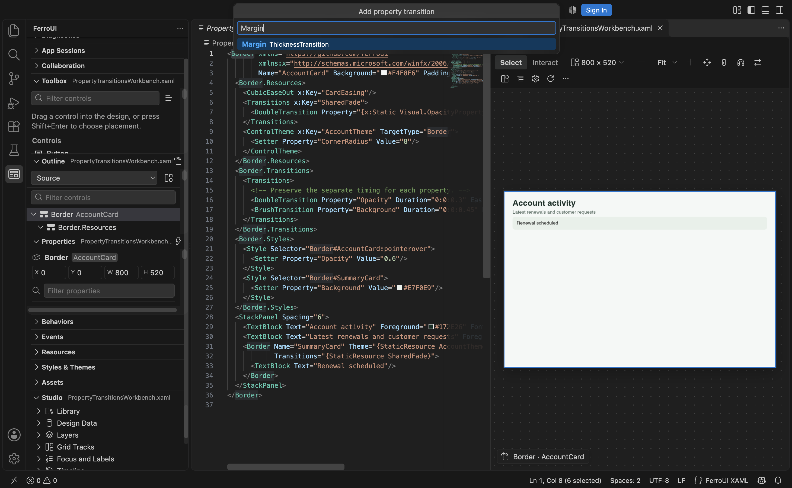

[Studio collection editor](../images/studio-property-transition-collection.png) · [VS Code timing editor](../images/vscode-property-transitions.png) · [Property transitions through MCP](reference.md#edit-property-transitions-with-mcp)

### Preview and edit property transitions in Rust

Open an RSX view with **FerroUI: Open Designer** and choose the invocation that declares the transitions. An inline array passed to `ferroui_view::transitions` supplies the native transitions in the isolated canvas. The designer recognizes qualified builder paths and explicit Rust imports. Durations can use literal `ferroui_view::ms`, `Duration::from_millis`, or `Duration::from_secs` calls. For `transition_eased`, use a supported native easing constructor, a literal native `Easing::parse(...).unwrap()` call, or `SpringEasing::with_values` with four literal parameters.

```rust
rsx! {
    Border {
        transitions: ferroui_view::transitions([
            ferroui_view::transition(
                ferroui_base::Visual::opacity_property(),
                ferroui_view::ms(260),
            ),
        ]),
        TextBlock { text: "Latest renewals" }
    }
}
```

1. Select the mapped control and open **Property Transitions** from **Studio**, the Command Palette, or the clock icon in Designer Studio.
2. Add, retarget, reorder, or remove an entry. The property picker offers registered Rust getters compatible with the control. Retargeting can change the transition class and keeps the duration and easing. Each action updates the active `rsx!` invocation in one Undo step.
3. Edit **Duration** in seconds using millisecond increments. Change **Easing** to a native name, four Bézier coordinates, or `Spring(mass,stiffness,damping,velocity)`. These Rust builders expose duration and easing. The XAML collection editor also exposes start delay.
4. Use **Reveal transition in source** to open the Rust declaration. Switch to **Interact** to see the native transition when a setter changes its property.

Use **Reveal transition collection** and the Rust editor for computed expressions. Run the app to evaluate those collections. The isolated preview reports the expressions in its partial-preview status.

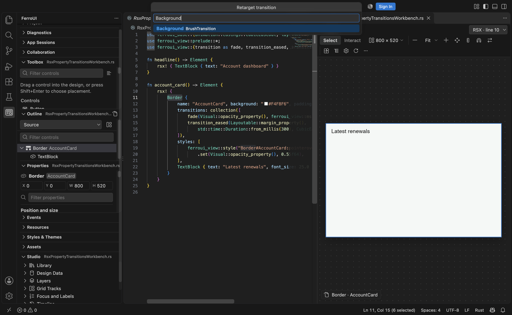

[Studio’s Rust transition editor](../images/studio-rsx-property-transitions.png) · [Rust transition fixture](../../../editors/vscode/test/fixtures/RsxPropertyTransitionsWorkbench.rs)

### Edit property transitions in App Preview

1. Open [HostedPreview.xaml](../../../samples/TodoWorkbench/HostedPreview.xaml) with **FerroUI: Open App-Hosted Design** and select the Todo Workbench target with `app-preview` enabled. Use **Source preview** to follow an XAML buffer or the currently selected RSX invocation.
2. Choose the clock icon labeled **App Preview Property Transitions**. Select an authored control, style, theme, or shared XAML collection. On **ReviewBadge**, choose **Add property transition**, then **Emphasis**. The loaded app registers this property and provides its compatible **DoubleTransition**.
3. Reopen the picker to edit **Duration**, **Start delay** in XAML, or **Easing**. You can also retarget, reorder, remove, or reveal an authored entry. Click the badge in the native preview to trigger its pointer-over setter and watch the transition.
4. Use editor Undo to reverse one action. Wait for the current frame after an edit. For a standalone XAML `Transitions` resource, enter its registered target type, such as `app:PreviewBadge`, when adding or retargeting an entry.

The picker follows the open source document and uses the running app's registry. Mapped Rust uses the same inline collection forms as Design. Use source navigation for computed Rust values or shared definitions in another file. Rebuild the app with the current `ferroui-designer-support` if the toolbar icon is unavailable.

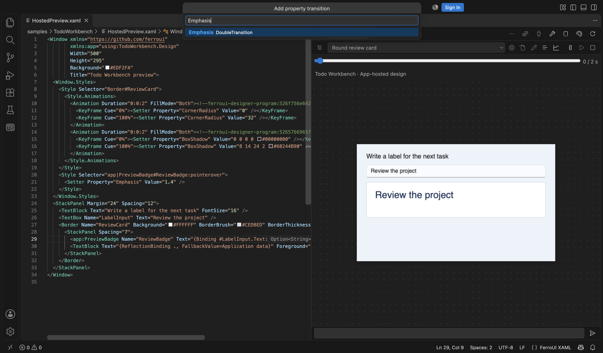

[See the applied transition in XAML](../images/vscode-app-preview-transition-edit.png) · [App Preview setup](runtime.md#render-with-your-app-in-app-preview) · [App Preview transition tools](reference.md#edit-app-preview-property-transitions-with-mcp)

## Edit an animation

1. Open [DesignWorkflows.xaml](../samples/DesignWorkflows.xaml) or an XAML file with an authored animation. Choose **FerroUI: Show Animation Timeline**. In the default VS Code layout, the **FerroUI Timeline** tab opens below the source and design. Drag the Panel divider or use **Maximize Panel** for more space. If you previously moved the view, open its title context menu and choose **Reset Location**.
2. Select an animation in the program picker. To create one in XAML, select an authored control and choose **New animation program** from **More Animation Actions**. The same menu manages program names, targets, timing, duplication, and removal. **Timing and Playback** includes delays, repeat, speed, direction, fill, and easing. Duration changes scale the authored key times.
3. Click the time ruler or drag the playhead to preview a pose. Enter an exact time in the seconds field and press Enter. **Previous keyframe** and **Next keyframe** step between authored keys. Use **Play** or **Pause** for the selected program. Open the gear icon, **Timeline view options**, for **Play all animations**, zoom, and keyframe snapping. **Stop** restores the underlying values. A compatible source edit can retain the paused pose and elapsed time.
4. Click a key or focus it and press Enter. The key editor opens beside the tracks on a wide Panel and below them in a narrow dock. Change the time or value and [edit the easing](#shape-an-incoming-easing). **Seek to selected keyframe** previews its exact pose.
5. Open the **Animation graph** icon and choose **Value curves** to see interpolated values, including overshoot. Drag a key to change its time or [one component of its value](#edit-a-curve-component). Use **Fit selected keyframes** to zoom into a group of keys in the graph.
6. Toggle a target header to collapse its property tracks into a row of summary diamonds. On expanded tracks, round keys have incoming easing and diamonds mark linear keys. Open **Filter tracks** and type a property or target name, or turn on **Selected controls only** to follow the canvas and Outline selection. A filter expands matching groups while it is active. Clear the search and uncheck the selection filter to return to all tracks.
7. Use the lock beside a target to protect its keys from Timeline edits. Locked keys still seek when you select them. Rectangle selection and Select All use displayed, unlocked property tracks. Unlock the tracks before arming **Record animation edits** for the canvas.

Escape dismisses the filter popup when it has focus.

### Read a velocity curve


Choose **Velocity curves** from **Animation graph** to see how quickly each scalar track changes. The graph shows signed property units per authored second. Positive values are rising, negative values are falling, and zero marks a held value. The graph estimates the slope between adjacent samples from the native animator. An easing overshoot can briefly reverse the sign as the value approaches its key.

The key markers stay under the velocity trace. Drag them horizontally to change their timing, or select a marker to change its authored value or incoming easing. The ruler, zoom, playhead, and selection work in both graph displays. Switch to **Keyframes** for the compact track lanes.

VS Code and Designer Studio agents can pass `metric: "velocity"` to `designer_animation_curve`. Use `metric: "value"` or omit `metric` to return property values. The query uses the accepted program and target and leaves the authored source and playhead intact.

### Inspect one part of a geometry value

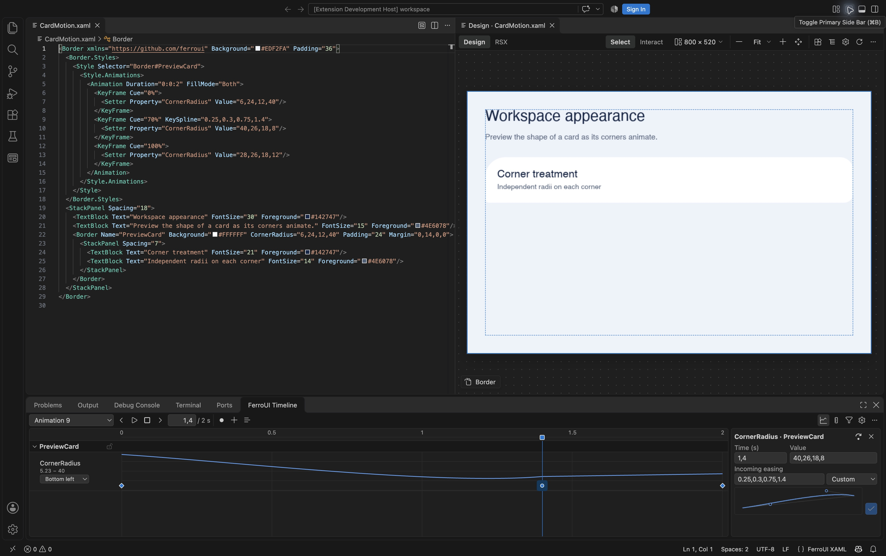

In **Value curves** or **Velocity curves**, choose a component beside a supported geometry track. Points and vectors offer X and Y. Size and rectangle tracks offer their dimensions. Thickness offers its four sides and corner radius offers its four corners. A rectangle also offers X and Y.

Choose **Value curves** and drag the authored key on the trace to edit the selected component. Select the marker to edit the corners, sides, axes, or dimensions together. Agents can read the track’s `curve_channels` from `designer_programs` and pass a channel such as `"top_left"` to `designer_animation_curve`.

### Edit a curve component

1. Choose **Value curves** in the VS Code Timeline, Designer Studio, or App Preview. Select a track and a channel, such as **Top right** for CornerRadius or **Radius Y · Percent** for a radial gradient.
2. Drag an authored key on the graph. Vertical movement changes the selected component. Horizontal movement retimes the same key. To make a small value change from the keyboard, focus the key in VS Code or select it in Studio and use Alt+Up or Alt+Down. A continuous value changes by one percent of the visible range. Integer and Boolean keys move by one step.
3. Use Undo to reverse one drag or keyboard edit. Open the key inspector to [edit several fields together](#edit-compound-keyframe-values).

Handles cover literal geometry, color, built-in effects, [registered shader parameters](#animate-registered-shader-parameters), gradient stops and fields, shadow layers, and individual transform operations. Combined transform matrices and velocity curves use the retiming row. Keys with a missing component or a different coordinate unit stay in that row. [MCP component editing](reference.md#edit-one-keyframe-component-with-mcp)

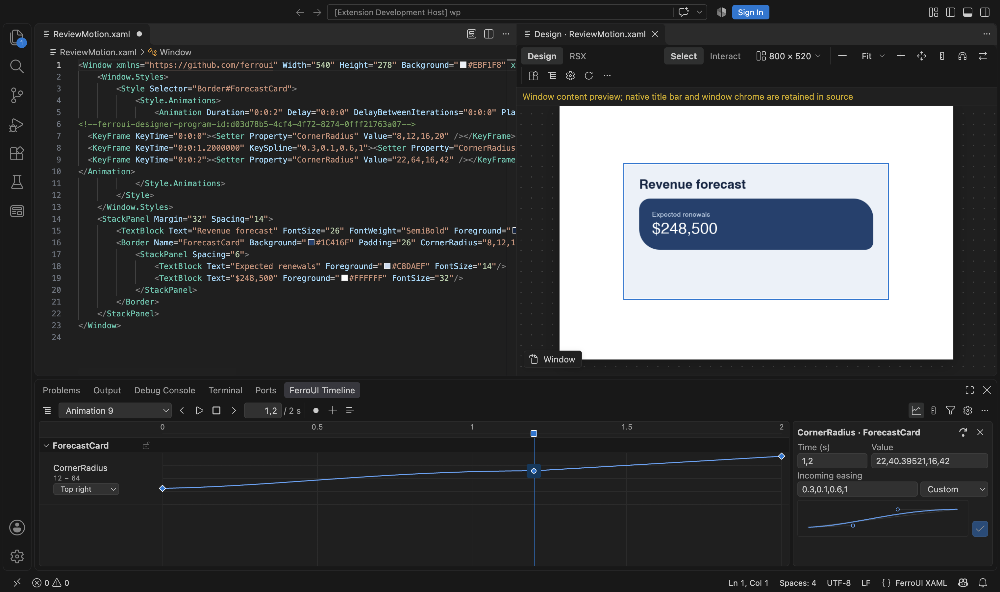

### Edit compound keyframe values

1. Select an authored key on a track in Timeline or Designer Studio. In App Preview, open **Keyframe lanes** or choose **Edit application keyframe**.
2. Change the fields you need. For a gradient, choose **Brush** or a numbered **Stop** in the value group picker. Shadow layers and transform operations also have numbered groups. Registered shader parameters use numeric fields and checkboxes according to their types. Field labels use the Value graph’s units, including percentages, degrees, and a 0 to 1 scale for color channels.
3. Set the key’s time or incoming easing if needed, then choose the **Apply keyframe** checkmark or press Enter in a field. The editor validates the draft against the current XAML or mapped Rust source. One Undo restores the key before the edit.

Switch groups to edit another part of the same value. Use the **Edit keyframe value as text** code icon to enter a complete value, for example to add a gradient stop or include a shader’s text argument. Each mode keeps its own draft while that key stays open. Apply uses the active mode. Rebuild the selected Cargo target if App Preview only offers the text field for a compound key.

For an existing XAML key, value edits follow the authored setter. The editor preserves XML quoting, comment positions, and property wrappers around mapped fields. Time and incoming easing can update the same KeyFrame when its setters share the timing change. Group moves and scaling follow the original frames, including when a destination reuses another selected key’s old time. Retiming one setter in a shared frame can split the key so each track receives its authored time.

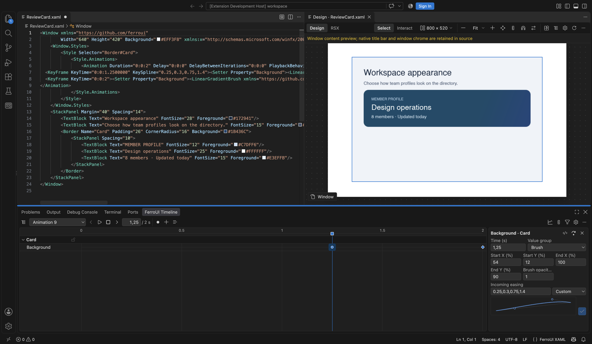

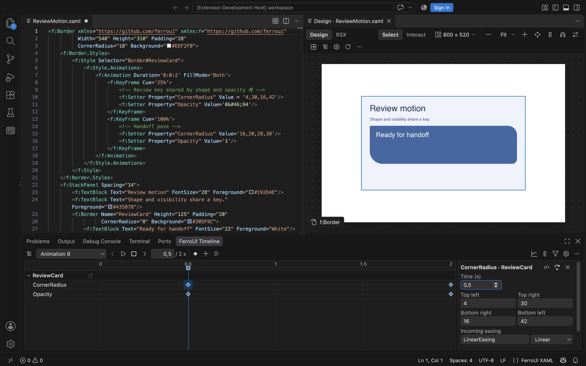

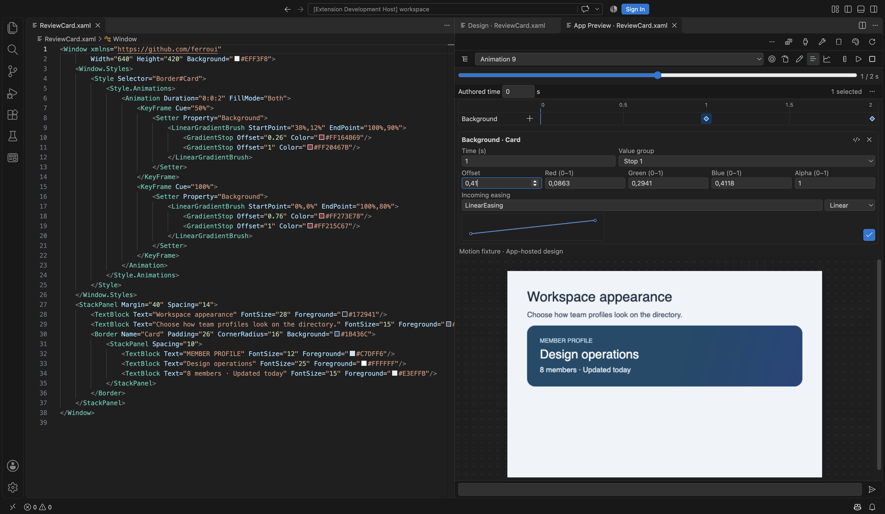

[Draft and apply a batch with MCP](reference.md#edit-one-keyframe-component-with-mcp)

### Animate a render transform

1. Open an animation with a transform component key. In XAML, use a setter such as `RotateTransform.Angle` or `TranslateTransform.X`. Use a matching transform object, a direct child of a `TransformGroup`, or let FerroUI create its default group on a control without a render transform.
2. In the VS Code Timeline or Designer Studio, open **Animation graph** and choose **Value curves** or **Velocity curves**. In App Preview, select the component track first. Rotation and skew use degrees, translations and centers use logical pixels, and scale uses a multiplier. Velocity is measured per authored second.
3. Drag the playhead to see the transformed view. Select a key to edit its value or incoming easing, or use **Add keyframe at playhead** on the track to capture the native value. If the first or last key omits the endpoint, the renderer resolves it from the underlying transform and the clip’s fill mode. **Stop** restores the underlying transform. Use Undo to restore the source.

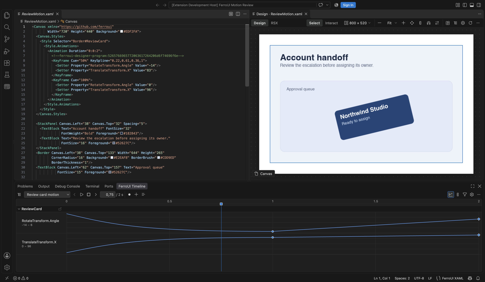

```xaml
<KeyFrame Cue="50%">
    <Setter Property="RotateTransform.Angle" Value="80" />
    <Setter Property="TranslateTransform.X" Value="44" />
</KeyFrame>
```

In Rust, use the corresponding property getter in an inline style clip. The same editor can update literal `RotateTransform`, `Rotate3DTransform`, `ScaleTransform`, `SkewTransform`, and `TranslateTransform` keys.

```rust
.key_frame(0.5, |key| key.set(
    ferroui_base::media::RotateTransform::angle_property(),
    80.0,
))
```

Agents can read the component property name from `designer_programs` or `designer_hosted_animations`. Pass it as `property` with `channel: "value"` to `designer_animation_curve` or `designer_hosted_curve`. Use the accepted program and target to draft, record, or apply a numeric key.

### Animate a gradient brush

1. Open an animation with an inline `LinearGradientBrush`, `RadialGradientBrush`, or `ConicGradientBrush` key for a brush property. In Studio or the VS Code Timeline, open **Animation graph** and choose **Value curves** or **Velocity curves**. In App Preview, choose the live target and track.
2. Choose a numbered stop and its **Offset**, **Red**, **Green**, **Blue**, or **Alpha**. Stop numbers follow the authored order and stop offsets use fractions of the gradient length. The picker also offers the brush opacity, start and end points, center, gradient and transform origins, radii, and angle where the brush provides them. Distances use percentage or logical-pixel channels. Angles use degrees.
3. Scrub to see the native brush. The graph starts a new segment where the native animator switches shapes, and it leaves a gap wherever a stop or geometry field is absent. Velocity shows change per authored second.
4. Select a key to edit the brush markup or use **Add keyframe at playhead** to capture the native brush. **Stop** restores the underlying brush. Each source edit uses one Undo step.

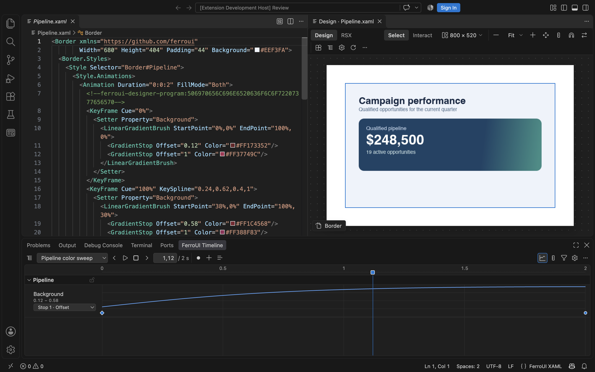

```xaml
<KeyFrame Cue="100%">
    <Setter Property="Background">
        <LinearGradientBrush StartPoint="10%,0%" EndPoint="100%,50%">
            <GradientStop Offset="0.3" Color="#FF285B91" />
            <GradientStop Offset="1" Color="#FF57B7A8" />
        </LinearGradientBrush>
    </Setter>
</KeyFrame>
```

Mapped Rust keys use literal native immutable brush constructors. Edits to inline stops preserve the
original argument structure and comments. Editing geometry on a `from_stops` key expands it to the same
brush's `new` constructor. `ImmutableRadialGradientBrush::with_radius` starts with the same
relative radius on both axes. Use the X and Y radius channels to inspect them. Editing both radii
to the same relative value keeps `with_radius`. Independent radii or a relative transform expand
the call to `new` while preserving the stops and comments. Use the Rust source editor for
computed values, or edit the declaration that owns a bound or resource-backed brush.

Solid brush keys can use `ImmutableSolidColorBrush::new`, `from_uint32`, or `with_opacity`.
Choose **Opacity** on the brush track to animate its opacity independently of its color alpha.
Changing the default opacity adds an explicit value through `with_opacity` while preserving the
authored color argument and constructor alias.

```rust
.key_frame(1.0, |key| key.set(
    ferroui_controls::Border::background_property(),
    Some(std::rc::Rc::new(
        ferroui_base::media::immutable::ImmutableLinearGradientBrush::from_stops(&[
            ferroui_base::media::immutable::ImmutableGradientStop::new(
                0.3, ferroui_base::media::Color::from_uint32(0xFF285B91),
            ),
            ferroui_base::media::immutable::ImmutableGradientStop::new(
                1.0, ferroui_base::media::Color::from_uint32(0xFF57B7A8),
            ),
        ]),
    ) as std::rc::Rc<dyn ferroui_base::media::IBrush>),
))
```

Agents can read `curve_channels` and pass a channel such as `gradient_stop/1/stop_offset` or
`gradient/start_point/percent_x` to `designer_animation_curve` or `designer_hosted_curve`.
Use the checked keyframe tools with the accepted source and frame to read, edit, or record the
complete brush. App Preview exposes brush authoring when the application and preview helper both
support it.

#### Share gradient stops across Rust keys

Pass a constant slice to a native brush constructor, or borrow a constant array. The Timeline resolves literal stop lists in the selected Cargo target, including lists brought into scope through a named import.

```rust
use ferroui_base::media::{
    Colors,
    immutable::{ImmutableGradientStop, ImmutableLinearGradientBrush},
};

const APPROVAL_STOPS: &[ImmutableGradientStop] = &[
    ImmutableGradientStop::new(0.25, Colors::STEEL_BLUE),
    ImmutableGradientStop::new(1.0, Colors::MEDIUM_SEA_GREEN),
];

fn approval_brush() -> ImmutableLinearGradientBrush {
    ImmutableLinearGradientBrush::from_stops(APPROVAL_STOPS)
}
```

Choose a numbered stop in its curve or keyframe editor to change its offset or color. Apply to write a private inline stop list at that key. One Undo restores the reference to the constant. Geometry-only edits keep the stop reference. To change the palette for every key that uses it, use Go to Definition on the constant name and edit its initializer in Rust. Studio, the VS Code Timeline, App Preview, and their MCP tools use the same source plan.

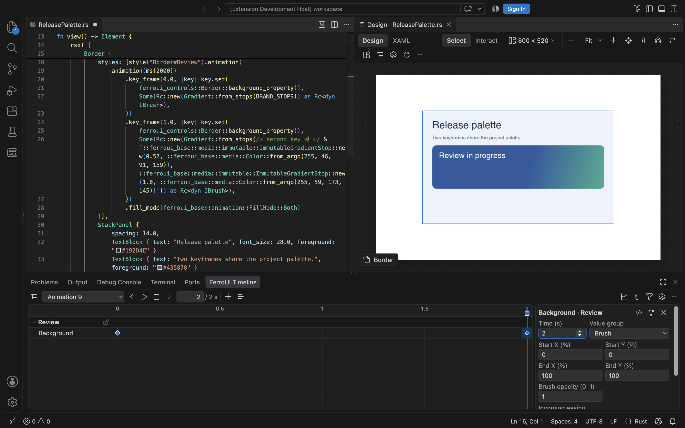

### Animate a transform list

1. Use `RenderTransform` as the keyframe property to animate the complete list of functions on a control. A value can contain translation, rotation, scale, skew, and affine matrix functions. Enter `none` for the identity. Use one whole transform track or separate component tracks for a given clip.
2. Open **Animation graph** and choose **Value curves** or **Velocity curves**. Choose an operation by position, such as **Operation 2 · Rotate Angle (°)**, or choose a coefficient of the **Combined** matrix. Translation uses logical pixels, angles use degrees, and scale uses a multiplier. Velocity measures change per authored second.
3. Scrub to see the native pose. Matching operations interpolate in order. When the remaining operations differ, the animator composes that part of each list and interpolates the matrices when possible. Operation graphs leave a gap during matrix fallback. The combined matrix shows the property’s sampled transform across the clip.
4. Edit the complete list in the key inspector or use **Add keyframe at playhead** to capture the current native value. App Preview uses the same workflow after you choose a track and live target. **Stop** restores the underlying transform. Use Undo to restore the source.

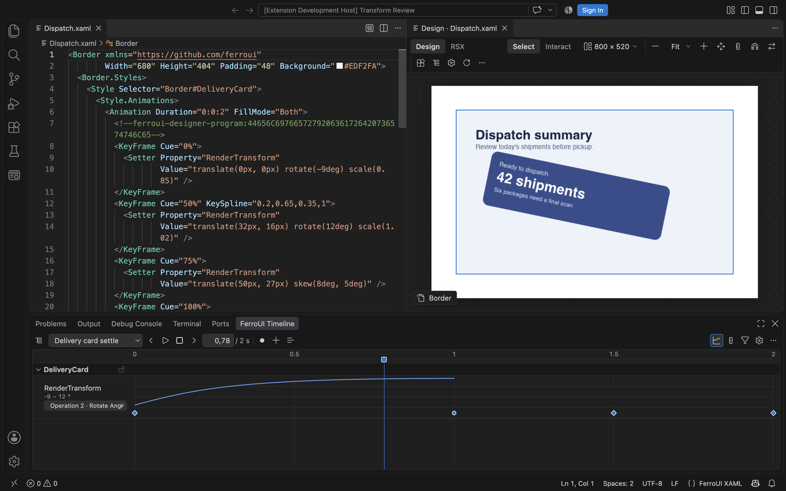

```xaml
<KeyFrame Cue="100%">
    <Setter Property="RenderTransform"
            Value="translate(24px, 8px) rotate(35deg) scale(1.1)" />
</KeyFrame>
```

Use the same literal with the Rust getter. Mapped edits also preserve the string in qualified `TransformOperations::parse` calls and their Rust error handling. A sampled or newly inserted key uses a string literal.

```rust
.key_frame(1.0, |key| key.set(
    ferroui_base::Visual::render_transform_property(),
    "translate(24px, 8px) rotate(35deg) scale(1.1)",
))
```

Agents can pass channels such as `transform_operation/2/rotate/angle` and `transform_matrix/m31` from `curve_channels` to `designer_animation_curve` or `designer_hosted_curve`. The checked keyframe tools accept the complete transform list. App Preview advertises these channels when the helper and application support transform-list authoring.

### Animate layered box shadows

1. Open a clip with a `BoxShadow` track on a supported control such as `Border` or `ContentPresenter`. In the Timeline, choose **Animation graph**, then **Value curves** or **Velocity curves**. In App Preview, also choose the track and its live target.
2. Choose a numbered shadow and component, such as **Shadow 2 · Spread (px)**. Each layer offers **Offset X**, **Offset Y**, **Blur radius**, **Spread**, **Red**, **Green**, **Blue**, and **Alpha**. Geometry uses logical pixels. Tint uses normalized 0–1 values. Velocity measures change per authored second.
3. Scrub to see how the layers render together. A missing layer leaves a gap. A switch between inner and outer shadows starts a new graph segment. Layer numbers follow the order of the authored list.
4. Select a key to edit the complete list and incoming easing, or choose **Add keyframe at playhead** to capture the list from the native preview. Separate layers with commas and use `inset` for an inner shadow. Enter `none` for an empty list. Use Undo to restore the source after applying the key.

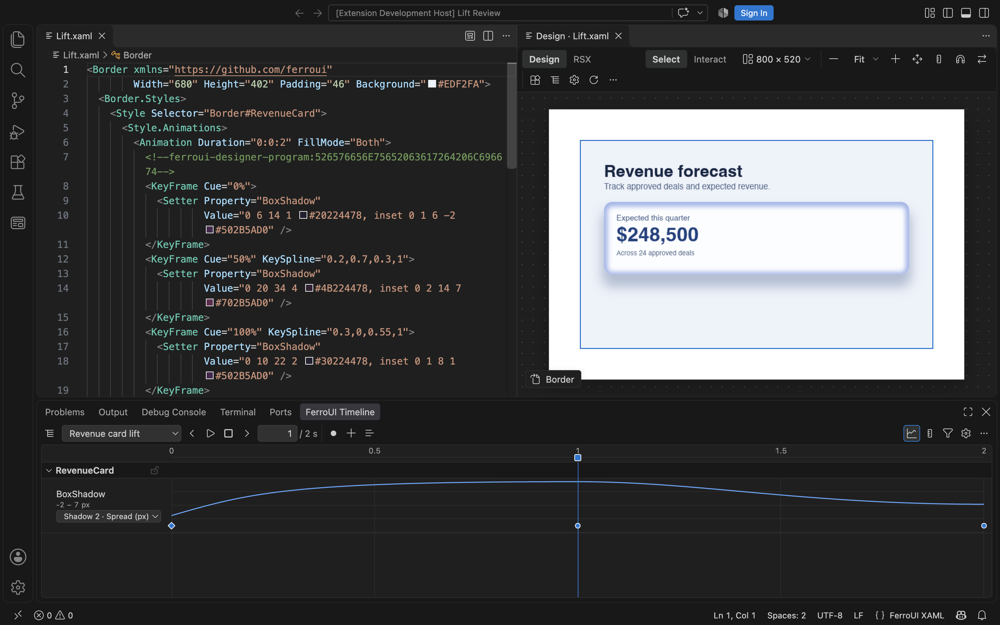

```xaml
<KeyFrame Cue="50%">
    <Setter Property="BoxShadow"
            Value="0 12 24 2 #40263452, inset 2 4 8 -1 #80325AC0" />
</KeyFrame>
```

Mapped Rust keys accept a qualified `BoxShadows::parse` string and literal `BoxShadows::new` or `BoxShadows::with_rest` constructors. Change the layer count in a parsed string or in source. The constructor form lets you edit the existing layers while keeping Rust comments and numeric suffixes.

```rust
.key_frame(0.5, |key| key.set(
    ferroui_controls::Border::box_shadow_property(),
    ferroui_base::media::BoxShadows::parse(
        "0 12 24 2 #40263452, inset 2 4 8 -1 #80325AC0",
    ).unwrap(),
))
```

Agents read `curve_channels` from `designer_programs` or `designer_hosted_animations` and pass a name such as `box_shadow/2/spread` to `designer_animation_curve` or `designer_hosted_curve`. Use the same keyframe draft and apply tools with the whole list as the value. An App Preview helper and app built with layered shadow support advertise these channels.

### Inspect a curve that changes units

1. Open an animation of `RenderTransformOrigin` or another `RelativePoint` property. For a `RelativeScalar` property, the same workflow uses one value instead of X and Y.
2. In **Animation graph**, choose **Value curves**. Use the channel picker to switch between **X (%)**, **Y (%)**, **X (px)**, and **Y (px)** when the track uses both units. A relative scalar offers **Percent** and **Pixels**. The trace has a gap wherever the other unit is active. Scrub across a change to see the native preview switch at the eased midpoint.
3. Choose **Velocity curves** to see percentage points per authored second (`pp/s`) or logical pixels per authored second (`px/s`). Drag a bottom marker to retime the key. Open its editor to change the complete value, for example from `25%,60%` to `24,40`. Enter either two percentages or two absolute coordinates for a relative point. Apply the edit and use one Undo to restore it.

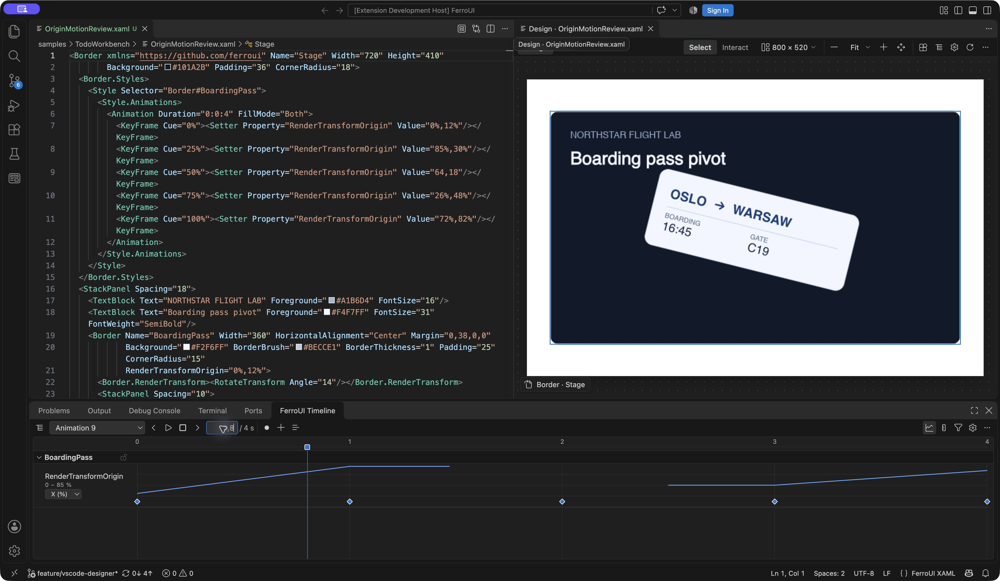

In App Preview, keep the playhead inside the pixel interval to inspect the changed native pose. The first edit to a source-authored XAML clip can write the animation block in the designer's canonical format. The playhead stays in place, and one Undo restores the original clip text.


Mapped Rust keys accept fully qualified `RelativePoint::new`, `RelativePoint::from_point` with a literal `Point::new`, and `RelativeScalar::new` on registered properties. Key edits keep constructor comments and numeric suffixes. This Rust key uses 25% of the width and 60% of the height.

```rust
.key_frame(0.5, |key| key.set(
    ferroui_base::Visual::render_transform_origin_property(),
    ferroui_base::RelativePoint::new(0.25, 0.60, ferroui_base::RelativeUnit::Relative),
))
```

Agents can use `percent_x`, `percent_y`, `absolute_x`, or `absolute_y` for a point and `percent` or `absolute` for a scalar. Query the channels listed by `designer_programs` or `designer_hosted_animations`, then pass the chosen name to `designer_animation_curve` or `designer_hosted_curve`. A percentage sample such as `25` represents 25%. A point with `break_before: true` starts a new segment after an interval in the other unit.

### Inspect a color animation

1. Open a clip with literal colors on a `Color` property or a solid brush property such as `Border.Background`. In Timeline, choose **Animation graph** and then **Value curves**. In App Preview, also choose the track and a compatible live target.
2. Use the picker beside the track to select **Red**, **Green**, **Blue**, or **Alpha**. The value scale stays at 0–1 as you switch channels. **Velocity curves** shows the signed change in the selected channel per authored second. Drag the playhead to compare the sampled color with the artboard.
3. Select a key marker to edit its full hex color, time, and easing. Use `#AARRGGBB` for a color with alpha. Applying the key uses one source Undo step.

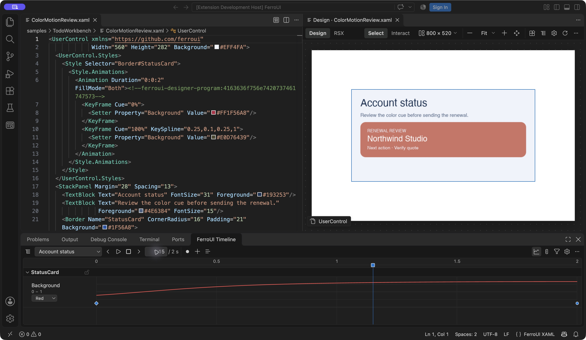

For a mapped Rust brush key, use a hex string or a qualified `ferroui_base::media::Color` constructor. Registered `Color` properties use the typed constructors. For example, this animation changes a solid background from opaque black to half-transparent orange.

```rust
ferroui_view::animation(ferroui_view::ms(2000))
    .key_frame(0.0, |key| key.set(
        ferroui_controls::Border::background_property(),
        "#000000",
    ))
    .key_frame(1.0, |key| key.set(
        ferroui_controls::Border::background_property(),
        ferroui_base::media::Color::from_argb(128, 255, 128, 64),
    ))
```

Keep keyframe closures as a single builder expression, as in `|key| key.set(...)`. A checked edit keeps comments and numeric suffixes around constructor arguments. Adding alpha to a `Color::from_rgb` key changes that call to `Color::from_argb` in the same edit. Keys authored as `Color::from_uint32(0xFF22_6688u32)` retain the packed ARGB constructor, integer radix, grouping, and suffix. The four literal fields of a `Color` struct can also be edited in place.

Color keys also accept qualified FerroUI swatches such as `ferroui_base::media::Colors::TEAL`, qualified `Color` parse calls with literal input, and native color strings for brush tracks. Editing a parsed color updates its string argument and keeps its Rust error handling. Editing a swatch writes an explicit color at that key.

Agents can request `"red"`, `"green"`, `"blue"`, or `"alpha"` from `designer_animation_curve` and `designer_hosted_curve` after reading the track’s `curve_channels`. Samples use normalized sRGB components and the color’s own alpha. App Preview reads the app’s native color, including its byte precision.

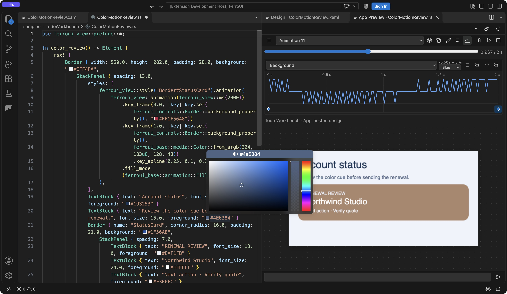

### Inspect a blur or drop-shadow animation

1. Open an `Effect` animation with literal blur keys or literal drop-shadow keys. In the docked Timeline or App Preview, open **Animation graph** and choose **Value curves** or **Velocity curves**. In App Preview, choose the effect track and its live target.
2. Choose **Blur radius** for a blur. For a drop shadow, choose **Blur radius**, **Offset X**, **Offset Y**, or a tint channel (**Red**, **Green**, **Blue**, **Alpha**). Radius and offsets use logical pixels. Velocity uses pixels per authored second. Tint values use a 0–1 scale, with velocity in normalized units per authored second. Scrub to compare the curve with the rendered effect. The graph leaves a gap where the target has no compatible effect.
3. Select a key marker to edit the whole value, such as `blur(12)` or `drop-shadow(6 -2 16 #A036587C)`. Drag the marker to change its time. To capture the current native sample inside the track, use **Add keyframe at playhead** in Timeline or **Add Key at Playhead** in App Preview. Review the draft and apply it in one Undo step.

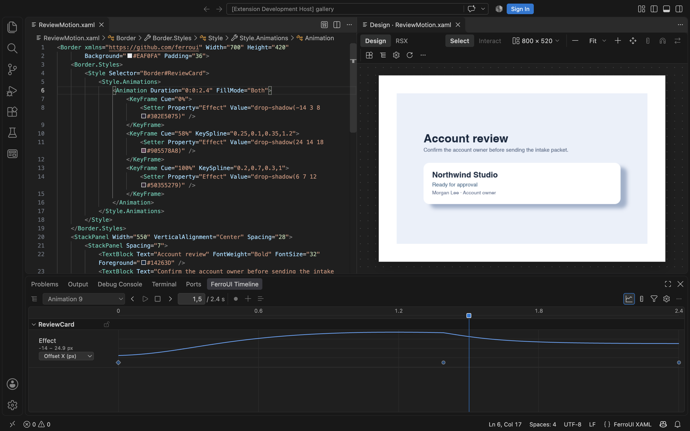

A XAML shadow key can use a hex color, a named color, or a functional color. The number after the two offsets is the blur radius. `#AARRGGBB` puts the tint alpha first.

```xml
<KeyFrame Cue="100%">
    <Setter Property="Effect" Value="drop-shadow(6 -2 16 #A036587C)" />
</KeyFrame>
```

Mapped RSX keys use a `ferroui_base::media::Effect::parse` call with a literal string. A key edit replaces the string contents and keeps its quotes, comments, and Rust error handling.

```rust
.key_frame(1.0, |key| key.set(
    ferroui_base::Visual::effect_property(),
    ferroui_base::media::Effect::parse("drop-shadow(6 -2 16 #A036587C)").unwrap(),
))
```

Agents read the track’s `curve_channels` from `designer_programs` or `designer_hosted_animations`. Pass `blur_radius`, `offset_x`, `offset_y`, or one of the tint channels to `designer_animation_curve` or `designer_hosted_curve`. The same keyframe draft and apply tools accept a complete effect literal. An app host built with effect-curve support publishes these channels in App Preview.

### Edit directional shadows and independent opacity

1. Open an `Effect` track with native object keys. Choose **Value curves** and then **Direction**, **Shadow depth**, or **Shadow opacity**. Offset `DropShadowEffect` objects offer **Offset X** and **Offset Y**. Both shadow objects offer radius and tint channels.
2. Scrub the artboard to compare the resulting shadow with the plot. Shadow opacity controls the whole effect. **Alpha** is the alpha of its tint color. Direction uses degrees, depth uses logical pixels, and **Velocity curves** shows change per authored second. FerroUI interpolates directions as numbers. Use, for example, 350° to 370° for an increasing sweep through 360°.
3. Open a key and edit its effect object in **Value**. The complete value can include a `Setter.Value` wrapper if the key uses one. Apply the key for one source Undo step. To record the native effect between keys, use **Add Key at Playhead**. The recorded key follows the preceding key's supported object form.

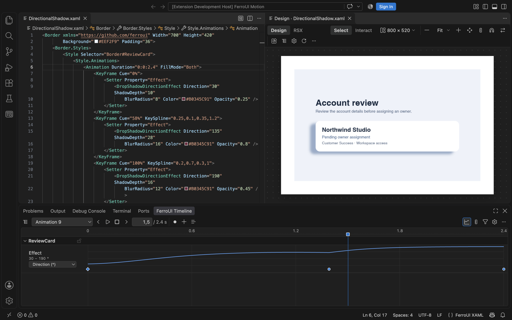

Use literal attributes on a built-in `BlurEffect`, `DropShadowEffect`, or `DropShadowDirectionEffect` object. Place the object directly inside the setter or use a property element.

```xml
<KeyFrame Cue="75%">
    <Setter Property="Effect">
        <Setter.Value>
            <DropShadowDirectionEffect Direction="110" ShadowDepth="18"
                                       BlurRadius="14" Color="#8036587C" Opacity="0.65" />
        </Setter.Value>
    </Setter>
</KeyFrame>
```

In RSX, use a mapped immutable effect constructor. Timeline stores changes in the existing literal constructor arguments and retains comments, number suffixes, and neighboring expressions. For example, this key exposes the direction, depth, radius, tint, and opacity of the shadow.

```rust
.key_frame(0.75, |key| key.set(
    ferroui_base::Visual::effect_property(),
    std::rc::Rc::new(ferroui_base::media::ImmutableDropShadowDirectionEffect::new(
        110.0, 18.0, 14.0, ferroui_base::media::Color::from_argb(128, 54, 88, 124), 0.65,
    )) as std::rc::Rc<dyn ferroui_base::media::IEffect>,
))
```

When directional and offset objects share a track, the picker offers their common properties. Edit binding-driven effect objects in source. Rebuild the configured App Preview target with the current FerroUI helpers to publish the added channels.

Agents can request `direction`, `shadow_depth`, and `shadow_opacity` from the same curve tools. Pass the complete effect object as the keyframe draft value, then apply the checked edit using the accepted frame and document revision.

### Animate registered shader parameters

1. Author two **Effect** keys that call the same registered effect. Use an effect string in a XAML setter or a literal string in a Rust `ferroui_base::media::Effect::parse` call. Library effects such as `spotlight` work in Studio and the isolated VS Code Timeline. Register your own effect in the app before opening its preview. Then open **App Preview** to use the running app’s registry and interpolator.
2. In **Animation graph**, choose **Value curves** or **Velocity curves**. Select a channel such as **Strength**, **Center X**, or **Color Green** on the Effect lane. App Preview uses the native samples from the chosen target. Scrub to a point on the authored ruler to see the shader at that time.
3. In **Value curves**, drag a key vertically or use Alt+Up and Alt+Down to change the selected parameter. Color channels use 0 through 1, Boolean values use 0 and 1, and integer parameters move in whole steps. For points, vectors, sizes, and rectangles, choose the coordinate or dimension to change. The edit keeps the other arguments and writes a new argument when you change a default.
4. Open a key in the inspector to enter the entire effect literal, including text arguments. Set shader images through the app’s Rust code. **Add Key at Playhead** records a snapshot the registry can read back. Each accepted edit uses one source Undo step. A value-only XAML edit keeps the authored cue, sibling setters, and comments. If a custom setter rejects the new value or changes another parameter, the edit is refused and the authored key stays in place.

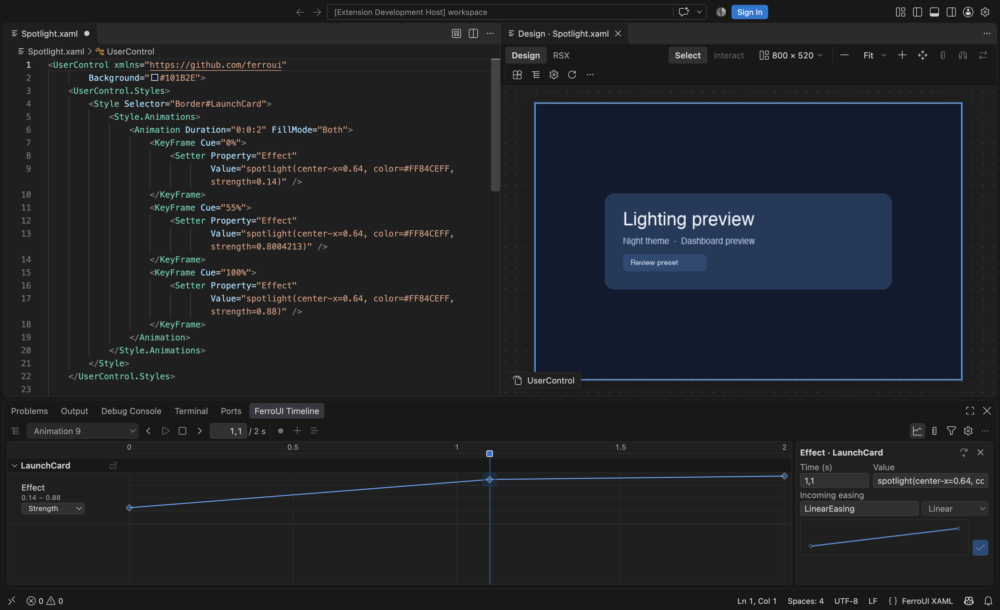

```xml
<KeyFrame Cue="100%">
    <Setter Property="Effect"
            Value="spotlight(center-x=0.64, strength=0.75, color=#FF82CCF0)" />
</KeyFrame>
```

```rust
.key_frame(1.0, |key| key.set(
    ferroui_base::Visual::effect_property(),
    ferroui_base::media::Effect::parse(
        "spotlight(center-x=0.64, strength=0.75, color=#FF82CCF0)"
    ).unwrap(),
))
```

The picker exposes numeric parameters, individual color and geometry components, and Boolean values as 0 or 1. Color uses the 0–1 scale and velocity is measured per authored second. Text and image inputs stay in source. A graph pauses wherever the active effect cannot supply the chosen parameter.

For project effects, register the type with `ferroui_base::media::CustomEffectRegistry::register` during app setup. Rebuild the configured App Preview target after changing its registry. Todo Workbench’s `review-spotlight` uses a slower start than the library spotlight. [Todo Workbench example](../../../samples/TodoWorkbench/app_preview/shader.rs)

Agents discover the exact channel ID in `curve_channels`. For example, pass `effect_parameter/review-spotlight/strength/value` to `designer_hosted_curve`. The same keyframe draft and apply tools use the accepted frame and source revision.

### Scale selected key times

Select at least two keys, then seek to the time that should stay fixed. Open **Keyframe Actions**, choose **Scale from Playhead**, and enter a factor. Use `0.5` to halve the spacing from the playhead or `2` to double it. The edit preserves key values and easing. If a destination would collide or leave the clip, adjust the selection, playhead, or factor and try again.

Scaling works with XAML and mapped Rust cues. For a Rust cue with multiple setters, select each of its keys when moving the cue. One Undo restores the complete selection's original times. Agents can pass the `scale_keyframes` action with `keyframes`, `pivot`, and `factor` to the shared `designer_program` authoring tool.

| With the Timeline ruler or a key focused | Action |
| --- | --- |
| `[` and `]` | Seek to the previous or next key among the visible tracks. The ruler pans when the key is outside the current zoom. |
| `,` and `.` | Step one frame backward or forward at the selected rate, or at 30 fps when showing seconds. Hold Shift to step ten frames. |
| Home and End | Seek to the start or end of the authored program. |
| `I` and `O` | Set the preview range In or Out at the current playhead. |
| `+`, `−`, `0` | Zoom in, zoom out, or fit the full duration. Ctrl or Command with the wheel zooms at the pointer. |
| Page Up and Page Down | Pan the zoomed ruler. You can also use the pan slider or scroll horizontally. |
| Shift, Ctrl, or Command with a key click | Select a range or toggle individual keys. Space toggles a focused key. Drag from empty track space to select keys in a rectangle. |
| Left and Right with a key focused | Nudge selected keys. Set the edit grid to 24, 30, or 60 fps from **Timeline view options**. Use **Keyframe Actions** for supported move, duplicate, and delete actions. |
| Ctrl+C or Command+C | Copy selected keys. With a key focused and no selection, copy that key. |
| Ctrl+V or Command+V | Paste at the playhead. Hold Shift to reverse the copied sequence. With one copied track, focus a key on a compatible track to paste there directly. |

For a native animation resource, choose **Choose preview targets** in **Timeline view options** to mount it on one or more controls. Use its elapsed playhead for payloads whose keys are edited in XAML. [Designer Studio animation authoring](../README.md#animation-authoring)

### Copy, paste, and mirror keyframes


1. Select keys on one or more tracks. Open the **Keyframe Actions** icon and choose **Copy Keyframes**.
2. Open the destination animation in VS Code or Designer Studio. Show and unlock its destination tracks, then seek to the paste time. Add a property track first if its property is missing.
3. Choose **Paste at Playhead**. Assign each copied track to an existing destination of the same value type. For discrete values, choose the same property. The first pasted key lands at the playhead and the remaining keys keep their relative timing across tracks.
4. Choose **Paste Reversed at Playhead** to paste the sequence in reverse. To reflect selected keys in place, seek to the pivot and choose **Mirror About Playhead**. Both actions reflect the Bézier handles between selected keys.

For a Timeline using a native elapsed clock, enter an authored time in seconds when prompted. For a mapped Rust cue with several setters, include every affected key when mirroring. The Timeline reports collisions, out-of-range placements, and Rust cues whose setters would require different splines. Each successful paste or mirror takes one Undo step.

For VS Code MCP, call `designer_keyframe_clipboard` through `designer_studio_query` with the program ID and selected `keyframes`. Each location contains `target`, `property`, and `time`. Pass the returned clipboard to the `designer_program` action `paste_keyframes` through `designer_studio_edit`. The `paste` argument contains `clipboard`, `destinations` in copied track order, the authored `time`, and optional `reverse`. Each destination contains `target` and `property`. Use `mirror_keyframes` with the selected `keyframes` and authored `pivot`. Use the destination frame’s current revision for the edit. The edit returns the accepted key locations as `keyframes`. Designer Studio exposes the same tool and actions directly.

### Add a native key in App Preview

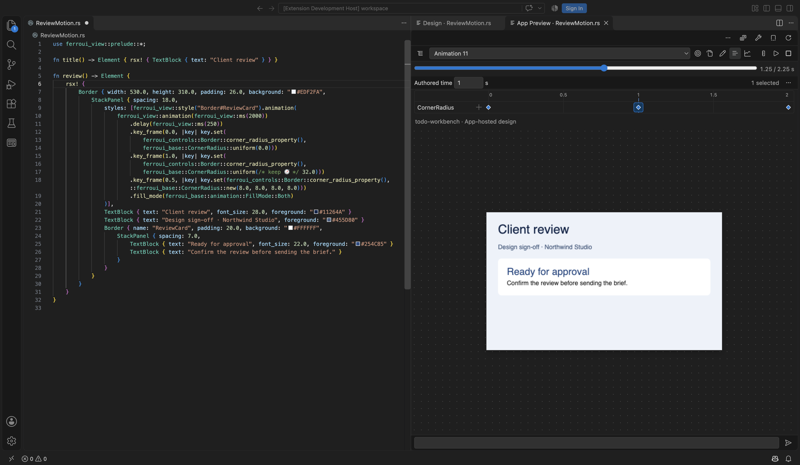

1. Open [App Preview](runtime.md#render-with-your-app-in-app-preview) with a current FerroUI app build. Pause the clip and open **Keyframe lanes**. For an animation resource, use **Choose preview targets** to bind it to a live control.
2. Click the keyframe ruler or enter **Authored time** in seconds. This position belongs to one animation iteration. The transport above the lanes shows elapsed time, including delay, speed, and repeats.
3. Choose the plus icon beside the property, or focus it and press Enter. **Add keyframe at authored playhead** captures that lane’s value using the running app’s native animator and inserts a key with linear incoming easing. The resulting key is selected. At an occupied time, open the existing key to edit it.

The action is available on typed XAML and mapped Rust tracks that advertise native sampling. With several preview targets, the lane samples its authored target when selected. Otherwise choose one live preview target. The edit updates the unsaved source in one Undo step. The authored cursor and compatible elapsed pose carry over through the preview rebuild.

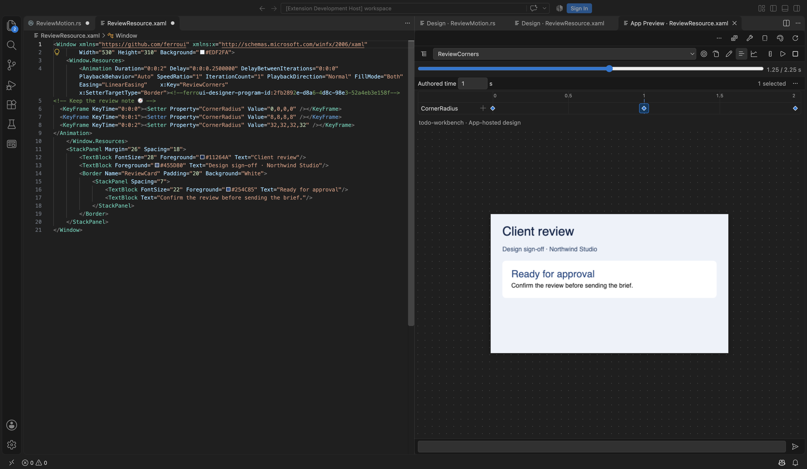

For MCP, read the frame, generation, and tracks from `designer_hosted_animations`. Choose a track with `canSample` and send `program`, the track’s `target` and `property`, authored `time`, and `sample: true` to `designer_hosted_keyframe_draft`. Pass `previewTarget` to select a compatible live control explicitly. The draft returns `sampledKey` and the checked patch. Apply with `designer_hosted_keyframe` using the current frame. For an explicit value, supply `value` and `easing` and omit `previous` to insert a key.

### Edit several keys in App Preview

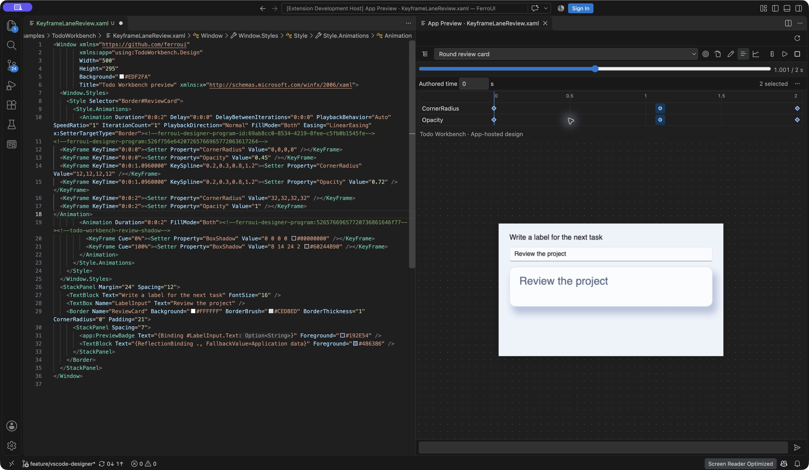

1. Open [App Preview](runtime.md#render-with-your-app-in-app-preview) with a current FerroUI app build. Choose a clip with typed XAML or mapped Rust tracks, pause playback, and open **Keyframe lanes** from the clip toolbar.
2. Click a key to select it. Hold Shift to select a range across tracks, or hold Ctrl or Command to toggle individual keys. Drag a rectangle from empty lane space to select several keys. Press Space to toggle a focused key and Ctrl+A or Command+A to select all.
3. Drag a selected key to move the group while preserving its relative spacing. With a key focused, use Left or Right to nudge, Ctrl+D or Command+D to duplicate, or Delete to remove. Double-click a key or press Enter to open its time, value, and easing editor.
4. Click the ruler or enter **Authored time** in seconds. Open **Keyframe actions** to move or duplicate by an exact offset, scale or mirror about that time, or paste there. The elapsed playhead above the lanes continues to describe the app’s preview pose.

Copy with Ctrl+C or Command+C and paste with Ctrl+V or Command+V. Hold Shift when pasting to reverse the sequence. Choose a compatible destination for each copied track. The VS Code Timeline, App Preview, and Designer Studio use the same clipboard format. Mapped Rust keys follow their source declarations, so a retime of a cue shared by several setters needs the full cue selection. The planner checks destination times and leaves the current source intact if any key collides. A successful group edit updates the buffer in one Undo step and retains the app’s compatible preview pose through the edit and Undo.


Read `keyframeSelection`, authored tracks, generation, revision, and sequence from `designer_hosted_animations`. Send the program and a `command` to `designer_hosted_keyframe_group_draft` for a checked patch or clipboard text. A key location uses `target`, `property`, and authored `time`. For paste, pass the parsed clipboard value with `destinations` in copied track order, authored `time`, and optional `reverse`. Apply a group through `designer_hosted_keyframe_group` with the same frame fields. The result reports the accepted key locations.

### Manage clips in App Preview

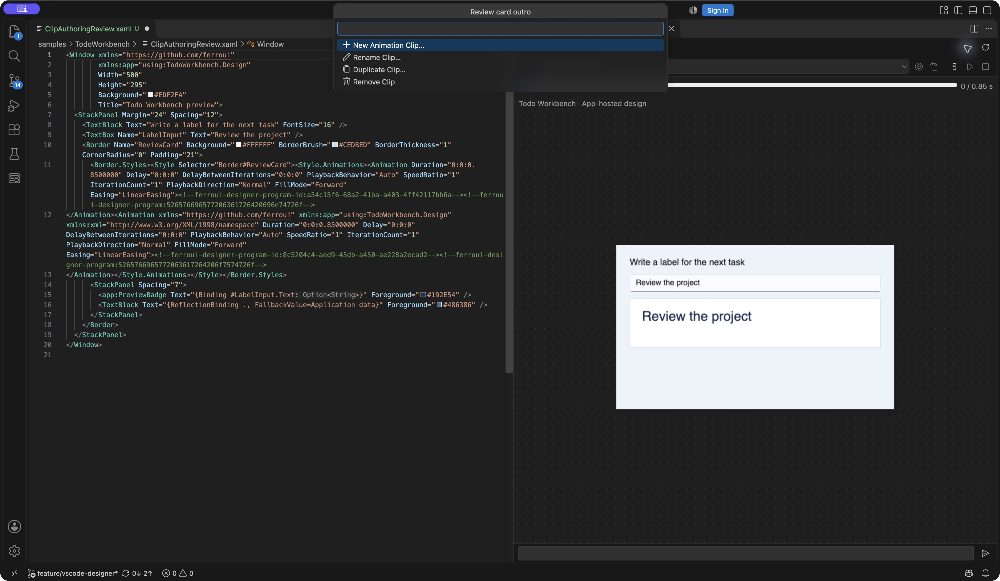

1. Open **App Preview** with a current FerroUI app build. Pause playback and open **Animation clip actions** in its toolbar. [Open App Preview](runtime.md#render-with-your-app-in-app-preview)
2. Choose **New Animation Clip**, then select a live style owner. Use the source line in the picker to distinguish controls with the same name. Give the clip a name, a FerroUI selector, and a duration in seconds. Use whole milliseconds for Rust. The new clip appears in the animation picker. Add its first keys from the source or the docked Timeline.
3. Choose a clip in the animation picker and reopen **Animation clip actions**. Choose **Rename Clip**, **Duplicate Clip**, or **Remove Clip**. In the comparison view, select the clip to edit when prompted.

A duplicate retains the clip’s timing and keys and receives its own source identity. Renaming a compatible clip retains its elapsed pose. Use Undo in the source editor to revert each operation. Rust clip actions apply to mapped inline styles in the active `rsx!` invocation. A computed style expression stays in Rust source.


For MCP, read `clipAuthoring.owners` and `clipAuthoring.programs` from `designer_hosted_animations`. Use the returned generation and frame with `designer_hosted_clip_draft` to plan the edit and `designer_hosted_clip_edit` to apply it. Send `action: "create"` with `owner`, `name`, `selector`, and `duration`. For `rename` and `duplicate`, send `program` and `name`. For `remove`, send `program`. The result includes the selected source key for a new, renamed, or duplicated clip.

## Rehearse a section

1. Choose a typed XAML or mapped Rust clip whose targets render in the designer. Open **Preview range** in the toolbar and enable **Limit playback to preview range**.
2. Set **In** and **Out** in seconds, or seek to either point and press `I` or `O` with the ruler focused. A blue line marks the range on the ruler. Keep **Loop range** enabled for repeat playback or clear it to hold the Out pose after one pass.
3. Use **Play preview range**, **Pause preview range**, and **Stop** in the transport. Play starts at the current playhead when it falls inside the range. Otherwise it starts at In. Playback disarms recording and samples the authored timeline. Clear **Limit playback to preview range** to use the clip's authored delay, repeat, and direction again.

The VS Code MCP tool `designer_timeline_control` accepts `action: "play_range"` with a program and a `range` containing `start`, `end`, and `loop`. Use the current designer revision for each action.

### Rehearse a range in App Preview

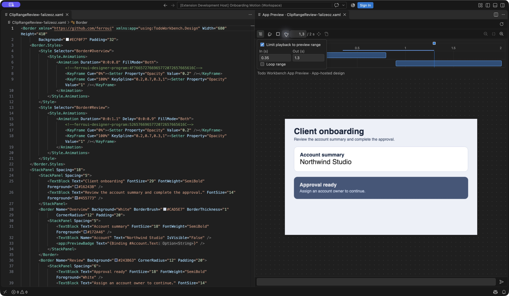

1. Open [App Preview](runtime.md#render-with-your-app-in-app-preview), then choose an animation with a live target. Choose **Compare animation clips** to rehearse a group on its shared clock.
2. Choose **Preview range** beside the playback controls and enable **Limit playback to preview range**. Enter **In (s)** and **Out (s)**, or focus the elapsed playhead and press `I` or `O` at the desired time. The ruler shades the interval.
3. Choose **Play preview range**. Playback starts at the current time if it is inside the range. With **Loop range** enabled, it wraps from Out to In. Clear **Loop range** to hold the native frame at Out. Pause holds the accepted pose, and Stop removes the sampled pose.
4. After a compatible source update, the first replacement frame retains the playhead and valid range. A shorter clock can move Out earlier. Choose a new interval if the clock ends before In. Clear **Limit playback to preview range** to play the full clip again.

App Preview range times are elapsed seconds, including authored delay, speed, and repetitions. The range is a preview setting. It leaves animation timing and keys in source intact. Use an updated FerroUI preview helper to retain the range across an app-hosted frame replacement.

Agents supply `action: "play_range"` and `range: { "start": 0.4, "end": 1.5, "loop": true }` to `designer_hosted_animation`. Include `program` for a single animation or omit it to rehearse all playable clips. Use the current app generation, revision, and sequence reported by `designer_hosted_animations`.

## Bookmark preview positions

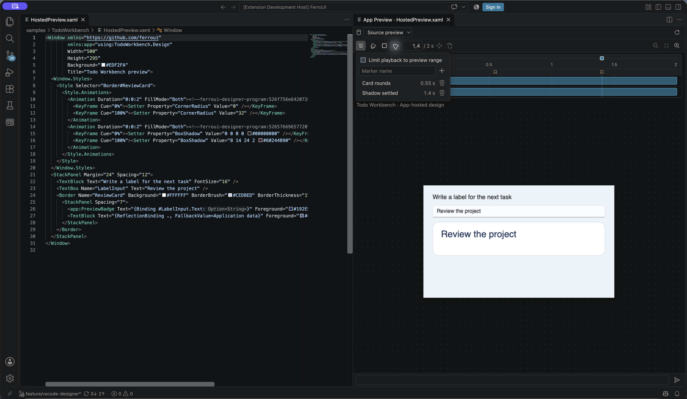

1. Pause playback and move the playhead to the pose you want. Open **Preview range** in the keyframe view, in App Preview, or in Designer Studio. On the shared ruler in the VS Code Timeline, choose the **Preview markers** bookmark icon.
2. Enter a name and choose **Add or update marker at playhead** or press Enter. Enter the same name at another position to move it.
3. Choose a marker on the ruler or select its name in the marker list to return to the native pose. Use **Remove marker** beside the name to delete it.

Typed clips in the VS Code Timeline use authored seconds. App Preview and the shared clip ruler use elapsed seconds, including the clip’s delay and playback speed. Each clock has its own markers. Markers are local to the preview session and leave the source and Undo history intact. When a clock becomes shorter, markers beyond its current end are hidden. App Preview and Studio retain marks when the authored clip identity and preview scope still match.

In VS Code, read `designer_timeline_markers` and call `designer_timeline_marker_edit` with `action` set to `set`, `remove`, or `seek`. Pass `program` for a typed clip or `all: true` for the shared ruler. **Set** takes a `name` and `time` in seconds. **Remove** and **Seek** take a `name`. App Preview reports `markers.programs` and `markers.shared` from `designer_hosted_animations`. Send `action: "marker"` to `designer_hosted_animation` with the same name-based action inside `marker`. Pass `program` for one app animation or omit it for the shared ruler. Use the accepted revision, sequence, and app generation from the query. [Designer Studio marker controls](../README.md#bookmark-poses-in-designer-studio)

[Markers on the docked VS Code Timeline](../images/vscode-timeline-markers.png)

## Shape an incoming easing

1. Select a source-backed key. **Incoming easing** shapes the segment that ends at the key. Choose a preset, type four cubic Bézier coordinates, or drag either control point on the curve.
2. Drag horizontally to adjust progress between 0 and 1. Drag vertically above or below that interval to shape overshoot. With a control point focused, use the arrow keys for 0.01 steps. Hold Shift for 0.1 steps or Ctrl or Command for 0.001 steps. Escape during a drag restores the starting curve.
3. Choose **Apply keyframe** to commit the time, value, and easing in one source edit. Use Undo to restore the original key. The same editor appears for supported keys in [App Preview](runtime.md#render-with-your-app-in-app-preview).

Designer Studio provides the same drag and nudge increments. Focus the native graph and press Space to switch handles. [Designer Studio animation authoring](../README.md#animation-authoring)

## Record a property or geometry change in XAML

Select the target’s program and seek to the time you want. **Add keyframe at playhead** samples a supported effective value, and double-clicking an empty part of a track records at that time. Turn on **Record animation edits** to edit animatable values in Properties or to drag and resize a targeted control in the canvas. The resulting keys preserve base attributes and bindings. One Undo restores the last recorded gesture. Turn recording off to edit the base values again.

## Edit mapped Rust clips and state routes

Open [animation_view.rs](../../../editors/vscode/test/fixtures/animation_view.rs), then select the RSX invocation containing the inline style animation. Timeline can preview that animation and patch its supported literal key times, values, and incoming splines. The source action jumps to the authored declaration. Use the warning action to find computed clips in the original Rust. For custom property accessors, export the [animation getter metadata](../../../editors/vscode/README.md#map-an-application-control-to-rsx) from the owning Cargo package. Use [App Preview](runtime.md#render-with-your-app-in-app-preview) for its registered control and animator.

Use named imports and aliases for the animation factory, property getter, and native value
constructors. The designer also resolves `style`, `animation`, and `ms` from an unambiguous
`ferroui_view::prelude::*` import. Re-exports in the selected Cargo module tree use the current
source, including supported unsaved module drafts. Editing a key keeps the original import and
call spelling. Follow the source warning when a local definition or an ambiguous import hides
the native factory.

For `CornerRadius::uniform`, `CornerRadius::top_bottom`, `Thickness::uniform`, and
`Thickness::symmetric`, use a value curve to change one corner or side. The designer keeps the
shorthand while its fields can represent the edit and expands to the same type's `new` constructor
when the fields become independent. The change preserves existing operand comments and takes one Undo.

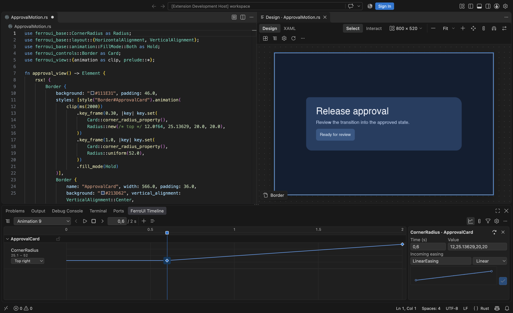

1. Seek to a time and choose **Add keyframe at playhead**, or double-click an empty part of a property track. The isolated designer samples the track at that time and adds a Rust `.key_frame(...)`. An empty mapped clip starts with Opacity.
2. Select one or more keys and open **Keyframe Actions**. **Duplicate at Offset…** copies their values and easing. Use the same menu to [copy, paste, and mirror keys](#copy-paste-and-mirror-keyframes). **Delete** removes the selected setters. With a key focused, use Ctrl+D or Command+D to duplicate at the current snap interval, or press Delete or Backspace.
3. When a cue has several setters, deleting one key preserves the other setters and their easing. Deleting the final key leaves the animation available for another key. One Undo restores the source for each edit.

Agents can preview a draft with `designer_keyframe_draft`. Call `designer_program` through `designer_studio_edit` with the accepted revision. Use `upsert_keyframe` without `previous` to insert an explicit value, `record_keyframe` to sample the accepted preview, `remove_keyframe` for a single property and time, or `duplicate_keyframes` and `remove_keyframes` with the selected key locations.

### Create and manage Rust clips

1. Select the control that should own the style. In **More Animation Actions**, choose **New animation program…**. Choose an eligible owner if prompted.
2. Enter a name, FerroUI selector, and duration in seconds with millisecond precision. The new animation appears in the active invocation’s inline `styles` and opens in Timeline. Use **Add keyframe at playhead** to start its first track.
3. Choose **Rename animation…**, **Duplicate animation…**, or **Remove animation** from the same menu. Renaming keeps the clip’s source identity. Duplicating copies its literal values, timing, and easing with a new identity. Each operation is one Undo step.

The designer stores the name and identity in a Rust comment beside the builder. It can append a clip alongside computed entries in a literal styles array. For a computed styles field, choose an enclosing control with inline styles to hold the new rule, or author the builder in Rust.

Agents use `designer_program` through `designer_studio_edit` with `create`, `rename`, `duplicate`, and `remove`. For creation, supply the current owner ID, name, selector, and duration. Read `designer_programs` after a source edit for the new clip and target IDs.

### Edit and preview visual states

1. Select the control that owns the state group. Open **Studio → States → Add state group…**, then enter a group name and an initial state name.
2. Open the group and choose **Add state…**. Select a state, then choose **Add or edit a state setter…**. Use a property such as `Opacity` on the owner, or supply the name of a descendant such as `Card` and set its `Width`.
3. Choose **Add transition…** in Rust or **Add or edit transition…** in XAML. Set the starting and destination states, then enter the duration in seconds. Choose **Any state** for a default route. Rust routes use whole milliseconds and accept native easing names or four comma-separated Bézier coordinates.
4. Choose **Preview transition…** to open the route in Timeline. Scrub to an intermediate frame, play the route, or reveal its source. **Clear state preview** restores the base view.
5. Open a state to remove it or one of its setters. Removing a state also removes routes connected to it. Use **Remove transition…** and **Remove state group** for those declarations. Each saved authoring action uses one editor Undo step.

Rust authoring works on mapped inline `visual_states` declarations. When a control has no such field, adding its first group inserts the field in the active `rsx!` invocation. Adding a sibling requires an inline array with identifiable group names. Setters use mapped numeric or geometry literals and built-in or project-registered animatable properties. Comments and surrounding Rust survive the checked source edit. [Typed Rust state examples](../README.md#rust-visual-states)

For MCP, read `designer_states` through `designer_studio_query` to get the groups, source ranges, and eligible Rust owner IDs in `creatableOwners`. Send `designer_state` through `designer_studio_edit` with the current designer revision. Use `upsert` with the complete group model for state, setter, and route changes. Use `remove` with the owner ID and group name to delete a group. Read the accepted frame again before issuing the next edit.

### Link a Rust event to a state

1. Select the event source, such as an Approve button, on the Rust canvas or in Outline.
2. Open **Studio → States → Event triggers → Link event to state…**. Choose a registered routed event, an enclosing state group, and a destination. **Click** is available on a Button.
3. Choose **Interact** on the canvas and activate the control to see the destination. In App Preview and Designer Studio, the same event plays the route from the current state. Use **Stop** in the Timeline before testing the event.
4. Select the link under **Event triggers** to change its destination, reveal the Rust call, or remove it. Each action uses one Undo step. Removing an inline state or group also removes its mapped links.

The source action writes a separate `state_trigger("Click", "Review", "Ready")` call within the control’s `rsx!` block. An unhandled routed event enters the destination in the nearest enclosing group named **Review**. The call works when compiled into the application and in the mapped App Preview with a current app build. Studio and VS Code show event choices from the control’s FerroUI metadata. [Runnable Todo Workbench example](../../../samples/TodoWorkbench/app_preview/review_states.rs)

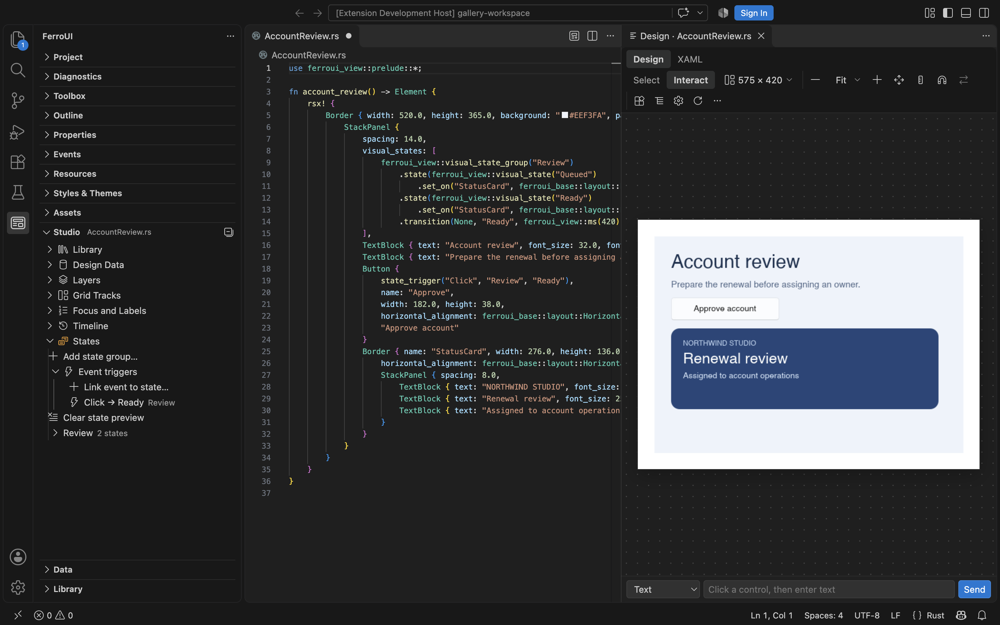

[Author state triggers with MCP](reference.md#link-rust-events-to-states-with-mcp) · [Designer Studio controls](../README.md#rust-visual-states)

### Author visual states in App Preview

1. Open a XAML view or a mapped `rsx!` invocation with a current App Preview build. Open **Visual state actions** in the App Preview toolbar and choose **New State Group**. Pick a live owner by name and source line, then enter a group name and an initial state.
2. Open the group again and choose **Add State** or **State Actions**. In a state’s actions, use **Add or Edit Setter** to enter the property, target, and value. Leave the target blank for a setter on the owner. A named target must resolve in the group’s scope.
3. Choose **Add or Edit Transition**. Set the starting state, destination, duration in seconds, and easing. Choose **Any state** for a default transition. Use a whole number of milliseconds for Rust, such as `0.64` seconds. Remove transitions, setters, individual states, or the whole group from the same actions. Removing a state also removes its routes.
4. Choose **Preview State** in an authored state’s actions or choose it under **States** in the animation picker and use **Preview state**. Choose **Preview Transition** or open a route under **State routes** to scrub its elapsed playhead. **Stop** clears the sampled pose.


App Preview uses the app’s registered animators for state poses and transitions. XAML authoring writes native style classes, setters, and animations. Mapped Rust authoring edits inline `visual_states` in the active invocation. Use Undo in the source editor to revert each operation. When the active transition or state still resolves after an edit, the first accepted frame restores its preview position.

#### Preview state bindings and resources

1. In an XAML state, use **Add or Edit Setter** to enter a literal, a binding, or a resource reference for an animatable property. The live target resolves each value using its loaded XAML scope and the app’s fixture data.
2. To try a resource-to-binding transition, open [HostedStateValues.xaml](../../../samples/TodoWorkbench/HostedStateValues.xaml) in the Todo Workbench Cargo project. Open **App Preview** with the `app-preview` feature and choose **Review metrics** in **Preview fixture**.
3. Pick **Delivery · Queued → Ready** under **State routes** and seek to 1 second. The card’s width starts at the scoped resource value of 312, passes 420, and reaches the named control’s width of 528. Its opacity moves from the dynamic resource value to the fixture’s bound value.
4. Edit `QueuedCardWidth` in XAML while the route is paused. App Preview restores the same playhead using the new resource. **Stop** removes the preview layer and restores the app’s underlying properties and bindings.

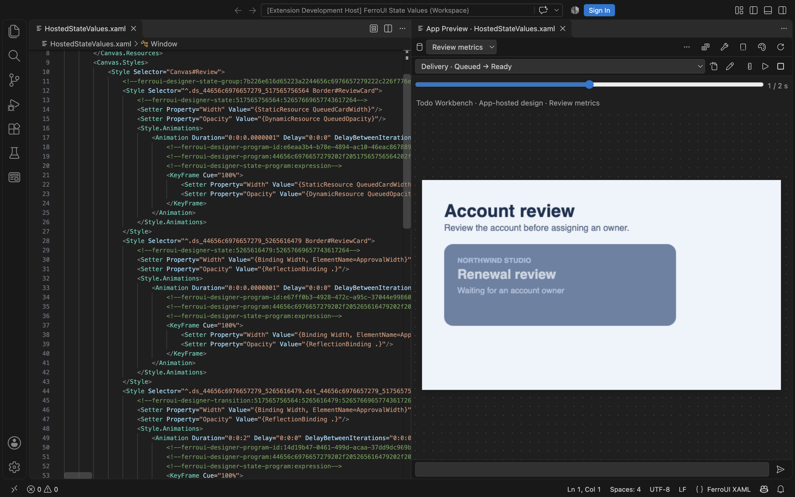

Agents can discover the state and route IDs with `designer_hosted_animations` and seek or stop with `designer_hosted_animation`. Use `designer_hosted_state_group_draft` to review changes to the authored expressions and `designer_hosted_state_group` to apply them.

To author directional XAML transitions, include `ferroui-xaml-interactions-custom` in the application and call `ferroui_xaml_interactions_custom::register_types()` before loading XAML in App Preview and in the running app. Studio uses the same `ConditionalAction` class for directional routes. [Todo Workbench registration](../../../samples/TodoWorkbench/app_preview.rs)

For MCP, read `stateAuthoring.owners` and `stateAuthoring.groups` from `designer_hosted_animations`. Pass the current app generation, revision, and frame sequence to `designer_hosted_state_group_draft` or `designer_hosted_state_group`. Use `upsert` with the complete group `model`, including states, setters, and transitions, or `remove` with `owner` and `group`. Entries with `stateRoute.endpoint` can be sampled with `seek` at `elapsed: 0` through `designer_hosted_animation`.

### Scrub a Rust state route in App Preview

1. Open the Rust view and run **FerroUI: Open App-Hosted Design**. After the app accepts the view, choose a route under **State routes** in the animation picker. Routes appear when the app can resolve their controls and registered animators. **Base → Ready** uses the current underlying values as the starting point.
2. Drag the playhead or focus it and use the arrow keys. Use **Play**, **Pause**, or **Stop** to drive the route. Stop removes the sampled layer and returns to the app’s own values.
3. Pause playback and use **Edit state route timing** to change the duration in whole milliseconds and the easing. The change to the Rust buffer uses one Undo step. **Reveal visual state in source** selects the declaration. A compatible replacement keeps its elapsed pose through the edit.
4. In Todo Workbench, choose the **Interactive review** Rust fixture to test its compiled button handlers. Stop designer playback before trying **Queued**, **Ready**, and **Reset**. The fixture’s runtime uses the logic compiled into the selected binary. The playhead samples eligible route values from the current Rust buffer. Rebuild the binary to exercise edited logic through its handlers. [App Preview setup](runtime.md#render-with-your-app-in-app-preview)

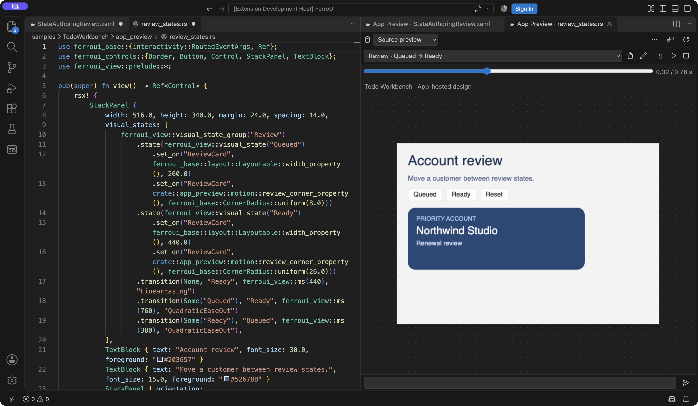

Agents can read the route details in `designer_hosted_animations`. Use `designer_hosted_animation` for playback and reveal, `designer_hosted_state_route_draft` to review the source patches, or `designer_hosted_state_route` to apply them. Pass the current app generation, frame revision and sequence. Durations in the MCP tools are expressed in seconds.

## Compare and sequence clips

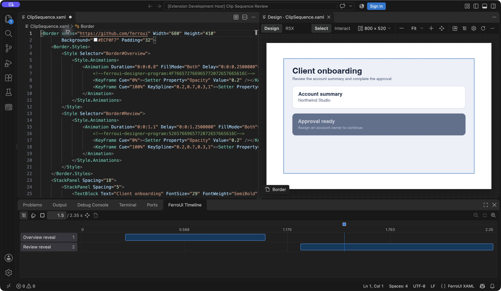

1. Open [ClipSequence.xaml](../samples/ClipSequence.xaml) in the Designer and show the Timeline. Choose **Compare animation clips**. The bars share one elapsed-time ruler. Each starts after its native delay and spans its active playback, including finite repeats and delays between iterations. A dashed bar extends to the edge of the ruler for an infinite clip.
2. Drag the playhead, click a bar to seek to its start, or enter an elapsed time and press Enter. Use **Play all clips**, **Pause clips**, and **Stop clips** to preview the artboard. Use the zoom icons or `+`, `−`, and `0` with a clip focused. Use the pan slider while zoomed in.
3. Drag an editable clip bar to change only its start. To place it precisely with the keyboard, select its row and choose **Set selected clip start**. Enter seconds and apply the change.
4. Select two or more clip names in the desired order. The numbers beside the names show that order. Choose **Sequence selected clips** and enter a **Start** and **Gap**. A zero gap places the clips end to end. A positive gap separates them. A negative gap overlaps them by that amount. An infinite clip can end a sequence. Apply the placements, then play or scrub across them.
5. Select one clip and choose **Open selected clip keyframes**, or toggle **Return to animation keyframes** to return to the keyframe view. One Undo restores every delay from the last placement operation.

Placement edits the native `Delay` attribute in XAML or the literal `.delay(ferroui_view::ms(...))` call in a mapped Rust builder. The clip keeps its authored keys, easing, fill, selector, and activation rules. The comparison clock starts clips with live preview targets together, then applies their offsets. In a running app, the selector or caller determines when each clock starts. Place clips that activate together to reproduce the shared timing in the app. Computed Rust clips and XAML delays defined by expressions remain source edits.

Agents can read each clip's `start`, `end`, and `editable` fields in `designer_programs`. Use `designer_program` with `place_clips` and the ordered `programs` IDs, optional `start`, and optional `gap` through `designer_studio_edit`. Use `scrub_all` with elapsed `time` to sample the combined pose. Studio exposes both actions directly through `designer_program`. VS Code also offers `scrub_all` in `designer_timeline_control`.

### Compare clips in App Preview


1. Open a source file inside the Cargo package and start [App Preview](runtime.md#render-with-your-app-in-app-preview). To try the walkthrough above with Todo Workbench, copy `ClipSequence.xaml` beside its `Cargo.toml` and choose **Source preview**.
2. Choose **Compare animation clips** in the App Preview animation toolbar. Drag the elapsed playhead or choose **Play all clips**. The app samples its loaded clips and draws the combined pose with its registered controls and animators. To include a clip that requires a target, open its animation and choose compatible preview controls.
3. Pause playback and drag a clip bar, or select clip names in order and choose **Sequence selected clips**. Set **Start** and **Gap** in seconds. Use **Set selected clip start** for a keyboard-only placement. XAML delays and mapped Rust delay literals update in the current buffer in one Undo step.
4. Keep scrubbing across the updated clips. When their declarations and targets resolve in the new source, the first replacement frame retains the shared playhead. Choose **Stop clips** to remove the sampled pose. Select a clip and choose **Open selected animation** to see its targets, keyframes, and curves.

App Preview shows comparison controls when the selected binary supports shared clip playback. Rebuild the binary with the current `ferroui-designer-support` to use them. A compiled Rust view fixture exposes the animation data it makes available to preview. Choose **Source preview** to edit mapped animations in the current RSX invocation.

Agents read the catalog with `designer_hosted_animations`, then use `scrub_all` or `play_all` in `designer_hosted_animation`. Pass an elapsed time in seconds as `elapsed`. Use `designer_hosted_clip_placement_draft` to review the checked patch and `designer_hosted_clip_placement` to apply it. Both accept ordered `programs`, optional `start`, and signed `gap` in seconds. Supply the current app generation, revision, and sequence with each request.

## Compare design data and environments

1. Open [PreviewStages.xaml](../samples/PreviewStages.xaml). Run **FerroUI: Show Design Data**. Add a named XAML fixture with typed JSON values, such as a string title and an array of items. Apply it once to store the design-only fixture in the view. Choose **Application values** to return to the regular bindings.
2. Run **Open Preview Stages** and use **Add Stage** to add workspace XAML views or supported RSX invocations. Pick an environment, viewport dimensions or content-fit sizing, a state, and a design fixture as applicable. Use one card for a loading state and another for a populated state, or compare light and dark variants.
3. Use **Select** to inspect a stage or **Interact** to operate its native controls. Pause a stage to hold its current image. Use **Checks** to review overflow, clipping, ineffective layout values, and accessibility in that stage. **More Actions** includes PNG export and stage settings. [Read Preview Checks](authoring.md#diagnose-a-design-time-issue)
4. Save the stages as a `.ferrostages` file. Open it again in VS Code or Studio. Each stage retains its chosen view, environment, state, and design fixture. Source changes update affected stages after a valid render is ready. [Design-time data](../design-time-data.md) · [Preview environments](../xcode-previews.md)


### Compare a high contrast stage

Use the **Environment** icon on one card and choose **High contrast** under **Theme**. Keep another card in Light or Dark to compare how the same view looks and measures under the native contrast palette. The option appears when the preview host supplies a High Contrast variant. **Checks** uses the selected card’s measured layout and colors.

The choice stays on that card and is saved in the stage set. Authored background and foreground values keep their native precedence. [Designer Studio stages](../xcode-previews.md) · [MCP stage actions](reference.md#choose-a-stage-theme-with-mcp)

### Compare locale and text size

1. Open **Environment** on a stage and choose **Locale**. Enter a language tag such as `ja-JP` or `fr-CA`. Clear the field to use the application's locale. **Direction** remains available for an independent reading-direction comparison.
2. Open **Environment** again and choose **Text size**. Enter a whole percentage from 50% to 300%. Text blocks, input text, and rich text measure at the new size within the stage's logical layout. Use **Checks** to find content that clips at the larger size.
3. Keep a second card at 100% to compare. Save the stage set to reopen the same settings in VS Code or Studio.

Locale supplies the preview's text language and its default binding converter culture. The native host's registered formatting data determines localized numbers and dates. A binding's explicit converter culture takes precedence. [Studio environment settings](../xcode-previews.md#environments-and-sizing) · [MCP text environment](reference.md#set-stage-locale-and-text-size-with-mcp)

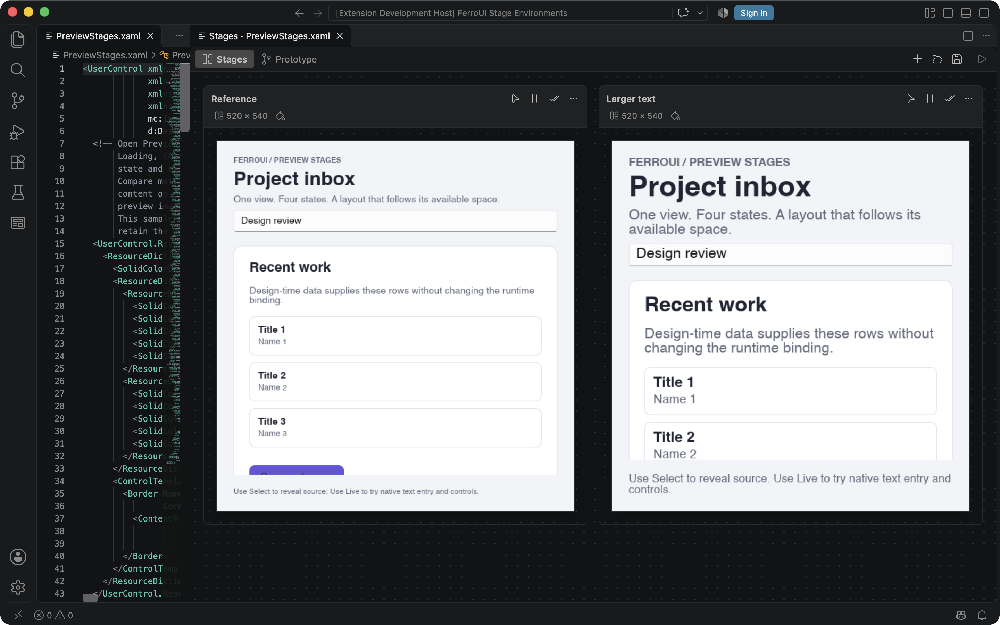

[Environment picker with the Japanese locale and 150 percent text size](../images/vscode-stage-text-environment.png)

### Inspect accessibility on a stage

Open **Checks** on the card you want to review. **Findings** includes missing accessible names, low text contrast, clipped layout and text, and ineffective layout values. **Tab order** shows one pass of the stage's native keyboard navigation. **Accessibility tree** uses native roles and accessible names and identifies disabled or offscreen peers.

Type a name or role to filter the picker. Choose a mapped row to reveal its XAML element or RSX control in the editor. Compare the Tab order in a reference card with a card that uses a different size, fixture, or state. Inspection keeps focus and source intact. [MCP reports](reference.md#read-preview-checks-with-mcp)

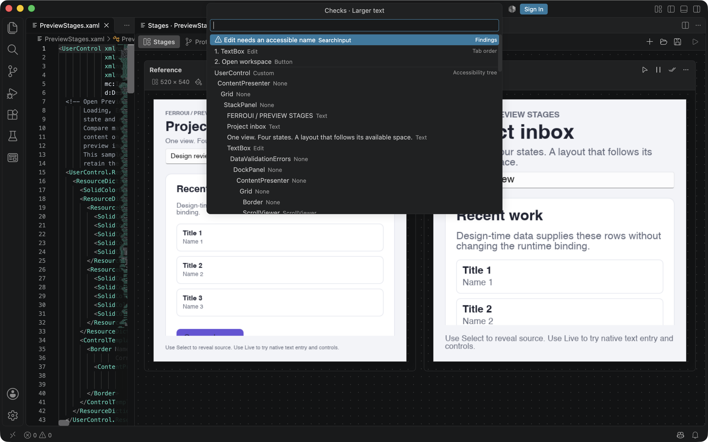

### Use the keyboard in a stage

1. Switch a ready stage to **Interact**. Choose **Keyboard input for** the stage with the **abc** icon, or click a control directly on the artboard.
2. Use Tab and Shift+Tab to move through its native controls. Press Enter or Space to activate a focused button, or type or paste into a focused text field. The artboard shows the focused control’s name and role when available.
3. Press Escape to return to the card toolbar. Each card has its own temporary control values. Pausing the card or editing its source ends keyboard input.


Use an updated preview helper for stage keyboard input. While playing a prototype, use the player’s interaction controls to follow its authored links. [Stage automation](reference.md#send-keyboard-input-to-a-stage)

### Try touch and pen on a stage

1. Open a ready XAML or Rust stage and turn on **Interact**. Choose **Environment** → **Pointer input**.
2. Choose **Current device** to use the mouse, touch, or pen reported by VS Code. Choose **Touch** or **Pen** to try that device with a mouse or trackpad. Keep a second stage on its current device to compare interactions.
3. Press and drag a native control, such as a slider, on the artboard. The active contact continues to its captured control when it moves beyond the artboard. Pause the stage or switch away to clear the gesture and release its capture.

The pointer choice travels with the stage set and applies to the card’s retained native view. A physical pen supplies pressure, tilt, and rotation when VS Code reports them. The updated preview helper also accepts native touch and pen contacts from agents. [Pointer automation](reference.md#send-pointer-contacts-to-a-stage)

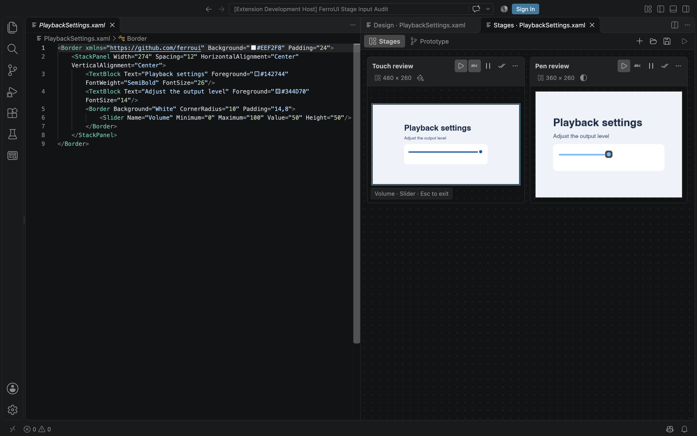

## Play a prototype

Switch the Stages board to **Prototype**. Each flow lists its starting stage, which the play button also announces to screen readers. Hover a shortened name in a narrow tab to read it in full. Use the play button beside a flow or choose **Play Prototype** from the toolbar.

Drag a stage title onto a destination or choose **Add interaction** to add a source-anchored trigger. Choose a native control, set the target stage or overlay, and use **Reveal trigger** to review the authored source. An overlay can set its placement, dimming, and dismissal. Save the stage set to reopen the same graph in Studio or run a [prototype scenario](runtime.md#run-a-native-ui-scenario). [Prototype authoring](../prototyping.md)

### Set a prototype transition

1. In **Prototype**, choose an interaction and select **Transition…**.
2. Choose **Dissolve** or a slide direction. Enter a duration in milliseconds and choose an easing. The connection displays the effect and duration.
3. Play the flow. A screen slides over the previous view. A dialog slides inside the current artboard while the covered controls stay in place. Try **Back** or **Close overlay** to see the reverse motion.

Choose **Instant** to remove a transition. Save the stage set to share the settings with Studio. VS Code’s Reduce Motion preference takes effect during playback. [Studio transition guide](../prototyping.md#animate-an-interaction)

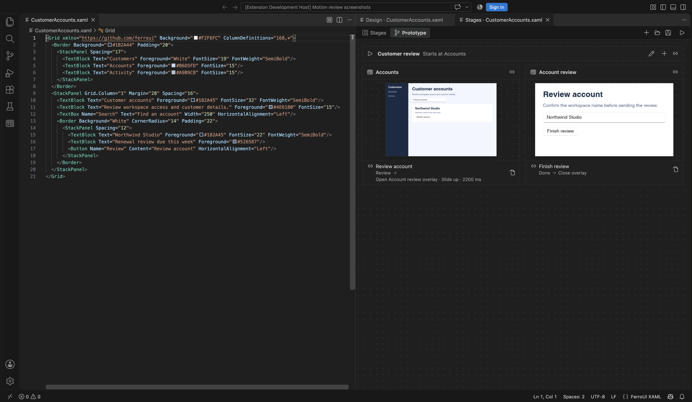

The sheet moves into the clipped artboard while the Accounts screen stays in place. [Slide-up playback capture](../images/vscode-prototype-sheet.png)

### Operate a native prototype

1. Play a flow and click a native control, or choose **Keyboard input** from the playback toolbar. Type into an active field or use Tab and Shift+Tab to move. Press Enter or Space to activate a focused interaction.
2. Open an overlay. Its native controls receive focus, and Tab cycles within the overlay. Open a second overlay to test a stacked dialog. Use Escape or **Close overlay** to return to the previous layer. Its opener regains focus when it is still available.
3. **Back** closes the top overlay first and then returns through the flow’s screen history. **Restart prototype** returns to the flow’s start while retaining your playback values. **Exit Prototype** followed by Play starts a fresh run.

The native artboard includes the base view, clipped overlays, and dimming. The playback toolbar and named interactions stay available for design review. While typing in a modal, the status on the artboard announces the focused control’s accessible name and role. [Prototype automation](reference.md#drive-the-native-prototype-player)

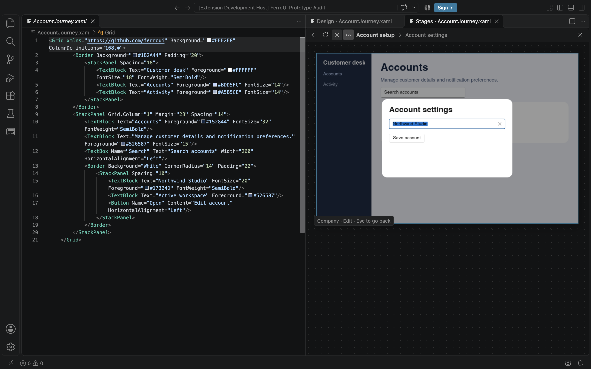
