Use App Preview for a view mounted with your app’s registered controls and data. Use Live App for the actual application windows of a managed or attached session. Both are available beside the source editor.

## Render with your app in App Preview

1. Provide an opted-in Cargo binary that calls `RemoteDesignerEntryPoint::run_if_requested` from `ferroui-designer-support`. Register the app’s loader, types, assets, and theme in that entry point. If you use `FerroRuntimeXamlLoader`, enable the Cargo feature `ferroui-markup-xaml-loader/source-overlays` so App Preview can load workspace dictionaries and unsaved includes. The [Todo Workbench setup](../../../samples/TodoWorkbench/README.md) includes a working `app-preview` target.
2. Open the XAML or mapped RSX file and run **FerroUI: Open App-Hosted Design**. Select the binary with the preview feature enabled. If its registered markup assembly differs from its Cargo package name, set `ferroui.hostedPreview.assembly`.
3. Choose **Source preview** to mount the current buffer. For app-supplied state, use a registered data context fixture or Rust view factory. DataContext fixtures render the current source against an app model. RustView fixtures mount an actual compiled Rust view, including dynamic children and handlers.
4. Send native input to the frame. For supported animations, choose the clip and target in the toolbar, then play, pause, or enter a pose with the elapsed playhead. Use **Animation graph** to choose **Value curves** or **Velocity curves**. Both displays sample the app’s animator at authored times while the elapsed playhead stays in place. Drag a supported key or open **Edit application keyframe**. Apply a validated source-backed XAML or mapped Rust change in one Undo step. Agents can request `metric: "velocity"` inside the `designer_hosted_curve` arguments.

For a supported geometry or color track, use the component picker beside its scale. Relative points and scalars offer separate percentage and pixel curves when their units change during playback. The app’s registered animator supplies the samples. Agents can read the track’s `curve_channels` from `designer_hosted_animations` and pass the selection as `channel` to `designer_hosted_curve`. [Inspect a curve that changes units](motion.md#inspect-a-curve-that-changes-units) · [Inspect a color animation](motion.md#inspect-a-color-animation)

For `BoxShadow`, the picker lists each shadow’s offsets, blur, spread, and tint. Select a supported key to edit the list or add a key from the sampled app pose. [Animate layered box shadows](motion.md#animate-layered-box-shadows)

On a gradient brush track, use the component picker to compare native color stops and direction or geometry. Record the complete sampled brush with **Add keyframe at playhead**. [Animate a gradient brush](motion.md#animate-a-gradient-brush)

For a whole `RenderTransform` track, choose a numbered operation or a coefficient of the combined transform. The native app supplies the value and velocity samples. [Animate a transform list](motion.md#animate-a-transform-list)

Choose **Compare animation clips** to use a shared elapsed ruler for the app’s native clips. Place XAML or mapped Rust clips with a drag or the keyboard, then use **Play all clips** to check the native result. A compatible source update retains the combined pose. [Compare clips in App Preview](motion.md#compare-clips-in-app-preview)

Open **Keyframe lanes** on one app-hosted clip to select across its tracks, retime or duplicate keys, and transfer typed keys between designers. Use **Authored time** to position paste, scale, and mirror operations while keeping the sampled app pose. [Edit several keys in App Preview](motion.md#edit-several-keys-in-app-preview)

Open **Animation clip actions** to create a clip on a live style owner or to rename, duplicate, or remove an authored clip. Each operation is one source edit. [Manage clips in App Preview](motion.md#manage-clips-in-app-preview)

Use **Preview range** to loop an elapsed interval or hold the app’s exact Out pose for review. It works with one animation or the shared clip ruler. [Rehearse a range in App Preview](motion.md#rehearse-a-range-in-app-preview)

App Preview holds its accepted image through compilation and invalid edits. A replacement frame can decode while another window covers VS Code. If the app rejects the new preview while building or showing the view, read the error in App Preview and correct the source or fixture. For a compatible replacement, the first frame can restore the paused pose, selected animation, and targets. A playing preview resumes its elapsed position when the replacement supports it. Test the hosted examples with [HostedPreview.xaml](../../../samples/TodoWorkbench/HostedPreview.xaml) and its app fixtures. [App preview integration and registered animator examples](../../../samples/TodoWorkbench/README.md)

Edit a workspace dictionary or style included by the current view and watch App Preview update before saving. Literal XAML includes are followed through nested dictionaries. The editor uses the selected package’s build metadata to locate file-backed compiled includes and resolves relative project files against their declaring document. A broken include pauses interaction on the retained image until you repair it. App Preview and the `designer_hosted_*` MCP tools share these revisions. Rebuild an older preview binary with the current `ferroui-designer-support` to enable included drafts. Registered Rust view fixtures use their compiled view factory.

Open **Visual state actions** to edit groups, setters, and transitions in XAML or mapped Rust. XAML state poses and routes resolve bindings and resources in the app’s live scope and sample its registered animators. A compiled Rust fixture uses its ordinary application clock for input and state handlers. [Preview state bindings and resources](motion.md#preview-state-bindings-and-resources)

Use **App Preview Property Transitions** to edit a source-backed XAML or mapped Rust collection with properties and transition classes from the running app. Click inside the accepted native frame to trigger changes on its controls. [Edit and test a transition](motion.md#edit-property-transitions-in-app-preview)

### Interact with App Preview from an agent

1. Enable `ferroui.mcp.allowWrites` in User Settings. In a trusted workspace, open the design and its App Preview with
   `designer_open` and `designer_hosted_open`. Use the design’s `session` for the following calls.
2. Read `designer_hosted_image` and pass its generation, revision, and sequence as
   `expected_generation`, `expected_revision`, and `expected_sequence` to `designer_hosted_input`.
   Use `input.type` set to `click` or `scroll` with `x` and `y` between 0 and 1. A scroll also takes
   a signed wheel `delta`.
3. Click a native text field, read the current frame, then send `input` with `type: "text"` and the
   text to enter. Read the next image to inspect the result. Each input receipt identifies the
   frame that accepted the gesture. If the preview reports a changed frame, recapture it before sending input.

These gestures use the app’s native input path and keep the authored source buffer intact.
[MCP reference](reference.md#drive-an-editor-workflow)

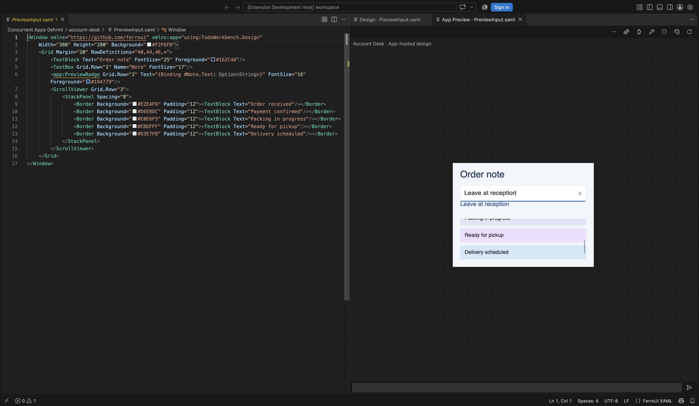

To use the toolbar’s **Refresh** action from an agent, read `designer_hosted_fixtures` and pass its `generation` and `revision`
to `designer_hosted_refresh` as `expected_generation` and `expected_revision`. The refresh reads the current source and workspace
dependencies. Wait for `designer_hosted_image` to return the new revision before sending further input.

### Edit a palette in App Preview

1. Open an XAML App Preview with the current `ferroui-designer-support` and choose the **App Preview palette** color icon in the toolbar.
2. Choose the view or one of its included XAML files, then select the palette scope. **Compare theme colors** shows where Light, Dark, and available High contrast colors resolve in the app’s resource graph. Scopes that inherit all their colors open in this mode. The source icon opens the corresponding declaration.
3. In the layer view, change a swatch or enter a color. Use **Add palette color** to add a color or solid brush to the selected layer. For a new High contrast layer, choose a theme provider registered by the app.
4. Check the updated frame before saving. The owning XAML buffer receives one undoable edit. If the buffer changes while a palette action is open, wait for the next accepted preview and try again.

The palette follows workspace and mapped compiled includes from the accepted frame. For keyed aliases and supported brush references, the comparison shows the resolved color and the source icon opens the literal supplying it. Hover the icon to see the reference chain. Rebuild the preview binary if the color icon is missing on an XAML view. [Follow a color alias](styles.md#follow-a-color-alias) · [Palette MCP tools](reference.md#edit-an-app-preview-palette-with-mcp)


[See an unsaved color edit in the owning dictionary and the updated native frame](../images/vscode-app-preview-palette-edit.jpg)

### Edit styles and control themes in App Preview

1. Open an XAML App Preview and choose **App Preview Styles & Themes** beside the palette icon. Select the source file and the authored definition. The file picker includes XAML loaded through resource and style includes. App Preview builds publish the Cargo package schema for application-registered target types and setters. Run **FerroUI: Build Project XAML Schema** for the package if you need to refresh it.
2. Edit the **Selector** or a literal setter value. Use the plus icon beside the definition to add a writable property, the link icon to choose a compatible resource, and the source icon to open the exact declaration. The discard icon removes a setter. Binding expressions and XAML object values have source navigation.
3. Choose a control theme to change **Based on**. The picker checks the target type and follows the authored inheritance chain across included dictionaries. Resources and base themes come from the accepted scope. A setter resource must resolve to a compatible value across its authored variants.
4. Use **New style or control theme** to add a declaration to a style or resource host in the selected file. Watch the native preview update before saving. Use editor Undo in the owning file to reverse the change.


[See cross-file control-theme inheritance in App Preview](../images/vscode-app-preview-control-theme.jpg) · [App Preview style MCP tools](reference.md#edit-app-preview-styles-with-mcp)

The same toolbar opens inline Rust styles when App Preview is rendering an RSX invocation. Edit selectors and typed setters or create a nested rule in the Rust buffer. Under **Color resources**, choose a layer to edit, assign a compatible color key, or compare the resolved Light, Dark, and High contrast colors. The source icon opens the supplying Rust declaration. After each accepted edit the app draws the new frame without a Cargo rebuild. [Edit inline Rust styles](styles.md#edit-inline-rust-styles) · [Edit Rust style colors](styles.md#edit-rust-style-color-resources) · [App Preview screenshot](../images/vscode-app-preview-rust-style.jpg)

### Open and copy App Preview control templates

Open an XAML view with **FerroUI: Open App-Hosted Design**, then choose the **App Preview Templates** icon in its toolbar. The picker shows controls whose templates were identified when the application loaded the accepted XAML snapshot. Choose a control, then choose **Open Template Source**. VS Code opens the supplying XAML beside the preview, including an included theme with a separate packaged resource address.

Choose **Make Inline Copy** to customize an inherited template at the control's declaration. FerroUI checks resource references in the original and destination scopes, carries over required definitions, and applies the copy to the previewed buffer in one Undo step. Other declarations continue to use the shared template. Use **Open Template Source** to inspect a shared definition or a template with dependencies that need attention.

Rebuild the preview binary with the current `ferroui-designer-support` to enable this toolbar action. The picker covers controls in the previewed XAML and template definitions from that file or the accepted workspace includes. [App Preview template tools](reference.md#inspect-app-preview-templates-with-mcp)

### Trace item and cell templates in App Preview

1. Open the XAML view or the Rust file that owns the RSX invocation. For Rust, choose the app's registered design fixture and select the invocation it mounts.
2. In **App Preview Templates**, choose a control or column and its template property. Choose **Open Template Source** to open the effective inline or shared definition. XAML definitions can come from accepted workspace dictionaries.
3. For a mapped Rust template, use **Open Template Assignment** to see where the control or column received it. Choose **Open Template in Design** to edit the RSX body using the existing canvas and source tools.

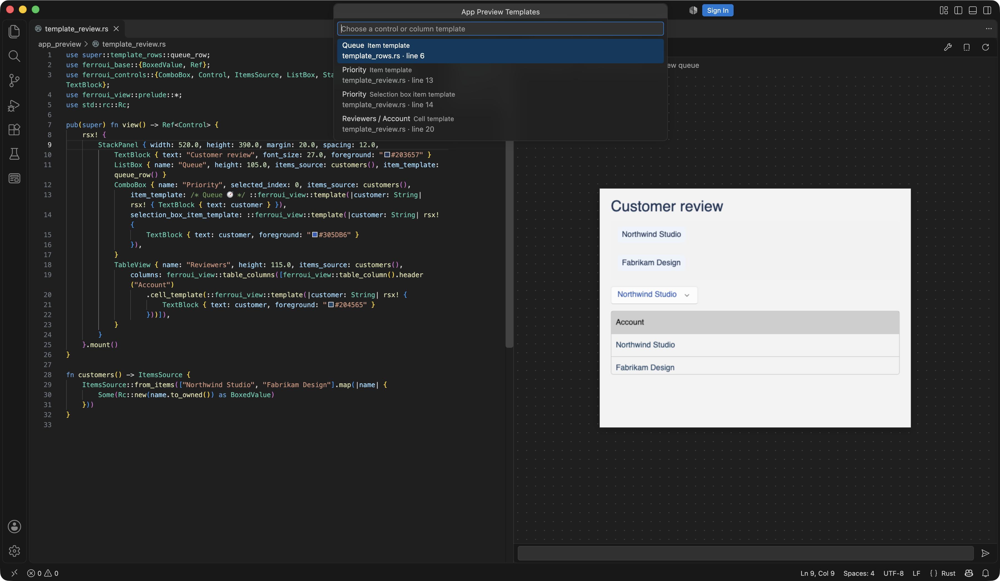

Rust source actions use the active debug build's source records. App Preview follows the Cargo features reported for the selected executable and checks the control and template against the accepted frame. If your shared factory uses `template(...)`, use fixture data that renders an item so the app can identify the declaration. Use `ferroui_view::template!(...)` to record its source before the first item renders. After a source change, save and rebuild the app-hosted fixture when required. Reopen the picker after the frame updates. [Register app preview fixtures](#render-with-your-app-in-app-preview) · [App Preview template tools](reference.md#inspect-app-preview-templates-with-mcp)

[See the shared Rust template selected in source beside the retained app frame](../images/vscode-app-preview-template-source.png).

#### Inspect TreeDataGrid display and editing templates

1. Open the grid's XAML or RSX view in App Preview with rows in its data source. Try **Account hierarchy** in [Todo Workbench](../../../samples/TodoWorkbench/README.md).
2. Open **App Preview Templates**. Search by the grid or column header, then choose **Cell template** for the displayed cell or **Cell editing template** for the editor. A template inside an expander appears under its inner column's header.
3. Open the definition. For a resource-key column, the source link follows the dictionary the app resolved when the cell was realized. For a Rust column, you can also open the assignment in the column builder or open the definition in Design.


Source links are available for runtime templates paired with a verified declarative column. Keep a row visible when inspecting resource-key columns so the app resolves their templates. If the app provides columns through a separate `Source` or `Model`, open those authored definitions in the application code.

#### Record an unmounted Rust template's source

Use `ferroui_view::template!` in a Rust file that defines a shared template, such as a cell editor in its own module. Pass the same closure you would give to `ferroui_view::template`.

```rust
use ferroui_controls::{templates::IDataTemplate, TextBox};
use std::rc::Rc;

pub fn review_editor() -> Rc<dyn IDataTemplate> {
    ferroui_view::template!(|_: String| ferroui_view::rsx! {
        TextBox { placeholder_text: "Review status" }
    })
}
```

Call `review_editor()` from the grid column's `.cell_editing_template(...)` setter and build the application in debug mode. **App Preview Templates** can open the RSX body and reveal the assignment while the grid is showing its display cells. **Live App Templates** can open the factory before the cell enters editing mode. The editor checks both source links against the build that supplied the template. [Try this in Todo Workbench](../../../samples/TodoWorkbench/app_preview/template_rows.rs)

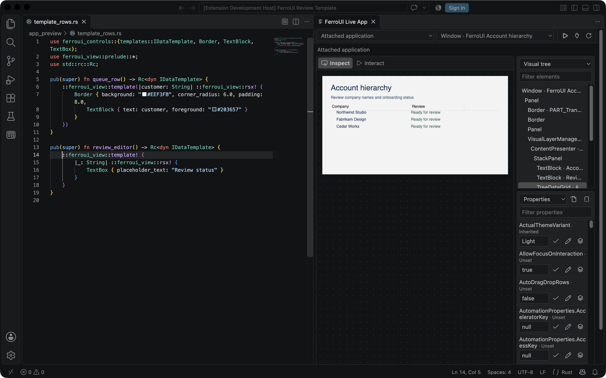

### Edit a shared Rust palette in App Preview

1. Use a `const` initialized with a supported color constructor in a module of the selected Cargo binary or its package library. For example, declare `mod brand;` in the crate root and reference `crate::brand::ACCENT` from an inline `.resource("Accent", crate::brand::ACCENT)` call. Named imports and re-exports also work.
2. Open **App Preview Styles & Themes** and select the rule. Choose the color’s source icon to open the initializer in its module. **Compare Rust theme colors** follows the same source for each appearance.
3. Use the change-color icon. Choose **Edit const** with the owning file shown in the picker to update the shared declaration. Choose **Use a local color** to change only the selected registration. Check the updated frame and use Undo in the edited buffer to restore it.

App Preview follows explicit module declarations in the owning Cargo target, including literal `#[path]` declarations in that package. It reads open drafts before the saved module. An invalid draft in the accepted module tree retains the previous frame while you repair it. Conditional and computed providers use Rust source navigation. [Rust color authoring](styles.md#edit-a-shared-rust-color) · [MCP actions](reference.md#edit-rust-styles-with-mcp)

## Hot reload and debug the running application

1. From a trusted Cargo workspace, run **FerroUI: Run with Hot Reload**. Select a development binary. Try `hot-reload-demo` for registered XAML or `view-gallery` for reactive RSX. Use `ferroui.hotReload.targets` to name an exact Cargo manifest, package, binary, feature set, or argument list.
2. Save a change to a registered XAML view or resource, or change an eligible `rsx!` literal read by a mounted reactive view. Inspect the outcome in the status bar, **Hot Reload Output**, or **Diagnostics**. An accepted in-place update keeps the app’s PID. An unsupported structural edit or Rust logic change builds a candidate. The currently running app remains available until the new one acknowledges startup.
3. If the save is rejected or the build fails, inspect the logged message and correct the file. Save again or run **Rebuild Hot Reload Application**. A successful structural rebuild gets a new PID. It retains compatible application state when the app supplies the corresponding handoff or persistence.

VS Code keeps an executable copy next to the Cargo binary for each running candidate. When an app retires or stops, the hot reload session waits for its copy to be removed. If the file stays locked, **Hot Reload Output** reports the copy that could not be removed.
4. To debug, configure a Rust attach request in `launch.json` using `${command:ferroui.hotReload.processId}` for the adapter’s process ID field. Run **Run and Debug with Hot Reload**, or choose **Attach Debugger to Managed App** for an existing session. The extension reuses the selected attach configuration after a replacement acknowledges startup.
5. Use **Stop Hot Reload Application** to end the managed session. For supported projects with explicit Rust patch slots, choose **Run with Registered Rust Patches** to start the owning supervisor. Configure its Python and pinned patch compiler when needed.

The XAML app must register a `ReloadManifest` and a `HotReloadSession` and acknowledge its startup. For RSX, use a debug binary with `ferroui-view`’s `hot-reload` feature and a compatible `launch` integration. [Framework reload prerequisites and registered patch workflow](../../development/hot-reload.md)

### Run several app sessions

1. Open **FerroUI → App Sessions** and choose the run icon. Pick a Cargo target. Repeat to launch another package, binary, or configuration. Running the same Cargo target with the same features and arguments selects its existing session and retries it if startup previously failed.
2. Choose a session in the tree to open its own Live App editor. Move the editors into separate groups to work with two native windows at once. The session stays pinned through in-place reloads and successful rebuilds. Choose **Open Live App** from the Command Palette for an editor with a session picker.
3. Use a row’s rebuild or stop icon to act on that app. The row’s context menu opens its build output, attaches a configured debugger, or makes it the managed app used by the status bar and Diagnostics. **Detach Debugger from This App** ends that app’s debugger connection and stops following future replacements. The app and its Live App editor stay connected. **Stop All Hot Reload Applications** stops every managed session. [Debugger controls for agents](reference.md#detach-a-debugger-with-mcp)

For a managed Windows app using LLDB DAP, use **Detach Debugger from This App** when the app should keep running. FerroUI selects LLVM’s local Windows process backend in the managed attach configuration and waits for LLDB to acknowledge disconnect. The request reports an error if LLDB fails to acknowledge within 15 seconds. [LLVM adapter environment](https://github.com/llvm/llvm-project/blob/llvmorg-23.1.6/lldb/tools/lldb-dap/extension/src/debug-adapter-factory.ts#L191)

If you start a separate LLDB DAP server and connect with `debugAdapterPort`, start that adapter with `LLDB_USE_LLDB_SERVER=0` on Windows. For older LLDB DAP extensions that configure the adapter through `lldb-dap.environment`, set `LLDB_USE_LLDB_SERVER` to `"0"` in that setting.

Use **Attach Debugger to This App** to reconnect to the same running process. Requesting its current configuration again keeps the active debugger. Selecting a different configuration detaches the current debugger first and checks that the selected process is still current before attaching.
4. To attach an independently launched app or Designer Studio, choose the connection icon in **App Sessions** and enter its loopback MCP address and bearer token. A successful connection adds a row. Disconnect from that row to close the inspector connection. The independently launched process keeps running. The Live App editor requires a server with native window inspection.

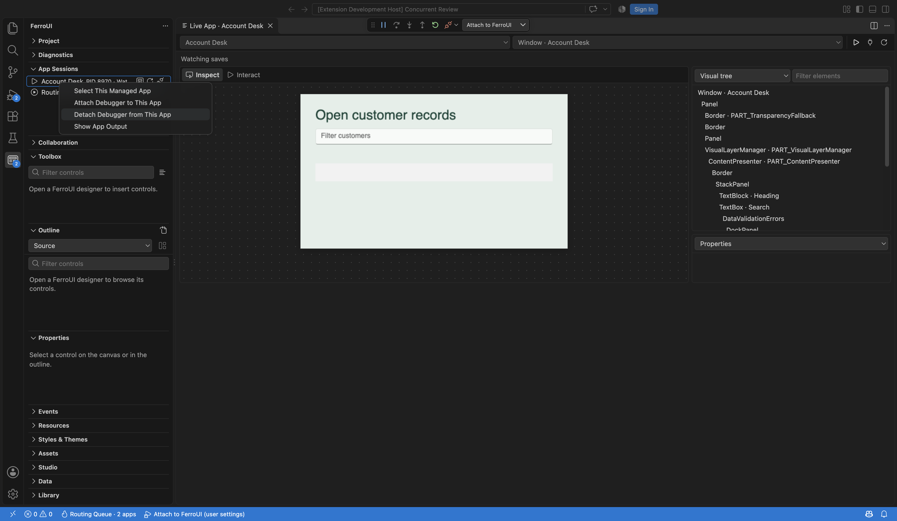

An attached debugger adds a debug icon to its app row. Hover or focus the row to read its attachment state. At a breakpoint, **App Sessions** and **Live App** show **Paused in debugger** for that session. **Disconnect** in VS Code’s debug toolbar updates the row while Live App stays connected. If the debugger follows a rebuild, the row reports the new attachment after the replacement connects.

A save can affect one app or several. The extension tracks each app’s Cargo package and local dependencies, along with XAML watched by that process. Builds sharing one Cargo output directory take turns through compilation and executable staging. Each running app keeps its own PID, reload outcomes, debugger, and window selection. [Target app sessions with MCP](reference.md#target-app-sessions-with-mcp)

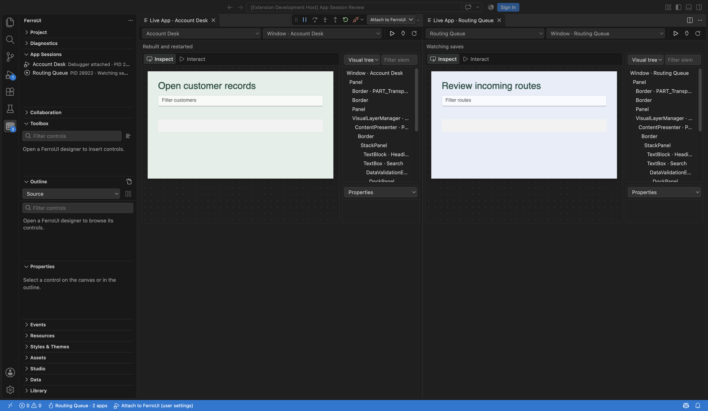

### Inspect a paused app

When a debugger opened by FerroUI stops at a breakpoint, Live App keeps its last frame and ends keyboard capture. Use VS Code's Run and Debug view to inspect the callback. In **App Sessions**, choose the Continue icon on the paused app's row. From the Command Palette, run **FerroUI: Continue Paused App** and pick a session if several apps are paused. This resumes the chosen app even when a separate debugger is active in VS Code. Live App resumes polling the same session.

Continue before sending another inspector request through Live App or the editor MCP bridge. An input action that triggered the breakpoint can finish after Continue. If its request expires during a longer pause, check the app before repeating it. [Continue a paused debugger with MCP](reference.md#continue-a-paused-debugger-with-mcp)

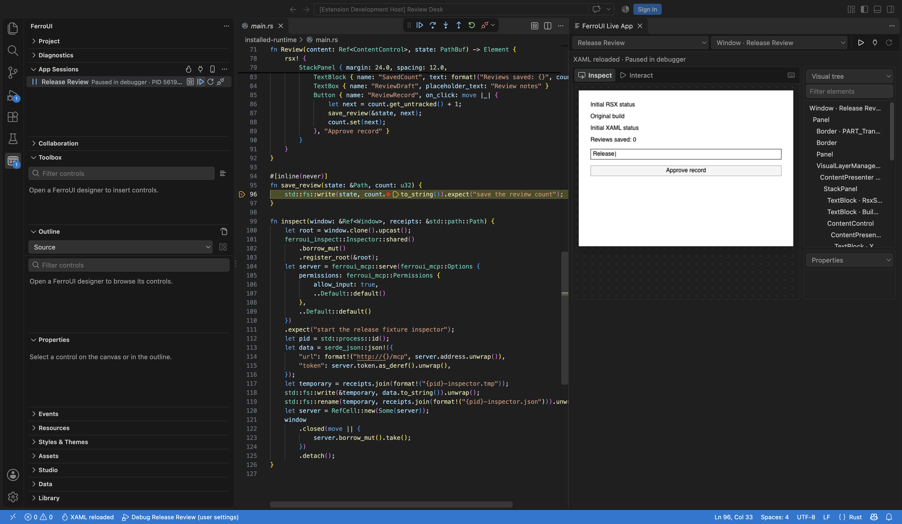

An independent session keeps its frame and inspector while another app stops. [Paused and running sessions side by side](../images/vscode-native-debugger-pause.png)

### Run an app on an iOS simulator

Open a trusted workspace on the Mac running Xcode. Boot an iOS simulator and build a simulator app with an opted-in FerroUI MCP inspector. To try the Contact Review example from the FerroUI repository root, run:

```sh
rustup target add aarch64-apple-ios-sim
scripts/ios/bundle.sh --package ferroui-ios --example simulator_inspector \
  --no-default-features --features quartz-metal,inspector-example \
  --bundle-id org.ferroui.simulator-inspector
```

In the owning workspace folder’s settings, add a profile that uses the app’s bundle identifier. Set `appPath` to install the built bundle when you launch. Leave out that field to use the app already installed on the chosen simulator.

```json
{
  "ferroui.iosSimulator.apps": [
    {
      "id": "contact-review",
      "label": "Contact Review",
      "bundleId": "org.ferroui.simulator-inspector",
      "appPath": "target/ios-bundles/simulator_inspector.app",
      "args": ["--mcp", "--mcp-input"]
    }
  ]
}
```

1. In **App Sessions**, choose the device icon for **Open Mobile App** and choose **Run iOS Simulator App** if VS Code offers several workflows. Select the profile and booted simulator. The command installs the optional bundle, launches it, and opens Live App after its inspector and native frame are ready.
2. Use **Inspect** to pick controls, read their properties or accessibility information, and reveal mapped source from a matching debug build. Use **Interact** if the app enabled inputs. The example opts into inspection with `--mcp` and enables input with `--mcp-input`.
3. Choose **Stop or Disconnect This App** on the simulator session to stop it. Running the same profile on the same device focuses its existing Live App session. To deploy a new build or switch launch profiles, stop the session, then run the desired profile. Use **Connect to Running MCP Server** to inspect an independently launched app without restarting it.

A launch starts or restarts the chosen bundle on the selected simulator. Multiple app sessions appear in the same view. [iOS simulator MCP tools](reference.md#run-an-ios-simulator-app-with-mcp)

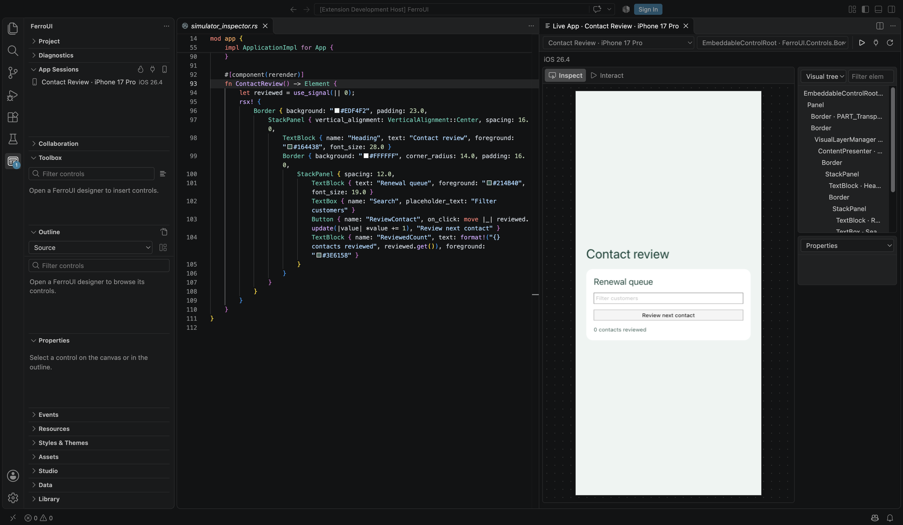

#### Build and redeploy simulator apps from source

Use a trusted workspace on the Mac running Xcode. Install the matching iOS Simulator Rust target and boot a simulator. Replace `appPath` with `build` in the profile. This profile builds Contact Review from the FerroUI workspace.

```json
{
  "ferroui.iosSimulator.apps": [
    {
      "id": "contact-review",
      "label": "Contact Review",
      "bundleId": "org.ferroui.simulator-inspector",
      "args": ["--mcp", "--mcp-input"],
      "build": {
        "application": "contact-review",
        "reloadOnSave": true
      }
    }
  ]
}
```

1. Choose **Run iOS Simulator App** or **Run and Debug iOS Simulator App**. App Sessions opens the pinned Live App editor while Cargo builds. FerroUI then installs the simulator bundle and verifies its inspector, process and first frame.
2. Choose **Rebuild This App** on the session row. With `reloadOnSave` enabled, saving Rust, XAML, or Cargo inputs owned by the selected package or a local dependency queues the same build. The running app stays available during compilation. Source saved again during compilation takes precedence before deployment.
3. Check **Show App Output** for compiler, deployment and debugger output. **Diagnostics → Hot Reload History** records the outcome of each queued save. A failed compile leaves the running process available. If a deployment replaces the process and fails to start, FerroUI tries to restore the last accepted bundle. Live App keeps its last frame through the restart.
4. An attached debugger detaches before deployment and follows the next accepted process. Choose **Disconnect** in VS Code’s debug toolbar to stop following replacements and leave the app running.

For your own app, set `build.package` and either `build.binary` or `build.example`. Set `build.toolchain` to the FerroUI checkout that supplies `scripts/ios/bundle.sh`. Use `build.manifestPath` for a nested Cargo workspace, and configure `build.features` and `build.noDefaultFeatures` as needed. The package uses the workspace lockfile and Cargo output directory. Set `build.target` if the default for the VS Code workspace host differs from the simulator target you need. [Rust iOS targets](https://doc.rust-lang.org/rustc/platform-support/apple-ios.html) · [iOS simulator MCP tools](reference.md#run-an-ios-simulator-app-with-mcp)

#### Debug Rust on an iOS simulator

Build the simulator bundle with Rust debug symbols, such as the Contact Review example’s default `dev` build. Keep the matching build outputs for source breakpoints. Install **LLDB DAP** in VS Code on the workspace Mac. If the adapter needs an explicit executable path, run `xcrun --find lldb-dap` and use that path in `lldb-dap.executable-path`. [LLDB DAP setup](https://lldb.llvm.org/use/lldbdap.html)

Add an attach configuration to the app’s workspace folder in `.vscode/launch.json`.

```json
{
  "version": "0.2.0",
  "configurations": [
    {
      "name": "Attach to Contact Review",
      "type": "lldb-dap",
      "request": "attach",
      "pid": "${command:ferroui.hotReload.processId}"
    }
  ]
}
```

1. Choose **FerroUI: Run and Debug iOS Simulator App** from the Command Palette or **Open Mobile App**. Pick the app profile and booted simulator. For a running simulator session, use **Attach Debugger to This App** in its App Sessions context menu.
2. If several attach configurations are available, choose the one for the app’s workspace folder. FerroUI waits for the app’s first frame and supplies the PID of the installed app that owns the session’s authenticated inspector. Use **Show App Output** on the session row if attachment fails.
3. Set a breakpoint in an event handler in your Rust source. In Contact Review, set it inside `review_next_contact` and choose **Review next contact** in Simulator or through **Live App → Interact**. Use **Continue** to resume the app and its inspector.
4. Use **Disconnect** in VS Code’s debug toolbar to detach and keep the simulator app running. To end both the debugger and the app, choose **Stop or Disconnect This App**. For a prebuilt bundle, stop the session before running the updated bundle. For a source profile, choose **Rebuild This App**.

[Attach a simulator debugger from an agent](reference.md#run-an-ios-simulator-app-with-mcp)

### Run an app on an iPhone or iPad

Open a trusted VS Code workspace on the Mac running Xcode. Pair the iPhone or iPad in **Xcode → Window → Devices and Simulators**, enable Developer Mode, and connect the device. Use a development-signed iPhoneOS build with the FerroUI MCP inspector set to `ferroui_mcp::Transport::Stdio`. The Contact Review example enables this transport with `--mcp-stdio` and permits Live App input when you also supply `--mcp-input`. [Xcode command-line tools](https://developer.apple.com/documentation/xcode/xcode-command-line-tool-reference) · [Developer Mode](https://developer.apple.com/documentation/xcode/enabling-developer-mode-on-a-device)

To assemble the Contact Review bundle, run the following from the FerroUI checkout. Replace the example identifier with one in your development provisioning profile.

```sh
rustup target add aarch64-apple-ios
scripts/ios/bundle.sh --target aarch64-apple-ios --package ferroui-ios \
  --example simulator_inspector --no-default-features --features quartz-metal,inspector-example \
  --bundle-id com.example.ContactReview --out build/device
```

Sign the resulting bundle with your development certificate, profile, and entitlements. Keep the matching sources and symbols to use Rust breakpoints and reveal controls in Live App. [iOS bundle packaging](../../porting/ios-platform.md#5-packaging-without-an-xcode-project)

Add a profile to the workspace folder’s `.vscode/settings.json`. Match the bundle identifier in your signed build.

```json
{
  "ferroui.iosDevice.apps": [
    {
      "id": "contact-review-device",
      "label": "Contact Review",
      "bundleId": "com.example.ContactReview",
      "appPath": "build/device/simulator_inspector.app",
      "args": ["--mcp-stdio", "--mcp-input"]
    }
  ]
}
```

FerroUI installs the bundle on the chosen device when the profile includes `appPath`. Omit `appPath` to use the development app already installed on the device. Quit any running copy before launching so Xcode can connect the app’s console.

1. Choose **Open Mobile App** in **App Sessions**, then **Run iOS Device App**. Select the profile and a connected device. Live App opens after the app acknowledges the launch and returns a native frame.
2. Pick a window, inspect the visual tree, or switch to **Interact** to send input when the app permits it. A session belongs to the chosen device and bundle. **Show App Output** opens that session’s console.
3. Choose **Stop or Disconnect This App** to stop the app started by that session. To deploy a new build, stop the session, replace the signed bundle, and run the profile again.

#### Attach to an independently running iPhone or iPad app

Connect the paired development device to the workspace Mac over USB. Install the `inetcat` utility from libusbmuxd on that Mac. VS Code discovers it on the workspace host, or you can specify its absolute path in `ferroui.iosDevice.inetcatPath` in User Settings. [inetcat reference](https://github.com/libimobiledevice/libusbmuxd/blob/master/docs/inetcat.1)

1. Start your development app with the current FerroUI HTTP inspector bound to `127.0.0.1` on the device. The Contact Review example enables it with `--mcp` and permits input with `--mcp-input`. For Rust source navigation, set `FERROUI_EDITOR_SOURCE=1` in the app’s launch environment and open its matching source in VS Code.
2. Read the port and bearer token from the app’s **FerroUI MCP** console announcement. Add a `ferroui.iosDevice.apps` profile with the app’s `id` and `bundleId`. In **App Sessions**, choose **Open Mobile App → Attach to iOS Device App** and select the profile and device. Enter the port and paste the token into the masked prompt.
3. Live App opens after the extension verifies the selected process and a native frame. Use **Show App Output** for the attachment status. To attach LLDB from VS Code, start the app with debugging disabled in the Xcode run scheme and use a matching executable and symbols in the VS Code attach configuration.
4. Use **Stop or Disconnect This App** to release the USB connection and its VS Code debugger. The independently started app keeps running. If the device or process changes, attach again using its current inspector credentials.

[Attach with editor MCP](reference.md#attach-to-an-ios-device-app-with-mcp)

#### Build and redeploy from Cargo on an iPhone or iPad

Install the `aarch64-apple-ios` Rust target on the workspace Mac. Use an Apple Development certificate with its private key and an iOS development provisioning profile that includes the bundle identifier and selected device. Run `security find-identity -v -p codesigning` to find the certificate fingerprint for `build.signing.identity`. [Apple provisioning profiles](https://developer.apple.com/documentation/technotes/tn3125-inside-code-signing-provisioning-profiles)

Use `build` in place of `appPath`. This example selects Contact Review from a FerroUI checkout. Use your certificate fingerprint, profile path, and bundle identifier.

```json
{
  "ferroui.iosDevice.apps": [
    {
      "id": "contact-review-device",
      "label": "Contact Review",
      "bundleId": "com.example.ContactReview",
      "args": ["--mcp-stdio", "--mcp-input"],
      "build": {
        "application": "contact-review",
        "reloadOnSave": true,
        "signing": {
          "identity": "0123456789ABCDEF0123456789ABCDEF01234567",
          "provisioningProfile": "/path/to/ContactReview.mobileprovision"
        }
      }
    }
  ]
}
```

For your app, set `build.package` and either `build.binary` or `build.example`. Set `build.toolchain` to the FerroUI checkout with `scripts/ios/bundle.sh`. Use `build.manifestPath` for a nested workspace and configure `build.features` and `build.noDefaultFeatures` as needed. Relative paths resolve from the owning workspace folder. Use `build.signing.entitlements` to supply an optional property list with concrete values for additional entitlements authorized by the profile. FerroUI supplies the app identifier and development debugger entitlements for the signed bundle.

1. Open the profile with **Run iOS Device App** or **Run and Debug iOS Device App**. The pinned Live App editor shows build progress and displays the first accepted native frame when ready. **Show App Output** includes the Cargo, signing, installation, and debugger messages.
2. Choose **Rebuild This App** from the session row. With `reloadOnSave` enabled, saving Rust, XAML, or Cargo inputs owned by the selected app or a local dependency queues a build. The current app stays available during compilation and signing. Saves received during a build take precedence before deployment.
3. FerroUI checks the running app against the session’s console and the device’s process list. It retires that inspector generation before installing the signed replacement. Live App retains the last accepted image. **Diagnostics → Hot Reload History** records the save and the replacement’s first frame.
4. A failed build or signing check leaves the running app available. If installation or startup fails after retiring a process owned by the session, FerroUI tries to restore its last accepted bundle when the device has no independent copy running. The debugger follows the next accepted process using the matching signed executable. **Disconnect** in VS Code’s debug toolbar detaches it and leaves Live App running.

After changing the launch profile or its signing settings, stop the session and run the profile again.

[iOS device MCP tools](reference.md#run-an-ios-device-app-with-mcp)

#### Debug Rust on an iPhone or iPad

Build with debug symbols and keep the symbols for the exact signed app. Install **LLDB DAP** in the VS Code workspace host. Use the Xcode adapter returned by `xcrun --find lldb-dap` if you set `lldb-dap.executable-path`. [LLDB DAP setup](https://lldb.llvm.org/use/lldbdap.html)

Add an attach configuration to the app workspace folder’s `.vscode/launch.json`. FerroUI fills in the selected device and process after Live App accepts the first frame.

```json
{
  "version": "0.2.0",
  "configurations": [
    {
      "name": "Attach to Contact Review on Device",
      "type": "lldb-dap",
      "request": "attach",
      "attachCommands": [
        "!device select ${command:ferroui.iosDevice.id}",
        "!device process attach -p ${command:ferroui.hotReload.processId}"
      ]
    }
  ]
}
```

The `!` prefix stops the LLDB command sequence when device selection fails. Choose **Run and Debug iOS Device App** or use **Attach Debugger to This App** on an existing App Sessions row. **Disconnect** in VS Code’s debug toolbar or **Detach Debugger from This App** keeps the app and Live App running. If an attachment fails, check the device’s connection, the app’s development provisioning, and that VS Code is using Xcode’s adapter. If a breakpoint uses a different build machine’s paths, configure LLDB DAP’s `sourceMap`. [iOS device MCP tools](reference.md#run-an-ios-device-app-with-mcp)

### Run or attach an Android app

Install Android SDK Platform Tools on the workspace host. Start an emulator or authorize a connected device in ADB. Use a debuggable APK that enables the FerroUI Live App inspector. To try Service Review on an ARM64 device from the FerroUI checkout, install the SDK and NDK for the Android build and run:

```sh
rustup target add aarch64-linux-android
scripts/android/apk.sh inspector
```

Add a profile to the owning workspace folder. Set `apkPath` to install the built APK when you run it. Leave it out to run the installed app. For a custom Android activity, set `activity` to its name. The default launches `org.ferroui.android.FerroMainActivity`.

```json
{
  "ferroui.android.apps": [
    {
      "id": "service-review",
      "label": "Service Review",
      "packageId": "org.ferroui.androidinspector",
      "apkPath": "target/android/inspector-arm64-v8a-debug.apk"
    }
  ]
}
```

1. In **App Sessions**, choose **Open Mobile App**, then **Run Android App**. Select the profile and the authorized device. If the profile specifies an APK, VS Code completes the full installation before it launches or restarts the app.
2. Use **Inspect** in Live App to read the app’s tree, properties, and accessibility or reveal mapped source. **Interact** sends input when the app enabled it. Verified Rust source comes from the debug build’s compiler locations and matching workspace files.
3. To inspect an app that is already running, choose **Attach to Android App**. **Stop or Disconnect This App** stops an app started from its App Sessions row. For an attached app, it closes the editor connection and leaves the app running.

Use `ferroui.android.adbPath` in user settings if the workspace host keeps Platform Tools in another location. The adapter uses a local ADB server on that host and owns a separate forward for each connection. Rebuild the APK and run the profile to deploy source changes. [Android MCP tools](reference.md#run-or-attach-an-android-app-with-mcp)

For your own app, enable the `live-inspector` feature of `ferroui-android` and include the `android.permission.INTERNET` manifest permission. On the UI thread after platform setup call `ferroui_android::live_inspector::serve` with the app’s MCP permissions and keep its handle. For an RSX app, call `ferroui_view::hot::enable_editor_source_locations()` before mounting the controls. [Android build setup](../../porting/android-platform.md) · [Application MCP permissions](../../mcp.md)

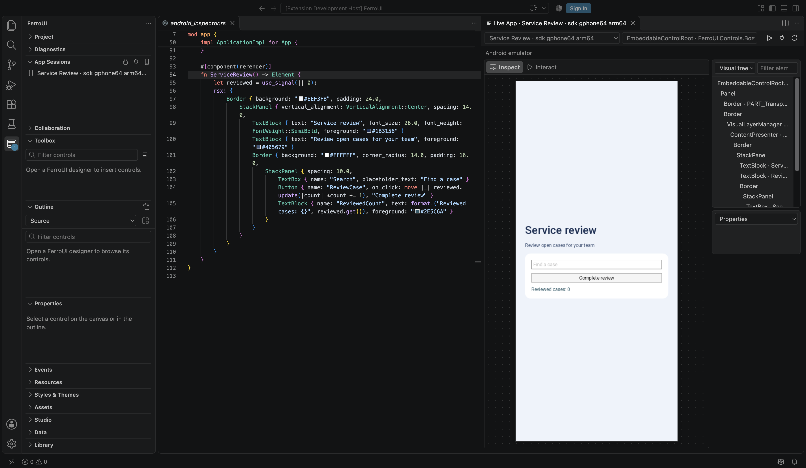

#### Build and redeploy Android source in VS Code

Use a trusted workspace host with the Android SDK, NDK, Java, Bash, and the Rust target for the device ABI. Add a `build` object in place of `apkPath`. This profile builds the bundled Service Review example on the selected ADB device.

```json
{
  "ferroui.android.apps": [
    {
      "id": "service-review",
      "label": "Service Review",
      "packageId": "org.ferroui.androidinspector",
      "build": {
        "application": "inspector",
        "debugger": true,
        "reloadOnSave": true
      }
    }
  ]
}
```

1. Choose **Run Android App** in **App Sessions**, select the profile, and then choose the device. The pinned Live App editor opens while Cargo builds. After the APK installs, FerroUI verifies the inspector and waits for a native frame.
2. Use **Rebuild This App** to queue another build. With `reloadOnSave` enabled, saves to the selected package and its local Cargo dependencies also queue builds. This includes XAML, Rust, and the workspace’s Cargo inputs. The running app continues accepting input while Cargo compiles. A source revision superseded during compilation is skipped before deployment.
3. Android restarts the app to deploy the new APK. The Live App tab retains the last accepted frame while the new process starts. A failed compile leaves the running generation available. If a deployment replaces the process and fails to start, FerroUI tries to reinstall the session’s last accepted APK and verifies its frame. **Show App Output** has the build and deployment details. **Diagnostics → Hot Reload History** records the outcomes for saved sources.
4. `build.debugger` packages the NDK debugger and stages the unstripped application library for each accepted installation. **Run and Debug Android App** waits for the first frame before attaching. An attached debugger stays on the running app during compilation, detaches when deployment begins, and reattaches after the replacement presents a frame. It also follows an accepted rollback. Use **Disconnect** in VS Code’s debug toolbar to end the attachment.

For your own app, set `build.package` to the Cargo `cdylib` package in place of `build.application`. Use the package name with underscores as its library name. Set `build.toolchain` to the FerroUI checkout that supplies `scripts/android/apk.sh` and `build.manifestPath` if the Cargo workspace is nested. Add features with `build.features`.

The managed packager reuses `android/debug.keystore` in the Cargo target directory. If you installed an APK signed with another FerroUI debug key, set `build.debugKeystore` to that key. Android keeps the installed app’s data when updating an APK with the same package ID and signing certificate. [Android app updates](https://developer.android.com/google/play/app-updates) · [Android MCP build actions](reference.md#run-or-attach-an-android-app-with-mcp)

#### Debug Rust on Android

Install the **LLDB DAP** extension on the workspace host. Build Service Review with `scripts/android/apk.sh inspector --debugger` to include the NDK debugger server in the debuggable APK. Update the profile’s `apkPath` if you built to a different output directory. [Android native debugging](https://developer.android.com/studio/debug) · [LLDB DAP setup](https://lldb.llvm.org/use/lldbdap.html)

For an app packaged with Gradle, include the NDK’s `lldb-server` as `libferroui_lldb_server.so` in each debug variant’s native library directory and enable native library extraction. Link the Rust library with `-Clink-arg=-Wl,--build-id=sha1` so LLDB can match it with local symbols. App Sessions offers the debugger action after the app reports the extracted server. [Android native library packaging](https://developer.android.com/ndk/guides/abis)

Add `"symbolFiles": ["target/aarch64-linux-android/debug/examples/libandroid_inspector.so"]` to the ARM64 Service Review entry in `ferroui.android.apps`. Use your actual output directory if you set `CARGO_TARGET_DIR`. Each file must be an unstripped library from the same build and ABI as the installed app. Its filename must match the library packaged in the APK. FerroUI verifies the build ID and loads the symbols at the shared library’s address in the accepted process. Close and reopen the app session if you change its profile.

Add an attach configuration to `.vscode/launch.json` in the app’s workspace folder.

```json
{
  "version": "0.2.0",
  "configurations": [
    {
      "name": "Attach to Service Review",
      "type": "lldb-dap",
      "request": "attach",
      "gdb-remote-port": "${command:ferroui.android.debugPort}"
    }
  ]
}
```

1. Set a breakpoint inside `complete_review` in `android_inspector.rs`. Choose **FerroUI: Run and Debug Android App** and select your app profile and device. For an app already connected to Live App, choose **Attach Debugger to This App** in its App Sessions context menu.
2. Choose the attach configuration if VS Code lists several. FerroUI waits for the first native frame, then uses the debugger installed with the app and a temporary ADB forward for the verified process. Once the breakpoint binds, click **Complete review** in the app or in **Live App → Interact**.
3. Use **Continue** to resume the app and its inspector. Use **Disconnect** in VS Code’s debug toolbar to keep the app and Live App connected. **Stop or Disconnect This App** also closes the debugger. The session still follows the ownership rules for apps you ran or attached to independently.
4. If attaching fails, open **Show App Output** on the App Sessions row for the Android debugger log. A library mismatch calls for the unstripped output of the exact installed build. If a matched breakpoint stays unbound, check the source paths recorded by the Rust compiler. LLDB DAP’s `sourceMap` can map a different build machine’s source paths to your workspace. [LLDB DAP configuration](https://lldb.llvm.org/use/lldbdap.html)

With an LLDB build that supports Python, FerroUI lets Android Runtime handle `SIGSEGV` and `SIGBUS` raised from its managed code regions. Native breakpoints and faults keep their ordinary stop behavior. Turn off `ferroui.android.passArtSignals` in workspace settings to inspect those managed-code signals in LLDB. With an adapter that lacks Python, use **Continue** when LLDB stops on a managed Android Runtime signal. [Android Runtime signal handling](https://developer.android.com/studio/platform/releases)

[Android debugger MCP actions](reference.md#run-or-attach-an-android-app-with-mcp)

### Run or attach a browser app

Install Chrome or Chromium and the FerroUI browser toolchain on the workspace host. Open a trusted workspace. Use a managed build when you want VS Code to rebuild on save. For a served profile, run these commands from the FerroUI checkout to build Dispatch Desk and serve it on loopback.

```sh
scripts/build-browser.sh live_inspector --debug --features inspector-example
node scripts/browser/serve.mjs target/browser-inspector-example/live_inspector --port 8080
```

Add a profile in the owning workspace folder’s settings. Use the full URL that Chromium displays after the page loads. The optional `width` and `height` set the managed viewport in CSS pixels and default to 960 × 620.

```json
{
  "ferroui.browser.apps": [
    {
      "id": "dispatch-desk",
      "label": "Dispatch Desk",
      "url": "http://127.0.0.1:8080/"
    }
  ]
}
```

1. In **App Sessions**, choose the globe icon for **Open Browser App**, then **Run Browser App**. Pick the profile. VS Code starts a disposable Chromium instance on the workspace host and opens the Live App editor after the first frame is ready. Set `ferroui.browser.executablePath` in user settings if Chromium is installed at a custom location.
2. Use **Inspect** to browse the visual, logical, or accessibility tree, then select a control to view its properties. Use **Interact** to click **Mark dispatched** and see the count and browser frame update. Use **Reveal Source** or **Apply to Source** when the browser build carries matching authored locations. To pick up changes to the compiled app, stop the session, rebuild the site, and run the profile again.
3. To inspect a tab you already opened, start Chrome or Chromium with a dedicated `--user-data-dir` and a loopback `--remote-debugging-port`. Add that port as `debugPort` in the app profile and open one tab at its exact URL. Choose **Attach to Browser App**. Use **Stop or Disconnect This App** to close the managed Chromium instance or leave an attached tab running. Reloading or leaving the attached page ends its Live App session. Attach again to inspect the new page.
4. Right-click the browser row in **App Sessions** and choose **Show App Output**. The Output selector identifies the app, workspace folder, and profile. A served app or attached tab records its connection to the inspector. A managed build also records compiler output and each candidate’s startup. Run and Debug adds attachment messages when available. Each session keeps its own output until it closes. [Read browser output with MCP](reference.md#run-or-attach-a-browser-app-with-mcp)

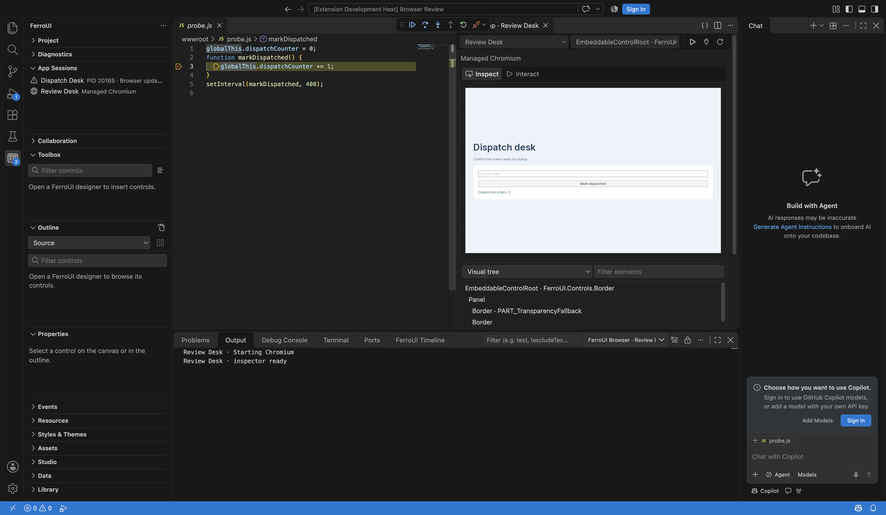

For example, with `chromium` on `PATH`, open a dedicated debug profile like this:

```sh
chromium --user-data-dir=/tmp/ferroui-debug-profile --remote-debugging-address=127.0.0.1 \
  --remote-debugging-port=9222 http://127.0.0.1:8080/
```

Use `"debugPort": 9222` in the matching VS Code profile. Keep this profile for local development. [Chromium debugging profiles](https://developer.chrome.com/blog/remote-debugging-port)

The app opts in through the `live-inspector` feature of `ferroui-browser`. On the UI thread after platform setup, call `ferroui_browser::live_inspector::install` with the element ID passed to `start_browser_app` and the app permissions. Keep the returned handle alive while the view is available. For RSX source reveal and mapped edits, call `ferroui_view::hot::enable_editor_source_locations()` before mounting the controls. [Browser toolchain](../../porting/browser-platform.md) · [Browser app MCP tools](reference.md#run-or-attach-a-browser-app-with-mcp)

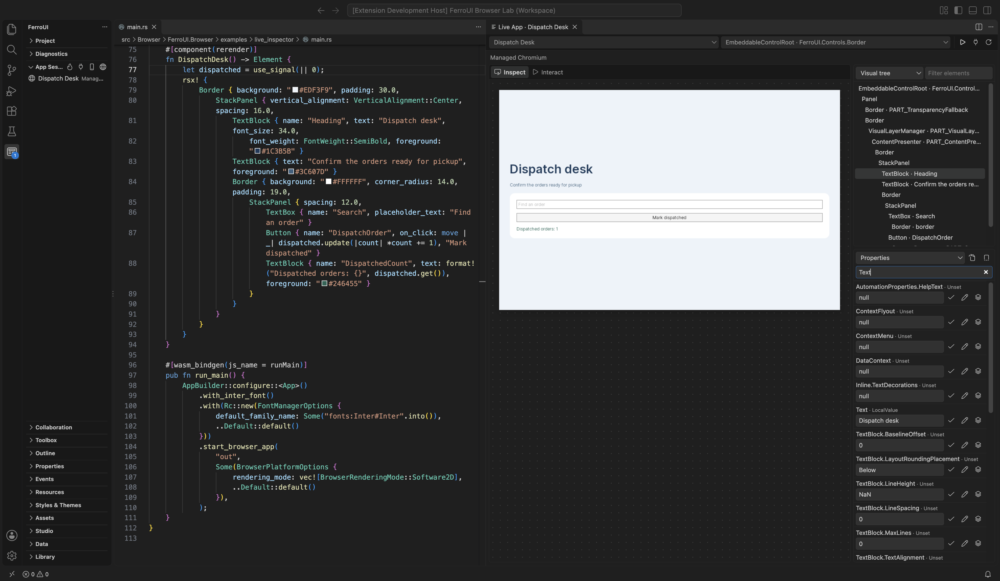

### Build and reload a browser app in VS Code

Activate the Emscripten SDK and the matching Rust and wasm-bindgen toolchain on the workspace host before starting the VS Code extension host. Keep Bash, Node.js, and npm on that host's PATH. Add this managed build profile to Workspace Settings in the FerroUI checkout.

```json
{
  "ferroui.browser.apps": [
    {
      "id": "dispatch-development",
      "label": "Dispatch Desk Development",
      "build": {
        "application": "live_inspector",
        "features": ["inspector-example"]
      }
    }
  ]
}
```

1. In **App Sessions**, choose **Open Browser App**, then **Run Browser App** and the development profile. The pinned **Live App** editor opens while the first build runs. The session shows when Chromium has presented the first frame.
2. Save a Rust or XAML file in the selected Cargo target or one of its local dependencies. Try changing **Dispatch desk** in `main.rs` or the text in `Instructions.xaml`. Saves to the app's `wwwroot`, Cargo manifest, lockfile, and Cargo configuration also request a build. Other packages keep their own sessions.
3. Select the session to keep interacting with the running app while an update builds and starts. Chromium keeps rendering the accepted page in its own window while the candidate starts. A successful candidate opens a new WebAssembly document in the same Chromium profile and loopback origin. It keeps the Live App tab and session ID. Browser-backed storage stays available. For example, click **Mark dispatched** before saving and check that the recorded count is present after the reload.
4. If compilation or startup fails, the running page and its inspector stay available. **Show App Output** reports whether startup stalled during navigation, inspector registration, or the first frame. **Diagnostics → Hot Reload History** shows failed and superseded saves and the first verified frame of accepted updates. Correct the source and save again, or choose the refresh icon on the App Sessions row for **Rebuild This App**. If Cargo cannot discover the project on first launch, save the repaired manifest to retry the same session. **Stop or Disconnect This App** releases the managed browser, candidate sites, and watch session.

For a separate app repository, set `build.toolchain` to the FerroUI checkout that owns `scripts/build-browser.sh`. Use the package and its matching browser binary as `application`. The selected Cargo workspace determines the target, so a local binary can share a name with a bundled example. Set `build.manifestPath` if its workspace manifest is below the folder root. Use document-relative URLs for files in `wwwroot` so each candidate can load its own site. A profile with `build.threads` enabled uses the installed threaded toolchain and serves its pages with Chromium's cross-origin isolation headers. [Browser toolchain and project setup](../../porting/browser-platform.md) · [MCP build and reload controls](reference.md#build-and-reload-a-browser-app-with-mcp)

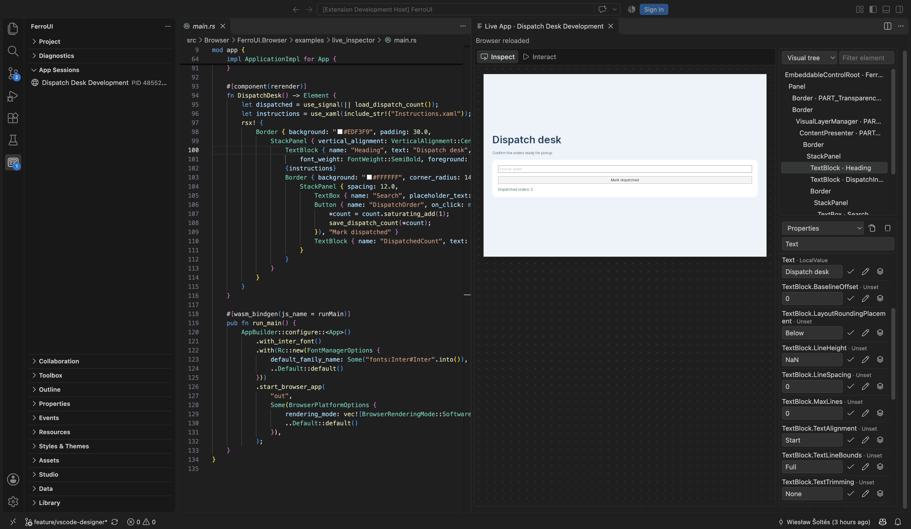

### Debug browser host scripts

1. Set a breakpoint in a script in your app's `wwwroot`, then choose **Open Browser App → Run and Debug Browser App**. Select the managed development profile. FerroUI starts a separate Chromium profile with a loopback debug listener and connects VS Code's built-in JavaScript Debug adapter after the app presents its first frame.
2. Trigger the code in **Live App → Interact**. Use the Debug toolbar, Call Stack, and Variables in VS Code to inspect the browser code. **Continue** resumes browser input and presentation.
3. Save a source change. The current debugger remains attached while Cargo builds and Chromium starts the candidate. When the replacement presents its first frame, FerroUI attaches the debugger to that exact page and maps its `wwwroot` URLs back to the workspace. Existing breakpoints follow the source.
4. Use **Disconnect** in VS Code’s debug toolbar to end the debugger connection and keep Live App running. Choose **Attach Debugger to This App** from the session's context menu to attach again. **Stop or Disconnect This App** closes the managed browser and its debug listener.

The same Run and Debug command can launch a served profile. It uses the workspace folder as the JavaScript source root. For an independently started Chromium profile, use VS Code's standard Chrome attach configuration. [VS Code browser debugging](https://code.visualstudio.com/docs/nodejs/browser-debugging) · [Browser debugger MCP tools](reference.md#debug-a-browser-app-with-mcp)

The Chromium session shares the Live App pause and Continue workflow. [Inspect a paused app](#inspect-a-paused-app)

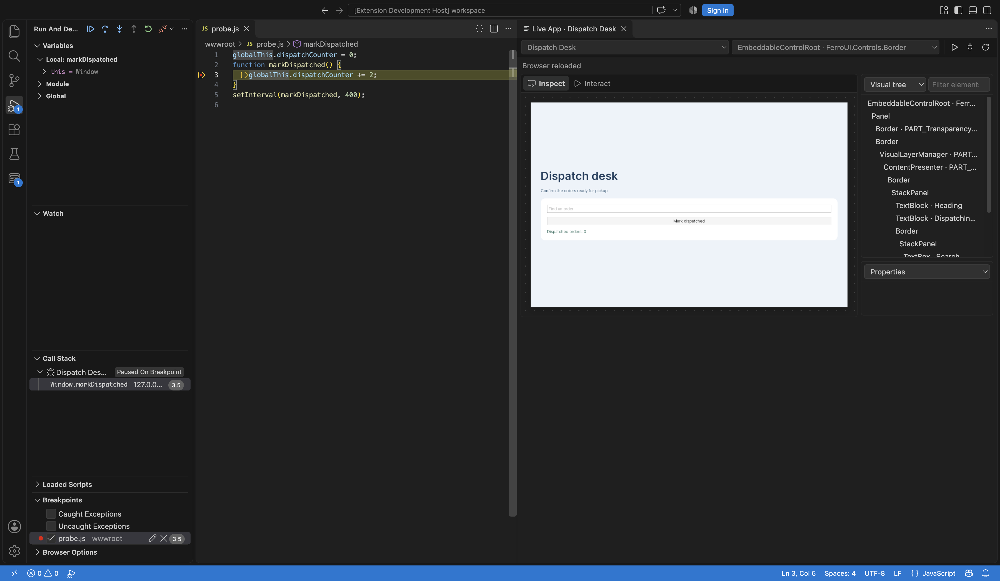

### Debug Rust code in a browser app

1. Install Microsoft's **WebAssembly DWARF Debugging** extension on the workspace host. In the managed browser profile, set `"debugSymbols": true` inside `build`.
2. Set a breakpoint in your app's Rust source. In Dispatch Desk, use the increment in `mark_dispatched`. Choose **Run and Debug Browser App**. After the first frame and a verified breakpoint appear, use **Live App → Interact** and click **Mark dispatched** to stop in the Rust handler.
3. Save a change and wait for the new frame. FerroUI reattaches to the accepted replacement page. Trigger the handler again to reach the existing breakpoint. Use **Continue** to resume the program.

Ordinary browser development builds keep Wasm function names for stack traces. Enabling `build.debugSymbols` preserves DWARF for Rust source breakpoints and compiles the selected target with full debug information. Dependencies follow their Cargo development profile. To debug an independently built site, use `scripts/build-browser.sh <application> --debug-symbols` and open the output through a served profile.

Use **Call Stack** to inspect Rust source locations. The adapter's Rust variable and expression support is limited. If the Variables view reports an error, use the Live App properties to inspect the running UI after resuming. [VS Code WebAssembly debugger](https://github.com/microsoft/vscode-dwarf-debugging-ext) · [Browser toolchain and debug symbols](../../porting/browser-platform.md#debug-a-browser-build)

## Inspect the actual window in Live App

1. Start a managed desktop target, open a mobile or browser app from App Sessions, or choose **FerroUI: Connect to Running MCP Server** for an authenticated loopback inspector. Use the app’s inspector flags, such as `--mcp` in Todo Workbench, to start its server. **Open Live App** opens the supported windows in the editor. Pick a window from its toolbar.
2. In **Inspect**, select a control in the native frame or browse the visual, logical, and accessibility trees. Alt+click chooses among overlapping native hits. Read properties, their effective style values, resources, accessible names, roles, and native diagnostics. Switch to **Interact** for clicks, scroll, text, or keys when the app permits input.
3. Try a property override in the inspector. Just the running session receives the override. Use **Reveal Source** to locate the authored value. When the current revision and source mapping match, use **Apply to Source** to write the supported RSX literal or XAML value into the editor. Review it, then save if you want hot reload to apply the source change.

Live App keeps the last accepted frame visible while it decodes a replacement. **Reconnect and refresh** keeps the selected window while it renews the inspector connection. A window change, a different hierarchy, or a refresh clears the selection while the new tree loads. When you return to its tab, Live App restores the current inspection and resumes polling.

Open Live App from a row in **App Sessions** to pin it to that session. An agent can adjust its window, hierarchy, expanded branches, inspection category, mode, and filters through the same controls. Those changes affect that editor, while app input and source edits use their own permission checks. [Control Live App with MCP](reference.md#control-the-live-app-editor-with-mcp)

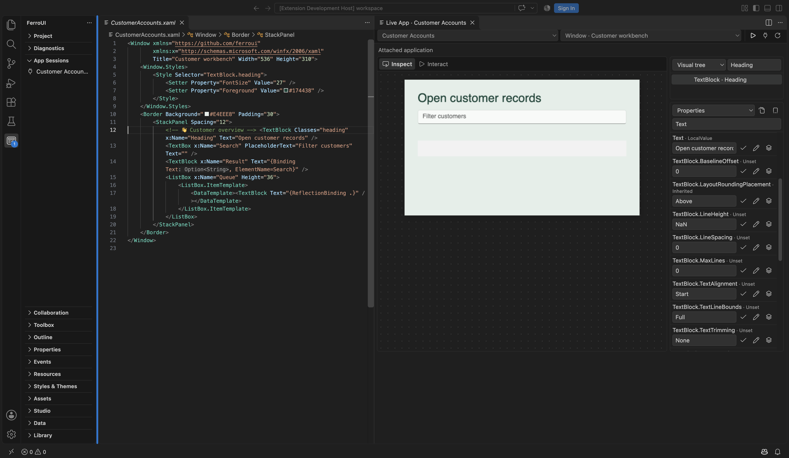

Managed debug builds record compiled RSX locations. Set `FERROUI_EDITOR_SOURCE=1` for an externally launched debug build that needs RSX source reveal. XAML source application requires compiled or runtime-loaded source information. If a change is stale or its target is untracked, reload the running app’s compatible revision or edit its authored source directly. [Runtime inspector and permissions](../../mcp.md)

Choose the layers icon beside a property to trace why that value is effective in the running app. The trace shows active and inactive contributors, a current value override, and the base value under an animation when available. Use a source arrow to open a matching location in the workspace. The layers icon appears when the app’s MCP server supports `get_property_trace`. [MCP value trace](reference.md#trace-property-values-with-mcp)

### Browse the inspection tree with the keyboard

1. Pick **Visual tree**, **Logical tree**, or **Accessibility tree**. Tab from **Filter elements** to the tree, or press Down from the filter. Once in the tree, use Up and Down to move among visible elements and Home and End to jump to either end.
2. Press Right to expand a branch or enter its first child. Press Left to collapse a branch or move to its parent. You can also click a branch's chevron. Type the start of a control name or type to jump to a match.
3. Press Enter or Space to inspect the focused element. The selection supplies Properties, Styles, Resources, and Diagnostics. Focus stays on the same element during a live repaint. If the element disappears or its branch closes, focus moves to the nearest available parent.

Filter by control type, name, text, or role. Matches keep their parent path. Escape clears the filter and restores the normal branch layout. Branches stay open or closed during updates to the same window and hierarchy. [Tree disclosure with MCP](reference.md#control-the-live-app-editor-with-mcp)

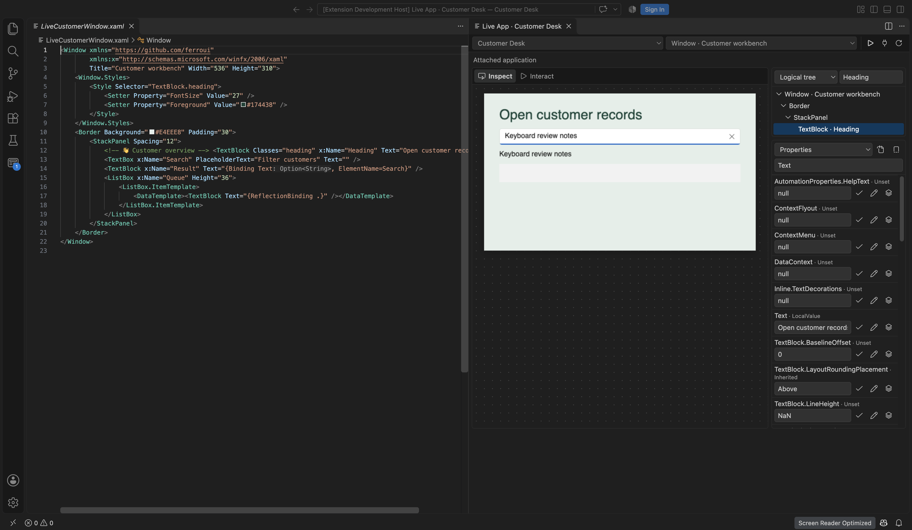

### Use the keyboard in Live App

1. Open a window whose app enabled inspector input. Switch to **Interact**, then choose the keyboard icon labeled **Keyboard input for** that window. The app’s current focus or first tab stop appears below the native frame.
2. Use Tab and Shift+Tab to follow the app’s focus order. Type or paste into the focused field. Use Enter or Space to activate the focused control. You can click a control in the frame while keyboard input is active.
3. Press Escape to return to the Live App toolbar. Leaving the editor, selecting another window, reconnecting, or replacing the app process also ends keyboard input. VoiceOver’s Control–Option shortcuts remain available during capture.

The keyboard icon uses the running app’s `window_keyboard` inspector tool. To send text or an exact key gesture to one selected control, use the **Send input** form below the frame. [Drive the same window with MCP](reference.md#send-keyboard-input-to-a-running-window)

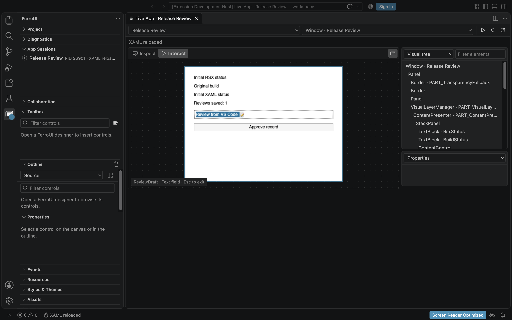

### Open an effective template in the running app

1. Select a control or grid in the live window or its visual tree. Choose the **Live App Templates** icon next to **Reveal Source**.
2. Select a control, item, display, or editing template. For a grid, the picker includes the column header when the app provides it.
3. VS Code opens the source recorded by the running app. Save or reload changed sources before choosing the template again.

The app must expose `get_template_sources` through its inspector. A source link requires a workspace file that matches the app’s recorded revision. XAML records the supplying dictionary or inline definition. A Rust template can open its mounted RSX body or the verified constructor in the running build. Use `template!` for a factory in a separate module that should be available before its first use. [Record an unmounted template's source](#record-an-unmounted-rust-templates-source) · [Live App template tools](reference.md#inspect-live-app-templates-with-mcp)

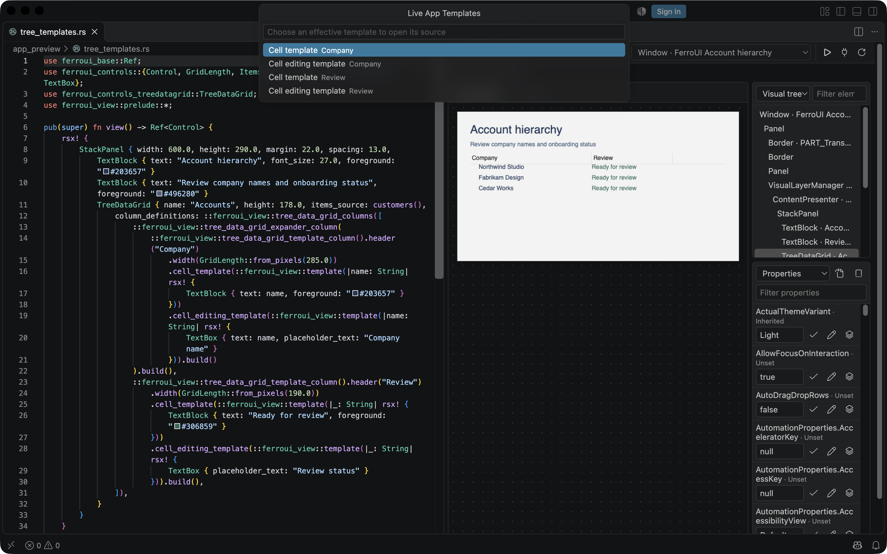

Selecting the Company editing template opens its Rust constructor beside the running grid. [Source navigation screenshot](../images/vscode-live-template-source.png)

## Read diagnostics and save history

Open **FerroUI → Diagnostics** to inspect the managed save outcome, acknowledgement time, binding errors, and native layout and scene counters. Open a binding result with a recorded source location to inspect its original declaration. **Show Hot Reload Output** includes build and process messages. Use **Preview Checks** in a design or stage for measured overflow, clipping, ineffective layout values, and accessibility in the accepted preview. [Read Preview Checks](authoring.md#diagnose-a-design-time-issue)

Expand **Hot Reload History** and hover over a save to see when its app acknowledged the revision and which compositor batch rendered it. The row shows the time from the editor observing the save to a native frame when the app reports one. Several saves can share a compositor batch within a process generation. A replaced process has its own generation and startup frame. If a revision draws no scene or its process exits first, the hover reports that outcome. Agents can read the same records with `ferroui_reload_history`.

### Profile a running window

1. Start a FerroUI app with MCP inspection or attach to its authenticated inspector. Open **FerroUI → Diagnostics** and choose **Record UI Profile** on **UI Profile**.
2. Choose the app and window if more than one is available. Select a recording duration and reproduce the interaction in the running app. Use **Stop UI Profile** to end the recording early.
3. Expand **Native Layout** or **RSX Components**. The highest total self time appears first. Expand a row for measure, arrange, render, or reconciliation. The phase tooltip shows total elapsed time including nested work and the longest individual self time.
4. Use **Reveal Profile Source** on a row with a mapped control. VS Code checks the app connection and current workspace source revision. Use **Export UI Profile** on the report to save its measurements as JSON.

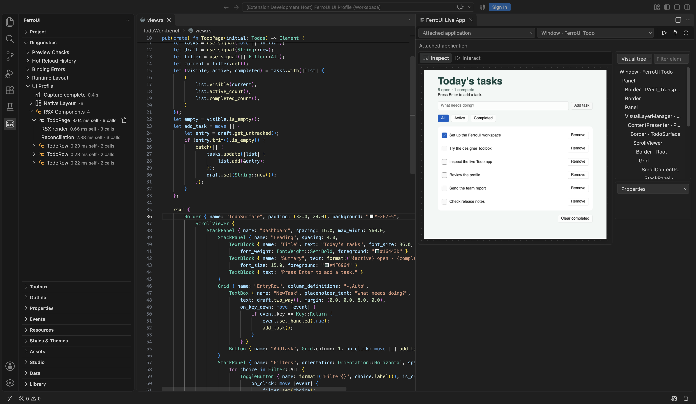

Self time subtracts nested measured operations from an operation's elapsed time. The layout rows count measure and arrange calls that did work. Component rows count actual executions of the RSX rendering and reconciliation paths, including dynamic child collections. They point to a currently mounted control when one is available. **Runtime Layout** continues to show window-level layout passes and compositor scene updates. [Profile tools for agents](reference.md#profile-a-runtime-with-mcp)

Each capture keeps up to 1,024 control or component rows for one window. The report shows any omitted calls after that limit. A process replacement leaves the previous report available for export. Reveal Source follows the report’s original connection generation.

## Run a native UI scenario

Testing discovers saved XAML, RSX, and prototype scenarios. Run a case to check native input, rendered properties, accessibility, and screenshot baselines. Review differences and approve an image from the comparison editor. [Test UI and review visual changes](testing.md)
