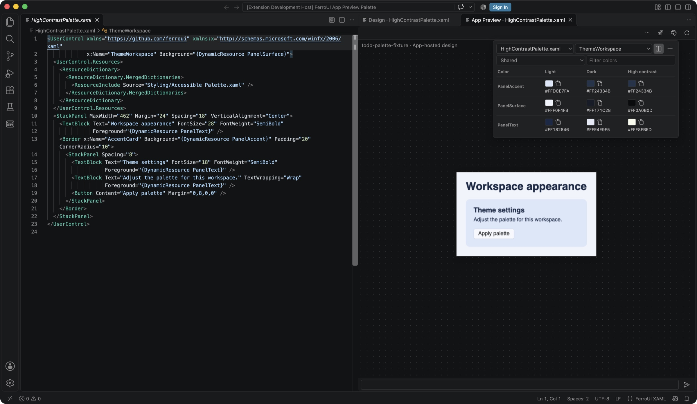

Use App Preview for a view mounted with your app’s registered controls and data. Use Live App for the actual application windows of a managed or attached session. Both are available beside the source editor.

## Render with your app in App Preview

1. Provide an opted-in Cargo binary that calls `RemoteDesignerEntryPoint::run_if_requested` from `ferroui-designer-support`. Register the app’s loader, types, assets, and theme in that entry point. The [Todo Workbench setup](../../../samples/TodoWorkbench/README.md) includes a working `app-preview` target.
2. Open the XAML or mapped RSX file and run **FerroUI: Open App-Hosted Design**. Select the binary with the preview feature enabled. If its registered markup assembly differs from its Cargo package name, set `ferroui.hostedPreview.assembly`.
3. Choose **Source preview** to mount the current buffer. For app-supplied state, use a registered data context fixture or Rust view factory. DataContext fixtures render the current source against an app model. RustView fixtures mount an actual compiled Rust view, including dynamic children and handlers.
4. Send native input to the frame. For supported animations, choose the clip and target in the toolbar, then play, pause, or enter a pose with the elapsed playhead. Use **Animation graph** to choose **Value curves** or **Velocity curves**. Both displays sample the app’s animator at authored times while the elapsed playhead stays in place. Drag a supported key or open **Edit application keyframe**. Apply a validated source-backed XAML or mapped Rust change in one Undo step. Agents can request `metric: "velocity"` inside the `designer_hosted_curve` arguments.

For a supported geometry or color track, use the component picker beside its scale. Relative points and scalars offer separate percentage and pixel curves when their units change during playback. The app’s registered animator supplies the samples. Agents can read the track’s `curve_channels` from `designer_hosted_animations` and pass the selection as `channel` to `designer_hosted_curve`. [Inspect a curve that changes units](motion.md#inspect-a-curve-that-changes-units) · [Inspect a color animation](motion.md#inspect-a-color-animation)

Choose **Compare animation clips** to use a shared elapsed ruler for the app’s native clips. Place XAML or mapped Rust clips with a drag or the keyboard, then use **Play all clips** to check the native result. A compatible source update retains the combined pose. [Compare clips in App Preview](motion.md#compare-clips-in-app-preview)

Open **Keyframe lanes** on one app-hosted clip to select across its tracks, retime or duplicate keys, and transfer typed keys between designers. Use **Authored time** to position paste, scale, and mirror operations while keeping the sampled app pose. [Edit several keys in App Preview](motion.md#edit-several-keys-in-app-preview)

Open **Animation clip actions** to create a clip on a live style owner or to rename, duplicate, or remove an authored clip. Each operation is one source edit. [Manage clips in App Preview](motion.md#manage-clips-in-app-preview)

Use **Preview range** to loop an elapsed interval or hold the app’s exact Out pose for review. It works with one animation or the shared clip ruler. [Rehearse a range in App Preview](motion.md#rehearse-a-range-in-app-preview)

App Preview holds its accepted image through compilation and invalid edits. If the app rejects the new preview while building or showing the view, read the error in App Preview and correct the source or fixture. For a compatible replacement, the first frame can restore the paused pose, selected animation, and targets. A playing preview resumes its elapsed position when the replacement supports it. Test the hosted examples with [HostedPreview.xaml](../../../samples/TodoWorkbench/HostedPreview.xaml) and its app fixtures. [App preview integration and registered animator examples](../../../samples/TodoWorkbench/README.md)

Edit a workspace dictionary or style included by the current view and watch App Preview update before saving. Literal XAML includes are followed through nested dictionaries. The editor uses the selected package’s build metadata to locate file-backed compiled includes and resolves relative project files against their declaring document. A broken include pauses interaction on the retained image until you repair it. App Preview and the `designer_hosted_*` MCP tools share these revisions. Rebuild an older preview binary with the current `ferroui-designer-support` to enable included drafts. Registered Rust view fixtures use their compiled view factory.

Open **Visual state actions** to edit groups, setters, and transitions in XAML or mapped Rust. Choose a pose or route to preview it with the app’s real control properties and animation registry. A compiled Rust fixture uses its ordinary application clock for input and state handlers. [Author visual states in App Preview](motion.md#author-visual-states-in-app-preview)

### Edit a palette in App Preview

1. Open an XAML App Preview with the current `ferroui-designer-support` and choose the **App Preview palette** color icon in the toolbar.
2. Choose the view or one of its included XAML files, then select the palette scope. **Compare theme colors** shows where Light, Dark, and available High contrast colors resolve in the app’s resource graph. Scopes that inherit all their colors open in this mode. The source icon opens the corresponding declaration.
3. In the layer view, change a swatch or enter a color. Use **Add palette color** to add a color or solid brush to the selected layer. For a new High contrast layer, choose a theme provider registered by the app.
4. Check the updated frame before saving. The owning XAML buffer receives one undoable edit. If the buffer changes while a palette action is open, wait for the next accepted preview and try again.

The palette follows workspace and mapped compiled includes from the accepted frame. Rebuild the preview binary if the color icon is missing on an XAML view. [Palette MCP tools](reference.md#edit-an-app-preview-palette-with-mcp)



[See an unsaved color edit in the owning dictionary and the updated native frame](../images/vscode-app-preview-palette-edit.jpg)

### Edit styles and control themes in App Preview

1. Open an XAML App Preview and choose **App Preview Styles & Themes** beside the palette icon. Select the source file and the authored definition. The file picker includes XAML loaded through resource and style includes. App Preview builds publish the Cargo package schema for application-registered target types and setters. Run **FerroUI: Build Project XAML Schema** for the package if you need to refresh it.
2. Edit the **Selector** or a literal setter value. Use the plus icon beside the definition to add a writable property, the link icon to choose a compatible resource, and the source icon to open the exact declaration. The discard icon removes a setter. Binding expressions and XAML object values have source navigation.
3. Choose a control theme to change **Based on**. The picker checks the target type and follows the authored inheritance chain across included dictionaries. Resources and base themes come from the accepted scope. A setter resource must resolve to a compatible value across its authored variants.
4. Use **New style or control theme** to add a declaration to a style or resource host in the selected file. Watch the native preview update before saving. Use editor Undo in the owning file to reverse the change.


[See cross-file control-theme inheritance in App Preview](../images/vscode-app-preview-control-theme.jpg) · [App Preview style MCP tools](reference.md#edit-app-preview-styles-with-mcp)

The same toolbar opens inline Rust styles when App Preview is rendering an RSX invocation. Edit selectors and typed setters or create a nested rule in the Rust buffer. After each accepted edit the app draws the new frame without a Cargo rebuild. [Edit inline Rust styles](styles.md#edit-inline-rust-styles) · [App Preview screenshot](../images/vscode-app-preview-rust-style.jpg)

## Hot reload and debug the running application

1. From a trusted Cargo workspace, run **FerroUI: Run with Hot Reload**. Select a development binary. Try `hot-reload-demo` for registered XAML or `view-gallery` for reactive RSX. Use `ferroui.hotReload.targets` to name an exact Cargo manifest, package, binary, feature set, or argument list.
2. Save a change to a registered XAML view or resource, or change an eligible `rsx!` literal read by a mounted reactive view. Inspect the outcome in the status bar, **Hot Reload Output**, or **Diagnostics**. An accepted in-place update keeps the app’s PID. An unsupported structural edit or Rust logic change builds a candidate. The currently running app remains available until the new one acknowledges startup.
3. If the save is rejected or the build fails, inspect the logged message and correct the file. Save again or run **Rebuild Hot Reload Application**. A successful structural rebuild gets a new PID. It retains compatible application state when the app supplies the corresponding handoff or persistence.

VS Code keeps an executable copy next to the Cargo binary for each running candidate. When an app retires or stops, the hot reload session waits for its copy to be removed. If the file stays locked, **Hot Reload Output** reports the copy that could not be removed.
4. To debug, configure a Rust attach request in `launch.json` using `${command:ferroui.hotReload.processId}` for the adapter’s process ID field. Run **Run and Debug with Hot Reload**, or choose **Attach Debugger to Managed App** for an existing session. The extension reuses the selected attach configuration after a replacement acknowledges startup.
5. Use **Stop Hot Reload Application** to end the managed session. For supported projects with explicit Rust patch slots, choose **Run with Registered Rust Patches** to start the owning supervisor. Configure its Python and pinned patch compiler when needed.

The XAML app must register a `ReloadManifest` and a `HotReloadSession` and acknowledge its startup. For RSX, use a debug binary with `ferroui-view`’s `hot-reload` feature and a compatible `launch` integration. [Framework reload prerequisites and registered patch workflow](../../development/hot-reload.md)

## Inspect the actual window in Live App

1. Start the managed development binary or run **FerroUI: Connect to Running MCP Server** to attach an authenticated loopback inspector. Use the `--mcp` flags of a participating app such as Todo Workbench to start its server. **Open Live App** opens the supported application windows in the editor. Pick a window from its toolbar.
2. In **Inspect**, select a control in the native frame or browse the visual, logical, and accessibility trees. Alt+click chooses among overlapping native hits. Read properties, their effective style values, resources, accessible names, roles, and native diagnostics. Switch to **Interact** for clicks, scroll, text, or keys when the app permits input.
3. Try a property override in the inspector. Just the running session receives the override. Use **Reveal Source** to locate the authored value. When the current revision and source mapping match, use **Apply to Source** to write the supported RSX literal or XAML value into the editor. Review it, then save if you want hot reload to apply the source change.

Managed debug builds record compiled RSX locations. Set `FERROUI_EDITOR_SOURCE=1` for an externally launched debug build that needs RSX source reveal. XAML source application requires compiled or runtime-loaded source information. If a change is stale or its target is untracked, reload the running app’s compatible revision or edit its authored source directly. [Runtime inspector and permissions](../../mcp.md)

Choose the layers icon beside a property to trace why that value is effective in the running app. The trace shows active and inactive contributors, a current value override, and the base value under an animation when available. Use a source arrow to open a matching location in the workspace. The layers icon appears when the app’s MCP server supports `get_property_trace`. [MCP value trace](reference.md#trace-property-values-with-mcp)

## Read diagnostics and save history

Open **FerroUI → Diagnostics** to inspect the managed save outcome, acknowledgement time, binding errors, and native layout and scene counters. Open a binding result with a recorded source location to inspect its original declaration. **Show Hot Reload Output** includes build and process messages. Use **Preview Checks** in a design or stage for measured overflow, clipping, ineffective layout values, and accessibility in the accepted preview. [Read Preview Checks](authoring.md#diagnose-a-design-time-issue)

Expand **Hot Reload History** and hover over a save to see when its app acknowledged the revision and which compositor batch rendered it. The row shows the time from the editor observing the save to a native frame when the app reports one. Several saves can share a compositor batch within a process generation. A replaced process has its own generation and startup frame. If a revision draws no scene or its process exits first, the hover reports that outcome. Agents can read the same records with `ferroui_reload_history`.

## Run a native UI scenario

1. Open the [customer search scenario](../../../editors/vscode/test/fixtures/customer-search.ferroui-scenario.json) in the `editors/vscode/test/fixtures` folder as a workspace. The **FerroUI Scenarios** section in Testing lists saved `*.ferroui-scenario.json` files.
2. If the scenario needs its first baseline, choose **Accept FerroUI Screenshot Baselines** in the Testing run-profile picker. Then run the scenario. It mounts saved source in a fresh native preview, drives input, checks the rendered properties and accessibility tree, and compares images for screenshot assertions. A visual mismatch links to the expected image, actual image, and diff.
3. Run the same file in CI. Relative document and baseline paths resolve from the scenario file. Set `--workspace` for a scenario nested under its workspace root and `--artifacts` for output images. A failed assertion gives the command a failing status.

```sh
ferroui-designer-preview --scenario customer-search.ferroui-scenario.json
```

A Rust scenario can select an RSX invocation with a zero-based UTF-16 `caret`. Use `channelTolerance` or `maxChangedPixels` when a fixture allows image variation. To test a `.ferrostages` flow with the same engine, use `prototype`, a stage set and flow, then `activateLink`, `expectStage`, and `expectOverlay`. The [customer review scenario](../../../editors/vscode/test/fixtures/customer-review.ferroui-scenario.json) exercises two stages and an overlay. [Scenario format and CLI options](../../../editors/vscode/README.md#native-ui-scenarios)
