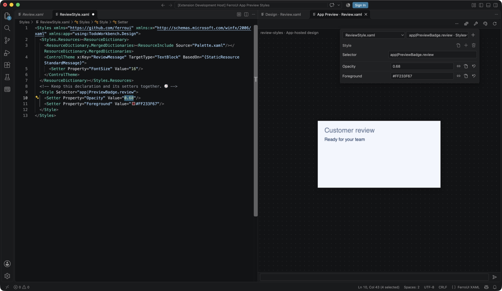
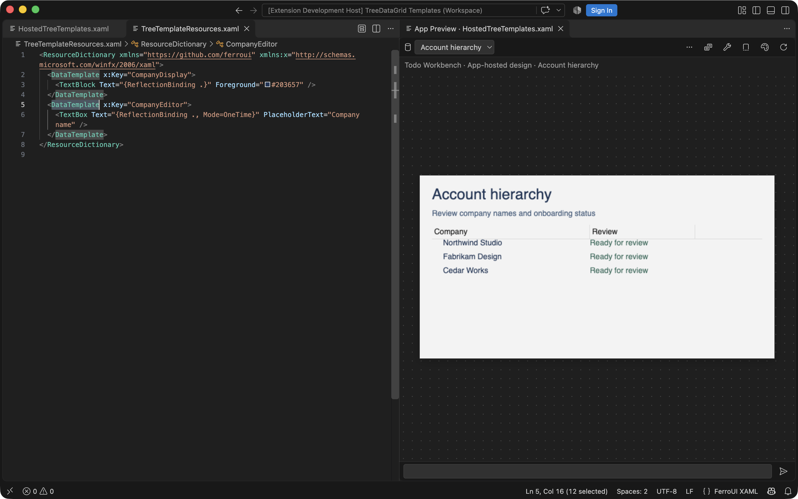
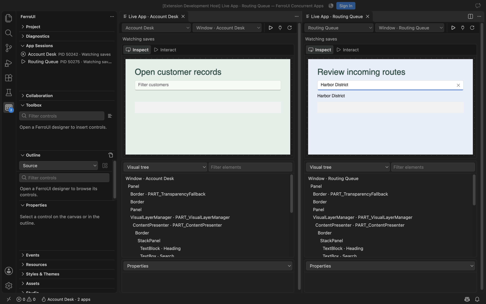

Use App Preview for a view mounted with your app’s registered controls and data. Use Live App for the actual application windows of a managed or attached session. Both are available beside the source editor.

## Render with your app in App Preview

1. Provide an opted-in Cargo binary that calls `RemoteDesignerEntryPoint::run_if_requested` from `ferroui-designer-support`. Register the app’s loader, types, assets, and theme in that entry point. The [Todo Workbench setup](../../../samples/TodoWorkbench/README.md) includes a working `app-preview` target.
2. Open the XAML or mapped RSX file and run **FerroUI: Open App-Hosted Design**. Select the binary with the preview feature enabled. If its registered markup assembly differs from its Cargo package name, set `ferroui.hostedPreview.assembly`.
3. Choose **Source preview** to mount the current buffer. For app-supplied state, use a registered data context fixture or Rust view factory. DataContext fixtures render the current source against an app model. RustView fixtures mount an actual compiled Rust view, including dynamic children and handlers.
4. Send native input to the frame. For supported animations, choose the clip and target in the toolbar, then play, pause, or enter a pose with the elapsed playhead. Use **Animation graph** to choose **Value curves** or **Velocity curves**. Both displays sample the app’s animator at authored times while the elapsed playhead stays in place. Drag a supported key or open **Edit application keyframe**. Apply a validated source-backed XAML or mapped Rust change in one Undo step. Agents can request `metric: "velocity"` inside the `designer_hosted_curve` arguments.

For a supported geometry or color track, use the component picker beside its scale. Relative points and scalars offer separate percentage and pixel curves when their units change during playback. The app’s registered animator supplies the samples. Agents can read the track’s `curve_channels` from `designer_hosted_animations` and pass the selection as `channel` to `designer_hosted_curve`. [Inspect a curve that changes units](motion.md#inspect-a-curve-that-changes-units) · [Inspect a color animation](motion.md#inspect-a-color-animation)

For `BoxShadow`, the picker lists each shadow’s offsets, blur, spread, and tint. Select a supported key to edit the list or add a key from the sampled app pose. [Animate layered box shadows](motion.md#animate-layered-box-shadows)

On a gradient brush track, use the component picker to compare native color stops and direction or geometry. Record the complete sampled brush with **Add keyframe at playhead**. [Animate a gradient brush](motion.md#animate-a-gradient-brush)

For a whole `RenderTransform` track, choose a numbered operation or a coefficient of the combined transform. The native app supplies the value and velocity samples. [Animate a transform list](motion.md#animate-a-transform-list)

Choose **Compare animation clips** to use a shared elapsed ruler for the app’s native clips. Place XAML or mapped Rust clips with a drag or the keyboard, then use **Play all clips** to check the native result. A compatible source update retains the combined pose. [Compare clips in App Preview](motion.md#compare-clips-in-app-preview)

Open **Keyframe lanes** on one app-hosted clip to select across its tracks, retime or duplicate keys, and transfer typed keys between designers. Use **Authored time** to position paste, scale, and mirror operations while keeping the sampled app pose. [Edit several keys in App Preview](motion.md#edit-several-keys-in-app-preview)

Open **Animation clip actions** to create a clip on a live style owner or to rename, duplicate, or remove an authored clip. Each operation is one source edit. [Manage clips in App Preview](motion.md#manage-clips-in-app-preview)

Use **Preview range** to loop an elapsed interval or hold the app’s exact Out pose for review. It works with one animation or the shared clip ruler. [Rehearse a range in App Preview](motion.md#rehearse-a-range-in-app-preview)

App Preview holds its accepted image through compilation and invalid edits. A replacement frame can decode while another window covers VS Code. If the app rejects the new preview while building or showing the view, read the error in App Preview and correct the source or fixture. For a compatible replacement, the first frame can restore the paused pose, selected animation, and targets. A playing preview resumes its elapsed position when the replacement supports it. Test the hosted examples with [HostedPreview.xaml](../../../samples/TodoWorkbench/HostedPreview.xaml) and its app fixtures. [App preview integration and registered animator examples](../../../samples/TodoWorkbench/README.md)

Edit a workspace dictionary or style included by the current view and watch App Preview update before saving. Literal XAML includes are followed through nested dictionaries. The editor uses the selected package’s build metadata to locate file-backed compiled includes and resolves relative project files against their declaring document. A broken include pauses interaction on the retained image until you repair it. App Preview and the `designer_hosted_*` MCP tools share these revisions. Rebuild an older preview binary with the current `ferroui-designer-support` to enable included drafts. Registered Rust view fixtures use their compiled view factory.

Open **Visual state actions** to edit groups, setters, and transitions in XAML or mapped Rust. XAML state poses and routes resolve bindings and resources in the app’s live scope and sample its registered animators. A compiled Rust fixture uses its ordinary application clock for input and state handlers. [Preview state bindings and resources](motion.md#preview-state-bindings-and-resources)

Use **App Preview Property Transitions** to edit a source-backed XAML or mapped Rust collection with properties and transition classes from the running app. Click inside the accepted native frame to trigger changes on its controls. [Edit and test a transition](motion.md#edit-property-transitions-in-app-preview)

### Interact with App Preview from an agent

1. Enable `ferroui.mcp.allowWrites` in User Settings. In a trusted workspace, open the design and its App Preview with
   `designer_open` and `designer_hosted_open`. Use the design’s `session` for the following calls.
2. Read `designer_hosted_image` and pass its generation, revision, and sequence as
   `expected_generation`, `expected_revision`, and `expected_sequence` to `designer_hosted_input`.
   Use `input.type` set to `click` or `scroll` with `x` and `y` between 0 and 1. A scroll also takes
   a signed wheel `delta`.
3. Click a native text field, read the current frame, then send `input` with `type: "text"` and the
   text to enter. Read the next image to inspect the result. Each input receipt identifies the
   frame that accepted the gesture. If the preview reports a changed frame, recapture it before sending input.

These gestures use the app’s native input path and keep the authored source buffer intact.
[MCP reference](reference.md#drive-an-editor-workflow)


To use the toolbar’s **Refresh** action from an agent, read `designer_hosted_fixtures` and pass its `generation` and `revision`
to `designer_hosted_refresh` as `expected_generation` and `expected_revision`. The refresh reads the current source and workspace
dependencies. Wait for `designer_hosted_image` to return the new revision before sending further input.

### Edit a palette in App Preview

1. Open an XAML App Preview with the current `ferroui-designer-support` and choose the **App Preview palette** color icon in the toolbar.
2. Choose the view or one of its included XAML files, then select the palette scope. **Compare theme colors** shows where Light, Dark, and available High contrast colors resolve in the app’s resource graph. Scopes that inherit all their colors open in this mode. The source icon opens the corresponding declaration.
3. In the layer view, change a swatch or enter a color. Use **Add palette color** to add a color or solid brush to the selected layer. For a new High contrast layer, choose a theme provider registered by the app.
4. Check the updated frame before saving. The owning XAML buffer receives one undoable edit. If the buffer changes while a palette action is open, wait for the next accepted preview and try again.

The palette follows workspace and mapped compiled includes from the accepted frame. For keyed aliases and supported brush references, the comparison shows the resolved color and the source icon opens the literal supplying it. Hover the icon to see the reference chain. Rebuild the preview binary if the color icon is missing on an XAML view. [Follow a color alias](styles.md#follow-a-color-alias) · [Palette MCP tools](reference.md#edit-an-app-preview-palette-with-mcp)


[See an unsaved color edit in the owning dictionary and the updated native frame](../images/vscode-app-preview-palette-edit.jpg)

### Edit styles and control themes in App Preview

1. Open an XAML App Preview and choose **App Preview Styles & Themes** beside the palette icon. Select the source file and the authored definition. The file picker includes XAML loaded through resource and style includes. App Preview builds publish the Cargo package schema for application-registered target types and setters. Run **FerroUI: Build Project XAML Schema** for the package if you need to refresh it.
2. Edit the **Selector** or a literal setter value. Use the plus icon beside the definition to add a writable property, the link icon to choose a compatible resource, and the source icon to open the exact declaration. The discard icon removes a setter. Binding expressions and XAML object values have source navigation.
3. Choose a control theme to change **Based on**. The picker checks the target type and follows the authored inheritance chain across included dictionaries. Resources and base themes come from the accepted scope. A setter resource must resolve to a compatible value across its authored variants.
4. Use **New style or control theme** to add a declaration to a style or resource host in the selected file. Watch the native preview update before saving. Use editor Undo in the owning file to reverse the change.



[See cross-file control-theme inheritance in App Preview](../images/vscode-app-preview-control-theme.jpg) · [App Preview style MCP tools](reference.md#edit-app-preview-styles-with-mcp)

The same toolbar opens inline Rust styles when App Preview is rendering an RSX invocation. Edit selectors and typed setters or create a nested rule in the Rust buffer. Under **Color resources**, choose a layer to edit, assign a compatible color key, or compare the resolved Light, Dark, and High contrast colors. The source icon opens the supplying Rust declaration. After each accepted edit the app draws the new frame without a Cargo rebuild. [Edit inline Rust styles](styles.md#edit-inline-rust-styles) · [Edit Rust style colors](styles.md#edit-rust-style-color-resources) · [App Preview screenshot](../images/vscode-app-preview-rust-style.jpg)

### Open and copy App Preview control templates

Open an XAML view with **FerroUI: Open App-Hosted Design**, then choose the **App Preview Templates** icon in its toolbar. The picker shows controls whose templates were identified when the application loaded the accepted XAML snapshot. Choose a control, then choose **Open Template Source**. VS Code opens the supplying XAML beside the preview, including an included theme with a separate packaged resource address.

Choose **Make Inline Copy** to customize an inherited template at the control's declaration. FerroUI checks resource references in the original and destination scopes, carries over required definitions, and applies the copy to the previewed buffer in one Undo step. Other declarations continue to use the shared template. Use **Open Template Source** to inspect a shared definition or a template with dependencies that need attention.

Rebuild the preview binary with the current `ferroui-designer-support` to enable this toolbar action. The picker covers controls in the previewed XAML and template definitions from that file or the accepted workspace includes. [App Preview template tools](reference.md#inspect-app-preview-templates-with-mcp)

### Trace item and cell templates in App Preview

1. Open the XAML view or the Rust file that owns the RSX invocation. For Rust, choose the app's registered design fixture and select the invocation it mounts.
2. In **App Preview Templates**, choose a control or column and its template property. Choose **Open Template Source** to open the effective inline or shared definition. XAML definitions can come from accepted workspace dictionaries.
3. For a mapped Rust template, use **Open Template Assignment** to see where the control or column received it. Choose **Open Template in Design** to edit the RSX body using the existing canvas and source tools.


Rust source actions use the active debug build's source records. App Preview follows the Cargo features reported for the selected executable and checks the control and template against the accepted frame. If your shared factory uses `template(...)`, use fixture data that renders an item so the app can identify the declaration. Use `ferroui_view::template!(...)` to record its source before the first item renders. After a source change, save and rebuild the app-hosted fixture when required. Reopen the picker after the frame updates. [Register app preview fixtures](#render-with-your-app-in-app-preview) · [App Preview template tools](reference.md#inspect-app-preview-templates-with-mcp)

[See the shared Rust template selected in source beside the retained app frame](../images/vscode-app-preview-template-source.png).

#### Inspect TreeDataGrid display and editing templates

1. Open the grid's XAML or RSX view in App Preview with rows in its data source. Try **Account hierarchy** in [Todo Workbench](../../../samples/TodoWorkbench/README.md).
2. Open **App Preview Templates**. Search by the grid or column header, then choose **Cell template** for the displayed cell or **Cell editing template** for the editor. A template inside an expander appears under its inner column's header.
3. Open the definition. For a resource-key column, the source link follows the dictionary the app resolved when the cell was realized. For a Rust column, you can also open the assignment in the column builder or open the definition in Design.



Source links are available for runtime templates paired with a verified declarative column. Keep a row visible when inspecting resource-key columns so the app resolves their templates. If the app provides columns through a separate `Source` or `Model`, open those authored definitions in the application code.

#### Record an unmounted Rust template's source

Use `ferroui_view::template!` in a Rust file that defines a shared template, such as a cell editor in its own module. Pass the same closure you would give to `ferroui_view::template`.

```rust
use ferroui_controls::{templates::IDataTemplate, TextBox};
use std::rc::Rc;

pub fn review_editor() -> Rc<dyn IDataTemplate> {
    ferroui_view::template!(|_: String| ferroui_view::rsx! {
        TextBox { placeholder_text: "Review status" }
    })
}
```

Call `review_editor()` from the grid column's `.cell_editing_template(...)` setter and build the application in debug mode. **App Preview Templates** can open the RSX body and reveal the assignment while the grid is showing its display cells. **Live App Templates** can open the factory before the cell enters editing mode. The editor checks both source links against the build that supplied the template. [Try this in Todo Workbench](../../../samples/TodoWorkbench/app_preview/template_rows.rs)


### Edit a shared Rust palette in App Preview

1. Use a `const` initialized with a supported color constructor in a module of the selected Cargo binary or its package library. For example, declare `mod brand;` in the crate root and reference `crate::brand::ACCENT` from an inline `.resource("Accent", crate::brand::ACCENT)` call. Named imports and re-exports also work.
2. Open **App Preview Styles & Themes** and select the rule. Choose the color’s source icon to open the initializer in its module. **Compare Rust theme colors** follows the same source for each appearance.
3. Use the change-color icon. Choose **Edit const** with the owning file shown in the picker to update the shared declaration. Choose **Use a local color** to change only the selected registration. Check the updated frame and use Undo in the edited buffer to restore it.

App Preview follows explicit module declarations in the owning Cargo target, including literal `#[path]` declarations in that package. It reads open drafts before the saved module. An invalid draft in the accepted module tree retains the previous frame while you repair it. Conditional and computed providers use Rust source navigation. [Rust color authoring](styles.md#edit-a-shared-rust-color) · [MCP actions](reference.md#edit-rust-styles-with-mcp)

## Hot reload and debug the running application

1. From a trusted Cargo workspace, run **FerroUI: Run with Hot Reload**. Select a development binary. Try `hot-reload-demo` for registered XAML or `view-gallery` for reactive RSX. Use `ferroui.hotReload.targets` to name an exact Cargo manifest, package, binary, feature set, or argument list.
2. Save a change to a registered XAML view or resource, or change an eligible `rsx!` literal read by a mounted reactive view. Inspect the outcome in the status bar, **Hot Reload Output**, or **Diagnostics**. An accepted in-place update keeps the app’s PID. An unsupported structural edit or Rust logic change builds a candidate. The currently running app remains available until the new one acknowledges startup.
3. If the save is rejected or the build fails, inspect the logged message and correct the file. Save again or run **Rebuild Hot Reload Application**. A successful structural rebuild gets a new PID. It retains compatible application state when the app supplies the corresponding handoff or persistence.

VS Code keeps an executable copy next to the Cargo binary for each running candidate. When an app retires or stops, the hot reload session waits for its copy to be removed. If the file stays locked, **Hot Reload Output** reports the copy that could not be removed.
4. To debug, configure a Rust attach request in `launch.json` using `${command:ferroui.hotReload.processId}` for the adapter’s process ID field. Run **Run and Debug with Hot Reload**, or choose **Attach Debugger to Managed App** for an existing session. The extension reuses the selected attach configuration after a replacement acknowledges startup.
5. Use **Stop Hot Reload Application** to end the managed session. For supported projects with explicit Rust patch slots, choose **Run with Registered Rust Patches** to start the owning supervisor. Configure its Python and pinned patch compiler when needed.

The XAML app must register a `ReloadManifest` and a `HotReloadSession` and acknowledge its startup. For RSX, use a debug binary with `ferroui-view`’s `hot-reload` feature and a compatible `launch` integration. [Framework reload prerequisites and registered patch workflow](../../development/hot-reload.md)

### Run several app sessions

1. Open **FerroUI → App Sessions** and choose the run icon. Pick a Cargo target. Repeat to launch another package, binary, or configuration. Running the same Cargo target with the same features and arguments selects its existing session and retries it if startup previously failed.
2. Choose a session in the tree to open its own Live App editor. Move the editors into separate groups to work with two native windows at once. The session stays pinned through in-place reloads and successful rebuilds. Choose **Open Live App** from the Command Palette for an editor with a session picker.
3. Use a row’s rebuild or stop icon to act on that app. The row’s context menu opens its build output, attaches a configured Rust debugger, or makes it the managed app used by the status bar and Diagnostics. **Stop All Hot Reload Applications** stops every managed session.
4. To attach an independently launched app or Designer Studio, choose the connection icon in **App Sessions** and enter its loopback MCP address and bearer token. A successful connection adds a row. Disconnect from that row to close the inspector connection. The independently launched process keeps running. The Live App editor requires a server with native window inspection.

A save can affect one app or several. The extension tracks each app’s Cargo package and local dependencies, along with XAML watched by that process. Builds sharing one Cargo output directory take turns through compilation and executable staging. Each running app keeps its own PID, reload outcomes, debugger, and window selection. [Target app sessions with MCP](reference.md#target-app-sessions-with-mcp)



### Run an app on an iOS simulator

Open a trusted workspace on the Mac running Xcode. Boot an iOS simulator and build a simulator app with an opted-in FerroUI MCP inspector. To try the Contact Review example from the FerroUI repository root, run:

```sh
rustup target add aarch64-apple-ios-sim
scripts/ios/bundle.sh --package ferroui-ios --example simulator_inspector \
  --no-default-features --features quartz-metal,inspector-example \
  --bundle-id org.ferroui.simulator-inspector
```

In the owning workspace folder’s settings, add a profile that uses the app’s bundle identifier. Set `appPath` to install the built bundle when you launch. Leave out that field to use the app already installed on the chosen simulator.

```json
{
  "ferroui.iosSimulator.apps": [
    {
      "id": "contact-review",
      "label": "Contact Review",
      "bundleId": "org.ferroui.simulator-inspector",
      "appPath": "target/ios-bundles/simulator_inspector.app",
      "args": ["--mcp", "--mcp-input"]
    }
  ]
}
```

1. In **App Sessions**, choose the device icon for **Run iOS Simulator App**. Select the profile and booted simulator. The command installs the optional bundle, launches it, and opens Live App after its inspector and native frame are ready.
2. Use **Inspect** to pick controls, read their properties or accessibility information, and reveal mapped source from a matching debug build. Use **Interact** if the app enabled inputs. The example opts into inspection with `--mcp` and enables input with `--mcp-input`.
3. Choose **Stop or Disconnect This App** on the simulator session to stop it. Running the same profile on the same device focuses its existing Live App session. To deploy a new build or switch launch profiles, stop the session, then run the desired profile. Use **Connect to Running MCP Server** to inspect an independently launched app without restarting it.

A launch starts or restarts the chosen bundle on the selected simulator. Multiple app sessions appear in the same view. [iOS simulator MCP tools](reference.md#run-an-ios-simulator-app-with-mcp)


## Inspect the actual window in Live App

1. Start a managed desktop target, run a configured iOS simulator app, or choose **FerroUI: Connect to Running MCP Server** to attach an authenticated loopback inspector. Use the app’s inspector flags, such as `--mcp` in Todo Workbench, to start its server. **Open Live App** opens the supported windows in the editor. Pick a window from its toolbar.
2. In **Inspect**, select a control in the native frame or browse the visual, logical, and accessibility trees. Alt+click chooses among overlapping native hits. Read properties, their effective style values, resources, accessible names, roles, and native diagnostics. Switch to **Interact** for clicks, scroll, text, or keys when the app permits input.
3. Try a property override in the inspector. Just the running session receives the override. Use **Reveal Source** to locate the authored value. When the current revision and source mapping match, use **Apply to Source** to write the supported RSX literal or XAML value into the editor. Review it, then save if you want hot reload to apply the source change.

Live App keeps the last accepted frame visible while it decodes a replacement. When you return to its tab, it shows the accepted window and resumes inspection.

Managed debug builds record compiled RSX locations. Set `FERROUI_EDITOR_SOURCE=1` for an externally launched debug build that needs RSX source reveal. XAML source application requires compiled or runtime-loaded source information. If a change is stale or its target is untracked, reload the running app’s compatible revision or edit its authored source directly. [Runtime inspector and permissions](../../mcp.md)

Choose the layers icon beside a property to trace why that value is effective in the running app. The trace shows active and inactive contributors, a current value override, and the base value under an animation when available. Use a source arrow to open a matching location in the workspace. The layers icon appears when the app’s MCP server supports `get_property_trace`. [MCP value trace](reference.md#trace-property-values-with-mcp)

### Open an effective template in the running app

1. Select a control or grid in the live window or its visual tree. Choose the **Live App Templates** icon next to **Reveal Source**.
2. Select a control, item, display, or editing template. For a grid, the picker includes the column header when the app provides it.
3. VS Code opens the source recorded by the running app. Save or reload changed sources before choosing the template again.

The app must expose `get_template_sources` through its inspector. A source link requires a workspace file that matches the app’s recorded revision. XAML records the supplying dictionary or inline definition. A Rust template can open its mounted RSX body or the verified constructor in the running build. Use `template!` for a factory in a separate module that should be available before its first use. [Record an unmounted template's source](#record-an-unmounted-rust-templates-source) · [Live App template tools](reference.md#inspect-live-app-templates-with-mcp)


Selecting the Company editing template opens its Rust constructor beside the running grid. [Source navigation screenshot](../images/vscode-live-template-source.png)

## Read diagnostics and save history

Open **FerroUI → Diagnostics** to inspect the managed save outcome, acknowledgement time, binding errors, and native layout and scene counters. Open a binding result with a recorded source location to inspect its original declaration. **Show Hot Reload Output** includes build and process messages. Use **Preview Checks** in a design or stage for measured overflow, clipping, ineffective layout values, and accessibility in the accepted preview. [Read Preview Checks](authoring.md#diagnose-a-design-time-issue)

Expand **Hot Reload History** and hover over a save to see when its app acknowledged the revision and which compositor batch rendered it. The row shows the time from the editor observing the save to a native frame when the app reports one. Several saves can share a compositor batch within a process generation. A replaced process has its own generation and startup frame. If a revision draws no scene or its process exits first, the hover reports that outcome. Agents can read the same records with `ferroui_reload_history`.

### Profile a running window

1. Start a FerroUI app with MCP inspection or attach to its authenticated inspector. Open **FerroUI → Diagnostics** and choose **Record UI Profile** on **UI Profile**.
2. Choose the app and window if more than one is available. Select a recording duration and reproduce the interaction in the running app. Use **Stop UI Profile** to end the recording early.
3. Expand **Native Layout** or **RSX Components**. The highest total self time appears first. Expand a row for measure, arrange, render, or reconciliation. The phase tooltip shows total elapsed time including nested work and the longest individual self time.
4. Use **Reveal Profile Source** on a row with a mapped control. VS Code checks the app connection and current workspace source revision. Use **Export UI Profile** on the report to save its measurements as JSON.


Self time subtracts nested measured operations from an operation's elapsed time. The layout rows count measure and arrange calls that did work. Component rows count actual executions of the RSX rendering and reconciliation paths, including dynamic child collections. They point to a currently mounted control when one is available. **Runtime Layout** continues to show window-level layout passes and compositor scene updates. [Profile tools for agents](reference.md#profile-a-runtime-with-mcp)

Each capture keeps up to 1,024 control or component rows for one window. The report shows any omitted calls after that limit. A process replacement leaves the previous report available for export. Reveal Source follows the report’s original connection generation.

## Run a native UI scenario

Testing discovers saved XAML, RSX, and prototype scenarios. Run a case to check native input, rendered properties, accessibility, and screenshot baselines. Review differences and approve an image from the comparison editor. [Test UI and review visual changes](testing.md)
