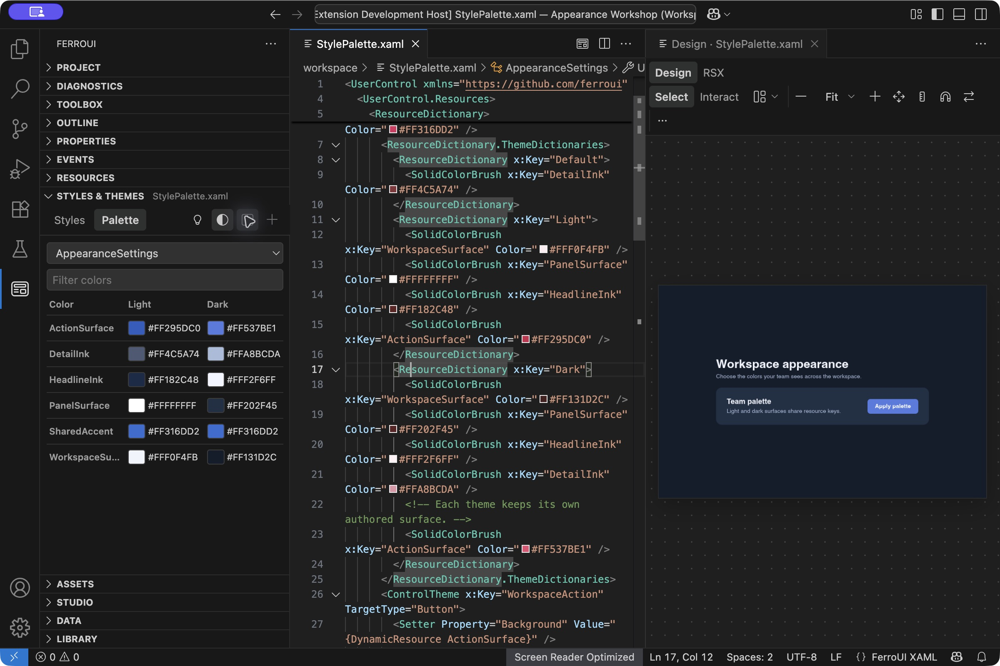

Open an XAML view in **Design** and run **FerroUI: Show Styles & Themes**. You can also expand a style or control theme in **Library** and choose **Edit Style or Theme**. The dock follows the current design. Drag its title to move it beside your canvas. Try [StylePalette.xaml](../../../editors/vscode/test/fixtures/StylePalette.xaml) to follow these steps.

## Compose a style or control theme

1. In **Styles**, select a definition. The list includes its declaring scope. Select a control on the canvas or in Outline to make its style host and ancestors available when creating a style.
2. Choose **New Style or Control Theme**. For a style, choose the host and enter a selector such as `Border.card`. To create a child style within a style or theme, start the selector with `^`, such as `^:pointerover`. For a control theme, choose a resource owner and provide the key and target type.
3. Edit the **Selector** of a style or choose a compatible theme under **Based on**. The base theme must resolve from the definition's scope and use the same target type or a base type. Choices that would create a cycle are unavailable.
4. Choose **Add setter** and select a property. Edit existing literal values in the setter rows. Use the link icon to choose a visible resource for a compatible property. A **Dynamic Resource** follows theme changes. A **Static Resource** resolves when the definition loads. Use the source arrow to open a binding, object value, or setter declaration.
5. Use **Preview definition on canvas** to sample the definition. Return to the document to see it applied to its authored controls. In **Properties**, use **Trace value** to see the actual winning setter or resource on a selected control. [Trace a value](authoring.md#trace-an-effective-property-value)

Each accepted action edits the XAML buffer in one Undo step. For a keyed style or control theme, use the resource actions in **Library** to rename, duplicate, or manage its references.

[Control theme inheritance in the Styles dock](../images/vscode-control-theme.jpg)

## Compare and edit a palette

1. Open **Palette** and choose a **Palette scope**. A scope is the selected resource owner or an authored dictionary. **Shared** shows ordinary entries. **Default**, **Light**, and **Dark** show the corresponding theme dictionaries.
2. Use **Preview Light theme** or **Preview Dark theme** in the toolbar to switch the native Design preview. The canvas inherits the chosen preview theme. Controls with an explicit theme retain their authored setting.
3. Choose **Compare Light and Dark colors** to see each key's resolved values side by side. The comparison follows the dictionary's local entries, variant and fallback lookup. Use the filter to find a key. Create a Light and a Dark card in **Stages** to compare the whole native view at once. [Compare stage environments](motion.md)
4. Return to a layer and edit a color field or choose its swatch. The text field accepts native color names and hex values, including `#AARRGGBB` for alpha. The swatch changes RGB while retaining the existing alpha. Use **Add palette color** to create a `Color` or `SolidColorBrush`. Adding a color to a missing theme layer creates its dictionary in the same Undo step.
5. Use the source arrow to open the exact declaration, or the references icon to find uses. A computed value opens in the source editor. For a theme backed by a separate include, open that XAML file to change its colors. Author Rust-owned style builders in the Rust source.

On the sample, compare `ActionSurface` in Light and Dark. Change its Dark value and switch the canvas between themes. The **Apply palette** button updates when Dark is active. Undo restores the original color.

[A Dark palette edit with the exact XAML value selected](../images/vscode-dark-palette-edit.jpg)

See [Styles and palettes from MCP](reference.md#edit-styles-and-palettes-with-mcp) and [Studio authoring](../native-controls.md#edit-scoped-styles-and-palettes) for the same source operations.
