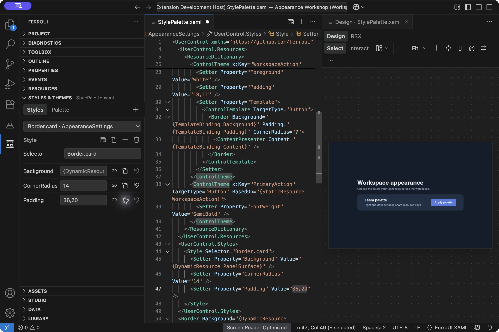
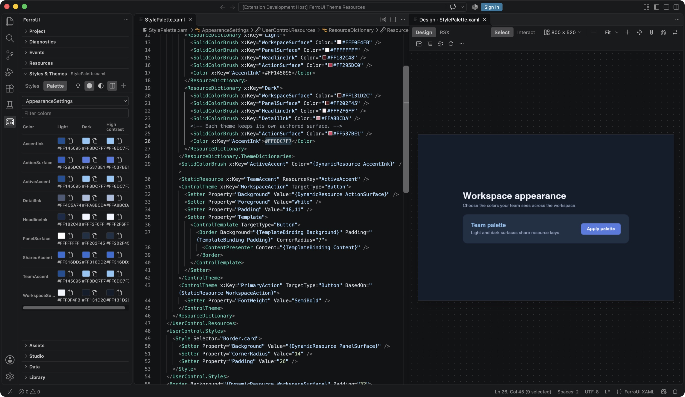
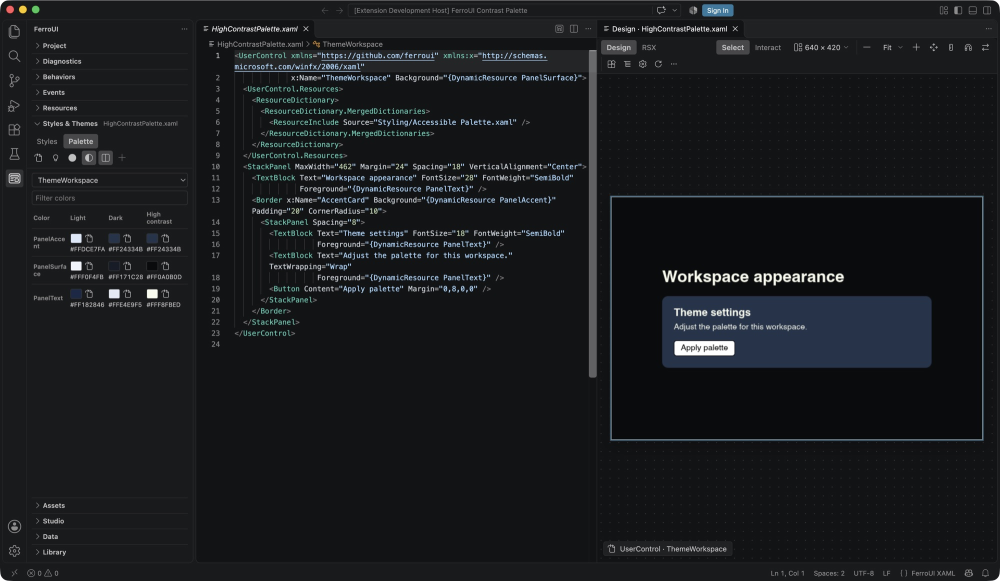
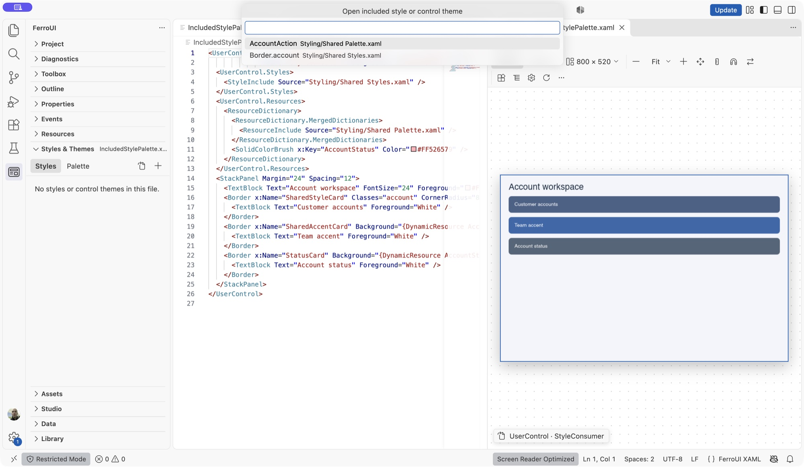
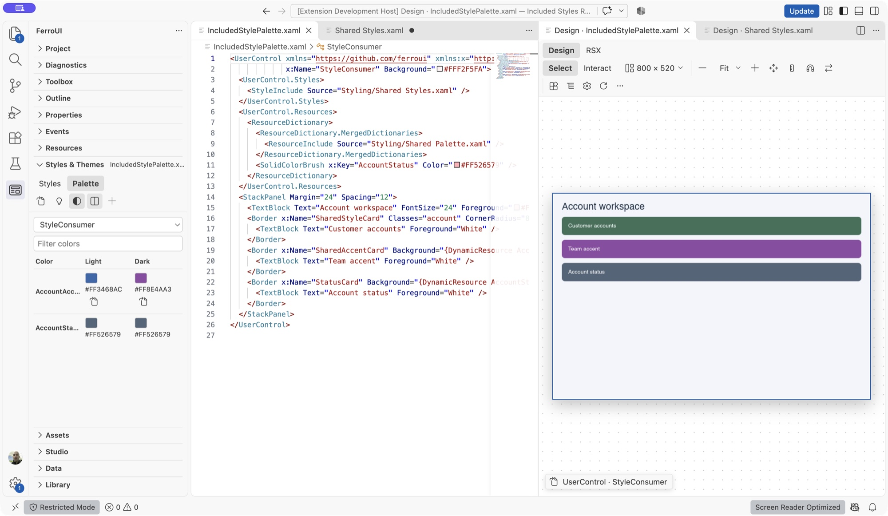
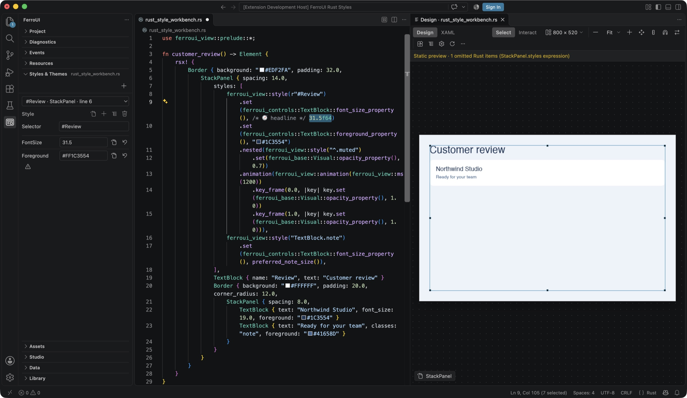
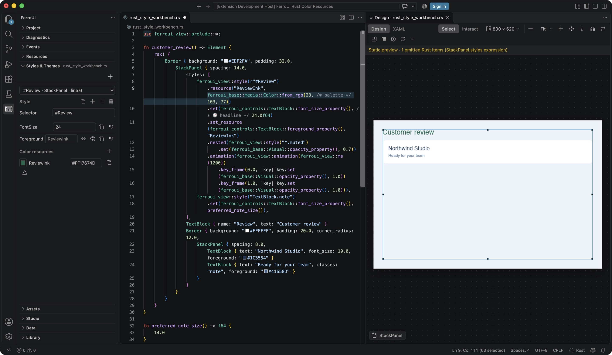
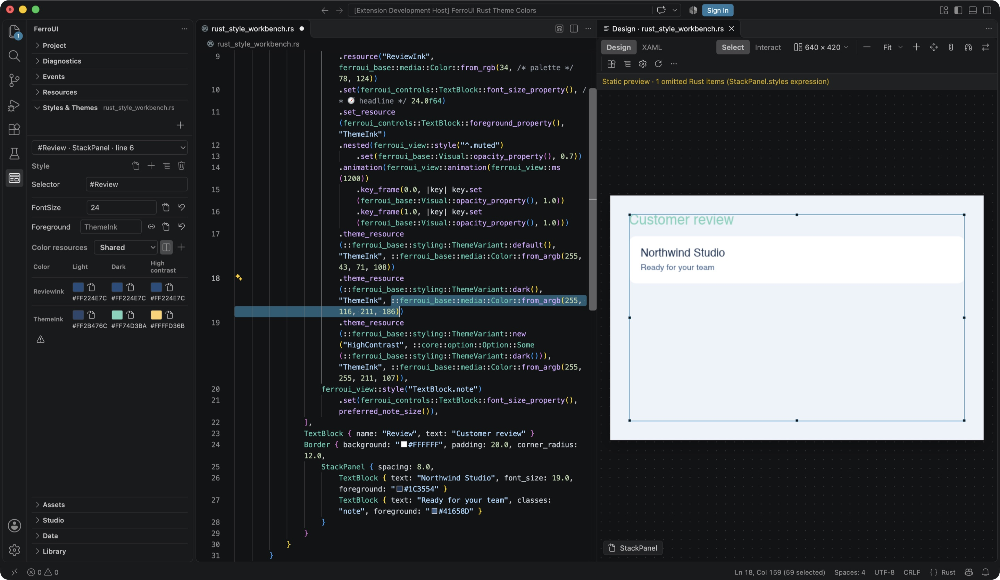

Open an XAML view in **Design** and run **FerroUI: Show Styles & Themes**. You can also expand a style or control theme in **Library** and choose **Edit Style or Theme**. The dock follows the current design. Drag its title to move it beside your canvas. Try [StylePalette.xaml](../../../editors/vscode/test/fixtures/StylePalette.xaml) to follow these steps.

## Compose a style or control theme

1. In **Styles**, select a definition. The list includes its declaring scope. Select a control on the canvas or in Outline to make its style host and ancestors available when creating a style.
2. Choose **New Style or Control Theme**. For a style, choose the host and enter a selector such as `Border.card`. To create a child style within a style or theme, start the selector with `^`, such as `^:pointerover`. For a control theme, choose a resource owner and provide the key and target type.
3. Edit the **Selector** of a style or choose a compatible theme under **Based on**. The base theme must resolve from the definition's scope and use the same target type or a base type. Choices that would create a cycle are unavailable.
4. Choose **Add setter** and select a property. Edit existing literal values in the setter rows. Use the link icon to choose a visible resource for a compatible property. Keyed static aliases appear when their target type is compatible. The setter keeps the alias key. A **Dynamic Resource** follows theme changes. A **Static Resource** resolves when the definition loads. Use the source arrow to open a binding, object value, or setter declaration.
5. Use **Preview definition on canvas** to sample the definition. Return to the document to see it applied to its authored controls. In **Properties**, use **Trace value** to see the actual winning setter or resource on a selected control. [Trace a value](authoring.md#trace-an-effective-property-value)

Each accepted action takes one Undo step. For a keyed style or control theme, use the resource actions in **Library** to duplicate the definition or review a rename across consuming XAML files. [Resource rename](authoring.md#rename-a-resource-across-xaml-files)

[Control theme inheritance in the Styles dock](../images/vscode-control-theme.jpg)

## Compare and edit a palette

1. Open **Palette** and choose a **Palette scope**. A scope is the selected resource owner or an authored dictionary. **Shared** shows ordinary entries. **Default**, **Light**, **Dark**, and **High contrast** show their authored theme layers.
2. Switch the native canvas with the appearance icons in the palette toolbar. **Preview High contrast theme** appears when the helper supports it. On an XAML or RSX canvas, you can also open the size button and choose the **Appearance** before selecting **Apply**. Controls with an explicit theme retain their authored setting.
3. Choose **Compare theme colors** to see each key's resolved values side by side. The comparison follows local entries, included dictionaries, and native variant fallbacks. Use the filter to find a key. Add cards in **Stages** for a side-by-side comparison of the entire view. [Compare stage environments](motion.md)
4. Return to a layer and edit a color field or choose its swatch. The text field accepts native color names and hex values, including `#AARRGGBB` for alpha. The swatch changes RGB while retaining the existing alpha. Use **Add palette color** to create a `Color` or `SolidColorBrush`. Adding a color to a missing theme layer creates its dictionary in the same Undo step.
5. Use the source arrow to open the exact declaration, or the references icon to find uses. A computed value opens in the source editor.

On the sample, compare `ActionSurface` in Light and Dark. Change its Dark value and switch the canvas between themes. The **Apply palette** button updates when Dark is active. Undo restores the original color.

[A Dark palette edit with the exact XAML value selected](../images/vscode-dark-palette-edit.jpg)

### Follow a color alias

In [StylePalette.xaml](../../../editors/vscode/test/fixtures/StylePalette.xaml), filter **Compare theme colors** for `TeamAccent`. Its `StaticResource` points to `ActiveAccent`, a brush whose `Color` uses `DynamicResource AccentInk`. Hover the source icon or focus it with the keyboard to inspect the chain and open the authored `AccentInk` value for that theme. Switch the canvas between Light and Dark to see the **Team palette** title change with the same resource.

The comparison reads static references in their declaring dictionary and dynamic brush colors from their resource host. It follows accepted includes and theme fallbacks. A brush whose reference cannot be verified shows **Unresolved** with the reason. Edit the literal in its owning layer to keep the alias and its consumers intact. [App Preview palette](runtime.md#edit-a-palette-in-app-preview) · [Palette MCP tools](reference.md#edit-styles-and-palettes-with-mcp)

### Add a High contrast color

1. Choose **High contrast** in **Palette layer**, then select **Add palette color**.
2. If the layer is missing, choose the theme package your application uses from the packages loaded by the preview host. Enter the resource key, choose `Color` or `SolidColorBrush`, and enter the value. FerroUI adds the typed theme key and color in one Undo step.
3. Select **Preview High contrast theme** and choose **Compare theme colors**. In the included sample, `PanelSurface` comes from the nested High contrast dictionary, and `PanelAccent` inherits the Dark declaration. The arrow beside a comparison value opens the declaration that supplied it. [HighContrastPalette.xaml](../../../editors/vscode/test/fixtures/HighContrastPalette.xaml)

## Edit styles and palettes in included XAML

Open a consuming view such as [IncludedStylePalette.xaml](../../../editors/vscode/test/fixtures/IncludedStylePalette.xaml). Its shared stylesheet and palette use paths relative to their declaring files.

1. In **Styles**, select the source icon **Open included style or control theme** and choose a definition by name and file. The owner opens in the existing editor split with the definition selected in **Styles & Themes**. Edit the selector or a setter there.
2. In **Palette**, select **Compare theme colors**. A source icon beside a resolved included color opens its owning scope and selects the color's layer. Use **Open included palette** in the toolbar to browse a dictionary and add a color. The comparison follows local overrides and merged dictionaries through the accepted preview.
3. After editing, use the back arrow in **Styles & Themes** to return to the consuming design. The consumer renders from the unsaved XAML. Use **Undo** in the owning buffer to restore the declaration and update its consumers again.

The pickers use the include sources in the current native preview. If an included source changes while you are opening it, reopen the picker after the preview catches up.

See [Styles and palettes from MCP](reference.md#edit-styles-and-palettes-with-mcp) and [Studio authoring](../native-controls.md#edit-scoped-styles-and-palettes) for the same source operations. When your XAML uses application-registered controls or fixtures, open the [App Preview palette](runtime.md#edit-a-palette-in-app-preview) to work with the previewed scope and the app’s registered theme variants.

Use [Styles & Themes in App Preview](runtime.md#edit-styles-and-control-themes-in-app-preview) to edit included selectors, typed setters, and control-theme inheritance against the app’s accepted native frame.

## Edit inline Rust styles

1. Open a Rust file in **Design**, choose an RSX invocation, and run **FerroUI: Show Styles & Themes**. Choose the selector and owner in the dock. Try [rust_style_workbench.rs](../../../editors/vscode/test/fixtures/rust_style_workbench.rs).
2. Change **Selector** or one of the typed setter values and press Enter. **Add setter** lists mapped writable property accessors. A Cargo build supplies additional accessors for registered controls. Use the source arrow to select a Rust literal or an expression.
3. Choose **New Style** and an owner to add a builder to its inline `styles` array. Choose **Add nested style** on a rule and enter a selector such as `^:pointerover`. Remove an authored setter with its discard icon. The trash icon removes a rule whose builder calls all have source mappings.
4. Check the native canvas. A rule can combine typed setters, nested styles, and animation clips. Each applied change edits the owning Rust buffer in one Undo step. The Timeline still uses the original clip and key source.

The editor maps explicit `ferroui_view::style` builders, typed property getters, and supported values such as numbers, colors, text, booleans, enum variants, and geometry constructors. The warning icon opens computed collections, getters, and selector expressions in source. Use the same **Styles & Themes** icon in App Preview to work against the application’s accepted frame. [Studio workflow](../native-controls.md#edit-rust-styles) · [MCP arguments](reference.md#edit-rust-styles-with-mcp)

[See the same Rust style workflow in App Preview](../images/vscode-app-preview-rust-style.jpg)

### Edit Rust style color resources

1. Choose a rule in **Styles & Themes**. Under **Color resources**, select a layer and choose **Add Rust color resource**. Enter a key and a hex color. **Shared** adds a `StyleBuilder::resource` call. **Default**, **Light**, **Dark**, and **High contrast** add `StyleBuilder::theme_resource` calls. Use **Default** when you want a fallback for appearances without their own value. A **Shared** declaration for the same key takes priority in that rule.
2. Use the link icon on a mapped color or brush setter to choose a resource. To add a setter that uses a resource, select **Add setter**, then choose **Resource reference** for a compatible property. The source uses `StyleBuilder::set_resource` with the selected key.
3. Change the color with the swatch or hex field. The preview updates each styled control that resolves that key. Use the source icon to reveal the original color constructor. **Trace value** in Properties reveals the exact winning setter operand, including the referenced key.
4. Choose **Compare Rust theme colors** to see the resolved Light, Dark, and High contrast values from the authored style dictionaries. Open any cell's source icon to find the color supplying that appearance. For example, a High contrast cell opens the Dark declaration when it inherits that value. Choose an appearance in the Design canvas toolbar to see the native result. High contrast preview appears when the host has a registered variant.

The color editor maps literal `Color::new`, `Color::from_rgb`, `Color::from_argb`, and `Color::from_uint32` declarations. For example, editing `Color::from_uint32(0xFF1B_507Au32)` updates the packed ARGB integer and keeps its radix, digit groups, and type suffix. The editor also maps `Color` struct literals whose four channels are integers, preserving the order of their fields and comments.

The palette recognizes the `ferroui_base::styling::ThemeVariant` constructors for Default, Light, and Dark, and the known High contrast variant from WinUI, Material, or macOS. Use qualified paths or named imports such as `use ferroui_base::styling::ThemeVariant as Appearance;`. A High contrast declaration created by the editor uses the same string key and Dark inheritance with `ThemeVariant::new`. Use the warning icon to open a computed variant or other unmapped Rust expression.

Resource choices and comparison values come from the style host and its authored ancestors. A closer resource on the matched control can change the effective value at runtime. The same color edits, layer comparison, and source navigation are available in App Preview. Each accepted edit takes one Undo step. [View resource API](../../declarative-ui.md#102-styles) · [MCP arguments](reference.md#edit-rust-styles-with-mcp)

[Compare the same layers in App Preview](../images/vscode-app-preview-rust-theme-palette.jpg)

### Edit a shared Rust color

1. Open the review view in [rust_shared_colors.rs](../../../editors/vscode/test/fixtures/rust_shared_colors.rs). In **Styles & Themes**, select the rule and choose **Default** in **Color resources**. `ReviewInk` comes from `const DEFAULT_INK` through a named import and a constant alias.
2. Use the source icon to open the supplying constructor. The canvas stays on the selected RSX invocation while you inspect the declaration. The source icon in **Compare Rust theme colors** opens the constructor for that appearance.
3. Choose **Change color from const DEFAULT_INK**. **Use a local color** writes a literal for this resource while preserving its key and comments. **Edit const DEFAULT_INK** changes the shared initializer and updates every reference to the constant. Enter the hex color and use Undo to reverse the source edit.

Named imports and constant chains work in the same file, including inline modules. For a palette in a separate file, open the Cargo package in a trusted workspace and start **Design** on its RSX view. FerroUI finds the owning target from Cargo metadata and follows explicit module declarations. Open drafts in those modules appear in the preview before saving.

The source icon opens the supplying file at its initializer. The **Edit const** choice shows the owning file and makes one undoable edit there. The Design canvas stays on the selected RSX invocation. Use Undo in that file to restore the shared color. If the module has an invalid draft, repair it to resume editing the accepted preview. [Studio workflow](../native-controls.md#edit-rust-styles) · [App Preview workflow](runtime.md#edit-a-shared-rust-palette-in-app-preview) · [MCP actions](reference.md#edit-rust-styles-with-mcp)
