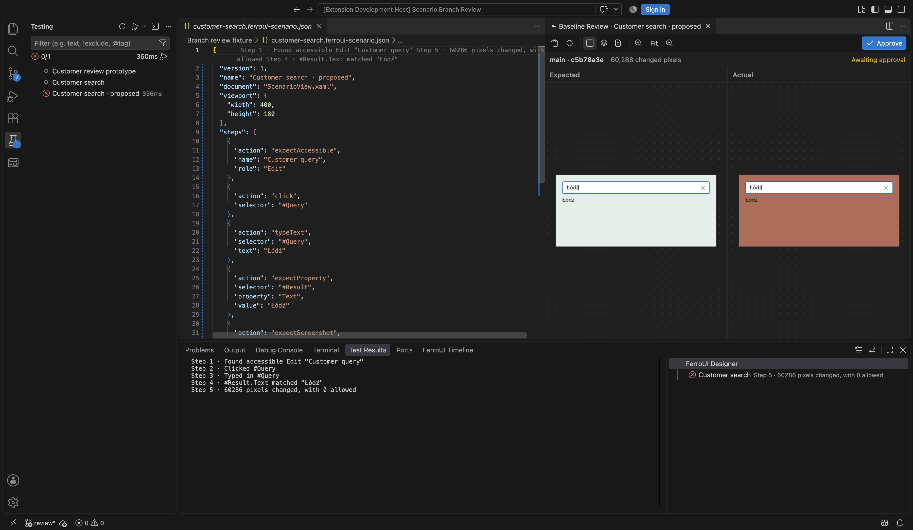
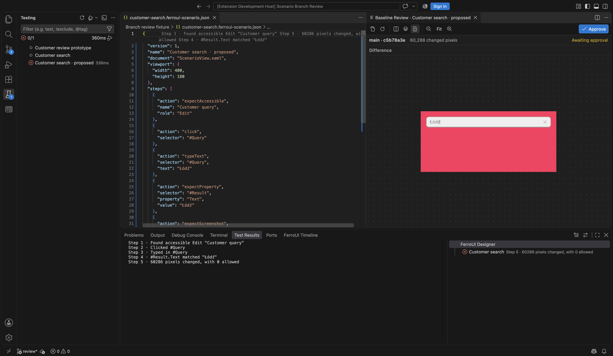

## Run saved UI scenarios

Open a workspace containing the [Task filter and Status indicator examples](../samples/scenarios). In VS Code, **Testing → FerroUI Scenarios** finds saved files ending in `*.ferroui-scenario.json`. Run one test or the selected set. FerroUI opens a fresh native preview for each scenario, sends its input, and checks rendered properties, accessibility, and screenshots.

Use a FerroUI selector such as `#Filter` for interaction and property assertions. For an RSX file with multiple invocations, add a zero-based UTF-16 `caret` with `line` and `character`. Document, stage set, and baseline paths are relative to the scenario file. A saved `.ferrostages` flow can exercise the prototype player, including overlays, focus, keyboard input, and settled transitions. [Scenario format](../../../editors/vscode/README.md#native-ui-scenarios) · [Prototype transitions](motion.md#set-a-prototype-transition)

A normal test run checks the PNG in your working copy. A missing baseline or a visual difference above the specified tolerance fails the matching screenshot assertion. **Test Results** links to the available expected, actual, and difference images. The samples commit their approved PNGs alongside the scenarios. Use a consistent rendering host and fonts when screenshots contain text.

## Review and approve a screenshot

1. Open a scenario and select the compare icon in its editor toolbar, or choose **Review FerroUI Screenshot Baselines** in Testing. **FerroUI: Review Scenario Baselines** also lets you choose a saved scenario from the Command Palette.
2. Use **Side by side**, **Overlay**, or **Highlight differences**. The overlay slider reveals the current image over the expected image. Magenta marks changed pixels outside the channel tolerance. The screenshot picker appears when the scenario captures several steps.
3. Select **Approve** to update the one PNG you reviewed. The runner repeats the saved scenario and verifies its source, the capture, the current baseline, and the Git checkout. If another assertion fails or the review is stale, run the review again after resolving the issue.
4. Run the normal test and commit the approved PNG with the corresponding source and scenario. A new PNG can be approved from the same view after its assertions pass.





Studio offers **Review scenario baselines** from the Project toolbar. Open the project folder first, choose a saved scenario, and run it in the comparison window. Use the difference icon to inspect changed pixels and the check icon to approve the selected image. Studio looks for the companion `ferroui-designer-preview` executable beside itself or on PATH. A source checkout can build both with `cargo build -p designer-studio -p ferroui-designer-preview`. Set `FERROUI_DESIGNER_PREVIEW` to the executable path when the helper is elsewhere. [Studio guide](../README.md)

## Compare against Git

Run **FerroUI: Compare Scenario Baselines with Git** and choose a local branch, tag, or commit. You can also set `ferroui.scenarios.baselineRef` for routine review, or enter the reference in Studio. FerroUI reads the recorded PNG from the merge base of that reference and the current checkout. A missing image in that commit appears as a new screenshot.

The comparison displays the historical image beside the current live capture. **Baseline verified** describes the working-copy PNG, so an approved feature branch can pass its tests and still show its proposed changes from the merge base. Approval updates the current workspace PNG. Commit and review that file through your normal Git workflow.

A shallow checkout needs enough local history to find both sides and their merge base. The review displays the resolved commit so you can confirm which image it used. [Git merge-base](https://git-scm.com/docs/git-merge-base)

## Run a suite in CI

Run the installed native preview helper from your project root, or put its build directory on PATH. Pass the scenario directory to `--scenario-suite`. The suite discovers saved scenarios recursively and writes one JSON report with per-case results. The command exits unsuccessfully if any scenario fails to render or an assertion fails.

```sh
mkdir -p scenario-results
ferroui-designer-preview --scenario-suite tests/ui --workspace "$PWD" \
    --artifacts "$PWD/scenario-results" > scenario-results/report.json
```

Publish `scenario-results` even when the step fails. Open `review.html` from the downloaded artifact to inspect each assertion and its available PNG evidence. The directory also contains the JSON summary. A branch-aware job can pass `--baseline-ref origin/main` to collect historical comparisons in the same run. On a pull request, check out the feature head with its history and fetch the intended base ref before running. The pass or fail result is based on the working-copy PNGs, interaction, and accessibility assertions.

FerroUI's own [Visual Designer workflow](../../../.github/workflows/designer.yml) runs the XAML and RSX sample suite with its compiled preview helper and uploads the reports. Single-case runs use `--scenario <file>`. For a single-case review, add `--review-baselines` and optional `--baseline-ref`. An explicit checked approval uses `--approve-baseline <approval>` with the scenario and the same reference. [Scenario tools for agents](reference.md#review-and-approve-a-scenario-with-mcp)
