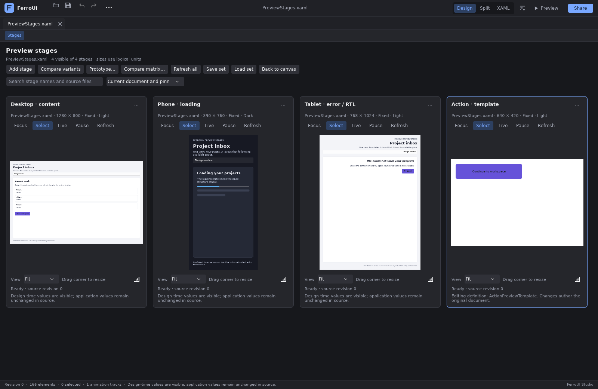
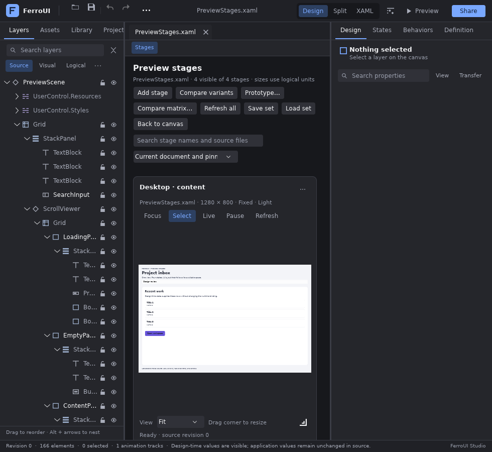
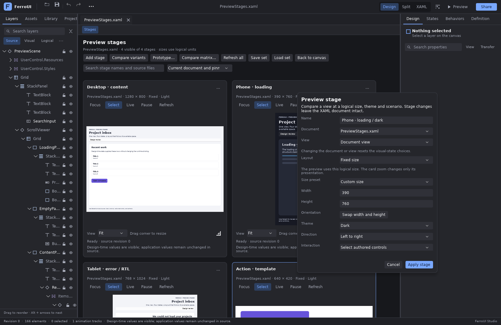
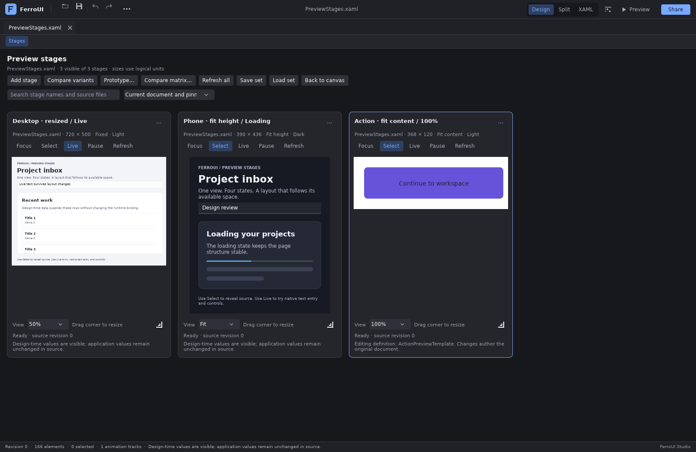
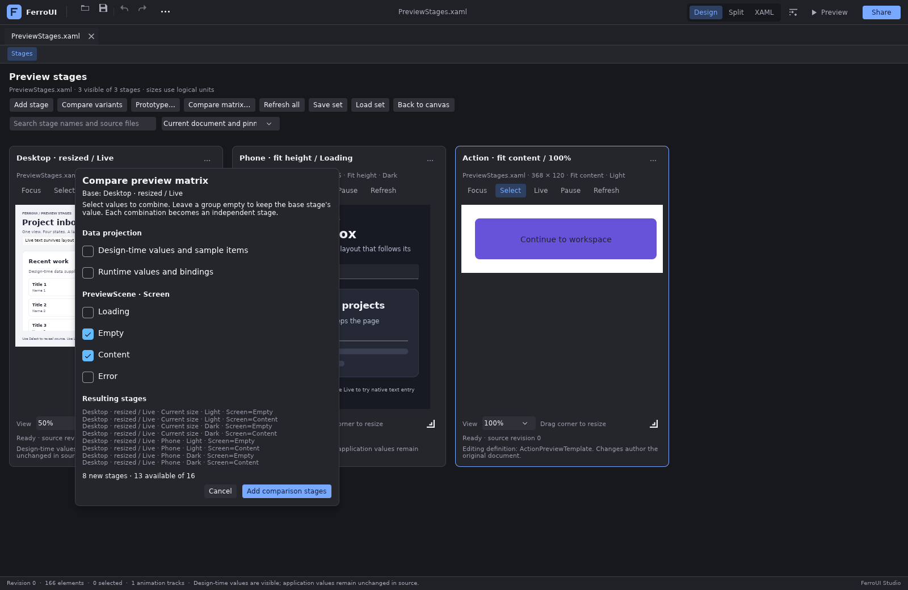

# Preview stages and the Xcode comparison

**Stages** opens a board of named, independent native previews. Each stage combines an
authored document or definition with a logical size or content-fitting constraint, theme,
reading direction, design-time data setting and optional visual-state scenario. A desktop
layout, a narrow phone layout,
and Loading, Empty, Content and Error screens can remain visible together while the same
XAML is edited.

The board reuses FerroUI's native controls, source mappings, definition projection and
preview factories. Its configurations are presentation state: adding or changing a stage
does not edit the XAML, add an undo entry or create another authoring session. Actual
authoring continues through the workspace's existing document transactions.

The [multi-view prototyping guide](prototyping.md) extends these stages with searchable
cross-document browsing, named flow starts, source-anchored Navigate/Back connections and
a native player. Prototype runs have independent native input state; saved stage sets
include their portable graph. The [prototype sample](samples/PrototypeFlow.xaml) provides
Home, Details and Settings screens for a connected journey.

## Try the workflow



These captures use the actual FerroUI workspace, native controls, Vello CPU rendering
and HarfBuzz text shaping. The board also wraps within a narrow editor viewport:



Run the sample from the repository root:

```sh
cargo run -p designer-studio -- --file docs/designer/samples/PreviewStages.xaml
```

1. Choose **Stages** on the canvas shelf. The first board opens with a **Current view**
   stage using the current document or definition and its preview environment.
2. Open that card's **… → Edit stage…**. Name it **Phone / Content**, choose a phone size,
   and select **Content** in the **Screen** visual-state group. **Apply stage** accepts
   the configuration. Cancel leaves the accepted stage intact.
3. Use **… → Duplicate** and edit the copies to select **Loading**, **Empty** and **Error**.
   Each copy owns its native view and selected endpoint. The sample's authored default
   remains the Content panel.
4. Use **Compare variants** to add phone/tablet/desktop sizes, light/dark themes,
   portrait/landscape orientations, or left-to-right/right-to-left layouts. Variants copy
   the selected stage's document, definition, data setting and scenario.
5. Use **Select** and click an authored control to synchronize the source selection and
   property inspector while keeping the board open. Split view also shows the selected
   XAML. **Focus** opens the stage's document or definition and environment in the editing
   canvas. **Live** sends input to the stage's native controls; the sample's search field
   accepts independent text in each live stage.
6. Use **… → Pin across document tabs** to keep a stage visible while another source tab
   is active. Unpinned stages remain associated with their document and reappear when
   that tab is selected.
7. Use **Pause** to suspend automatic source updates for a stage. **Refresh** explicitly
   rebuilds it from the accepted source; **Resume** restores automatic updates. The
   status line identifies a paused, pending, invalid or failed source instead of
   presenting the retained image as a newly accepted result.
8. **Save set** and **Load set** persist the named configurations in a versioned JSON
   manifest. Keep the referenced source documents available in the workspace. The
   manifest contains source identities and settings; it does not embed document text,
   native objects or session-local node IDs.
9. Open **Compare matrix** to combine several sizes, themes, reading directions, design-data
   settings and authored states. Review the combination count before creating the stages;
   the board's 16-stage capacity includes the stages already present.
10. In a stage editor, choose **Fit content** or fit just one axis. The card shows the native
    measured size. Drag the card's resize grip to choose a fixed logical size, or use its
    zoom control to inspect the same layout at a different display scale.
11. Choose **… → Save preview image…** to save that stage's accepted native frame as a PNG.
    The image contains the application preview, without the card's designer commands.
12. Use **Current document** / **All views** and search to find stages. Open **Prototype**
    to define a named flow, add interactions between authored controls and stages, and
    play the connected journey. See [prototyping](prototyping.md) for the complete workflow.

The sample also contains **ActionPreviewTemplate**. Add a stage, choose that authored
definition in **View**, and configure its sample content and sample size. This gives a
component preview alongside the complete document without extracting or rewriting the
template. The sample's theme dictionaries demonstrate actual theme resource lookup;
its `d:ItemsSource` demonstrates the existing design-time data projection.

## What transfers from Xcode



The comparison uses Apple's published documentation, reviewed on 2026-10-28. Apple's
Xcode 27 release notes describe argument grids and independently pinned preview tabs;
they are a reference for the workflow, not a requirement to run a particular Xcode
version with FerroUI.

| Apple workflow | Applicable FerroUI adaptation | Existing foundation and implementation |
| --- | --- | --- |
| Named preview declarations and configured sample views | Named stages for a complete document or an authored template, theme or other supported definition | Existing native preview factories and definition scopes; new stage descriptors and independent native graphs. See [Adding previews](https://developer.apple.com/documentation/xcode/adding-previews-to-your-interface-files). |
| Live and selectable canvas modes | Per-stage Live input or source-backed Select mode, with Focus returning to the editing canvas | Existing native interaction and source maps; each stage has its own accepted graph identity. See [Interacting with previews](https://developer.apple.com/documentation/xcode/interacting-with-previews-in-the-canvas). |
| Preview variants | Side-by-side size, theme, orientation and reading-direction comparisons; named native state scenarios | Existing environment model and visual-state authoring; new board ownership and variant creation. See [Interacting with previews](https://developer.apple.com/documentation/xcode/interacting-with-previews-in-the-canvas). |
| Pinning a preview while navigating source | Pin a stage's source identity across document tabs while continuing to follow accepted changes | Pinning changes visibility; Pause controls automatic updating. See [Build programmatic UI with Xcode Previews](https://developer.apple.com/videos/play/wwdc2023/10252/) and the Xcode 27 notes above. |
| Preview-specific state and sample context | Independently selected VisualStateGroup endpoints, existing design-time values/sample items, and registered native factories | Preview-only classes, clocks and property layers belong to each stage; authored values and bindings remain intact. See [Adding previews](https://developer.apple.com/documentation/xcode/adding-previews-to-your-interface-files). |
| Device and environment overrides | Logical dimensions, rotation, Light/Dark/application theme and inherited/LTR/RTL flow | Native ThemeVariantScope and FlowDirection provide per-stage inheritance. A layout size does not supply another platform runtime. See [Interacting with previews](https://developer.apple.com/documentation/xcode/interacting-with-previews-in-the-canvas). |
| Content-fitting preview traits | Fixed layout, fitting both axes, or fitting one axis within a finite width/height proposal | The native stage host measures and arranges the actual preview. It preserves authored constraints and reports the measured size. See [sizeThatFitsLayout](https://developer.apple.com/documentation/developertoolssupport/previewtrait/sizethatfitslayout). |
| Resizable canvas and canvas magnification | A direct resize grip plus per-card display zoom | Resize changes the native layout proposal; zoom changes only its visual presentation. Existing Live controls survive both. See [Interacting with previews](https://developer.apple.com/documentation/xcode/interacting-with-previews-in-the-canvas). |
| Parameterized preview groups | Bounded combinations of sizes, themes, reading directions, design-data settings and selected native states | A comparison matrix validates every combination and capacity before adding the set. See [parameterized preview groups](https://developer.apple.com/documentation/swiftui/preview(_:traits:arguments:body:)). |
| Preview screenshots | PNG export from the accepted native stage, through the save picker or an embedding API | The existing platform renderer captures the stage at its own logical size, independent of card zoom. See [canvas screenshots](https://developer.apple.com/documentation/xcode/interacting-with-previews-in-the-canvas) and [Xcode 15.3 release notes](https://developer.apple.com/documentation/xcode-release-notes/xcode-15_3-release-notes). |

Xcode's separate scene APIs, widget timelines, device simulators and Apple frameworks do
not map directly to XAML. FerroUI stages therefore describe views and native state
endpoints using the existing source model. They do not introduce Swift syntax, a parallel
scene language or an additional rendering backend.

## Environments and sizing

Width and height are finite logical layout units, from **1 to 16,384** on each axis. The
size presets provide useful phone, tablet and desktop constraints. Rotation swaps width
and height. Cards scale their visual presentation to fit the board while the native
layout still receives the configured dimensions; the reduced card size is not the
application's layout size.

Each stage has its own theme scope and reading direction. Theme-aware resources resolve
against that scope, and inherited flow direction reaches the application controls. The
board does not rewrite fixed widths, font sizes or explicit theme settings authored by
the application. For example, a fixed-width root can still overflow a narrow stage; that
is useful evidence about the actual layout.

**Use design-time values and sample data** controls the existing projection independently
for each stage. Turning it off exposes the ordinary runtime values and bindings. See
[design-time data](design-time-data.md) for supported namespace aliases, scalar/object
overrides, sample item generation and source-mapping rules.

### Content-fitting layouts

**Layout** in the stage editor offers four native sizing policies:

| Editor choice | `PreviewStageLayout` | Native layout behavior |
| --- | --- | --- |
| Fixed size | `Fixed` | Arrange at the configured width and height. |
| Fit content | `SizeThatFits` | Measure with the configured maximum width and height, then fit both axes to the native desired size. |
| Fixed width · fit height | `FixedWidth` | Keep the configured width and fit the measured height within the configured maximum height. |
| Fit width · fixed height | `FixedHeight` | Fit the measured width within the configured maximum width and keep the configured height. |

Fitted axes are bounded between 1 and the supplied maximum, in logical units. The host
uses a finite proposal, so wrapping text, responsive panels and native minimum/maximum
constraints participate in measurement. It does not approximate the content bounds by
counting controls or measuring a screenshot. An authored fixed size or minimum may still
overflow the offered space; the stage clips at its accepted viewport.

The card reports the actual layout size separately from the proposal. Native content
changes can update that measured size without constructing another view or changing the
XAML. Layout policies belong to the saved stage configuration. Older version-1 manifests
that omit the policy keep the original **Fixed size** behavior.
**Focus** opens the ordinary editing canvas at the configured width and height proposal;
the content-fitting policy remains local to the comparison stage.

For a small component, choose the sample's **ActionPreviewTemplate**, set its sample size,
and use **Fit content**. The stage then fits the actual template host instead of reserving
a complete desktop surface. For a scrolling document, **Fixed width · fit height** is
useful for comparing the height requested by the same content at phone and desktop widths.

### Resize and zoom

Drag a stage's lower-corner grip to preview a new logical size. A draft outline and
dimensions follow the pointer; releasing applies the size and selects **Fixed size**.
Escape, lost pointer capture or a conflicting stage/viewport change cancels the draft.
When the grip has keyboard focus, arrow keys resize by one logical unit and Shift+arrow
resizes by ten. Dimensions retain the 1–16,384 bounds.

The pointer calculation accounts for the card's display scale, so dragging a reduced
phone preview changes the intended logical dimensions. Resizing a stage does not rebuild
its native controls or discard text entered in Live mode. It also leaves the source and
undo history intact.

Each card can display **Fit**, **25%**, **50%**, **75%**, **100%**, **150%** or **200%** zoom.
Fit keeps the complete preview visible; fixed magnifications use native scrolling when
the preview exceeds the card. This zoom is board presentation state. It does not change
the application's layout constraint, saved stage manifest or screenshot density.



## Comparison matrices

**Compare matrix** starts from an existing stage. Choose sizes, themes, reading directions,
design-data settings and any available authored state groups. An axis with no selected
values retains the base stage's setting. A selected state axis replaces that group's
choice while retaining choices in other groups.

The editor shows the resulting count before Apply. For example, two sizes × two themes
× two Screen states produce eight independent stages. With the original base stage still
present, that uses nine of the board's sixteen slots. Adding two directions to that
example would require sixteen new stages and is rejected until there is enough space.

The matrix validates all names, dimensions, axes, definition eligibility, retained base
state choices, state anchors and capacity before creating any stage. A descriptor error
leaves the board intact. A native loading failure
in an otherwise valid combination remains visible as that card's own diagnostic; the
other combinations can still render. Names identify each combination, and each resulting
stage can subsequently be edited, pinned, paused or removed independently.

The matrix keeps the base stage's source, definition, layout policy and unrelated state
choices. This lets a content-fitting component use the same comparison workflow as a
complete view. The resulting ordinary configurations are saved by **Save set**; restoring
a set does not rerun an external generator or require a special matrix runtime.



## Save a native preview image

Choose a card's **… → Save preview image…** to capture its native frame at one pixel per
logical unit and open the host's PNG save picker. Capture happens before awaiting the
picker, so later source edits or Live interaction do not change the image already offered
for saving. Cancel leaves the application and stage unchanged.

The image excludes the card's title, status, zoom and commands. Ancestor Viewbox scaling
does not change its raster density. The export captures the currently realized controls
in the stage's visual tree using the already arranged native graph and the
host's rendering backend; it does not reparent controls, force a source refresh, run
application input, advance animation clocks or alter layout to obtain a larger image.

The public and automation APIs accept a density from **0.25× to 4×**. Density scales the
bitmap pixels while preserving logical layout. Fractional pixel extents round upward.
Each output is limited to **16,777,216 pixels**, at most **16,384 pixels per axis**, and
**64 MiB of encoded PNG bytes**. Reduce density or stage size when a requested export
exceeds those bounds.

Only an accepted frame matching the current source and configuration is eligible.
An unchanged paused stage can be captured; a retained frame with newer pending, invalid,
missing or failed source cannot be exported as current output. Native layout must already
be valid. A host without a native rendering backend reports that limitation instead of
returning an empty image.
Layout validation examines at most 100,000 visual nodes, skipping subtrees the native
renderer would not display, and rejects pending visible descendant layout without running it.
The [sample phone PNG](images/designer-preview-export.png) was captured through this public
stage export API during the native rendering test.

## Native state scenarios

The source language service resolves keys in native theme dictionaries and included
theme providers as well as ordinary resources. Definition navigation retains every
possible theme declaration. A rename that would change only part of a referenced theme
family is rejected, keeping the other theme variants and shared references intact.

A stage can select one state from each authored visual-state group in its preview scope.
The sample's **Screen** group selects one visible panel:

| Endpoint | Visible panel | Purpose |
| --- | --- | --- |
| Loading | LoadingPanel | In-progress layout with a determinate progress indicator |
| Empty | EmptyPanel | Empty-state text and primary action |
| Content | ContentPanel | Sample project rows and the normal action |
| Error | ErrorPanel | Recoverable failure text and retry action |

Groups continue to be stored as ordinary native styles, setters and animations, with
the designer's existing ownership comments. The board reads those authored groups and
applies their class selections to a fresh native candidate. It validates all groups,
states, namescope targets and literal property conversions before changing the candidate's
classes. A failed candidate is removed while the previously accepted stage stays visible.

If one authored state owner is realized in several native template instances, the document
stage reports an ambiguity and directs you to a definition stage. Previewing that template
as its own definition provides one unambiguous state owner. This keeps state application
from selecting an arbitrary instance of a shared template.

Literal endpoints use the same disposable native animation-value layer as the main
designer's state preview. This allows a selected endpoint to preview a property whose
authored local value would otherwise take precedence over a style setter. Binding and
resource endpoints remain native style and animation expressions; the board does not
replace them with fabricated computed setters. They require a rooted logical tree so
namescopes, resources and inherited data resolve normally. The workspace retries an
initial scenario after the card is attached.

The selected state is an **endpoint scenario**. Its native clock is sampled to the end
and retained without an advancing application timer. Live mode still permits native
control input, but selecting an explicit scenario does not replay its transition in a
loop. Use the existing timeline/state authoring tools to inspect transition timing, or
clear the explicit state choices to exercise the application's ordinary live state
behavior. Application handlers and actions retain their existing native semantics.

Each stage owns its graph, class changes, clock and literal-value disposables. Editing
text or selecting a scenario in one stage does not reuse another stage's controls or
namescope. Registered host factories must also return a fresh view for every invocation;
their captured application services may be shared intentionally.

Live control state remains in its graph while selecting cards, changing stage size or
layout policy, zooming, and switching document tabs or board visibility. An explicit
refresh or a change to the rendered source, view, theme, reading direction, data setting
or selected states constructs a new native graph and resets
transient input, selection and scroll state in that stage. The editing canvas retains
its existing development hot-reload behavior.

## Source identity and retained results

The board supports up to **16 stages**, with at most **32 selected state groups per
stage**. Every stage retains the source URI, accepted document snapshot and native object
mapping that produced its current view. Secondary previews use an isolated native load
with the original resource base URI, so several stages can render one file without
registering competing hot-reload owners for that file.

Each accepted graph retains an immutable loader source snapshot. Native `ResourceInclude`,
`StyleInclude` and requests made by deferred templates record their actual dependencies
against that snapshot. Changing an included document already open in the workspace
refreshes its automatically updating dependent stages; unrelated document edits preserve
existing Live graphs. A pending or invalid dependency retains the previous frame without
current source-selection authority until a valid refresh succeeds. These updates follow
the workspace's supplied open-document snapshots.

The designer explicitly enables the loader's `source-overlays` feature in both debug and
release builds. Global hot-reload registration remains development-only; these snapshots
do not register additional reload owners.

Definition and state-owner references use namespace-qualified source paths with authored
names or resource keys. Named and keyed targets survive sibling insertion or reordering.
Removing, moving, renaming or making a path ambiguous produces a diagnostic. Give repeated
unnamed controls distinct names when they need to be persistent preview targets; the
board does not guess from an unstable numeric position.

| Status | Meaning |
| --- | --- |
| Ready | The native stage accepted the indicated source revision and configuration. |
| Paused | Automatic source updates are suspended; an explicit Refresh can accept a newer revision. |
| Pending source | The stage source or an included open document has a draft that has not yet entered its accepted preview path. |
| Invalid source | The stage source or an included open document has syntax diagnostics. The prior accepted native result can remain visible. |
| Missing document | The referenced source is unavailable in the workspace. |
| Failed | Native loading, target resolution or scenario evaluation failed; the diagnostic identifies the failure. |

Retained card commands and source selections carry stage epochs and native/source
identity. A callback from a replaced or removed card cannot act on a newer graph with
coincidentally equal node IDs. A paused or failed result cannot be used as though it were
an accepted selection from newer source. Pending source text remains in the source editor
through board configuration, focus and persistence operations.

## Embedding and persistence

The public components can be embedded independently:

- `PreviewStageBoard` owns stage configurations, independent native previews, source
  snapshots, refresh/status handling and guarded source-selection tokens.
- `PreviewStageView` renders cards and emits explicit actions. It receives stage controls
  from its host and does not own document or runtime state.
- `PreviewStageEditor` edits a detached configuration and validates it on Apply.
- `PreviewStageManifest` validates and serializes a version-2 stage set, including the
  prototype graph. Version-1 sets load with an empty graph. JSON parsing rejects unknown
  fields, invalid dimensions, malformed source paths, invalid graph references and
  manifests larger than 1 MiB.
- `PreviewStageMatrix` validates and expands comparison axes into ordinary stage
  configurations within a supplied capacity.
- `PreviewStageExportOptions` and `PreviewStageImage` describe bounded PNG density and
  captured bytes/dimensions. `capture_preview_stage_png` supports custom hosts which
  validate their own accepted stage/source lifecycle.

`DesignerWorkspace` exposes `add_preview_stage`, `update_preview_stage`,
`duplicate_preview_stage`, `remove_preview_stage`, `move_preview_stage`,
`set_preview_stage_paused`, `refresh_preview_stage`, `refresh_all_preview_stages`,
`compare_preview_stage`, `compare_preview_stage_matrix`, `set_active_preview_stage` and
`set_preview_stages_visible`.
`preview_stage_manifest` and `restore_preview_stage_manifest` provide persistence without
requiring the native file picker.
`plan_preview_stage_matrix` returns the exact configurations and validates the available
capacity without constructing controls; `compare_preview_stage_matrix` adds the validated
set through the same board as the native editor.

`preview_stage_image(id, options)` captures an eligible native stage through the workspace's
source and configuration guards. Its PNG bytes and dimensions can be stored or displayed
by an embedding host. `PreviewStageInfo.layout_size` reports native measured width and
height independently from the configured environment's proposal.

For example, the following creates four ordinary comparison stages while retaining the
base stage's definition, layout policy, data mode and authored state choices:

```rust
use ferroui_designer::{
    DesignerWorkspace, PreviewStageId, PreviewStageMatrix, PreviewStageMatrixSize,
    PreviewTheme,
};
use std::rc::Rc;

fn compare_sizes_and_themes(workspace: &Rc<DesignerWorkspace>, base: PreviewStageId)
    -> Result<Vec<PreviewStageId>, String>
{
    workspace.compare_preview_stage_matrix(base, PreviewStageMatrix {
        sizes: vec![
            PreviewStageMatrixSize { name: "Phone".into(), width: 390.0, height: 844.0 },
            PreviewStageMatrixSize { name: "Desktop".into(), width: 1280.0, height: 800.0 },
        ],
        themes: vec![PreviewTheme::Light, PreviewTheme::Dark],
        ..PreviewStageMatrix::default()
    })
}
```

A scenario descriptor for the supplied sample can be constructed from its authored
document before passing it to the workspace:

```rust
use ferroui_designer::{
    PreviewEnvironment, PreviewSourceAnchor, PreviewStageConfiguration,
    PreviewStageState, PreviewTheme,
};
use ferroui_designer_core::Document;

fn phone_content(document: &Document, source_uri: &str)
    -> Result<PreviewStageConfiguration, String>
{
    let owner = document.ast().find_name("PreviewScene")
        .ok_or("The sample's PreviewScene is missing")?;
    let mut stage = PreviewStageConfiguration::new(
        "Phone / Content",
        source_uri,
        PreviewEnvironment {
            width: 390.0,
            height: 760.0,
            theme: PreviewTheme::Light,
            ..PreviewEnvironment::default()
        },
    );
    stage.states.push(PreviewStageState {
        owner: PreviewSourceAnchor::capture(document, owner)?,
        group: "Screen".into(),
        state: "Content".into(),
    });
    Ok(stage)
}
```

An independent host supplies `PreviewStageSource` snapshots and registered preview
options through `PreviewStageBoard::sync_sources`. Mount the board's stage controls in a
rooted native logical tree before evaluating resource/binding scenarios. Stage snapshots
are observations of the host's authored document; the board does not create a second
editable history or collaboration participant.

## Automation

The MCP tools expose the same workspace board and native graphs:

| Tool | Contract |
| --- | --- |
| `designer_preview_stages` | Read `model`, `epoch`, `visible`, stage configurations/statuses, measured sizes, `current_source`, `current_image_source`, the manifest and active source URI. Optional `stage` and `tree: "visual"` or `"logical"` add native runtime rows. Reading does not rebuild a stage or apply source drafts. |
| `designer_preview_stage` | Apply a local stage action against `expected_model` from the latest read. Returns the updated board, plus created IDs or per-stage refresh errors where applicable. |
| `designer_preview_matrix` | Plan the exact combinations and return their configurations, count, available capacity and current model without adding native stages. |
| `designer_preview_image` | Read a current accepted native stage as a PNG with source, graph and size metadata, using `expected_model` from the latest read. Accepts bounded pixel density; does not refresh the stage, apply drafts or write files. |

Mutation actions are `add`, `update`, `duplicate`, `remove`, `move`, `pause`, `refresh`,
`refresh_all`, `focus`, `select`, `show`, `restore`, `compare` and `compare_matrix`. Add/update accept the
complete `PreviewStageConfiguration`; compare accepts named environments based on an
existing stage. `compare_matrix` accepts the bounded comparison axes described above. Restore accepts
the validated versioned manifest. Referenced source
documents must be open to render or focus their stages. Unavailable sources remain
references with a **Missing document** diagnostic; these actions do not open filesystem
paths or load arbitrary source documents.

Every mutation requires the MCP host's `allow_property_writes` permission and the current
model token. Operations that create, resume, focus or refresh Live previews also require
`allow_input`, including operations that synchronize another automatically updating Live
stage. The model identifies the current documents, pending source text and board; it is
an optimistic concurrency guard, not an authorization credential. Stage settings remain
local presentation state and are available to collaboration viewers with the required
host permissions.

Matrix planning and image capture are read-only tools and do not require those write or
input permissions. Image capture returns an MCP image content block plus structured
metadata, including the stage/source identity, rendered revision, logical dimensions and
pixel dimensions. The transport keeps PNG bytes out of the repeated text metadata.

`current_image_source` reports whether the accepted frame matches current source,
dependencies and configuration; valid arranged layout is checked when capturing. A paused
stage with an unchanged accepted source can report `current_image_source: true` while
`current_source: false`, because pausing removes interactive source-selection authority.
`DesignerWorkspace::preview_stage_image_source_is_current` exposes the same source guard
to embedding hosts.

Runtime rows include native `inspector_id` values and clear `source_id` when the retained
preview no longer represents accepted current source. `select` uses a stage and a current
native inspector ID, then validates the graph/source identity before changing the source
selection. At most 10,000 rows are returned, with `tree_truncated` reporting truncation.
Automation `focus` changes the active source/definition/environment context; use `show`
with `visible: false` when the editing canvas should also replace the board.

## Platform and accessibility boundaries

A phone-sized FerroUI stage tests a FerroUI layout under a narrow constraint. It does not
boot an iOS simulator, load UIKit, emulate device pixels, add an operating-system keyboard
or synthesize a notch/safe area. The existing **Preview** command remains the way to open
the actual native Window on the current host platform. Test platform integration with
the application's real platform backend and services.

Dynamic Type is a native platform text-scaling contract, including control metrics and
layout behavior. FerroUI currently has no equivalent stage-wide contract, so the board
does not label a wrapper `FontSize` change as a Dynamic Type simulation. Apple's own
[`dynamicTypeSize` documentation](https://developer.apple.com/documentation/swiftui/environmentvalues/dynamictypesize)
also distinguishes macOS, where that environment value does not affect text size.

Per-stage culture/localization, increased contrast, safe-area presets and device-specific
accessibility environments remain future work. A global culture change would affect other
previews and editor controls; a useful implementation needs a native, isolated resource
and formatting context. Existing native keyboard-order and label-target tools remain
available in [the workflow guide](feature-comparison.md). Visual variants alone do not
constitute an accessibility audit; Apple's
[Accessibility Inspector](https://developer.apple.com/documentation/accessibility/accessibility-inspector)
is a separate inspection and auditing workflow.

Other useful follow-ups are host-named sample context providers and explicitly modeled
platform scenes. Each should extend the native host contracts instead of claiming parity
with simulator behavior.

## Implementation and validation

The implementation is organized in `preview_stages`, `preview_stage_scenarios`,
`preview_stage_view`, `preview_stage_editor`, `preview_stage_export`,
`preview_stage_matrix`, `preview_stage_matrix_editor` and `workspace_preview_stages`.
The existing `runtime`, `definition_projection`, `design_time`, `preview_host` and
environment modules remain shared with the editing canvas.

Native tests cover independent graphs for the same source URI, source-preserving
configuration, scenario isolation, native resource/binding endpoints, complete scenario
validation before class changes, logical-tree attachment, clock ownership and disposal,
and all four endpoints in the runnable sample. Board/workspace tests cover their own
source, target, persistence and input contracts.

Additional native tests exercise finite content measurement, retained Live input during
resizing, zoom/scroll coordinate handling, cancelled and stale resize drafts, bounded
matrix planning and application, and repeated template-owner diagnostics. PNG tests
decode the native output and check actual pixel colors and dimensions at several
densities while an ancestor Viewbox uses another scale. They reject pending layout both
before capture and when a native renderer invalidates a descendant during rendering.
The file-picker regression changes and removes a stage while the save sheet is pending,
then verifies that the original PNG is saved without an authored change. The rendered
workspace test also verifies read-only MCP image bytes and source/size metadata against
the same direct native capture.
