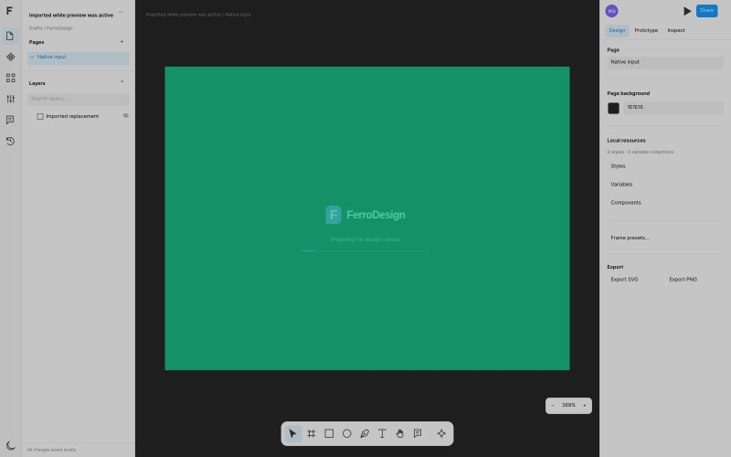
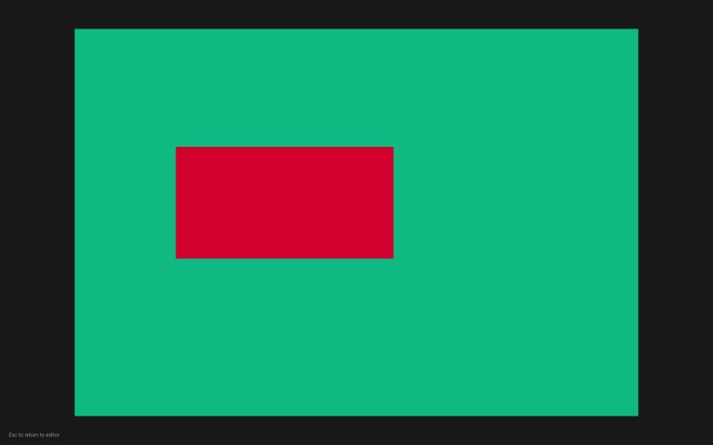
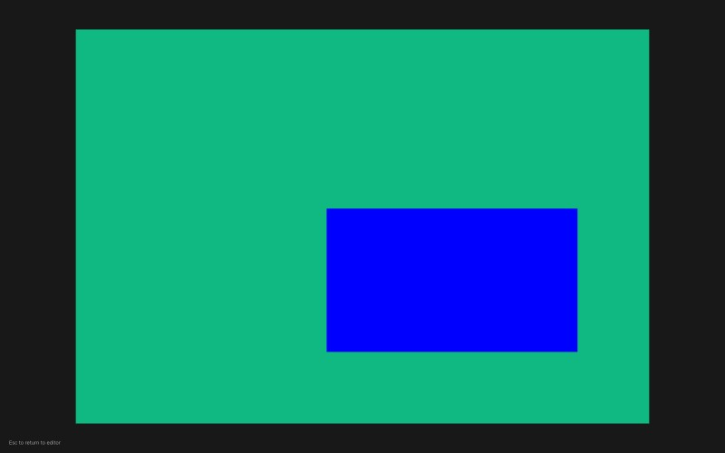
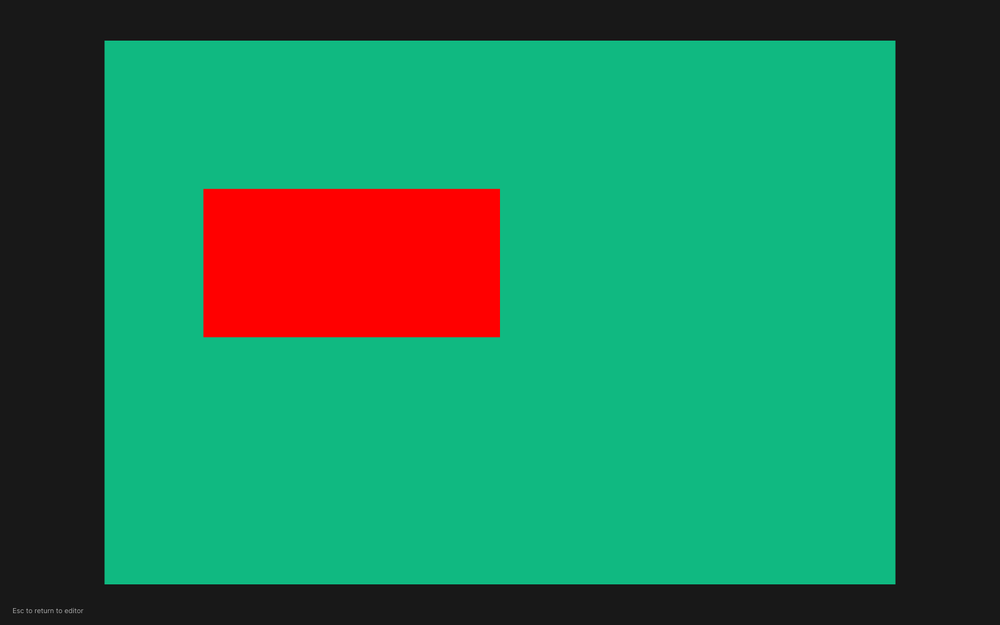
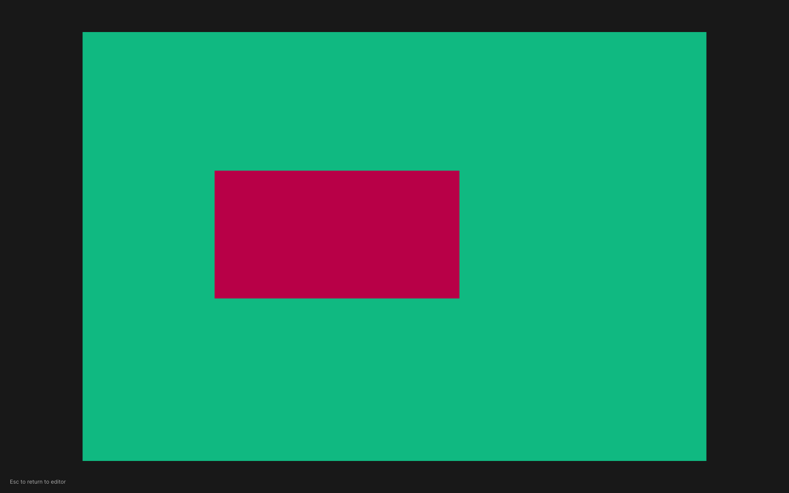

# Prototype motion readiness and original CI timing

## Exact failing application and trace

The original results are for application and harness commit
`b7b0b8853dd47a3426537a6babc11fcc0e0e40cc`, Chromium `156.0.8078.4`,
[workflow 39869066118](https://github.com/wieslawsoltes/FerroUI/actions/runs/39869066118),
browser job `120138674133`. The validation ZIP, artifact `12467743199`, was
downloaded and its SHA-256 verified against GitHub's artifact metadata.
[The compact extraction](prototype-motion-b7-ci.json) records the digest,
exact trace call IDs and clock anchor, source screencast resource names and
hashes, and final native state. The original ZIP remains the source of truth.

Software2D passed all three motion checks in 4,416 ms. WebGL2 failed its first
midpoint wait after 10 seconds. The animation duration was 2,000 ms and the
required progress range was strictly greater than 0.2 and less than 0.8.

| Observed event | Exact measurement |
| --- | ---: |
| Native `mouseClick` completed | 2,831,511.793 trace ms |
| Midpoint rAF wait API call started | 2,831,515.246 trace ms |
| Click completion to wait API call start | 3.453 ms |
| Consecutive recorded compositor swap gap across startup | 8,399.665 ms |
| Final native presentation | Frame 20, no active animation |

The routed native press hit the intended source button at world
`(100.00000561242817, 89.99999929844648)`. A delay in the harness
dispatching its wait call or a missed click is therefore unsupported by this
evidence. The trace cannot establish when the first page predicate executed;
page scheduling could still delay polling.

The screencast continued to deliver images of the preceding document after the
timed click. The next available motion image shows an early red-purple tween;
its center JPEG pixel is `(210, 0, 45)`. The following image shows the completed
blue destination. These are the exact original trace JPEGs, reduced by the
trace recorder to 800×500; they have not been edited:

| Previous document | Early tween | Completed destination |
| --- | --- | --- |
|  |  |  |

The blue-channel fraction `45 / 255 ≈ 0.1765` is an approximate visual
observation from a lossy JPEG, not a recorded native progress value. The trace
does not retain every predicate result. The stale frames and large swap gap
support a startup/rendering backlog; they do not establish whether application
rendering, the graphics driver or host scheduling caused it.

## Readiness and diagnostics correction

`tests/prototype-browser.mjs` now requires a source-presentation frame counter
advance and an actual PNG screenshot before timed input. The independently
calculated source-button center must be exactly opaque red. The presentation,
camera, canvas bounds and complete authored document must remain unchanged
across that readback. Model state or two DOM rAFs alone cannot satisfy this
precondition.

The existing midpoint wait records up to 240 passive progress/frame samples
from its existing rAF poll, plus a dropped-sample count and the latest overflow
sample. It adds no extra native-model poller and cannot change the animation
clock. Diagnostic collection happens after the midpoint assertions/screenshot
or a failed wait; it has a separate five-second response bound and preserves
the original failure. Each run writes `*-prototype-smart-progress.json`.

The animation remains 2,000 ms, its midpoint range remains `(0.2, 0.8)`, and the
wait remains 10 seconds. No retry, fabricated clock or relaxed gate was added.
This is a readiness and diagnostic improvement; the original failure is not
reclassified as a pass, and the evidence above is not a browser result for a
newer application build.

## Local replay

[The local result extraction](prototype-motion-readiness.json) records the
official b7 browser artifact/wasm hashes, exact executed motion-module and native
helper hashes, browser version, report digests and coverage scope. The runtime
was still application commit `b7b0b885`; the harness was based on `1637a093`
with the readiness/diagnostic correction above. These results cannot validate
the newer spacing-variable or angular-handle application changes.

| Execution scope | Mode | Motion result | Other result |
| --- | --- | --- | --- |
| Normal harness, `FERRODESIGN_SCENARIOS=prototype-motion` | WebGL2 | All 3 checks passed, 22,273 ms | Selected mode passed |
| Same normal harness run | Software2D | Not reached | Existing common IME preparation timed out in `openTextEditor`, before scenario dispatch |
| Separate isolated module with exact current native helpers and same SVG import/fixture | Software2D | All 3 checks passed, 4,517 ms | No page or console errors; shared gates and other features were not executed |

The normal run therefore remains **failed overall**. The isolated Software2D
result does not replace its blocked shared gate. Its first standalone attempt
also completed all three motion checks but failed an extra console-empty check
on the temporary server's `/favicon.ico` 404. That result is retained in the
extraction. Returning HTTP 204 for that unused icon was the only temporary
server correction before the clean isolated replay; no application or motion
assertion changed.

Both executed modes checked the source PNG at `(562, 420)` as exactly
`[255, 0, 0, 255]`. The WebGL2 rAF log captured progress `0.275`, with native
rendered frames increasing from 3 to 7; Software2D captured `0.212`, with
frames increasing from 4 to 21. Neither bounded log dropped samples. The
preserved WebGL2 midpoint PNG also contains an actual intermediate brush
`[184, 0, 71, 255]`; it is a later compositor capture, not a claim that screenshot
pixels and the earlier model sample are simultaneous.

| Verified source before input | Actual WebGL2 intermediate capture |
| --- | --- |
|  |  |

The complete bounded progress logs are
[WebGL2](readiness-WebGL2-prototype-smart-progress.json) and
[Software2D](readiness-Software2D-prototype-smart-progress.json).
The standard selected-harness command, using an extracted browser build and
the pinned Chromium, is:

```sh
cd samples/FerroDesign
FERRODESIGN_DIST=/path/to/extracted/browser-build \
FERRODESIGN_CHROMIUM=/path/to/chrome \
FERRODESIGN_SCENARIOS=prototype-motion \
node tests/browser.mjs
```

This command retains the normal shared gates. The original CI failure and its
unknown renderer/driver/host cause remain documented above; a passing focused
replay does not establish full-suite recovery or performance under other loads.
Node syntax validation and `git diff --check` also passed for the correction.
