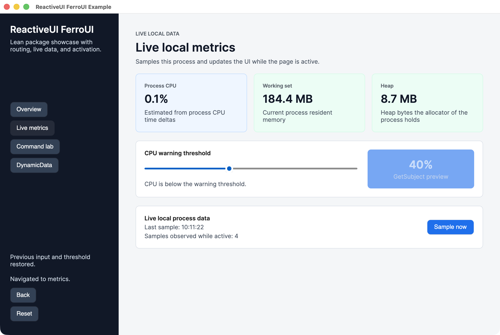

# MVVM on FerroUI

FerroUI's reactive foundation is a set of Rust ports of the .NET libraries that MVVM applications are usually built on: System.Reactive, DynamicData, Splat and ReactiveUI. This guide is for developers who know those libraries from .NET and want to write a FerroUI application in Rust. It shows how the familiar concepts map to the port, with code taken from the crates' documentation tests, their tests and the two samples, `samples/ReactiveDemo` and `samples/ReactiveUIExample`.

The plan of the port and its design decisions are in [porting/reactive.md](porting/reactive.md) (sections 5.1 to 5.8); every difference from the .NET libraries is recorded in [porting/DEVIATIONS.md](porting/DEVIATIONS.md).

## 1. The crates

Each .NET library is ported to one crate, with the same module structure in snake case:

| Crate | Port of | Depends on |
|---|---|---|
| `ferroui-system` | The parts of the .NET base library the others share: `IObservable<T>`, `IDisposable`, `INotifyPropertyChanged`, `ObservableCollection<T>`, `CancellationToken`, `Task<T>`, `SynchronizationContext`, and the property paths (`prop!`) | nothing of FerroUI |
| `ferroui-reactive` | System.Reactive (Rx.NET) | `ferroui-system` |
| `ferroui-reactive-testing` | Microsoft.Reactive.Testing | `ferroui-reactive` |
| `ferroui-dynamic-data` | DynamicData | `ferroui-reactive`, `ferroui-system` |
| `ferroui-splat` | Splat | `ferroui-system` |
| `ferroui-reactiveui` | ReactiveUI (the System.Reactive flavour) with the run time of ReactiveUI.Binding | `ferroui-system`, `ferroui-reactive`, `ferroui-splat` |
| `ferroui-reactiveui-testing` | ReactiveUI.Testing | `ferroui-reactiveui`, `ferroui-reactive`, `ferroui-reactive-testing`, `ferroui-splat`, `ferroui-system` |
| `ferroui-reactiveui-controls` | The integration of ReactiveUI with the controls: the dispatcher scheduler, activation, property observation and command binding for FerroUI objects, the reactive views and view hosts, `use_reactive_ui` | `ferroui-base`, `ferroui-controls` and the crates above |

Only `ferroui-reactiveui-controls` depends on the user interface. The others can be used in a library, a console program or a test without any part of FerroUI, and view models written against them can be tested without a window. `ferroui-reactiveui-controls` does not depend on `ferroui-dynamic-data`; an application that uses reactive collections names it itself.

## 2. Getting started

The reactive crates are released with the rest of the workspace at one version, and the first release that contains them is `0.3.0-preview.1`, the version the workspace carries. Name the same version for every FerroUI crate:

```toml
[dependencies]
ferroui-base = "=0.3.0-preview.1"
ferroui-controls = "=0.3.0-preview.1"
ferroui-desktop = "=0.3.0-preview.1"
ferroui-themes-winui = "=0.3.0-preview.1"
ferroui-system = "=0.3.0-preview.1"
ferroui-reactive = "=0.3.0-preview.1"
ferroui-splat = "=0.3.0-preview.1"
ferroui-reactiveui = "=0.3.0-preview.1"
ferroui-reactiveui-controls = "=0.3.0-preview.1"
# Reactive collections
ferroui-dynamic-data = "=0.3.0-preview.1"

[dev-dependencies]
ferroui-reactive-testing = "=0.3.0-preview.1"
ferroui-reactiveui-testing = "=0.3.0-preview.1"
```

The facade crate `ferroui` offers the same crates behind features: `reactive` (`ferroui::system`, `ferroui::reactive`), `dynamic-data` (`ferroui::dynamic_data`) and `reactiveui` (`ferroui::splat`, `ferroui::reactiveui`, `ferroui::reactiveui_controls`). An application that compiles its markup also names `ferroui-markup-xaml`, as described in the README.

ReactiveUI is set up on the application builder with `use_reactive_ui`. This is the entry point of ReactiveDemo (`samples/ReactiveDemo/program.rs`):

```rust
use ferroui_controls::AppBuilder;
use ferroui_desktop::AppBuilderDesktopExtensions;
use ferroui_reactiveui::ReactiveUIBuilder;
use ferroui_reactiveui_controls::AppBuilderExtensions;

fn build_ferro_app() -> AppBuilder {
    AppBuilder::configure::<App>()
        .use_platform_detect()
        .use_reactive_ui(|_: &ReactiveUIBuilder| {})
        .log_to_trace(LogEventLevel::Warning, &[])
}
```

Once the platform services are set up, `use_reactive_ui` installs the dispatcher's synchronization context on the user-interface thread, creates a ReactiveUI builder with the services of FerroUI (`with_ferro`: the dispatcher scheduler as the main thread scheduler, the activation of views, the observation of the properties of controls, the command binding of controls, the data-template hook and the suspension host), runs the closure, and builds. The closure is where an application registers its own services; ReactiveUIExample registers its views and its metrics service there (`samples/ReactiveUIExample/example_app_builder_extensions.rs`):

```rust
pub fn configure_reactive_ui(builder: &ReactiveUIBuilder) {
    let _ = builder.with_registration(|resolver: &dyn IMutableDependencyResolver| App::register_views(resolver));
}

// AppBuilder::configure::<App>().use_reactive_ui(ExampleAppBuilderExtensions::configure_reactive_ui)
```

An application whose markup uses the reactive views calls `ferroui_reactiveui_controls::register_types()` when it registers its own types (`samples/ReactiveDemo/register_types.rs`). The markup names them through the XML namespace `http://reactiveui.net` or `using:ReactiveUI.FerroUI`.

## 3. View models

A view model holds a `ReactiveObject` as a field, named `reactive` by convention, and is shared as an `Rc`. `reactive_object!` writes the traits a class derived from `ReactiveObject` inherits in .NET: `INotifyPropertyChanged`, `INotifyPropertyChanging`, `IReactiveObject`, `IHandleObservableErrors` and `IEnableLogger`. `reactive_object!(Type, field)` names another field; the field may be any type that is `AsRef<ReactiveObject>`, which is how ReactiveUIExample shares a `ViewModelBase` part between its view models.

`reactive_properties!` is the counterpart of the `[Reactive]` attribute of ReactiveUI.SourceGenerators. Each field marked `#[reactive]` becomes a `RefCell` with a getter and a setter `set_<field>` that raises the change under the PascalCase name (`search_term` is `SearchTerm`). From the crate documentation:

```rust
use ferroui_reactiveui::{reactive_object, reactive_properties, ReactiveObject};

reactive_properties! {
    #[derive(Default)]
    pub struct Search {
        reactive: ReactiveObject,
        #[reactive]
        search_term: String,
        #[reactive]
        page: u32,
        history: RefCell<Vec<String>>,
    }
}
reactive_object!(Search);

let search = Rc::new(Search::default());
search.set_search_term("reactive".to_owned());
assert_eq!(search.search_term(), "reactive");
```

A setter written by hand calls `raise_and_set_if_changed` (`IReactiveObjectExt`) with the backing field, a `RefCell` or a `Cell`, and the property name, which .NET takes from `[CallerMemberName]`. It returns whether the value changed. From the DynamicData page of ReactiveUIExample:

```rust
pub fn set_search_text(&self, value: String) {
    let _ = self.raise_and_set_if_changed(&self.search_text, value, "SearchText");
}
```

The views and view hosts compare view models with `PartialEq`. A view model is a reference type in .NET, so the samples compare by identity:

```rust
impl PartialEq for AppViewModel {
    fn eq(&self, other: &Self) -> bool {
        std::ptr::eq(self, other)
    }
}
```

**Output properties.** `ObservableAsPropertyHelper` and `to_property` work as in .NET, with one difference of construction: `to_property` needs the view model's `Rc`, so the helper is created after the view model and stored in a `OnceCell`. From `samples/ReactiveDemo/app_view_model.rs`:

```rust
reactive_properties! {
    pub struct AppViewModel {
        reactive: ReactiveObject,
        #[reactive]
        search_term: Option<String>,
        search_results: OnceCell<ObservableAsPropertyHelper<SearchResults>>,
        is_available: OnceCell<ObservableAsPropertyHelper<bool>>,
    }
}
reactive_object!(AppViewModel);

// In the constructor, once the view model is an `Rc`:
let is_available = view_model
    .when_any_value(prop!(AppViewModel => search_results))
    .select(|search_results: SearchResults| search_results.is_some())
    .to_property(&view_model, prop!(AppViewModel => is_available));
let _ = view_model.is_available.set(is_available);

// The getter of the property:
pub fn is_available(&self) -> bool {
    self.is_available.get().is_some_and(|helper| helper.value())
}
```

`to_property_with_initial_value` gives the property a value before the observable produces one (`MetricsViewModel::load_label`), and the `thrown_exceptions()` of a helper reports the errors of its observable, as `ThrownExceptions` does.

## 4. Property paths

Where .NET takes an expression (`x => x.SearchTerm`, `v => v.NameBox.Text`), the port takes a typed `PropertyPath`, written with a macro that expands at compile time into the getters and the property names along the path. There are three macros:

- **`prop!`** (`ferroui_system::prop`): `prop!(AppViewModel => search_term)` is the path of the getter `search_term` of an `Rc<AppViewModel>`, observed through `INotifyPropertyChanged` under the name `SearchTerm`. A step may be renamed with `as "Name"`, and steps through objects held in `Rc` are separated by dots: `prop!(Person => address.street)`. `prop!(object Type => getter)` is the path of an object that does not raise `PropertyChanged` itself.
- **`ferro_prop!`** (`ferroui_reactiveui_controls`): a step through a property of a FerroUI object, held as `Ref<T>` and observed through the property system. It is joined to a path with `then`. From `samples/ReactiveDemo/main_window.rs`:

  ```rust
  prop!(MainWindowView => search_text_box).then(ferro_prop!(TextBox => text))
  ```

- **`settable_prop!`** (`ferroui_reactiveui`): a path with the setter `set_<last getter>`, for the side of a binding that is written (`bind`, `bind_to`). `SettableProperty::new(path, setter)` takes any other setter.

`when_any_value`, `when_any`, `when_changed` and the other members of `ReactiveUIBindingExtensions` take one path or a tuple of 2 to 16 paths, where .NET has overloads of 1 to 16 expressions. The values of a tuple of paths are a tuple. From `samples/ReactiveUIExample/ViewModels/metrics_view_model.rs`:

```rust
let load_label = view_model
    .when_any_value((prop!(MetricsViewModel => latest), prop!(MetricsViewModel => cpu_warning_threshold)))
    .select(|(snapshot, threshold): (MachineSnapshot, f64)| {
        if snapshot.processor_percent() >= threshold {
            "CPU is at or above the warning threshold.".to_owned()
        } else {
            "CPU is below the warning threshold.".to_owned()
        }
    })
    .to_property_with_initial_value(&view_model, prop!(MetricsViewModel => load_label), "Waiting for live data.".to_owned());
```

`when_any_value_select` takes the selector as a second argument, as `WhenAnyValue(..., Func<...>)` does:

```rust
fixture.when_any_value_select((prop!(WhenAnyTestFixture => value1), prop!(WhenAnyTestFixture => value2)), |(v1, v2)| format!("{v1}_{v2}"))
```

The observations hold the observed object weakly: once the view model is dropped, they produce nothing more.

## 5. Commands

`ReactiveCommand<P, R>` is created by associated functions, one name per shape of the delegate that .NET overloads:

| .NET | Rust |
|---|---|
| `Create(Action)`, `Create(Func<TResult>)` | `ReactiveCommand::create` |
| `Create(Action<TParam>)`, `Create(Func<TParam, TResult>)` | `create_param` |
| `CreateFromTask(Func<Task<TResult>>)` | `create_from_task` |
| `CreateFromTask(Func<TParam, Task<TResult>>)` | `create_from_task_param` |
| `CreateFromTask(Func<CancellationToken, Task<TResult>>)` and with a parameter | `create_from_task_cancellable`, `create_from_task_param_cancellable` |
| `CreateFromObservable(...)` | `create_from_observable`, `create_from_observable_param` |
| `CreateRunInBackground(...)` | `create_run_in_background`, `create_run_in_background_param` |
| `CreateCombined(...)` | `create_combined` |

Each has a `_with` form that takes `can_execute` and the output scheduler (`None` is .NET's `null`), and the synchronous forms have a `try_` form whose function returns a `Result`. A task is a closure that returns a future of `Result<R, ObservableError>`.

The command lab of ReactiveUIExample gates an asynchronous command on its input and observes its errors (`samples/ReactiveUIExample/ViewModels/command_lab_view_model.rs`):

```rust
let can_run = view_model.when_any_value_select(prop!(CommandLabViewModel => work_item_text), |text: String| !text.trim().is_empty());
let run_work = ReactiveCommand::create_from_task_with(move || Self::run_work_async(run_weak.clone()), Some(can_run), None);

let _ = run_work.thrown_exceptions().subscribe_next(move |error: ObservableError| { /* report the error */ });
```

The streams of a command are the ones of .NET: `can_execute()` and `is_executing()` are `Rc<dyn IObservable<bool>>` that start with the current value; `thrown_exceptions()` reports the errors of the executions and of the gate, and while nothing observes it an error goes to `RxState::default_exception_handler`; `as_observable()` is the stream of results. `execute(parameter)` and `execute_default()` return an observable that runs the command when it is subscribed:

```rust
let _ = view_model.open_page().execute_default().subscribe_next(|_| {});
```

**Commands and controls.** ReactiveUI's `ICommand` and the `ICommand` of the controls (`ferroui_base::input::ICommand`) are two traits in the port. A command reaches a control in one of two ways:

- **From markup.** `ReactiveCommandAdapter::command_of` wraps a command as a command of the controls. The view model exposes the adapter as a property, and the markup binds `Command="{Binding AddFeature}"` as usual:

  ```rust
  let _ = view_model.add_feature_command.set(ReactiveCommandAdapter::command_of(Rc::new(add_feature.clone())));
  ```

- **From code.** `bind_command` (`BindCommandMixins`) binds a command of the view model to a control of the view, inside the view's activation. From `samples/ReactiveDemo/nuget_details_view.rs`:

  ```rust
  disposable_registration.add(view.bind_command(prop!(NugetDetailsViewModel => open_page), prop!(NugetDetailsViewFor => open_button), None));
  ```

## 6. Views

A view is a markup document whose root is one of the reactive classes of the integration: `ReactiveUserControlBase` or `ReactiveWindowBase`. FerroUI classes are not generic, so the root is the non-generic class, and the code-behind types it with its view model through `ReactiveUserControl::<VM>::from_control` or `ReactiveWindow::<VM>::from_control`. From ReactiveUIExample:

```xml
<rxui:ReactiveUserControlBase xmlns="https://github.com/ferroui"
                              xmlns:x="http://schemas.microsoft.com/winfx/2006/xaml"
                              xmlns:rxui="using:ReactiveUI.FerroUI"
                              xmlns:vm="using:ReactiveUIExample.ViewModels"
                              x:Class="ReactiveUIExample.Views.DynamicDataView"
                              x:DataType="vm:DynamicDataViewModel">
```

```rust
#[repr(C)]
pub struct DynamicDataView {
    base: ReactiveUserControlBase,
}

impl DynamicDataView {
    pub fn typed(this: &Ref<Self>) -> ReactiveUserControl<DynamicDataViewModel> {
        ReactiveUserControl::<DynamicDataViewModel>::from_control(this.clone())
    }
}
```

**The view the bindings take.** In .NET the control is its own `IViewFor<TViewModel>`. A FerroUI control is a handle (`Ref<T>`), while the bindings take a view shared as an `Rc` that implements `IViewFor` and raises `PropertyChanged` for `ViewModel`. `BindableView<C, VM>` is that view for a control: it follows the control's `ViewModel` property and holds the control weakly. The named elements of the document are reached through `element_property` (a property of an element, for `bind` and `one_way_bind`) and `element_control` (an element, for `bind_command`). ReactiveDemo writes the same adapter by hand (`samples/ReactiveDemo/code_behind_view.rs`) with getters for the named elements.

**Activation.** Bindings are created inside `when_activated`, and disposed when the view is deactivated. The forms of `WhenActivated` have one name per shape of the block: `when_activated`, `when_activated_register`, `when_activated_disposables` and `when_activated_empty`, each with `_for_view` and `_with_view_model_changed` variants. The view model side is `ViewModelActivationMixins::when_activated_disposables` on an `IActivatableViewModel`.

**Bindings.** `bind`, `one_way_bind` and their `_select` forms (`PropertyBindingMixins`) take the view model (`None` follows the view's `ViewModel`), a path of the view model, and a `SettableProperty` of the view. A binding a hook refused is `None`. From `samples/ReactiveUIExample/Views/dynamic_data_view.rs`, abridged:

```rust
type View = BindableView<ReactiveUserControlBase, DynamicDataViewModel>;

let view = View::new(&control);
let bound = view.clone();
let _ = view.when_activated_disposables(move |disposables| Self::bind_view(&bound, disposables));

// In bind_view:
let none = None::<Rc<DynamicDataViewModel>>;
let search_box = element_property("SearchTextBox", &this.search_text_box(), ferro_prop!(TextBox => text), |text: &Ref<TextBox>, value: Option<String>| {
    text.set_value(TextBox::text_property(), value)
});
add(view
    .bind_select(none.clone(), settable_prop!(DynamicDataViewModel => search_text), search_box, Some, |text: Option<String>| text.unwrap_or_default())
    .map(|binding| binding as Rc<dyn IDisposable>));

disposables.add(view.bind_command(prop!(DynamicDataViewModel => add_feature), element_control("AddFeatureButton", &this.add_feature_button()), None));
```

ReactiveDemo binds the same way, with the view's `SettableProperty`s written once as functions:

```rust
dispose_with(
    view.bind(view.view_model(), settable_prop!(AppViewModel => search_term), MainWindowView::search_text_box_text()),
    disposable_registration,
);
```

`bind_to` writes each value of an observable to a property of a target (`BindToMixins`). From the tests of `ferroui-reactiveui`:

```rust
let binding = source.as_observable().bind_to(target.clone(), settable_prop!(TestViewModel => name));
```

A binding holds its target weakly; once the target is dropped, it is no longer written. Markup bindings (`{Binding ...}` with `x:DataType`) work alongside the code bindings: ReactiveUIExample exposes the properties of its view models to markup with `ferro_markup_type!`.

## 7. View location and routing

**Registering views.** .NET finds the classes that implement `IViewFor<TViewModel>` by reflection or with a source generator. In Rust they are listed. ReactiveDemo lists its views in a `ViewAssembly` and registers them with `ViewRegistrar` (`samples/ReactiveDemo/app.rs`):

```rust
pub fn view_assembly() -> ViewAssembly {
    ViewAssembly::new("ReactiveDemo").view::<NugetDetailsViewModel, NugetDetailsViewFor>(None, || NugetDetailsView::new().view())
}

pub fn register_views() {
    let resolver = AppLocator::current_mutable();
    let assemblies = [Rc::new(view_assembly())];
    ViewRegistrar::register_views(Some(&*resolver), Some(&assemblies[..]));
}
```

The first argument of `view` is the view contract (`[ViewContract]`). The builder also has `register_reactive_ui_views(assemblies)`. A view can be registered directly with the resolver, with a contract, as ReactiveUIExample does in `App::register_views`:

```rust
resolver.register_view_for::<MetricCardViewModel>(
    || PerformanceMetricCardView::view_for_of(&PerformanceMetricCardView::new()),
    Some(PERFORMANCE_CONTRACT),
);
```

`ViewRegistrations` (`register_with::<VM, _>(factory, ViewRegistrationOptions::new().with_contract(...))`, then `apply()`) builds the view dispatch that ReactiveUI's source generator writes in .NET. The `DefaultViewLocator` resolves a view from that dispatch first, then from the mappings of the locator, then from the service locator.

**View hosts.** `ViewModelViewHost` shows the view located for its `ViewModel`, under its `ViewContract`, and its `DefaultContent` when there is none. From `samples/ReactiveUIExample/Views/MetricsView.xaml`:

```xml
<rxui:ViewModelViewHost Grid.Column="0"
                        ViewContract="performance"
                        ViewModel="{Binding ProcessorCard}" />
```

An items control without an item template gets one from the data-template hook of the integration (`AutoDataTemplateBindingHook`, registered by `use_reactive_ui`), which shows each item with the view located for it. ReactiveDemo's result list and ReactiveUIExample's overview rely on it.

**Routing.** A screen implements `IScreen` and owns a `RoutingState`. A routable view model implements `IRoutableViewModel`: its `url_path_segment`, and its `host_screen`, an `Option` because a page holds its screen weakly (the screen owns the router, whose stack owns the page). From `samples/ReactiveUIExample/ViewModels/main_view_model.rs`:

```rust
impl IScreen for MainViewModel {
    fn router(&self) -> Rc<RoutingState> {
        self.router.clone()
    }
}

// router: RoutingState::new(),
let _ = self.router.navigate().execute(page).subscribe_next_error(
    move |routed: RoutableViewModel| { /* navigated */ },
    move |error| { /* the navigation failed */ },
);
```

`navigate()`, `navigate_and_reset()` and `navigate_back()` are commands, as `Navigate`, `NavigateAndReset` and `NavigateBack` are; the parameter of `navigate` is an `Option<RoutableViewModel>` (`Rc<dyn IRoutableViewModel>`). The view of the screen hosts the current page with a `RoutedViewHost`:

```xml
<rxui:RoutedViewHost x:Name="RouterHost" Grid.Column="1" Router="{Binding Router}">
  <rxui:RoutedViewHost.DefaultContent>
    <TextBlock Text="Select a route to begin." />
  </rxui:RoutedViewHost.DefaultContent>
</rxui:RoutedViewHost>
```

## 8. Reactive collections with DynamicData

`ferroui-dynamic-data` has the keyed side (`SourceCache`, `ferroui_dynamic_data::cache`) and the side of positions (`SourceList`, `ferroui_dynamic_data::list`), with the operators of DynamicData as provided methods of `ObservableCacheEx` and `ObservableListEx`. The DynamicData page of ReactiveUIExample (`samples/ReactiveUIExample/ViewModels/dynamic_data_view_model.rs`) keeps its features in a `SourceCache` keyed by id:

```rust
let source = SourceCache::new(|feature: &Rc<ShowcaseFeature>| feature.id());
source.add_or_update_items(ShowcaseFeature::defaults());
```

The list is one pipeline: `connect`, `auto_refresh` on the favourite flag, a filter that changes with the throttled search text, a transform into row view models, and `sort_and_bind` into an `ObservableCollectionExtended` with a `SortExpressionComparer`:

```rust
let predicates: Rc<dyn IObservable<FeaturePredicate>> = view_model
    .when_any_value(prop!(DynamicDataViewModel => search_text))
    .skip(1)
    .throttle_on(SEARCH_THROTTLE, scheduler)
    .start_with([initial_text])
    .distinct_until_changed()
    .select(|text: String| -> FeaturePredicate { Rc::new(move |feature: &Rc<ShowcaseFeature>| feature.matches(&text)) });

// Favourites first, then by name.
let comparer = SortExpressionComparer::<Rc<FeatureItemViewModel>>::descending(|row| row.is_favourite())
    .then_by_ascending(|row| row.name())
    .comparer();

let subscription = view_model
    .source
    .connect()
    .auto_refresh(prop!(ShowcaseFeature => is_favourite))
    .filter_dynamic(predicates)
    .transform(move |feature: &Rc<ShowcaseFeature>| FeatureItemViewModel::new(feature.clone(), row_remove.clone()))
    .sort_and_bind(&view_model.items, comparer)
    .subscribe_next(move |_| { /* update the status */ });
```

A fixed predicate is `filter(|item| ...)`; `sort` and `sort_by` sort without binding. The cache is edited with `add_or_update`, `remove_key` and `edit`; the commands of the page call them:

```rust
let remove_feature = ReactiveCommand::create_param(move |key: i32| removed_from.remove_key(key));
```

`auto_refresh` takes a property path, as `AutoRefresh(x => x.IsFavourite)` takes an expression, and re-evaluates the filter and the sort when that property of an item changes. An `ObservableCollection` of `ferroui-system` is an items source of the controls, as an `ObservableCollection<T>` is in .NET: the example sets `ItemsSource::new(Rc::new(items.collection().clone()))` on its list, and the list follows the changes `sort_and_bind` makes.

## 9. Threading

Everything is single-threaded and reference counted, as FerroUI's object model is. Observables, observers, subscriptions and view models are `Rc` and not `Send`; a sequence and its subscriptions live on the thread that created them. The state that is static in .NET (`RxSchedulers`, `RxState`, the Splat locator, `MessageBus.Current`, the options of DynamicData) is per thread.

**Schedulers.** `ImmediateScheduler`, `CurrentThreadScheduler` and the virtual-time schedulers are ported as they are. The main thread scheduler is `FerroScheduler`, which runs its work in jobs of the dispatcher and its delays on `DispatcherTimer`s; `use_reactive_ui` sets `FerroScheduler::instance()` as `RxSchedulers::main_thread_scheduler()`. `RxSchedulers::task_pool_scheduler()` cannot run work on a thread pool, since the work is not `Send`; it is the default scheduler of the current thread unless one is set. Until something sets them (in a unit test, for example), both schedulers are the default scheduler of the thread.

Operators that wait take their scheduler in a separate method (`throttle_on`, `delay_on`) where .NET has an overload. ReactiveDemo throttles its search on the main thread scheduler, because the default scheduler of a thread waits by blocking it:

```rust
let search_results = view_model
    .when_any_value(prop!(AppViewModel => search_term))
    .throttle_on(Duration::from_millis(800), RxSchedulers::main_thread_scheduler())
    .select(|term: Option<String>| term.map(|term| term.trim().to_owned()))
    .distinct_until_changed()
    .where_(|term: &Option<String>| term.as_deref().is_some_and(|term| !term.is_empty()))
    .select_many_async_with_token(move |term: Option<String>, token: CancellationToken| {
        search_nuget_packages(&search_service, &launcher, term.unwrap_or_default(), token)
    })
    .observe_on(RxSchedulers::main_thread_scheduler())
    .to_property(&view_model, prop!(AppViewModel => search_results));
```

**Work on other threads.** Background work goes through tasks (`ferroui_system::threading::tasks`). `tasks::run` runs a `Send` closure on a worker thread and gives a `Task<T>` that completes on the calling thread; `Task::spawn_local` runs a future on the current thread. A `Task<T>` is a future, so an asynchronous operator or command awaits it. ReactiveDemo's search service sends its HTTP request from a worker thread (`samples/ReactiveDemo/nuget_search.rs`):

```rust
fn search(&self, term: &str, token: CancellationToken) -> Task<Vec<PackageSearchMetadata>> {
    if token.is_cancellation_requested() {
        return Task::from_canceled();
    }
    let term = term.to_owned();
    tasks::run(move || query(&term))
}
```

The result is plain data (`Send`); the view models are made from it on the user-interface thread when the task completes. `create_run_in_background` keeps its .NET name but runs on the task pool scheduler, that is on the current thread.

**The synchronization context.** A task woken from another thread resumes on its own thread through the thread poster of that thread. `FerroScheduler::install_on_ui_thread`, which `use_reactive_ui` calls, makes the dispatcher's `FerroSynchronizationContext` the synchronization context of the user-interface thread (`ferroui_system::threading::set_synchronization_context`) and with it the thread poster, so tasks of that thread complete through the dispatcher. `observe_on_context` and `subscribe_on_context` are the `SynchronizationContext` forms of `ObserveOn` and `SubscribeOn`. Without a poster, as in a console program or a test, `tasks::run_pending_wakes()` or `tasks::block_on` runs the queued wakes.

## 10. Testing

`ferroui-reactive-testing` is Microsoft.Reactive.Testing: the virtual-time `TestScheduler`, hot and cold test observables, recorded notifications and their assertions. From its crate documentation:

```rust
use ferroui_reactive_testing::{assert_messages, ReactiveTest as RT, TestScheduler};

let scheduler = TestScheduler::new();
let xs = scheduler.create_hot_observable(vec![RT::on_next(150, 1), RT::on_next(210, 2), RT::on_completed(250)]);
let source = xs.as_observable();
let res = scheduler.start(move || source.clone());
assert_messages!(res.messages(), RT::on_next(210, 2), RT::on_completed::<i32>(250));
```

`ferroui-reactiveui-testing` is ReactiveUI.Testing. `SchedulerExtensions::with` runs a block with a scheduler as both schedulers of `RxSchedulers`, and restores them afterwards, also when the block panics; `TestSchedulerExtensions` moves virtual time in milliseconds (`advance_by_ms`, `advance_to_ms`).

A view model is tested without a window: its services are traits, the test gives its own, and virtual time replaces the throttle. This is the pattern of ReactiveDemo's view model tests (`samples/ReactiveDemo/tests/app_view_model_tests.rs`):

```rust
use ferroui_reactive_testing::TestScheduler;
use ferroui_reactiveui_testing::{SchedulerExtensions, TestSchedulerExtensions};

#[test]
fn the_search_waits_until_the_term_has_not_changed_for_800_ms() {
    TestScheduler::new().with(|scheduler| {
        let search = RecordingSearchService::new();
        let view_model = AppViewModel::with_services(search.clone(), RecordingLauncher::source(&RecordingLauncher::new()));

        view_model.set_search_term(Some("reactiveui".to_owned()));
        scheduler.advance_by_ms(799.0);
        assert!(search.terms().is_empty(), "no search before 800 ms without a change");

        scheduler.advance_by_ms(1.0);
        assert_eq!(search.terms(), ["reactiveui"], "one search, of the last term");
    });
}
```

Commands are tested the same way: `view_model.open_page().execute_default().subscribe_next(|_| {})`, then `scheduler.advance_by_ms(1.0)`. A view model can also take its scheduler as a parameter, as the DynamicData page does (`DynamicDataViewModel::with_scheduler(&screen, Some(scheduler.scheduler()))`); its tests then move the scheduler with `scheduler.advance_by(duration_to_ticks(SEARCH_THROTTLE) + 1)`.

Views are tested in the unit-test application of the controls (`UnitTestApplication::start_with`, from `ferroui-controls` with the feature `testing`). The samples' test support resets ReactiveUI and configures it as `use_reactive_ui` does, then creates the window, shows it and runs the dispatcher's jobs (`samples/ReactiveDemo/tests/support.rs`, `main_window_tests.rs`):

```rust
RxAppBuilder::reset_for_testing();
RxSuspension::reset_for_testing();
StartupConfiguration::configure_reactive_ui(&|_: &ReactiveUIBuilder| {});
```

## 11. Differences from .NET

The main deviations, each recorded with its reason in [DEVIATIONS.md](porting/DEVIATIONS.md):

- **No reflection or expression trees.** Expressions are property paths written with `prop!`, `ferro_prop!` and `settable_prop!`; the arity overloads of `WhenAnyValue` are tuples of paths; views are listed (`ViewAssembly`, `register_view_for`, `ViewRegistrations`) rather than found by scanning assemblies; Splat registers and resolves services by generic methods keyed by the type, not by `Type`. See [ReactiveUI](porting/DEVIATIONS.md#reactiveui-srcferrouireactiveui-srcferrouireactiveuitesting-testsferrouireactiveuitests-testsferrouireactiveuitestingtests) and [Splat](porting/DEVIATIONS.md#splat-srcferrouisplat-testsferrouisplattests).
- **`try_` forms and panics in place of exceptions.** A selector or command that can fail is a `try_` form returning `Result<T, ObservableError>`, whose error takes the path of a .NET exception (`OnError`, `ThrownExceptions`). A panic is Rust's unhandled exception; where .NET catches an exception, the port catches the panic as a `PanicException`. See [Reactive](porting/DEVIATIONS.md#reactive-srcferrouireactive-srcferrouireactivetesting-testsferrouireactivetests) and [DynamicData](porting/DEVIATIONS.md#dynamicdata-srcferrouidynamicdata-testsferrouidynamicdatatests).
- **`_cache` and `_list` suffixes.** A DynamicData operator whose name is also an Rx operator takes the suffix of its kind: `count_cache`, `switch_cache`, `cast_list`, `sum_aggregate`. Overloads become separate names throughout (`select_with_index`, `throttle_on`, `create_from_task_param`). See [DynamicData](porting/DEVIATIONS.md#dynamicdata-srcferrouidynamicdata-testsferrouidynamicdatatests).
- **Per-thread state.** The schedulers of `RxSchedulers`, the service locator, `RxState`, `MessageBus::current` and the options of DynamicData are per thread, and the observables are single-threaded; there is no thread-pool scheduler. See [Reactive](porting/DEVIATIONS.md#reactive-srcferrouireactive-srcferrouireactivetesting-testsferrouireactivetests), [Splat](porting/DEVIATIONS.md#splat-srcferrouisplat-testsferrouisplattests) and [ReactiveUI controls](porting/DEVIATIONS.md#reactiveui-controls-srcferrouireactiveuicontrols).
- **Weak observation.** Without a garbage collector, cycles would leak: property observations, `bind_to`, the writes of `bind` and `one_way_bind`, the subscription of an `ObservableAsPropertyHelper` and `host_screen` hold their objects weakly, and stop when the object is dropped. See [ReactiveUI](porting/DEVIATIONS.md#reactiveui-srcferrouireactiveui-srcferrouireactiveuitesting-testsferrouireactiveuitests-testsferrouireactiveuitestingtests).
- **Two command traits and adapter views.** A command reaches a control's `Command` through `ReactiveCommandAdapter`, and a control binds through a `BindableView` of itself. See [ReactiveUI controls](porting/DEVIATIONS.md#reactiveui-controls-srcferrouireactiveuicontrols) and [Samples](porting/DEVIATIONS.md#samples-samplesreactivedemo-samplesreactiveuiexample).

## 12. The samples

### ReactiveDemo

`samples/ReactiveDemo` is a port, file for file, of `ReactiveDemo`, the getting-started sample of the ReactiveUI documentation: a NuGet package browser. It shows a view model with a notifying property and two output properties, the throttled and deduplicated search with `when_any_value` and `to_property`, a `ReactiveCommand` that opens the page of a package, views in markup bound in code inside `when_activated`, and view location for the items of a list without an item template.


```sh
cargo run -p reactive-demo
# Search an in-memory catalogue instead of nuget.org
cargo run -p reactive-demo --no-default-features
cargo test -p reactive-demo
```

### ReactiveUIExample

`samples/ReactiveUIExample` is a port of the example of the integration of ReactiveUI with the reference UI framework, with a DynamicData page added. A shell with a sidebar hosts routed pages in a `RoutedViewHost`: an overview shown through the data-template hook, live metrics of the process sampled while the page is active, with metric cards located under view contracts, a command lab with can-execute, asynchronous work, a failing command and an interaction, and the DynamicData page of section 8. On desktop, `AutoSuspendHelper` saves the input of the command lab and the threshold of the metrics on exit and restores them on launch.

| The DynamicData page | The live metrics page |
|---|---|
|  |  |

```sh
cargo run -p reactiveui-example
cargo test -p reactiveui-example
```

Both samples use the WinUI 3 theme. Their differences from the references are listed in [DEVIATIONS.md, section Samples](porting/DEVIATIONS.md#samples-samplesreactivedemo-samplesreactiveuiexample) and in each sample's README.
