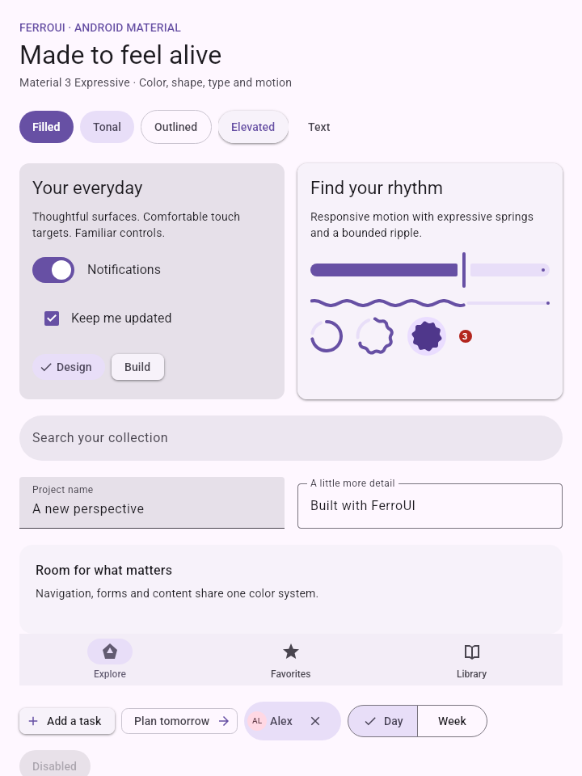
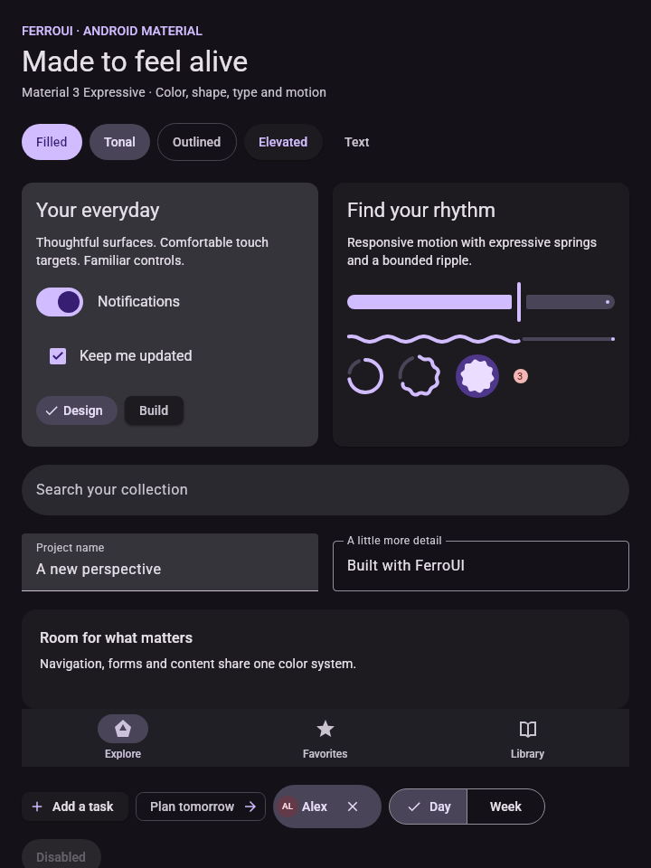
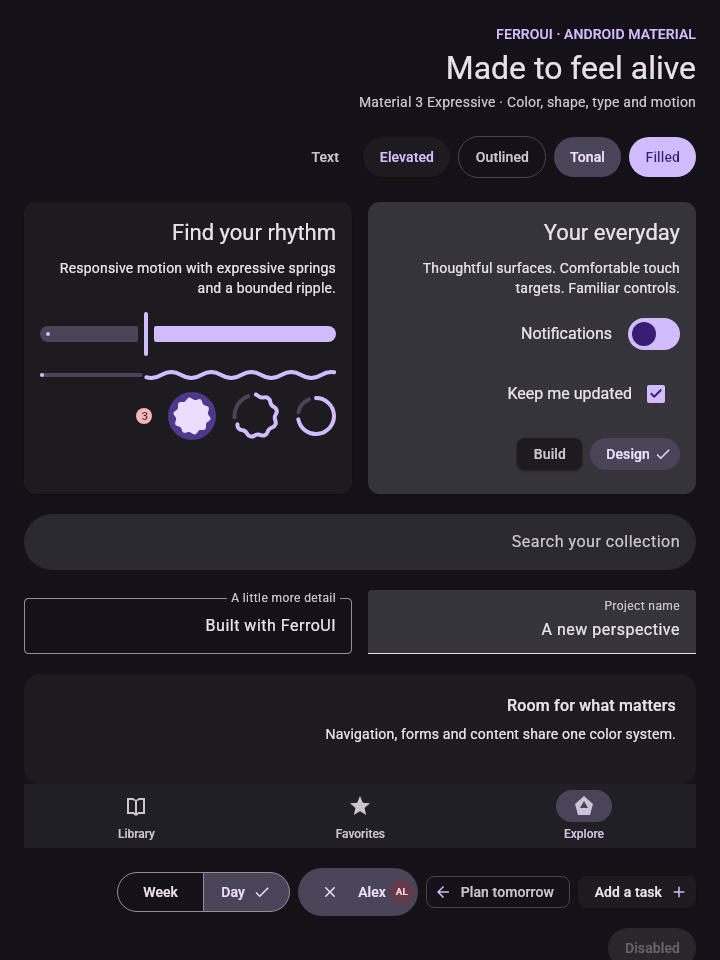
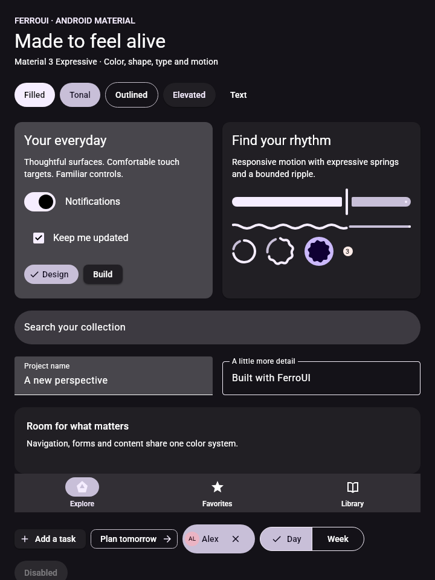
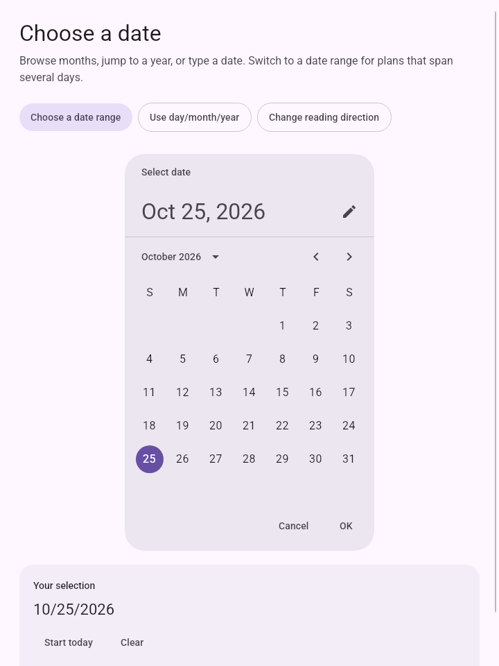
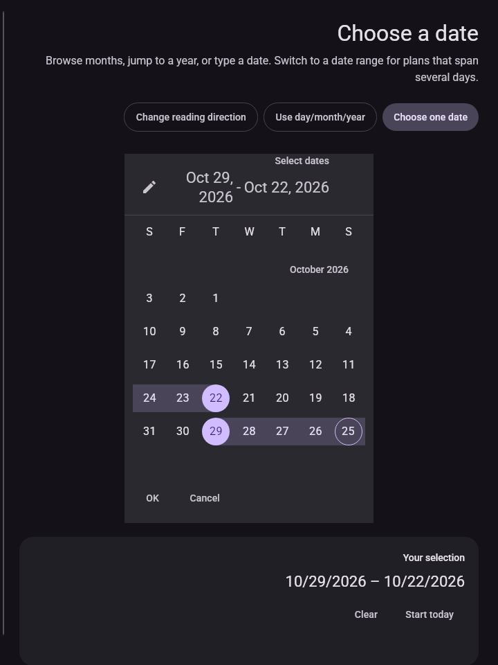
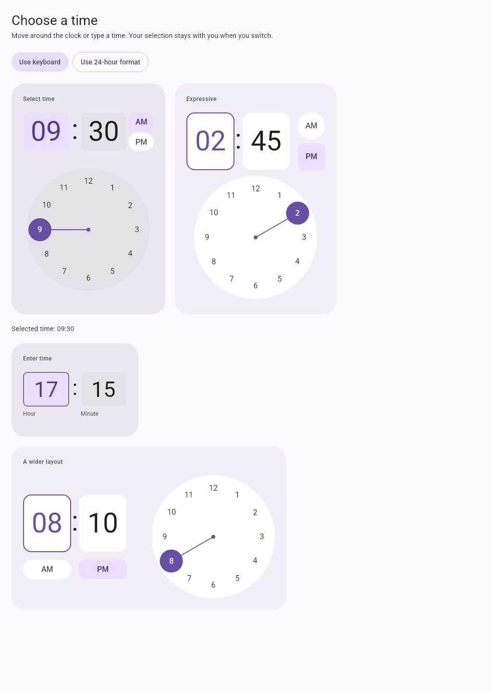
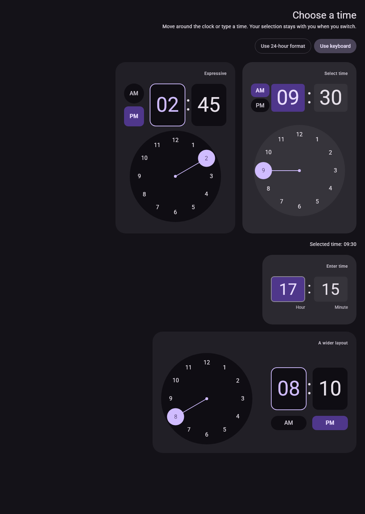
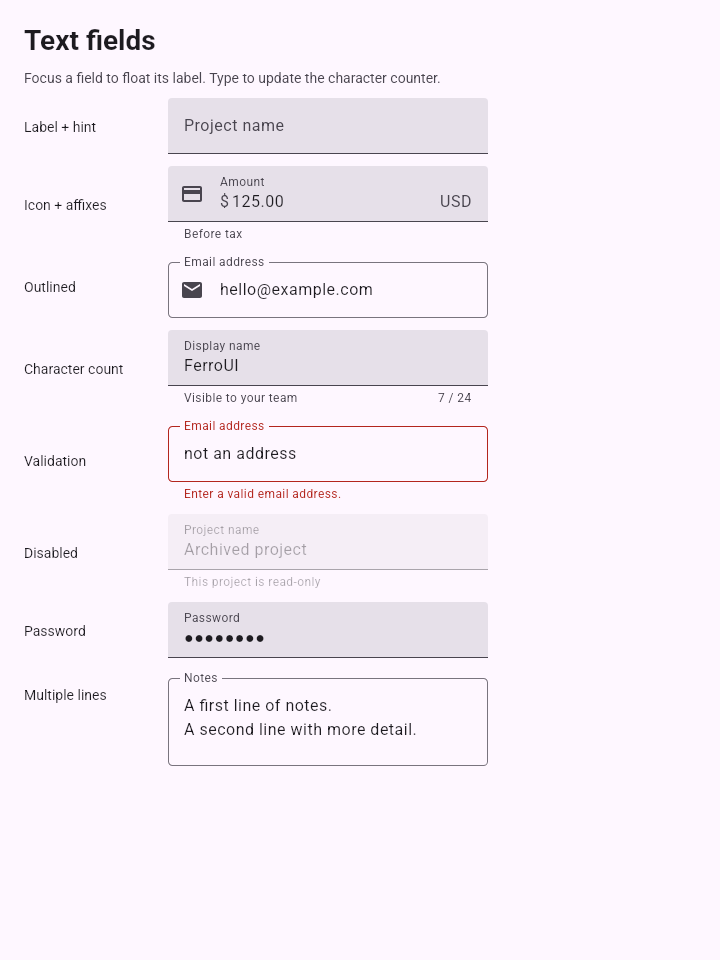

# Android Material 3 Expressive theme

`ferroui-themes-material` is an independent compiled-XAML theme derived from
FerroUI's WinUI 3 theme infrastructure. It keeps FerroUI's controls, template
parts, input routing, resource lookup, automation peers and layout services,
and replaces their visual system with Android Material 3 Expressive.

## Reference

Reference checked on **2026-10-25**:

- [AndroidX Material3 release notes](https://developer.android.com/jetpack/androidx/releases/compose-material3):
  stable **1.4.0**, newest Expressive preview **1.5.0-beta02**, released 2026-10-21.
- [Material 3 design systems](https://developer.android.com/develop/ui/compose/designsystems/material3).
- [Pinned AndroidX source](https://android.googlesource.com/platform/frameworks/support/+/e4d933c98df7baa7ea2b83eea6e086915961e0ff/compose/material3/material3/src/):
  revision `e4d933c98df7baa7ea2b83eea6e086915961e0ff`.

The baseline is explicit because Expressive is still a preview API surface.
`scripts/material-theme/reference-tokens.json` records the upstream values and
source files; `generate.py` reproducibly creates the color, typography, geometry
and compatibility resources, plus the Rust color-scheme API. No source is fetched
at application startup or during the theme build.

## Add the theme

For applications in this workspace, depend on `ferroui-themes-material` directly,
or enable the facade crate's `material-theme` feature. The facade re-exports it
as `ferroui::themes_material` and exports `MaterialTheme` and
`MaterialAppBuilderExtension` in its prelude. Compiled XAML applications must name
the crates referenced by their generated Rust directly, as with other FerroUI
themes. This crate is a new workspace package; its presence here does not imply
it has already been published to crates.io.

Register the bundled fonts on the application builder:

```rust
use ferroui_controls::AppBuilder;
use ferroui_desktop::AppBuilderDesktopExtensions;
use ferroui_themes_material::MaterialAppBuilderExtension;

let builder = AppBuilder::configure::<App>()
    .use_platform_detect()
    .with_material_fonts();
```

Add the theme to the application's styles, before application-specific styles:

```rust
use ferroui_themes_material::MaterialTheme;

let theme = MaterialTheme::new();
application.styles().add(theme.as_style());
```

Or declare it in compiled markup:

```xml
<Application xmlns="https://github.com/ferroui"
             xmlns:material="using:FerroUI.Themes.Material">
  <Application.Styles>
    <material:MaterialTheme />
  </Application.Styles>
</Application>
```

`RequestedThemeVariant="Light"` and `"Dark"` select complete schemes. The
`MaterialTheme::high_contrast()` variant starts with a generated dark scheme at
Material contrast level +1. `Default` starts with the dark baseline. Use the
host's normal requested-theme policy to follow its light/dark preference.

### Typography

Roboto is embedded under OFL 1.1. The regular (400), medium (500) and bold (700)
faces are static instances of the pinned Google Fonts variable font, retaining
its family name and licensing. The static faces let every renderer's font manager
resolve the intended weight without depending on variable-axis support. Exact
font provenance, hashes and instancing axes are in
`scripts/material-theme/font-provenance.json`.

There are 15 normal and 15 emphasized type styles. Keys follow the names
`MaterialDisplayLarge`, `MaterialHeadlineMedium`, `MaterialTitleSmall`,
`MaterialBodyLarge`, and `MaterialLabelMedium`; append `Emphasized` for the
expressive emphasized style. These are complete `TextBlock` themes with size,
weight, line height and letter spacing. The corresponding scalar resource keys
are available for custom controls.

```xml
<TextBlock Theme="{StaticResource MaterialHeadlineLarge}" Text="Welcome" />
<TextBlock Theme="{StaticResource MaterialBodyMedium}" Text="A supporting line." />
```

All geometry is in FerroUI device-independent units, corresponding to Material
dp at the normal display scale. FerroUI's host text scaling and rendering are
still responsible for actual pixels; the theme cannot reproduce Android's
rasterizer merely by using the same font and metrics.

## Color and state layers

`MaterialColorRole::ALL` names all **48** roles of the pinned AndroidX scheme,
including fixed accents and all surface-container levels. The default light scheme is AndroidX `expressiveLightColorScheme()`, including
its four tone-30 container-foreground overrides; dark is `darkColorScheme()`.
`MaterialColorScheme::light()` also exposes the standard non-expressive light
tokens, while `expressive_light()` supplies the theme default. A role such as `Primary` supplies
`MaterialPrimaryColor`, `MaterialPrimaryBrush`, and state-layer brushes named
`MaterialPrimaryHoverBrush`, `MaterialPrimaryFocusBrush`,
`MaterialPrimaryPressedBrush`, and `MaterialPrimaryDraggedBrush`.

State layers use the upstream alpha values: hover 0.08, focus 0.10, pressed 0.10,
and drag 0.16. Disabled colors distinguish container, outline, content and text
field treatment; the entire control is not simply faded. Interactions combine
hover/focus layers with an expanding ripple instead of doubling a pressed fill.

Compatibility brushes are installed inside the selected variant dictionary,
so light and dark windows do not share one mutable brush.

`set_color_scheme` replaces a whole variant dictionary, including role colors,
state brushes and compatibility resources. Existing `DynamicResource` bindings
are notified without reconstructing controls. The old resource names remain
available for inherited templates and application styles; their explicit role
mapping lives in `scripts/material-theme/compatibility-map.json`.

```rust
use ferroui_base::media::Color;
use ferroui_base::styling::ThemeVariant;
use ferroui_themes_material::MaterialColorScheme;

let seed = Color::from_uint32(0xff00639b);
theme.set_color_scheme(ThemeVariant::light(),
    &MaterialColorScheme::from_seed(seed, false));
theme.set_color_scheme(ThemeVariant::dark(),
    &MaterialColorScheme::from_seed(seed, true));
```

Seed schemes use real CAM16/HCT tonal palettes and dynamic contrast constraints.
Nine palette variants and contrast levels -1 through +1 are supported. Palette
and role rules follow Google Material Color Utilities commit
`bd811e4ca2ab94c4ce3cadc89c19b1820b9704b3`, separately from the AndroidX baseline.
`MaterialColorSpec::Spec2021` is that source's default; `Spec2025` enables its
newer phone palettes and role curves, and `Spec2026` applies the source's fallback
for the nine supported single-seed styles. Independent TypeScript-generated
fixtures cover 3,456 schemes and all 165,888 ARGB role values. Complete device-role and tonal-palette
imports preserve the supplied colors. Enable `android-dynamic-color` on Android and call
`theme.use_android_dynamic_colors()` after platform initialization to read and
follow the system colors. See
[Material dynamic color](material-dynamic-color.md) for source versions,
Android API-level mapping, errors, and examples.

## Controls and variants

The theme preserves the original control types and their required `PART_*`
contracts. Existing application commands, bindings, focus navigation, text
editing, selection and automation remain attached to those controls. Native
Material geometry is applied where FerroUI has an equivalent control; desktop
controls without a Material counterpart receive a coordinated Material skin.

| Component | Default or explicit API | Implemented visual anatomy |
| --- | --- | --- |
| Buttons | `Button`, `MaterialFilledButton`, `MaterialTonalButton`, `MaterialOutlinedButton`, `MaterialTextButton`, `MaterialElevatedButton` | Filled 40dp surface within a minimum 48dp target, pill shape, state layers, bounded ripple, expressive pressed shape |
| Button sizes | `MaterialExtraSmallButton`, `MaterialMediumButton`, `MaterialLargeButton`, `MaterialExtraLargeButton` | Expressive size metrics and state-dependent corners |
| Icon buttons | `MaterialIconButton`, `MaterialFilledIconButton`, `MaterialTonalIconButton`, `MaterialOutlinedIconButton`; corresponding toggle themes | Five expressive sizes, narrow/default/wide widths, round/square and selected/pressed shapes, 48dp minimum targets |
| Floating action buttons | `MaterialFloatingActionButton`, `MaterialSmallFab`, `MaterialMediumFab`, `MaterialLargeFab`, `MaterialExtendedFab`, toggle FAB themes | Native geometry and icon sizes, primary/secondary/tertiary/surface colors, real Button commands, animated intrinsic width and label visibility; original `MaterialFab` key retained |
| Checkboxes and radio buttons | `CheckBox`, `RadioButton` | 18dp checkbox or 20dp radio geometry, 40dp feedback layer, 48dp target, selected/indeterminate/disabled states |
| Switch | `ToggleSwitch` | 52×32dp track, 2dp outline, 16/24/28dp off/on/pressed thumb, original drag and knob travel contracts |
| Slider | `Slider` | 16dp track, 4×44dp handle, 2dp pressed handle, gaps and stop mark, horizontal/vertical layout, keyboard and value binding |
| Range slider | `MaterialRangeSlider` | Two independent focus/automation targets, native track/handle/gap/tick geometry, continuous/discrete values, noncrossing touch and keyboard selection, RTL |
| Text fields | `TextBox`; `MaterialTextField` attached properties; classes `outlined`, `floatingLabel` | Separate label/placeholder, leading/trailing icons, prefix/suffix, supporting/error text and UTF-16 counter; 56dp painted field, outline notch, retained editor/selection/IME |
| Progress | `MaterialLinearProgress`, `MaterialWavyLinearProgress`, `MaterialCircularProgress`, `MaterialWavyCircularProgress` on `ProgressBar` | Material caps, gaps, stop indicators, native wavy construction, determinate and indeterminate animation |
| Loading | `MaterialLoadingIndicator`; `MaterialContainedLoadingIndicator` | Seven rounded polygon shapes and morphs, determinate circle-to-soft-burst path, optional container |
| Cards | `MaterialFilledCard`, `MaterialElevatedCard`, `MaterialOutlinedCard` on `ContentControl` | Material surface roles, 12dp corners, elevation/outline variants |
| Chips | `MaterialAssistChip`, `MaterialSuggestionChip` on `Button`; `MaterialFilterChip`, `MaterialInputChip` on `ToggleButton` | Native assist/suggestion/filter/input slots, avatar precedence, selected icon and label motion, ordinary/elevated/expressive shapes and colors, independent optional dismiss command, 48dp targets |
| Segmented buttons | `MaterialSegmentedGroup` with real `RadioButton` or `ToggleButton` children; original `MaterialSegmentedButton` key retained | Parent-scoped single choice or independent multiple choice, equal widths/1dp outline overlap, automatic logical corners and interaction stacking, stable reserved check space, native check/label motion and selection automation |
| Navigation | `MaterialNavigationBar`, `MaterialNavigationBarTall`, `MaterialNavigationRail`, `MaterialNavigationRailNarrow` on `TabControl` | 64/80dp bars, 96/80dp rails, icon/label geometry, selected pill and live selection |
| Top app bars | `MaterialAppBar`; small/center-aligned/medium/large/flexible variants | Native title/subtitle layouts, pinned/enter-always/exit-until-collapsed scroll arbitration, spline fling and snap, container-color interpolation, title semantics handoff, RTL and host insets |
| Tabs | `TabControl`, `TabItem` | Material primary indicator, selected text, scrolling and retained item presentation |
| Search | `MaterialSearchBar` on `TextBox`; `MaterialSearchView` | 56dp rounded input and docked expandable results, retained query editor, clear/back/submit actions, native expansion/collapse motion roles |
| Snackbar | `MaterialSnackbar`, `MaterialSnackbarHost` | FIFO host, action/dismiss controls, cancellable handles and futures, visible-time timeout policy, source fade/scale transitions and live-region semantics |
| Badges | `MaterialBadge` on `Border`, `MaterialBadgeWithLabel` on `ContentControl` | 6dp dot or 16dp label badge with error/on-error roles |
| Dialog and sheet surfaces | `MaterialDialog`, `MaterialBottomSheet` on `GroupBox`; `MaterialBottomSheetHost` | Surface themes plus an in-window modal sheet host with anchors, scrim, drag, vetoable dismissal, back navigation, focus containment/restoration and host-supplied insets |
| Date pickers | `MaterialDatePicker` with single/range selection and picker/input modes | 360dp calendar, 48dp day targets and 40dp circles, native headers, year selection, virtualized range months, culture-aware validation and selection automation |
| Time pickers | `MaterialTimePicker` with dial/input modes and classic/vibrant variants | Native portrait/landscape metrics, 12/24-hour dial and AM/PM controls, numeric drafts, interruptible hand motion, real keyboard and value/selection automation |
| Other existing controls | ComboBox, lists, menus, tooltips, calendars, pickers, command bars, trees, tabs, managed dialogs, and the inherited theme surface | Material typography, colors, spacing, feedback and template-part compatibility |

Example composition:

```xml
<StackPanel xmlns="https://github.com/ferroui"
            xmlns:material="using:FerroUI.Themes.Material" Spacing="16">
  <Button Theme="{StaticResource MaterialTonalButton}" Content="Save changes" />
  <TextBox Classes="outlined" material:MaterialTextField.Label="Project name"
           material:MaterialTextField.SupportingText="Shown to your team" Text="My project" />
  <ProgressBar Theme="{StaticResource MaterialWavyLinearProgress}" Value="64" />
  <material:MaterialLoadingIndicator
      Theme="{StaticResource MaterialContainedLoadingIndicator}" />
</StackPanel>
```

A card theme does not make `ContentControl` clickable. Put an actual input control
inside or use an application control with the desired command semantics.
The original dialog and bottom-sheet **resource keys** style surfaces. Use
`MaterialBottomSheetHost` for implemented modal behavior, or those resource keys
when the application already owns its overlay. `MaterialSearchView` supplies a
docked results view; the application provides its result items and search logic.
The inherited calendar and picker controls preserve FerroUI's behavior. Use the
new `MaterialDatePicker` and `MaterialTimePicker` controls for the Material
calendar/range and analog-clock/input anatomy.

Use `MaterialSymbolIcon` on `PathIcon` for source-defined symbols authored in a
24×24 viewport. It scales the full viewport and preserves the icon’s interior
whitespace. Arbitrary application paths retain the ordinary `PathIcon` theme.
See [Material chips](material-chips.md) for chip slots and dismissal examples.

### Calendar and clock pickers

`MaterialDatePicker` supports `SelectionMode=Single` or `Range`, and
`DisplayMode=Picker` or `Input`. Bind `SelectedDate` for a single date or
`SelectedStartDate`/`SelectedEndDate` for an inclusive range. `DisplayedMonth`,
`Today`, `Culture`, the first day of the week, year bounds, blackout dates and a
custom date validator control the calendar. `Culture` reads FerroUI’s culture-data
provider; applications supply that provider or explicit `DateTimeFormatInfo`
when localized data is needed. The standalone gallery supplies US/UK examples.
`ShowActions` adds confirmation and
cancel controls when the picker is hosted in a dialog or sheet. Input drafts
remain editable and display field-specific errors; only complete valid dates
populate the selection, while an incomplete or invalid edited endpoint is cleared.
Numeric date input currently accepts ASCII decimal digits with the culture's
date ordering and separator.

`MaterialTimePicker` keeps `Hour` in 0–23 and `Minute` in 0–59 independently of
`Is24Hour`. `DisplayMode=Input` exposes numeric editors; `DisplayMode=Dial`
exposes the clock dial and active hour/minute selection. `IsVibrant=True` enables
the expressive variant, and `Orientation=Horizontal` selects the landscape
layout. Numeric time input currently accepts ASCII decimal digits. Incomplete
numeric drafts remain separate from committed values. The
dial uses actual radio-button automation nodes and the picker exposes an
`IValueProvider` value in `HH:mm` form. Each picker supplies selection events,
keyboard navigation and reduced-motion behavior. See [Material time picker](material-time-picker.md)
for exact dial/input metrics, localization hooks and accessibility integration.

### Stateful components

Put a sheet host last in the application's overlay `Grid`. Its body is ordinary
FerroUI content, and `State` is a two-way bindable requested state:

```xml
<Grid xmlns="https://github.com/ferroui"
      xmlns:material="using:FerroUI.Themes.Material">
  <!-- The application page goes here. -->
  <material:MaterialBottomSheetHost Name="DetailsSheet" Padding="24" State="Hidden">
    <StackPanel Spacing="16">
      <TextBlock Theme="{StaticResource MaterialHeadlineSmall}" Text="Details" />
      <TextBlock Text="Your sheet content" />
    </StackPanel>
  </material:MaterialBottomSheetHost>
</Grid>
```

Call `show()`, `expand()` and `hide()`, or bind `State`. The semantic states are
`Hidden`, `PartiallyExpanded` and `Expanded`. A short sheet retains its partial
state even when partial and expanded coordinates coincide; growing that content
uses the pinned implementation's reconciliation rule. Back visits the partial
anchor before dismissal when it is distinct. `set_confirm_state_change` can veto
a state change. `Dismissed` is raised after exit settles; removal does not report
a completed dismissal. `SafeInsets` receives system-bar and keyboard insets from
the platform host. The sheet exposes accessible expand/collapse actions, and
its automation state follows the settled semantic state. Nested touch scrolling
uses the source pre/post-scroll and pre/post-fling ordering: sheet expansion
consumes an upward fling first, child inertia uses Android spline decay, and
only unconsumed boundary velocity reaches sheet settling.

`MaterialSearchView::Query` is two-way bindable. `QuerySubmitted` reports Enter or
an explicit `submit_query()` call; expansion never recreates its TextBox. `Content`
holds results. Escape/back collapses the results, and Down moves focus into them.
The expanded docked height respects the 240dp minimum, the window's two-thirds
cap and an optional `MaxExpandedHeight`.

```rust
use ferroui_themes_material::{MaterialSnackbarHost, MaterialSnackbarMessage};

let host = MaterialSnackbarHost::new(); // Add this control to the overlay.
let request = host.show(MaterialSnackbarMessage::new("Item archived").with_action("Undo"));
// request.result() is None until action, dismissal, timeout or cancellation.
// request.perform_action(), request.dismiss() and request.cancel() affect only this request.
```

Only the current snackbar's visible time counts toward its timeout. Short and
long durations are 4 and 10 seconds; an action defaults to indefinite. The host
can receive a `MaterialSnackbarTimeoutPolicy` to apply an accessibility timeout.
Requests are FIFO; completing an older handle cannot dismiss its successor.
The handle can also be awaited, and dropping its pending future cancels that
request. Hidden and detached hosts pause scheduling.

Use `MaterialExtendedFab` for a real expanding/collapsing button. Its ordinary
`Content` and `Command` remain active; `Icon`, `IsExpanded` and `SizeVariant`
control the expressive presentation. Small/medium/large heights are 56/80/96dp.
Width uses FastSpatial motion and label opacity uses FastEffects, with velocity
preserved on interruption. The label stays mounted through its exit and drops
out of measurement and duplicated semantics when collapsed.

Text fields use an advisory `CharacterLimit`/`ShowCharacterCount` pair. The
counter counts UTF-16 code units, as Android does, but does not truncate the
editor's text. `ErrorText` and `IsError` add Material presentation without
replacing FerroUI validation. Fields have a 120dp minimum
width: Compose's 280dp `TextFieldDefaults.MinWidth` is clamped to the width the
parent offers, whereas a FerroUI `MinWidth` overflows a narrower parent, so the
280dp minimum is the opt-in `nativeMinWidth` class.
An automatic clear button is opt-in through the `clearButton` class.

`DensityStyle::Compact` retains a compatibility switch for existing applications
but does not reduce required Material touch targets. Existing application
`Width`, `Height`, `Padding`, or custom templates can of course override defaults.

The 18dp checkbox follows the latest Material 3 token specification. The pinned
Compose preview still defaults `isCheckboxStylingFixEnabled` to false, retaining
its legacy 20dp checkbox. A native comparison must enable that flag to compare
the same Material 3 styling branch; the theme intentionally uses the current
Material specification rather than the preview's compatibility default.

## Motion and feedback

`MaterialMotionScheme::Expressive` is the default. `Standard` is also available:

```rust
use ferroui_themes_material::MaterialMotionScheme;
theme.set_motion_scheme(MaterialMotionScheme::Standard);
theme.set_reduced_motion(true);
```

Six roles separate spatial motion from effects. The analytic spring solver
handles underdamped, critical and overdamped springs; `MaterialSpringState`
retargets from the current position and velocity. `MaterialDoubleTransition`,
`MaterialCornerRadiusTransition` and `MaterialThicknessTransition` carry
per-property spring velocity through actual FerroUI transition interruption.
A restarted transition samples its predecessor at the elapsed clock time and
integrates from that position and velocity; completion and removal clear the
retained state. Controls use the appropriate spatial/effects roles, and navigation page
transitions update when the scheme changes.

| Role | Expressive damping / stiffness | Standard damping / stiffness |
| --- | --- | --- |
| Fast spatial | 0.6 / 800 | 0.9 / 1400 |
| Default spatial | 0.8 / 380 | 0.9 / 700 |
| Slow spatial | 0.8 / 200 | 0.9 / 300 |
| Fast effects | 1.0 / 3800 | 1.0 / 3800 |
| Default effects | 1.0 / 1600 | 1.0 / 1600 |
| Slow effects | 1.0 / 800 | 1.0 / 800 |

`MaterialRipple` handles pointer and keyboard activation, multiple contacts,
bounded/unbounded geometry, and rounded clipping. It follows the pinned portable
AndroidX `RippleAnimation`'s 75ms fade-in, 225ms radius/center expansion and 150ms
fade-out. The Android-specific Compose implementation delegates to the platform's
`RippleDrawable`; matching the portable reference does not establish identical
native ripple pixels or frame timing on every Android release. Subscriptions are
weak and released on detachment; a settled held ripple does not continuously
schedule frames. Effectively disabled controls cannot start a new ripple.

Progress uses the upstream 1750ms linear and 6000ms circular indeterminate
cycles. Wavy paths use quadratic/cubic path construction and measured arc length.
The loading indicator uses rounded-polygon feature matching and cubic morphs,
650ms shape steps, the native morph spring and 4666ms global rotation. It exposes
`Value`, `Minimum`, `Maximum`, `Percentage`, `IsIndeterminate` and `ReducedMotion`.

Explicit reduced motion and the host's `animations_enabled` preference snap
transitions and render stable indicator/ripple states. Input and value changes
continue to work. The custom indicator renderers stop their clocks when detached,
hidden or reduced; a host must expose its accessibility preference for automatic
platform behavior.

Changing `MaterialTheme::ReducedMotion` while a transition is running also snaps
the easing copies already held by the UI or compositor on their next frame. A
per-theme cancellation generation prevents an old transition from resuming if
motion is quickly enabled again; subsequent interactions use the new setting.
FerroUI's duration-based transition engine still owns those transitions' original
finite clock lifetimes. Snapping the visible result does not claim immediate
disposal of every existing engine subscription. The custom continuous indicators
and ripple scheduler stop their own work when hidden, detached or reduced.

## Gallery and verification

```sh
cargo run -p material-theme-gallery --bin material-theme-gallery
```

The gallery includes a Material overview and the inherited control-family pages.
Its toolbar changes light/dark/high-contrast mode, density, text direction,
seed color and Expressive/Standard/reduced motion. The same controls are rendered
for capture; capture failures include
missing templates, failed page loads and binding diagnostics.

```sh
python3 scripts/material-theme/generate.py --check
cargo test --locked -p ferroui-themes-material --lib
cargo test --locked -p material-theme-gallery --lib
cargo check --locked -p ferroui --no-default-features --features material-theme
cargo build --locked -p material-theme-gallery --bin material-theme-gallery
FERROUI_MATERIAL_GALLERY_CAPTURE=target/material-captures \
FERROUI_MATERIAL_GALLERY_VARIANTS=Light,Dark,HighContrast \
FERROUI_MATERIAL_GALLERY_DENSITIES=normal \
FERROUI_MATERIAL_GALLERY_FLOWS=ltr,rtl \
xvfb-run -a target/debug/material-theme-gallery
```

On Windows/macOS or a desktop Linux session, omit `xvfb-run`. Optional variables
include `FERROUI_MATERIAL_GALLERY_SIZE=720x960`, `SCALE=2` with the same prefix,
and `SETTLE_MS=300`. Set `PAGES=material,buttons` with the same prefix to capture
a subset. By default all 23 gallery pages are included. The CI workflow runs
token regeneration, theme and gallery tests, facade compilation and all 138
combinations of the 23 pages, three color variants and two text directions,
and uploads the images.

Tests cover literal baseline roles, independent HCT seed goldens, contrast,
complete Android palette imports, live scheme replacement, motion and ripple
math/lifecycle, rounded-path/morph invariants, arranged component geometry,
selection and editor bindings, and inherited panel layout contracts. Test
expectations for native dimensions are independent of the generated XAML.

### Recorded desktop verification

The gallery's capture mode renders all 23 gallery views in Light, Dark and
HighContrast, each in LTR and RTL (Linux/X11 under Xvfb, Skia, 720x960, scale 1,
normal density); the Material theme workflow runs it and uploads the images.
Continuously animated controls make these captures unsuitable as unsynchronized
pixel goldens.

Visual review verified source-sized icon viewports, real chip dismissal and
selection, field labels/notches/affixes/supporting rows, complete date-range
headings and range bands, clock labels and selector clipping, all clock/input
layouts, and RTL/high-contrast behavior. Deterministic tests additionally cover
interrupted springs, animation cleanup, semantic versus keyboard activation,
queued snackbar lifetimes, nested sheet fling arbitration and accessibility.

The Android CI job separately compiles the theme with `android-dynamic-color`
for `aarch64-linux-android`. A native target build, paired reference-device pixels
and synchronized animation traces are not part of this local desktop record.
Desktop captures do not establish equivalence for system bars, native IME
presentation, TalkBack, predictive-back animation or haptics.

| Light | Dark |
| --- | --- |
|  |  |

| Dark, RTL | High contrast |
| --- | --- |
|  |  |

| Native date picker | Complete range, dark RTL |
| --- | --- |
|  |  |

| Full clock/input gallery | Full clock/input gallery, dark RTL |
| --- | --- |
|  |  |



### Native comparison configuration

The following is the configuration checklist for a future Android comparison.
It is not a record of a device run. Save the settings and exact input/clock trace
beside every reference capture so changes in the host are not mistaken for theme
regressions.

| Setting | Reference configuration |
| --- | --- |
| AndroidX dependency | `androidx.compose.material3:material3:1.5.0-beta02`, with resolved dependency versions recorded; source revision `e4d933c98df7baa7ea2b83eea6e086915961e0ff` |
| Theme | `MaterialExpressiveTheme`; explicitly supply `MotionScheme.expressive()` for the default comparison or `MotionScheme.standard()` when testing `MaterialMotionScheme::Standard` |
| Baseline light colors | `expressiveLightColorScheme()` versus `MaterialColorScheme::expressive_light()`; this includes the four tone-30 container foreground overrides below |
| Baseline dark colors | `darkColorScheme()` versus `MaterialColorScheme::dark()` |
| Standard light colors | Test separately with explicit `lightColorScheme()` versus `MaterialColorScheme::light()`; selecting the standard **motion** scheme does not change the palette |
| Dynamic colors | Run both implementations on the same Android device/user/configuration and record every resolved ARGB role. Use API 31–33 tonal mapping or API 34+ direct roles consistently. A seed-generated desktop palette is a different comparison case |
| Checkbox branch | Set `ComposeMaterial3Flags.isCheckboxStylingFixEnabled = true` **before** composition. The pinned release defaults this to false, which uses the legacy 20dp checkbox; the Material 3 branch is 18dp |
| Precision-pointer sizing | Keep `ComposeMaterial3Flags.isPrecisionPointerComponentSizingEnabled = false`, its pinned default, and keep the 48dp minimum interactive target. Record any other changed flags explicitly |
| Display density | Record native `densityDpi`, logical content bounds and physical output size. Set FerroUI's render scale to the same pixels-per-dp ratio; for example 320dpi corresponds to scale 2. Compare unscaled PNGs with the same content crop |
| Font scaling | Start at Android font scale 1.0 and FerroUI text scale 1.0; test enlarged text as a separate case. Record Android font-weight adjustment/bold-text settings and any host text overrides |
| Font files | Record actual font file hashes, fallback fonts and variation axes. For a controlled typography comparison, install the bundled Roboto faces in the Android fixture with the same weights/width. Also retain a separate platform-font comparison when assessing Android's default appearance |
| Layout | Use `DensityStyle::Normal`, identical dp constraints and padding, the same locale, identical text/icon content, and separately captured LTR and RTL. Exclude system bars/IME from the crop or match their insets explicitly |
| Component state | Compare enabled, disabled, focused, hovered, pressed, selected and indeterminate states independently. Reproduce touch coordinates, pointer type, key events, focus source, release/cancel events and drag path |
| Animation settings | Keep native animation duration scale at 1 for motion comparisons, disable battery-driven frame restrictions, and record refresh rate. Test zero/reduced motion independently with both the explicit setting and the host accessibility setting |
| Capture timing | Use controlled frame clocks with a shared time zero at the first animation frame. Advance to the same elapsed milliseconds after the same input event. A wall-clock sleep or the gallery's `SETTLE_MS` alone does not synchronize continuously animated controls |
| Renderer/device | Record Android API/build fingerprint, emulator or physical device, GPU/software mode, FerroUI backend and screenshot color space. Native `RippleDrawable`, text rasterization and elevation shadows must be evaluated as renderer-dependent results |

The expressive light overrides are `OnPrimaryContainer = #4F378B`,
`OnSecondaryContainer = #4A4458`, `OnTertiaryContainer = #633B48`, and
`OnErrorContainer = #8C1D18`. They come from `expressiveLightColorScheme()` in the
pinned [`ColorScheme.kt`](https://android.googlesource.com/platform/frameworks/support/+/e4d933c98df7baa7ea2b83eea6e086915961e0ff/compose/material3/material3/src/commonMain/kotlin/androidx/compose/material3/ColorScheme.kt)
and the corresponding `PaletteTokens` tone-30 values; they do not replace the
standard-light or Android dynamic-color mappings.

At minimum, retain these timestamped traces in addition to settled images:

| Motion | Useful checkpoints |
| --- | --- |
| Press ripple | 0, 37.5, 75, 112.5 and 225ms from press; release at both 10ms and 300ms, then sample the complete fade. Record native `RippleDrawable` output separately from portable-ripple conformance |
| Spatial/effects springs | 0, 50, 100, 200, 300 and 600ms; reverse the target at 80ms to expose interruption/velocity differences, and report settling thresholds rather than assuming all transition hosts end at the same time |
| Linear indeterminate progress | Include the 250, 650 and 900ms head/tail offsets and the 1750ms wrap |
| Circular indeterminate progress | Capture increasing and decreasing arc phases and the 6000ms wrap |
| Loading morph | Capture the 0.6-damped, stiffness-200 spring before and at its 297ms unit-step finish, the 650ms shape boundary, the seven-shape sequence wrap and the separate 4666ms global rotation wrap |
| Hidden/unloaded/reduced state | Hide or detach during motion, restore, and toggle reduced motion while active; verify that callbacks stop and document the resumed/reset phase on each implementation |

Measure geometry, resource colors, semantic state and animation trajectories as
well as pixel differences. Report the number and magnitude of differing pixels,
the allowed text/shadow rasterization tolerances, and any behavior discrepancy.
Do not turn a successful build or a visually similar settled image into a claim
of full native equivalence.

### Fidelity boundaries

The resources and component algorithms are pinned to AndroidX source. A passing
build, unit test or FerroUI screenshot is **not** proof of pixel-for-pixel native
Android equivalence. No native Android comparison result is implied by this PR.
To certify it, capture the same states on an Android reference app using the
pinned Material3 version, identical device density, font scale, palette, locale
and motion time, then compare both images and interaction traces.

Material elevation levels are 0, 1, 3, 6, 8 and 12dp. The theme's paired
`BoxShadow` resources approximate Android's ambient/spot shadow rendering;
FerroUI's shadow rasterizer is not Android's physical renderer. Text shaping,
hinting, subpixel placement and font fallback also depend on the active backend.
The Material scalar, corner and thickness adapters integrate with FerroUI's
transition engine and preserve interruption velocity. Color and shadow
transitions continue to use the renderer's existing value interpolation.
Platform navigation, predictive back, edge-to-edge insets, haptics,
Android accessibility services and OS dialogs belong to the host/backend.

Desktop-only components and the documented composite surfaces are adaptations.
A complete clone of the Android framework or every Compose component is outside
a theme package's API. These boundaries are recorded so application authors can
distinguish native source values, implemented algorithms, renderer-dependent
output and application behavior.

## Source layout and licenses

- `Resources/Material*.xaml`: generated roles, typography, metrics and inherited-key mappings.
- `Controls/*.xaml`: Material templates preserving existing control contracts.
- `motion.rs`, `ripple.rs`, `progress_indicator.rs`, `rounded_geometry.rs`,
  `loading_indicator.rs`: native motion/geometry ports and FerroUI integration.
- `dynamic_color.rs`, `color_scheme.rs`: seed/palette imports and live resources.
- `android_colors.rs`, `android_palette_math.rs`: optional native system-color
  import, subscription lifecycle and AndroidX float CAM16/HCT neutral tones.
- `samples/MaterialThemeGallery`: interactive gallery and strict render capture.
- `scripts/material-theme`: pinned data, generator and font provenance.

Original FerroUI/Avalonia/WinUI MIT notices are retained. AndroidX-derived
algorithms and tokens are attributed under Apache 2.0 (`LICENSE-ANDROID`), and
Roboto retains its OFL notice. `NOTICE.md` records the upstream revisions and
third-party sources. The package declares `MIT AND Apache-2.0 AND OFL-1.1`.
