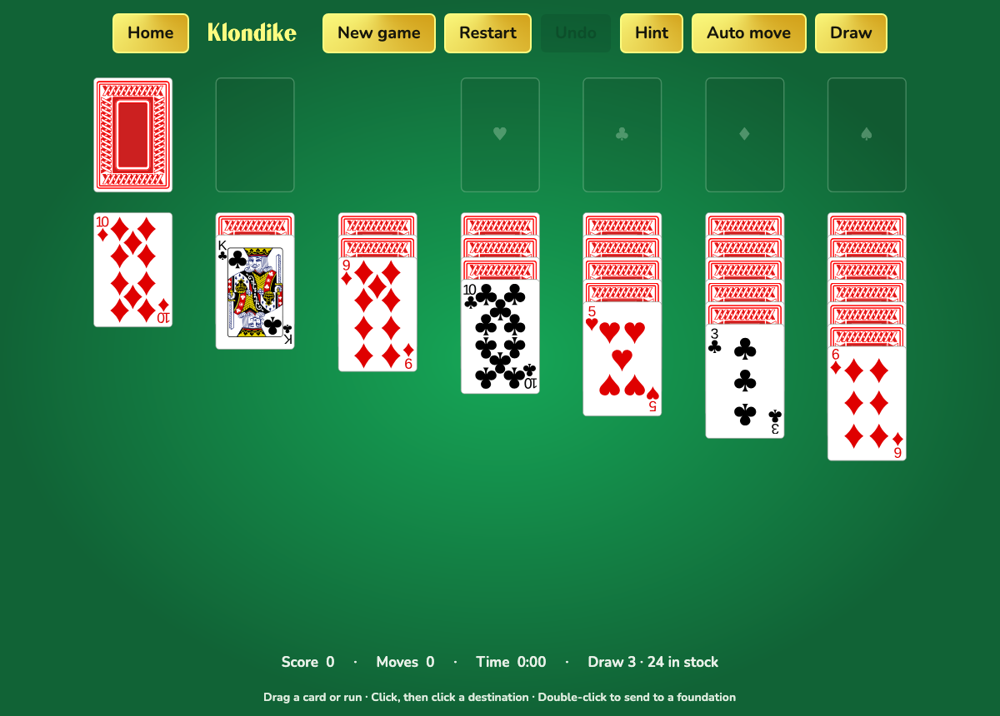

# Ferro Solitaire

A native Rust / FerroUI port of [AvaloniaUI/Solitaire](https://github.com/AvaloniaUI/Solitaire), with Klondike, FreeCell and Spider. The interface uses FerroUI's XAML loader, retained controls, layout, routed input and desktop lifetime. The original vector playing cards, title glyph, fonts, green table and gold buttons are retained, with animated card movement, timed dealing, a startup fade and animated gold trays.



## Run

Install [Rust](https://rustup.rs/) 1.89 or newer and the platform prerequisites for [FerroUI](https://github.com/wieslawsoltes/FerroUI). On macOS, install the Xcode command line tools. On Linux, install a C/C++ compiler, pkg-config, fontconfig and FreeType development packages. Windows needs the MSVC C++ build tools. The first build downloads Skia binaries and builds HarfBuzz.

```sh
cargo run --release -p ferro-solitaire
```

Open a game directly with `cargo run --release -p ferro-solitaire -- --klondike`, `--freecell` or `--spider`. It is a sample of this repository and builds against the FerroUI crates of the workspace; no .NET SDK is needed.

## Play

- Drag a face-up card or legal run onto its destination, or click a card and then its destination.
- Double-click or right-click a card to send it to its foundation. **Auto move** repeatedly moves eligible cards to foundations.
- Click the stock or **Draw** to turn Klondike cards. Spider's **Deal row** requires every column to contain a card.
- **Hint** highlights a legal move. **Undo** restores a move, card reveal, stock turn or complete Spider run. **Restart** replays the same deal; **New game** shuffles another deck.
- Settings select Klondike draw one / draw three and Spider one / two / four suits. Changes apply to the next new game.
- **Space** draws, **H** shows a hint, **A** auto-moves, **Ctrl/Cmd+Z** undoes, **Ctrl/Cmd+N** starts a new game, and **Escape** clears the selection or dismisses a dialog.

Selecting a game from the title screen always shuffles a new deck and plays its deal animation, matching the original. Settings, current game snapshots, undo history and per-game statistics are saved locally, including on close. The timer pauses away from the game, while the window is inactive, during dealing/movement sequences and while a dialog is open. Home can interrupt an animation safely; selecting a game again starts a new animated deal.

Data is stored in `FerroSolitaire/state.json` under the OS local application data directory. Set `FERRO_SOLITAIRE_DATA_DIR` to use a different directory. Invalid or unsupported saves are reported in the status bar and preserved without being overwritten.

## Verify

```sh
cargo test -p ferro-solitaire --locked --no-default-features
cargo test -p ferro-solitaire --locked --features headless --test ui --test animations
cargo fmt -p ferro-solitaire -- --check
cargo clippy -p ferro-solitaire --locked --all-targets --features headless -- -D warnings
```

The rule tests cover deals, suit distributions, legal runs, foundations, stock recycling, scoring, victories, exact undo, and save validation. The UI test loads every page using the real XAML loader and Skia renderer, invokes native commands, and simulates mouse dragging and click-to-move through the board's Viewbox transform. The animation test steps a native `IClock`, verifies intermediate rendered frames and control identity, and checks cancellation during a deal.

To export rendered pages while running the UI test:

```sh
FERRO_SOLITAIRE_CAPTURE_DIR="$PWD/artifacts" cargo test -p ferro-solitaire --features headless --test ui --test animations
```

For an unattended desktop launch: `FERROUI_SMOKE_EXIT_MS=2000 cargo run -p ferro-solitaire -- --klondike`.

See [the porting notes](PORTING.md) for the source mapping, intentional fixes, visual differences and platform scope. Original copyrights and MIT terms are in [NOTICE.md](NOTICE.md), [LICENSE](LICENSE) and [AUTHORS](AUTHORS).
