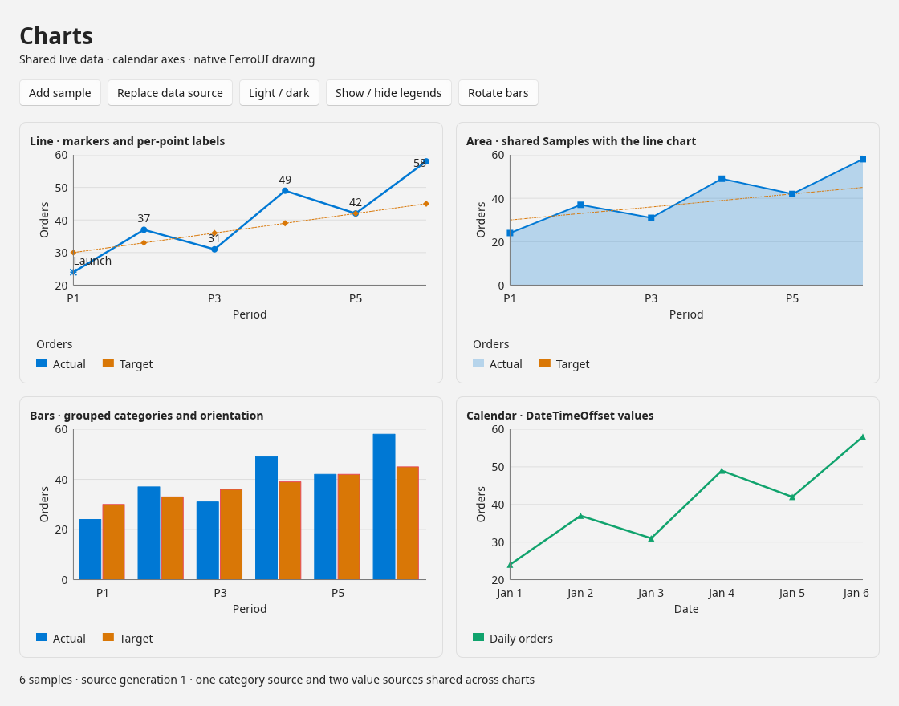
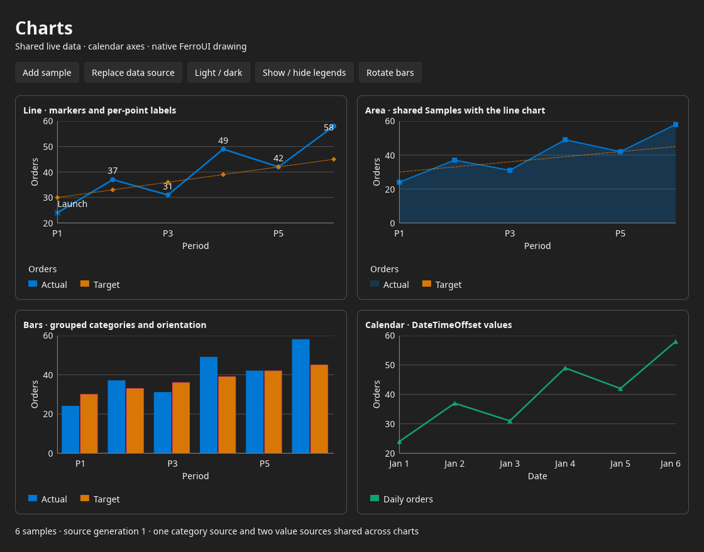
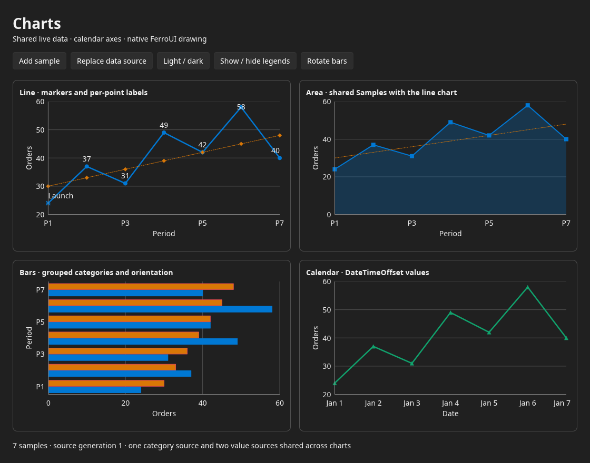

# WinUI Charts: public-contract port

## 1. Scope and source boundary

This work implements the Charts control introduced in
[WinUI discussion 12343](https://github.com/microsoft/microsoft-ui-xaml/discussions/12343)
as idiomatic Rust controls using FerroUI. The reference is pinned to
`microsoft/microsoft-ui-xaml` commit
[`9427b7216337ea3d7b19ac32d48c327286ee7138`](https://github.com/microsoft/microsoft-ui-xaml/tree/9427b7216337ea3d7b19ac32d48c327286ee7138).
The initial FerroUI base is `86b6b4ab41669bf830fba681504a4ee94752a4e6`.

**The public upstream tree does not contain the Charts implementation.** It
contains API tests, interaction tests, and engineering samples. The pinned
[ChartApp README](https://github.com/microsoft/microsoft-ui-xaml/blob/9427b7216337ea3d7b19ac32d48c327286ee7138/Samples/ChartApp/README.md)
states that Charts ships in `Microsoft.Internal.WinUIDetails`, that the public
build's pinned package does not include Charts, and that public pull-request
builds skip the sample. Inspection of the complete pinned Git tree found no
Charts implementation files outside these test and sample roots.

This is a port of the **published API and observable contract**, with translated
tests and adapted examples. Its rendering implementation uses FerroUI services;
it is not a translation of unpublished C++ source. Passing property, collection,
or layout stability tests does not prove pixel equality with Microsoft's
renderer or equivalence to unspecified private algorithms. This boundary
remains explicit even when every available test has a Rust counterpart.

The public API reference is
[Microsoft.UI.Xaml.Controls.Charts](https://learn.microsoft.com/en-us/windows/windows-app-sdk/api/winrt/microsoft.ui.xaml.controls.charts?view=windows-app-sdk-2.0-experimental).
The API is experimental. The pinned source tests are the reproducible
behavioral reference for this port.

## 2. Public surface and Rust map

The public namespace has 14 classes and seven enums. Rust files below are the
implementation destinations; file existence alone does not establish verified
parity. Section 5 describes the explicit verification map.

| Public type | File in `src/FerroUI.Controls.Charts/` | Responsibility |
| --- | --- | --- |
| `Chart` | `chart.rs` | Control lifecycle, layout, collections, legend, rendering and invalidation |
| `Axis` | `axis.rs` | Visibility, title and chart ownership |
| `CartesianAxis` | `cartesian_axis.rs` | Tick labels/marks, grid lines and brushes |
| `CategoryAxis` | `category_axis.rs` | Source-index/value ordering and direction |
| `DateTimeAxis` | `date_time_axis.rs` | Date bounds, calendar intervals and labels |
| `LinearAxis` | `linear_axis.rs` | Numeric bounds, spacing, validation and ticks |
| `CartesianSeries` | `cartesian_series.rs` | Abstract shared series properties, samples, axes and overrides |
| `LineSeries` | `line_series.rs` | Line presentation |
| `AreaSeries` | `area_series.rs` | Filled area presentation |
| `BarSeries` | `bar_series.rs` | Horizontal and vertical bar presentation |
| `Samples` | `samples.rs` | Shared source data and changes |
| `DataLabelOverride` | `data_label_override.rs` | Immutable text/brush descriptor |
| `DataMarkerOverride` | `data_marker_override.rs` | Immutable marker/brush descriptor |
| `XamlChartsResources` | `xaml_charts_resources.rs` | Native resource dictionary with light, dark and default themes |

| Enum (`enums.rs`) | Values, in upstream order |
| --- | --- |
| `BarOrientation` | `Horizontal`, `Vertical` |
| `CategorySortKey` | `Index`, `Value` |
| `DateTimeIntervalType` | `Auto`, `Day`, `Week`, `Month`, `Year` |
| `GridLines` | `None`, `Major`, `Minor` |
| `MarkerShape` | `None`, `Square`, `Diamond`, `Triangle`, `X`, `Asterisk`, `ShortDash`, `LongDash`, `Circle`, `Plus` |
| `SortOrder` | `Ascending`, `Descending` |
| `StrokeDashStyle` | `Solid`, `Dash`, `Dot`, `DashDot`, `DashDotDot` |

`MarkerShape` has numeric values 0 through 9 in the order shown. Typed Rust
enums do not manufacture invalid discriminants to reproduce arbitrary managed
integer-to-enum casts.

### 2.1 Properties and defaults

| Owner | Contract |
| --- | --- |
| `Chart` | `ShowLegend = false`; `LegendTitle = ""`; `Series`, `Axes`, `Data` empty with stable collection identity; content property `Series` |
| `Axis` | `IsVisible = true`; `Label = ""` |
| `CartesianAxis` | `ShowTickLabels = true`; `ShowTickMarks = false`; `GridLines = None`; five brushes unset |
| `CategoryAxis` | `SortKey = Index`; `SortOrder = Ascending` |
| `LinearAxis` | `Minimum`, `Maximum`, `Spacing` unset, selecting automatic values |
| `DateTimeAxis` | Bounds unset; `IntervalType = Auto`; `LabelFormat = ""` |
| `CartesianSeries` | `Title = ""`; `IsVisible = true`; samples, axes and `Stroke` unset; `StrokeThickness = 1`; `StrokeDashStyle = Solid` |
| Series presentation | Labels/markers disabled; `MarkerShape = Circle`; label/marker brushes unset; override maps empty |
| `AreaSeries` | `Fill` unset |
| `BarSeries` | `Fill` unset; `Orientation = Horizontal` |
| `Samples` | `ItemsSource` unset; content property `ItemsSource` |

`ChartAutomationPeer` is additionally registered in
`FerroUI.Automation.Peers`. The three collection aliases, descriptors and all
enums have native markup metadata and Rust call paths for the build compiler.

The X data role is always category/date data and Y is always numeric values,
including horizontal bars. Orientation changes display axes, not axis-type
compatibility. `XAxis` accepts `CategoryAxis` or `DateTimeAxis`; `YAxis`
accepts `LinearAxis`.

Automatic axes and brushes are effective rendering choices. They must not be
written back into public `XAxis`, `YAxis`, `Stroke`, or axis brush properties.
Upstream exposes axis references as plain properties without dependency
property identifiers and excludes both override maps from its XAML members.
Native metadata adaptations are recorded in section 4.

### 2.2 Validation and ownership

- A series or axis belongs to at most one chart and cannot occur twice in one
  chart. Removal releases ownership so it can be reused.
- Explicit axes must be present in the target chart before adding a series
  that references them. Rejected assignments preserve the old reference.
- Invalid indexes or ownership conflicts preserve the collection and emit no
  event. Setting an item to itself and clearing an empty collection are no-ops.
- Linear bounds are finite and strictly ordered. Spacing is finite, positive
  and no larger than a fully explicit range. Rejected values retain the old
  state; clearing a value selects automatic behavior.
- Date bounds are strictly ordered and support pre-1900 dates, including 1601.
  Calendar intervals select tick cadence; they do not aggregate samples.
- Upstream retains negative/nonfinite `StrokeThickness`. Rendering sanitizes
  the effective pen without mutating the public value.
- Overrides use zero-based source indexes. Out-of-range keys survive data
  growth, sample replacement and series removal.

### 2.3 Layout, resources and accessibility

Finite available dimensions are requested unchanged, including zero. Infinite
dimensions fall back to 160 by 96, subject to minimum-size constraints.

| Axis property | Resource key |
| --- | --- |
| `GridLineMajorBrush` | `ChartsGridLineMajorBrush` |
| `GridLineMinorBrush` | `ChartsGridLineMinorBrush` |
| `TickBrush` | `ChartsTickBrush` |
| `TickLabelBrush` | `ChartsTickLabelBrush` |
| `AxisLineBrush` | `ChartsAxisLineBrush` |

Resolution respects local/application resources and theme changes while
leaving unset local properties unset. Brushes use FerroUI's `IBrush` abstraction;
the chart does not reject a brush solely because it is not solid.

Published automation tests require `LabeledBy` naming, explicit-name
precedence, full-description precedence and peer queries that do not measure
or arrange an unloaded chart. Existing FerroUI automation is the integration
point. Those tests do not establish per-point selection, hover tooltip or
keyboard-navigation behavior.

## 3. Framework and dependency mapping

The implementation follows [PORTING-GUIDE.md](PORTING-GUIDE.md) and existing
external control libraries. No Windows runtime, COM, Win2D or backend-specific
renderer is required.

| Upstream responsibility | FerroUI integration |
| --- | --- |
| Dependency objects and properties | `FerroObject`, `ferro_class!`, `ferro_properties!`, class metadata |
| Lifecycle, layout and render | `Control`, `LayoutableImpl`, `VisualImpl`, property invalidation |
| Enumerable data | Existing items-source adapters and observable collections |
| Observable vectors/maps | Shared handles, change notifications and ownership validation |
| Reference identity | `Ref<T>` / `Rc<T>` identity; collections initialized per instance |
| Subscription lifetime | Weak captures and explicit detachment on source/series replacement |
| Plot and marker geometry | `DrawingContext`, `StreamGeometry`, pens, brushes and plot clips |
| Typography | Existing text formatting and text layouts |
| Palette/resources | Existing dictionaries and theme variants |
| Accessibility | Automation properties and control peers |
| XAML | Type registration, metadata and collection adapters |
| Validation exceptions | Rust `Result` without partial mutation |
| MSBuild and Windows deployment | Cargo and FerroUI platform hosts |

The production crate depends on `ferroui-base` and `ferroui-controls`; its build
script uses `ferroui-build-scan` to publish the native type model. It does not
add a second collection, property, resource, rendering or text subsystem. The
runtime XAML loader is a test dependency. `ChartsDemo` uses `ferroui-build`
and `ferroui-markup-xaml` for compiled markup; the desktop backend and WinUI
theme are optional dependencies of that sample's `desktop` feature.

`Samples.ItemsSource` is `Option<BoxedValue>`, retaining arbitrary input objects
as the WinUI property does. Supported values resolve through
`ValueTypes::try_convert` into existing `ItemsSource` adapters, including
registered model collection conversions. An unsupported scalar is retained but
produces an empty view. `set_source(Option<ItemsSource>)` is the typed Rust
convenience. Decoding preserves source indexes, including gaps, and a snapshot
is cached once per source revision; multiple series can share one `Samples`.
The markup runtime registers a `RuntimeList`-to-`ItemsSource` conversion over
the list's existing shared storage. This is needed when a XAML `ArrayList` or
`List<T>` first enters an object-typed property and is converted later. The
Charts runtime-XAML regression appends to that original boxed list after load
and verifies that `Samples` observes the addition; no snapshot-only adapter or
Charts dependency on the markup runtime is introduced.

`FerroList` supplies vector storage and notifications. Ownership checks wrap
its mutations and commit ownership before public notifications, so reentrant
observers see consistent state. Removing a referenced axis is rejected. Chart
drop releases ownership even if a caller retains a collection handle, and an
old handle cannot later release an item's new chart ownership.

The override maps reuse `FerroDictionary<u32, Rc<...>>`. Descriptor fields are
immutable, descriptor equality is identity equality, and replacement retains
the original map notification behavior. Subscriptions detach on source or
series replacement and capture charts weakly.

Geometry/tick construction is separated from drawing. Retained scenes can be
reused when data, axes, style and layout are unchanged; relevant changes
invalidate them through framework notifications. Of the chart's own properties,
only those the scene is built from (`ShowLegend`, `LegendTitle`, `Padding`,
`Foreground`, `Background`, the font properties, `LetterSpacing` and
`FlowDirection`) invalidate it; pointer-over, focus, `DataContext`, `Tag` and the
like do not, and a new size is detected when the scene is requested. Core paths do not assume an
OS clock, filesystem or thread availability.

### 3.1 Explicit geometry decisions

The private upstream algorithms are unavailable, so the following are native
decisions rather than inferred implementation parity:

- Theme dictionary colors, the eight-color series palette, axis/legend spacing
  and marker dimensions are native defaults. The published resource key and
  property contracts are retained; unavailable internal XAML resources are not
  represented as translated files.
- Horizontal tick labels use measured text widths, stay inside the control's
  bounds and omit overlapping labels while retaining their ticks and grid
  lines. This avoids clipping endpoint dates in narrow chart cards.
- Lines and area polygons are clipped in normalized axis coordinates before
  projection to pixels. A second `DrawingContext` clip confines the grid,
  paths and bars to the plot. Markers and per-point labels draw afterward under
  the surrounding control clip, keeping endpoint markers whole. Only points
  inside both axis domains contribute these annotations, and label origins are
  constrained by the plot bounds. Axis labels and the legend also draw in the
  control layer. Extreme out-of-range samples do not send unbounded coordinates
  to a backend.
- Category identity includes the sample's type. Value sorting uses a total
  order: finite numeric categories sort numerically before nonnumeric
  categories, which sort by label. Index ordering preserves first occurrence.
  This makes mixed numeric/text comparisons transitive and keeps source indexes
  available for overrides after display-order changes.
- Grouped bars divide one category band among compatible visible bar series.
  Date-bar widths use 80% of the smallest positive spacing between neighboring
  dates and then divide that band among series. Duplicate dates do not collapse
  the spacing calculation to zero. Baselines include zero when auto-ranging
  area/bar values; explicit bounds still control the visible range.
- A per-point label goes on the side its value points to (above a positive value,
  below a negative one; right or left of a horizontal bar), 5.5 DIPs from the point so
  that it clears the point's marker, and on the other side when it does not fit inside
  the plot there. The labels of every series are drawn after the markers of every
  series, so no marker covers a label.
- Date ticks are aligned to UTC calendar boundaries (midnights, Mondays, the
  first of a month or a year), not to the offsets of the samples. With an empty
  `LabelFormat` the labels use the format of the interval the ticks were made
  with (`yyyy` for years, `MMM yyyy` for months, `yyyy-MM-dd` for days and
  weeks), including the interval `Auto` resolves to. A daily range with fewer
  than two midnights in it (the published interval types stop at a day) is
  divided into whole minutes or hours (1, 5, 15 or 30 minutes, 1, 2, 3, 6 or
  12 hours, the smallest step that gives at most the target count) and labelled
  `HH:mm` (`MMM d HH:mm` across midnight); a range shorter than a minute has its
  two bounds as ticks.
- Monotone dense line paths use a min/max envelope per pixel column, preserving
  extrema and source traversal order. Nonmonotone paths and separate gap
  segments preserve their order. Dense area polygons reduce each monotone run
  independently, retaining turns, baseline returns and winding. This reduces
  submitted geometry; it does not make all storage proportional to screen
  width. Decoded snapshots, axis inputs and `ChartLayout.points` still take
  **O(total samples)** memory, and requested markers/labels remain per-point
  work.

The public `layout_snapshot`/`scene_build_count` diagnostics support tests of
these decisions. The accompanying tests cover invariants and native render
behavior, without pretending to specify Microsoft's unpublished algorithms.

## 4. Adaptations and boundaries

1. **Unavailable rendering source.** Tick selection, labels and plot geometry
   are native implementations. Future publication of the original source would
   enable deeper algorithm and visual comparison. No pixel-parity claim is made.
2. **Typed inputs.** Nonnullable collection members and typed enums make managed
   null-insertion and arbitrary invalid-enum cases unrepresentable. Null sample
   references and arbitrary `ItemsSource` values remain representable. Invalid
   bounds and axis ownership return `ChartError` from typed setters. Raw
   property-system writes (bindings, style setters, inspectors) never replace
   valid state with an invalid value: an invalid `Minimum` or `Maximum` of a
   `LinearAxis` or `DateTimeAxis` is coerced back to the old value without an
   error, and a rejected `XAxis` or `YAxis` (an axis of the wrong kind, or one
   that is not in the chart) keeps the old axis and is logged as a warning in
   the area `Property`.
3. **Enumeration.** FerroUI's snapshot collection conventions can differ from
   managed enumerator invalidation. The snapshot/borrow contract is an explicit
   adaptation, not the upstream mutation-during-enumeration exception.
4. **XAML ABI.** WinRT metadata providers and package resource URIs become native
   metadata/resources. Mapped tests establish inheritance, activation, enum
   conversion, content properties and collection population. Exact WinRT names
   and `ms-appx` identities are not FerroUI APIs.
5. **Control/property hierarchy.** Native `Chart` derives `TemplatedControl`
   because that class supplies the typography/background/foreground surface
   present on WinUI `Control`. `XAxis`/`YAxis` are validated native
   `DirectProperty` values for invalidation; upstream exposes plain properties,
   which no binding, style or property editor can reach (see item 2 for what a
   rejected write through those does).
   Override maps remain excluded from XAML, while the immutable descriptor
   types have read-only native metadata.
6. **Notifications and theme scopes.** Native vector events translate source
   vector actions and indexes. `FerroDictionary::clear` reports `Remove` with
   the removed entries instead of WinRT `MapChanged::Reset`. Theme changes use
   `Window.RequestedThemeVariant` or `ThemeVariantScope` inheritance. The chart
   does not introduce a parallel theme system or write effective brushes into
   local axis properties.
7. **Accessibility.** The native `HelpText` automation property and peer method
   supply the description contract. The peer's name is `AutomationProperties.Name`,
   then `LabeledBy`, as the published tests require; without either it is the
   legend title, then the titles of the series. The control type is `Custom` with
   the localized type "chart" (the published tests do not specify a type). The two source interaction tests become
   in-process window/automation-tree tests that apply the source mutation
   sequence; they do not claim Windows UIA host discovery or OS input injection.
8. **Sample hosts.** Four upstream Windows deployment variants share scenarios.
   MSIX manifests, logos and MSBuild files remain in the source inventory as
   context. `ChartsDemo` consolidates the chart scenarios into a reusable native
   view and optional desktop host. The upstream engineering menu, debug
   commands and secondary-window workflow are not a public control API and are
   not copied one for one.
9. **Calendar ticks.** Date ticks are aligned to UTC calendar boundaries and a
   daily range without two midnights in it gets minute or hour ticks
   (section 3.1); the published API has no sub-day interval type.
10. **Additions.** `CategoryAxis::sorted_indices_by`, `Chart::layout_snapshot`
    and `Chart::scene_build_count` are native additions to the public API for
    tests and diagnostics; they are not part of the WinUI contract.
11. **Markup conversion.** `ferroui-markup-xaml` registers a conversion from a
    run-time list (`RuntimeList`) to `ItemsSource` that shares the list's
    storage, so that a list built in XAML can be the `ItemsSource` of a chart's
    samples and stays live. The conversion applies to every `ItemsSource`
    target, not only to the charts.

Implementation presence, mapping completeness, test execution and visual
verification are distinct. All 132 public test cases have a reviewed
disposition: 114 mapped, 17 adapted and one safely unrepresentable invalid-enum
case. Execution evidence and remaining verification gates are recorded below.

Upstream [issue 12350](https://github.com/microsoft/microsoft-ui-xaml/issues/12350)
reports series drawing beyond the plot and across axes. The native scene uses
a plot clip for the series layer, with explicit bounds and out-of-range data
covered by rendering regressions. Endpoint markers and per-point labels draw
after the plot clip is removed, within the control clip; off-domain samples
produce no annotations and label origins are constrained by the plot bounds.
Axis labels and the legend also occupy the control layer. This is a regression
scenario, not a requirement to reproduce the upstream bug.

Animations, zoom/pan, trackball and pie charts are requests in discussion
comments, not demonstrated released features. Stacked, spline, polar,
financial and logarithmic charts are likewise outside this pinned contract.

## 5. Source and test inventory

The [source manifest](data/winui-charts/source-manifest.json) lists all **88
files** under `controls/dev/Charts` and `Samples/ChartApp`, with Git blob SHAs
and roles. It includes test support, four sample hosts, deployment files and
assets. The [file disposition map](data/winui-charts/file-map.json) accounts for
every one of those files: contract tests, scenario references, native service or
host replacements, documentation evidence, and unused Windows branding assets.
It names existing native files and explains replacements and omissions. No
nonexistent implementation source path is invented.

| Upstream test file | Tests | Rust responsibility |
| --- | ---: | --- |
| `APITests/ChartTests.cs` | 35 | Control, collections, lifecycle, XAML |
| `APITests/ChartAxisTests.cs` | 31 | Validation, properties, resources, live layout |
| `APITests/ChartSeriesTests.cs` | 35 | Series properties, brushes, overrides |
| `APITests/ChartSamplesTests.cs` | 25 | Source types, sharing, changes and replacement |
| `APITests/ChartAutomationTests.cs` | 4 | Automation precedence and no layout side effects |
| `InteractionTests/ChartsTests.cs` | 2 | Automation presence, live data/series/legend/theme changes |
| **Total** | **132** | **130 API tests and two interaction tests** |

Every method has an entry in [test-map.json](data/winui-charts/test-map.json),
keyed by its exact upstream file and name.

| Status | Meaning |
| --- | --- |
| `pending` | No reviewed Rust mapping yet |
| `mapped` | Named Rust `#[test]` function exists; execution evidence is separate |
| `adapted` | Rust test covers the alternative explained in its notes |
| `not-applicable` | Exact platform/type-system operation is absent, with rationale |

The scanner verifies unique/complete upstream file and test identities,
absence of invented source tests, existing native file counterparts, existence
of mapped Rust tests and rationales for adaptations.
With an upstream checkout, it regenerates the pinned inventory and compares
it exactly. It does not equate similar names with semantic or visual parity.
`--require-complete` fails while any source method remains pending. Optional
`--execution-log` checks ordinary Cargo/libtest output: every mapped or adapted
test must appear exactly once as passing and the log must contain a successful
test summary. A missing, ignored, failed or ambiguous result fails that gate.

```sh
git clone --filter=blob:none https://github.com/microsoft/microsoft-ui-xaml.git /tmp/winui-charts-reference
git -C /tmp/winui-charts-reference checkout 9427b7216337ea3d7b19ac32d48c327286ee7138

# Regenerate inventory, preserving existing reviewed mappings.
python3 scripts/winui-charts/conformance.py inventory --upstream /tmp/winui-charts-reference

# Verify source and map integrity.
python3 scripts/winui-charts/conformance.py check --upstream /tmp/winui-charts-reference

# Associate exact translated method names, then review any adapted behavior.
python3 scripts/winui-charts/conformance.py bind-names
python3 scripts/winui-charts/conformance.py check --require-complete

# Execute behavior/integration tests separately and validate the captured run.
# pipefail preserves Cargo failure even when tee writes the log successfully.
set -o pipefail
cargo test -p ferroui-controls-charts --lib -- --test-threads=1 2>&1 | tee /tmp/charts-tests.log
python3 scripts/winui-charts/conformance.py check --require-complete --execution-log /tmp/charts-tests.log

# Exercise compiled markup, live data and the same document through the runtime loader.
cargo test -p charts-demo --lib
cargo run -p charts-demo --features desktop
```

## 6. Native usage and the compiled sample

Register the crate with `ferroui_controls_charts::register_types()` when loading
markup. Applications using the facade enable its `charts` feature and reach
the same API as `ferroui::controls_charts`; the facade remains a pure re-export,
following its existing color-picker and TreeDataGrid conventions. The library
exposes `https://github.com/ferroui/charts` and also maps its
types into FerroUI's standard XML namespace. A build script depending on
`ferroui-build` consumes the exported type model through Cargo's normal
`.xamlmeta` chain; it does not need to link the controls into the build host.

The [compiled sample](../../samples/ChartsDemo/README.md) declares four charts,
their axes, seven series and merged `XamlChartsResources` in
`MainView.xaml`. Its Rust code connects the same category and value `Samples`
to line, area and grouped-bar series and uses `DateTimeOffset` on a calendar
axis. It demonstrates dash styles, markers, labels and immutable per-point
overrides. Its buttons append to live lists, replace their sources, change the
theme, toggle legends and switch bar orientation. Sample replacement retains
each shared `Samples` identity.

`charts_demo::create_view()` returns a `Ref<UserControl>` for an existing host.
`ChartsDemo` additionally exposes the same commands for integration tests or
host controls. The default feature set has no desktop backend dependency. The
`desktop` feature installs FerroUI's WinUI theme and opens the view in a native
window. Browser and mobile hosts supply their usual application/theme services.

## 7. Verification record

| Gate | Recorded result |
| --- | --- |
| Public source audit | 88 files, 130 API tests, two interaction tests; implementation unpublished |
| Inventory generation | Generated from pinned revision above |
| Mapping integrity | Passed with pinned source comparison and `--require-complete`: 88 file dispositions; 114 mapped, 17 adapted, one not-applicable; zero pending |
| Rust execution | 2026-10-21 local run: `cargo test --locked --offline -p ferroui-controls-charts --lib`, 181 passed, zero failed/ignored; execution-log gate matched every one of the 131 mapped/adapted counterparts |
| Markup integration | `cargo test --locked --offline -p ferroui-markup-xaml --lib`: 196 passed; Charts runtime XAML also exercises the live `RuntimeList` source bridge |
| Compiled/runtime sample and native render | `cargo test --locked --offline -p charts-demo --features render-smoke --lib`: four passed; generated and inspected 1120×880 light, dark and live-mutation PNGs using real Vello CPU drawing, HarfBuzz and installed fonts |
| Facade feature | `cargo check --locked --offline -p ferroui --no-default-features --features charts`: passed |
| Optional desktop runner | `cargo check --locked --offline -p charts-demo --features desktop`: passed using the matching official Skia prebuilt; compilation evidence, not an interactive desktop-window run |
| Browser build | `cargo check --locked --offline -p ferroui-controls-charts --target wasm32-unknown-emscripten`: passed; compilation evidence, not browser execution |
| Pixel comparison with internal implementation | Unverified; reference execution/source unavailable here |

The final core run used `CARGO_INCREMENTAL=0`, `CARGO_PROFILE_DEV_DEBUG=0`
and `CARGO_PROFILE_TEST_DEBUG=0`. These keep build
artifacts within the available disk space; they do not bypass tests. The first
full run found the object-typed XAML list conversion gap described in section
3; the subsequent passing run includes its live-mutation regression.
The desktop check initially failed while setting up the external Skia native
dependency. It passed after downloading the official `skia-bindings 0.153.3`
prebuilt matching the locked crate's revision and enabled features and pointing
`SKIA_BINARIES_URL` at that local archive. No dependency versions or registry
sources were changed, and the successful check did not compile Skia from source.
The offscreen sample supplies actual renderer/font/shaping services to the test
application, a mock window host and a manual animation clock that finishes
theme transitions before capture. It exercises real drawing and checks that
colored chart pixels exist and that theme/live updates change output. These
images do not compare against an upstream rendering baseline.

The dedicated [Charts workflow](../../.github/workflows/charts.yml) runs the
contract suite, verifies its captured results against the 132-case map, tests
the shared XAML runtime, and checks the facade's optional `charts` feature. It
builds and executes the compiled/runtime sample, renders the
light/dark/live-mutation images with Vello CPU and HarfBuzz, and checks the
backend-independent control for `wasm32-unknown-emscripten`. It uploads the
contract log and PNGs for review.
The workflow records these gates independently from pixel parity with the
unpublished upstream renderer.

### Native rendering examples

These captures come from the compiled `ChartsDemo` view rendered by FerroUI's
Vello CPU backend. The [capture record](data/winui-charts/rendered/README.md)
gives the command and scenario for each image. They are reviewable examples of
this port, rather than reference images from Microsoft's internal package.

**Light theme:** shared line/area/bar data and a calendar axis, with legends,
markers, dashed strokes and an immutable label/marker override.



**Dark theme:** the same controls after a native theme change and completion
of the WinUI theme's brush transitions.



**Live mutation:** one appended sample reaches all four charts; bar series
switch to horizontal orientation and legends are hidden.



## 8. Work log and attribution

- **2026-10-21:** Started `feat/winui-charts-port` from the FerroUI base above.
  Opened [draft PR 282](https://github.com/wieslawsoltes/FerroUI/pull/282) before
  implementation. Audited upstream, identified the internal-package boundary,
  and generated file/test inventories.
- **2026-10-21:** Began control/rendering, axis, sample and series implementation
  in parallel. Validation evidence is updated as commits land.
- **2026-10-21:** Registered all public classes/enums and native collection
  adapters, added runtime XAML cases and the source-scanned compiled sample,
  then reviewed every source file/test disposition. Added an execution-log gate
  to keep test presence separate from measured passing results.
- **2026-10-21:** Executed the full native contract suite and validated all
  mapped cases against its log; checked the facade and browser target, ran
  the shared markup suite, and generated native light/dark/live-update captures
  from the compiled sample. The dedicated CI workflow preserves these gates
  and uploads its images and contract log.

Public tests and samples are MIT licensed. The complete Microsoft notice and
license accompany the crate in
[`NOTICE.md`](../../src/FerroUI.Controls.Charts/NOTICE.md). The notice applies
to the published material used here and does not claim access to unpublished
implementation source.
