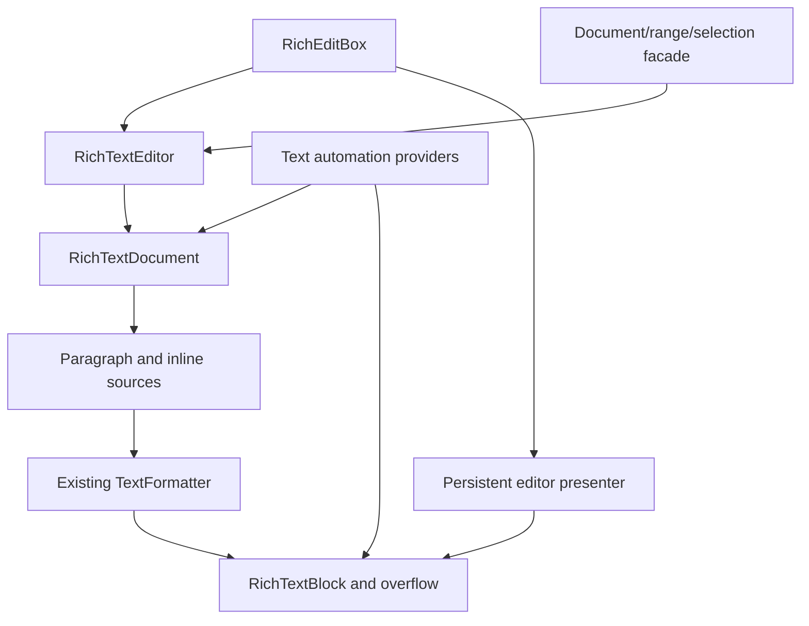

# Using and extending the rich text implementation

The implementation uses FerroUI's existing object, property, document-inline,
text-formatting, input, clipboard, dispatcher and automation contracts. This guide
describes the implemented architecture and its public Rust entry points. The
exact upstream member dispositions are in [API-MAP.md](API-MAP.md); missing native
members remain pending there and in [DEVIATIONS.md](DEVIATIONS.md).

## Architecture and ownership



| Responsibility | FerroUI contract and implementation |
|---|---|
| Observable objects, inherited values, untyped markup | `Ref<T>`, `FerroObject`, `ferro_class!`, registered properties and ordinary markup metadata. |
| Document identity and structure | [RichTextDocument](../../../src/FerroUI.Controls/documents/rich_text_document.rs), shared BlockCollection/InlineCollection handles and existing Run/Span/Bold/Italic/Underline/LineBreak/InlineUIContainer types. |
| Durable edit state | [DocumentSnapshot](../../../src/FerroUI.Controls/documents/document_snapshot.rs) and [format patches](../../../src/FerroUI.Controls/documents/character_format.rs). Mutable feature/decoration values are copied when snapshots are taken. |
| Shaping and line layout | [RichTextSource/RichTextLayout](../../../src/FerroUI.Controls/rich_text_layout.rs) feed the existing formatter. Existing font selection, Unicode, bidi, shaping, glyph drawing and text-run APIs remain responsible for text layout. |
| Pagination and selection | [RichTextBlock](../../../src/FerroUI.Controls/rich_text_block.rs) owns a primary view; [RichTextBlockOverflow](../../../src/FerroUI.Controls/rich_text_block_overflow.rs) contributes further pages through weak links. |
| Editable state | [RichTextEditor](../../../src/FerroUI.Controls/rich_text/rich_text_editor.rs) owns history, selection, typing format, input limits and composition state over the same model. |
| Control integration | [RichEditBox](../../../src/FerroUI.Controls/rich_edit_box.rs) derives from TemplatedControl and owns one persistent [RichEditBoxTextPresenter](../../../src/FerroUI.Controls/rich_edit_box_text_presenter.rs). It connects owner-routed input, clipboard, caret and the [input-method client](../../../src/FerroUI.Controls/rich_edit_box_text_input_method_client.rs). |
| Native text-object semantic services | [RichEditTextDocument/Range/Selection](../../../src/FerroUI.Controls/rich_text/rich_edit_text_document.rs) expose typed operations over the same editor; this is separate from the unavailable native TOM ABI. |
| Accessibility | [Portable text providers](../../../src/FerroUI.Controls/automation/provider/i_text_provider.rs) and [range providers](../../../src/FerroUI.Controls/automation/provider/i_text_range_provider.rs) use the same document/geometry; the [Windows bridge](../../../src/Windows/FerroUI.Win32/automation/automation_node_text.rs) handles native marshalling. |

The primary view owns the logical content. Overflow links and back references are
weak, and linking rejects cycles or a second owner. A model cannot be attached to
two unrelated primary views at once. For independent views, create independent
models from a snapshot. An embedded control is still the same control in that
snapshot, so copying it does not make simultaneous visual ownership valid.

Formatting and editing callbacks copy values out of interior mutable storage
before raising notifications. Document batches collect changes into a revision;
live pointers follow each completed replacement immediately through an internal
position notification, and public subscribers receive ordered batched notifications.
Pointers created midway through a batch track only subsequent edits, so ending
the batch cannot apply an earlier edit to them twice. The tests for these boundaries are in
[rich_text_document_tests.rs](../../../src/FerroUI.Controls/documents/rich_text_document_tests.rs).

Inherited presentation changes rebuild formatted text without changing the stored
document's revision or composition identity. The property system reports explicit
inheritance provenance because clearing a local value can also produce a value
with inherited priority. `TextElement`, `Inline`, `Block` and `Paragraph` use that
provenance to choose `IInlineHost::invalidate_layout`; the block collection forwards
it to the view without publishing a document edit. Local document formatting still
publishes semantic invalidation, including inside an open edit batch. Inherited
mutable feature and decoration collections take the same layout-only route;
locally assigned collections remain document formatting. Snapshots capture base
values rather than flattening parent presentation, so undo restores content that
continues to inherit the current theme. See RT-I14 and
[presentation invalidation tests](../../../src/FerroUI.Controls/documents/rich_presentation_invalidation_tests.rs).

## Construct a rich document

```rust
use ferroui_base::media::FontWeight;
use ferroui_controls::RichTextBlock;
use ferroui_controls::documents::{Hyperlink, Paragraph, Run, Span};

let view = RichTextBlock::new();
let paragraph = Paragraph::new();
paragraph.inlines().add(Run::with_text(Some("Read ")));

let emphasis = Span::new();
emphasis.set_font_weight(FontWeight::Bold);
emphasis.inlines().add(Run::with_text(Some("formatted text")));
paragraph.inlines().add(emphasis);
paragraph.inlines().add(Run::with_text(Some(" and ")));
paragraph.inlines().add(Hyperlink::with_text(
    "open the project",
    Some("https://github.com/wieslawsoltes/FerroUI"),
));
view.blocks().add(paragraph);
```

Collections are shared handles. Keeping `let blocks = view.blocks()` and adding
to `blocks` changes the view's document; it does not mutate a detached copy.
Block/paragraph and inline ownership is validated during document operations.
Use `InlineUIContainer::with_child(control)` for an embedded control. The control
participates in ordinary FerroUI measure/arrange and is represented by one object
replacement character in the text coordinate system.

The ordinary document classes are registered for XAML. Content remains a
structured document rather than being converted to plain text by the loader:

```xml
<RichTextBlock FontSize="18" TextWrapping="Wrap">
  <Paragraph>
    A <Bold>formatted</Bold> paragraph with
    <Hyperlink NavigateUri="https://github.com/wieslawsoltes/FerroUI">a link</Hyperlink>.
  </Paragraph>
  <Paragraph>Another paragraph.</Paragraph>
</RichTextBlock>
```

The loader's normal whitespace rules still apply. Put intentional spaces in the
text and use adjacent tags when testing structure independently of whitespace.
The implementation does not bypass the regular runtime/compiled markup system.

## Text element names and template scopes

`TextElement::find_name` resolves the current nearest logical namescope using
FerroUI's `NameScopeExtensions`, then returns the same registered live object
that a control would receive. It has no separate registry or cached scope. A
missing scope or registration returns `None`; reparenting and scope replacement
take effect on the next call. Typed method metadata has a durable generator
override, so regenerating the ordinary Controls declarations preserves FindName.

Template instances publish their existing `TemplateResult` scope on the built
root before `TemplateApplied`. An explicitly scoped root retains its nearer
scope. The XAML deferred scope keeps its declaring parent weak, allowing live
outer-name fallback without a cycle through a named template owner. Real XAML
fixtures obtain Runs from the event's per-instance scope and invoke FindName
without attaching a scope themselves. Replacement and destruction checks cover
the old instance and the declaring tree. A chain of weak scope references
allows a nested deferred resource to skip an expired temporary construction
scope and reach its surviving declaring scope. A live scope still controls
local names, misses and asynchronous completion.

FerroUI's completed `ChildNameScope` can fall back to its parent, while ordinary
nested NameScopes are isolated. Runtime registration follows the shared
StyledElement/NameScope policy; changing Name does not add a new automatic
registration mechanism. Native deferred element realization is not implemented.
An already pending asynchronous lookup retains the framework's existing
completion policy if an incomplete declaring scope disappears. These boundaries
remain explicit in RT-I33.

## Linked columns and page geometry

```xml
<Grid ColumnDefinitions="*,*" ColumnSpacing="20">
  <RichTextBlock x:Name="FirstColumn"
                 Height="240"
                 TextWrapping="Wrap"
                 OverflowContentTarget="{Binding #SecondColumn}">
    <Paragraph>Content is laid out into the first column and continues in the next.</Paragraph>
  </RichTextBlock>
  <RichTextBlockOverflow x:Name="SecondColumn" Grid.Column="1" Height="240" />
</Grid>
```

Continuation includes the formatter break state. The existing
[TextLineBreak::fork](../../../src/FerroUI.Base/media/text_formatting/text_line_break.rs)
preserves the resolved shaping/bidi continuation when a following column has a
different width. Changes to text, formatting, width or an overflow target rebuild
the affected page inputs; selection remains associated with document offsets.

`hit_test_text_position`, `get_rects_for_range`, `line_metrics`, `content_start`,
`content_end` and `text_view_for_position` expose the same formatted view used for
drawing. Querying geometry does not change the selection. Geometry needs measured
and arranged content; the portable automation layer reports an explicit error
when no usable visual geometry exists.

Native line breaking, pixel output, every formatting option and all incremental
cache behavior are separate conformance targets. Reusing the formatter avoids a
second text engine, but does not prove identical native engine output.

## UTF-16 coordinates and live ranges

Public rich document positions count UTF-16 text. For `a😀b`, scalar boundaries
are `0`, `1`, `3`, and `4`. An edit at offset `2` would split the surrogate pair
and is rejected. Paragraph boundaries contribute LF. An inline `LineBreak` uses
the framework's platform newline: CRLF on Windows and LF elsewhere; its UTF-16
extent must therefore be measured from the model instead of assumed to be one.
Inline controls contribute U+FFFC. Native synthetic element-open/close markers
are not exposed as text.

`TextPointer` holds a weak document reference and an offset/gravity pair. Gravity
determines whether an insertion at that offset leaves the pointer before or after
the inserted text. Batched edits preserve the order of each position adjustment.
Detached/dropped documents make weak pointers unavailable. TextPointer character
rectangles are shaped insertion/caret rectangles using the requested direction as
affinity, which is an explicit adaptation of native structural geometry.

`RichEditTextRange::get_clone()` creates an independent live range. A range
operation changes that range; selecting it is a separate operation. A selection
is directed, with anchor and active endpoints, while a content range is normalized
for slicing and replacement.

## Text highlighters

Highlighters describe visual ranges without changing the document's formatting
or edit revision. `TextHighlighter` owns solid foreground/background brush values
and a shared range collection. The Rust range value is `TextHighlightRange`;
its markup name remains `TextRange`.

```rust
use ferroui_base::media::Brushes;
use ferroui_controls::documents::{TextHighlighter, TextHighlightRange};

let highlight = TextHighlighter::new();
highlight.set_background(Some(Brushes::yellow()))?;
highlight.ranges().add(TextHighlightRange::new(0, 5));
view.text_highlighters().add(highlight);
```

```xml
<RichTextBlock.TextHighlighters>
  <TextHighlighter Foreground="Black" Background="#FFFFDB80">
    <TextRange StartIndex="0" Length="10" />
  </TextHighlighter>
</RichTextBlock.TextHighlighters>
```

StartIndex and Length preserve signed source values. Inserting a range into the
collection copies that value; modifying a retrieved copy requires writing it back
through `set` to change the collection. Markup uses a temporary boxed value while
assigning the two fields, then copies it into the collection. Empty/invalid ranges
do not paint, and valid regions are clipped to the document.

The loader recognizes this specific framework value through
`FerroXamlIlTextRangeTransformer`. It lowers the temporary `Ref<TextHighlightRange>`
constructor and its ordinary field assignments before the generic XamlX value
initializer guard. Attribute, property-element and `x:Arguments` forms therefore
work in runtime and compiled markup while the collection still copies the value.
Other value types retain the normal initializer validation. The differential
markup harness traverses blocks, highlighters and copied ranges, so its tree
comparison observes actual rich content rather than only the outer control.

Later highlighter layers replace both foreground and background with their own
brushes/defaults. Visual normalization occurs per layer before overlap resolution
so scalar boundaries do not change precedence or rewrite the public range value.
Brush/item changes invalidate the visual input through weak subscriptions.
The literal source overlap fixtures and value/lifetime tests are linked in
[TESTS.md](TESTS.md); native rendering and high-contrast conformance remain distinct.

## Editing and text-object services

```rust
use ferroui_base::media::FontWeight;
use ferroui_controls::RichEditBox;
use ferroui_controls::documents::CharacterFormat;

let editor = RichEditBox::new();
editor.set_text("Hello, rich text")?;
let text = editor.text_document();

text.edit_group(|text| {
    let word = text.get_range(0, 5)?;
    word.set_character_format(&CharacterFormat {
        font_weight: Some(FontWeight::Bold),
        ..Default::default()
    })?;
    word.set_text("Welcome")
})?;

text.undo()?;
```

`RichEditBox::document()` is the control's direct shared-model property.
`RichEditBox::text_document()` is the editing/service facade. Both use the same
document, selection, geometry and history. This naming distinction avoids
introducing a second editable model behind the control.

The editor enforces read-only and UTF-16 maximum-length policies, performs
grapheme-aware deletion, coalesces compatible typing, bounds undo storage and
clears stale history after external edits. A failed grouped edit restores the
prior snapshot/selection and does not create a partial undo unit. If a layout or
publication callback independently changes the model, restoring that old
snapshot would overwrite application state. A mutation fence instead rejects
the interrupted group, retains the external edit and live position rebasing,
and discards stale history, typing format and queued composition causes. Nested
groups inherit that invalidation even if their action catches the inner error;
an ordinary `ReentrantEdit` error without a proved model change still rolls back.
A successful group records at most one undo unit when history is enabled;
no-op and preview-only groups add none. Typing format is retained at a collapsed selection
until the caret moves.

Format patches distinguish “leave unchanged” (`None`) from explicitly clearing
a nullable field (`Some(None)`). Range queries return `TextFormatValue::Uniform`
or `Mixed`. A mixed result is not silently converted to one run's format. Patch
fields use FerroUI font/brush/decoration values and layout distances; native TOM
points, effect flags and unrepresented fields need explicit conversion or work.

The TOM facade exposes the following native-valued units. These are separate
from the existing Unicode editing/navigation units and UI Automation units.

| Unit | Value | Implemented boundary |
|---|---:|---|
| Character | 0 | A Unicode scalar, preserving UTF-16 surrogate pairs. Combining scalars remain distinct. |
| Word | 1 | Word span with following ASCII spaces/tabs. Search uses its own boundary rules. |
| Sentence | 2 | Native punctuation and ASCII-whitespace rules covered by focused fixtures. |
| Paragraph | 3 | Native separators, including CRLF as one boundary. |
| Line | 4 | Displayed lines from a complete untrimmed associated view; Paragraph when headless. |
| Story | 5 | The model's single document. Document remains a Rust associated-constant alias. |
| HardParagraph | 12 | Paragraph objects, distinguishing inline soft line breaks. |
| Cluster | 13 | Actual shaping clusters from a complete untrimmed associated view, without grapheme fallback. |

`Cluster` reads the formatter's shaped cluster output, including ligatures,
complex-script clusters, bidi logical order, inline objects and linked pages. It
rejects an unavailable, incomplete, trimmed, stale or malformed layout. Ordinary
editor grapheme deletion remains a separate navigation contract. Story coordinates exclude the synthetic
terminal CR; projection of that mark by GetText does not enlarge the model.

`start_of` and `end_of` return signed movement/collapse counts. `get_index` uses
one-based indices and `set_index` also accepts negative indices relative to the
end. Range movement counts collapsing a nonempty range as its first move.
Extreme counts saturate at the story boundary; invalid indices are nonmutating.
A control associates its persistent presenter after first measure. A manually
associated view is weak and must share the model. Incomplete or trimmed line
coverage produces an explicit error rather than fabricated display lines.

`RichEditTextRange::delete(unit, count)` removes the existing nonempty range
first, counting it as one deleted unit. A zero count removes only that range;
positive and negative counts then extend forward or backward. Remaining units
are resolved after the first deletion because a joined word or reflowed line can
have different boundaries. The operation follows the supported native paragraph
join rules, retains the editor's independent directed selection and forms one
undo unit. `RichEditTextSelection::delete_by` instead collapses the selected
range at the resulting insertion point. Its layout preflight recaptures the live
selection after application callbacks. Extreme signed counts are handled without
absolute-value overflow. Native structural markers and unsupported units remain
outside this contract.

`character()` reads the exact UTF-16 code unit at the range start, even for a
degenerate range; it returns zero at the model's end. `set_character(u16)` rejects
an isolated surrogate and refuses to replace half of an existing pair. The Rust
`character_scalar()` / `set_character_scalar(char)` extension handles complete
Unicode scalars. Replacements preserve assigned formatting and container context,
including inherited owner/paragraph values, and retain the range's start while
rebasing its far endpoint and the independent selection. Preflight no-ops and validation failures preserve composition and redo.
A changed request may cancel preview before rechecking its committed character;
a detected external callback edit instead invalidates stale history/composition. The native synthetic final CR is not
an editable character in this model.

Search supports forward/backward and whole-word options with Unicode lowercase
mapping and preserved UTF-16 offsets; it is not a locale collation or full case
folding implementation. Remaining units/options stay in the exact API inventory.

### Independent range formatting gravity

The native-valued `RangeGravity` enum and the range's getter/setter select the
character format at a collapsed boundary. Character-format queries and plain
SetText/paste share the same resolver, with explicit typing patches applied last.
Independent range duplicates reset to UIBehavior; shared Rust clones share the
accepted mode. Reentrant reads and asynchronous clipboard work use range/model
generations, and grouped edits restore the independent editor typing snapshot
exactly. [RANGE-GRAVITY.md](RANGE-GRAVITY.md) records the measured mode readback,
paragraph and terminal boundaries, transaction policy and native fixture scope.
The range's physical endpoint tracking and the live selection's Gravity are
separate contracts, not inferred from formatting affinity.

### Selection Home and End

`RichEditTextSelection::home_key(unit, extend)` and `end_key(unit, extend)`
accept `Line` and `Story`. A nonextending Line operation first chooses the
normalized start for Home or end for End, then finds that line's boundary.
Extension instead uses the directed active endpoint and keeps the anchor.
The result is the accepted signed UTF-16 displacement, including cancellation
or replacement by selection-event handlers. Other units fail before changing
the selection, composition or history.

Line navigation uses the same complete, untrimmed layout as range movement,
including linked overflow and logical ordering in RTL text. A collapsed End
excludes the formatter's newline extent; an extended End includes a real hard
paragraph mark. It retains the source line so repeating the same extended End
does not advance again at that boundary. General caret gravity and exact
soft-break/wrap extension affinity are still separate contracts. Without an
associated measured view, the existing paragraph fallback supplies line
boundaries. Story navigation needs no layout and ends at the model's final caret;
the model does not contain the native synthetic terminal paragraph mark.

These operations preserve active composition and redo and work in a read-only
document. They create no editing group. Layout callbacks can change selection,
so navigation captures its active endpoint after resolving the layout. If a
selection or publication callback changes the document itself, the operation
preserves that external state, invalidates stale history and reports
`ReentrantEdit` instead of acknowledging an obsolete destination.

The initial implementation exposed an ambiguity between the
[Win32 HomeKey](https://learn.microsoft.com/en-us/windows/win32/api/tom/nf-tom-itextselection-homekey)
and [EndKey](https://learn.microsoft.com/en-us/windows/win32/api/tom/nf-tom-itextselection-endkey)
parameter tables and the
[WinUI HomeKey remarks](https://learn.microsoft.com/en-us/windows/windows-app-sdk/api/winrt/microsoft.ui.text.itextselection.homekey).
The completed [system MSFTEDIT observations](native-msftedit-home-end.json)
establish the collapse-edge and real-paragraph-mark behavior described above.
Six additional regressions cover those endpoints, empty paragraphs, repeated
End affinity, cancellation and callback ownership. The engine identity and exact
fixture text remain attached to the observations. Synthetic terminal EOP and
external WinUI engine equivalence are still open under RT-I21.

### Selection vertical movement

`move_up(unit, count, extend)` and `move_down(unit, count, extend)` accept
`Line` and `Paragraph`. Line movement uses actual shaped lines and hit testing
from a complete, untrimmed associated view. Collapsed movement retains its desired
physical horizontal position across short lines, mixed line heights, bidi text
and linked overflow. Extension projects through each actual crossed line from
the reached caret position. A short or empty intervening line therefore clamps
subsequent extension, including within a single multi-line command. An earlier
collapsed desired column survives temporary extension: nonempty extension uses
the actual active caret, while returning to a collapsed caret can resume that
earlier column.
Paragraph movement uses logical boundaries and needs no view. Screen and Window
are absent from the current `TextRangeUnit`; other exposed units reject before
side effects.

Negative counts reverse the command. A zero count does not need layout.
Extreme counts widen before negation and saturate by index, avoiding signed
overflow and iteration proportional to the request. Extended Line traversal is
bounded by actual crossed display lines. A nonempty collapsed move
chooses the normalized edge in the direction of travel and applies the full
requested distance from that edge. If collapsing is the only accepted change,
it counts as one unit. This vertical rule differs from ordinary range Move's
collapse-and-consume contract.
Returned values count accepted units relative to the command direction, rather
than UTF-16 displacement. Cancellation returns zero; a redirected result counts
the boundaries or display lines actually crossed.

The shared publisher also serves logical selection movement. It fences document
mutation and selection publication without creating an edit group. A separate
navigation generation prevents an outer callback from replacing a newer view or
affinity decision even when selection offsets happen to match. Explicit
selection changes, model edits and actual view replacement invalidate retained
navigation state. Reassociating the same validated live presenter is inert, so
normal caret scrolling retains the horizontal position. Read-only movement
preserves composition and redo.

Line extension beyond the first or last line can reach a real story edge as one
additional unit. Accepted redirection counts the same unit, including an edge
on the original line. The [264-command native record](native-msftedit-navigation.json)
supplies collapse/count and edge observations. The later [282-command record](native-msftedit-navigation-isolated.json)
adds 18 fresh-control/sequence observations; all original rows match across the
two recorded DLL versions. It established the required distinction: native
extension clamps its physical column after crossing a short line, whereas
ordinary caret movement retains the desired column. In the isolated sequence,
collapse visits 5→8→14→8→5, while extension visits 5→8→10→8→1 with anchor 5.
The Rust `project_extension` path now implements that stepwise projection;
five new regression definitions cover downward/upward motion, repeated facades,
empty lines, extreme counts and redirected story edges. Two additional
formatter-instrumented definitions compare geometry queries for 8/1,024-line
stories and fence newer callback state during redirected-edge projection.
Additional edge geometry is requested only for an accepted edge redirection;
ordinary projection work is bounded by crossed lines. The later
[290-command record](native-msftedit-navigation-options.json) adds eight mixed
collapse/extension commands. Starting at offset 5 in `abcdef\rx\rabcdef`,
collapse Down reaches 8, extension Down reaches `(8,14)`, extension Up reaches
`(8,8)`, and collapse Up restores 5. Starting again at 5, extension Down reaches
`(5,8)`, collapse Down reaches 10, collapse Up reaches 8, and extension Up reaches
`(8,1)`. Literal fixtures preserve both sequences. The final focused Rust
selection gate passed all 70 tests, including these mixed-mode, geometry-cost
and callback-ownership regressions.
Fresh final-empty-line Up1 and Down(-1) both reach 4, resolving the previous
reused-state difference. Synthetic terminal EOP and the remaining
Gravity/Options/Type contracts remain explicit under RT-I23.

Validation also exposed an existing shared formatter prerequisite: structural
EOL/EOP markers were entering RTL directional glyph groups, causing every caret
on a Hebrew line to resolve to the same edge. The formatter now separates those
markers and anchors their caret/bounds to the preceding logical run. A direct
formatter fixture checks LTR/RTL inverse hit testing, nonzero source starts,
one/two-unit markers, and selected ranges; it first failed against the old
library and passed after the correction. This changes geometry bookkeeping,
not glyph shaping or native pixel parity.

### Selection horizontal movement

`move_left(unit, count, extend)` and `move_right(unit, count, extend)` accept
`Character` and `Word` without requiring a layout view. Keyboard `Character`
uses the existing FerroUI `GraphemeEnumerator`, so a surrogate pair, combining
sequence or joined emoji moves as one grapheme. Ordinary range
`TextRangeUnit::Character` remains scalar-based; its separate contract is not
changed by keyboard navigation. `Word` reuses the reviewed word boundaries,
including the documented trailing ASCII blank policy.

For a nonextended selection, Character movement collapses to the directional
edge and consumes one requested unit. Word movement aligns that edge to the
directional word boundary and consumes one unit. Extension preserves the
directed anchor. Negative requests reverse direction, unsupported units reject
even for zero, and widened counts saturate at the real document edges. The
shared publication path accounts for accepted units after cancellation or
redirection, rejects stale document results, protects newer nested navigation
and clears old vertical affinity after an accepted horizontal command.

The completed [300-command horizontal record](native-msftedit-navigation-options.json)
contains ASCII, combining/ZWJ, word punctuation, mixed Hebrew/LTR and empty-story
fixtures. Its default and RTL-reading windows use the same logical source
offsets for the recorded left/right commands. That is the current Rust policy;
visual bidi left/right and arbitrary Gravity behavior remain separate contracts.
For example, in `A😀é👩‍👩‍👦B`, Character Right moves UTF-16 offsets 1→3,
3→5 and 5→13. Literal Rust regressions replay 294 recorded rows, including 78
additional aligned-word and grapheme-interior cases. Six synthetic terminal-EOP
rows remain explicitly outside normalized Rust coordinates. Separate fixtures
cover scalar independence, unit validation, extreme counts,
cancellation/redirection, mutation and affinity ownership. These execute in the
completed 70-test focused selection gate at the published navigation checkpoint.

The system MSFTEDIT observations retain the exact text, engine version, window
style, directed selection flags/type and signed native delta. They do not
establish the behavior of the external WinUI text engine. The later
[316-case SetFlags/TypeText record](native-msftedit-typing.json) preserves requested
and accepted flags, typed text, selection phases and exact changed UTF-16
stories. Overtype consumes one existing grapheme for each typed Unicode scalar;
a nonempty selection is consumed by the first scalar. Typed CR and LF each
insert a paragraph without consuming the next target, so TypeText with CRLF
inserts two paragraphs. Paragraph boundaries are protected from overtype.
This recorded behavior guides the next Selection.Options/TypeText implementation;
the observation artifact alone does not implement those contracts.

### Selection options, classification and typed overtype

`SelectionOptions` retains the native StartActive, AtEndOfLine, Overtype, Active
and Replace bits. Every `RichEditTextSelection` over an editor reads and changes
the same modes. StartActive follows the accepted directed endpoints and is true
for a caret; Replace remains set, as observed in system MSFTEDIT. Setting
StartActive on a nonempty selection changes its direction through the ordinary
cancellable control projection. Cancellation, redirection, a model change or a
newer nested selection/navigation/mode request prevents the older call from
installing stale flags. Unknown bits fail before changing composition or history.

Overtype affects actual `EditKind::Typing` transactions, including control
typing. One accepted input Unicode scalar consumes one target grapheme. The
first scalar consumes an existing selected range. A typed CR or LF inserts a
paragraph without consuming target text, and existing CR/LF delimiters are
protected. Consequently, `TypeText("\r\n")` inserts two paragraph breaks, while
bulk text loading and paste retain their existing CRLF-to-one-break normalization.
The native typing record establishes this distinction; it is not inferred from
the bulk-load implementation.

MaxLength planning considers accepted input and consumed target text together.
A rejected suffix cannot erase additional target graphemes. Rich formats,
structured inlines and embedded identity survive the accepted replacement, which
forms one undo unit when history is enabled. Empty TypeText returns without
ending preedit or rejecting a read-only editor; nonempty typing retains normal
read-only and composition transaction checks.

Mode-only changes do not create an undo entry or clear redo. Undoing a text edit
retains the current modes. A failed explicit transaction restores its mode and
direction checkpoint, whereas undoing a successful group retains current modes.
Those history choices are explicit FerroUI policy. Active records TOM state and
does not acquire OS focus. AtEndOfLine retains explicit caller intent and is
cleared by an accepted changed typing operation; automatic visual-affinity
calculation remains separate. The editor reports InsertionPoint or Normal;
native None/InlineShape/Shape constants do not imply implemented shape selection.

`rich_edit_text_selection_options_tests.rs` contains 20 focused cases, including
the literal 316-command system MSFTEDIT replay. The source artifact and test
definitions are separate from completed execution evidence in TESTS.md. Native
terminal EOP, other native soft-break encodings, automatic activity/affinity and
external WinUI engine behavior remain under RT-I26.

### Editor template, viewport and focus

A RichEditBox template supplies ContentElement, HeaderContentPresenter,
PlaceholderTextContentPresenter and DescriptionPresenter. ContentElement may be
a ScrollViewer or another supported framework content host. The persistent
presenter is moved into the new host during retemplating; model, selection,
composition, live ranges and undo/redo survive. Missing parts are allowed.

The presenter measures the full document against the available viewport width,
implements logical scrolling, and clamps offsets when content shrinks. Header
and description remain outside the document viewport. Text, caret, selection,
embedded content, automation ranges and IME geometry use the same offset. The
control remains the semantic focus and automation owner; the raw presenter adds
no independent Text provider or tab stop.

The `:flyout-focus` state requires the control's current ContextFlyout to target
that control and keyboard focus to be inside its actual popup content. It keeps
the selection brush and model composition active during that transition. Focus
return, actual blur, closure and replacement clear the state through weak
subscriptions. The shared input-method connection now retains semantic ownership and session
generations across owned popup roots; browser and IMM32 adapters follow that
transport ownership. Actual platform IME/candidate behavior and separate native
window execution remain conformance gates.

### Compiled theme resources and formatting commands

The port supplies actual `RichEditBox` resources in the
[WinUI](../../../src/FerroUI.Themes.WinUI/Controls/RichEditBox.xaml),
[Fluent](../../../src/FerroUI.Themes.Fluent/Controls/RichEditBox.xaml) and
[Simple](../../../src/FerroUI.Themes.Simple/Controls/RichEditBox.xaml) themes.
Each merged dictionary uses the existing theme's palette and density resources.
It installs the persistent rich presenter in `ContentElement`, alongside the
header, placeholder and description parts. Selection, composition, the document,
live ranges and undo remain properties of the shared editor during theme changes
and retemplating.

The native `TextCommandBarFlyout` source queries bold and italic, disables an
effect when the complete selection has it, and otherwise enables it. Underline
sets Single when the selected native value is None or Undefined. The
[owner commands](../../../src/FerroUI.Controls/rich_edit_box_format_commands.rs)
express those operations through existing FerroUI format patches and grouped
history. `BoldState`, `ItalicState` and `UnderlineState` independently return
`Option<bool>`: `None` denotes mixed formatting. `IsBold`, `IsItalic` and
`IsUnderlined` expose uniform-on values to the menu's checked state. Toggling a
mixed selection enables the supported effect across the range. Underline is
changed run by run within one transaction, retaining each run's other
decorations. A collapsed selection changes its typing format.

The owned framework `MenuFlyout` binds cut/copy/paste, undo/redo, select-all and
`ToggleBold`/`ToggleItalic`/`ToggleUnderline` to the actual editor.
`CanFormat` observes read-only and effective enablement. The commands use the
same cancellation and reentrancy policy as other editor edits; they query the
accepted selection after preedit cancellation. Declared XAML commands, dynamic
resources and theme parts are exercised by the actual-theme and runtime/compiled
markup fixtures listed in [TESTS.md](TESTS.md).

The [RichTextPage](../../../samples/ControlCatalog/Pages/RichTextPage.xaml)
catalog entry demonstrates formatting/history/read-only controls, an editor and
read-only preview over shared content, and linked read-only columns. It is a
framework example authored for this port. RT-I17 retains the native command-bar,
lazy-part, touch UI, OS focus-reveal, localization and appearance boundaries;
headless theme tests do not close them.

## RTF and clipboard

```rust
use ferroui_controls::documents::DocumentSnapshot;
use ferroui_controls::rich_text::{RtfReader, RtfWriter};

let snapshot = DocumentSnapshot::from_text("Unicode: café 😀");
let rtf = RtfWriter::write(&snapshot)?;
let decoded = RtfReader::read(rtf.as_bytes())?;
assert_eq!(decoded.text(), snapshot.text());
```

The [RTF codec](../../../src/FerroUI.Controls/rich_text/rtf.rs) supports its RTF1
subset: groups/escapes, Unicode fallback and the portable byte encodings below,
font/color tables, supported paragraph/character styles, character formatting,
paragraph metrics, and hyperlink/bookmark/target fields. Native OLE/pictures, tables/lists, additional code pages and unsupported
format representations return explicit errors. Rust stream adapters use the codec for RTF and have an explicit byte/encoding
policy. The native stream ABI and every TextGetOptions/TextSetOptions flag are
not supplied by the codec.

Default reader bounds are 16 MiB of input, nesting depth 128, one million parsed
tokens and 8 Mi UTF-16 text units. `read_with_limits` permits a caller to choose
tighter bounds. A syntactically accepted RTF group is not proof that all its
content features are supported; unsupported required content is rejected.

### RTF styles and fields spanning paragraphs

The [stylesheet resolver](../../../src/FerroUI.Controls/rich_text/rtf_styles.rs)
implements paragraph `s` and character `cs` references, forward `sbasedon` chains,
the no-base sentinel, additive character formatting, and subsequent direct
formatting overrides. It follows the *Style Sheet* grammar in Microsoft's
[RTF 1.9.1 specification](https://officeprotocoldoc.z19.web.core.windows.net/files/Archive_References/%5BMSFT-RTF%5D.pdf),
pages 24–26. Definitions replay supported format controls through the same decoder
as body formatting. Font/charset selection, language, paragraph spacing,
indentation and tabs therefore retain their existing validation and units.
Group exit restores the outer character style state.

Style names, key bindings and unknown starred metadata do not become document
text. Used inheritance chains are checked for missing/wrong-kind references,
cycles and depth. Expansion also consumes a separate work budget bounded by
`max_tokens`, preventing repeatedly selected styles from multiplying decoding
work without limit. Unused unsupported section/table definitions can remain in
the input; applying them fails explicitly. The result retains resolved appearance,
not editable named-style identity, next-style policies or linked style updates.
Export writes canonical direct formatting rather than reconstructing the original
style sheet. These limitations are recorded as RT-I19.

A hyperlink field result may span multiple paragraphs. FerroUI's document tree
gives each nonempty result segment its own paragraph-owned `Hyperlink`, retaining
the URI, target, inline formatting, paragraph metrics and surrounding text. Empty
paragraphs create no invisible hyperlink or automation focus target. Paragraph
separators count toward the text limit. The cumulative URI/target strings
materialized across all segments are separately bounded by `max_bytes` before
cloning, including across multiple fields. Stream imports parse and validate the
complete result before touching the live model or canceling composition. The
separate link identities are an explicit model translation of the original field.

[RichTextTransfer](../../../src/FerroUI.Controls/rich_text/rich_text_transfer.rs)
offers an exact in-process snapshot and, when encodable, platform RTF formats
alongside plain text. Embedded controls retain identity in in-process transfer;
plain text remains available to external applications when the rich snapshot has
no supported RTF representation. Import prioritizes the in-process snapshot,
then advertised RTF, then plain text. Malformed/unsupported advertised RTF returns
an error rather than silently flattening it.

Clipboard actions are asynchronous through the existing framework transfer
contracts. Copy captures the fragment before awaiting the platform. Paste checks
the captured document/revision/selection before applying a delayed result. Rich
run formatting survives casing and single-line policy transformations. The
control exposes edit/clipboard failures to callers for normal application status
handling.

### Independent TOM clipboard services

[RichEditTextRange clipboard methods](../../../src/FerroUI.Controls/rich_text/rich_edit_text_clipboard.rs)
accept an injected `Rc<dyn IClipboard>` and return the framework's
`LocalBoxFuture<Result<_, ClipboardError>>`. This follows FerroUI's asynchronous
platform service without synchronously blocking an application dispatcher.
The ten exact pinned interface/runtime-class/document identifiers have
individual partial mappings under RT-I24.

`RichTextPasteFormat` has three supported policies:

| Policy | Accepted representations |
|---|---|
| `BestAvailable` | Exact in-process document snapshot, then supported RTF aliases, then Unicode plain text. |
| `PlainText` | Unicode plain text only. |
| `Rtf` | Supported RTF aliases only; absence or invalid RTF does not flatten to plain text. |

Native format zero requests the best representation. Rust uses named policies
because registered RTF format identifiers depend on the platform/session.
Arbitrary numeric formats, OLE cloning and unsupported rich content remain
separate work. The [pinned public XML](https://github.com/microsoft/microsoft-ui-xaml/blob/fe244ca6ac4d482712b234a9de3cf771cc6481de/packaging/Intellisense/generated/Microsoft.UI.Text.xml)
defines document `CanCopy` as permission; it is independent of a nonempty
selection and of editing read-only state. The current document model permits
copying and has no copy-protection mechanism. `CanPaste` probes fallible
advertised formats without decoding a delayed payload, ending composition, or
changing history; availability does not promise that a later platform read or
RTF parse will succeed.

Copy captures an immutable visible fragment before the platform await. Cut ends
an original IME preview on its first poll, then captures the committed range and
waits for the clipboard write before deleting. This ordering prevents copying a
preview while deleting different committed text. A failed write preserves the
committed document and undo/redo history but does not restart that ended preview.
Empty Cut leaves composition and clipboard untouched.

Paste validates and clips the payload before ending an original preview, then
reads the live committed endpoints again. Invalid, unavailable, empty or fully
length-rejected content cannot delete the target or end its preview. Plain text
inherits the range's insertion context; rich content keeps its supported
structure. Successful Cut/Paste preserve and rebase the editor's directed
selection and form one undo group while updating the independent live range.

Delayed edits retain document mutation identity, shared endpoint/format
generation, and a disposable editor-change subscription. This detects changes
inside held batches, endpoint/format/selection round trips and even empty IME
sessions. `get_clone()` remains independent; ordinary Rust clones share range
ownership. Retrieved transfer data is disposed on success, error and canceled
payload futures, before the final ownership check. Clipboard-owned outgoing
data is not disposed by the range. Callback edits keep their ownership through
the existing composition and edit-group publication fences.

The [28 public regressions](../../../src/FerroUI.Controls/rich_text/rich_edit_text_clipboard_tests.rs)
use actually pending platform/payload futures, exact formatting/selection/history
assertions, and disposal callbacks. The control's routed Copy/Cut/Paste events
and character-casing policy remain a separate integration path.

### RTF byte encodings and font-scoped decoding

The [byte boundary](../../../src/FerroUI.Controls/rich_text/rtf_encoding.rs)
uses `encoding_rs` 0.8.42 with default features disabled. It feeds raw text and
hex escapes into one incremental decoder and emits UTF-16 from a fixed stack
buffer. A multibyte character can span adjacent raw/escaped tokens. A change of
format, group, font, page or destination finishes the previous sequence, so an
incomplete character cannot be hidden across a semantic boundary. Invalid input
returns a typed error without replacement characters, before a parsed document
can be applied to the live editor.

| RTF code page | Portable decoder |
|---|---|
| 874 | Thai |
| 932 | Shift JIS |
| 936 | GBK |
| 949 | Korean |
| 950 | Big5 |
| 1250–1258 | Windows Central European, Cyrillic, Western, Greek, Turkish, Hebrew, Arabic, Baltic and Vietnamese |
| 10000 / 10007 | Mac Roman / Mac Cyrillic |
| 65001 | UTF-8 |

Document `ansicpg`, font `fcharset` and explicit font `cpg` select byte decoding;
they are separate from `lang`/`deflang`. A font's explicit `cpg` takes precedence
regardless of declaration order. DEFAULT charset inherits the declared document
page, while ANSI charset selects 1252. Group exit restores font/page state and
`plain` restores the default font. Font names and hyperlink field instructions
use the same decoding boundary as body text. RTF `u`/`uc` fallback bytes are
consumed before entering the legacy decoder. Text limits apply to decoded UTF-16
units, including astral scalars.

The writer continues to emit canonical Unicode escapes, preserving text rather
than the input file's original byte encoding or charset declarations. Symbol
fonts, OEM/Johab and unlisted pages fail explicitly; portable tables and vendor
mapping differences require native comparison. Tables, lists, OLE, pictures,
math and remaining format effects remain outside the supported content subset.
RT-I18 records these boundaries and the fixture suite is linked in
[TESTS.md](TESTS.md).

## Rust text streams

`RichEditTextDocument::load_from_stream` and `save_to_stream`, and range
`set_text_via_stream` and `get_text_via_stream`, accept `&mut dyn Read` or
`&mut dyn Write` with `TextStreamOptions`. The options make encoding, output BOM
and byte limits explicit. UTF-8 is the default; UTF-16LE/BE are supported for
plain text. Matching input BOMs are accepted and contradictory ones fail.
RTF retains its raw byte encoding and requires the default UTF-8/no-BOM policy.

The default input/output byte limit is 16 MiB. A bounded reader consumes at most
one byte beyond the limit to detect overflow. Invalid flags and encoding policy
fail before touching the stream. Read/parse/decode failure leaves content,
composition, live endpoints, defaults and history intact. Range replacement is
one undoable operation and rebases the independent selection.

Output is fully encoded before writing, so representability or limit errors
leave the writer untouched. An I/O failure can leave a written prefix. Interrupted
I/O is retried. Neither adapter seeks, truncates, flushes or closes the stream;
position and completion policy stay with the caller. Output is captured before
writer callbacks, so reentrant writer behavior does not alter the chosen snapshot.

## Input methods and composition

The input-method client exposes committed surrounding text and UTF-16 selection
separately from the preview shown by a composition. Repeated previews replace
the prior preview. Cancel restores the original rich content/selection; a commit
that changes document content or formatting produces at most one undo unit when
history is enabled, while an
empty/no-change completion produces none. An external edit prevents cancellation from restoring a
stale snapshot over the changed model, even while an outer model batch has not
yet published its revision.

An explicit native begin starts the lifecycle before a text update. It captures
the committed snapshot and directed selection without changing content,
formatting, revision or history. `is_composing()` is true, while
`active_composition_range()` is `None` until a real update defines an extent.
The start event reports empty text and the native unknown-start projection 0/0.
The first exact delta establishes its own range, independently of the original
selection. A legacy caller may still begin implicitly with its first preedit
update. Canceling or completing an empty session raises one empty end event and
preserves redo without adding undo. The absence of a pending automation range
is a deliberate framework projection; native automation behavior before the
first update needs platform conformance evidence.

The three routed composition events use `RichEditCompositionEventArgs`. Its
readonly `StartIndex` and `Length` are signed UTF-16 values for the entire
accepted extent, independent of the caret; uninitialized arguments retain the
native -1/0 sentinel. Changed events exclude cursor-only updates, and ended
payloads contain accepted filtered/limited text rather than the original request.
Reentrant model changes or caret round trips invalidate stale native completion
acknowledgements. A nested begin from an end callback owns its new session.
Native asynchronous dispatch of nested composition events remains separate work.

`composition_changed` supplies accepted preview deltas and finalization causes.
Filtering, normalization and UTF-16 limits are reflected in the payload. Moving
the preview cursor does not emit a text cause; finalization contains the accepted
committed text, or an empty string for cancellation. Commit creates at most one
history unit when history is enabled and document content or formatting changes, without a
preceding cancellation notification. Grouped edits queue causes until
the group settles and discard them on rollback. Preview-only groups create no
undo entry. An independently held model batch can defer public model Changed
beyond the cause callback; that event-order difference is recorded explicitly.

### InputScope objects and platform policies

`InputScope`, `InputScopeName` and `InputScopeNameValue` live in
`ferroui_base::input`. Their object construction follows the pinned
[`InputScope.cpp`](https://github.com/microsoft/microsoft-ui-xaml/blob/fe244ca6ac4d482712b234a9de3cf771cc6481de/dxaml/xcp/core/core/elements/InputScope.cpp)
and
[`InputScopeNameFactory.cpp`](https://github.com/microsoft/microsoft-ui-xaml/blob/fe244ca6ac4d482712b234a9de3cf771cc6481de/dxaml/xcp/dxaml/lib/InputScopeNameFactory.cpp).
The exact 43 enum names and `repr(i32)` values come from the pinned
[`Microsoft.UI.Xaml.Input` model](https://github.com/microsoft/microsoft-ui-xaml/blob/fe244ca6ac4d482712b234a9de3cf771cc6481de/dxaml/xcp/tools/XCPTypesAutoGen/XamlOM/Model/Microsoft.UI.Xaml.Input.cs).
Checked `from_raw` and parsing reject undefined numeric gaps. The enum type and
constants have complete value mappings; object behavior and platform consumers
retain their partial states.

An `InputScope` owns a persistent ordered `FerroList<Ref<InputScopeName>>` and
starts with an empty Names collection. An `InputScopeName` is a FerroObject with
a typed styled `NameValue` property defaulting to `Default`. Enum construction
creates a real name wrapper; converting one named string creates a scope with
one wrapper. Runtime metadata and compiled markup support the native shortcut,
explicit Names objects, scalar name content, the enum constructor and `x:Null`.
InputScopeName uses its actual NameValue content property, without a separate
object type converter. The XAML compiler ignores an empty or whitespace-only
InputScope attribute as an empty non-string assignment; use `x:Null` to clear
an existing scope. The explicit Rust string parser rejects empty names.
For example, the explicit collection form is:

```xml
<RichEditBox xmlns="https://github.com/ferroui">
  <RichEditBox.InputScope>
    <InputScope>
      <InputScope.Names>
        <InputScopeName NameValue="Hiragana" />
        <InputScopeName>KatakanaFullWidth</InputScopeName>
      </InputScope.Names>
    </InputScope>
  </RichEditBox.InputScope>
</RichEditBox>
```

Names preserves list identity, order and shared wrapper identity. Weak
subscriptions observe collection changes and NameValue changes, subscribe once
to repeated instances of the same wrapper, dispose unused subscriptions when
items leave, and allow callbacks to mutate the list. Shared scopes update every
live owning RichEditBox without retaining an owner or removed item. Each update
captures an immutable `Rc<[InputScopeNameValue]>`; a backend never receives live
FerroObjects, and an earlier option snapshot cannot change under a callback.

`RichEditBox.InputScope` is now a nullable styled `Option<Ref<InputScope>>`.
The complete ordered snapshot flows through the new inherited attached
`TextInputOptions.InputScopeNames` property. `effective_input_scope()` chooses
the first name for current single-purpose platform APIs.
`effective_content_type()` supplies a narrower existing content hint when a
host has no exact representation. An absent or empty scope falls back to the
independently configured legacy content type; setting or clearing a scope does
not overwrite that value. An explicit first `Default` supplies the default
keyboard purpose instead of exposing the legacy hint. Legacy Rust content-hint setters remain convenient
through conversion to a real scope object. View builders accept native enum
names, legacy content hints, shared scope objects and nullable reactive signals.

The manager observes effective changes to all ten attached `TextInputOptions`
properties on the semantic owner, including inherited values and cleared local
overrides. Updating a policy preserves the current client, connection and
composition. The binding owns a weak property subscription that survives reset
and is disposed on owner replacement or manager teardown. If a backend setter
reenters and changes the owner or policy, the manager reapplies the current
same-transport values after the older call returns.

CoreText caches the latest options before its lazy native context exists and
applies that scope before the first focus notification. Nested native scope
writes are serialized; a failed setter leaves the desired options available for
retry. Its exact name translation covers all 43 public scope values, including
the distinct XAML/CoreText names for numeric/alphanumeric PINs. Existing legacy
content-hint behavior remains separately covered.

| Backend | Current scope consumer and boundary |
|---|---|
| Windows CoreText | Uses the first exact native scope, including script/full-width values, with the established lazy-context and reentrant setter rules. |
| Android | Converts the first name to EditorInfo keyboard/input flags. Explicit digits and date/time components use numeric hints; telephone scopes retain telephone hints. Unsupported script/full-width distinctions use supported fallback hints. Installing changed options updates the EditorInfo callback before restarting active input. An options-only restart transfers the current composing region to the replacement connection; client reassignment retires that handoff. |
| iOS | Converts the first name to supported keyboard and suggestion traits. Scope selection does not change document masking; secure entry retains the established content-type/sensitivity policy. Changed options reload the current responder's input views; actual UIKit execution remains a native gate. |
| Wayland | Converts the first name to the supported text-input purpose and hint flags, including telephone, date/time and password/PIN purposes. The protocol has fewer purposes than WinUI. |
| Fcitx | Converts the first name to its supported capability flags, retaining existing independent sensitivity and suggestion options. Unsupported distinctions use narrower flags. |
| Native/macOS | An optional native interface delivers the first scope's supported semantic meaning to the existing AppKit view. URL, email address, full name and whole telephone number use public macOS 14 content constants; unsupported scopes and private/suggestion-disabled entry clear the hint. Existing native interface slots remain unchanged. |
| IMM32 | Sends the complete ordered scope array, including duplicates and independent privacy, through Windows `SetInputScopes`. Per-site staging handles options before client attachment; window identity and generation fences protect handoff, release and reentrant completion. This does not provide a TSF Document Manager or guarantee touch-keyboard notification. |
| IBus | Maps the first name to the pinned protocol purpose and hint flags, then writes the actual `ContentType` D-Bus property. Serialized latest-snapshot delivery, unique-owner/context generations and queued-signal guards protect reconnect/disposal and preserve preedit. Unsupported script/width distinctions use explicit protocol fallbacks. |
| Browser | Maps the first name to supported `inputmode` hints with framework return-key, capitalization, sensitivity and language options. A persistent textarea carries LF and directed UTF-16 selection. Exact replacement/composition delivery enables supported suggestions only for exact-edit clients; legacy clients and private input keep them disabled. Reentrant option updates retain the owner and current composition. Actual browser/device execution remains a separate gate. |

The full ordered snapshot is retained. Single-purpose APIs select the first
name; IMM32 transports all names with the equal weighting specified by Windows.
Further platform-specific negotiation remains pending. Input scopes are
keyboard/input-method hints: they do not filter rich-document text, mask its
rendering or enforce PIN length. Shared prediction-option delivery tests do not
establish OS prediction, proofing, handwriting or candidate-window behavior.
Native collection/activation ABI, actual OS sessions and complete platform
policy behavior remain under RT-I20. Native context-menu coordinates and
cancellation have the partial request bridge below; candidate-window alignment
retains its pending mapping. Real platform composition, cancellation and focus
flows remain separate tests from the deterministic control suite. Synchronous TextChanging, deferred TextChanged and cancellable/reentrant
SelectionChanging now follow the mapped native host contracts. Real platform
input ordering still requires separate backend verification.

### Browser DOM replacements and composition

The browser bridge uses the existing text-input connection's exact edit
contract. It captures beforeinput intent together with owner/connection identity,
document revision, exact text and directed selection. The subsequent DOM value
and selection produce one checked UTF-16 replacement. Selection-anchored
comparison retains the correct formatted run when repeated characters make a
plain common-prefix diff ambiguous. A mobile event without beforeinput uses the
known selection and resulting caret where that information is sufficient.

The model may retain raw CR and CRLF in Run text, while the HTML textarea API
normalizes line endings to LF. `DomTextProjection` publishes that LF view and
translates replacement and directed-selection boundaries back to exact model
UTF-16 offsets. The resulting selection is translated against the new
projection. Unchanged normalization is not a document edit, and untouched model
newlines, formatting and history survive neighboring edits. A caret inside a
CRLF pair has no textarea boundary; it is rejected and resynchronized. An edit
that would create a new CRLF across the replacement boundary is likewise
rejected before committing a composition preview. The
[HTML value contract](https://html.spec.whatwg.org/multipage/form-elements.html#the-textarea-element)
is distinct from the rich document's coordinate model.

Focus/client replacement, document or selection round trips, policy changes and
reentrant callbacks invalidate stale edits. Rejection mirrors the current
canonical state back into the same textarea. Synchronizing between beforeinput
and input leaves a rejected pending marker, preventing the later input event
from being treated as a fresh edit for another owner.

Composition uses a captured ownership token for its preview and final commit.
Cancellation and an accepted empty replacement are distinct. Committed text
creates at most one rich undo unit. A handled keyboard commit cannot also arrive
through the DOM path as a second edit, and the raw key handler does not commit
composition-owned text. The legacy composition end also rechecks generation
after clearing preedit, since that callback can move focus synchronously.

The TypeScript event-dispatch suite, pure UTF-16 conversion tests and actual
RichEditBox connection tests are separate from browser/device IME execution.
RT-I27 and TESTS.md retain the exact completed evidence and remaining boundary.

### Native/macOS semantic hints

Rust maps the complete options snapshot to supported AppKit content meanings
and manages active-client lifetime, deduplicated delivery and reentrant updates.
The Objective-C++ bridge sets the existing view's `NSTextContent.contentType`.
The optional `IFrnTextInputMethodOptions` interface preserves the original input
method IID and vtable, and an older native library can omit the extension.
Public URL, email, name and telephone constants are guarded by macOS 14
availability; earlier systems receive no semantic hint.

Sensitive/password/PIN policy and explicitly disabled suggestions suppress this
hint channel. They do not supply masking, secure event input or general IME
candidate suppression. Updates preserve the view, input context and marked text.
The [native implementation record](../../../native/FerroUI.Native/INPUT_OPTIONS.md)
contains all 43 scope mappings, API evidence, ABI details and the real AppKit
integration procedure. Exact replacement callbacks and `NSTextCheckingClient`
services remain separate work under RT-I29.

### IMM32 scope associations

IMM32 forwards every scope's exact Windows value, preserving array order and
duplicates. The platform gives entries equal weight; order does not rank them.
Empty or absent names retain legacy hints, and independent sensitive policy
adds `IS_PRIVATE`. Options delivered before the native client are staged on its
site. Scope associations are tracked separately from composition contexts using
the original HWND and weak parent identity.

Native calls can reenter the framework. Serialized delivery rechecks the latest
site, options and recipient after each callback. Release clears the association
before destruction; if an in-flight setter completes after its release callback,
the original live window is cleared again before handing off newer intent.
Failed calls are retryable and do not enter the successful-value cache.

The contracts are Microsoft's
[SetInputScopes](https://learn.microsoft.com/en-us/windows/win32/api/inputscope/nf-inputscope-setinputscopes)
and [SetInputScope](https://learn.microsoft.com/en-us/windows/win32/api/inputscope/nf-inputscope-setinputscope).
An HWND without a TSF Document Manager does not notify interested text services
through these calls. Transporting hints therefore does not establish live
touch-keyboard behavior. Phrase lists, regular expressions, SRGS, return-key
labels and proofing are outside this consumer; see RT-I30.

### IBus content purpose, hints and lifecycle

IBus `ContentType` is a writable `(uu)` property, delivered with
`org.freedesktop.DBus.Properties.Set`; it is not a similarly named method. Purpose
and hint values are pinned to
[`ibus@0fd4e408`](https://github.com/ibus/ibus/tree/0fd4e408a52d3d15179c643fd54d310aafd8875f)
(1.5.32). The Rust mapper handles every scope and retains independent sensitivity,
suggestion, casing and emoji policy. A keyboard-purpose override cannot erase
password/PIN or explicitly sensitive privacy hints.

Options arriving before context creation remain queued. One serialized worker
coalesces later changes and replays the latest snapshot into a new context.
Generation checks keep a failed reply for a retired context from disconnecting
its replacement. Proxies address the unique bus owner, and ownership checks
surround each asynchronous connection stage. Disposal or owner loss retires a
late-created context instead of publishing it.

Signal guards are installed before asynchronous registration awaits. Queued
commit, forwarded-key and preedit signals recheck the active owner/context before
dispatch, including the interval before registration cleanup completes. The
shared D-Bus input base rejects retired callbacks and disposables as well. The
private-session-bus suite exercises this protocol and lifecycle using actual
D-Bus messages; it does not establish behavior of a particular installed engine,
candidate UI or real keyboard session. See RT-I28.

### Context-menu opening and placement

`RichEditBox::context_menu_opening` exposes a typed callback over the shared
`ContextMenuEventArgs`. Its readonly `cursor_left` and `cursor_top` are root-relative
device-independent coordinates. The inherited routed `Handled` state is shared
by typed Rust callbacks and markup handlers; setting it cancels default opening.
The source contract is the modern synchronous
[`TextControlFlyoutHelper::ShowAt`](https://github.com/microsoft/microsoft-ui-xaml/blob/fe244ca6ac4d482712b234a9de3cf771cc6481de/dxaml/xcp/dxaml/lib/TextControlFlyoutHelper.cpp)
path and the root-coordinate projection in
[`TextBoxBase.cpp`](https://github.com/microsoft/microsoft-ui-xaml/blob/fe244ca6ac4d482712b234a9de3cf771cc6481de/dxaml/xcp/core/native/text/Controls/TextBoxBase.cpp).

The control handles the bubbling `ContextRequested` request from pointer release,
Apps, Shift+F10 or holding. The nearest rich editor owns it. The opening event runs
before the default menu is read, so a callback can attach, replace or remove the
menu. Nested requests and detach/reattach invalidate the outer request. Shaping
callbacks also check the model, directed selection and visual owner before
publishing a computed point. A canceled menu opening is consumed once and cannot
be retried by an instance handler captured in the original event route.

Keyboard placement follows the native normalized selection-edge rule: the last
selected grapheme's bottom/right for LTR or the first selected grapheme's
bottom/left for RTL, independent of selection direction. A collapsed selection
uses the shaped caret. Resolving the selected fragment keeps an edge exactly at
a soft wrap on its selected line. The edge is chosen in presenter coordinates
before transforming the point, following the native order. Choosing a corner of
an already transformed bounding box would swap the selected side under RTL
reflection. FerroUI coordinates already use DIPs, so the native
rasterization-scale division is not repeated.

The point is an actual popup anchor. `ContextRequestedEventArgs` carries an
optional rectangle relative to a weak visual owner and converts it into the
consumer's coordinates. `ContextMenu` and the rectangle-aware `PopupFlyoutBase`
path reuse ordinary precedence, opening cancellation, ownership, focus,
dismissal and holding feedback. The existing positioner applies RTL gravity and
screen constraints. Its point-rectangle branch preserves a zero-size anchor
instead of erasing it through an area-only intersection. No temporary change to
the public flyout placement properties is needed.

Ordinary popup dismissal retains the semantic input connection and active
composition. Focus return no longer emits a redundant text-view identity
notification for the unchanged persistent presenter while the keyboard device
is still publishing focus events. Cursor/layout notifications remain, and
actual view/template changes still announce their new view. A separate
regression verifies that an application redirecting focus outside the editor
retires the old connection and cancels its preview. The shared keyboard manager
now prepares its accepted focus destination before publishing LostFocus/GotFocus.
A real template replacement during those events can therefore requery the
accepted owner instead of the previous closed-popup child. Ordinary client
installation still occurs after the events. Accepted focus generations fence
nested changes and round trips; a canceled nested request leaves the outer
transition active. Client and view-accessor callbacks also validate the focus
generation. Four public regressions cover native/overlay template remount,
nested Lost/Got redirection and return, cancellation, and post-event client
installation. Their execution is recorded separately; this is synchronous
framework ownership and does not establish arbitrary platform focus order.

The markup review found a second integration issue in existing composition,
selection-changing and text-changing arguments: typed metadata expected concrete
values while actual handlers receive a shared routed-argument handle. Their
metadata now uses checked payload downcasts through
`Rc<dyn IRoutedEventArgs>` and the normal routed base. Runtime/generated handlers
can accept `RoutedEventArgs`, while typed Rust subscribers see the same live
payload and cancellation state. The three original metadata failures were
reproduced before repair; context arguments have the same explicit coverage.

An already open owned popup is repositioned in place. Native text flyouts can
close/reopen their internal popup to refresh commands; that notification sequence
is not reproduced. Automatic native selection floaties, legacy asynchronous
command-gated `PopupMenu`, exact `EM_GETSELECTIONEDGES` metrics and direct calls to
an arbitrary generic `Flyout.ShowAt` remain separate contracts (RT-I22). Runtime,
compiled markup and control fixtures are recorded independently from real
platform execution.

### Exact native replacement requests and acknowledgement

`TextInputMethodEdit` carries three related values: the UTF-16 range being
replaced, replacement text, and the desired selection in the resulting text.
The connection/session exposes this as one request. RichEditBox validates the
whole request against its current document and policies; it acknowledges success
only when range, text and selection are accepted together. Empty replacement
text performs the requested deletion. Malformed scalar boundaries, impossible
selection, filtering or limit changes, cancellation and reentrant edits cannot
be reported as an accepted exact update.

An exact composition retains its complete active span separately from the
current caret/selection. Subsequent updates address the current UTF-16 preview
without losing its suffix when the caret moves inside it. Starting composition
does not synthesize a separate Delete of the previous selection. Selection-only
updates keep the preview; changed completion finalizes one undo unit; cancellation
restores the original rich snapshot. An intercepted completion retains preview
for a later retry.

The CoreText adapter also distinguishes current client state from the state that
native CoreText has acknowledged. A failed NotifyTextChanged does not advance
the acknowledged length. Later retry therefore uses the last successful native
length, even if the document changes again meanwhile. Generation/revision checks
keep late client acknowledgements and reentrant older notifications from hiding
newer work. Unsupported clause FormatUpdating returns Failed. This path does not
assert support for native clause display or proofing/candidates, and the legacy
TextBox route and actual Windows execution remain separate gates (RT-I16).

### Native layout geometry and cursor ownership

CoreText's [ControlBounds](https://learn.microsoft.com/uwp/api/windows.ui.text.core.coretextlayoutbounds.controlbounds)
describes the whole input control in screen coordinates. The previous adapter
copied its caret rectangle into both TextBounds and ControlBounds, and transformed
only the top-left point. The adapter now captures the manager connection's
semantic owner, with explicit owner/text-view fallbacks for legacy direct
clients. It obtains the complete control rectangle through FerroUI visual
transforms, applies native `TransformBounds` to both complete rectangles, then
uses validated rasterization scale and the HWND client-to-screen origin.

The existing minimum caret size applies in root DIPs before the native transform;
it does not inflate the whole control. Missing native roots, invalid scale,
unavailable HWND screen mapping, invalid rectangles or stale ownership leave the
request unpopulated. The optional framework range-geometry capability now accepts
the exact `LayoutRequest.Range` in the visible UTF-16 story, including preedit.
RichEditBox returns shaped range fragments or an insertion rectangle for an
empty range; complete coverage is checked before native publication. The old
caret path is used only when a client reports the capability unsupported, not
when an implemented request is invalid or stale. Range fragments retain their
own transforms until all corners have reached screen coordinates, preventing
an early axis-aligned union from inflating rotated content. Whole-control bounds
remain separate. [INPUT-GEOMETRY.md](INPUT-GEOMETRY.md) describes the API, zero-width
breaks, partial-layout rejection and callback/publication fences.

Publication checks client/connection/composition identity, intrinsic revision,
focus, root, owner, bounds, transform and nested-request generation around
callback-bearing queries and native setters. The final revision callback runs
before the last pure geometry comparison. Cancellation and sender identity are
checked between the text/control setters. No active borrow crosses client or
native callbacks.

A prerequisite was fixed in the shared input manager: a custom caret getter can
focus another owner, replace its client, reset the connection, leave and return,
or synchronously publish newer same-client geometry. Binding and per-query
generations now reject the old result, and the accepted owner transform is read
after the getter. Three public integration regressions exercise those sequences
without exposing private manager internals.

Existing `Name` and `Pin` content hints now map to CoreText
`PersonalFullName` and `PinNumeric`. These are input hints and impose no text
validation or PIN length. The InputScope object and ordered Names snapshot now
also carry exact enum hints as described above; native multi-name negotiation
and OS keyboard behavior retain their partial mappings. Actual candidate-window
observations/alignment are separate services;
neither caret nor control layout bounds establish the candidate window's bounds.

## Text accessibility

Both rich view and rich editor peers expose `ITextProvider` and `ITextProvider2`;
the editor also exposes `ITextEditProvider` and retains `IValueProvider`. The portable service implements the six Text provider
operations and eighteen TextRange operations over live weak model ranges. It
handles single selection, embedded controls, text search, formatting search,
range movement, geometry and text/selection notifications.

UI Automation has seven units: Character, Format, Word, Line, Paragraph, Page and
Document. Format boundaries merge equal effective runs but stop at semantic link
and embedded-control boundaries. Line falls back to Paragraph when the document
is not completely laid out; Page falls back to Document without a complete
multiple-page overflow chain. These are separate from the eight implemented TOM-facade units and their native values.

Twenty-five attribute identifiers have typed handling, including font, color,
read-only/visibility, decoration/baseline, alignment and indentation values.
Mixed and NotSupported are values distinct from provider failures. Native font
size/paragraph metrics are converted to typographic points at this boundary;
unsupported brushes or attributes return NotSupported. The supported identifiers
do not imply implementation of every native style or hidden-text feature.

The Windows bridge dispatches to the UI thread and marshals native BSTR,
SAFEARRAY, VARIANT and HRESULT values. Range comparison accepts canonical
same-backend COM identities and checks document/owner compatibility. Root-space
portable geometry is transformed to native screen coordinates at the boundary.
Native tests are linked separately from portable tests; compilation alone is not
a Windows accessibility-client run.

Text2 caret activity follows keyboard focus independently of blink visibility,
and queries do not alter selection. Hyperlinks expose stable weak automation
peers with Invoke, live metadata and TextChild container/range identity. Returned
child ranges stay associated with the owning document, not the lifetime of the
inline peer. TextEdit inherits Text independently of Text2 and returns the full
live composition range. A conversion target stays absent until the backend
identifies that distinct range. Portable TextEdit observers receive accepted
preview deltas and one finalization, rewire on document replacement, and dispose
without retaining the owner. The Windows bridge sends a BSTR SAFEARRAY on the
UI thread and retains length-aware embedded-NUL strings. Failed array creation
or conversion destroys already-created slots through RAII.

The public `AutomationPeer::raise_text_edit_text_changed_event` path works even
when that peer has no TextEdit pattern. It resolves its weak `EventsSource` once,
retains that identity through reentrant callbacks and creates the Windows provider
on demand. `None` produces no event; accepted strings retain embedded NUL and
UTF-16 data. Runtime metadata merges these members with the existing peer
declaration. Annotation lookup, remaining attributes and native text bridges on
other backends remain pending. See RT-I10 and RT-P05, and the exact
pending member list in [API-MAP.md](API-MAP.md).

## Inherited language and RTF language tags

TextElement's inherited Language property uses FerroUI CultureInfo. Character
format patches expose `language_tag` and validated `set_language_tag`. Tags
follow the pinned XML-language grammar: empty, or ASCII subtags of one to eight
characters; the primary subtag contains letters and later subtags may contain
digits. This accepts more than registered BCP-47 language tags by design.

Empty language resolves through the platform application's preferred language,
with en-US as the fallback. Local inline values override inherited values and
reach the existing culture-aware font fallback and text shaper. Snapshots,
formatting queries, editor history and the persistent presenter retain language.

The RTF codec supports known `deflang`/`lang` locale IDs and `plain` resets.
Unknown IDs or tags with no supported RTF representation return typed errors.
The framework's finite locale table does not reproduce Windows ResolveLocaleName
or its ordered MUI fallback list. Far-East and dual proofing languages remain
separate contracts; see RT-I11.

## Paragraph spacing and indentation

`ParagraphFormat::set_line_spacing(rule, value)` and `set_indents(first, left,
right)` accept native typographic points. Absolute distances are converted to
FerroUI layout units; Multiple retains its scalar multiplier. The corresponding
getters convert back to points. Direct Paragraph properties and patch fields
remain in layout units, like the rest of FerroUI.

Single, OneAndHalf, Double, AtLeast, Exactly and Multiple affect actual line
advancement, available-height fitting and overflow. Undefined keeps the existing
LineHeight/LineStackingStrategy behavior. Percent is retained in the native-valued
enum but rejected by the paragraph operation, matching the pinned contract.

Indents allow finite negative values and remain separate from nonnegative block
margins. First-line indentation is relative to left indentation. Snapshot edits,
paragraph splits, undo and RTF retain these values. The codec recognizes either
ordering of RTF `sl` and `slmult`, and preserves signed `fi`/`li`/`ri`. During RTF
export, external horizontal block margins are normalized into indentation.

## Text operation flags and document defaults

Document/range `get_text` and `set_text_with_options` use native-valued
`TextGetOptions` and `TextSetOptions`, with typed errors for unknown, contradictory
or unsupported combinations. The normalized model keeps LF and scalar-safe
UTF-16 positions. The native-style document getter can project CR/CRLF/LF and its
synthetic final paragraph marker without modifying live offsets. The native
UseLfAndUseCrLf fixture is retained in the focused document-service tests.

`FindOptions` has native Word/Case values. Its signed search length supplies the
direction and bound; the separate `TextFindOptions` convenience API retains its
explicit Backwards option. Unicode lowercase matching is not locale collation.

Default character/paragraph formats are shared by facades over one editor and
copied by value, including mutable collections. They apply to empty typing and
whole plain-document replacement, preserve existing nonempty text when changed,
and participate in undo and failed-group rollback. Paragraph-format queries
compare effective paragraph fields separately from character formatting.

Object-text projection, numbering, hidden-text filtering/unhiding, UnicodeBidi
insertion mode and ApplyRtfDocumentDefaults return explicit unsupported errors.
Supported plain Unlink insertion preserves adjacent links while placing the new
content outside them. Unsupported declarations are not counted as implemented
operation semantics.

## Structured Unicode case conversion

`RichEditTextRange::change_case(LetterCase::Lower | LetterCase::Upper)` operates
on the same structured snapshot and editor history as the other range services.
The enum retains the native values 0 and 1. A changed result is `true`; a
writable degenerate or unchanged range returns `false` without creating history,
changing its revision or interrupting composition.

```rust
use ferroui_controls::rich_text::LetterCase;

let range = editor.text_document().document_range()?;
range.change_case(LetterCase::Upper)?;
```

Conversion reads the complete selected string, then attributes the converted
scalars to their original runs. Consequently `ß` expands to `SS` in its original
format, and Greek final-sigma context crosses adjacent spans rather than being
reset at a style boundary. Hyperlink metadata, paragraph properties, soft breaks
and embedded-control identity remain structured. Independent directed selection
endpoints are remapped in UTF-16, including endpoints inside the converted range.
The outer transaction records content and selection as one undo unit.

An expansion that exceeds the configured text limit fails instead of losing
characters through truncation. A nonexpanding operation remains valid when an
application has lowered the limit below the existing document length; its limit
is restored before the group publishes. A changed programmatic operation first
settles preedit, then captures committed content again so the preview cannot be
reintroduced as a committed edit.

This operation uses Rust's Unicode default casing over the selected text. It
does not call Windows locale services or infer Turkish/Azeri/Lithuanian casing
from Language. Native locale and Unicode-version conformance, structural offsets,
and finer live-pointer behavior within the replaced fragment remain separate
boundaries in RT-I15.

## Explicit and default paragraph tabs

`ParagraphFormat::add_tab`, `delete_tab`, `clear_all_tabs`, `get_tab` and
`tab_count` use native-valued `TabAlignment` and `TabLeader` enums. Facade tab
positions are typographic points; `Paragraph`/formatter values use layout units.
`TextTabStops` is an immutable sorted shared value. Adding a position replaces an
existing position, clearing removes explicit stops while retaining default stops,
and more than 63 explicit positions or nonfinite/negative distances fail before
changing the value.

The formatter resolves Left, Center, Right, Decimal and Bar alignment, with
Spaces, Dots, Dashes, Lines, ThickLines and Equals leaders. Fields can span
formatted runs and embedded controls. Decimal alignment uses the supplied run
culture. RTL paragraphs measure from the right leading edge while left/right
alignment remains physical. Reflow forks the necessary shaped run state instead
of modifying cached input shared with earlier lines.

`RichEditTextDocument::default_tab_stop` and `set_default_tab_stop` expose the
shared document interval in points. Changes apply to existing/new paragraphs in
one undoable operation. RTF document loading restores document defaults; inserting
RTF into an existing range uses that destination document's default interval.
Explicit stops survive both paths. Clipboard export resolves effective external
context while the in-process transfer retains the exact snapshot.

## Rich line stacking and line bounds

Rich layout consumes the shared `TextLineBounds` enum and TextBlock property
added on main. It passes the head's policy through each paragraph, empty lines
and overflow continuation. Source invalidation, inherited/local override and
clipping coercion follow the existing property and layout system. The line's
allocation advance is distinct from its draw origin: caret/range geometry,
drawing, page splitting and embedded controls use the same retained metrics.
[LAYOUT.md](LAYOUT.md) records the native line-stacking formulas, the extracted
960-case C++/Rust comparison and the remaining font-metric differences.

## Inherited typography

All 43 named Typography property families use registered inherited attached
properties, typed snapshots and the existing font-feature pipeline. The complete
property/default/tag table, enum mapping, raw override rules, formatter consumers,
RTF limits and source-audit command are in [TYPOGRAPHY.md](TYPOGRAPHY.md).

## Extending the port

For each new contract, read the pinned source or external public definition,
implement it through the existing FerroUI API, and add behavior tests that would
fail for the previous behavior. Add exact target/test/deviation evidence to
`mapping.json`, then regenerate the reports with the inventory script. Keep the
source file partial until all its relevant members and deviations have been
reviewed. `reuse_candidate`, `reference`, source-map checks and a growing test
count are never substitutes for a completed native behavior audit.

The native string boundary distinguishes counted text queries from editable
Unicode strings. `HStringInterop::new_utf16` preserves the requested code-unit
slice exactly, including a native request for half a surrogate pair or an
embedded NUL. The slice is owned before entering a COM callback.
`HStringInterop::try_value` strictly decodes inbound edits and reports malformed
UTF-16 instead of introducing replacement characters. Adapter generation checks
also surround client accessors, subscription registration/disposal and state
queries, whose callbacks can replace the client. The Windows-only reentrancy
fixtures instantiate the actual adapter while avoiding context/window creation;
they still require an executed Windows test gate.
