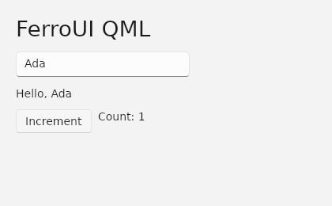

# QML for FerroUI

FerroUI can compile a QML component, instantiate its objects in Rust, and mount its visual objects as native FerroUI controls. The compatibility target is the published Qt QML 6.12.0 language and object model. The implementation was written from the public documentation. Qt is used separately as a behavioral reference in an optional test.

## Run the gallery

```sh
cargo run --locked -p qml-gallery
```

The gallery combines a native FerroUI TextBlock, Qt Quick positioners, a text field and a button. Typing edits the greeting. Clicking Increment changes a QML property and updates the count label. The desktop binary and headless test mount the same compiled component. [QML source](../samples/QmlGallery/ui/Main.qml) · [Rust host](../samples/QmlGallery/lib.rs)



## Compile a component in Cargo

Applications inside the workspace can use these dependencies.

```toml
[dependencies]
ferroui-qml.workspace = true
ferroui-qml-controls.workspace = true

[build-dependencies]
ferroui-qml-build.workspace = true
```

Compile the file from the application's build script.

```rust
fn main() {
    ferroui_qml_build::compile_file("ui/Main.qml", "main_qml.rs")
        .expect("compile Main.qml");
}
```

Include the module in the application. Retain the returned view while the controls are mounted. It owns the live component and the subscriptions that connect native events to QML.

```rust
use ferroui_qml::Error;
use ferroui_qml_controls::{ControlRegistry, QmlView};

include!(concat!(env!("OUT_DIR"), "/main_qml.rs"));

fn create_view() -> Result<QmlView, Error> {
    let registry = ControlRegistry::standard()?;
    QmlView::new(&compiled_qml(), &registry, Default::default())
}
```

The optional `qml` feature of the FerroUI facade also exposes the runtime and controls crates as `ferroui::qml` and `ferroui::qml_controls`. Generated modules name the direct dependency `ferroui_qml`.

### Check against a Rust type registry during the build

For model-only QML, add `ferroui-qml` to build dependencies and use the same type registrations used by the host. The structural check resolves constructors, member assignments, aliases, handlers, object-valued properties and required child properties. Bindings and application callbacks execute when an instance is created. Required root properties can be supplied through the initial property map.

```rust
fn main() {
    let types = ferroui_qml::TypeRegistry::new();
    ferroui_qml_build::Compiler::new()
        .import_path("qml-modules")
        .check_with(|doc| types.check(doc))
        .compile_file("ui/Model.qml", "model.rs")
        .expect("compile Model.qml against the application types");
}
```

The command-line compiler accepts import roots with `-I`. Its `--check` mode checks source and module linkage. Native type contracts are supplied by the host through the Rust API.

```sh
cargo run --locked -p ferroui-qml-build --bin ferroui-qmlc -- --check samples/QmlGallery/ui/Main.qml
cargo run --locked -p ferroui-qml-build --bin ferroui-qmlc -- samples/QmlGallery/ui/Main.qml > main_qml.rs
```

## Modern JavaScript with WebScene V8

Enable `javascript` on the build helper and use `ferroui-qml-webscene` in the application. The published WebScene 1.0.37 native package contains V8 15.3.10 and ABI 3. The gallery can run the same native controls with either execution backend. Use Python 3.11 or newer for the package verification step. On Linux and macOS, run the following from the workspace root.

```sh
export FERROUI_WEBSCENE_LIBRARY="$(python3 scripts/qml/webscene-runtime.py target/webscene-runtime)"
cargo build --locked -p ferroui-qml-webscene --bin ferroui-qml-webscene-worker
cargo run --locked -p qml-gallery --features webscene
```

On Windows, run these commands in PowerShell.

```powershell
$env:FERROUI_WEBSCENE_LIBRARY = python scripts/qml/webscene-runtime.py target/webscene-runtime
cargo build --locked -p ferroui-qml-webscene --bin ferroui-qml-webscene-worker
cargo run --locked -p qml-gallery --features webscene
```

The setup helper checks the SHA-256 of the published NuGet package and extracts the library, ICU data, snapshot and licenses together. It supports Linux x64 and ARM64, macOS x64 and ARM64, and Windows x64. Keep the native files together when distributing an application. Put the worker beside the application executable or specify both absolute paths with `WebSceneEngine::new(worker, library)`. `WebSceneEngine::from_env()` also accepts `FERROUI_WEBSCENE_WORKER`.

For a workspace application, keep the regular runtime dependencies above and select the build helper feature.

```toml
[dependencies]
ferroui-qml.workspace = true
ferroui-qml-controls.workspace = true
ferroui-qml-webscene.workspace = true

[build-dependencies]
ferroui-qml-build = { workspace = true, features = ["javascript"] }
```

```rust
// build.rs
fn main() {
    ferroui_qml_build::Compiler::new()
        .with_javascript()
        .compile_file("ui/Main.qml", "main_qml.rs")
        .expect("compile QML and its JavaScript imports");
}
```

```rust
use ferroui_qml::Error;
use ferroui_qml_controls::{ControlRegistry, QmlView};
use ferroui_qml_webscene::WebSceneEngine;
use std::{rc::Rc, time::Duration};

include!(concat!(env!("OUT_DIR"), "/main_qml.rs"));

fn create_view() -> Result<QmlView, Error> {
    let engine = WebSceneEngine::from_env()?.with_timeout(Duration::from_secs(2));
    QmlView::with_script_engine(
        &compiled_qml(), &ControlRegistry::standard()?, Default::default(), Rc::new(engine)
    )
}
```

The compiler parses JavaScript with SWC, resolves relative files, watches the transitive dependency graph for Cargo and embeds executable scripts in the generated Rust. V8 compiles the JavaScript functions in the worker and caches their factories. For a binding such as `parent.width`, the runtime checks the actual receiver, declaration scope and property type. A proven read of a scalar QML slot stays on the UI thread and participates in normal dependency tracking. Method references, JavaScript-object members and general expressions retain guest execution. Static module initialization runs before this optimization takes effect. The default build mode continues to generate native Rust for the built-in language profile. To load a file at runtime, use `Compiler::new().with_javascript().load(path)?.document` and pass the linked document to `Instance::with_engine` or `QmlView::with_script_engine`.

### Bundling modules selected at runtime

Declare additional entry files when JavaScript selects a module by locale, theme or another runtime value. The paths passed to `javascript_entry` are relative to the directory containing the entry QML file. Calling it enables JavaScript compilation. Both `load` and `compile_file` embed the selected files and their literal dependencies. Cargo build scripts also register those files for recompilation.

```rust
ferroui_qml_build::Compiler::new()
    .javascript_entry("plugins/en/index.js")
    .javascript_entry("plugins/pl/index.js")
    .compile_file("ui/Main.qml", "main_qml.rs")?;
```

In `ui/Main.qml`, ``import(`./plugins/${locale}/index.js`)`` returns a Promise for the selected ES module. QML, classic scripts and ES modules resolve relative specifiers from the importing file. Project-relative virtual URLs preserve directory names, encoded filename characters and module identity across relocations. Explicit entries must resolve within the entry QML directory tree. A computed path outside the embedded catalog rejects the Promise. Statically linked files outside that tree retain opaque URLs and can use their declared import edges. The CLI accepts a repeatable `--js-entry FILE` option. [Computed import fixture](../tests/QmlCompiled/computed/Main.qml)

### Scopes, modules and host objects

- Classic `.js` code-behind has state per importing component. Local `.import` aliases have their own scope, and `.pragma library` state is shared inside one instance's JavaScript realm.
- ES module exports, re-exports, cycles, top-level await, `import.meta.url` and dynamic imports run in V8. The released WebScene ABI lacks a native module-import callback. The build helper lowers ESM to `System.register` with SWC and an in-memory SystemJS linker executes the resulting module graph. Literal specifiers add their targets to the build graph automatically. A computed specifier resolves at execution time against the embedded module catalog. Deferred modules execute on their first import.
- A property read through a JavaScript proxy goes through the active QML transaction, so a binding subscribes to the branch it actually executes. Proxy writes and nested calls use the same transaction and notification order. Guest functions and objects keep identity across synchronous Rust calls in the same instance. V8 holds weak projections of native records and model rows. A live JavaScript reference preserves the underlying native value and its identity. The worker rejects an allocation that would exceed 65,536 simultaneously held dynamic host proxies.
- The worker uses WebScene’s ABI 3 synchronous resource callback and its pinned JavaScript text-loader hook to exchange in-memory requests with the QML thread. No server or port is used. One backend can serve several QML instances. Each instance owns a separate worker and V8 realm. A timed-out worker is terminated. Committed QML slots survive the reset, and references into the old JavaScript heap become stale. Rollback applies to QML-managed changes. Arbitrary mutations of V8-owned closure state and module globals follow JavaScript semantics.
- Assign `target.value = Qt.binding(function () { return this.base + adjustment })` to install a reactive JavaScript closure. Reads subscribe to QML properties, including changes made from Rust. An ordinary function receives the object on the left of the assignment as `this`, including when assigning through an alias. An arrow keeps its lexical `this`. A plain write removes the binding. If the worker resets, updating a dependency of an expired binding returns an error and rolls back the update. Assign a value to the target or install a new closure to recover. [Binding fixture](../tests/QmlCompiled/webscene/Bindings.qml)
- With WebScene, a signal's `connect(fn)` registers a JavaScript function, a bound QML method, or another signal. The optional form `connect(receiver, fn)` supplies the callback's `this`. `disconnect` removes all matching registrations. A callback can disconnect a later listener during delivery. Registrations added during delivery take effect on the next emission. These callbacks also observe `Instance::emit` and property writes from Rust. QML transaction rollback restores changed registrations. After a worker restart, reconnect callbacks in the new realm. [Signal fixture](../tests/QmlCompiled/webscene/Signals.qml)
- Rust can inspect a retained Promise with `Instance::promise_state`, wait for it using `settle_promise`, or run a method and await its result atomically with `call_and_await`. A positive timeout bounds the entire VM call, including nested QML methods and V8's microtask checkpoint.
- Promise reactions and compiled async functions can read or update properties, invoke methods and emit signals on the QML owner thread. Rejection during an atomic call rolls back synchronous and asynchronous QML writes. Suspended jobs preserve their declaration scope. When resumed by a later Rust call they use that call's transaction, including its rollback. An aborted transaction revokes the host authority of any reaction it scheduled or resumed.

The JavaScript compiler uses SWC to lower async functions and generators to Promise reactions in inline QML code, classic scripts and ES modules. The native worker can therefore associate each suspension with its originating QML transaction. Runtime-created async functions built through JavaScript `eval` or `Function` bypass the compiler. A native await resumption without an owning transaction can run pure JavaScript and receives an error on QML host access. Use a QML Timer for scheduled UI events.

The module tests use a shared QML fixture that also runs on Qt 6.12.0 and a separate async fixture for extended V8 behavior. Direct V8 execution follows ECMAScript semantics where Qt differs. For example, V8 preserves a trailing hole when slicing a sparse array, whereas Qt 6.12 trims it. [Shared fixture](../tests/QmlCompiled/webscene/App.qml) · [Promise fixture](../tests/QmlCompiled/webscene/Async.qml) · [Published Linux runtime](https://www.nuget.org/packages/WebScene.NativeEngine.Runtime.linux-x64/1.0.37)

## Architecture

| Crate | Responsibility |
|---|---|
| `ferroui-qml-compiler` | Tokenizes UTF-8, parses object and script syntax, records source spans, validates declarations and links component definitions. The module resolver is supplied by the caller. |
| `ferroui-qml-build` | Resolves local files and versioned module exports, tracks Cargo inputs and emits readable Rust. Rust compiles the expressions, methods, signal handlers and control flow in the supported language. |
| `ferroui-qml` | Owns object identity, typed slots, component scopes, aliases, reactive dependencies, signal dispatch and native callback registration. Both execution paths share property reads, writes and conversions. |
| `ferroui-qml-webscene` | Provides the WebScene V8 backend, its worker executable, bounded request protocol and embedded JavaScript module loader. |
| `ferroui-qml-controls` | Creates FerroUI controls, validates and applies native property updates, projects child collections and forwards native input. It also supports registration from FerroUI class and property metadata. |

`Qt.url(path)` preserves relative references. `Qt.resolvedUrl(path)` resolves them against the calling QML declaration or classic JavaScript file. ES modules use the engine base. Pass a QML object as the second argument to resolve from its instantiation context, or pass `null` to select the engine base. Cargo uses the relocatable base `https://qml.invalid/components/project/`. These helpers return FerroUI's string-backed `url` value. Resolution uses the Rust URL parser and displays UTF-8 and spaces while preserving escaped delimiters. Qt's JavaScript URL object methods and full QUrl parsing and formatting are outside this representation. [Qt URL fixtures](../tests/QmlCompiled/creation/urls/Main.qml)

Each instance owns its object arena. Object references carry an instance identity. The linker gives each composite instance a private ID scope and resolves each type using its defining document's imports. For multiple top-level documents, construct an `Engine` with the registry and call `load_root(&source, initial_properties)` for each independently linked document or generated component. A load returns an `ObjectId`. Use `engine.id(root, name)` for lexical IDs and `engine.instance_mut()` to call methods or set properties. Each root has its own component URL catalog and native function tables. Referenced module singletons are allocated once per engine and notify bindings across documents.

`unload_root(root)` runs destruction handlers and retires the document’s objects, including objects it created without a parent. Singleton state survives the last root unloading. `reset()` also runs singleton destruction handlers and starts a fresh engine realm. A failed load, unload or reset rolls back QML properties, object lifetimes and pending notifications. With `Engine::with_script_engine`, roots share one JavaScript module cache. Embedded script URLs must identify the same script wherever they occur. [Engine lifecycle fixtures](../tests/QmlCompiled/engine_roots.rs)

When a binding runs, the runtime tracks the properties it actually reads. A conditional binding can therefore stop listening to the discarded branch. Imperative assignment detaches the existing binding. A failing transaction restores the previous values and dependency edges and discards pending host notifications. Native Rust functions used in bindings must be deterministic with respect to their declared arguments. Application-owned side effects inside a callback are outside the transaction.

A QML method or signal can be stored in a `var`, passed as an argument, or captured in Rust as `Value::Method` via `Instance::method`. Invoking the reference calls its original receiver in both Rust and V8.

FerroUI posts `Qt.callLater(function, ...args)` callbacks to the owning view's dispatcher. Reposting a function moves it to the end and replaces its arguments. Callbacks scheduled by callbacks execute on a subsequent event turn. A failed transaction discards its postings. Headless Rust hosts can inspect `Instance::has_deferred_work()` and deliver a bounded turn through `Instance::process_deferred(limit)`.

One `Binding` can control several properties across different objects. The target names resolve in the component's ID scope, including forward references and aliases. A registered grouped property such as `font.pixelSize` can be written as a dotted path or a nested group.

```qml
Binding {
    when: panel.selection !== null
    heading {
        text: panel.selection.title
        font.pixelSize: 18
    }
    subtitle.text: panel.selection.description
}
```

The grouped and dotted forms evaluate their expressions only while `when` is true. The explicit `target`, `property` and `value` form evaluates `value` independently of `when`. Each target saves its previous binding or value according to `restoreMode`. A conversion failure rolls back the whole update.

With `delayed: true`, FerroUI applies each initial value on attachment and coalesces subsequent input changes into one owner-loop job per controller. Disabling the controller restores its targets immediately. This last detail differs from Qt 6.12.0 for grouped, delayed declarations. In a QQmlEngine probe, disabling such a controller retained the last published values.

Rust hosts can register a receiver-aware method with `TypeDefinition::context_method`. Its callback can capture services, read and update model properties, and call QML signals and methods through the current transaction. For example, a binding that calls the following method will update when the receiver's `gain` changes.

```rust
use ferroui_qml::{Error, TypeDefinition, Value};

let meter = TypeDefinition::default()
    .property("gain", "real", Value::Number(1.0))
    .context_method("percent", vec![], "real", |ctx, _| {
        let Value::Number(gain) = ctx.get(ctx.owner(), "gain")? else {
            return Err(Error::new("gain must be numeric"));
        };
        Ok(Value::Number(100.0 * gain))
    });
```

### Point, size and rectangle values

Declare `point`, `size` and `rect` properties and construct values with `Qt.point(x, y)`, `Qt.size(width, height)` and `Qt.rect(x, y, width, height)`. QML also accepts the corresponding string initializers, including `"1,2,10x20"` for a rectangle. The default size is −1 × −1. Rectangles expose computed, read-only `left`, `right`, `top` and `bottom`.

A local reference to a property can write back through its fields. Assigning into another typed property copies the coordinates. Grouped declarations can bind fields separately, so an imperative write replaces the binding on that field. A whole-property write replaces all its field bindings. Rust hosts exchange owned `Value::Geometry` values, or read and write a named field through `Instance::get` and `Instance::set`. The QML and WebScene profiles share the same reactive slots and rollback behavior. V8 uses JavaScript object identity for strict comparisons between separate geometry wrappers. Subfield aliases and separate `Binding` objects aimed at geometry paths have additional coverage pending. [Geometry fixture](../tests/QmlCompiled/geometry/Main.qml)

### Qt Quick states and animation

`Item` and `StateGroup` accept named states and conditional `when` expressions. A state can extend another state. `PropertyChanges` supports target-relative and grouped ID declarations, reactive bindings, one-time evaluation with `explicit`, and restoration through `restoreEntryValues`. An active state's changes use the same property slots, type validation and rollback as ordinary bindings.

`Transition` selects numeric animations by source and destination state and by target property. It supports wildcard and comma-separated names and reversible matches. An applicable transition takes precedence over `Behavior on property`. A behavior retargets from the current displayed value. `NumberAnimation` also runs independently or as a property value source. It supports finite and infinite loops, playback controls and linear and polynomial easing through quintic curves.

A mounted view samples the tracks on its dispatcher clock. A headless caller can advance the same timeline exactly with `Instance::advance_time`. `SequentialAnimation` and `ParallelAnimation` combine numeric and color tracks, timed pauses and discrete `PropertyAction` writes. Nested loops use modular time. The Qt 6.12 oracle scrubs the shared group at five exact timestamps using `AnimationController`. Color samples use eight-bit sRGB channels and preserve alpha. Spring and path animations require separate implementations. State script and reparent operations and the remaining Qt easing curves need separate implementations. [State and transition fixture](../tests/QmlCompiled/states/Main.qml)

### Dynamic trees and background scripts

A `Component` retains its declaration scope. Creating an object assigns a new identity to every node, applies the initial property map, resolves bindings and emits completion within one transaction. The native view validates newly created peers before mounting them. Destroying the instance subtree releases its controls, input subscriptions, worker registrations and deferred calls. Rust can drive the same lifecycle through `QmlView::create_object` and `destroy_object`. [Components, initialization and destruction](qml-components.md)

A nested `ListElement` role creates a child `ListModel`. Declare a single child, a list of elements, or an empty list. At runtime use arrays of role records with `append`, `insert` and `set`. Child models retain identity when their parent row moves and notify delegates directly when edited. Replacing a nested role through `set` or a row assignment retires its old subtree after bindings have switched to the replacement. Failed edits restore the previous rows, identities and projections. A worker can edit multiple nested models and publish a revision-checked batch with the root model’s `sync()`. [Nested delegate fixture](../tests/QmlCompiled/nested_roles/Main.qml)

A `Repeater` places one Item-derived delegate per model entry immediately after itself in its parent’s visual list. Use a count, an array, or a `ListModel`. An implicit child, a `delegate: Item { … }` declaration and a reference to a `Component` share the same construction path. A delegate can declare required properties for `index`, `modelData` and named model roles. Without required properties, its bindings can read those names from the delegate context. For a single-role ListModel, `modelData` contains that role’s value. For multiple roles, a required `modelData` and the `model` property refer to the same delegate row. Implicit `modelData` is undefined in that case. The row exposes the view’s named roles.

Moving or editing a ListModel row preserves its delegate and native control. Edits to an existing role update the affected row directly. A view captures its role names when it first instantiates delegates. Existing and newly appended delegates keep that set when the underlying model gains roles. Reassigning the model starts a new role projection. `ListModel.get()` exposes the underlying row directly. Replacing an array rebuilds its delegates. A guest-owned JavaScript array retains the identity of its elements. Use `itemAt(index)` to obtain a current delegate and `itemAdded` / `itemRemoved` to observe changes. Each Repeater accepts up to 65,536 rows. [Source and generated fixture](../tests/QmlCompiled/delegates/Main.qml)

A `ListView` realizes delegates for its viewport, its pixel `cacheBuffer`, and the current item. Numeric models use index arithmetic and ListModels use stable row handles. Scrolling a million-row numeric model creates only the items needed at the destination. Vertical and horizontal views estimate unmeasured sizes and refine the content extent when they measure delegates. Use `positionViewAtIndex`, `itemAtIndex` and `indexAt` to navigate and inspect realized items. Selection follows the same ListModel row when it moves. [Shared Qt and Rust fixture](../tests/QmlCompiled/views/Main.qml)

For a ListModel, `delegateModelAccess: DelegateModel.ReadWrite` forwards assignments to required role properties, implicit roles and the delegate's `model` object. With the default `Qt5ReadWrite`, assigning a required property replaces its local value. `ReadOnly` protects the source model when writing through projected roles.

Inside an Item or Rectangle, a child can anchor its left, right, top, bottom, or center lines to its parent or a sibling. Opposing edges stretch that axis. Per-edge margins override `anchors.margins`, and center offsets apply on their own axis. The layout orders horizontal and vertical dependencies separately, so a target can follow its dependent in declaration order. Invalid cross-axis targets, foreign parents and cycles fail validation before the native tree is changed. Rust and QML can clear or reassign an anchor line. The native control’s arranged bounds report the effective geometry. QML geometry slots retain their authored dimensions and bindings for restoration when an anchor is removed. [Anchor fixture](../tests/QmlCompiled/anchors/Main.qml)

The native `Loader` mounts and replaces the visual subtree of a bundled QML file or an inline component. Its two axes size independently. Rust hosts can drive the owner event loop manually to finish deferred instantiation. [Loader lifecycle and sizing](qml-loader.md)

`QtQml.WorkerScript` runs classic scripts and ES modules in independent WebScene processes. The worker sends copied values back through an owner-thread queue. A `ListModel` proxy sends a revision-checked group of edits when the worker calls `sync()`. The UI dispatcher sleeps between deliveries. [Worker scripts and Rust event-loop integration](qml-workers.md)

An application can enable remote QML on its type registry. HTTP transfers run off-thread, and fetched QML uses the same owner-thread binding and component lifecycle as embedded QML. [Network component loading](qml-network.md)

## Compatibility with Qt QML 6.12

| Area | Available in this implementation | Remaining coverage |
|---|---|---|
| Components and modules | File and inline components, local modules, engine-wide singletons, independently loaded roots, dynamic factories, initial property maps and bindings, runtime QML text, owner-thread destruction, embedded URL catalogs, HTTP component and script graphs, and time-sliced preparation for Loader and public incubators | Slicing final activation, native module plugins and complete pragma behavior |
| Object model | Required, readonly and default properties, lexical source property shadowing with virtual, override and final declarations, aliases, typed signals and methods, property change handlers, `Component.onCompleted`, source and registered enums, `Component.onDestruction` and bound method identity | Complete Qt value-type library, attached properties, interception, aliasing and inheritance edge cases, including overriding properties supplied by native Rust types |
| Built-in Rust scripting | Numeric, boolean and string expressions, object and array literals with identity, indexed reads and writes, function and signal calls, local declarations, assignment, branching, loops and returns | Closures, prototypes, exceptions, Promises and local script modules require an external engine. |
| WebScene scripting | V8 built-ins, closures, classes, prototypes, exceptions, Promises, classic scripts and local ES modules. Both the file loader and Cargo-generated components use the same engine. Desktop WorkerScript runs in an isolated process. Dedicated browser application workers can run packaged QML JavaScript in separate guest workers. [Browser hosting](qml-browser.md) | Host access from uncompiled native-await resumptions, main-thread browser hosting and browser WorkerScript |
| Reactive infrastructure | Dependency tracking, signal connections, single- and multi-target conditional Binding overlays with restoration, delayed bindings, Qt.callLater and Timer with a deterministic clock and native dispatcher integration | The complete Qt global object, network and resource loading |
| Models | `QtQml.Models.ListModel` and nested `ListElement` declarations, WorkerScript model synchronization, fixed and dynamic role types, insertion, moves, removal, role edits, row handles and rollback. Eager Repeater and viewport-bounded ListView delegates, retained row identity, reuse lifecycle, section labels, header and footer components, reversed layout and ListModel delegate access modes | Function-valued roles and proxy models |
| Native visuals | Item, Repeater, ListView, Rectangle, Row, Column, Flow, Text, TextInput and TextEdit. The Controls module supplies Label, Button, CheckBox, TextField and TextArea. Parent and sibling edge, center and fill anchors participate in native arrangement. | Baseline and mirrored layout anchors, complete implicit geometry, additional animation and state operation types and the rest of Qt Quick and Controls |
| FerroUI API | Register Rust types, properties, signals, enums, pure methods and receiver-aware methods with reactive reads. Register visual factories or expose supported scalar styled properties with `register_ferro_control`. | Property types outside the reflected scalar set require an explicit native adapter |
| Tooling | Cargo build integration, native Rust code generation, command-line checks, source diagnostics, headless tests and a Qt reference harness | Language server, debugger, profiler, designer support and Qt binary plugin/toolchain interoperability |

## Verification

```sh
cargo test --locked -p ferroui-qml-compiler -p ferroui-qml -p ferroui-qml-build -p qml-compiled-tests
cargo test --locked -p ferroui-qml-controls
cargo test --locked -p qml-gallery --no-default-features
```

The compiled fixtures exercise duplicate internal IDs across instances, writes through aliases, typed Rust calls, singleton identity, method control flow and transaction rollback. A separate fixture compares the two FerroUI backends with the published Qt runtime on original inputs. Qt and Python are only needed to repeat the live comparison. [Behavioral reference and reproduction steps](../tests/QmlCompiled/reference/README.md)

The inventory fixture checks a sequence of edits against the same resulting row order and role values observed in Qt 6.12.0. It also tests FerroUI rollback and rejection of stale row handles. [Inventory component](../tests/QmlCompiled/models/Inventory.qml)

## Public references

- [Qt QML 6.12](https://doc.qt.io/qt-6.12/qtqml-index.html)
- [QML language reference](https://doc.qt.io/qt-6.12/qmlreference.html)
- [Object attributes](https://doc.qt.io/qt-6.12/qtqml-syntax-objectattributes.html)
- [Property binding](https://doc.qt.io/qt-6.12/qtqml-syntax-propertybinding.html)
- [Scope and name resolution](https://doc.qt.io/qt-6.12/qtqml-documents-scope.html)
- [Module imports](https://doc.qt.io/qt-6.12/qtqml-syntax-imports.html)
