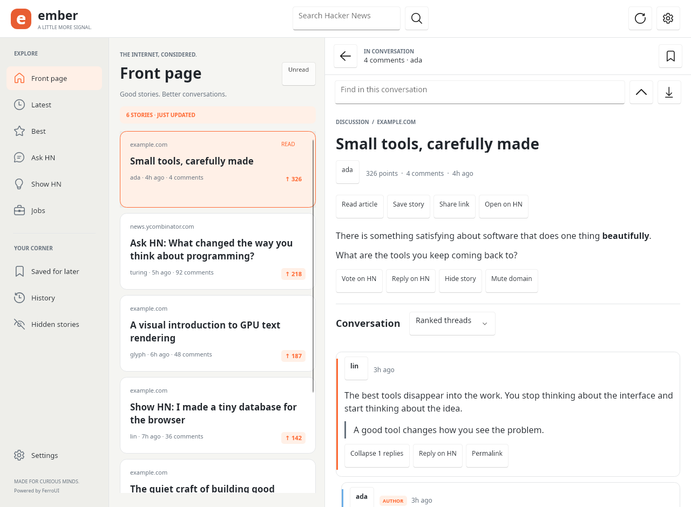

# Ember — Hacker News for FerroUI

Ember is a responsive Hacker News reader built with FerroUI's retained control
tree, compiled XAML, WinUI 3 controls and composition animations. Desktop, browser,
Android and iOS hosts share the same Rust application. The browser runs the
FerroUI application in WebAssembly and renders it into a canvas; its HTML shell
contains only startup and error presentation.

The design combines an amber accent, generous reading surfaces, Fluent icons and
an adaptive navigation rail. Wide windows show navigation, stories and discussion
together. A compact window presents one pane at a time with bottom navigation.

## Rendered screens

These captures use deterministic HN fixtures and the actual FerroUI control tree,
rendered by Skia/HarfBuzz through the native test host.



[Dark desktop](images/ember-desktop-dark.png) ·
[Phone feed](images/ember-phone-dark.png) ·
[Custom tablet theme](images/ember-tablet-custom.png) ·
[Phone discussion in the browser](images/ember-phone-comments.png)

The phone discussion capture comes from the compiled WebAssembly application in
Chrome, using the same reader controls and deterministic API fixtures.

## Reading and discovery

| Area | Implemented behavior |
| --- | --- |
| Feeds | Front page, Latest, Best, Ask HN, Show HN and Jobs; server-ranked pagination and explicit refresh. |
| Search | Algolia full-text search for stories, comments, all items, Ask HN, Show HN and polls; relevance or newest order; author, minimum points/comments, recent time presets and a custom UTC date range. |
| Discussion | Ranked, newest or oldest branches; branch and top-level collapse; local comment search with ancestor context; parent navigation; deleted/dead item handling; new-comment indicators and restored reading position. |
| Long threads | Virtualized native list containers, bounded loading, explicit missing/pending counts, and a load-more action. Poll options retain their scores and HN order. |
| Profiles | User biography, karma, account creation information and submissions through the public HN API. |
| Local library | Saved stories, read history, hidden stories, domain/user/keyword mutes, and hide-read filtering. |
| Offline reading | Cache fallback for visited content; an explicit Download discussion action verifies that the complete loaded discussion is persisted before reporting completion. |
| Sharing and accounts | Copy the canonical discussion link, open the article or HN page, and open HN for sign-in, voting, replies and submission. |
| Appearance | System, light, dark and custom themes; custom accent/background; reading font size and line height; compact density and reduced motion. |
| Data controls | Versioned JSON export/import of local reading state, cache clearing and history clearing. |

The [official Hacker News API](https://github.com/HackerNews/API) exposes public
read operations. Ember's **Vote on HN**, **Reply on HN**, sign-in and submit actions
open the appropriate HN page in the platform browser. They do not report a vote or
submission as completed. Local saved stories are a device library and do not sync
with an HN account. Full-text search uses the separate
[Algolia HN Search API](https://hn.algolia.com/api).

## Navigation, touch and keyboard

The shell uses logical pixel breakpoints rather than identifying the device:

| Available width | Layout |
| --- | --- |
| Below 900 | One visible story/detail pane and bottom navigation; More exposes the remaining feeds and settings. |
| 900–1239 | A 74-pixel icon rail, a 340-pixel story pane and the remaining width for detail. |
| 1240 and above | A 202-pixel labeled rail, a 400-pixel story pane and the remaining width for detail. |

The header search field appears from 1100 pixels; Search remains reachable through
navigation at smaller widths. Primary buttons, navigation targets, comment actions
and links provide at least 44 logical pixels of height. Action rows wrap on narrow
screens. Deep comments cap their visual indentation so text retains usable width.

| Input | Action |
| --- | --- |
| `Ctrl+K` / `Command+K` | Open search. |
| `Enter` in header search | Run the query. |
| `Escape` | Navigate back. |
| `J` / `K` | Select the next/previous story. |
| `R` | Refresh the active feed or discussion. |
| `S` | Toggle the selected story's saved state. |
| `O` | Open the selected story's article, or its HN page when no article is available. |
| Swipe a story left | Toggle saved state after an 80-pixel horizontal swipe. |
| Swipe a story right | Toggle hidden state after an 80-pixel horizontal swipe. |
| Pull the feed heading down | Refresh after a 72-pixel touch/pen drag. |

Letter shortcuts do not intercept typing in a text box. Every swipe action also
has a button path. Browser story navigation updates the URL without reloading the
application, and Back/Forward routes through the reader. A browser URL with
`?item=8863` opens that discussion. The desktop host accepts an initial HN URL as
its first argument.

Page changes combine a 180 ms composition opacity animation with a 220 ms,
12-pixel vertical entrance. Reduced motion skips both animations. Themes use
dynamic resource brushes, so custom surfaces, code
blocks and text remain coordinated. Custom background luminance selects the
underlying light/dark WinUI theme; the generated main and muted text colors are
checked against the generated reading surfaces. Reading typography is applied to
HN HTML without enlarging every navigation label.

## Content rendering

`ember-content` parses HN story, comment and profile HTML into an inert document
model. Paragraphs, headings, quotations, nested ordered/unordered lists, code,
emphasis, strike-through, line breaks and links are rendered with FerroUI controls
and native text inlines. Text can be selected. Links are focusable controls with
accessible names and a host navigation callback. Code preserves whitespace and
scrolls on both axes within a viewport capped at 420 logical pixels high by
default, with scroll chaining back to its containing discussion.

The parser removes active subtrees, including scripts, styles, frames, embedded
objects, forms, SVG and MathML. Remote images become alt text; tables become
readable rows. Only HTTP/HTTPS links with a host are actionable. Credentials,
control characters and backslashes are rejected, and relative HN links resolve
against `https://news.ycombinator.com/`. Link validation also runs in the renderer.

Default limits are 256 KiB of source text, 4,096 visited nodes and an output depth
of 32. Truncation is reported in the document model and the rendered content.
There is no WebView, script execution, remote image fetch or arbitrary CSS layout.
The external article action opens the original website; downloading a discussion
does not archive an external article. See
[the content package guide](../../samples/Ember.Content/README.md) for rendering
options and the parser's boundaries.

## Persistence and cache policy

Local reading data and public API payloads have separate namespaces in the same
store. The versioned `ReaderState` contains preferences, saved/read/hidden state,
timestamps, collapsed branches, seen comments, reading anchors, mute rules,
recent searches and the downloaded-discussion manifest. JSON import validates the
schema and normalizes preferences; an unsupported future version is rejected.
Export contains this local state, not all cached article/comment payloads.
Settings displays the JSON in a multiline editor; Copy backup sends it to the
platform clipboard so it can be pasted into a file. Import reads JSON pasted into
that editor and replaces local reading state after validation. These controls do
not present a native file picker or copy the database itself.

Native hosts use a bundled SQLite database, schema version 1, with WAL enabled. A
dedicated worker owns the connection. Operations resolve after their transaction
finishes, so database work does not run on the UI thread. Browser storage uses the
origin-scoped `ferroui-ember` IndexedDB database, and writes resolve on transaction
completion. A failed transaction or quota error remains an error.

### Retrieval and expiry

| Record | Default freshness |
| --- | --- |
| Feed ID list | 60 seconds |
| Item/comment | 120 seconds |
| User profile | 900 seconds |
| Search result page | 300 seconds |

`CacheFirst` returns a fresh record immediately and otherwise attempts a network
load. `Refresh` attempts the network even when a fresh record exists. Both can
return a stale cached record when the network fails, with source/staleness and an
explanation. `Offline` performs no network request and reports missing content.
The UI first presents an available cached feed/discussion, then requests its
current version. A `null` item is a valid negative cache entry, distinct from a
failed request. Item and profile identities are checked against their requested
IDs before accepting a response.

The repository limits transport concurrency to eight requests across concurrent
operations and shares in-flight requests for identical URLs. Dropping all waiters
releases the request future and its concurrency permit. Feed item results retain
the provider's order even when individual requests finish out of order. Payloads
are limited to 8 MiB. Native HTTP uses a fixed pool of eight background workers
and a bounded 128-job queue. Enqueueing never blocks the UI; a saturated queue
returns a retryable error, unpolled requests queue no work, and workers skip
canceled queued requests. An already-running request may finish after its caller
cancels, but cannot increase the worker bound. Connection/read/total timeouts
bound stalled native calls. Browser fetch uses a 20-second timeout, omits
credentials and accepts only the two configured HTTPS API providers.

### Saved and downloaded content

Saving a story pins its cached root item. It does not implicitly fetch all its
comments. **Download discussion** traverses the thread and poll options, then
verifies the resulting item records in durable storage. Only a complete result
is added to the downloaded manifest and Saved stories. Missing items, failed
cache writes or an exhausted budget produce an explicit partial/error result
and can be retried.

Interactive thread loading starts with 120 items, extends by 200 and is capped at
10,000 items in the UI. Download uses a 10,000-item budget. The reusable core
supports budgets up to 20,000. Traversal is iterative and cycle-safe; missing and
pending IDs are retained instead of pretending that an incomplete tree is
complete. Local thread search matches decoded, visible text and authors, retains
matching comments' ancestors, and does not overwrite stored collapse state.
Entities and text split across formatting spans remain searchable; link
attributes and removed active content do not produce matches. Input is debounced
by 180 ms, and a bounded set of parsed search documents is reused for rendering.

The default item cache target is 5,000 records, configurable from 100 to 100,000.
Pruning removes the oldest unpinned item records while preserving saved roots and
every item pinned by a completed download. Pinned records may therefore exceed
the target. Search pages and profiles share a separate limit of 256 newest
records, enforced after metadata writes and during general pruning. The six
feed lists and local reading state are retained outside that budget. These are
record-count targets, not a total byte quota. Browser site-data clearing,
storage eviction and disk exhaustion still affect persistence.

**Clear cache** removes public cached payloads and the UI's downloaded manifest;
bookmarks and preferences remain, but the associated content needs fetching
again. **Clear history** removes read/opened timestamps and seen-comment markers,
while retaining bookmarks. Export a JSON backup before moving between devices.
A failed initial state read pauses automatic writes to protect the existing data.
A validated backup imported while that read is pending takes precedence over its
late result. There is no cross-device or concurrent multi-tab state merge.

### Browser offline startup

The default non-threaded browser build installs a content-versioned service-worker
cache for the complete application shell. An incomplete installation fails and
keeps the previous complete shell available. The worker extends FerroUI's worker
and retains its download handler. API responses remain under the repository's
IndexedDB expiry policy rather than a second service-worker cache policy.

Offline startup requires one successful online shell installation. Threaded and
combined builds retain IndexedDB reading data but do not enable Ember shell
precaching because the framework worker owns cross-origin isolation in those
modes. See [the browser host guide](../../samples/Ember.Browser/README.md).

## Architecture

| Package | Responsibility |
| --- | --- |
| `samples/Ember.Core` | Tolerant HN/Algolia models, query construction, repository, cache policy, local state, thread traversal, URL safety, native SQLite and HTTP adapters. |
| `samples/Ember.Content` | HTML parsing and safe document model; optional native FerroUI rendering. |
| `samples/Ember` | Compiled XAML shell, custom templated story cards, virtualized thread view, profiles, settings, search, themes, navigation and composition. |
| `samples/Ember.Desktop` | Desktop application entry point and native platform services. |
| `samples/Ember.Browser` | WebAssembly host, asynchronous Fetch/IndexedDB adapters, URL history, installable shell and browser validation. |
| `samples/Ember.Android` | Android activity integration, Internet permission and app-private database location. |
| `samples/Ember.iOS` | iOS application integration and sandbox database location. |

`Repository` depends on asynchronous `HttpClient` and key/value `Store` traits.
Their boxed futures are deliberately not `Send`, so browser promises and UI-local
dispatch can use the same repository as native workers. The shared UI receives a
repository factory from its host and applies completed results on FerroUI's UI
dispatcher. Navigation generations prevent late results from replacing a newer
selection. Source, stale, partial and storage-error information remains explicit.

Fluent icon paths are embedded as vector geometry and inherit the current
foreground. Their upstream sources and license are recorded under
[`samples/Ember/Assets/Fluent`](../../samples/Ember/Assets/Fluent/NOTICE.md).

## Run and package

Use the repository's normal Rust and platform prerequisites. Commands below run
from the repository root. Build output goes to `$CARGO_TARGET_DIR`, or `target`
when it is not set; point it at a directory outside the repository (for example
on a larger disk) to keep the checkout small, and the paths below follow it.

### Desktop

```sh
cargo run --locked -p ember-desktop
cargo run --locked -p ember-desktop -- 'https://news.ycombinator.com/item?id=8863'
```

On ARM64 Windows (`aarch64-pc-windows-msvc`) LLVM's `clang` must be on `PATH`:
the native HTTP client uses rustls, whose `ring` dependency compiles C and
assembly with clang on that target (x64 Windows, macOS and Linux need nothing
extra). Install it with the Visual Studio component "C++ Clang Compiler for
Windows" or from the LLVM releases, and open a shell where `clang --version` works.

The window asks for 1440 by 940; when that does not fit the work area of the
screen (a small or highly scaled display), it is shrunk to the work area and moved
onto it when it opens.

The default native database is `Ember/reader.sqlite3` under `%LOCALAPPDATA%` on
Windows, `~/Library/Application Support` on macOS, and `$XDG_DATA_HOME` or
`~/.local/share` on other desktop Unix systems. Set `EMBER_DATABASE` to use a
specific file. Android and iOS hosts override that path with their app sandbox.

### Browser

```sh
scripts/browser/setup.sh /path/to/browser-tools
source /path/to/browser-tools/env.sh
scripts/build-ember-browser.sh
python3 -m http.server 8080 --directory "${CARGO_TARGET_DIR:-target}/browser/ember-browser"
```

Open `http://localhost:8080/`. The build uses FerroUI's
`wasm32-unknown-emscripten` toolchain. The wrapper accepts `--out`, `--debug`,
`--features vello`, `--threads` and `--both`. The default renderer is Skia;
`--features vello` also builds FerroUI's alternative renderer, selectable with
`?Renderer=Vello`.

### Mobile hosts

```sh
scripts/android/apk.sh ember
scripts/ios/bundle.sh --package ember-ios --bin ember-ios --name Ember --bundle-id org.ferroui.ember
```

Android packaging requires the repository's SDK/NDK prerequisites; iOS packaging
requires macOS/Xcode. Android stores data under the activity's private files
directory. iOS uses `Library/Application Support/Ember` within its application
sandbox. Signing and installation follow the existing platform scripts.

## Verification and CI

The focused [Ember workflow](../../.github/workflows/ember.yml) runs core/parser
tests, actual control-tree/render tests (in parallel, as the workspace run does), a
desktop compile check and the browser service-provider tests when the Ember sources
change; the workspace run of the main CI runs the same tests on macOS with every
other change. It uses the repository's
pinned actions and disables debug information/incremental artifacts to reduce
disk use. Android/iOS packaging and the full Emscripten build are separate gates
because they need their platform toolchains.

```sh
export CARGO_PROFILE_DEV_DEBUG=0 CARGO_PROFILE_TEST_DEBUG=0 CARGO_INCREMENTAL=0
cargo test --locked -p ember-core
cargo test --locked -p ember-content --no-default-features
cargo test --locked -p ember -p ember-content --features ember-content/render-tests --lib
cargo check --locked -p ember-desktop
npm ci --prefix samples/Ember.Browser
npm test --prefix samples/Ember.Browser
```

The core's deterministic tests cover optional/unknown API fields, ordering,
overlapping request limits, native worker/queue saturation, cancellation,
deduplication, expiry/offline fallback,
thread cycles and budgets, identity validation, safe navigation, encoded search,
state persistence, pinned and metadata eviction, SQLite reopening and failed-write download
handling. Parser tests cover malformed HTML, entity decoding, active content,
URL attacks and resource budgets. UI tests use actual FerroUI controls and the
Skia/HarfBuzz test services, including finite-width rich text and interaction.

To save rendered desktop/phone theme captures:

```sh
EMBER_CAPTURE_DIR="${CARGO_TARGET_DIR:-target}/ember-captures" cargo test --locked -p ember \
  capture_real_control_tree_in_desktop_and_phone_themes -- --nocapture
```

Browser adapter tests use `fake-indexeddb` to exercise asynchronous request and
transaction behavior. They also cover provider restrictions, HTTP/body failures,
URL history and complete/incomplete shell installation. After building the real
browser application, run its interaction smoke test with Chrome/Chromium:

```sh
CHROME=/path/to/chrome node samples/Ember.Browser/tests/browser-smoke.mjs
```

The smoke runner uses deterministic API fixtures with the actual compiled reader,
its input handling and IndexedDB. It serves `$CARGO_TARGET_DIR/browser/ember-browser`
(or the site given as its argument), and its captures go to
`$CARGO_TARGET_DIR/ember-browser-smoke` (`target` when `CARGO_TARGET_DIR` is not set).
The read-only `emberState()` test export reports actual visible controls, their
bounds and hit-test availability; it does not provide a second UI implementation.

### Platform status

| Surface | Implementation | Validation status for this change |
| --- | --- | --- |
| Shared core | Native/browser-neutral models, repository and storage contracts | `cargo test -p ember-core` in the Ember workflow (Linux) and the workspace run (macOS): native pool cancellation and saturation, metadata bounds, SQLite and offline reopening. |
| Rich content | HTML document model and native renderer | `cargo test -p ember-content`, parser and security tests and the Skia renderer tests, on the same two runs. |
| Shared UI | Real FerroUI controls, themes, layout and interaction | The `ember` tests on the same two runs, in parallel: semantic Find, bounded code, long-link wrapping and baseline alignment, navigation, restored reading context and importing a backup during a delayed startup read. Desktop/phone light/dark and tablet custom-theme captures can be generated (see above). |
| Linux desktop | Native host, SQLite/HTTP and shared reader controls | `cargo check -p ember-desktop` in the Ember workflow; the shared UI tests exercise the actual control tree through Skia/HarfBuzz. |
| Browser | WebAssembly reader, Fetch, IndexedDB, URL history and default offline shell | The JavaScript tests of the platform providers and the offline worker in the Ember workflow. The Chrome smoke test (desktop and phone: touch gestures, themes, URL history, downloads, IndexedDB persistence, an offline reload through the offline shell) is run by hand; it is not part of CI. |
| Windows/macOS | Shared desktop host with the existing FerroUI platform services | The shared UI tests run on macOS in the workspace run of CI; no interactive Windows or macOS session is claimed. |
| Android | Native host and packaging-script integration | Physical-device layout, IME, lifecycle and signed-package behavior remain unverified. |
| iOS | Native host and bundling-script integration | Physical-device layout, safe areas, lifecycle and signed-package behavior remain unverified. |

## Current boundaries

The reader refreshes on request; continuous Firebase streaming, background push
notifications and an account synchronization service are not implemented. Search
depends on Algolia's index and may differ from the live Firebase item. The public
API's missing/dead/deleted items and provider availability remain visible states.

Rich content supports HN markup; external article extraction, embedded media and
paywall handling belong to the opened website. Sharing currently copies a
discussion URL through the platform clipboard. Clipboard, external-launch,
screen-reader and mobile lifecycle behavior depends on the corresponding FerroUI
host and should be exercised on each target device before distribution.

## API references

- [Official Hacker News API and field definitions](https://github.com/HackerNews/API)
- [Y Combinator's API announcement](https://www.ycombinator.com/blog/hacker-news-api)
- [Algolia HN Search API](https://hn.algolia.com/api)
