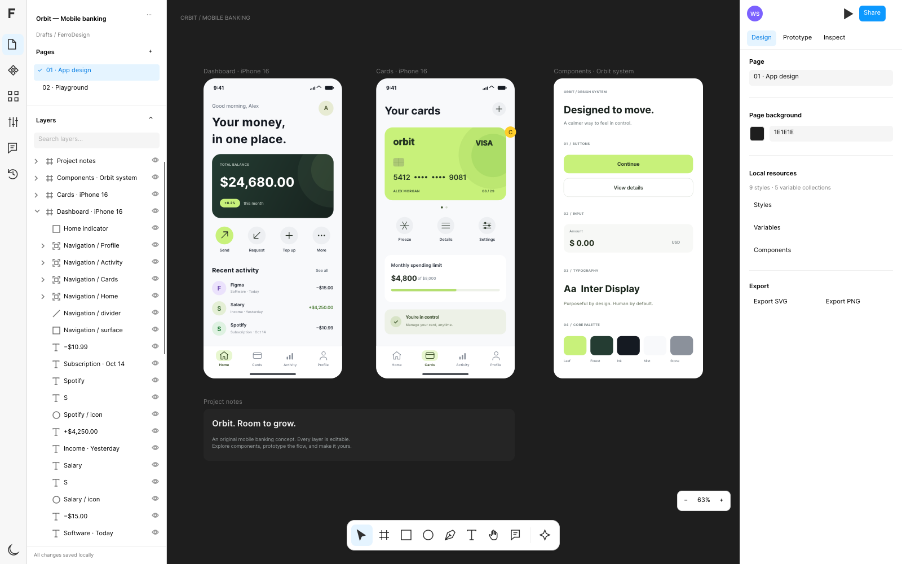
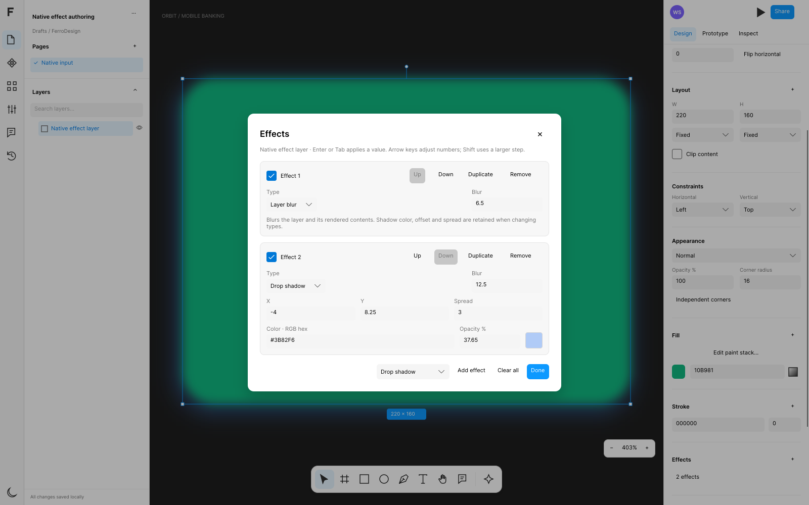
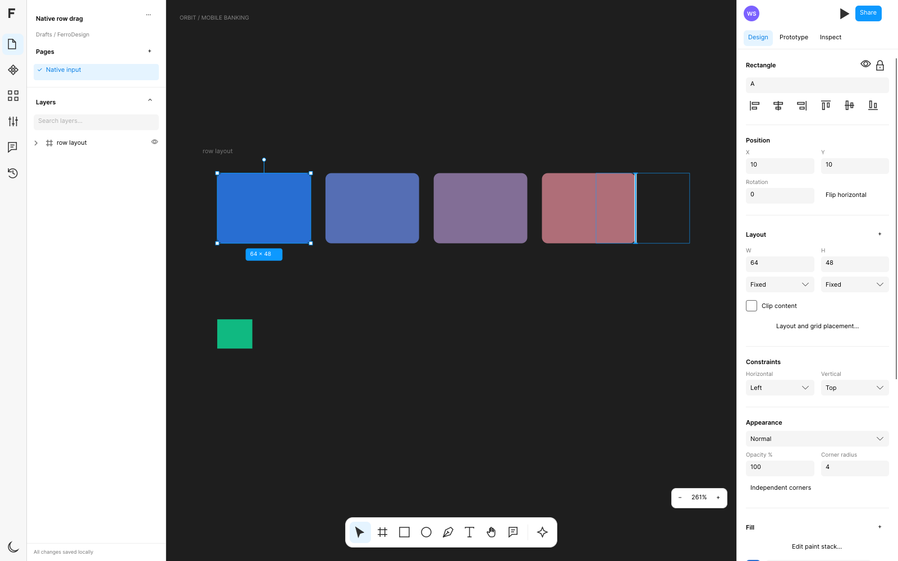

# Browser evidence: `945283ef`

These are unchanged outputs from the actual FerroUI WebAssembly application at source **`945283ef24202dab638c85bc9dc3d5f47fcc902d`**, validated in [workflow run 39306364660](https://github.com/wieslawsoltes/FerroUI/actions/runs/39306364660). The workflow completed successfully, including artifact publication and cleanup. This evidence was added in a later documentation-only commit; the tested application source is the revision above.

## Recorded result

- Chromium 156.0.8078.4: all **62 Software2D** and **59 WebGL2** interaction checks passed.
- Neither context recorded page errors or console errors.
- All **34 static native captures** passed on their first attempt, with no retries.
- WebGL2 used ANGLE/Vulkan/SwiftShader. These results do not measure hardware-GPU throughput.
- The separate browser storage gate passed all **5 IndexedDB checks**.

The [complete raw browser report](report.json) retains checks, counters, native control bounds, document hashes and capture attempts. The [paired release benchmark](../../benchmarks/2026-10-19-945283ef-editor-performance.json) retains native engine measurements. [VALIDATION.md](../../VALIDATION.md) explains the measurements and their limits.

## Captured editor

All six PNG files below are 1600 × 1000 browser captures. They have not been resized, recolored or composited. The documents are the editable sample and synthetic interaction fixtures used by the suite. Visual inspection covers control arrangement, legibility and the visible artwork in these states; no matched Figma reference screenshot was used, and no full visual-parity score is claimed.

The review also identified visible limits: the canvas caption still reads “ORBIT / MOBILE BANKING” after importing the synthetic documents, the centered Effects modal covers part of the selected artwork, and the thin drag-preview outline is subtler than its insertion marker. The effect captures show layer blur and drop shadow at this viewport size; they do not establish every effect type, smaller-window accessibility or long-stack layout. These observations are retained rather than treating a functional test pass as full visual parity.

### Initial editor, Software2D

### Initial editor, WebGL2

### Native effect stack, Software2D

### Native effect stack, WebGL2

### Held auto-layout drag, Software2D

### Held auto-layout drag, WebGL2

The held-drag screenshots deliberately show the original child placement together with the preview outline and insertion marker. The preview has not modified the document. The subsequent pointer release and exact Undo/Redo assertions passed in both modes.

## Complete artifacts and integrity

The full browser distribution and validation outputs are attached to the same run. GitHub artifact downloads may require a signed-in account; both are currently marked to expire on **2026-11-18** under the workflow's 30-day retention policy. This directory keeps the raw report, selected PNGs and benchmark in source history after that period.

| Artifact | ZIP bytes | SHA256 |
| --- | ---: | --- |
| [Complete browser build](https://github.com/wieslawsoltes/FerroUI/actions/runs/39306364660/artifacts/12215744957) | 11,705,819 | `9c3d9dc52203774b0087bf9c36b315781dcd3730ac1ffe1e5c9617fce4557110` |
| [Validation, screenshots, traces, reports and lockfiles](https://github.com/wieslawsoltes/FerroUI/actions/runs/39306364660/artifacts/12217631378) | 54,191,011 | `9fb53a95f653e44148270e097642e4105c4a971ff35f6a514e487fe6dc457739` |

Both downloaded ZIPs matched GitHub's published sizes and SHA256 digests and passed CRC verification. Both inner trace ZIPs passed CRC checks as well. The browser distribution contains 16 files with `index.html` at its root. Its `ferrodesign_app.wasm` is 49,841,600 bytes, SHA256 `da5ffef914865f71d5cdcad2e4703c7e9b0b699dc2565af385ded1bb5a3fe9e0`. Serve the extracted build over HTTP to run it.

The raw browser report is 440,718 bytes, SHA256 `c06210131d8a1542f381743eccb72c0037e192bfdb2d022dd8f5c7da189de3e9`; the raw benchmark is 7,424 bytes, SHA256 `fc7a2776c0f9438204e120096a8746c4b1672bb0081f9313325033a4fb31e497`. [provenance.json](provenance.json) records every preserved file's byte count and digest. Copies were checked byte-for-byte against the extracted artifact.
