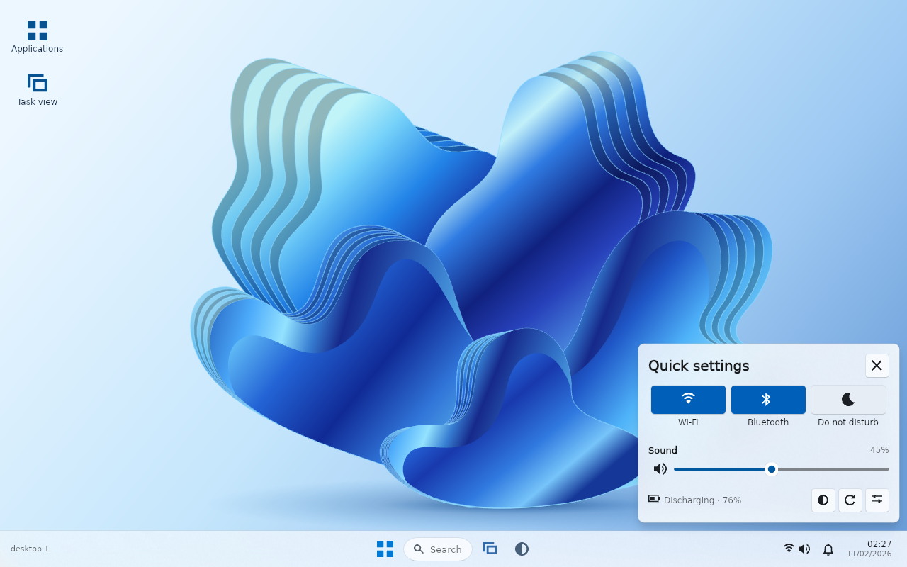
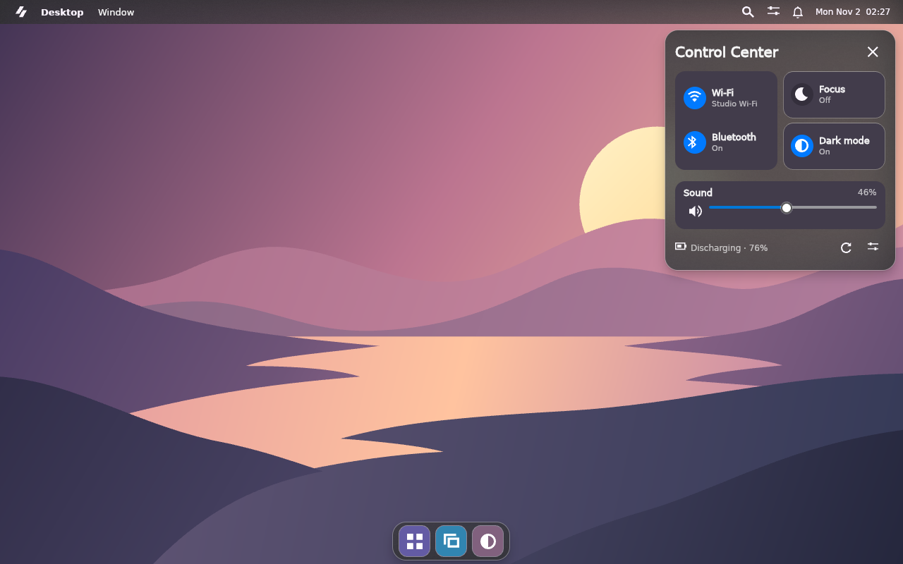
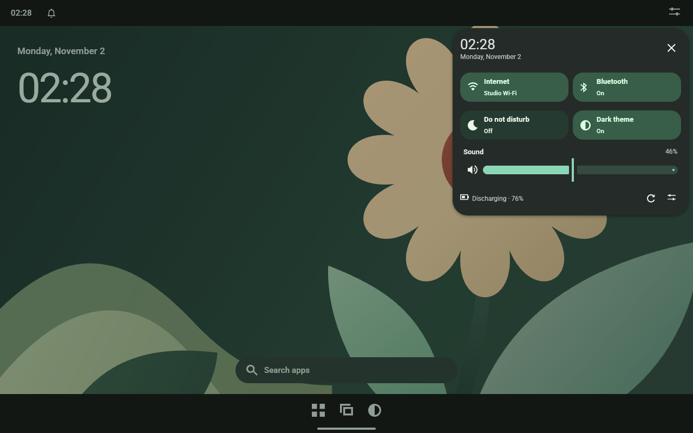
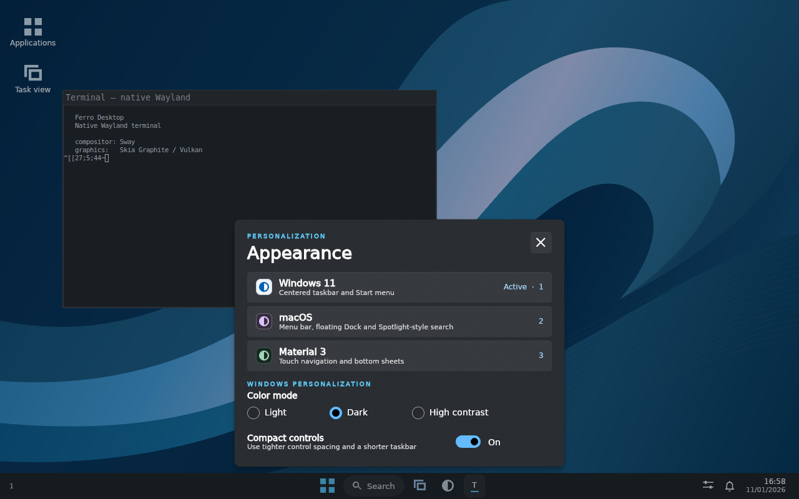
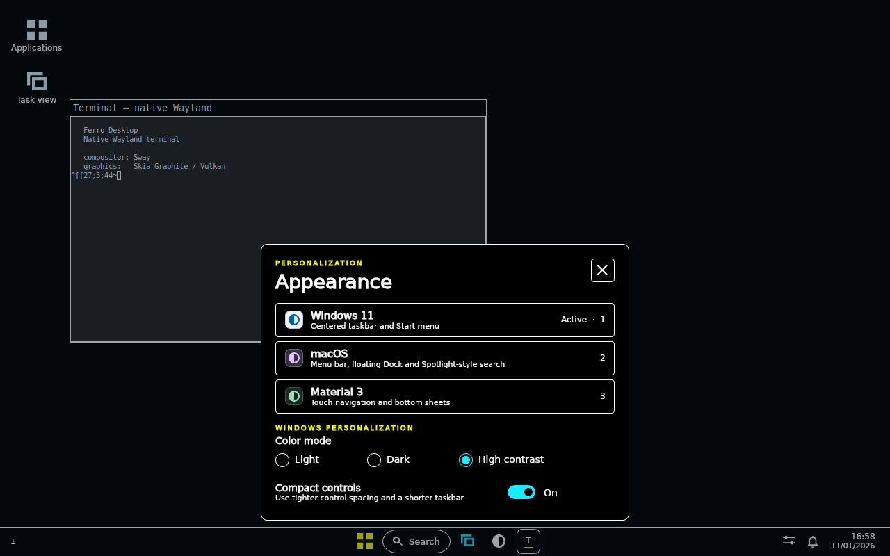

# Desktop appearances

The default Windows 11 appearance uses FerroUI's compiled WinUI 3 theme. Open **Appearance settings** from the taskbar, **Appearance** from the macOS menu bar or **Wallpaper and style** from the Material taskbar. While the shell has keyboard focus, Ctrl+, opens the chooser. Press a digit from 1 through 9 to select the corresponding registered appearance, or use Tab and Enter. Escape returns to the desktop.

| Appearance | Native control theme | Shell composition |
| --- | --- | --- |
| Windows 11 | WinUI 3, light by default | Centered taskbar, desktop shortcuts and Start with Grid, List and Category views |
| macOS | macOS, dark by default | Top menu bar, floating Dock and a centered application search panel |
| Material 3 | Material, dark by default with bundled Roboto | Clock home screen, status strip, app taskbar and bottom sheets |

A switch replaces the shell application's installed style in its existing style collection and changes its requested theme variant. Shell labels bind to shared theme resources such as `TextFillColorPrimaryBrush` and `ContentControlThemeFontFamily`. The appearance descriptor supplies brushes for the desktop surface, icon tiles and wallpaper. The shell rebuilds its chrome around the existing search query, catalog, workspace state and window-manager connection. In session mode it also updates the reserved screen edges so maximized clients follow the new layout.

The setting persists as an appearance ID in `$XDG_CONFIG_HOME/ferro-desktop/appearance`, with `$HOME/.config` as the default configuration directory. A persistence error is shown in the chooser after the live change. `--theme=windows`, `--theme=macos` and `--theme=material` select a startup appearance explicitly. Applications launched from the shell continue to draw with their own toolkits and settings.

## Desktop panels

Windows Start remembers the selected **All apps** view. With the search field focused, **Ctrl+1** selects Grid, **Ctrl+2** selects the alphabetical List and **Ctrl+3** selects Category. Each category tile shows icons from installed desktop entries. Use the arrow keys and **Enter** to open a category, and **Alt+Left** to go back. Typing a query searches the full catalog. [Start in Category view](screenshots/windows-launcher.webp) · [Start in List view](screenshots/windows-start-list.webp)

Start, Spotlight and the Material app drawer share recent launches for the current shell session. An app moves to the front when its launch succeeds. **Clear** empties the history across all three profiles.

Pinned and running windows share an app button when the client identifies its installed desktop entry. The shell reads xdg-shell app IDs, Sway client metadata and X11 resource classes. Selecting a pin launches the application if it has no window on this workspace. Selecting a running app activates its window, and repeated clicks cycle its windows. A click on a single active, minimizable Windows taskbar button minimizes it. The macOS Dock marks running apps with a dot, and its menu bar shows the focused application alongside Spotlight, Control Center and the clock.

The Android profile reserves 48 logical pixels for the status strip and 72 for its tablet taskbar. The time opens the calendar, the bell opens notifications and the controls button opens Quick Settings. Swipe up on empty home wallpaper to open all apps, or swipe down to open notifications. Swipe up from the bottom handle and release to show Home, or pause before releasing to open recent windows. Mouse drags work as well as touch and pen. The app grid and recents buttons provide keyboard-accessible alternatives.

On macOS, the **Window** menu lists the session’s windows and offers commands for the focused client. Right-click a Dock app to select one of its windows or change whether the app stays in the Dock. [Window menu above a maximized GTK client](screenshots/macos-window-menu.webp) · [Dock menu for a running app](screenshots/macos-dock-menu.webp)

## Materials in the desktop scene

| Appearance | Panel and flyout materials in a shared render target |
| --- | --- |
| Windows 11 | The taskbar uses base acrylic. Flyouts use the WinUI presenter brush and its 32-unit shadow elevation. High Contrast uses the system window and text brushes, the thicker flyout outline and a flat background. |
| macOS | Menu bar and Dock use the toolbar backdrop brush. Flyouts use a denser menu backdrop. The theme supplies the glass edge and menu shadow. Reduced transparency, increased contrast or inactive theme state selects an opaque surface. |
| Material 3 | The Garden wallpaper's eucalyptus leaf seeds both light and dark Material color schemes. Navigation uses the surface container role, and sheets use the high surface container role with the theme's flyout elevation. Opening a sheet draws the scrim role at 32% opacity. |

In the FerroUI compositor, wallpaper, client buffers and chrome share the scene. Backdrop brushes sample the content underneath as it changes. Windowed previews can sample their wallpaper. Independent Wayland layer surfaces and separate notification windows use solid theme brushes because client pixels belong to another render target. The acrylic effect graph also observes FerroUI's platform transparency and energy-saving policy.

## System controls

| Windows quick actions | macOS Control Center | Android Quick Settings |
| --- | --- | --- |
|  |  |  |

Windows opens a compact quick-action grid above the taskbar. On macOS the connectivity module groups Wi-Fi and Bluetooth next to Focus and Dark mode. Android opens its two-column shade below the status strip. Each profile uses the shell's notification service for Do Not Disturb and the active theme for color mode. High Contrast preserves the selected Windows accessibility mode.

Volume and brightness sliders support keyboard adjustment and commit the final thumb position on release. While a device write is in flight, the shell keeps the latest requested percentage for each destination. Bluetooth power is read back from the same BlueZ adapter after a write. The panel disables controls for unavailable providers and requests a fresh snapshot while it is open.

## Profile color modes

The appearance chooser offers **Light** and **Dark** for macOS and Material. With the chooser focused, press **L** or **D**. Each profile keeps its own selection in `macos-style` or `material-style` beside the `appearance` file. Switching away and returning, including after restarting the shell, restores that profile's choice. Both default to dark. A color change updates the existing control theme, shell palette and managed window decorations together.

## Windows personalization

In the Windows profile, **Appearance** offers the native WinUI 3 Light, Dark and High Contrast variants. Radio buttons select the color mode, and a toggle switch sets Normal or Compact density. While the chooser has focus, **L**, **D** and **H** select the color mode and **C** toggles density. The choices persist separately in `$XDG_CONFIG_HOME/ferro-desktop/windows-style`. Returning from the macOS or Material profile restores the selected Windows settings.

The shell keeps the WinUI theme instance when changing color or density. The requested theme variant selects its compiled resource dictionaries, and the theme's density property selects the compact control resources. The taskbar, popups, status messages and text resolve their brushes through those dictionaries. Shell flyouts use the WinUI flyout acrylic brush and the shared WinUI theme shadow with the same 32-unit Z translation as the control template. FerroUI applies the material policy and composition shadow recipe to the available backing surface. High Contrast also removes the decorative wallpaper. Compact mode reduces the taskbar's screen reservation from 52 to 42 logical pixels, including on managed Wayland outputs.

These captures show the same managed Wayland session and native terminal.

| Dark with Compact density | High Contrast with Compact density |
| --- | --- |
|  |  |

The Windows notification indicator uses the themed InfoBadge with the actual unread count. Shell status uses InfoBar, and the initial device query in Quick Settings uses ProgressRing. GTK, Qt and other native clients continue to own their control trees.

## Register a fourth appearance

Define a descriptor in `src/shell/appearance.rs` and add its handle to `Appearance::ALL`. Stable IDs identify saved settings and command-line values. Pick a layout, supply its top and bottom screen reservations in device-independent pixels, and provide a native style factory and variant.

```rust
static COBALT_DESCRIPTOR: Descriptor = Descriptor {
    id: "cobalt",
    name: "Cobalt",
    layout: Layout::Taskbar,
    wallpaper: Wallpaper::Fold,
    insets: (0.0, 60.0),
    palette: Palette {
        bar: "#F5DBE8FF",
        accent: "#2145AE",
        dock_tiles: ["#2458CF", "#3F6AAA", "#314F71"],
        ..Appearance::Windows.palette()
    },
    tint: |c| Color::from_rgb(c.r / 2, c.b, c.g.saturating_add(35)),
    style: || ferroui_themes_winui::WinUITheme::new().as_style(),
    variant: ThemeVariant::light,
};
const COBALT: Appearance = Appearance::new(&COBALT_DESCRIPTOR);
```

Include `COBALT` in the registry slice. The chooser, numeric shortcuts, preference reader and command-line parser consume this registry. The profile can use a distinct FerroUI theme crate by supplying its style factory. A new panel placement requires a new layout strategy in `desktop.rs`. The test `fourth_descriptor_supplies_its_own_palette_on_an_existing_layout` exercises registration on a shared layout.
