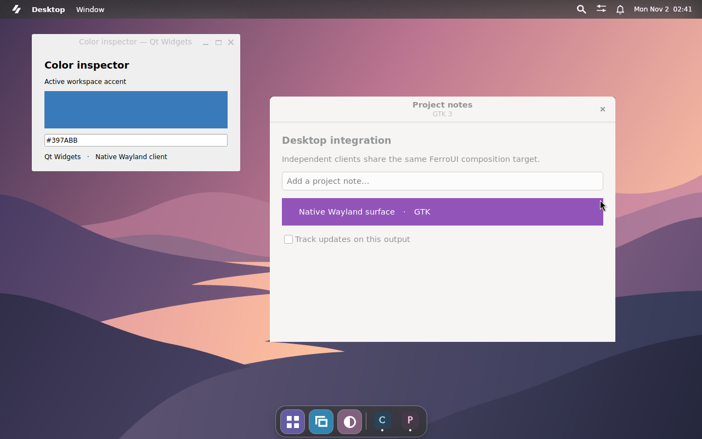
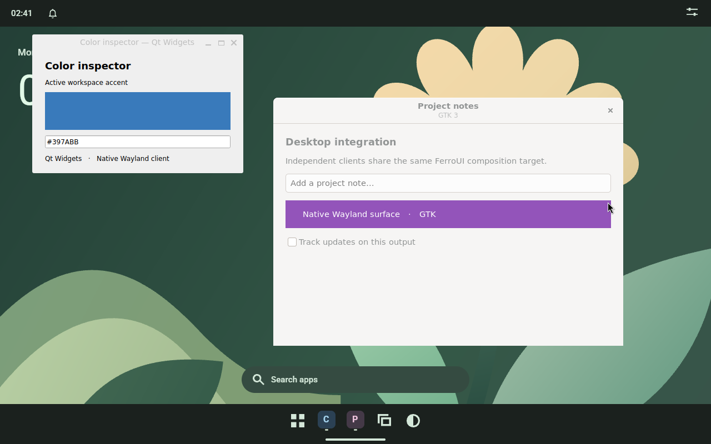
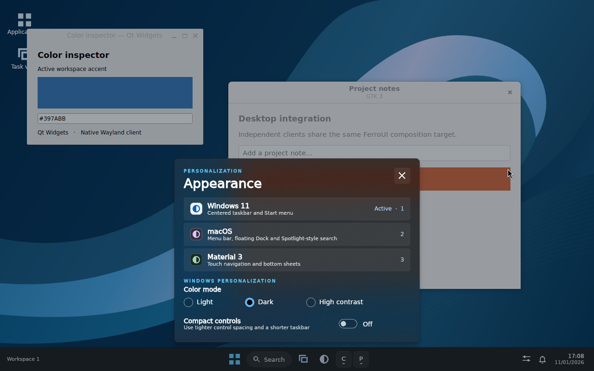
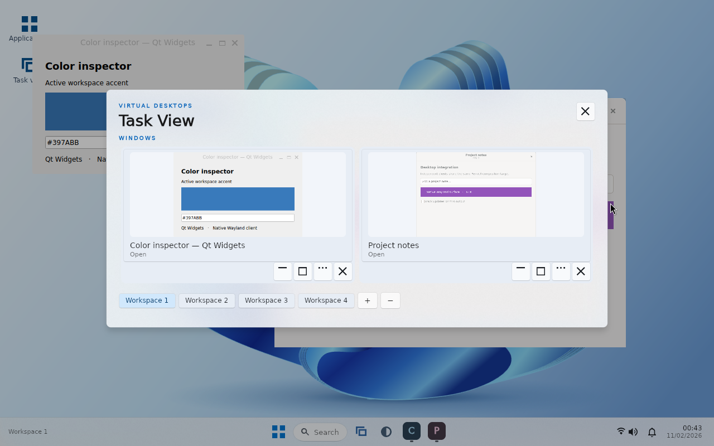
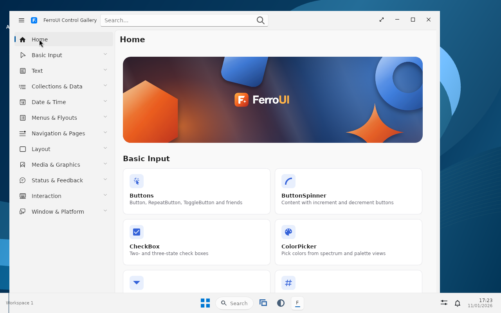

# FerroUI desktop composition

The FerroUI compositor mode combines the desktop and independent native Wayland windows in one retained FerroUI visual tree. Smithay implements the child Wayland display, xdg-shell roles and seat. FerroUI owns client placement, stacking, workspaces, hit testing and composition. The Graphite presenter sends the finished output to a host window. In the dedicated login, Sway supplies the physical seat, fullscreen output window and secure lock surface.

## Run it

Start a composited desktop in a window on your existing Wayland or X11 desktop. The shell prints its child socket name when ready. Supply an unused name to make it easy to connect an independent client. The socket lives in your existing `XDG_RUNTIME_DIR`.

```sh
samples/LinuxDesktop/build.sh run -- --compositor=ferro --socket=ferro-lab
```

In another terminal, connect applications to the new display.

```sh
env -u WAYLAND_SOCKET -u DISPLAY -u SWAYSOCK WAYLAND_DISPLAY=ferro-lab foot
env -u WAYLAND_SOCKET -u DISPLAY -u SWAYSOCK WAYLAND_DISPLAY=ferro-lab GDK_BACKEND=wayland gtk3-demo
```

The shell launcher uses a GIO launch context with the child display. Directly spawned applications receive their own environment. Existing single-instance applications on a shared D-Bus session can still route activation to a running instance. For a separate activation bus and the login keybindings, install the sample and run `ferro-desktop-wayland --ferro --nested`. To use the dedicated login, select **Ferro Desktop (FerroUI Compositor)** in the display manager. The supervisor sends the child display to D-Bus-activated applications in this session. It also routes **Super+Return** to a terminal inside the composed desktop.

## What gets composed

| Stage | Implementation |
| --- | --- |
| Client commit | The protocol worker reads ARGB8888 or XRGB8888 shared-memory buffers into owned premultiplied BGRA snapshots. It checks offsets, strides and lengths before copying and releases the client buffer after import. |
| Surface tree | Toplevels, synchronized subsurfaces and popups retain their protocol order and positioning. Hidden workspaces and minimized windows stay in the window model. Only visible surfaces enter the output scene. |
| FerroUI visuals | Each client surface has a retained `CompositionSurfaceVisual` and `CompositionDrawingSurface`. A new pixel revision updates the bitmap. Moving or raising the window changes visual properties or child order. |
| Presentation | The UI dispatcher coalesces commits. The renderer reports completion of the FerroUI composition batch to the protocol worker, which completes the matching Wayland frame callbacks. Skia Graphite on Vulkan is the default output renderer. `--software` selects raster explicitly. |
| Shell | The wallpaper sits below the clients. The taskbar, Dock, menus, launcher and passive notification banners sit above them. Fullscreen clients use the whole output. Appearance changes keep the client connections and visual layer alive. |

The input seat targets the topmost eligible client surface, including its popups and subsurfaces. On a native Wayland host, the seat receives the parent’s current XKB map, layout group, modifier state and evdev codes. The X11-hosted preview uses the default evdev layout. Child applications exchange clipboard selections over the private display. Use **Alt+primary drag** to move and **Alt+secondary drag** to resize a client. The task overview exposes activate, close, minimize, maximize, restore, snap, fullscreen and workspace operations. **Super+1–9** switches to an existing workspace and **Super+Shift+1–9** moves the focused client. **Super+Left/Right**, **Super+Up/Down** and **Super+F** control snap, maximize/minimize and fullscreen. A windowed host may reserve system shortcuts. Its shell controls provide the same operations. With a child focused, its own shortcuts, including Ctrl+W, go to that application.

The same GTK and Qt windows stayed mapped as the compositor switched from macOS to Material. Qt then received keyboard input and repainted its color swatch.

| macOS | Material |
| --- | --- |
| [](screenshots/compositor-macos-clients.webp) | [](screenshots/compositor-material-clients.webp) |

## WinUI appearance

Open Appearance in the Windows profile to select Light, Dark, High Contrast or Compact density. The shell installs FerroUI’s compiled WinUI theme, including all 95 control dictionaries merged by [WinUIControls.xaml](../../src/FerroUI.Themes.WinUI/Controls/WinUIControls.xaml) in this revision. Controls resolve semantic brushes, flyout materials and elevation from the active resources. Microsoft’s Windows App SDK hosts the Windows-specific WinUI runtime and interop APIs. Linux uses the FerroUI implementations. macOS and Material remain independent profiles. GTK and Qt clients draw their content and client-side decorations with their own toolkits. See [appearance profiles and extension points](APPEARANCE.md).

The dark WinUI personalization flyout below samples the actual GTK and Qt surfaces in the same output. These are independent application processes.



## Shell motion

Start and Windows system flyouts rise 14 DIPs over 155 ms. Spotlight and macOS system panels fade in over 105 ms. Material sheets enter from their anchored edge over 200 ms. Top shades descend 28 DIPs, and bottom sheets rise by the same distance. These are finite compositor key frames. Animating `Translation.Y` preserves the elevation in `Translation.Z`. The input target becomes available as soon as the sheet opens, and closing it immediately restores the underlying target. The shell skips entry motion in Windows High Contrast and when the active theme or platform disables animations.

### Wallpaper reuse on the composed output

The private compositor caches the static wallpaper in an output-scale FerroUI bitmap layer. Client damage and acrylic sampling can reuse that layer. The cache follows the output scale and extent. Delegated Wayland sessions already put the wallpaper on a separate surface.

Two alternating pairs of local Graphite development builds ran `tests/wayland-session.sh --ferro` with `FERRO_TEST_BENCHMARK=1` on the same 1280 × 800 headless Mesa software Vulkan output. Each run opened and closed Start ten times after two warm-up cycles, with independent GTK and Qt clients visible.

| Median command-to-captured-frame latency | Direct vector drawing | Cached wallpaper |
| --- | ---: | ---: |
| Open, first run | 329.1 ms | 231.0 ms |
| Open, second run | 348.4 ms | 235.5 ms |
| Close, first run | 164.6 ms | 163.5 ms |
| Close, second run | 168.8 ms | 134.2 ms |

Across 20 opens per configuration, the median fell from 339.7 ms to 234.5 ms. The measurement includes process startup, D-Bus, shell motion, composition and the screenshot observer. All four runs recorded zero shell CPU ticks during the five-second idle sample. The same 1,050 × 500 wallpaper crop matched pixel-for-pixel in both pairs.

## Live window previews

Open the window overview with **Super+Tab** in the composed session. Task View, Mission Control and Recents show each visible client from the same retained visual tree that presents it on the desktop. A toplevel has a container positioned at its xdg window geometry. Its surface, synchronized children and popups retain their local positions and stacking order. Popups can extend beyond that geometry on the desktop.

Each overview thumbnail binds a FerroUI `CompositionVisualSurface` to the client container. A uniformly scaled surface brush shows the window in its natural proportions, including portions obscured by other windows. The overview creates these brushes only while mounted. A client buffer update feeds both views through the existing drawing surface. The shell uses an icon for minimized clients and for clients owned by a separate compositor.

The capture below shows the Qt color inspector and GTK notes window. The GTK test client updated the purple swatch while the overview held keyboard focus. The compositor fixture checks both preview colors on the presented output.



## Scope

The child compositor exposes one logical output, native xdg-shell clients and shared-memory buffer import. Direct DMA-BUF import, DRM/KMS scanout, Xwayland, touch/tablet seats and a child screen-capture portal remain outside this mode. The Sway-managed login remains available for native multi-output management, Xwayland and portal integration. See [Wayland sessions](WAYLAND.md).

The integration tests use Sway’s headless backend, GTK 3, PyQt5/Qt Wayland, Pillow, Weston clients, grim, wtype, jq, ImageMagick, a C compiler, libwayland development files and wayland-scanner. The pointer fixture uses the wlr protocol XML from the Cargo registry or the installed wlr-protocols package. Run the tests with a Graphite development build.

```sh
samples/LinuxDesktop/build.sh build --profile dev
samples/LinuxDesktop/tests/ferro-compositor.sh target/debug/ferro-desktop /tmp/ferro-compositor
FERRO_TEST_BENCHMARK=1 samples/LinuxDesktop/tests/wayland-session.sh --ferro target/debug/ferro-desktop /tmp/ferro-composed-login
```

## Launch the WinUI Control Gallery

The existing Linux `control-catalog-desktop` sample can be installed as a separate application. Supply its executable as the installer’s optional second argument.

```sh
cargo build --release --locked -p control-catalog-desktop
sudo samples/LinuxDesktop/session/install.sh target/release/ferro-desktop target/release/control-catalog-desktop
```

Open Start and search for **FerroUI WinUI Gallery**. The desktop entry selects the catalog’s WinUI theme and native Wayland shared-memory presentation. The shell passes its child display to the launched process and composes the catalog’s buffers with Graphite. Controls inside that window belong to the catalog.



To reproduce the gallery capture, point the compositor test at both built executables. The test drives the production launcher, verifies the private socket and checks the stable external catalog on the parent output.

```sh
FERRO_TEST_CATALOG=target/release/control-catalog-desktop \
  samples/LinuxDesktop/tests/ferro-compositor.sh target/release/ferro-desktop /tmp/ferro-catalog-captures
```
