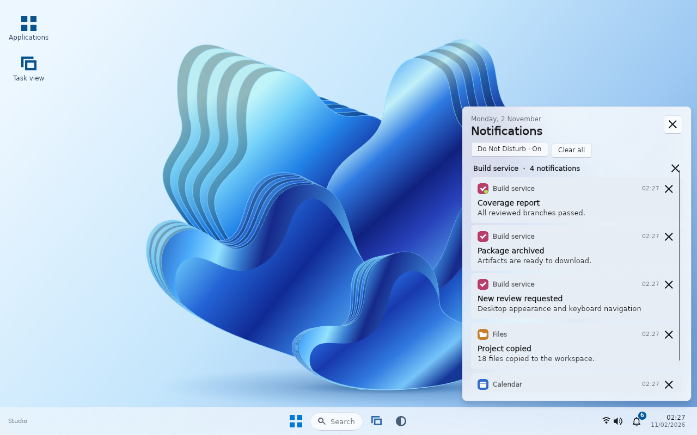
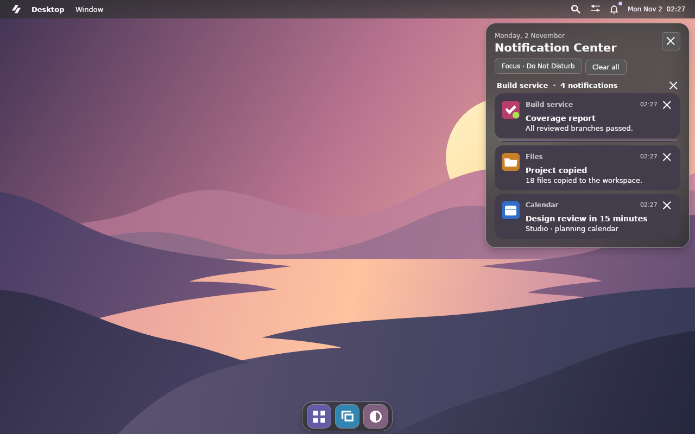
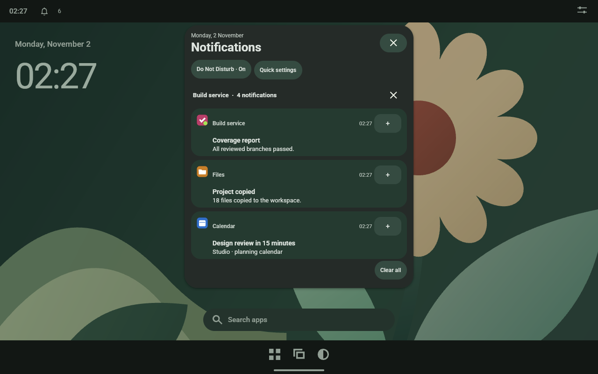

# Desktop notifications

The Ferro Desktop login session serves `org.freedesktop.Notifications` on the session bus. Existing clients can use libnotify, `notify-send` or the D-Bus interface directly.

```sh
notify-send --app-name="Build service" "Build succeeded" "All targets passed."
```

Open **Notifications** on the shell or press **Ctrl+N** with shell focus. **Do Not Disturb** silences banners for this session and keeps incoming messages in the center. **Clear all** dismisses active notifications and removes expired history. Windowed previews leave notification delivery with the current desktop.

| Appearance | Passive banner | Notification center |
| --- | --- | --- |
| Windows 11 | Lower right of the work area, above the taskbar | Sender sections show the three newest messages and a disclosure for older ones. |
| macOS | Upper right, below the menu bar | Stacks initially show the newest message. Expand a stack or clear the entire sender. |
| Material 3 | Centered below the status bar | The shade opens at the top. Expand a card for more text and actions, or swipe horizontally to dismiss it. Four or more messages from one sender form a group. |

Each notification shows its receipt time. The sender's icon uses the supplied icon name or file, with the installed application's icon from its `desktop-entry` hint as a fallback. Group identity also uses that hint, so two applications with the same visible name can be cleared independently. Pressing a notification title invokes its supplied `default` action.

## Native captures

These frames show the same independent D-Bus senders on the three desktop profiles. Their status artwork comes from the clients.

| Windows 11 Notification Center | macOS notification stack | Material notification shade |
| --- | --- | --- |
| [](screenshots/notifications.webp) | [](screenshots/macos-notifications.webp) | [](screenshots/material-notifications.webp) |

[Passive Windows banner over a focused client](screenshots/toast.webp)

## Delivery

- The server advertises plain-text bodies and actions. Selecting a button emits `ActionInvoked`. A non-resident notification then emits `NotificationClosed` with reason 2.
- Replacing an active identifier updates its content and restarts its timeout. `CloseNotification` explicitly retires an active identifier with reason 3. An invalid identifier produces a D-Bus error.
- Expiration emits reason 1. Normal notifications use six seconds when the client requests the server default. Critical notifications with the default timeout and notifications with timeout zero stay active until recalled, dismissed or evicted. Banners yield the screen after six seconds.
- Expired messages remain as text in the history unless the sender set the transient hint. Retired actions cannot be invoked. The session keeps up to 64 entries, evicting expired history before active notifications. Evicting an active notification emits reason 4.
- One dispatcher timer tracks the next deadline. An arrival that leaves the earliest deadline unchanged reuses that timer. Each incoming operation also reconciles overdue IDs if a busy UI delayed the timer. Native banner windows are created on demand and reused for replacements. The center pages through eight sender groups at a time. The server processes D-Bus calls in arrival order. When 128 outgoing signal batches are pending, new notifications receive the standard D-Bus limits error and action buttons pause until delivery resumes. Already accepted entries can still expire or close. The service does not queue for or replace the name of another notification daemon.

## Native validation

With the native test dependencies plus GLib's `gdbus`, X11's `xprop`, and ImageMagick installed, run the protocol and visual smoke test from the repository root.

```sh
samples/LinuxDesktop/tests/notifications.sh target/release/ferro-desktop /tmp/ferro-notifications windows
```

Pass `macos` or `material` as the last argument to exercise those profiles.

It creates a private display and session bus, launches independent clients, and checks notification replacement, action invocation, expiration, recall, Do Not Disturb, eviction and name release. The output includes the D-Bus signal trace and screenshots of the banner and center.

[Freedesktop desktop notifications protocol](https://specifications.freedesktop.org/notification/latest/protocol.html)
