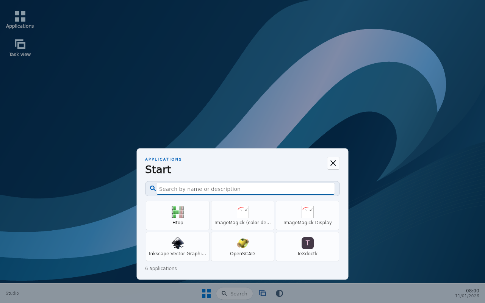
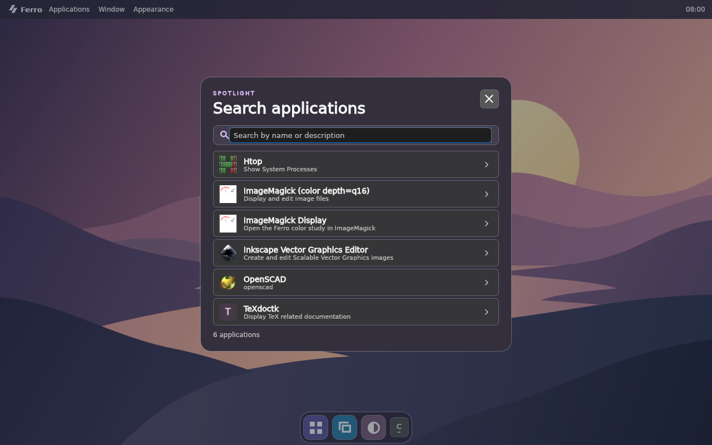
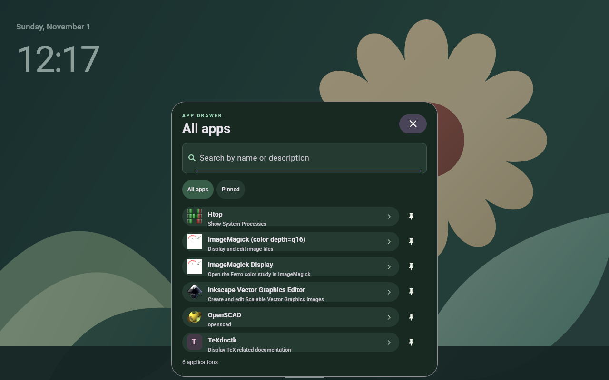
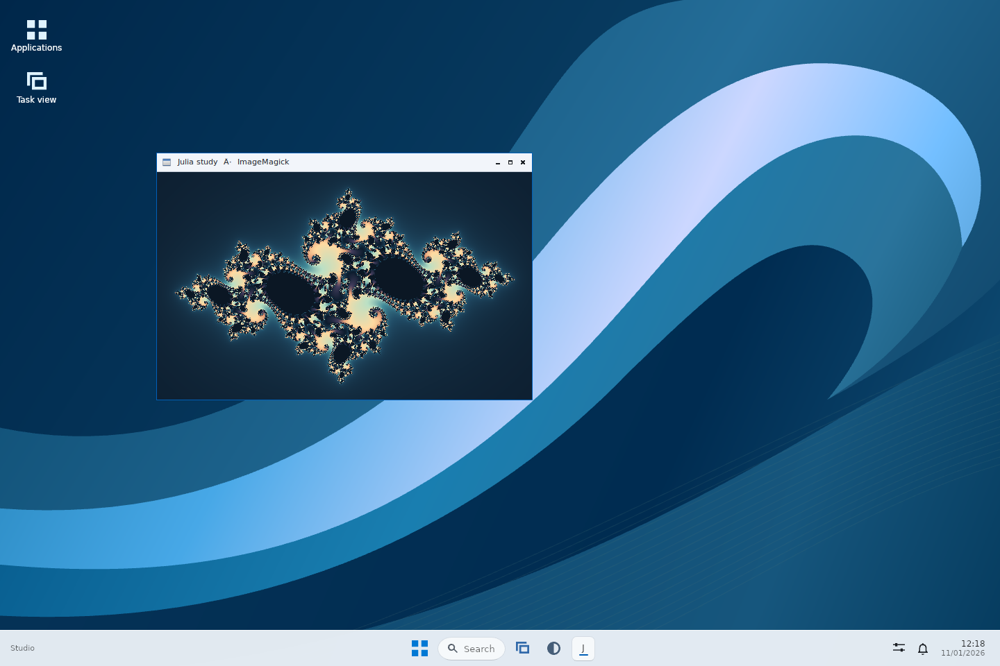
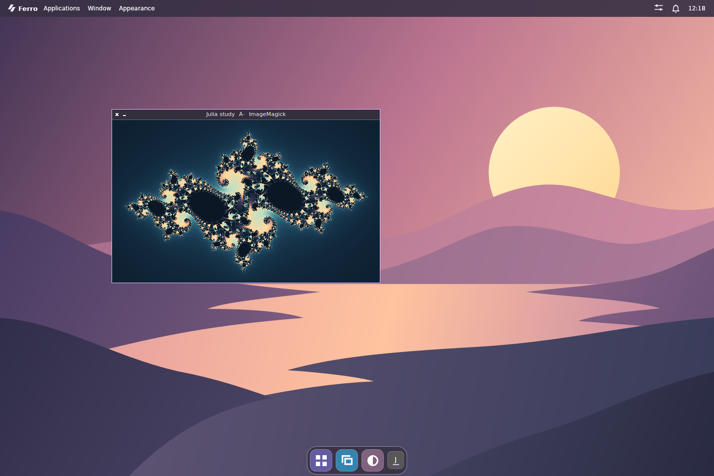
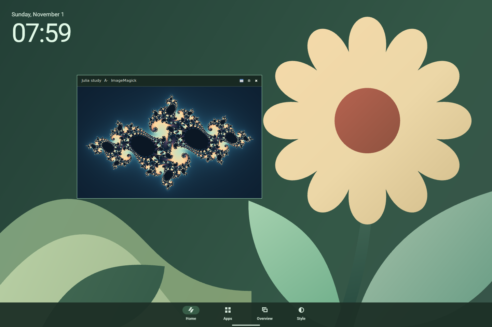
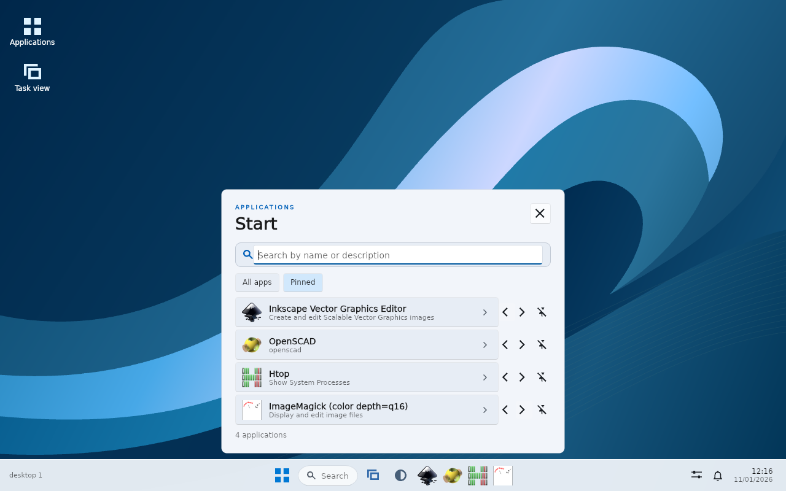
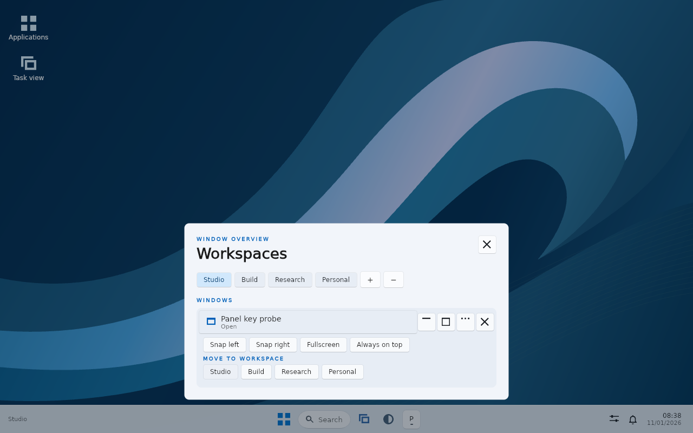
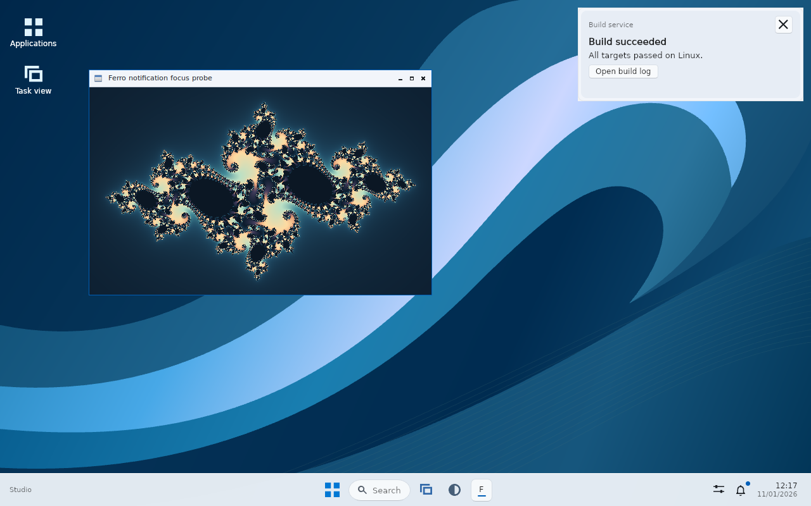
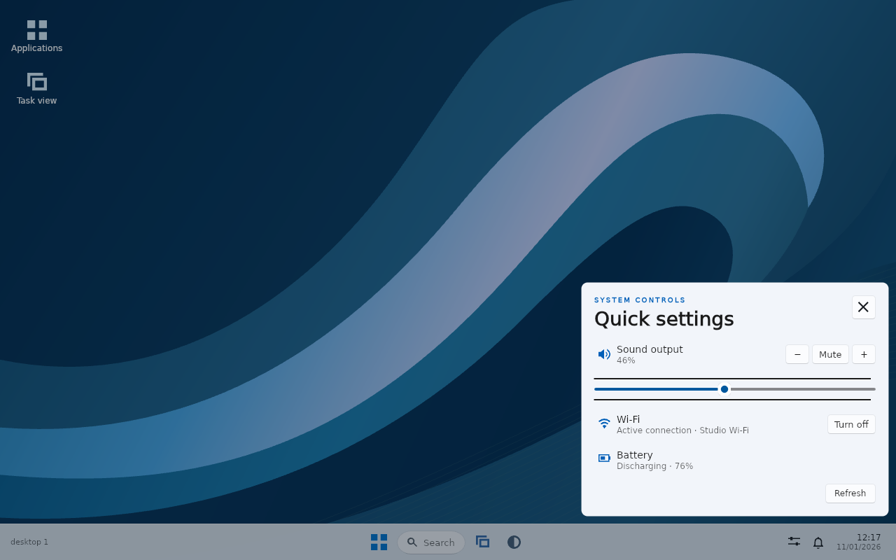

# Ferro Desktop

Ferro Desktop is a Linux desktop session built from FerroUI controls. The shell owns the desktop surface, application launcher and workspace overview. An EWMH window manager owns placement, stacking and focus of independent X11 clients. This boundary lets existing Linux applications participate without rendering their content a second time in the shell.

## Screenshots

These captures come from an X11 session running Skia Graphite on Mesa Lavapipe. The bottom row follows one ImageMagick window across three live appearance changes. The viewer displays a Julia set produced by the included test fixture.

| Windows 11 · WinUI 3 | macOS | Android · Material 3 |
| --- | --- | --- |
|  |  |  |
|  |  |  |

| Pinned apps | Window arrangement |
| --- | --- |
|  |  |
| **Notification banner above an active client** | **Quick Settings** |
|  |  |

The Quick Settings capture uses a real PulseAudio null sink and isolated NetworkManager and UPower test services. See the [notification center](screenshots/notifications.webp) for actions on earlier messages.

## Architecture

| Layer | Responsibility |
| --- | --- |
| Shell | Mount the visual tree once. Dispatch actions from buttons, search and keyboard input. |
| Applications | Discover the signed-in user's desktop entries and launch through Linux application services. |
| Window management | Observe the X server and delegate operations on real client windows to the window manager. |
| Presentation | Use FerroUI layout, text shaping, input, accessibility and the Skia compositor. Keep native graphics selection in the host. |

Windowed mode runs inside an existing X11 desktop. Login-session mode installs a desktop surface below application windows and uses the session window manager. The two modes share the same shell and application catalog.

## Run

From the repository root, start a windowed session with the default Windows appearance.

```sh
samples/LinuxDesktop/build.sh run
```

Open **Appearance** on the shell or press **Ctrl+,**. Choose Windows 11, macOS or Material 3. The taskbar, menus, dock, launcher and controls change in the running process. The shell saves the selection under the user's XDG configuration directory. Use `--theme` for a launch-specific override.

```sh
samples/LinuxDesktop/build.sh run -- --theme=macos
samples/LinuxDesktop/build.sh run -- --theme=material --scene=applications
```

| Appearance | Controls | Desktop |
| --- | --- | --- |
| Windows 11 (initial default) | FerroUI WinUI theme | Centered taskbar, Start grid and task view |
| macOS | FerroUI macOS theme | Menu bar, Dock and centered application search |
| Material 3 | FerroUI Material theme | Touch-sized bottom navigation and app drawer |

**Ctrl+K** opens applications. Type a name or part of a description, then press **Enter** to launch the first match. **Ctrl+W** opens the workspace and window overview. **Ctrl+Alt+1–9** selects a workspace where the window manager provides it. **Esc** dismisses the open surface.

## Everyday controls

| In the shell | Action |
| --- | --- |
| Ctrl+K or Ctrl+Space | Open the launcher. Pin an installed application to put it on the taskbar, Dock or Material home screen. |
| Ctrl+P / Ctrl+Shift+P in search | Pin or unpin the first result on the page / switch between all applications and pins. In the pinned list, Alt+Left or Alt+Right moves the entry. |
| Ctrl+W | Switch or create workspaces, arrange a client, or move it to a named workspace. The overview exposes actions supported by the window manager. |
| Ctrl+N | Read or dismiss notifications, invoke actions and toggle Do Not Disturb. Banners leave the active application's keyboard focus intact. |
| Ctrl+Shift+Q | Open Quick Settings. Adjust default audio output, toggle Wi-Fi and control available backlights. While open, M toggles mute, + and − change volume, and W toggles the wireless radio. |
| Ctrl+Shift+C, or the date and time | Open the native FerroUI calendar and browse months with the mouse or keyboard. |

The managed login session can provide the freedesktop notification service. Windowed previews share the surrounding desktop and leave its notification service alone. See [Notifications](NOTIFICATIONS.md) and [Windows and workspaces](WINDOWS.md).

Quick Settings reads the current default sink using WirePlumber or PulseAudio, including PipeWire's PulseAudio compatibility server. NetworkManager supplies radio state and the active connection. UPower supplies the display battery. Brightness uses the kernel backlight class and the current logind session's `SetBrightness` method. Device operations run outside the UI dispatcher. The panel refreshes while visible and reconciles changes with the provider's response.

## Login session

With Openbox in the session's PATH, install the release binary and choose **Ferro Desktop** from an X11 display manager.

```sh
samples/LinuxDesktop/build.sh
sudo samples/LinuxDesktop/session/install.sh target/release/ferro-desktop
```

The supervisor starts Openbox and the shell on the login display. The shell covers the primary screen and reserves space for the active appearance's panels. **Super+Space** reveals Start, **Super+A** opens Quick Settings, **Super+N** opens notifications, and **Super+Tab** opens the overview. These shortcuts work over a maximized client. Escape restores focus. The shell also updates the titlebars of windows decorated by the managed Openbox instance. Applications that draw their own titlebars control those pixels. Windowed mode leaves the surrounding desktop's work area alone.

## Renderer and validation

The build wrapper selects Skia Graphite on Vulkan for the shell. The recorder wraps a device-local FerroUI Vulkan image, restores its layout on the graphics queue and submits it to the existing swapchain presenter. Normal frames stay on the GPU. Pass `--software` to run the same visual tree using Skia raster.

The application catalog builds a trigram index for larger catalogs. Substring verification preserves match order and short, multiword and Unicode queries. Search pages mount a bounded number of controls. The window tracker coalesces X11 property notifications before updating the view. The clock schedules its next update at a minute boundary. Set `FERROUI_FRAME_TIMES=1` to collect the compositor's render-time distribution when the window closes.

For build prerequisites, the checked header download and local tests, see [Building](BUILDING.md). For details on adding a profile, see [Appearance profiles](APPEARANCE.md).
