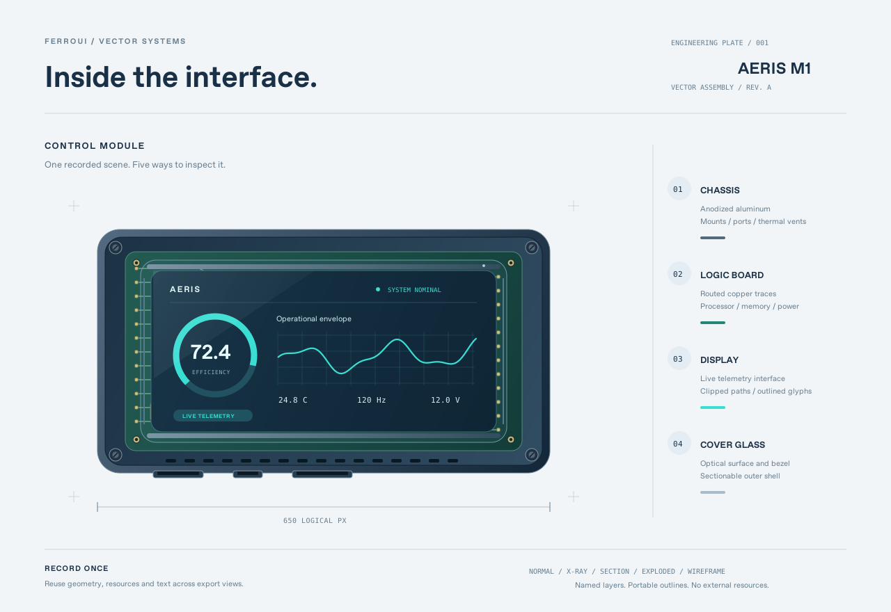

# Layered SVG export



This example records a 1280 × 880 technical illustration through FerroUI's
Skia drawing contracts and exports five views of the same retained document.
The generated SVGs contain named designer layers, portable glyph outlines,
editable geometry, gradients, clips and inspection annotations.

The executable source is
[`layered_export.rs`](../../src/Svg/FerroUI.Svg/examples/layered_export.rs).
The backend's API, fidelity policy and feature boundaries are described in
the [SVG backend documentation](../../docs/porting/svg-backend.md).

## Generated examples

| File | View | SVG bytes |
| --- | --- | ---: |
| [aeris-normal.svg](output/aeris-normal.svg) | Assembled module and telemetry interface | 561,105 |
| [aeris-xray.svg](output/aeris-xray.svg) | Transparent assembly fills with visible internal outlines | 580,237 |
| [aeris-cutaway.svg](output/aeris-cutaway.svg) | A section window removes the display and cover, exposing the board | 561,764 |
| [aeris-exploded.svg](output/aeris-exploded.svg) | Layers separated by declared depth, with guides and outlined labels | 617,246 |
| [aeris-wireframe.svg](output/aeris-wireframe.svg) | Assembly contours with fills removed | 575,584 |
| [aeris-normal.svgz](output/aeris-normal.svgz) | Deterministic gzip of the compact normal export | 140,877 |

Each view contains five semantic layers and 205 recorded drawing calls. The
scene has a plate, chassis, circuit board, display and cover glass. Common
`assembly` tags limit x-ray and wireframe treatments to the product; plate
typography remains unchanged. The `shell` tag selects the display and cover
for the cutaway. Layer depths and bounds determine the exploded positions.

The section is a 2D rectangular cut through selected layers. The exploded
view translates layers by their declared depth. These operations retain the
original recording and do not compute intersections of solid 3D meshes.

## Generate the files

From the repository root:

```sh
cargo run --locked -p ferroui-svg --example layered_export -- samples/SvgExport/output
```

The application initializes `SkiaPlatform`, records the layers once, exports
all five views, and writes the compact normal document as SVGZ. It uses
`SvgFidelity::VectorOnly`, so an operation requiring raster fallback fails
the example rather than silently changing the fixture's representation.

The example chooses available system fonts when recording. It tries Inter,
DejaVu Sans and Arial for its main labels, with a corresponding monospace
fallback. Generated files contain outlines, including automatic exploded-view
labels, so importing those files does not require the originating fonts.
Regenerating the fixture on a machine with different fonts can change its
appearance and byte counts. The fixed ASCII labels use direct glyph mapping;
applications should keep their FerroUI/HarfBuzz layout for shaped scripts.

## Independent renderer validation

[`validate_exports.py`](../../src/Svg/FerroUI.Svg/examples/validate_exports.py)
parses each SVG, rejects duplicate IDs and unresolved local references, then
renders the files through Inkscape at 96 DPI. It writes PNGs to a temporary
directory unless `--preview-dir` is supplied. Inkscape must be installed;
`--renderer /path/to/inkscape` selects another installation.

```sh
python3 src/Svg/FerroUI.Svg/examples/validate_exports.py samples/SvgExport/output
```

For a pixel comparison, generate a temporary Skia raster replay as well:

```sh
cargo run --locked -p ferroui-svg --example layered_export -- target/svg-validation --reference
python3 src/Svg/FerroUI.Svg/examples/validate_exports.py target/svg-validation --preview-dir target/svg-previews --max-mean-error 1
```

The reference exports every recorded layer through Skia's raster renderer
at one pixel per logical pixel. Inkscape composites that reference and
independently renders the vector SVG. The validator compares the resulting
full-page RGB pixels after compositing transparency on white. The optional
mean-error gate uses 0–255 channel values. Antialiasing differences between
renderers are expected; the gate is a chosen tolerance for this fixture.

Pillow and NumPy accelerate the comparison when installed. Both are optional:
the script also includes a standard-library reader for the noninterlaced
8-bit PNGs generated by Inkscape, plus a standard-library metric calculation.
That path can be exercised with `python3 -S`.

### Recorded validation

On Linux x86_64 with Inkscape 1.4, all five committed SVGs parsed and rendered
successfully. Every view contained five vector layers, zero image elements
and zero text elements. All labels, including generated annotations, were
outlined. Each document's local references resolved to unique IDs.

| Normal vector export versus Skia raster replay, 1280 × 880 | Measurement |
| --- | ---: |
| Mean absolute RGB channel error | 0.4837 / 255 |
| Root mean square RGB channel error | 4.8593 / 255 |
| Pixels with any channel difference greater than 16 | 0.9321% |

The Pillow/NumPy and standard-library comparison paths produced the same
reported metrics. The normal, x-ray, section, exploded and wireframe previews
were also visually inspected. This validates this illustration through
Inkscape; direct Figma and Illustrator import checks remain separate work.

## Measure export performance

The optional benchmark performs five warm-up exports and then times 100
compact exports of the retained document. All five layers reuse their cached
native SVG fragments after warm-up. The timed loop includes fragment parsing,
XML optimization, serialization and output allocation; it does not replay
the Skia pictures into native SVG again. It does not rerun layout, text shaping
or the render callbacks. Recording, font discovery, filesystem writes and
gzip compression are also outside the timed loop.

```sh
cargo run --locked --release -p ferroui-svg --example layered_export -- target/svg-benchmark --benchmark
```

For a smaller local build that optimizes the export and XML hot path while
reusing an existing development build of FerroUI:

```sh
cargo --config 'profile.dev.package.ferroui-svg.opt-level=3' \
      --config 'profile.dev.package.roxmltree.opt-level=3' \
      run --locked -p ferroui-svg --example layered_export -- target/svg-benchmark --benchmark
```

This second command uses a mixed profile: `ferroui-svg` and `roxmltree` are
compiled at optimization level 3, the remaining Rust dependencies retain
their development profile, and Skia uses its prebuilt native archive. Debug
assertions remain enabled, so the executable labels the run `debug`. It is
an export-focused measurement and should not be presented as a full-framework
release benchmark.

### Recorded measurement

The final generation on the Linux x86_64 validation host used the mixed
profile command above and the absolute-path compact output:

| Measurement | Result |
| --- | ---: |
| Warm compact export, minimum of 100 | 8.955 ms |
| Warm compact export, median of 100 | 10.768 ms |
| Warm compact export, 95th percentile of 100 | 14.415 ms |
| Compact SVG before gzip | 557,836 bytes |
| Compact SVGZ | 140,877 bytes |

For context, initial scene recording took 13.64 ms, and the first normal SVG
export took 110.93 ms, including native Skia SVG replay and writing the file.
Those are separate one-shot observations, not warmed export measurements.
The warm timing does not describe cold end-to-end rendering or a full release
build, and it is specific to this scene and validation host.

Compact output removes formatting whitespace while preserving numeric
precision and absolute path encoding. `relative_paths` is an explicit
export option whose effect depends on the paths: it can enlarge raw SVG.
For this illustration, an earlier relative-path compact export measured
588,155 uncompressed bytes, exceeding the 561,105-byte formatted normal
document, although it compressed to a smaller 82,829-byte SVGZ. Absolute-path
compact output measured 557,836 bytes and compressed to 140,877 bytes. This
demonstrates that raw size and gzip size can favor different encodings;
relative path encoding is consequently an explicit workload-dependent choice.

The final SVGZ decompressed successfully, its timestamp field was zero, and
its parsed SVG tree matched the formatted normal document after removing
formatting whitespace. All five regenerated SVG files were byte-identical to
the files used for the renderer comparison and visual inspection above.
