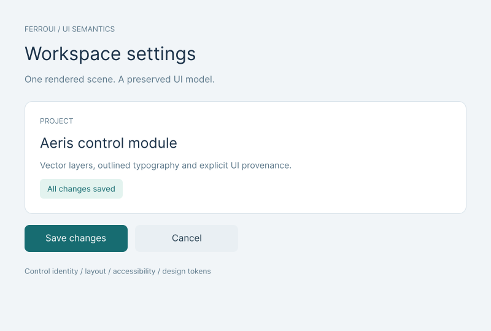

# UI semantics example



This is a laid-out FerroUI control tree, rendered once through the Skia-backed SVG backend. The
same retained recording produces a plain SVG and a semantic SVG. The semantic version preserves
20 UI nodes while keeping the complete scene in one vector compositing layer. Its visible text
is outlined using the embedded Inter font; its metadata independently retains readable labels.

| Artifact | Purpose | Bytes |
| --- | --- | ---: |
| [workspace-settings.svg](workspace-settings.svg) | Vector artwork plus the complete selected UI manifest | 237,241 |
| [workspace-settings-plain.svg](workspace-settings-plain.svg) | The same recording with semantics disabled | 209,876 |
| [workspace-settings.svgz](workspace-settings.svgz) | Reproducible gzip of the semantic SVG | 72,656 |
| [workspace-settings.ui.json](workspace-settings.ui.json) | Deterministic JSON extracted from the embedded manifest | 53,388 |
| [workspace-settings.png](workspace-settings.png) | Inkscape preview, 800 × 540 | 48,829 |

The manifest adds 27,365 bytes of uncompressed XML for this example. All files are self-contained;
viewing the SVG does not require Inter to be installed. The metadata namespace and source URI are
identifiers, not resources fetched while viewing the artwork.

## What the example retains

The tree contains Border, StackPanel, TextBlock and Button controls. Each node has an application
key, runtime type, visual parent, any in-snapshot logical/template relationships, layout bounds,
local-to-layer matrix and source visual/input state. Layout includes desired size, margin,
constraints, alignment and validity. This example explicitly enables display-text and automation
peer capture. Its buttons therefore retain role/name/automation ID descriptors and template-part
relationships even though Skia renders their chrome and text as ordinary vector geometry.

The customization callback uses unique control names as application keys. On `SaveButton` it also
supplies an authored source URI and three typed properties:

```json
{
  "key": "SaveButton",
  "type": "Button",
  "properties": {
    "command": { "type": "string", "value": "SaveWorkspace" },
    "design-token.background": { "type": "string", "value": "AccentPrimary" },
    "test-selector": { "type": "string", "value": "workspace.save" }
  }
}
```

These values are supplied by the application; the exporter does not inspect or invoke command or
binding objects. The semantic graph is explicitly associated with the layer, not with invented
per-control path groups. See the [API and vocabulary guide](../../../docs/porting/svg-semantics.md)
for coordinate conventions, content selection, persistent identity, limits and compositor usage.

## Reproduce

From the repository root:

```sh
cargo run --locked -p ferroui-svg --example semantic_export -- samples/SvgExport/semantics
python3 src/Svg/FerroUI.Svg/examples/read_ui_semantics.py \
  samples/SvgExport/semantics/workspace-settings.svg \
  --output samples/SvgExport/semantics/workspace-settings.ui.json
```

The [Rust example](../../../src/Svg/FerroUI.Svg/examples/semantic_export.rs) initializes the SVG
platform, HarfBuzz and embedded Inter font collection, creates explicit button templates, measures
and arranges the tree, and records it in strict `VectorOnly` mode. It reports 15 drawing calls,
one semantic layer, 20 semantic nodes and one prepared-vector cache hit on the semantic export
after the plain export. No raster fallback, SVG image element or visible SVG text element occurs.

The [Python reader](../../../src/Svg/FerroUI.Svg/examples/read_ui_semantics.py) uses only the standard
library. It validates the version-one vocabulary, node counts, typed fields, IDs, relationships,
ancestry and metadata/layer consistency before writing JSON. Fields excluded during export remain
absent. Its output contains no local input path and can be used by a separate design/inspection
tool without reparsing the vector path data.

## Validation

Both SVGs were independently rendered at 96 DPI with Inkscape 1.4. Their decoded **800 × 540 RGBA
pixels are identical**. The preview was visually inspected. The semantic SVG and its SVGZ also
decompress to identical bytes. Exact file and pixel fingerprints are recorded in
[validation.json](validation.json).

To repeat the pixel comparison with Inkscape and Pillow installed:

```sh
inkscape samples/SvgExport/semantics/workspace-settings.svg \
  --export-filename=semantic.png --export-dpi=96
inkscape samples/SvgExport/semantics/workspace-settings-plain.svg \
  --export-filename=plain.png --export-dpi=96
python3 - <<'PY'
from PIL import Image
with Image.open("semantic.png") as a, Image.open("plain.png") as b:
    assert a.size == b.size == (800, 540)
    assert a.convert("RGBA").tobytes() == b.convert("RGBA").tobytes()
print("Exact RGBA agreement")
PY
```

The complete SVG library suite passes 133 tests with default features and 133 with `media3d`.
The 21 added Rust regressions cover snapshot capture, content projection, transform conventions,
stable references, invalid/bounded input, inspection/raster behavior and prepared-cache reuse.
The new reader passes 12 focused Python tests; the existing renderer-validator tests add three.
Strict all-target/all-feature Clippy and formatting checks pass. Direct Figma/Illustrator import
and preservation of custom metadata by those editors were not exercised.
